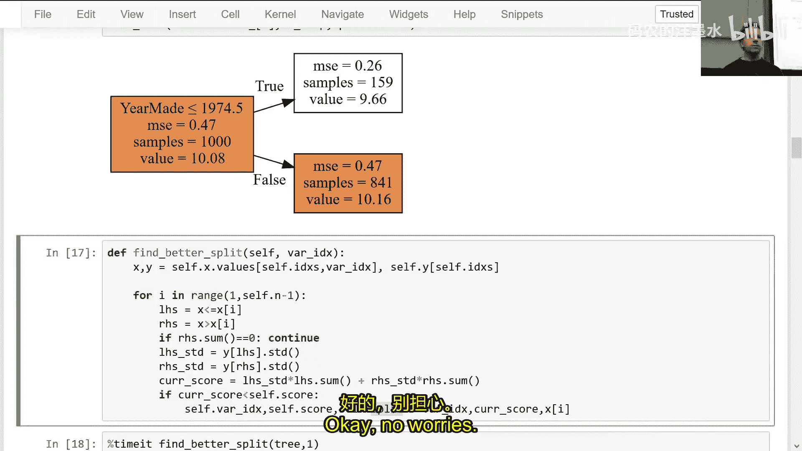
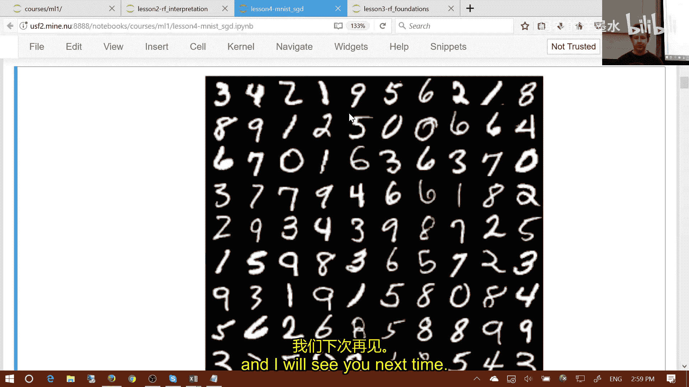

# 【全集】旧金山大学-面向程序员的机器学习-中英字幕-1080P-p07-Lecture-7---射频和梯度下降--BV1YAvYBAEG3_p7-

Welcome back。 We're going to be talking today about。

Random forests we're going to finish building our own random forest from scratch。

 but before we do I wanted to tackle a few things that have come up during the week a few questions that I've had and I want to start with kind of the position of random forests in general so we spent。

About half of this course doing random forests and then after today the second half of this course will be neural networks broadly defined。

呃。This is because these two represent like the two key classes of techniques which cover nearly everything that you're likely to need to do。

 random forests belong to the class of techniques of decision tree ensembles。

Along with gradient boosting machines being the other key type and some variants like extremely randommo trees。

They诶。Have the benefit that they're highly interpretable， scalable， flexible。

 work well for most kinds of data， they have the downside that they don't extrapolate at all to like。

Data that's outside the range that you've seen as we looked at at the end of last week's session。嗯。

But know they're a great starting point。I think， you know， there's a huge catalog。

Both machine learning tools out there and like a lot of courses and books。

Don't attempt to kind of curate that down and say， like for these kinds of problems， use this。

 for these kinds of problems， use that finished， you know， but they're rather like。

Here's a description of 100 different algorithms。And。You just don't need them， you know。

 like I don't see why you would ever use support vector machine today， for instance。

 like no no reason at all I could think of doing that people loved studying them in the 90s because they are like very theoretically elegant and like you can really write a lot of math about support vector machines and people did but you know in practice I don't see them as having any place。

嗯。So there's like a lot of techniques that you could include in an exhaustive list of every way that people have looking machine learning problems。

But I would rather tell you like how to actually solve machine learning problems in practice。

 I think you know we're about to finish today the first class which is you know one type of decision tree ensembles in part two。

 Anneette will tell you about the other key type there being gradient boosting and we're about to launch next lesson into neural nets。

 which includes all kinds of GLM， rid regression， elastic net laso。Logistic aggression， et cetera。

 are all variants of neural nets。嗯。You know， interestingly。Leo Bman， who created random forests。

 did so very late in his life and unfortunately passed away not many years later。嗯。

So partly because of that， very little has been written about them in the academic literature。

 partly because SPMs were just taken over at that point， you know， other people didn't look at them。

嗯。And also， like just because they're like quite hard to grasp at a theoretical level。

 like analyze them theoretically。 It's quite hard to write conference papers about them or academic papers about them。

 So there hasn't been that much written about them。

 But there's been a real researchsurgence not researchurgence a new wave in recent years of empirical machine learning。

 like what actually works。 Kagggels been part of that。 but also just part of it has just been like。

Companies using machine learning to make shitloads of money like Amazons on and Google。

And so nowadays a lot of people are writing about decision tree ensembles and creating better software for decision tree ensembles like GBM and XGBst and Ranger for R and psyic learn and so forth but a lot of this is being done in industry rather than academia but you know it's encouraging to see there's certainly more work being done in deep learning than in decision tree ensembles。

 particularly in academia， but there's a lot of progress being made in both。

 you know if you look at like，Of the package is being used today for decision tree ensembles。

Like all the best ones， the top five or six， I don't know that any of them really existed。

fiive years ago， you know， maybe other than like SKL or even three years ago。

 so yeah that's been good， but I think there's a lot of work。ItsStill to be done we talked about。

 for example， figuring out what interactions are the most important last week and some of you pointed out in the forums that actually there is such a project already for gradient boosting machines which is great but it doesn't seem that there's anything like that yet for random forests and you know random forests do have a nice benefit over GBMs that they're kind of。

Harder to screw up， you know， and easier to scale。So hopefully that's something that this community might help fix。

Another question I had during the week was about the size of your validation set。

 how big should it be？So like to answer this question about how big does your validation set need to be。

 you first need to answer the question。How。How accurate do I need。

 How precisely do I need to know the accuracy of this algorithm， right so like。

If the validation set that you have is saying like this is 70% accurate。And if somebody said。

 well is it 75% or 65% or 70% and the answer was I don't know anything in that range is close enough like that would be one answer whereas else if it's like is it 70% or 70。

01% or 69。99% like then that's something else again right so you need to kind of start out by saying like how how accurate do I need this so like for example。

 in the deep learning course we've been looking at dogs versus cats images and the models that we're looking at had about a 99。

For 99。5% accuracy on the validation set。And our validation set size。Was a。2000。Okay， in fact。

 let's do this in Excel， that'll be a bit easier。So our validation set。Size was 2000。

And our accuracy was 99。4%。Right， so the number of incorrect。Is something around。

1 minus accuracy times n。So we were getting about 12 wrong。Right。嗯。And the number of cats we had。

Is half。And so the number of wrong cats is about。6。Okay。

 so then like we we run a new model and we find instead。That the accuracy has gone to 99。2%。

And then it's like， okay， is this less good at finding cats， that it's like， well。

 it got two more cats wrong。So it's like， probably not。Right， so。But then it's like。

 well does this matter， theres 99。4 versus 99。2 matter。

 and if this was like it wasn't about cats and dogs， but it was about finding fraud。

RightThen the difference between a 06% error rate and a 0。

8% error rate is like 25% of your cost of fraud。So like that can be huge like it' was really interesting like when IageNet came out earlier this year。

 the new competition results came out。😊，And the accuracy had gone down from 3%。

So the error went down from 3% to 2% and I saw a lot of people on the internet。

 like famous machine learning researchers being like，M。

 some Chinese guys got it better from like 97% to why 98% is like statistically。

 not even significant who cares kind of a thing。But actually， I thought like。Holy crap。

 this Chinese team just blew away the state of the art and image recognition。

 like the old one was 50% less accurate than the new one。

 Like that's that's actually the right way to think about it， isn't it because it's like。You know。

 we were trying to recognize， you know like。Which tomatoes were ripe and which ones weren't？

And like our new approach， you know， the old approach， like 50% of the time。

 more was like letting in the unrie tomatoes。Or， you know， 50% more of the time。

 we were like accepting fraudulent customers。 like that's a really big difference。

So just because like this particular validation set we can't really see6 versuss a doesn't mean the 。

2% different isn't important， it could be， so my kind of rule of thumb is that this like this number of like how many observations you actually looking at。

 I want that generally to be somewhere higher than 22。

W 22 because 22 is the magic number where the T distribution roughly turns into the normal distribution so as you may have learned。

 the T distribution is is the normal distribution for small data sets and so in other words。

 once we have 22 of something or more kind of start to behave。Kind of。

Normally in both sense of the words， like it's kind of more stable and you can kind of understand it better。

That's my magic number when somebody says do I have enough of something I kind of start out by saying like do you have 22 observations of the thing of interest so if you're looking at like。

Lung cancer， you know， and you had a data set that had like 1 thousand0 people without lung cancer and 20 people with lung cancer。

 I'd be like， I very much doubt we're going to make much progress， you know。

 because we haven't even got 20 of the thing you want。So ditto with a validation set。

 if you don't have 20 of the thing you want， that it's very unlikely to be useful。

 or if like at the level of accuracy we need， it's not plus or minus 20。

 it's just it's that's the point where I'm thinking like。

Be a bit careful so just to be clear you want 22 to be the number of samples in each set like in the validation that test in the train or so what I'm saying is like if there's if there's less than 22 of a class in any of the sets then it's it's going to get it's getting pretty unstable at that point right and so like that's just like the first rule of thumb but then what I would actually do is like start practicing what we learn about the。

Pomial distribution， or actually vet distribution。 So what's the。

What is the mean of the binomial or distribution of N samples and probability P？N times p， okay。

 thank you， n times p is our mean。So if you've got a 50% chance of getting ahead and you toss it 100 times on average。

 you get 50 heads and then what's the standard deviation？And pay one minus pay。Okay。Okay。

 so these are like。Two numbers Well， the first number you don't really have to remember it's intuitively obvious。

 The second one is one that try to remember forever more because not only does it come up all the time。

 the people that you work with will all have forgotten it So you'll be like the one person in the conversation who could immediately go we don't have to run this 100 times I can tell you straight away it's by nomi or it's going to be NPQ NP when going speak。

Then there's the standard error。The standard error is if you run a bunch of trials each time getting a mean。

 what is the standard deviation of the mean？I don't think you guys have covered this yet。

 is that right？对。So this is really important because this means like if you train 100 models。😊。

Each time the validation set accuracy is like the meaning of a distribution。

 and so therefore the standard deviation of that validation set accuracy it can be calculated with the standard error and this is equal to the standard deviation divided by square root。

And。so this tells you， so like one approach to figuring out like is my validation set big enough is train your model five times？

With exactly the same hyperparameters each time and look at the validation set accuracy each time and you know there's like a mean and a standard deviation of five numbers you could use or a maximum and minimum you can use。

But to save yourself some time， you can figure out straight away that like， okay， well， I have a 0。

99。Accuracy as to you know whether I get the cat correct or not correct。

 so therefore the standard deviation is equal to 0。99 times 0。01。Okay， and then I can get the。

Standard error。Of that right so basically the size of the validation set you need。It's like。

However big it has to be such that your insights about its accuracy are good enough for your particular business problem and so like I say like the simple way to do it is to pick a validation set of like a size a thousand0。

 train five models and see how much the validation set accuracy varies and like if it they're all close enough for what you need then you're fine if its not maybe you should make it bigger。

Or maybe you should consider using cross validation。Instead。Okay， so like as you can see。

 it really depends on what it is you're trying to do。😊。

How common your less common class is and how accurate your model is。

 could you pass that back to Melissa please？Thank you。

 I have a question about the less common classes， if you have less than 22。

 let's say you have one sample of something， let's say it's a face and I only have one representation from that particular country。

 do I toss that into the training set and it adds variety do I pull it out completely out of the data set or do I put it in a test set instead of the validation set？

So you certainly couldn't put it in the test or the validation set because you're asking I mean in general because you're asking can I recognize something I've never seen before but actually this question of like can I recognize something I've not seen before。

 there's actually a whole class of models specifically for that purpose it's called either one shot learning which is you get to see something once and then you have to recognize it again or zero shot learning which is where you have to recognize something you've never seen before。

 we're not going to cover them in this course。😊，But that can be useful for things like face recognition。

 you know， like is this the same person I've seen before and so generally speaking obviously for something like that to work。

 it's not that you've never seen our face before it's that you've never seen Melissa's face before you know and so you see Melissa's face once and you have to recognize it again。

Yeah， so in general， you know， your validation set and test set need to have the same。

Mix or frequency of observations that you're going to see in production in the real world。

And then your training set should have an equal number in each class， and if you don't。

 just replicate the less common one。Until it is equal so this I think we've mentioned this paper before。

 a very recent paper that came out， they tried lots of different approaches to training with unbalanced data sets and found consistently that oversling the less common class until it is the same size as the more common class is always the right thing to do。

嗯。So you could literally copy， you know， so like I've only got a thousand you know。

 10 examples of people with cancer and 100 without， so I could just copy those 10。

And other you 90 times。That's kind of a little memory inefficient。

 so a lot of things including I think SK learns random forests have a class wes parameter that says each time youre bootstping or resampling。

 I want you to sample the less common class with a higher probability or did if you're in doing deep learning you know。

 make sure in your mini batch it's not randomly sampled but it a stratified sample or the less common class is picked more often。

Okay， okay。So let's get back to finishing off。Our random forests and so what we're going to do today is we're going to finish off writing our random forest and then after your your after today your homework will be to take this class。

And to add to it all of the random forest interpretation algorithms that we've learned okay so obviously to be able to do that you're going to need to totally understand how this class works so please you know ask lots of questions as necessary as we go along。

So just to remind you。We're doing the bulldozers kigle competition data set again。

 we split it as before into 12，000 validation， the last 12000 records and then just to make it easier for us to keep track of what we're doing we're going to just pick two columns out to start with yearmade and machine hours on the me and so what we did last time was we started out by creating a tree ensemble and the tree ensemble had a bunch of trees which was literally a list of。

And trees， trees where each time we're just called Cre T。系。

And createreate tree contained a sample size number of random indexes。

And this one was drawn without replacement。So remember bootstrapping means sampling with replacement so normally with Psyit learn if you've got N rows。

 we grab N rows with replacement， which means many of them will appear more than once。

 so each time we get a different sample， but it's always the same size as the original data。

 and then we have our set RF samples function that we can use which does with replacement sampling of less than N rows。

 this is doing something again， which is it sampling without replacement。

Sample size rows okay because we're permuting the numbers from n to self dot y minus1 and then grabbing the first self dot sample size of them actually there's a faster way to do this you can just use NP。

random。 choiceice which is a slightly more direct way but this way works as well。All right。

 so this is our random sample for this one of our and trees trees。

And so then we're going to create a decision tree。And our decision tree， we don't pass at all of x。

 we pass it the specific indexes and remember x is a pandas data frame。

 so if we want to index into it with a bunch of integers。

 we have to use IL integer locations and that makes it behave indexing Y just late lumpey。

Our y vector is nuy， so we can just index into it directly。

 and then we're going to keep track of our minimum leaf size。

And so then the only other thing we really need in ensemble is somewhere way to make a prediction and so we were just going to do the mean。

😊，Of the tree prediction。For H tree。Alright， so that was that。

 And so then in order to be able to run that。We need a decision tree class because it's being called here and so there we go。

Okay， so that's the starting point。So。The next thing we need to do is to flesh out our decision tree。

 so the important thing to remember is all of our randomness happened back here in the tree ensemble。

The decision tree class we're going to create。Doesn't have randomness in it。

Okay so right now we are building a random deregressor right so that's why we are taking the mean of the tree the outputs if we work to work with classification do we take the max like the classifier will give you either zeros or ones No I would still take the mean so the so each tree is going to tell you what percentage of that leaf node contains cats and what percentage contains dogs so then I would average all those percentages and say across the trees on average there is 19% cats。

😊，And 81% dogs。Good question。 So， you know。Random tree classifiers are almost identical or can be almost identical。

 the random tree regresses。The technique we're going to use to build this today will basically exactly work for classification certainly for binary classification you can do with exactly the same code。

 for multiclass classification， you just need to change your data structure so that like you have like a one hot encoded matrix or a list of integers that you treat as a one hot encoded matrix。

Okay。So our decision tree。So remember our idea here is that we're going to like try to avoid thinking so we're going to basically write it as if everything we need already exists Okay so we know from when we created the decision tree。

 we're going to pass in the X the y and the minimum leaf size so here we need to make sure we've got the X and the y and the minimum leaf size okay so then there's one other thing which is as we split our tree into subtes。

 we're going to need to keep track of。Which of the row indexes went into the left hand side of the tree。

 which went into the right hand side of the tree， Okay so we're going to have this thing called indexes。

As well， right， So at first， we just didn't bother passing in indexes at all。

 So if indexes is not passed in， if it's none， then we're just going to set it to。

The entire length of y right so NP。 a range is the same as just range in Python。

 but it returns a nu array right so the root of a decision tree。Contains all the rows。

 that's the definition really of the root of a decision tree， so all the rows is row naught， row 1。

 row 2， etca up to row y minus1。And then we're just going to store away all that information that we were given。

We're going to keep track of how many rows are there and how many columns are there。

So then the every leaf and every node in a tree has a value。 it has a prediction。

 and that prediction is just equal to the average。Of the dependent variable。Okay。

 so every node in the tree。Yhy indexed with the indexes is。

The values of the dependent variable that are in this branch of the tree， and so here is the mean。诶。

Some nodes in a tree also have a score which is like how effective was the split？Here right。

 but that's only going to be true if it's not a leaf node right a leaf node has no further splits and at this point when we create a tree。

 we haven't done any splits yet， so its score starts out as being infinity。

So having built the root of the tree， our next job is to find out which variable should we split on and what level of that variable should we split on。

 so let's pretend that there's something that does that。Fine， basket。So then we're done。😊，Okay， so。

How do we find。A variable to split on。So well， we could just go through H。Potential variables。

 so C contains the number of columns we have， so go through each one and see if we can find a better split than we have so far。

On that column。Okay， now notice this is like。Not。The full random forest definition。

 this is assuming that max features is set to all right remember。

 we could set max features to like 0。5 in which case we wouldn't check all the numbers from notugh to sea。

 we would check half the numbers at random from notugh to see。 So if you want to turn this into like。

A random forest that has the max features support， you could easily like add one line of code to do that。

 but we're not going to do it in our implementation today。Okay。

So then we just need find better split and since we're not interested in thinking at the moment for now。

 we're just going to leave that empty， all right。So。

The one other thing I like to do with my kind of when I start writing a class is I like to have some way to print out what's in that class and so if you type print followed by an object or if it' Jupyter notebook you just type the name of the object。

嗯。At the moment it's just printing out underscore， underscore main。

 underscore underscore do decision tree at blah， blah blah。

 which is not very helpful right so if we want to replace this with something helpful。

 we have to define the special Python method name Dunder Retra。

To get a representation of this object。 So when we， when we basically just。

Write the name like this behind the scenes it calls that function and the default implementation of that method is just to print out this unhelpful stuff so we can replace it by instead saying let's create a format string where we're going to print out n and then show n and then print vow and then show v okay so how many。

How many rows are in this node and what's the average of the dependent variable？

Then if it's not a leaf node， so if it has a split。

Then we should also be able to print out the score。The value was split out。

And the variable that we split on。Now， you'll notice here。Self。s leaf S leaf is defined as a method。

 but I don't have any parentheses after it。This is a special kind of method called a property。

And so a property is something that kind of looks like。A regular variable。

 but it's actually calculated on the fly。 So when I call this leaf， it actually calls this function。

 right， But I've got this special decorator。Property okay。

 and what this says is basically you don't have to include the parentheses when you call it。

Okay and so it's going to say all right， is this a leaf or not。

 so a leaf is something that we don't sp on， if we haven't sp on it。

 then its score is still set to infinity， so that's my logic。😊，Does that make sense。

So this at notation is called a decorator， it's basically a way of telling Python more information about your method。

Does anybody here remember where you have seen decorators before？Let me pass it over here。Yeah。

 where have you seen where have you seen decorators before tell us more about flask and how it uses decor the at appel？

Yeah， what does that do I forgot Okay so how to describe it no worries so flask so anybody who's done any web programming before with something like flask or a similar framework would have had to have said like this method is going to respond to this bit of the URL and either to post or to get and he put it in a special decorator so。

😊，Behind the scenes， that's telling Python to treat this method in a special way。

 So here's another decorator。 Okay and so you know if you get more advanced with Python。

 you can actually learn how to write your own decorators， which， as was mentioned， you know。

 basically insert some additional code。 but for now just no there's a bunch of predefined decorators we can use to。

😊，Change how our methods behave and one of them is our property。

 which basically means you don't have to put parentheses anymore。

 which of course means you can't add any more parameters beyond self。Yeah。Why， if it's not a leaf。

 why is this square infinity， because doesn't infinity mean you're at the root？No。

 infinity means that you're not at the root， it means that you're at a leaf。

 so the root will have a split， assuming we find one but everything will have a split till we get all the way to the bottom。

 the leaf and so the leaves will have a score of infinity because they won't split。Great。All right。

So that's our decision tree， it doesn't do very much。

 but at least we can like create an ensemble right 10 tree sample size a thousand right and we can like print out so now when I go m to zero it doesn't say blah。

 blah， blah blah blah it says。What we asked it to say， n colon 1000， foul colon 10。808。

 and this is a leaf because we haven't sp on it yet， so we've got nothing more to say。Okay， so then。

The indexes are all the numbers from north 1000。OkayBecause the base of the tree has everything。

 this is like everything in the random sample that was passed to it because remember by the time we get to the point where it's a decision tree where we don't have to worry about any of randomness in the random forest anymore。

All right， so。Let's try to write。The thing which finds a split。 Okay， so we need to implement。

Findine better split。 Okay， And so it's going to take the index of a variable， variable number one。

 variable number3， whatever。 And it's going to figure out。What's the best split point？

Is that better than any split we have so far and for the first variable。

 the answer will always be yes because the best one so far is none at all。

 which is infinity bad okay？😊，So let's start by making sure we got something to compare to。

 so the thing we're got to compare to will be psychic loans random first。

And so we need to make sure that Cyyt Learns random For gets exactly the same data that we have。

 so we start out by creating ensemble。Grab a tree out of it and then find out which particular random sample of X and Y did this tree use？

Okay， and we're going to store them away so that we can pass them to Psyit La so that we have exactly the same information。

So let's go ahead and now create a random forest using psyic Learn， so one tree。One decision。

 no bootstrapping。 So whole the whole data set So this should。

Be exactly the same as the thing that we're going to create this tree。系。So let's try。

So we need to define。Find better split。Okay， so find better split takes a variable。Okay。

 so let's define。our X independent variables and say okay， well it's everything inside our tree。

 but only those indexes that are in this node， which at the top of the tree is everything and just this one variable。

Okay， and then for our Y's， it's just whatever our dependent variable is at the indexes in this node。

 Okay， so there's our x and Y。So let's now go through every single value。In our independent variable。

And so I'll show you what's going to happen， so let's say our independent variable is EMA。诶。

And not going to be in order。Right， and so we're going to go to the very first row and we're going to say。

 okay， year made here is three right And so what I'm going to do is I'm going to try and calculate。

The score if we decided to branch on the number three so I need to know which rows are greater than three。

 which rows are less than an equal to three and they're going to become my left hand side and my right hand side right and then we need a score so there's lots of scores we could use so in random forest we call this the information gain right the information gain is like how much better does our score get because we split it into these two groups of data there's lots of ways we could calculate it Gny cross entropy it means squared error whatever。

If you think about it， there is an alternative formulation of root mean squared error which is mathematically the same to within a constant scale。

 but it's a little bit easier to deal with， which is we're going to try and find a split。

Wwhich causes the two groups to each have as lower a standard deviation as possible so like I want to find a split that puts all the cats over here and all the dogs over here right so if these are all cats and these are all dogs then this has a standard deviation of zero and this has a standard deviation of zero whereas this is like a totally random mix of cats and dogs this is a totally random mix of cats and dogs。

 they're going to have a much higher standard deviation。That makes sense。

 and so it turns out if you find a split that minimizes those group standard deviations or specifically the weighted average of the two standard deviations。

 it's mathematically the same as minimizing the rip mean squared error。

 that's something you can prove to yourself after class if you want to。

All right so we're going to need to find first of all split this into two groups so where's all the stuff that is greater than three so greater than three is this one this one and this one so we did the standard deviation of that。

So let's go ahead and say standard deviation。Of greater than3， that one。That one。And that one， okay。

And then the next will be the standard deviation of。Less than or equal to three。

 so that would be that one， that one， that one。And then we just take the weighted average of those two。

 and that's out score。That would be our score if we split on three。

So that makes sense and so then the next step would be try of split on four， try splititting on one。

 try splititting on six。Redundantly try split on four again。

Redundantly tries putting on one again and find out which one works best。

So that's our code here is we're going to go through every row and so let's say okay。

 left hand side is any values in x that are less than or equal to this particular value。

Our right hand side is every value in x that are greater than this particular value。Yeah。Okay。Okay。

 so what's the data type that's going to be in LHS and RHS， what are they actually going to contain？

They're going to be a raise， a raise of what。Rs of row of bullions， Yeah。

 which we can treat as0 and one。 Okay， so LHS will be an array of。

False every time it's not less than or equal to and true otherwise， and RHS will be a boian array of。

The opposite， okay。And now we can't take a standard deviation of an empty set。

So if there's nothing that's greater then。This number， then these will all be false。

 which means the sum will be zero。And in that case。

 let's not go any further with this step because there's nothing to take the standard deviation of at it's obviously not a useful split。

Okay， so assuming we've got this part， we can now calculate the standard deviation of the left hand side。

and of the right hand side and take the weighted average or the sums the same thing to a scalar right and so there's our score and so we can then check is this better than our best score so far and our best score so far we initially initiallyized it to infinity right so initially this is better。

So if it's better， let's store away。Well of the information we need。

 which variable has found this better split？What was the score we found and what was the value that we split on？

Okay， so there it is。So if we run that。And I'm using time it。

 so what time it does is it sees how long this command takes to run and it tries to give you a kind of statistically valid measure of that。

 so you can see here it's run run at 10 times。To get an average。

 and then it's done that seven times to get a mean and standard deviation across runs。

 and so it's taking me 75 milliseconds plus or minus 10。ok。

So let's check that this works find but split tree0， so zero is year made。

 one is machine H current meter。So with one。We got back Mach hours current meter。

 3744 with this score， and then we ran it again with zero that's year made and we got a better score 658 and split 1974 and so in 1974 let's compare。

Yep， that was what this tree did as well， okay， so we've got we've confirmed that this method is doing is giving the same result that SKL's Random For did。

And you can also see here the value 10。08。And again， matching here， the value 10。08。Okay。

 so we've got something that can find one split， could you pass that to yournet please。So Jeremy。

 why don't we put a unique on the X there？Because I'm not trying to optimize the performance yet。

 but you see that no like he is doing more Yeah so it's like you can see in the Excel I like checked this one twice。

 I checked this for twice unnecessarily yeah。Okay， so。

And so youette are already thinking about performance， which is good。

So tell me what is the computational complexity？Of this。Section of the code。 and， and like。

 have a think about it。 but also， like， feel free to talk us through it if you want to kind of。

Think and talk at the same time。So what's the computational complexity of this piece of code？

Can I pass it over there， yes。All right， Jayde， take us through your thought process I think you have to take each different values through the column to calculate it。

Once to see the splits。 So and then compare all the like all the possible combinations between these different values so that can be expensive。

 Like because you're can you or does somebody else want to tell us the actual computational complexity。

 So like， yeah， quite high。 Jade's thinking how high。嗯。I think it's n squared。 Okay。

 so tell me why is it n squared。 because for the full loop， it is N Yes。

 and I think I guess the standard deviation will take in。 So it's n square。 Okay。

 or this one maybe it's even easier to know like this is like which one's less than X。

 I'm going to have to check every value it's less than X Okay， and so。So it's useful to know like。

How do I quickly calculate computational complexity I can guarantee most of the interviews you do are going to ask you to calculate computational complexity on the fly and it's also like when you're coding you want it to be second nature so the technique is basically is there a loop okay then we're obviously doing this n times okay so there's an n involved is there a loop inside the loop if there is then you need to multiply those two together in this case there's not。

Is there anything inside the loop that's not a constant time thing so you might see a sort in there and you just need to know that sort is n log n like that should be second nature if you see a matrix multiply you need to know what that is in this case there are some things that are doing elementwise array operations so keep an eye out for anything where nuy is doing something to every value of an array in this case is checking every value of x against a constant so it's going to have to do that n times so to flesh this out into a computational complexity you just take the number of things in the loop and you multiply it by the highest computational complexity inside the loop n times n is n squared you pass that。

In this case， couldn't we just presort the list and the do like one n log n computation there's lots of things we can do to speed this up so at this stage it's just like what is the computational complexity we have but absolutely it's certainly not as good as it can be okay so that's where we're going to go next just like all right n squared is not is not great so let's try and make it better。

嗯。So here's my attempt at making it better。And the idea is this， okay。

 who wants to first of all tell me what's the equation for standard deviation？M， any craps the folks。

So for the standard division， it's the difference between the value and its' mean。

 It's we take a square root of that。 Sorry， we take the。

The power of two then we sum up all of these observations and we take the square roots out of all this sum Yeah you have to divide divide by n to great good okay。

 now in practice we don't normally use that formulation because it kind of requires us calculating you know x minus the mean lots of times does anybody know the formulation that just requires x and x squared。

😊，Anybody happen to know that one， Yes at the back turn'll pass that back there。

Square root of a mean of squares minus。Squared of mean。 Yeah， great。

 mean of squares minus the square of the means。 Al right， So that's a really good one divided by。

 that's a really good one to know， because like you can now calculate。😊。

Varances or standard deviations of anything， you just have to first of all grab the column as it is。

The column squared right and as long as you've got those stored away somewhere you can immediately calculate the standard deviation so the reason this is handy for us is that if we first of all sort our data right？

So let's go ahead and sort our data。Then if you think about it。

 as we kind of start going down one step at a time。

Then each group is exactly the same as the previous group on the left hand side with one more thing in it。

 and on the right hand side with one less thing in it。

And so given that we just have to keep track of sum of x and sum of x squared。

 we can just add one more thing to x， one more thing to x squared on the left and remove one thing on the right so we don't have to go through the whole lot each time and so we can turn this into a order N algorithm so that's all I do here is I sort the data right and I're going to keep track of the count of things on the right。

The sum of things on the right and the sum of squares on the right。And initially。

 everything's in the right hand side。Okay， so initially n is the count。

Y sum is the sum on the right and y squared sum is the sum of squares on the right and then nothing is initially on the left。

 so it's zeros okay and then we just have to loop through。H observation， right， and。

Add one to the left hand count， subtract one from the right hand count。

 add the value to the left hand count， subtract one from the right hand count。

Add the value squared to the left hand， subtract it from the right hand。Okay。Now。

 we do need to be careful though， because if we're saying less than or equal to one。

 say we're not stopping here， we're stopping here， like we have to have everything in that group。

So the other thing I'm going to do is I'm just going to make sure that the next value is not the same as this value。

 if it is， I'm going to skip over it right so I'm just going to double check。

That this value and the next one aren't the same。So as long as they're not the same。

 I can keep going ahead and calculate my standard deviation now passing in the count。

 the sum and the sum squared， right， and there's that formula。😊，Okay， the summer squared。

Divided by the square of the sum， sorry minus the square of the sum。Yeah。

Do that for the right hand side。 And so now we can calculate the weighted average score just like before。

 And all of these loans are now the same。 Okay， so we've turned our order。

And squared algorithm into an order N algorithm。 And in general。

Stuff like this is going to get you a lot more value than like pushing something onto a spark cluster or ordering faster RA or using normal cores in your CPU or whatever right this is the way you want to be you know improving your code and specifically。

Write your code right without thinking too much about performance， run it。

 is it fast enough for what you need then you're done if not。Profile it， right， So in Jupiter。

 instead of saying percent time it， you say percent P run。

And it will tell you exactly where the time was spent。😡，In your algorithm。

 and then you can go to the bit that's actually taking the time and think about like， okay， is this。

Is this algorithmically as efficient as it can be？Okay， so in this case， we run it。

And we've gone down from 76 milliseconds to less than two milliseconds and now some people that are new to programming think like。

 oh great， I've saved 60 something milliseconds but the point is this is going to get run。

Like tens of millions of times okay so the 76 millisecond version is so slow that it's got to be impractical for any random forest you use in practice right whereas the one milliseconds version I found is actually quite quite acceptable。

And then check the numbers should be exactly the same as before， and they yeah， okay。

So now that we have a function find better split that does what we want。

 I want to insert it into my decision tree class， and this is a really cool Python trick。

 Python does everything dynamically right so we can actually say。The method called find better split。

In decision tree。Is that function I just created。And that like sticks it inside that class。

I'll tell you what's slightly confusing about this is that this thing， this word here。😊。

And this word here， they actually have no relationship to each other。

 They just happen to have the same letters in the same order right So like I could call this find better split underscore F。

Right， and then I could like call that。And call that。

 so now my function is actually called find better split underscore fu， but my method。

I'm expecting to call something called Decree。finebe split。so here I could say decision tree。

 find better split equals find better split_ food。Okay， you see that's the same thing。 so like。

It's important to understand how namespaces work like in every language that you use one of the most important things is kind of understanding how it figures out what a name refers to so this here means find better split as defined find inside this class right and nowhere else right well。

 I mean a parent class but never mind about that this one here means find better split fo in the global namespace a lot of languages don't have a global name space。

 but Python does okay and so the two are like even if they happen to have the same letters in the same order they're not referring in any way to the same thing。

That makes sense it's like。This family over here may have somebody called Jeremy and my family has somebody called Jeremy and our names happen to be the same。

 but we're not the same person， okay？Okay。Okay， so now that we've stuck the decision tree， sorry。

 the fine better split method inside the decision tree with this new definition when I now call the tree ensemble constructor。

That a tree ensemble instructor called Create Tree。Create tree instantiated decision tree。

Decision tree called fine vase split， which went through every column to see if it could find a better split。

And we've now defined， find better split。And therefore， tree ensemble， when we create it。

 has gone ahead and done the split。That makes sense anybody have any questions or uncertainties about that。

 like we're only creating one single split。So far。All right。

 so this is pretty pretty neat right we kind of just do a little bit at a time testing everything as we go and so as you all implement the random forest interpretation techniques。

 you may want to try programming this way to like every step check that you know what you're doing matches up with what psychic Learn does or with a test that you've built or whatever。

So at this point， we should try to go deeper up。Very inception， right。

 so let's go now max depth is two。And so here is what psychic learned did after breaking at year May 74。

 it then broke at machine hours Meter 2956。 So we had this thing called。Find vase split。

We just went through every column and tried to see if there's a better split there but actually we need to go a bit further than that。

 not only do we have to go through every column and see if there's a better split in this node。

But then we also have to see whether there's a better split。

In the left and the right sides that we just created。In other words。

 the left right side and the right hand side should become decision trees themselves so there's no difference at all between what we do here to create this tree and what we do here to create this tree other than this one contains 159 samples and this one contains 1000。

Okay。So this row of codes exactly the same as we had before。😊，Okay， and then we check， actually。

 we could do this a little bit easier， we could say if self dot。Is leaf。would be the same thing。Okay。

 but I'll just leave it here for now。 So is self score。 So if the score。It's infinite still。

 in fact let's write it properly。His wave。So let's go back up and just remind ourselves。

Is leaf is self that score equals in， okay？So since it's there， we might as well use it。

 so if it's a leaf node。Then we have nothing further to do right so that means we're right at the bottom there's no split that's been made Okay。

 so we don't have to do anything further On the other hand。

 if it's not a leaf node so it's somewhere back earlier on。

Then we need to split it into the left hand side and the right hand side。

Now earlier on we created a left hand side and a right-hand side array of boions right now better would be to have here would be have an array of indexes and that's because we don't want to have a full array of all the balloleanions in every single node right because remember although it doesn't look like there are many nodes when you see a tree of this size when it's fully expanded。

😊，The bottom level， if there's a minimum leaf size of one， contains the same number of nodes as。

The entire data set。 And so if every one of those contained a full Boolean array of size of the whole data set。

 you've got squared memory requirements， which would be bad。 On the other hand。

 if we just store the indexes that the things in this node。

 then that's going to get smaller and smaller。Okay。So NP。

 non0 is exactly the same as just this thing which gets the Booleion array。

 but it turns it into the indexes of the trues Okay。

 so this is now a list of indexes for the left hand side。And indexes to the right hand side。

So now that we have the indexes the left hand side and the right hand side。

We can now just go ahead and create a decision tree， so there's a decision tree for the left。😊。

And there's our decision tree for the right。Okay， and we don't have to do anything else we've already written these。

We already have。A constructor that can create a decision tree。

So like when you really think about what this is doing， it kind of hurts your head， right because。

The reason， the whole reason that fine vsp got cold。I's because。Find vase split。

Is called by the decision tree Conor。But then the decision tree then fine v split itself then causes the decision tree constructor。

 so we actually have circular recursion。And I'm not nearly smart enough to be able to think through recursion。

 so I just choose not to right like I just write what I mean。And then I don't think about it anymore。

😡，Like what do I want， well to find a variable split， I'm going to go through every column。

 see if there's something better。If it managed to do a split。

 figure out left hand side of the right hand side and make them into decision trees。

Okay like now try to think through how these two methods call each other would just drive me crazy but I don't need to right I know I have a decision tree constructor that works and I know I have a fine vase bit that works so that's it right that's how I do recursive programming is by pretending I don't just ignore it that's my advice a lot of you are probably smart enough to be able to think through it better than I can so that's fine if you can right so now that I've written that again I can patch it into the decision tree class。

And as soon as I do， the tree ensemble constructor will now use that right because Python's dynamic。

 right， that just happens automatically。So now I can check my left hand side。Should have 159 samples。

And a value of 9。66。There it is， 159 samples， 9。66 right hand side。8ight41， 10。15。

The left hand side of the left hand side。150 samples， 9。62。1und50 samples，9。62。 Okay。

 so you can see it like。I'm because I'm not nearly clever enough to write machine learning algorithms like not only can I not write them correctly the first time often like every single line I write will be wrong right so I always start from the assumption that the line of code I just typed is almost certainly wrong and I just have to see why and how right and so like I just make sure and so eventually I got to the point where like much to my surprise it's not broken anymore you know so here I can feel like okay this it would be surprising if all of these things accidentally happen to be exactly the same as I could learn so this is looking pretty good。

喂。So now that we have something that can build a whole tree。

 we want to have something that can calculate predictions。And so to remind you。

 we already have something that calculates predictions for a tree ensemble by calling tree dot predict。

But there is nothing called tree dot predict， so we're going to have to write that。Okay。😊。

To make this more interesting， let's start bringing up the number of columns that we use。嗯。

Let's create our tree ensemble again， and this time let's go to a maximum depth of three。Okay。

 so now our tree is getting more interesting。And let's now define how do we？

Create a set of predictions for a treat。And so a set of predictions for a tree is simply the prediction for a row for every row。

That's it， right， that's our predictions， so the predictions for a tree are every rose predictions。

And on a array。 Okay， So again， we're like。Skipping thinking， thinkings hard， you know。

 so let's just like keep pushing it back。嗯。This is kind of handy， right， Notice that you can do for。

Blair in array with anumpier array， regardless of the rank of the array。

Regardless of the number of axes。In the array。 And what it does is it will loop through the leading axis these these concepts are going to be very。

 very important as we get into more and more neural networks because we're going to be all doing tensor computations all the time。

 So the leading axis of a vector is the vector itself， the leading access of a matrix are the rows。

 the leading access axis of a three dimensionmenal tensor， the matrices that represent the slices。

And so forth， right。 So in this case， because x is a matrix， this is going to look through the rows。

 And if you write your。Kind of tensor code this way。

 then it'll kind of tend to generalize nicely to higher dimensions。

 like it doesn't really matter how many dimensions are in x。

 this is going to loop through each of the leading axis。Okay， so we can now call that decision tree。

t predict。Okay。All， so all I need to do is write predict row and I've delayed thinking so much。

 which is great that the actual point where I actually have to do the work。

 it's now basically trivial。😊，So if we're at a leaf node， then the prediction is just equal to。

Whatever that value was。Which we calculated right back in the original tree construct。

 it's just just the average of the wise， right？If it's not a leaf node。

 then we have to figure out whether to go down the left hand path or the right hand path to get the prediction right。

If。This variable in this row is less than or equal to the thing the amount we decided to split on。

Then we go down the left path。Are there ways we go down the right path？Okay。

And then having figured out what path we want， which tree we want。

 then we can just call predict row on that， right and again。

We've accidentally created something recursive。And again， I don't want to think about。How that。

Works control flow wise or whatever， but I don't need to because I just it just does like I just told it what I wanted。

 so I trust it to work right， if it's a leaf， return the value。

 otherwise return the prediction for the left hand side or the right hand side as appropriate。即。😊。

Notice this here。This if。Has nothing to do with。This if。AllThis if is a control flow statement。

That tells Python to go down that path or that path to do some calculation。This， if is。An operator。

That returns a value。So those of you that have done C or C plus plus will recognize it as being identical to that it's called the Ternary operator if you haven't that's fine basically what we're doing is we're going to get a value where we're going to say it's this value if this thing is true。

And that value otherwise。And so you could write it。

This way but that would require writing four lines of code to do one thing and also require you to have code that if you read it to yourself or to somebody else is not at all naturally the way you would express it right I want to say the tree I' going to go down is the left-hand side if the variables less than the split or the right- hand side otherwise right so I want to write my code the way I would think about or the way I would say my code so this kind of turnernary operator can be quite helpful for that。

All right。So now that I've got a prediction for a row， I can dump that into my class。

And now I can create calculate predictions。😊，And I can now plot my actuals against my predictions。

When you do it， get a plot。You'll often have a lot of dots sitting on top of each other so a good trick is to use alpha Al means how transparent the things。

 not just in matpllib but like in every graphics package in the world pretty much and so if you set alpha to less than one then this is saying you would need 20 dots on top of each other for it to be fully blue and so this is a good way to kind of see。

How much things are sitting on top of each other so it's a good trick， good trick for scatter plots。

😊，There's my asd， not bad。诶。And so， let's now go ahead and。To a random forest。诶。

With no maximum of spitting。And our tree ensemble had no maximum amount of spidding we can compare our R squared。

To they're r squared and so they're not the same， but actually oursal is a little better。

 so I don't know what we did differently， but we'll take it。Okay。

 so we have now something which for a forest with a single tree in is giving as good accuracy on a validation set using an actual real world data set。

 you know， bubble of bluedos compared to psychic line。So let's go ahead and round this out。

So what I would want to do now is to create a package that has this code in。

 and I created it by like creating a method here， a method here。

 a method here and patching them together。 So what I did with now is I went back through my notebook and collected up all the cells that implemented methods and posted them all together right And I've just posted them down here。

 So heres this is my original tree ensemble。😊，And here is all the cells in the decision tree。

 I just dumped them all into one place without any change。So that was it。

 That was the code we wrote together。 So now I can go ahead and I can create a。Tray ensemble。

I can calculate my predictions。 I can do my scatter plot。 I can get my R squared， right。

 and this is now with。5 trees。Right and here we are。

 we have a model of blueduc for bulldozers with a 71% icequad with a random forest we wrote entirely from scratch。

So that's pretty cool。Any questions about that， and I know there's like quite a lot to get through so during the week feel free to ask on the forum。

😊，About any bits of code you come across， Can somebody pass the box to Masha， there it is。Yeah。

Can we get back to the probably to the top of maybe。At the decision tree。

 when we set the score equal to infinity， right， do we calculate this this score？For that， I mean。

 like， I lost track of that。 and specifically， I wonder。When we implement。

When we implement find var split， we check for self score equal to whether it's equal to infinity or not。

 to me， it seems like unclear whether we fall out of this。

 I mean like if we ever implement the method if if our initial value is infinity。

So okay let's talk through the logic so the decision tree starts out with a score of infinity。

 so in other words at this point when we've created the node there is no split。

So it's infinitely bad。Okay， so that's why the score is infinity。

 and then we try to find a variable and a split。That is better。And to do that。

 we loop through each column and say， hey， column， do you have a split which is better than the best one we have so far？

And so then we implement that。Let's do the slow way since it's a bit simpler。Findine better split。

 we do that by looping through each row。And finding out， this is the current score if we split here。

 is it better than the current score， The current score is infinitely bad， so yes， it is。

 And so now we set the new score equal to what we just calculated and we keep track of which variable we chose and the split we split on。

Okay， no worries。

Okay， great， let's take a five minute break and I'll see you back here at 22。

嗯。对。So when I tried comparing the performance of this。Against Psyt Learn， this is quite a lot slower。

And the reason why is that although like a lot of the work's been done by Nmpay。

 which is nicely optimized sea code， think about like the very bottom level of a tree。If we've got。

A million data points and the bottom level of the tree has something like 500，000。

Decision points with a million leaves underneath right， and so that's like。500。

000 split methods being called each one of which contains multiple calls to nuumpy。

 which only have like。One item that's actually being calculated on and so it's like that's like very inefficient and it's the kind of thing that Python is particularly not good at performance wise right like calling lots of functions lots of times I mean we can see it's it's not bad right you know for a kind of。

A random forest which 15 years ago would have been considered pretty big。

 this would be considered pretty good performance， right， but nowadays this is。

Some hundreds of times at least slower than it should be so。

What the psychic Learn folks did to avoid this problem was that they wrote their implementation in something called Cyython。

And Cyython is a superet of Python。So any Python you've written。Pretty much。You can use as cython。

 right？But then what happens is Python runs it in a very different way。

 rather than passing it to the kind of the Python interpreter， it instead converts it to C。

Compilees that and then runs that C code which means the first time you run it。

 it takes a little longer because it has to go through the kind of translation and compilation。

 but then after that it can be quite a bit faster。And so I wanted just to quickly show you what that looks like because。

嗯。You are absolutely going to be in a position where Cyython is going to help you with your work and most of the people you're working with will have never used it may not even know it exists。

 and so this is like a great superpower to have。So to use siphon in the notebook， you say load X。

 load extension，phon，And so here's a Python function。Tpe 1。Okay。Here is the same as a cphon function。

It's exactly the same thing with percent percent siphon at the top。

This actually runs about twice as fast。As this， but just because it does the compilation。

Here is the same version again， where I've used a special cen extension called C depth。

 which defines the C data type of the return value and of each variable。And so basically。

 that's the trick that you can use to start making things。Run quickly， right， And at that point。

 now it knows it's not just some。Python object， called。T， in fact。

 I probably should put one here as well。Let's try that， so we've got Fb2， we've call that Fb3。

So for F three。Yeah， so it's exactly the same as before but we say what the data type of the thing we passed to it was is and then define the data types of each of the variables and so then if we call that。

Okay， we've now got something that's 10 times faster right so yeah。

 it doesn't really take that much extra and it's just it's just Python with a few little bits of markup。

 So that's like its it's good to know that that exists because。If there's something custom。

 you're trying to do。It's actually I find it kind of painful having to go out and you know go into see and compile it and link it back and all that whilst doing it here is pretty easy Can you pass that just to your right please Musha？

😊，So when you're doing like for the con version of it。

 So in the case an array or an MP array does is a specific C type of。 Yeah， So there's like a lot of。

Specific stuff for integrating Python with NI and there's a whole page about it Yeah so we won't worry about going over it but you can read that and you can basically see the basic ideas there's this C import which basically imports a certain types of Python library into the kind of the C bit of the code and you can then use it in your sithon。

Yeah， it's。That's pretty straightforward。Oh， good question。 Thank you。 All right， So your。

 your mission now。😊，Is to implement。Confidence based on trade variant。Feature importance。

 partial dependence and tree interpreter。For that random first。

Removing redundant features doesn't use a random forest at all so you don't have to worry about that extrapolation is not an interpretation technique so you don't have to worry about that so it's just the other ones so confidence based on tree variant we've already written that code so I suspect that the exact same code we have in the notebook should continue to work so you can try and make sure it get that working。

Feature importance is with the variable shuffling technique。And once you have that working。

 partial dependence， it will just be a couple of lines of code away because rather than shuffling a column。

 you're just replacing it with a constant value， but it's nearly the same code。

And then T interpreter is going to require you writing some code and thinking about that。

 well once you've written T interpreter， you're very close if you want to to creating the second approach to feature importance。

 the one where you add up the importance across all of the rows。

Which means you would then be very close to doing interaction importance。

So it turns out that there are actually there's actually a very good library for interaction importance for XG boost but there doesn't seem to be one for random For so you could like start by getting it working on our version and if you want to do interaction importance and then you could like get it working on the original SK learn version and that would be a cool contribution like sometimes writing it against your own implementation is kind of nicer because you can see exactly what's going on。

All right， so that's that's your job。 You don't have to rewrite the random forest。 Feel free to。

 if you want to， you know， practice。So if you。Get stuck。At any point， you know， ask on the forum。

 right is。A whole page here on Wiki dot fast AI about how to ask for help。 So when you ask your。

Coworkers on Slack for help when you ask people in a technicalno community on GitHub or discourse for help。

 whatever。Asking for help the right way will go a long way towards。You know。

 having people want to help you and be able to help you， right， so。

So like search for your an like search for the error you're getting。

 see if somebody's already asked about it。嗯。嗯。You know， how have you tried to fix it already。

 what do you think is going wrong？What kind of computer are you on， how is it set up。

 what are the software versions？Exactly， what did you type and exactly what happened， right， Now。

 you could do that by。Taking a screenshot so you know。

 make sure you've got some screenshot software that's really easy to use。

 so if I were to take a screenshot， I just hit a button， select the area， copy a clipboard， go to my。

Forum， pastte it in。 And there we go。 right， That looks a little bit too big。

 so let's make it a little smaller。And so now I've got a screenshot people can see exactly what happened。

 better still if there's a few lines of code and error messages to look at， create a gist。

 a gist is a handy little GitHub thing which basically lets you share code so if I wanted to create a gist of this。

I actually have a。Extension area， that little extension。 So if I click on here。Give it a name。

Say make public。OkayAnd that takes my Jupyter notebook， shares it publicly。

 I can then grab that URL up your linked location。And paste it into my forum post。Right。

 and then when people。Click on it。Then they'll immediately see。My notebook。When it renders。

Okay so that's a really good way now that particular button is an extension so on Jupiter you need to click enV extensions and click on just it right while you're there you should also click on collapsible headings that's this really handy thing I use that lets me flapse things and open them up if you go to your Jupiter and don't see this enV extensions button then just Google for Jupiter envy extensions it'll show you how to P install it and get it set up right but those two extensions are super duper handy。

是。All right。Other than that assignment， we're done with random forests and until the next course。

 when you look at GPMs， we're done with decision tree ensembles。And so we're going to move on to。

Neural networks。Broadly defined。And so。Neural networks are going to allow us to go beyond just you know the kind of nearest neighbors approach of random forests。

 you know all the random forests can do is to average data that it's already seen。

 it can't extrapolate， it can't calculate right linear regression can calculate and can extrapolate。

 but only in very limited ways。Neural nets give us the best of both worlds。嗯。

We're going to start by applying them to unstructured data。

 so unstructured data means like pixels or the amplitudes of sound waves or words， you know。

 data where everything in。All the columns。A all the same type， you know。

 as opposed to like a database table where you've got like a revenue and a cost and a zip code and a date。

 it should be structured data。We're going to use it for structured data as well。

 but we're going to do that a little bit later， so unstructured data is a little easier and it's also the area which more people have been applying deep learning to for longer。

嗯。Okay。嗯。If you're doing the deep learning course as well。

 you know you'll see that we're going to be approaching kind of the same conclusion from two different directions。

 so the deep learning course is starting out with big complicated convolutional neural networks being solved with you know sophisticated optimization schemes and we're going to kind of gradually drill down into like exactly how they work where else with the machine learning course we're going to be starting out more with like。

How does stochastic gradient descent actually work？

What do we do what can we do with like one single layer which would allow us to create things like logistic regression when we add regularization to that。

 how does that give us things like ridge regression。

 elastic net less O and then as we add additional layers to that how does that let us handle more complex problems and so we're not going to we're only going to be looking at。

Fully connected layers in this machine learning course and then I think next semester with Yette you're probably going to be looking at some more。

Sophisticated approaches。 and so yeah， so in this machine learning。

 we're going to be looking much more at like what's actually happening with the matrices and how they actually calculated and the deep learning it's much more like what are the best practices for actually。

😊，Solving you at a world class level， real world deep learning problems， right。Next week。

 we're going to。Be looking at like the classic Ms problem， which is like how do we。

Recognize digits now。If you're interested， you can like skip ahead and like try and do this with a random forest and you'll find it's not bad。

 given that a random forest is basically a type of nearest neighbors， right。

 It's finding like what are the nearest neighbors in。In tree space。

Then a random forest could absolutely recognize that this9， those pixels。

You know similar to pixels we've seen in these other ones and on average they were nines as well and so like we can absolutely solve these kinds of problems to an extent using random forests but we end up being rather data limited because every time we put in another decision point you know we're hlving our data roughly and so there's just this limitation and the amount of calculation that we can do where else with neural nets we're going to be able to use lots and lots and lots of parameters using these tricks we're going to learn about with regularization so we're going to be able to do lots of computation and there's going to be very little limitation on really。

What we can actually end up calculating as a result。 Great。

 good luck with your random forest interpretation， and I will see you next time。😊。

