# 【全集】旧金山大学-面向程序员的机器学习-中英字幕-1080P-p08-Lecture-8---逻辑回归--BV1YAvYBAEG3_p8-

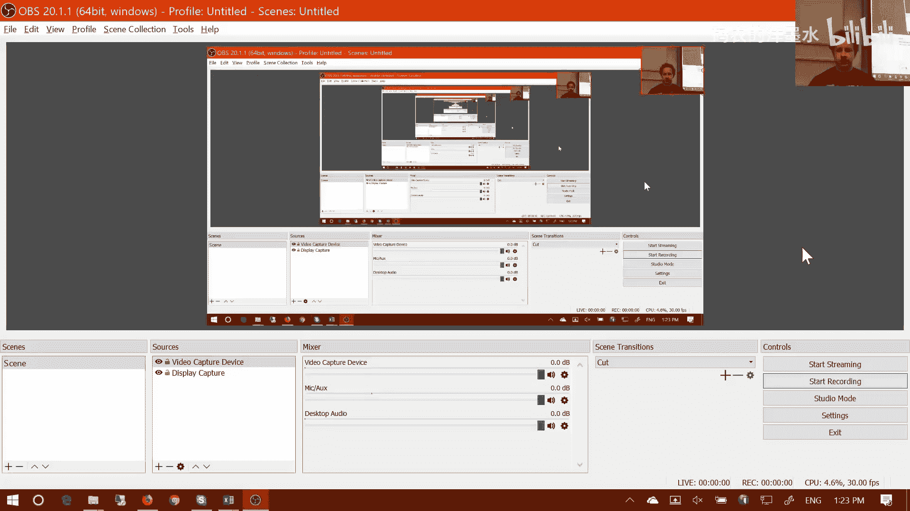

So I don't want to embarrass Rachel， but I'm very excited that Rachel's here。

 so this is Rachel for those of you that don't know。

 she's not quite back on her feet after her illness。

 but well enough to at least come to at least part of this lesson so don't worry if she can't stay for the whole thing and I'm really glad she's here because Rachel actually wrote the vast majority of the lesson we're going to see it's I think it's a really really cool work so I'm glad she's going to at least see it being taught even if unfortunately she's not teaching it herself。

So it's coming。Good Thanksgiving present， best thanks present。😊。

So as we discussed at the end of last lesson， we're kind of moving from the decision tree ensembles to neural nets broadly defined and as we discussed。

 you know， random forests and decision trees are limited。By the fact， in the end。

 that they're basically。Yeah。They're basically doing the nearest neighbors。

RightYou know all they can do is to get return the average of a bunch of other points and so they can't extrapolate out to know if you're thinking what happens if I increase my prices by 20% and you've never priced at that level before or what's going to happen to sales next year and obviously we've never seen next year before it's very hard to extrapolate it's also hard if it needs to you know like it can only do around logbased2N decisions you know and so if there's like a time series it needs to fit to that takes like four steps to kind of get to the right time area。

 then suddenly there's not many decisions left for it to make so there's kind of this limited amount of computation that it can do so there's a limited complexity of relationship that it can model。

Yes， Prince。我。

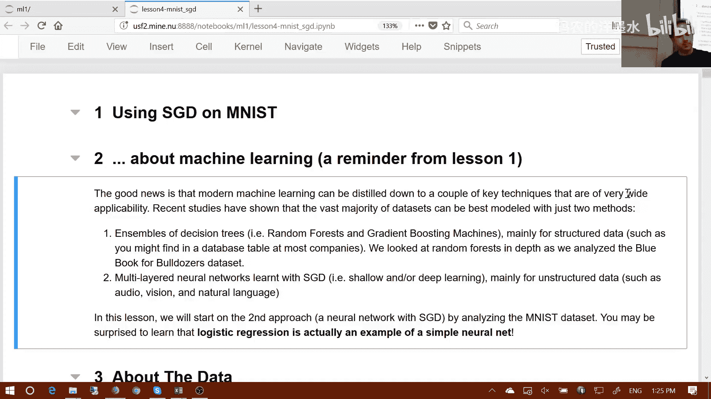

Can I ask about one more drawback of random forest that I feel so if we have data as categorical variable which are not in sequential order so for random forest we encode them and treat them as numbers let's say we have2 cardinality and 1 to 20 so the result that random forest gives is like the split that random forest givess is something like less than5 less than 6 but if the categories are not sequential not in any order。

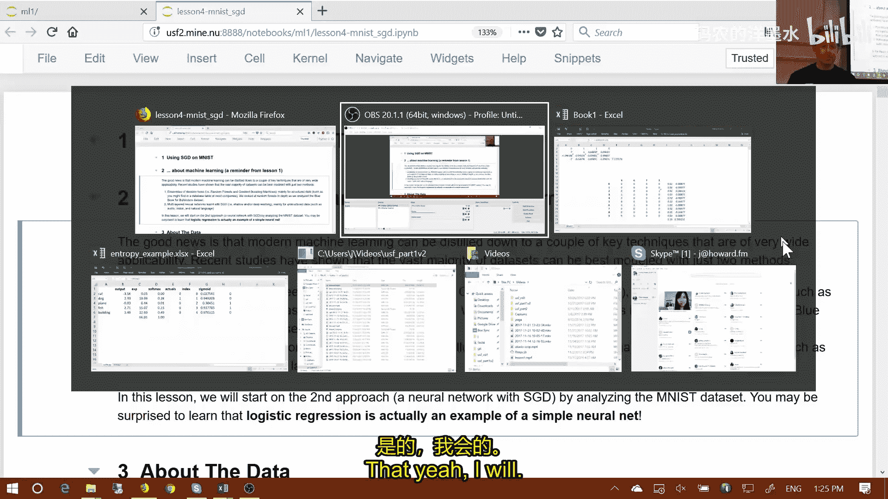

What does that mean？Yeah， so。So if you've got like。Oh， let's go back to Bordoers。Erupts。Erupts with。

A C， Orups。And I。I don't know， whatever， right and。We arbitrarily label them like this。Right。

 and so actually， we know that all that really mattered was if it had air conditioning。

 So what's going to happen。 Well， it's basically going to say like， okay， if I group it into。

Those together and those together that like that's an interesting break just because it so happens that the air conditioning ones all going to end up in the right hand side and then having done that right it's then going to say okay well within the group with the two and3 it's going to notice that it's further more going to have to split it into two more groups so eventually it's going to get there。

It's going to pull out that category。 it's just it's going to take more splits than we would ideally like。

 so it's kind of similar to the fact that for it to model a line it can only do it with lots of splits and only approximately So random is fine with categories that are not sequential also Yeah so it can do it it's just like in some way it's suboptimal because we just need to do。

More break points than we would have liked but it gets there it does a pretty good job and so even although random forests you know do have some deficiencies。

 they're incredibly powerful you know particularly because they have so few assumptions they're really hard to screw up and you know it's kind of hard to actually win a kle competition with a random forest but it's very easy to get like top 10% so in like in real life where often that third decimal place doesn't matter random forests are often like what you end up doing。

😊，嗯。But for some things like this Ecuadorian groceries competition， it's very。

 very hard to get a good result with a random forest because like there's a huge time series component and like nearly everything is these two massively high cardinality categorical variables which is the store and the item and like so there's very little there to even throw at a random forest and the。

😊，You know， the difference between every pair of stores is kind of different in different ways。

 and so you know there are some things that are just hard to get even relatively good results with the randomom first。

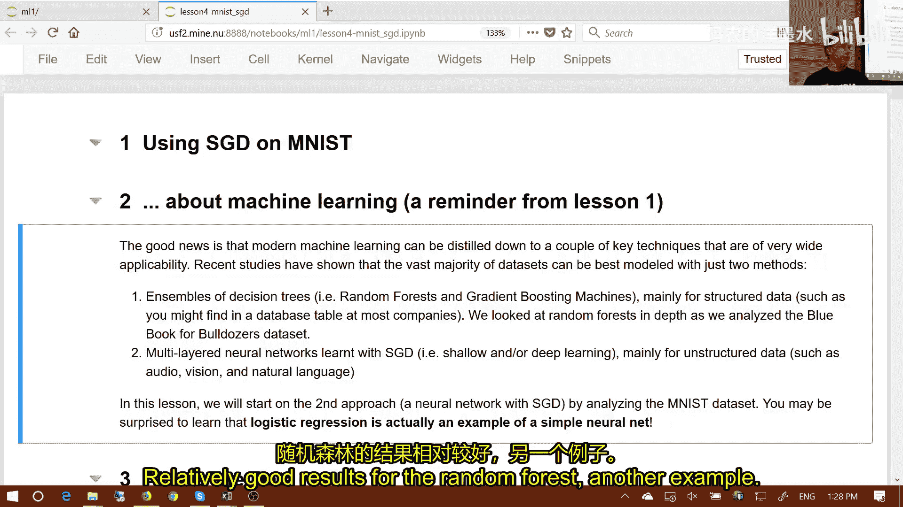

Another example。Is recognizing numbers。You can get like okay results with a random forest。

 but in the end， the kind of the relationship between， you know like the spatial structure。

Turns out to be important， right， And you kind of want to be able to do like computations like finding edges or whatever that kind of carry forward through。

 through the computation。 So， you know， just doing a。

Kind of clever nearest neighbors like a random forest， you know， turns out not to be ideal。

So if for stuff like this neural networks turn out that they are ideal。

 neural networks turn out to be something that works particularly well for both things like the Ecuadorian groceries competition。

 so forecasting sales over time by store and by item and for things like recognizing digits and for things like turning voice into speech and so it's kind of nice between these two things。

 neural nets and random forests we kind of cover the territory right I haven't needed to use anything other than these two things for a very long time。

And we'll actually learn， I don't know what course exactly。

 but at some point we'll learn also how to combine the two because you can combine the two in really core ways。

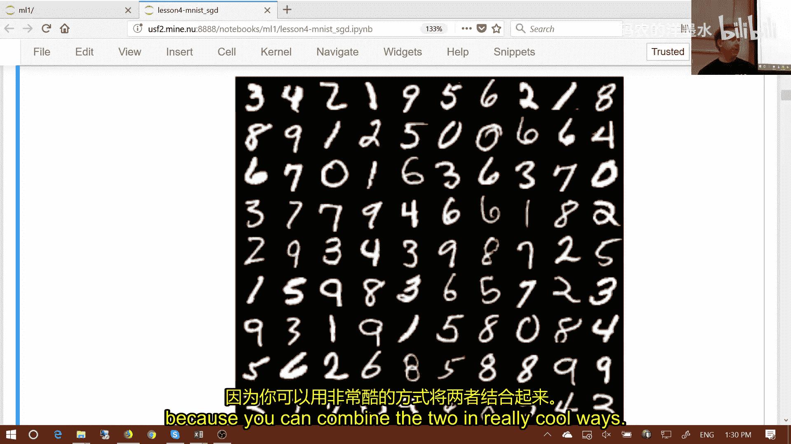

So here's a picture from Adam Ge Ge of an image so an image is just a bunch of numbers and each of those numbers is not to 255 and the dark ones are two close to 255 the light ones are close to zero so here is an example of a digit from this EndNIS data set EndNIS is a really old it's like a hello world machine of neural networks and so here's an example and so there are 28 by 28 pixels if it was color there would be three of these one for red one for green。

 one for blue。

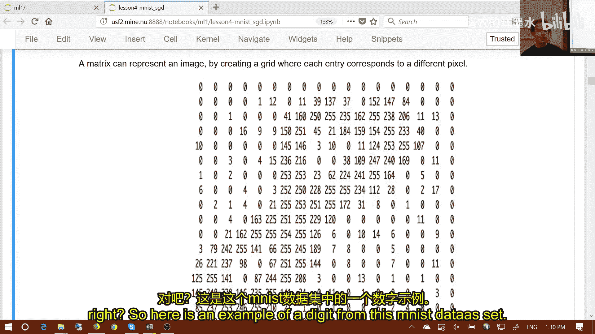

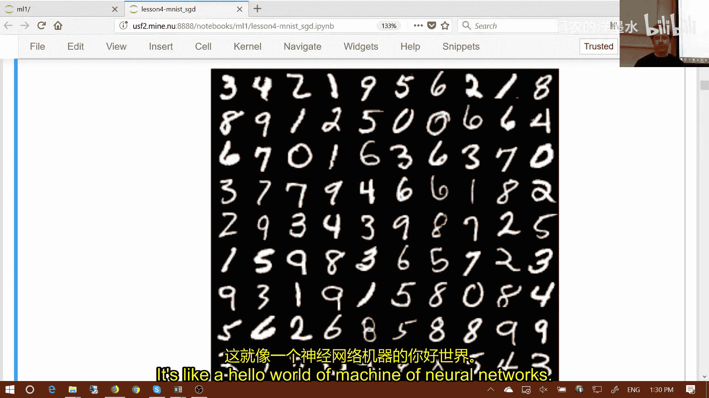

Check。So our job is to look at you know， the array of numbers。

And figure out that this is the number eight。Which is tricky， right， How do we do that。

We're going to use a few a small number of fast AI pieces and we're gradually going to remove more and more and more until by the end we'll have implemented our own neural network from scratch。

 our own training loop from scratch and our own matrix multiplication from scratch。

 so we're gradually going to dig in further and further。嗯。😊，All right， so the data for MNIST。

 which is the name of this very famous data， is available from here and we have a thing in fastaiI。

o called getda which will grab it from a URL and store it on your computer unless it's already there in which case it'll just go ahead and use it and then we've got a little function here called loademNT which simply loads it up。

😊，You'll see that it's zipped so we can just use Python's GZ to open it up and then it's also pickled so if you have any kind of Python object at all you can use this built- in Python library called pickle to dump it out onto your disk share it around load it up later and you get back the same Python object you started with so you've already seen this something like this with like。

Ps feather format pickle is not just for pandas， it's not just for anything。

 it works for basically nearly every Python object。

So which might lead to the question well why didn't we use pickle for a pandas data frame right and the answer is pickkle works for nearly every Python object。

 but it's probably not like optimal for nearly any Python object right so because like we were looking at panda's data frames with like over 100 million rows。

😊，We rarely want to save that quickly and so feather is a format that's specifically designed for that purpose and so it's going to do that really fast。

 if we tried to pickle it， it would have been taken a lot longer right？

Also note that pickle files are only for Python， so you can't give them to somebody else where like a feather file。

 you can hand around。Okay， so it's worth knowing that pickle exists because if you've got some dictionary or some kind of object floating around that you want to save for later or send to somebody else。

 you can always just。Pickle it Okay， so in this particular case， the folks at deeplening。

net were kind enough to provide a pick old version。嗯。

Pickle has changed slightly over time and so old pickle files like this one you actually have to this was a Python 2 one so you have to tell it that it was encoded using this particular Python 2 character set but other than that Python 2 and 3 can normally open each other's pickle files All right so once we've floated that in。

We loaded in like so and so this thing which we're doing here。

 this is called destructuring and so destructuring means that load Mist is giving us back a tuple of tuples。

So if we have on the left-hand side of the equal sign a tuple of tuples we can fill all these things in so we're given back a tuple of training data。

 a tuple of validation data and a tuple of test data in this case I don't care about the test data so I just put it into a variable called_ which kind of by like Python people tend to think of underscore as being a special variable which we put things we're going to throw away into it's actually not special but it' it's really common if you see something assigned to underscore it probably means you're just throwing it away by the way in a Jupyter notebook it does have a special meaning which is the last cell that you calculate is always available and underscore by the way but that's kind of a separate issue。

So then the first thing in that tuple is itself a tuple。

 and so we're going to stick that into x and y for our training data and then the second one goes into X and Y。

Grab validation data。Okay， so that's called deuring and it's pretty common in lots of languages。

 some languages don't support it， but those that do life becomes a lot easier。😊。

So as soon as I you know look at some new data set。

 I just check out whats what have I got right so what's its type， okay it's a nu array。

 what's its shape？It's 50，000 by 784， and then what about the dependent variables， that's an array。

 its shape is 50，000。So。This image is not of length 784， it's at size 28 by 28。So what happened here。

 well we could guess and we can check on the website it turns out we'd be right that all they did was they took the second row and concaten it to the first row and the third row and concaten it to that and the fourth row and concatennate it to that so in other words。

 they took this whole 28 by 28 and flattened it out into a single 1D array that makes sense。

 so it's going to be a size 28 squared。This is not like normal by any means。

 so I don't think like everything you see is going to be like this most of the time when people share images。

 they share them as JPEGs or PNGs， you load them up you get back a nice 2D array but in this particular case for whatever whatever reason the thing that they pickled was flattened out to be 784 and this word flatten is very common with you know kind of working with tensors。

 so when you flatten a tensor it just means that you're turning it into a lower rank tensor than you started with in this case we started with a rank 2 tensor a matrix for each image and we turned each one into a rank 1 tensor 。

e。 a vector so overall the whole thing you know is rank2 matrix a rank 2 tensor rather than a rank 3 tensor。

So just to remind us of， you know， the jogon here。嗯。This。And math， we we call a vector。

In computer science， we would call it a 1D array。Yeah。

But because deep learning have people have to come across as smarter than everybody else。

 we have to call this a rank。One tensor okay they all mean the same thing more or less unless you're a physicist in which case this means something else and you get very angry at the deep learning people because you say isn't it a tensor so there you go don't blame me this is just what people say。

So this。Is either a matrix？Or a 2D array。Or a rank。To tena。

And so once we start to get into three dimensions， we start to run out of mathematical names。

which is why we start to be nice just to say rank three tensor and so there's actually nothing special about vectors and matrices that make them in any way more important。

Then rank three tensors or rank four tensors or whatever。

 so I try not to use the terms vector to n matrix where possible because I don't really think theyre they're any more special than any other rank of tensor Okay so kind of it's good to get used to thinking of this as a rank to tensor Okay and then the。

The rose。And columns。If we're computer science people， we would call this dimension zero。

And dimension 1。But if were deep learning people， we would call this axis zero or axis。玩。Okay。

 and then just to be really confusing if you're an image person。

This is the first axis and this is the second axis So if you think about like TVs， you know。

 1920 by 1080 columns by rows。Everybody else， including deep learning and mathematicians。

 rose by columns， so this is pretty confusing if you use like the Python imagingaging library。

You get back columns by rows， pretty much everything else， rows by columns， so be careful。

Because they hate us。Because they're bad people。I guess。嗯。I mean， there's a lot of just。

Particularly in deep learning like a whole lot of different areas have come together like information theory。

 computer vision， statistics， signal processing and you've ended up with this hodgepodge of nomenclature in deep learning often like every version of things will be used so today we're going to hear about something that's called either negative log likelihood or binomial or categorical cross entropy depending on where you come from we've already seen something that's called either one hot encoding or dummy variables depending on where you come from I realize it's just like the same concept gets kind of somewhat independently invented in different fields and eventually they find their way to machine learning and then we don't know what to call them so we call them all of the above something like that。

So I think that's what's happened with computer vision， rows and columns。😊，So。

There's this idea of normalizing data， which is subtracting out the mean and dividing by the data deviation。

嗯。So a question for you。😊，Do you like often it's important to normalize the data so that we can more easily train a model。

 do you think it would be important to normalize the independent variables for a random forest if we're training a random forest？

I to be honest， I don't know why we don't need to normalize I just know that we don't we don't okay。

 does anybody want to think about why Ka it wouldn't matter because。

Each scaling and transformation we can have will be applied to each row and we will be computing means as we were doing like local averages and at the end we will of course want to denormalize it back。

To give so it wouldn't change the results。 I'm talking about the independent variables。

 not the dependent variable。 I told you asked about dependent。 Okay， here wants have a go， Matthew。

Yeah。呃。mightight be because we just care about the relationship between the independent variables and the independent variable。

 so scale does our own matter。Okay， come on。Pat， why。

 why do we only like because at each split point we can just divide to see。Which。

Regardless of what scale you're on， what minimizes variance and would that would right。

 so really the key is that when we're deciding where to split。All that matters is the order。😡。

I at all the better is how they're sorted。 so if we divide by the subtract the mean and divide by the standard deviation。

 they're still sorted in the same order。 So remember when we implemented the random forest we said sort them and then we like then we completely ignore the values we just said like now add on one thing from the dependent at a time So so random forests only care about the sort order of the independent variables。

 they don't care at all about their size and so that's why they're wonderfully immune to outliers because they totally ignore the fact that it's an outlier。

 they only care about which one's higher then what other thing so this is an important concept it doesn't just appear in random forest that occurs in some metrics as well for example。

 area under the ROC curve you come across a lot that area under the ROC curve。

Completely ignores scale and only cares about sort we saw something else when we did the dendrogram Spearman's correlation is a rank correlation。

 only cares about order， not about scale。So random forests。

One of the many wonderful things about them are that we can completely ignore a lot of these statistical distribution issues。

But we can't for deep learning because for deep learning we are trying to train a parameterized model。

 so we do need to normalize our data， if we don't then it's going to be much harder to create a network that trains effectively。

 so we grab the mean and the standard deviation of our training data and subtract out the mean divide by the standard deviation and that gives us a mean of zero and a standard deviation of one。

Now for our validation data。We need to use the standard deviation and mean from the training data right we have to normalize it the same way。

 just like categorical variables， we had to make sure they had the same indexes mapped to the same levels for a random forest。

Or missing values， we had to make sure we had the same median used when we were replacing the missing values。

 you need to make sure anything you do in the training set you'd do exactly the same thing and the test and validation set so here I'm subtracting out the training set me in the training sets down deviation so this is not exactly zero and this is not exactly one。

 but it's pretty close。And so in general， if you find you try something on a validation set or a test set and it's like much。

 much， much worse than your training set， it's probably because you normalized it in an inconsistent way or encoded categories in inconsistent way or something like that。

Yeah。All right， so let's take a look at some of this data。So we've got 10。

000 images in the validation set and each one is a rank1 tensor of length 784 in order to display it。

 I want to turn it into a rank2 tensor of 28 by 28。

So there a nuplay has a reshaped function that takes a tensor in and reshapes it to whatever size tensor you request。

Now if you think about it， you only need to tell it about if there are d axes。

 you only need to tell it about d minus1 of the axes you want because the last one it can figure out for itself so in total there are 10。

000 by 784 numbers here altogether so if you say well I want my last axes to be 28 by 28。

Then you can figure out that this must be 10，000。Otherwise it's not going to fit。It makes sense。

 so if you put minus1， it says like make it as big as small as you have to to make it fit and so you can see here it figured out it has to be 10。

000。So you'll see this used in。Ne net software preprocessing and stuff like that all the time。

 like I could have written 10，000 here， but I try to get into a habit of like any time I'm referring to like how many items in my input I tend to use minus1 because like it just means later on I could like use a subsample this code wouldn't break I could you know do some kind of stratified sampling it was unbalanced this code wouldn't break so by using this kind of approach of saying like minus1 here for the size it just makes it more resilient to change us later it's a good habit to get into。

So this kind of idea of like being able to take tenses and reshape them and。

Change axes around and stuff like that is something you need to be like totally do without thinking。

Because it's going to happen all the time so for example here's one I tried to read in some images they were flattened I need to unflatten them into a bunch of matrices okay reshape read some I read some images in with open CV and it turns out open CV orders the channels blue。

 green red everything else expects them to be red green blue I need to reverse the last axis how do you do that。

I read in some images with Python Imaging Library， it read them as know， rows by columns by channels。

 Pytorch expects channels by rows by columns。How do I transform that so these are all things you need to be able to do without thinking like straight away because they just it happens all the time and you never want to be sitting there thinking about it for ages so make sure you spend a lot of time over the week just practicing with things like all the stuff we're going to see today reshaping slicing。

 reordering dimensions stuff like that and so the best way is to create some small tenses yourself and start thinking like okay what's I experiment with so here can we pass that over there。

Do I have to backtrack a little bit， Of course， I love it。 So back in normal， you say， I like。

 you might have gone over this， but。still like wrestling with a little bit saying many machine learning algorithms behave better when the data is normalized but you also just said that scale doesn't really matter so I said it doesn't matter for random forests yeah so random forests are just going to put things based on order and so we love them we love random forests for the way they're so immune to worrying about distributional assumptions but we're not doing random forests we're doing deep learning and deep learning does care。

有 getting你 pass死了。Yeah。We have a parametric， then we should scale if we have a nonparmetric then we should scale tell generalize no not quite right because like K nearest neighbors is nonparmetric and scale matters a hell of a lot so I would say things involving trees generally are just going to split at a point and so probably you don't care about scale but you know you probably just need to think like is this an algorithm。

That uses order or does it use specific numbers？Can can you please give us an intuition of why it needs scale just because it that we may clarify some of the issues。

 not until we get to doing SGD。 So we're going to get to that。 Yeah， so for now。

 we're just going to say take my word for it。 let me pass it to Daniel。

So this is probably a dumb question but can you like explain a little bit more what you mean by scale because I guess when I think of scale I'm like oh all the numbers should be generally the same size That's exactly what you mean but is that like the case like with the cats and dogs that we went over with like the deep learning like you could have a small cat and like a larger cat but it would still know that those were both cat Oh I guess you know this is one of these problems where language gets overloaded yeah so in computer vision when we scale an image we're actually increasing the size of the cat in this case we're scaling the actual pixel values so in both case scaling means to make something bigger and smaller in this case we're taking numbers from nugh to 255 and making them so that they have an average of zero and a standard deviation of one could you please explain us you see by columnum by row by pixel？

By pixel so there's a single when you're scaling just not thinking about a picture but kind of an input yeah learning so okay yeah sure so I mean it's a little bit subtle but in this case I've just got a single mean and a single standard deviation right so it's basically on average how how much black is there。

And so on average， you know we have a mean and a standard deviation across all the pixels in computer vision we would normally do it by channel。

 so we would normally have one number for red， one number for green， one number for blue。In general。

 you need a different set of normalization coefficients for each like each thing you would expect to behave differently。

 so if we were doing like a structured data set where we've got like income distance in kilometers and number of children like you need three separate normalization coefficients for those they're like very different kinds of things so yeah it's kind of like a bit domainme specific here。

 it's like in this case all of the pixels are you know levels of gray so we've just got a single scaling number whereas else you could imagine if they were red versus green versus blue you could need to scale those channels in different ways。

😊，He trusted it back place。So I am having a bit of trouble imagining what would happen if we don't normalize in this case。

So when we'll get there So for so so this is kind of what Janette was saying is like why do we normalize and for now we're normalizing because I say we have to when we get to looking at stochastic gradient descent。

 we'll basically discover that if you。Basically to skip ahead a little bit we're going to be doing a matrix multiply by a bunch of weights we're going to pick those weights in such a way that when we do the matrix multiply we're going to try to keep the numbers at the same scale that they started it out as and that's going to basically require the initial numbers we're going to have to know what their scale is so basically it's much easier to create a single kind of neural network architecture that works for lots of different kinds of inputs if we know that they're consistently going to be mean zero standard deviation one that would be the short answer but we'll learn a lot more about it and if in a couple of lessons。

You're still not quite sure away， let's come back to it because it's a really interesting thing to talk about。

Yes I'm just trying to visualize the axes we're working with here so under plots when you when you write so x valid shape we get 10000 by 784 does that mean that we brought in 10。

000 pictures of that dimension exactly okay and then in the next line when you choose to reshape it is there a reason why you put 2828 on as Y or Z coordinates or is there a reason why they're in that order Yeah there is pretty much all。

Neural network libraries assume that the first access。Its like it's kind of the equivalent of a row。

 it's like a separate thing， it's a sentence or an image or a you know example of sales or whatever。

 so I want each image you know to be a separate item of the first axis。

And then so that leaves two more axes for the rows and columns of the images and that's pretty standard that's totally standard Yeah。

 I don't think I've ever seen a library that doesn't work that way。Can you pass it to our Bureau。嗯。

So while normalizing the validation data， I saw you have used mean of x and standard deviation of x data training data only so shouldn't we use mean and standard deviation of validation data。

You mean like join them together or the separately calculating meaning No because you see then you would be normalizing the validation set using different numbers and so now the meaning of like this this pixel has a value of three in the validation set has a different meaning to the meaning of three in the in the training set it would be like if we had like days of the week encoded such that Monday was a one in the a training set and was a zero in the validation set we've got now two different sets where the same number has a different meaning So we we want to make sure that we so let me give an example let's say we were doing like full color images and our。

Tests their training set contained like green frogs， green snakes and gray elephants right。

 We we're trying to figure out which was which。 And we normalized using you know。

 the each channel mean。And then we have a validation set and a test set。

 which are just green frogs and green snakes。So if we were have normalized by the validation sets statistics。

 we would end up saying things on average are green。

 and so we would like remove all the greenness out。

And so we would now fail to recognize the green frogs and the green snakes effectively so we actually want to use the same normalization coefficients that we were training on and for those of you doing the deep learning class。

 we actually go further than that when we use a pre-trained network。

 we have to use the same normalization coefficients that the original authors trained on so the idea is that you know that a number needs to have this consistent meaning across every data where you use it。

Can you pass it to us later？Yeah。That means when you are looking at the test set。

 you normalize the test set based on this this mean thats right that right。Okay。

So here's a you know so the validation y values just rank 1 tensor of 10，000。

 remember there's this kind of weird python thing where a tuple with just one thing in it needs a trail link comma okay so this is a rank one tensor of length 10000 and so here's an example of something from that it's just the number three so that's our labels。

So here's another thing you need to be able to do in your sleep， slicing into a tensor。

So in this case， we're slicing into the first axis。

With zero so that means we're grabbing the first slice so because this is a single number this is going to reduce the rank of the tensor by one。

 it's going to turn it from a three dimensionmenal tensor into a two dimensional tensor right so you can see here this is now just a matrix and then we're going to grab 10 through 14 inclusive rows 10 through 14 inclusive columns and here it is right so this is the kind of thing you need to be super comfortable like grabbing pieces out looking at the numbers and looking at the picture。

So here's an example of a little piece of that first image。And so。

You kind of want to get used to this idea that if you're working with something like pictures or audio。

 you know this is something your brain's really good at interpreting right so like keep showing pictures of what you're doing whenever you can but also remember behind the scenes their numbers so like if something's going weird print out a few of the actual numbers you might find somehow some of them have become infinity or they're all zero or whatever right so like use this interactive environment and to explore the data as you go。

😊。

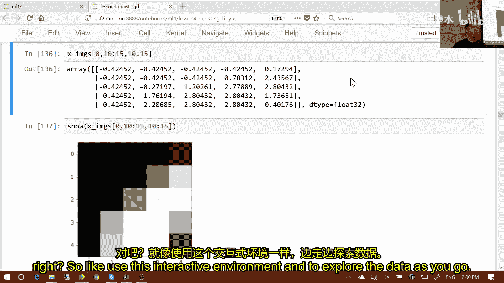

嗯。Did you have a question， Where's the box up。Just a quick， I guess。

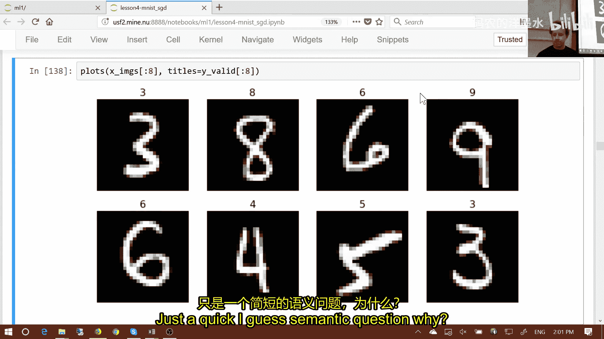

Semantic question， why when it's a tenor of rank three， is it stored as like X， Y。

 Z instead of like to me， it would make more sense to store it as like a list of。Like 2D tensors。

 it's not steward as either， right， So remember the formatting， because let's look at this as a3D。

Okay， so here's a 3D。Right， so a 3D tensor is formatted as showing a list of 2D tensors， Basically。

 But when when you're extracting it， why isn't it Like if you're extracting the first one。

 Why isn't it， X images。Square bracket， zero， closed square brackets。

 and then a second set of square bracket because that has a different meaning right。

 So it's kind of the difference between。Tenses and jagged arrays， right， So basically。

 if you do like something like。Something like that that says take the second list item and from it grab the third list item and so we tend to use that when we have something called a jagged array。

 which is where each subarray may be of a different length right where else we have。

Like a single object。of three dimensions and so we're trying to say like which little piece of it do we want and so the idea is that that is a single slice object to go in and grab that piece out。

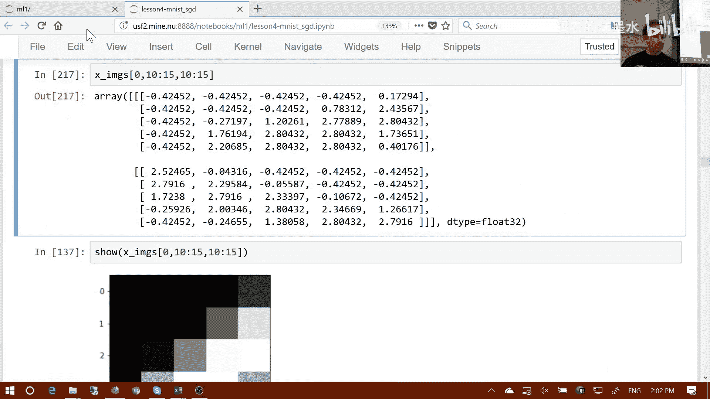

。Okay。So here's an example of a few of those images along with their。

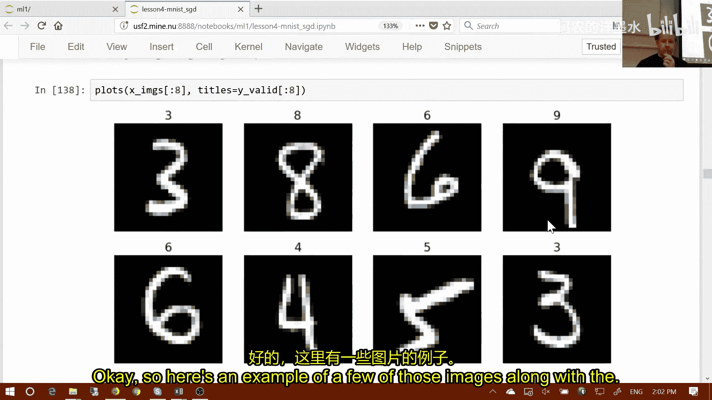

Labels and this kind of stuff you want to be able to do pretty quickly with Matplot Libb' it's going to help you a lot in in life in your exam so you can have a look at you know what Rachel wrote here when she wrote plots we can use。

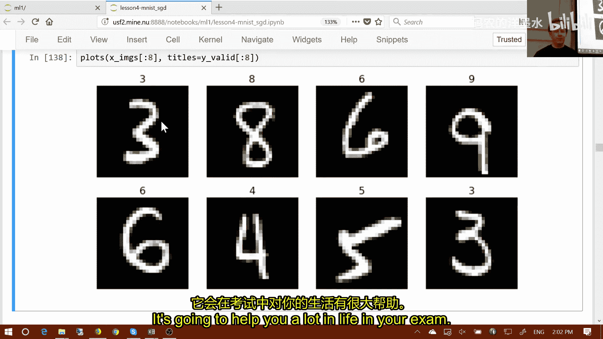

We can use add subplot to basically create those little separate plots and you need to know that I am show is how we basically take a nuy array and draw it as a picture and then we've also added the title。

On top。So there it is all right so let's now。😊，Take that data and try to build a neural network with it and so a neural network and sorry this is going to be a lot of review for those of you already doing deep learning。

 a neural network is just a particular mathematical function or a class of mathematical functions but it's a really important class because it has the property it supports what's called the universal approximation theorem。

Whi is that means that a neural network can approximate any other function arbitrarily closely。

So in other words， it can do， in theory， it can do anything as long as we make it big enough。

So this is very different to a function like 3x plus 5 right which can only do one thing。

 it's a specific function， or the class of functions AX plus B。

 which can only represent lines of different slopes moving it up and down different amounts。

Or even the function， ax squared plus bx plus C plus sine D。You know， again。

 only can represent a very specific subset of relationships the neural network， however。

 is a function that can represent any other function to arbitrarily close accuracy。Right。

So what we're going to do is we're going to learn how to take a function until let's take like AX+ B。

 and we're going to learn how to find its parameters， in this case， A and B。

 which allow it to fit as closely as possible to a set of data。

And so this here is showing example from a notebook that we'll be looking at in the deep learning course which basically shows what happens when we use something called stochastic gradientdi descent to try and set A and B and basically what happens is we're going to pick a random A to start with a random B to start with and then we're going to basically figure out do I need to increase or decrease A to make it closer the line closer to the dots do I need to increase or decrease B to make the line closer to the dots and then just keep increasing and decreasing A and B lots and lots of times so that's what we're going to do and to answer the question do I need to increase or decrease A and B we're going to take the derivative。

So the derivative of the function with respect to A and B tells us how will that function change as we change A and B so that's basically what we're going to do。

But we're not going to start with just a line， the idea is we're to build up to actually having a neural net。

And so it's going to be exactly the same idea， but because it's an infinitely flexible function。

 we're going to be able to use this exact same technique to fitbit to arbitrarily complex relationships。

😊，Now， that's basically the idea。So then what you need to know is that a neural net。

Is actually a very simple thing。 A neural net actually is something which。T。As import， let's say。

 we've got。A vector。嗯。Does a matrix product？By that vector so is like this is of size。

 let's draw this properly。So like if this is size R， This is like R by C。

 A matrix product will spit out something of。Size C。And then we do something called a nonlinearity。

 which is basically we're going to throw away all the negative values so it's basically max。

Zero comma x。And then we're going to put that through another matrix model play。

And then we're going to put that through another max zero comma X。

 and we're going to put that through another matrix multiply and so on right until eventually we end up with the single vector that we want。

 So in other words， each stage of our neural network is the key thing going on is。A matrix multiply。

 so in other words， a linear function， so basically deep learning most of the calculation is lots and lots of linear functions。

 but between each one。We're going to replace the negative numbers with zeros pass。Yes。

 so why are we throwing away the negative numbers as we go through this we'll see right the short answer is if you apply a linear function to a linear function to a linear function it's still just a linear function so it's totally useless but if you throw away the negatives that's actually a non-linear transformation and so it turns out that if you apply a linear function to the thing we throw away the negatives and apply that to a linear function that creates a neural network and it turns out that's a thing that can approximate any other function arbitrarily closely so there's tiny little difference actually makes all the difference and if you're interested in it check out the deep learning video where we cover this because I actually show a nice visual intuitive proof not something that I created but something that Michael Nielsen created or if you want to skip straight to his website you could go。

Michael Nielsen， Universal。I think I spell his name wrong， never a mind theorem。😔，Here we go。

 neural networks and Deep learning chapterpt 4， and he's got a really nice walkthrough basically with lots of animations where you can see why this works。

Once。I feel like the hottest thing。I feel like the hardest thing with getting started like technical writing on the internet is just like posting your first thing so if you do a search for Rachel Thomas Medi blog you'll find this we'll put it on the lesson Wiki where she talks about she actually says the top advice she would give to her younger self would be to start bloggingging sooner and she has like。

Both reasons why you should do it some examples of things that you know examples of places she's blogged it' turned out to be great for her and her career but then some tips about how to get started I remember when I first suggested to Rachel she might think about blogging because she had so much interesting to say and you know at first she was kind of surprised at the idea that like she could blog you know and now people come up to us at conferences and they're like you're Rachel Thomas I love your writing you know so like I've kind of seen that transition from like wow could I outb to to being known as a strong technical author so yeah so check out this article if you still need convincing or if you're wondering how to get started and since the first one is the hardest maybe your first one should be like。

😊，Something really easy for you to write。You know， so it could be like。You know。

 here's a summary of the first 15 minutes of lesson than three of our machine learning course。

 you know， here's why it's interesting。 here's what we look， or it could be like。诶。

Here's a summary of how I used a random forest to solve a particular problem in my practicum I often get questions like oh my practicum。

 my organization， we've got like sensitive commercial data。

That's fine like you know just find another data set and do it on that instead to show the example or you know anonymize all of the values and change the name of the variables or whatever like you can talk to your employer or your practicum partner to make sure that they're comfortable with whatever it is you're writing in general though you know。

People love it when their interns and stuff blog about what they're working on because it makes them look super cool。

 you know， it's like， hey， I'm a。😊，You know， in turn working at this company and I wrote this post about this core analysis I did and then other people would be like wow。

 that looks like a great company to work for so generally speaking you should find people are pretty supportive。

Besides which there's lots and lots of data sets out there available。😊。

So even if you can't base it on the work you're doing， you can find something similar for sure。

All right， so we're going to start building our neural network。

 we're going to build it using something called payytorch Payytorch is a library that basically looks a lot like Nmpay。

嗯。But when you create some code with pie torch， you can run it on the GPU。Rather than the CPU。

 So the GPU is。Something which is basically going to be probably at least an order of magnitude。

 possibly hundreds of times faster than the code that you might write for the CPU for particularly stuff involving lots of linear algebra so with deep learning neural nets if you don't have a GPU。

 you can do it on the CPUU but it's going to be frustratingly slow。啊。

Your Mac does not have a GPU that we can use for this because I'm actually advertising today we need an NviDdia GPU I would actually much prefer that we could use your Macs because competition is great right but NviDdia were really the first ones to create a GPU which did a good job of supporting general purpose graphics programming units GP GPU so in other words that means using a GPU for things other than playing computer games they used they created a framework called Couda CDA it's a very good framework。

 it's pretty much universally used in deep learning if you don't have an NviDdia GPU。

 you can't use it no current Macs have an NviDdia GPU most laptops of any kind don't have an NviDdia GPU if you're interested in doing deep learning on your laptop the good news is that you need to buy one which is really good for playing。

Per game is on。There's a place called Ex PC Ga laptops where you can go and buy yourself a great laptop for doing deep learning。

 you can tell your parents that you need the money。To do deep learning， so could you please have。

Yeah， so you'll generally find a whole bunch of laptops with names like Pre and Viper with pictures of robots and stuff。

Salth Pro， Rata， leopard， anyway。Having said that， like I don't know that many people that do much deep learning on their laptop。

 most people will log into a cloud environment by far the easiest I know if to use is called Cresle with Cresle you can basically sign up and straight away the first thing you get is a thrown straight into a Jupyter notebook backed by a GPU cost 60 cents an hour with all of the fast AI libraries and data already available so that makes life really easy it's less flexible and in some ways less fast than using AWS which is the Amazon Web services option。

It costs a little bit more 90 cents an hour rather than 60 cents an hour。

 but it's very likely that your employer is already using that。

 it's like it's good to get to know anyway they've got more different choices around GPUs and it's a good good choice if you Google for GitHub student PAC。

If you're a student。You can get $150 of credits straight away pretty much and so it's a really good way to get started Daniel did you have a question？

I just wanted to know your opinion on， I know that Intel recently published like an open source like way of like boosting like regular packages that they claim is equivalent like if you use the bottom tier GPU on your seat like on your CPU if you use their boost packages。

 like you can get the same performance。Do you know anything about that Yeah I do it's a good question so and actually NL makes some great numerical programming libraries。

 particularly this one called MKL， the Ma kernelnel Library。😊，They。

They definitely make things faster than not using those libraries。

 but if you look at a graph of performance over time。

 GPUs have consistently throughout the last 10 years， including now。

 are about 10 times more floating point operations per second than the equivalent CPU and they're generally about a fifth of the price for that performance。

Yeah，诶 it it。And then because of that， like everybody doing anything with deep learning basically does it on NviIDIdia GPUs and therefore using anything other than NviIDdia GPUs is currently very annoying。

So slower， more expensive， more annoying， I really hope there will be more activity around AMG GPUs in particular in this area。

 but AMB's got like literally years of catching up to do so it might take a while。Yeah。

Yeah so I just wanted to point out that you can also buy thing such as like a GPU extender to a laptop Yeah that's also like kind of like maybe a first step solution if you really want to put something on Yeah Yeah I think for like 300 bucks or you can buy something that plugs into your thunderhbol port if you have a Mac and then for another five or 600 bucks you can buy a GPU to plug into that Having said that for about 100 bucks you can actually create a pretty good you know GPU based desktop and so if you're considering that the fast AI forums have like lots of threads where people help each other speck out something at a particular price point anyway so to start with I'd say use Cresle and then you know when you're ready to invest a few extra minutes getting going use AWS to use AWS you basically。

啊俾 so。Yeah， I'm just talking to the folks online as well。聞き。Yeah。Okay， so AWS， when you get there。

 go to EC2。😊，EC2 like there's lots of stuff on AWS EC2 is the bit where we get to like rent computers by the hour right now we're going to need a GPU based。

Instance unfortunately when you first sign up for AWS they don't give you access to them so you have to request that access so go to limits up on the top left right and the main GPpU instance we'll be using is called the P2 so it's scroll down to P2 and here P2 do x large you need to make sure that that number is not zero if you've just got a new account it probably is zero which means you won't be allowed to create one you have to go request limit increase and the trick there is when it asks you why do you want the limit increase type fast do AI because AWs knows to look out and they know that fast AI people are good people so they'll do it quite quickly that takes a day or two generally speaking to go through so once you get the email saying you've been approved for P2 instances you can then go back here and say launch instance。

And so we've basically set up one that has everything you need。

 so if you click on community AMI and AMI is an Amazon machine image it's basically a completely set computer right and so if you type Fast AI or one word you'll find here Fast AI deal Part one version2 for the P2 right so that's all set up ready to go so if you click on select。

And then it'll say， okay， what kind of computer do you want right， and so we have to say， all right。

 I want a GPU compute type。And specifically， I want a pay2 extra lunch。

And then you can say review and launch I'm assuming you already know how to deal with SSH keys and all that kind of stuff if you don't check out the introductory tutorials and workshop videos that we have online or Google around for SSH keys。

Very important skill to know anyway。 All right， so hopefully you get through all that， you have。

Something running on a GPU with the fast AI repo， if you use Cresle， just CD fast AI2。

 the repo is already there， GetPol， AWS， CD fastt AI， the repo is already there， Get pull。

 if it's your own computer you'll just have to get clone and then away you go。All right。

 so part of all of those is Pytorrch is pre-installed and so Pytorrch basically means we can write code that looks a lot like Ny but it's going to run really quickly on the GPU secondly since we need to know like which direction and how much to move our parameters to improve our loss we need to know the derivative functions pytorrch has this amazing thing where any code you write using the pytorrch library it can automatically take the derivative of that for you so we're not going to look at any calculus in this course and I don't look at any calculus in any of my courses or in any of my work basically ever in terms of like actually calculating derivatives myself because I've never had to it's done for me by the library so as long as you write the Python code the derivative is done so the only calculus you really need to know to be an effective practitioner is like what does it mean to be。

Derivative and you also need to know the chain rule， which we'll come to。嗯。

Allright so we're going to start out kind of top down。

 create a neural net and we're going to assume a whole bunch of stuff and gradually we're going to dig into each piece right so to create neural nets we need to import the ptorrch neural net library Pitorrch funnily enough is not called p torch it's called torch okay so torch。

 Nn is the pitorrch subsection that's responsible for neural nets okay so we'll call that NN and then we're going to import a few bits out of fast AI just to make life a bit easier for us。

So here's how you create a neural network and Pytorch。The simplest possible neural network。

You say sequential and sequential means I am now going to give you a list of the layers that I want in my neural network。

 so in this case， my list has two things in it。 The first thing says， I want a linear layer。

 So a linear layer is something that's basically going to do Y equals A X plus B， right。

But matrix matrix modelplay， not Uniivevariate， obviously， so it's going to do a matrix product。

 basically。So the input to the matrix product is going to be a vector of length 28 times 28 because that's how many pixels we have and the output needs to be of size 10。

 we'll talk about y in a moment， but for now you know this is how we define a linear layer。

And then again， we're going to dig into this in detail。

 but every linear layer just about in neural nets has to have a nonlinearity after it。

 and we're going to learn about this particular nonlinearity in a moment it's called the softmax and if you've done the DL course you've already seen this。

So that's how we define a neural net， this is a two layer neural net。

 there's also kind of an implicit additional first layer， which is the input。

 but with Pytorr you don't have to explicitly mention the input but normally we think conceptually like the input image is kind of also a layer。

Because we're kind of doing things pretty manually with Pytorch。

 we're not taking advantage of any of the convenience is in Fast AI for building this stuff。

 we have to then write dot Kuda， which tells Ptororch to copy this neural network across to the GPU。

 so now on from now on that network is going to be actually running on the GPU。

 if we didn't say that it would run on the CPU。So that gives us back a neural net。

 a very simple neural net。So we're then going to try and fit the neural net to some data so we need some data so Fast AI has this concept of a model data object which is basically something that wraps up training data validation data and optionally test data and so to create a model data object you can just say I want to create some image classifier data。

 I'm going to grab it from some arrays right and you just say okay this is the path that I'm going to save any temporary files。

 this is my training data。Aase， and this is my validation data。 Ars。 Okay。

 And so that just returns an object that's going to wrap that all up。

 And so we're going to be able to fit to that data。 So now that we have a neural net。

And we have some data。 We're going to come back to this in a moment， but we basically say。

 what loss function do we want to use， What optimizer do we want to use， And then we say。Fit。

 we say fit。This network。To this data going over every image once。

Using this loss function and this optimizer and print out these metrics。Bang， okay。

 and this says here， this is 91。8% accurate。 Okay， so that's like the simplest possible neural net。

So what that's doing is it's creating a matrix multiplication followed by a nonlinearity。

 and that it's trying to find the values for this matrix which basically that fit the data as well as possible。

 that end up predicting this is a one， this is a9， this is a three。

And so we need some definition for as well as possible and so the general term for that thing is called the loss function so the loss function is the function that's going to be lower if this is better right just like with random forests we have this concept of information gain and we got to like pick what function do you want to use to define information gain and we were mainly looking at root mean squared error most machine learning algorithms we call something very similar to loss right so the loss is how do we score how good we are and so in the end we're going to calculate the derivative of the loss with respect to the weight matrix that we're modifyplying by to figure out how to update it so we're going to use something called negative log likelihood loss。

So negative log likelihood loss is also known as cross entropy they're literally the same thing there's two versions one called binary cross entropy or binary negative log likelihood and another called category called cross entropy the same thing one is for when you've only got a zero or one dependent。

 the other is if you've got like cat dog， airplane or horse or zero one through9 and so forth。

So what we've got here is the binary version of cross entropy， and so here is the definition。

I think maybe the easiest way to understand this definition is to look at an example。

So let's say we're trying to protect cat versus dog。One is cat， zero is dog。So here we've got cat。

 dog， dog， cat。And here are our predictions。 We said 90% sure it's a cat。9ine0% sure it's a dog。

80% sure it's a dog， 80% sure it's a cat。Right， so we can then calculate the。

Binary cross entropy by calling our function， so it's going to say， okay， for the first one。

We've got y equals1， so it's going to be one times。Lolog of 0。9。Plus1 minus y1 minus1 is 0。

 so that's going to be skipped。And then the second one is going to be a 0。

 so it's going to be zero times something， so that's going to be skipped。😊。

And the second part will be 1 minus0 so this is1 times log of 1 minus p1 minus 。1 is 0。9。

 So in other words， the first piece and the second piece of this are going to give exactly the same number。

Which makes sense because the first one we said we were 90% confident it was a cat and it was and the second we said we were 90% confident it was a dog and it was so in each case the loss is coming from the fact that you know we could have been more confident。

So if we said we're 100% confident the loss would have been zero。 so let's look at that in Excel。

So here's our。Yeah。09。1。2。8 right and here's our predictions 1001 so here's  one minus the prediction right here is log of our prediction。

 here is log of one minus our prediction。And so then here is Al。3。ok。So if you think about it。

And I want you to think about this during the week， you could replace this。With an if statement。

Rather than why， because y is always 100。Right then it's only ever going to use either this or this。

 so you could replace this with an if statement， so I'd like you during the week to try to rewrite this。

With an if statement， okay。And then see if you can then scale it out to be a categorical cross entropy。

 So categorical cross entropy works this way。 let's say we were trying to predict。Three and then six。

 and then7， and then two。So if we were trying to predict three。

And the actual thing that was predicted was like 4。7。Right versus like， well。

 actually putting it this way， we're trying to predict three and we actually predicted five。😊。

We' were trying to predict three and we accidentally predicted nine。

Like being five instead of three is no better than being nine instead of three。

 so we're not actually going to say like how far away is the actual number。

 we're going to express it differently or to put it another way。

 what if we're trying to predict cats， dogs， horses and airplanes。

You can't like how far away is cat from horse。 So we're going to express these a little bit differently。

 rather than thinking of it as a three。 Let's think of it as a vector。

With a one in the third location。And rather than thinking of it as a6。

 let's think of it as a vector of zeros for the one in the six location。 So in other words。

 one hot encoding so let's one hot encode at a dependent variable。😊，And so that way now。

 rather than predicting trying to predict a single number， let's predict。10 numbers。

Let's predict what's the probability that it's a zero， what's the probability it's a1。

 what's the probability it's a two and so forth right and so let's say we're trying to predict。

The two right then here is our binary cross entropy， sorry categorical cross entropy。

 so it's just saying， okay， did this one predict correctly or not how far off was it and so forth for each one。

And so add them all up so categorical cross entropy is identical to binary cross entropy。

 we just have to add it up across all of the categories so try and turn the binary cross entropy function in Python into a categorical cross entropy Python and maybe create both the version with the F statement and the version with the sum and the product。

All right， so that's why in our pie torch。Okay。We had 10 as the output as the output dimensionality for this matrix。

 because when we multiply up by a matrix with 10 columns。

We're going to end up with something of length 10， which is what we want。 We want to have。

10 predictions。Okay。So。So that's the loss function that we're using。Yeah。Yeah。All right。

 so then we can fit the model。And what it does is it goes through every image。This many times。

 so in this case it's just looking at every image once。

And going to slightly update the values in that weight matrix based on those gradients。

And so once we've trained it， we can then say predict。Using this model on the validation set。

And now that sps out something of 10，000 by 10。Can somebody tell me why is this of shape these predictions。

 why are they of shape 10，000 by 10？Very for， Chris， it's right next to you。

Well it's because we have 10，000 images。We're training on10000 images training on so that's what we're validating on in this case。

 but same thing So 10000 will be validating on so that's the first axis first second and then second axis is because we actually make 10 predictions per image Good good exactly So each one of these rows is the probabilities that it's a n that it's a one that is a two that's three and so forth Okay。

 very good。So in math， there's a really common operation we do called AGmX。

 And when I say it's common， it's funny。At high school I never saw AGMax first year undergrad I never saw AGMax but somehow after university everything's about AGM。

 so it's one of these things that's for some reason not really taught at school but it actually turns out to be super critical and so AGM is both something that you'll see in math and it's just written out in full AGMax。

😊，It's in nuy， it's in pie torch， it's super important and what it does is it says let's take this array of pres right and let's figure out on this axis remember axis one is columns right so across as Chris said the 10 predictions for each one for each row。

Let's find which prediction has the highest value and return， not that If it doesn set maps。

 it would return the value。 Ag max returns the index of the value。 So by saying ag max axis equals1。

 it's going to return。The index which is actually the number itself right so let's grab the first five Okay so for the first one it thinks there's a three。

 then it thinks x ones a eight， next ones are six， the next ones are nine。

 next ones are six again Okay so that's how we can convert our probabilities back into predictions。

All right， so if we save that away， call it pres， we can then say， okay。

 when does pres equal the ground truth， so that's going to return an array of bulls which we can treat as ones and zeros and the mean of a bunch of ones and zeros。

Is just the average， so that gives us the accuracy。So there's our 91。

8% and so you want to be able to like replicate the numbers you see and here it is， there's our 91。

8%。So when we train this， it tells us the last thing it tells us is whatever metric we asked for and we asked for。

Accuracy。Okay， so the last thing it tells us is our metric， which is accuracy。

 and then before that we get the training set loss。😊。

And the loss is again whatever else we asked for negative log likelihood and the second thing is the validation set loss Ptorch doesn't use the word loss。

 they use the word criterion so you'll see here crit okay so that's criterion equals loss this is what loss function we want to use they call that the criterion same thing okay。

嗯。So here's how we can recreate that accuracy。

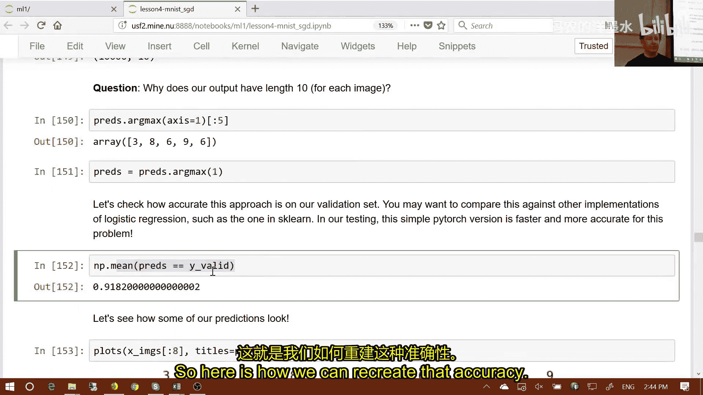

So now we can go ahead and plot eight of the images along with their predictions and we've got three eight。

 six，9， oh wrong， five wrong， okay， and you can see like why they're wrong like this is pretty close to a nine is's just missing a little cross at the top。

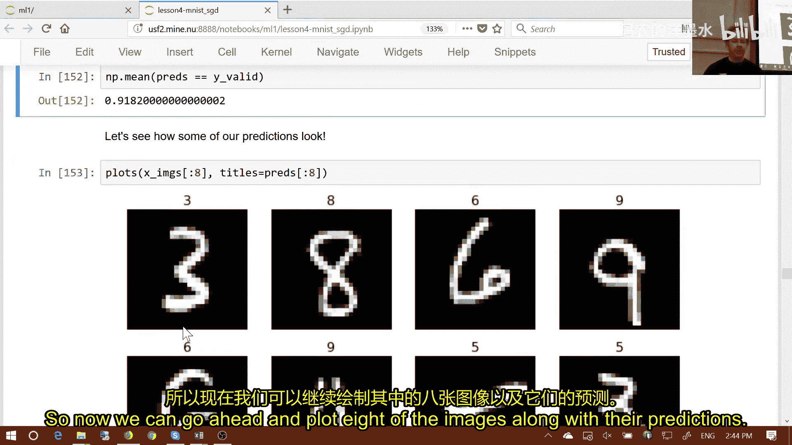

This is pretty close to a5 it's got a little bit at the extra here right so we've made a start and all we've done so far is we haven't actually created a deep neural net we've actually got only one layer so what we've actually done is we've created a logistic regression。

😊，So a logistic regression is literally what we just built and you could try and replicate this with SKLear's logistic regression package when I did it。

 I got similar accuracy but this version ran much faster because this is running on the GPU where else SK learn runs on the CPU so even for something like logistic regression。

 we can you know implement it very quickly with Pytorch， how can you pass that to in。

So when we're creating our net， we have to do dot kuta。

 what would be the consequence of not doing that would it just not run， it wouldn't run quickly。

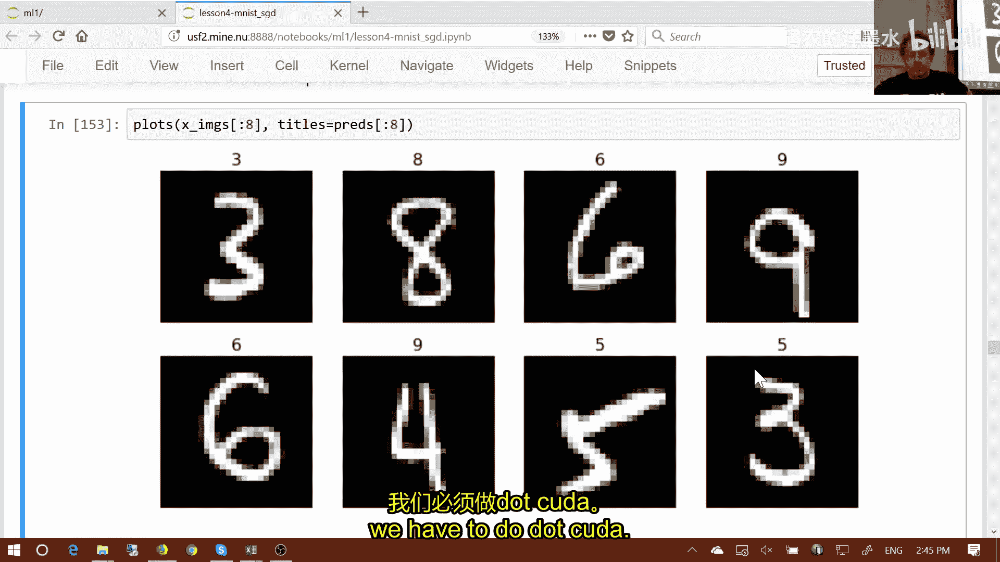

Yeah， it'll run on the CPU。Can you pass it today。So maybe build the neural network。

 Why is that we have to do linear and followed by a nonlinear。嗯。

So the short answer is because that's what the universal approximation theorem says is the structure which can give you。

Arbitrarily accurate functions for any functional form you know so the long answer is the details of why the universal approximation theorem works another version of the short answer is that's the definition of a neural network so the definition of a neural network is a linear layer followed by a activation function followed by a linear layer followed by an activation function etc we go into a lot more detail of this in the deep learning course but you know for this purpose it's enough to know like that it works so far of course we haven't actually built a deep neural net at all we've just built a logisticistic regression and so at this point if you think about it all we're doing is we're taking every input pixel and multiplying it by a weight。

For each possible outcome， right， So we're basically saying， you know， on average， the number one。

 you know， has these pixels turned on。 The number two has these pixels turned on。

 And that's why it's not terribly accurate， right， That's， that's not how。

Digit recognition works in real life， but that's always built so far。Okay。

 can you pass that to Devin？So you keep saying this universal approximation theorem， yeah。

 did you define that？Yeah， but let's cover it again because it's worth talking about。嗯。All right。

 so Michael Nielsen has this great website called Neural Networks and Deep Learning and his chapter four is actually kind of famous now。

 and in it he does this walkthrough of basically showing that a neural network can。

Can approximate any other function to arbitrarily close accuracy as long as it's big enough and we walk through this in a lot of detail in the deep learning costs but the basic trick is that he shows that with a few different numbers you can basically kind of cause these things to kind of create little boxes。

 you can move the boxes up and down， you can move them around。

 you can join them together to eventually basically create like connections of towers which you can like use to approximate any kind of surface so you know that's basically the the trick and so all we need to do given given that is to kind of find the parameters for each of the linear functions in that neural network so to find the weights in each of in each of the matrices and so so far we've got just one。

Matrix， and so we've just built a simple logistic regression so far Good on did you have a question？

Just a small out， I just want to confirm that when you showed images of the examples of the images which were misclassified。

 Yeah， they look rectangular。 So it's just that while rendering the pixels are being scaled differently。

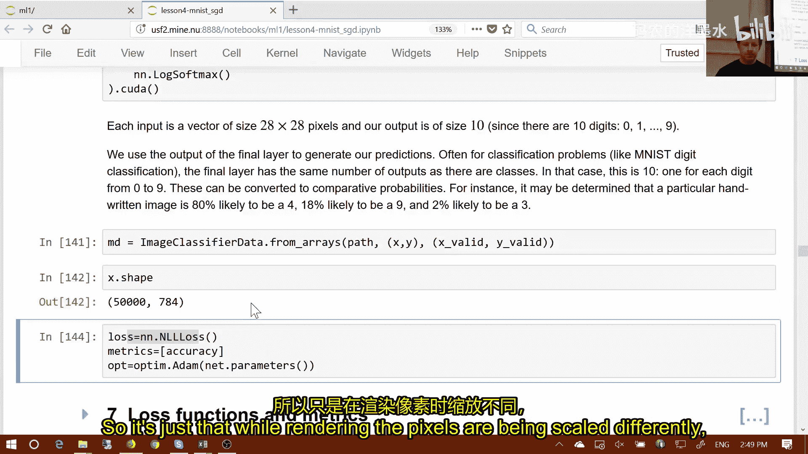

So are they still 28 by 28 squared28 but 28？I think they're square。

 I think they just look rectangler because they've got titles on the title。 I'm not sure。

 I don't know。 Anyway， they are square and like。😊，Matpltlibb yeah。

 does often fiddle around with you know what it considers black versus white and you know having different size axes and stuff。

 so yeah you do have to be a bit careful there sometimes。

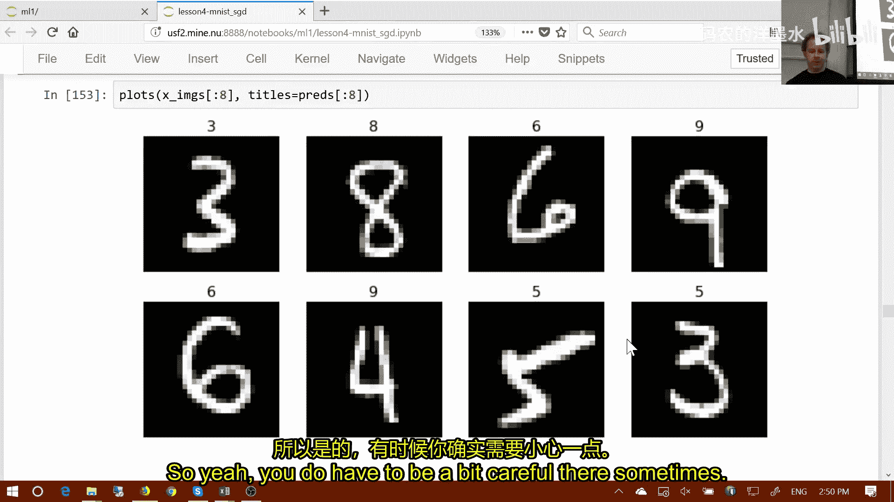

Oh。Okay， so。Hopefully， this will now make more sense because what we're going do is like dig in a layer deeper and define logistic regression without using an N dot sequential。

 without using an N dot linear， without using an end dot log softmax。 So we're going to do。

Nearly all of the layer definition from scratch so to do that we're going to have to define a pytorch module。

 a pytorch module is basically either a neural net or a layer in a neural net which is actually kind of a powerful concept of itself。

 basically anything that can kind of behave like a neural net can itself be part of another neural net and so this is like how we can construct particularly powerful architectures combining lots of other pieces。

So to create a Py torch module， just create a Python class。

 but it has to inherit from an N dot module， so we haven't done inheritance before。Other than that。

 this is all the same concepts we've seen in OO already basically if you put something in parentheses here。

 what it means is that our class gets all of the functionality of this class for free it's called subclassing it so we're going to get all of the capabilities of a neural network module that the Pytorch authors have provided and then we're going to add additional functionality to it。

😊，When you create a subclass， there is one key thing you need to remember to do。

 which is when you initialize your class， you have to first of all initialize the superclass so the superclass is the NN do module so the NN dot module has to be built before you can start adding your pieces to it and so this is just like something you can copy and paste into every one of your modules you just say super dot in it this just means。

Construct the superclass first， okay。So having done that we can now go ahead and define our weights and our bias so our weights is the weight matrix it's the actual matrix that we're going to multiply our data by and as we discussed it's going to have 28 times 28 rows。

And 10 columns。And that's because if we take an image。

Which we flattened out into a 28 by 28 length vector， right。

 Then we can multiply it by this weight matrix to get back out a length 10 vector。

 which we can then use to。Consider it as a set of predictions。So that's our weight matrix now。

The problem is that we don't just want y equals AX， we want y equals AX plus B。

 so the plus B in neural nets is called bias and so as well as defining weights we're also going to find bias and so since this thing is going to spit out for every image something of length 10 that means that we need to create a vector of length 10 to be our biases in other words for everything naught one through three up to9 we're going to have a different。

Plus B that would be adding。Right， so。We've got our。Data matrix here， which is of length，10000。By。

28 times 28。and then we've got our weight matrix。Which is 28 by 28。Brows by 10。

So if we multiply those together。Okay。We get something of size 10，000。By10。Okay。

 and then we want to add on。At bias。Yeah。对。U sorry， run around， add on our bias。Okay， like so。嗯。

And so when we add on， and we're going to learn a lot more about this later。 But when we add on。

A vector like this， it basically is going to get added to every row。Okay。

 so the bias is going to get added to every road。So we first of all define those and so to define them we've created a tiny little function called get weights。

 which is over here， which basically just creates some normally distributed random numbers so torch dot Rand n returns a tensor filled with random numbers from a normal distribution。

We have to be a bit careful though， when we do deep learning。

 like when we add more linear layers later。😊，Imagine if we have。A matrix which on average。

 tends to increase the size of the inputs we give to it。

If we then multiply by lots of matrices of that size。

 it's going to make the numbers bigger and bigger and bigger， like exponentially bigger。

Or what if it made them a bit smaller， it's going to make them smaller and smaller and smaller。

 exponentially smaller。 So like because a deep network applies lots of linear layers。If on average。

 they result in things a bit bigger than they started with or a bit smaller than they started with。

 it's going to like。Exponentially multiply that difference。

 So we need to make sure that the weight matrix is of an appropriate size that the inputs to it。

 the kind of the mean of the inputs basically is not going to change。

So it turns out that if you use normally distributed random numbers。

And divided by the number of rows in the weight matrix。

 it turns out that particular random initialization keeps your numbers at about the right scale right So this idea that like if you've done linear algebra。

 basically at the eigenvalue， the first eigenvalue is like bigger than one or smaller than one。

 it's going to cause the gradients to like get bigger and bigger or smaller and smaller。

 That's called gradient explosion right so。We'll talk more about this in the deep learning course。

 but if you're interested， you can look at timing her initialization。And read all about this concept。

 right， But for now， you know， it's probably just enough to know that if you use this。

Type of random number generation you're going to get random numbers that are nicely behaved you're going to start out with an input which is mean zero standard deviation1 once you put it through this set of random numbers you'll still have something that's about mean zero standard deviation1 that's basically the goal okay one nice thing about pitorrch is that you can play with this stuff right so torch。

 R and like try it out like every time you see a function being used run it。

and take a look and so you'll see it looks a lot like an numpey but it doesn't return a numppay array。

 it returns a tensor。And， in fact。Now I'm GPU programming。Okay， like put Doc Hoa。

 and now it's doing it on the GPU。 So like。I just multiplied that matrix by3 very quickly on the GPU so that's how we do GPU programming with Ptorrch。

 right？So this is our weight metrics so we create， as I said we create 1 28 by 28 by 10。

 one is just rank one of 10 for the biases， we have to make them a parameter。

 this is basically telling pi torch which things to update when it does SGD that's very minor technical detail。

So having created the weight matrices， we then define a special method with the name forward this is a special method。

 the word the name forward has a special meaning in pytorch a method called forward in pytorrch is the name of the method that will get called when your layer is calculated Okay so if you create a neural net or a layer you have to define forward and it's going to get passed。

The data from the previous layer。So our definition is to do a matrix multiplication of our input data times our weights and add on the biases。

So that's it。 That's what happened earlier on when we said NN dot linear， it created this。

This thing for us。Okay。Now unfortunately though we're not getting a 28 by 28 long vector。

 we're getting a 28 row by 28 column matrix， so we have to flatten it unfortunately in torch by torch they tend to rename things they spell re reshape。

 they spell it view okay so view means reshape so you can see here we end up with something where the number of images we're going to leave the same。

And then we're going to replace row by column with a single axis， again。

 negative one meaning as long as required Okay， so this is how we flatten something using P torch so we flatten it。

 do a matrix multiply and then finally we do a softm So softm is the activation function we use。

If you look in the deep learning repo， you'll find something called entropy example where you'll see an example of softftmax。

 but a softmax simply takes the outputs from our final layer so we get our outputs from our linear layer and what we do is we go e to the power of。

For each output。And then we take that number and we divide by the sum。Of the eight of the pars。

That's called softftmax。 Why do we do that？ Well， because we're dividing this by the sum。

That means that the sum of those itself must add to one right and that's what we want。

 we want the probabilities of all the possible outcomes add to one。Furthermore。

 because we're using e to the power off， that means we know that every one of these is between zero and one and probabilities we know should be between zero and one。

And then finally， because we're using。Either the power of。

 it tends to mean that slightly bigger values。In the input turn into much bigger values in the output。

 So you'll see generally speaking in my softm， there is going to be one big number and lots of small numbers。

 and that's what we want， right because we know that the output is one hot encoded。So in other words。

 the softm activation function， the softm nonlinearity。

 is something that returns things that behave like probabilities。

where one of those probabilities is more likely to be kind of high and the other ones that were more likely to be low。

 and we know that's what we want to map to our one hot encoding。

 so a softmax is a great activation function to use to kind of help the neural net。

 make it easier for the neural net to map。To the output that you wanted。

And this is what we generally want when we're kind of designing neural networks。

 we try to come up with little architectural tweaks that make it as easy for it as possible to match the output that we know we want。

😊，So that's basically it， right， like rather than doing sequential it all and using NN dot linear NN dot Softmax。

 weve defined it from scratch。We can now say just like before。

 our net is equal to that class do coa and we can say dot fit and we get to within a slight random deviation。

 exactly the same output。Okay， so what I'd like you to do during the week is to play around with like torch dot Rand end to generate some random tensors。

 torch。t mat Mo to start multiplying them together， adding them arc。

Try to make sure that you can rewrite softmax yourself from scratch， you know。

 like try to fiddle around a bit with。You know reshaping view all that kind of stuff so that by the time you come back next week。

 you feel like pretty comfortable with Pytorrch and if you Google for Pytorrch tutorial。

 you'll see there's a lot of great material actually on the Piytorrch website to help you along。

 basically showing you how to create tensors and modify them and do operations on them。All right。

 great。 Yes， you had a question。 Can you pass it over？

So I see that the forward is the layer that gets applied after each of the linear layers well not quite the forward is just the definition of the module so this is like how we this is how were implementing linear so does that mean after each linear layer we have to apply the same function let's say we can't do a logs soft max after layer one and then apply some other function after layer two if we have like a multi layer neural network so normally way to find neural networks。

Yeah。Normally we define neural networks like so we just say here is a list of the layers we want right we don't you don't have to write your own forward right all we did just now was to say like okay instead of doing this let's not use any of this at all but write it all by hand ourselves。

Right， so you can， you can write as many layers as you like in what any order you like here。

 The point was that here we're not using any of that。 We've written our own。Mat Mole plus bias。

 our own softm。 So this is like this is this is just Python code。

 You can write whatever Python code inside forward that you like。

To define your own neural net so like you won't normally do this yourself。

 normally you'll just use the layers that Pytorch provides and you're used dot sequential to put them together or even more likely you'll download a predefined architecture and use that we're just doing this to learn how it works behind the scenes。

All right， great。Thanks， everybody。

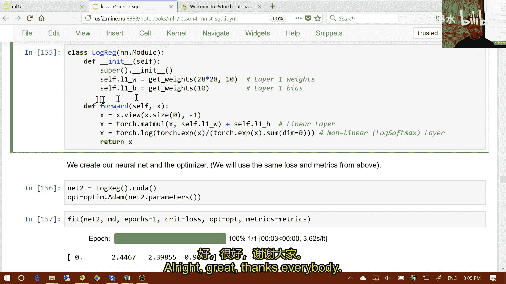