# 【全集】旧金山大学-面向程序员的机器学习-中英字幕-1080P-p09-Lecture-9---正则化--BV1YAvYBAEG3_p9-

All right， welcome back to machine learning。I'm really excited to be able to share some amazing stuff that University of San Francisco students have built during the week or written about during the week。

Quite a few of the things I'm going to show you have already spread around the Internet quite a bit。

 lots of。Tweets and posts and all kinds of stuff happening。

 one of the the first to be widely shared was this one by Tyler who did something really interesting。

He started out by saying like what if I like create the synthetic data where the independent variables is like the X and the Y and the dependent variable is like color and interestingly。

 he showed me an earlier version of this where he wasn't using color He was just like puttingting the actual numbers in here and this thing kind of wasn't really working at all And as soon as he started using color。

 it started working really well。 And so I wanted to mention that one of the things that unfortunately we don't teach you at USF is theory of human perception。

 perhaps we should because actually when it comes to visualization。

 it's kind of the most important thing to know is what is the human eye or what was the human brain good at perceiving。

 there's a whole area of academic study on this and one of the things that were best at perceiving is differences in color So that's why as soon as we look at this picture of this synthetic data he created you can immediately see oh there's kind of four areas of。

I red。看完。So what he did was he said， okay， what if we like tried to create a machine learning model of this synthetic data set。

 So specifically， he created a tree。 And the cool thing is that you can actually draw。The tree。

 right So after he created the tree， he did this all in that plot lid。

 that plot lid is very flexible， right， He actually drew the tree boundaries。

 So that's already a pretty neat trick is to be actually able to draw the tree。

 But then he did something even cleverer， which is he said， okay。

 so what predictions does the tree make。 Well， it's the average of each of these areas。

 And so to do that， we can actually draw the average color。😊。

It's actually kind of pretty here is the predictions that the tree makes。😊，Now。

Here's where it gets really interesting， is like you can， as you know， randomly。

Generate trees through resampling。And so here are four treats。Generated through resembling。

 They're all like pretty similar， but a little bit different。

 And so now we can actually visualize bagging and to visualize bagging。

 we literally take the average of the four pictures。 right， That's what bagging is。

And there it is right And so here is like the fuzzy decision boundaries of a random forest And I think this is kind of amazing right because it's like a I wish I had this actually when I started teaching you all random forest because I could have skipped a couple of classes It's just like。

 okay， that's what we do you know， we create the decision boundaries we average each area And then we we do it a few times and average all of them Okay so that's what a random forest does。

 And I think like this is just such a great example of。😊。

Ma the complex easy through through pictures so congrats to Tyler for that it actually turns out that he has actually reinvented something that somebody else has already done a guy called Christianini who went on to be one of the world's foremost machine learning research has actually included almost exactly this technique in a book he wrote about decision forests so it's actually kind of cool that Tyler ended up reinventing something that one of the world's foremost authorities under decision forests actually has created so I thought that was neat that's nice because when when we posted this on Twitter。

 you know got a lot of attention and finally somebody was able to say like oh you know what this actually already exists so Tyler has gone away and started reading that book。

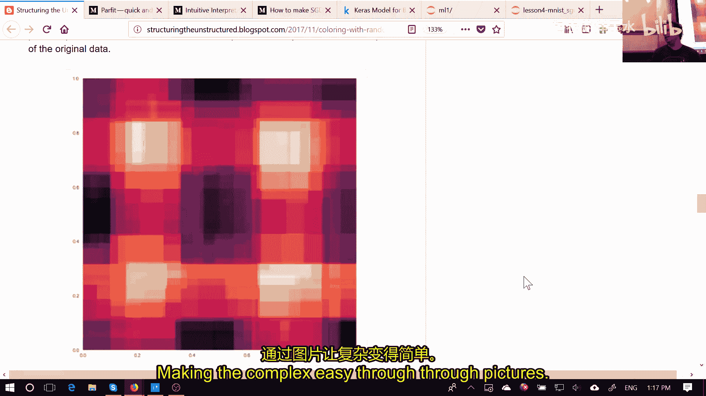

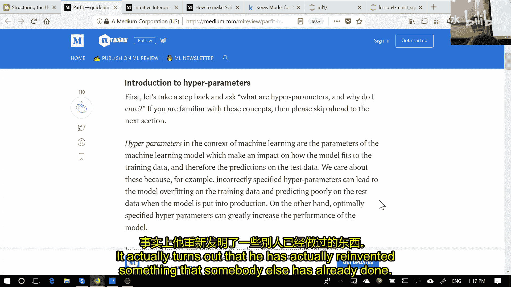

嗯。Something else which is super cool is Jason Carpenter。

Created a whole new library called Parfit and Parit is a paralyzed fitting of multiple models for the purpose of selecting hyperparameter。

 and there's a lot I really like about this。He's shown a FLIA example of how to use it and like the API looks very similar to other grid search based approaches but it uses the validation techniques that Rachel wrote about and that we learned about a couple of weeks ago of using a good validation set。

嗯。And， you know， what he's done here is in his blog post that introduces it， you know， he's， he's。

Gone right back and said， like， well， what are hyper parameters。 Why do we have to train them。

 And he's kind of explained every step。 And then the， the module itself。Is like， it's。

 it's very polished。 You know， he's added documentation to it。 He's added a nice read me to it。

 And it's kind of interesting when you actually look at the code， you realize。You know。

 it's very simple， you know， which is it's definitely not a bad thing。

 That's a good thing is to make things simple。 But by kind of writing this little bit of code and then packaging it up so nicely。

 he's made it really easy for other people to use this technique， which is great。 And so。😊。

One of the things I've been really thrilled to see is then Vannay went along and combined two things from our class one was to take parfit and then the other was to take the kind of accelerated SGD approach to classificationification we learned about in the last lesson and combine the two to say like okay well let's now use parfi to help us find the parameters of a SGD logistic agion so I think that's really a really great idea。

Something else which I thought was terrific is Prince actually。Basically， went through， and。

Summarized pretty much all the stuff we learned in the random forest interpretation。

 and he went even further than that as he described each of the different approaches to random forest interpretation。

He described how it's done。 So here， for example， is feature importance through variable permutation。

 little picture of each one。And then super coolol here is the code to implement it from scratch so I think this is like really nice post。

 you know describing something that not many people understand and showing you know exactly how it works both with pictures and with code that implements it from scratch so I think that's really really great one of the things I really like here is that for like the tree interpreter but he actually showed how you can take the tree interpreter output and feed it into the new waterfall chart package that Chris USF student built to show how you can actually visualize the contributions of the tree interpreter in a waterfall chart。

 so again， kind of nice combination of multiple pieces of technology we've both learnt about and built as a group。

嗯。I also really thought this kernel there's been a few interesting kernel shared and I'll share some more next week。

 Devveche wrote this really nice kernel showing there's this quite challenging cable competition on detecting icebergs versus chips and it's kind of a weird two channel satellite data。

 which is very hard to visualize and he actually went through and basically described kind of the formulas for how these like radar scattering things actually work。

And then actually managed to come up with a code that allowed him to recreate。You know。

 the actual 3D icebergs。Or shifts。 and I have not seen that done before like you knows it's quite challenging to know how to visualize this data and then he went on to show how to build a neural net to try to interpret this。

 so that was pretty fantastic as well。So yeah， congratulations for all of you。

 I know for a lot of you， you know you're posting stuff out there to the rest of the world for the first time。

 you know， and it's kind of intimidating， you're used to writing stuff that you kind of hand into a teacher and they're the only ones who see it and。

You know， it's kind of scary the first time you do it but then the first time somebody， you know。

 that fors your cableval kernel or it's a clap to your medium post， he suddenly realize。

 oh I'm actually I've written something that people like that's that's pretty great。

 So if you haven't tried yourself yet， I again invite you to。

Try writing something and if you're not sure you could write a summary of a lesson。

 you could write a summary of like if there's something you found hard。

 like maybe you found it hard to fire up a GPU based AWS instance， you eventually figured it out。

 you could write down， just describe how you solved that problem。

Or if one of your classmates didn't understand something and you explained it to them。

 then you could like write down something saying like， oh。

 there's this concept that some people have trouble understanding Here's a good way I think of explaining it。

 There's all kinds of stuff you could， you could do。Okay， so。Let's go back to STGD。嗯。

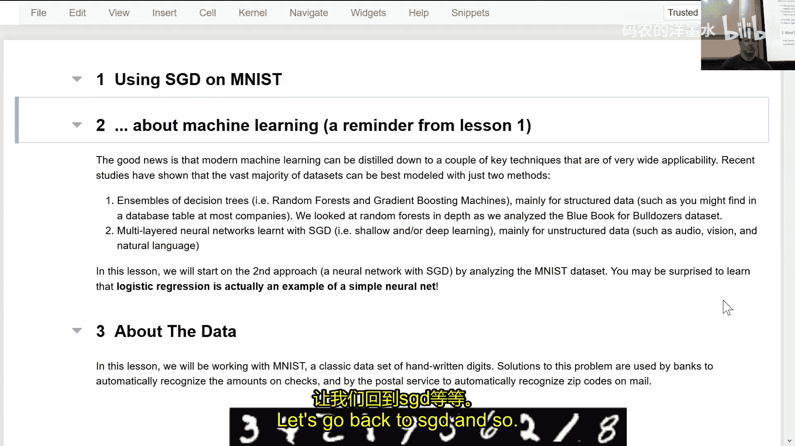

And so。We're going back through this notebook， which。

Rachel put together basically taking us through kind of SGD from scratch for the purpose of digit recognition and actually quite a lot of the stuff we look at today is going to be closely following part of the computational linear algebra course which you can both find the MOCs on Fast AI or at USF it'll be an elective next year so if you find some of this this stuff interesting and I hope you do then please consider signing up for the elective or checking out the video online。

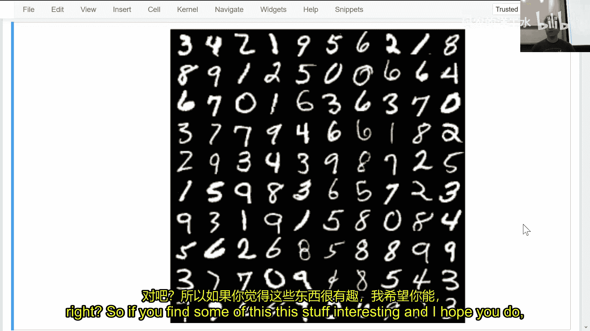

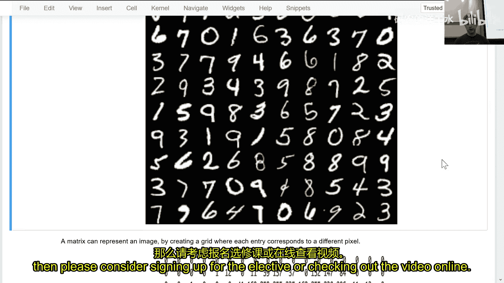

嗯。

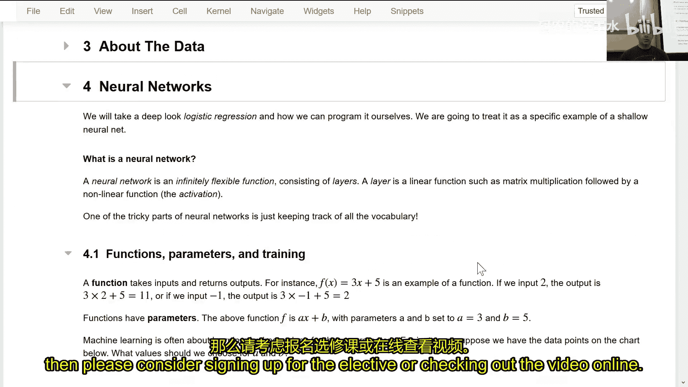

So we're building。Neural networks。

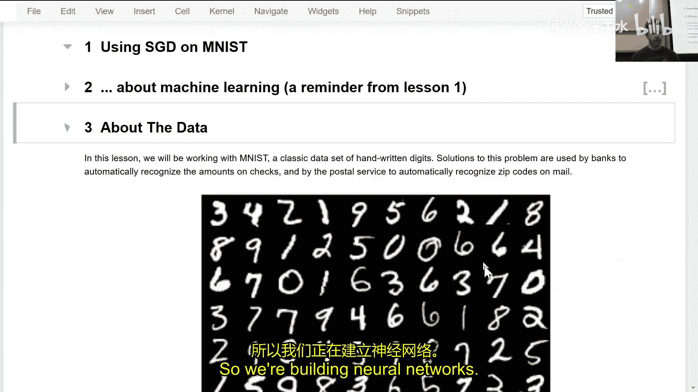

And we're starting with an assumption that we've downloaded the Mnes data。

 We've normalized it by subtracting the in and divided by the standard deviation。 Okay。

 so the data is， it's slightly unusual in that although they represent images where they were downloaded as each image was a 784 long。

Rannk one tensor。 So it's been flattened out。 Okay， And so for the purpose of drawing pictures of it。

 we had to resize it。There 28 by 28， but the actual data we've got is not 28 by 28。

 it's 784 long flatten out。嗯。Okay。The basic steps we're going to take here is to start out with training。

The world's simplest neural network， basically a logistical question。 so no hidden layers。

And we're going to treat it using a library fast AI and we're going to build the network using a library Ptorrch and then we're going to gradually get rid of all the libraries right so first of all we'll get rid of the NN neuralnet library and Paytorrch and write that ourselves。

🤧嗯。Then we'll get rid of the fast AI fit function and write that ourselves。

 and then we'll get rid of the Pytorrch optimizer and write that ourselves。

 And so by the end of this notebook， we'll have written all the pieces ourselves。

 The only thing that we'll end up relying on is the two key things that Pytorch gives us， which is a。

 the ability to write Python code and have it run on the GPU。And B。

 the ability to write Python code and have it automatically differentiated for us Okay。

 so they're the two things we're not going to attempt to write ourselves because it's boring and pointless but everything else we'll try and write ourselves on top of those two things so。

Our starting point is like not doing anything ourselves。

 it's basically having it all done for us and so Pettorrch has an NN library which is where the neuralnet stuff lives。

 you can create a multilayer neural network by using the sequential function and then passing in a list of the layers that you want and we asked for a linear layer followed by a softm layer and that defines our logistic regression the input to our linear layer is 28 by 28 as we just discussed the output is 10 because we want a probability for each of the numbers not through9 for each of our images okay。

嗯。Cuter sticks it on the GPU。And then。Fit。😡，Fits a model Okay。

 so if we start out with a random set of weights and then fit。

 he uses gradient descent to make it better。We had to tell the fit function。What criterion to use。

 In other words， what counts as better， And we told it to use negative log likelihood。

 We'll learn about that in the next lesson。 what that is exactly。

We had to tell it what optimizer to use and we said please use Opem。A。

 the details of that we won't cover in this course we're going to use something build something simpler called SGD if you're interested in Adam we just covered that in the Dick learning course。

And what metrics do you want to print out， we decided to print out accuracy。 Okay， so that was that。

 And so if we do that。Okay。So after we fit it， we get an accuracy of generally somewhere around 91。

 92%。So what we're going to do from here is we're going to gradually。

 we're going to repeat this exact same thing。 So we're going to rebuild。This model。You know。

 four or five times fitting it， building it and fitting it with less and less libraries。 Okay。

 so the second thing that we did last time。Was to try to start to define the。

The module ourselves right so instead of saying the network is a sequential bunch of these layers。

 let's not use that library at all and try and define it ourselves from scratch。So to do that。

 we have to use。O， because that's how we build everything in pipetorch and we have to create。

A class which inherits from anN dot module， so anN dot module is a pytorch class that takes our class and turns it into a neural network module which basically means will anything that you inherit from an N dot module like this。

 you can pretty much insert into a neural network as a layer or you can treat it as a neural network it's going to get all the stuff that it needs automatically to work as a part of or a full neural network and we'll talk about exactly what that means today and the next lesson right。

嗯。So we need to construct the object， so that means we need to define the constructor thunder in it。

And then importantly， this is a python thing is if you inherit from some other object。

 then you have to create the thing you inherit from first。

 So when you say super dot done in that says construct the N dot module piece of that first right if you don't do that then the N dot module stuff never gets a chance to actually get constructed so this is just like a standard Python00 subclass constructor and if any of that's unclear to you。

 then you know this is where you definitely want to just grab Python intro to00 because this is the standard approach so inside our constructor。

We want to do the equivalent of。And N dot linear。Allright。

 so what N N dot linear is doing is it's taking our。It's taking our 28 by 28。A vectorect。

 so 768 long。Factor， and we're going to be， that's going to be the input to a matrix multiplication。

 So we now need to create a。Something with。768。Rose。And。That's 768 and 10 columns。Okay。

 so because the input to this。Is going to be a mini batch of size。Actually。

 let's move this into a new window。768 by 10。And the input to this is going to be a mini batch of size。

64。Bye。768。So we're going to do this matrix product。哎。So when we say in Pitorch N N dot linearar。

It's going to construct。This matrix for us， right。 So since we're not using that。

 we're doing things from scratch， we need to make it ourselves。 So to make it ourselves， we can see。

Generate normal random numbers。With this dimensionality， which we passed in here，7，68 by 10。 Okay。

 so that gets us our， our randomly initialized。Mattrix， okay？Then we want to add on。To this。

You know we don't just want y equals AX， we want y equals AX plus B so we need to add on what we call in neural that's a bias vector。

 so we create here a bias factor of length 10， here again randomly initialized and so now here are our two randomly initialized weight tenses。

So that's not constructive。Now we need to find forward Why do we need to define forward This is a pitorrch specific thing What's going to happen is this is when you create a module in pitorch。

 the object that you get back behaves as if it's a function。

 you can call it with parentheses which will do it that in a moment and so you need to somehow define what happens when you call it as if it's a function。

And the answer is， Pytorch calls a method called forward。

That's just that's the pytorrch kind of approach that they picked so when it calls forward。

 we need to do our actual calculation of the output of this module or later so here is the thing that actually gets calculated in all logisticistic regression。

So， basically， we take our。Input X。Which gets passed to For。 That's basically how forward works。

 It gets passed。Go many batch。And we matrix multiply it by。The layer1 weights。

 which we defined find up here。And then we add on。The layer 1 bias， which we defined up here。

 and actually， nowadays， we can define this a little bit more elegantly。

Using the Python 3 matrix Moplication operator， which is the outsl。And when you use that。

 I think you kind of end up with something that looks closer to what the mathematical notation looked like。

 and so I find that nicer。All right， so thats that's our linear layer in our logistic regression in our zero hidden layer neural net。

 So then the next thing we do to that。Is。Softmax。Okay， so we get the output。Of this。Mattrix multiply。

who wants to tell me what the dimensionality of my output of this matrix butterply is。So 64 by 10。

 thank you， Kim。I should mention for those of you that weren't at deep learning class yesterday。

 we actually looked at a really cool post from Kaam who described how to do structured data analysis with neural nets。

 which has been like super popular and a whole bunch of people have kind of said that they've read it and found it super interesting。

So that was really exciting。😊，So we get this matrix of outputs and we put this through a soft mass。

And why do we put it through a softm， We put it through a softm because in the end。

 we want you know for every image we want a probability that's a 0 or a one or a two or a three or4 right so we want a bunch of probabilities that add up to one and where each of those probabilities is between zero and one。

So， a soft Max。Does exactly that for us。So for example。

 if we weren't picking out you know numbers from0 to 10， but instead we're picking out cat。

 dog plane fish or building， the output of that matrix multiply for one particular image might look like that。

 these are just some random numbers and to turn that into a soft max I first go E to the power of。

H of those numbers。I sum up。Those eight of the paras。

And then I take each of those eight of the power ofs and divide it by the sum。And that's softftm。

 that's the definition of softm。 So because it was either the power of。

 it means it's always positive。Because it was divided by the sum。

 it means that it's always between0 and1。And it also means because it's divided by the sum that they always add up to one。

So by applying this soft Mac。Activation function， so anytime we have a layer of outputs。

 which we call activations， and then we apply some function。

 some nonlinear function to that that maps one one scalr to one scalar like softmax does we call that an activation function so the softmax activation function takes our outputs and turns it into something which behaves like a probability we don't strictly speaking need it。

 we could still train and train something which where the output directly as the probabilities but by creating using this function that automatically makes them always behave like probabilities。

 it means there's less。For the network to learn。 So it's going to learn better so generally speaking。

 whenever we design an architecture， we try to design it in a way where it's as easy as possible for it to create something of the form that we want。

So that's why we use Somax。Right， so that's the basic steps。 right， We have our input。

 which is a bunch of images， which is here gets multiplied by a weight metrics。

 We actually also add on a bias。To get a output of the linear function。

 we put it through a nonlinear activation function， in this case， softmax。

 and that gives us our probabilities。So there that all is。嗯。Pietorrch also tends to use the log。

Of softms， for reasons that don't particularly need bother us。 Now。

 it's basically a numerical stability convenience。 Okay， so to make this the same as our。

Version up here that you log Softmax。I'm going to use log here as well。We can now instantiate。

This class that has created an object of this class。

So I have a question back for the probabilities where we were before。

If we were to have a photo with a cat and a dog together would that change the way that that works or does it work in the same basic Yeah so that's a great question so if you had a photo with a cat and a dog together。

And you wanted it to spit out both cat and dog。This would be a very poor choice。

 So softm is specifically the activation function we use for categorical predictions where we only ever want to predict one of those things。

 right， And so part of the reason why is that as you can see， because we're using e to the。

 right E to the slightly bigger numbers， creates much bigger numbers as a result of which we generally have just one or two things large and everything else is pretty small。

 So if I like recalculate these random numbers a few times。

 you'll see like it tends to be a bunch of zeros and one or two high numbers。

 right So it's really designed to。Try to kind of。Make it easy to predict like this one thing is the thing I want if you're doing multi label prediction。

 so I want to find all the things in this image rather than using softms。

 we would instead use sigmoid right so sigmoid would each of it would cause each of these between to be between 0 and1。

 but they would no longer add to one。It's a good question。And like a lot of these。

Details about that best practices are things that we cover in the deep learning course and we won't cover heaps of them here in the machine learning course we're more interested in the mechanics。

 I guess。But we'll try and do them move quick。Alright。

 so now that we've got that we can instantiate an object of that class and of course we want to copy it over to the GPU so we can do computations over there。

 again， we need an optimizer we'll be talking about what this is shortly。

 but you'll see here we've called a function on our class called parameters， but we never defined。

A method called parameters。 And the reason that is going to work is because it actually was defined for us inside an end dot module。

 And so an end dot module actually automatically goes through the attributes we've created and finds anything that basically we said this is a parameter。

 So the way you say something is a parameter is you wrap it in an end up parameter。

 So this is just the way that you tell pi torch this is something that I want to optimize so when we created the weight matrix。

 we just wrapped it with N enddo parameter。 it's exactly the same as a regular pi torch variable。

 which we'll learn about shortly， it's just a little flag to say。

 hey you should optimize this And so when you call net2 dot parameter on our net2 object we created。

 it goes through everything that we created in the constructor checks to see if any of the of type parameter。

 And if so it sets all of those being things that we want to train with the optimr。

And we'll be implementing the optimizer from scratch later。Okay， so having done that。We can fit。

And we should get basically the same answer as before，91 ish。So that looks good。All right。So。

What have we actually built here Well what we've actually built as I said。

 is something that can behave like a regular function so I want to show you how we can actually call this as a function。

 so to be able to call it as a function， we need to be able to pass data to it to be able to pass data to it。

 I'm going to need to grab a mini batch of emist images。Okay。

 so we used for convenience the image classifier data from a raise method from Fast AI and what that does is it creates a pietorrch data loader for us a Ptorrch data loader is something that grabs a few images and sticks them into a mini batch and makes them available and you can basically say give me another mini batch。

 give me another mini batch， give me another mini batch and so。In Python。

 we call these things generators， generators are things where you can basically say， I want another。

 I want another， I want another， right？There's this kind of very close connection between iters and generators I not going to worry about the difference between them right now。

 but you'll see basically to turn。To actually get hold of something which we can say。

 please give me another of。Thanks。In order to grab something that we can we can use to generate many batches。

 we have to take our data loader and so you can ask for the training data loader from our model data object。

 You'll see there's a bunch of different data loaders you can ask for。 you can ask for the。

Test data loader， the train data loader， the validation loader， augmented images。

 data loader and so forth。 So we're going to grab the training data loader。That was created for us。

 this is a standard Pitor data loader well slightly optimized by us but same idea and you can then say this is a standard Python thing。

 we can say turn that into an iterator， turn that into something where we can grab another one at a time from and so once you've done that。

We've now got something that we can iterate through。

 you can use the standard Python next function to grab one more thing from that generator okay。嗯。

So that's returning the Xs from our mini batch and the Ys found our mini batch the other way that you can use generators and iterators in Python is with a for loop。

 I could also have said like four you know X mini batchch comm a Y mini batch in data loader。

And then like do something right， so when you do that， it's actually behind the scenes。

 it's basically syntactic sugar for calling next。Lots of times。 Okay， so this is all standard。

Python stuff。So that returns。A tensor。Of size 64 by 784， as we would expect。

 right the fast AI library we used defaults to a mini batch size of 64。 That's why it's that long。

These are all of the background zero pixels， but they're not actually zero， in this case。

 why aren't they zero？Yeah， they're normalized exactly， right。

 so we subtract to the main divided by standard deviation right？嗯。So there， there it is。

 So now what we want to do is we want to pass that into our， our logistic regression。

So what we might do is we'll go。A variableariable xMmb equals variable Okay。

 I can take my x mini batch。I can move it onto the GPU because remember my Net2 object is on the GPU。

 so our data for it also has to be on the GPU。And then the second thing I do is I have to wrap it in variable。

 So what does variable do。This is how we get for free automatic differentiation。

Pytorrch can automatically differentiate， you know pretty much anything， any tensor。

But to do so takes memory and time。So it's not going to always keep track like。

 to do automatic differentiation。 It has to keep track of exactly how something was calculated。

 We added these things together。 We multipied it by that。 We then took the sign。 blah， blah。

 blah right You have to know all of the steps because then to do the automatic differentiation。

 it has to。Take the derivative of each step using the chain rule， modelply them all together。

 so that's slow and memory intensive。 So we have to opt in to saying like， okay。

 this particular thing we're going to be taking the derivative of later。

 So please keep track of all of those operations for us。

 And so the way we opt in is by wrapping a tensor in a variable。 right so。That's how we do it。

And you'll see that it looks almost exactly like a tensor， but it now says variable containing。

This tensor so in ptorrch a variable has exactly identical API to a tensor。

 or actually more specifically a superet of the API of a tensor。Anything we can do to a tensor。

 we can do to a variable。But it's going to keep track of exactly what we did so we can later on take the derivative。

 so we can now pass that。Into our net2 object。 Remember。

 I said you can treat this as if it's a function。RightSo notice we're not calling dot forward。

We're just treating it as a function。And then remember we took the log。

 so to undo that I'm taking the X， and that will give me my probabilities。Okay。

 so there's my probabilities。And it's got。Return something of size 64 by 10。

 so for each image in the mini batch， we've got 10 probabilities。

And you'll see most probabilities are pretty close to zero。And a few of them are quite a bit bigger。

Which is exactly what we we would hope， right， I that it's like， okay， it's not a 0。 It's not a1。

 It's not a2。 It is a3。 It's not a4， It's not a5 and so forth。

So maybe this would be a bit easier to read if we just grabbed like the first three of them。Okay。

 so it's like 10 to the egg three， 10 to the egg  eight， two， five， five，4， okay。

 and then suddenly here's one which is 10 to egg one， right？

So you can kind of see what it's trying to。What I was trying to do here。I mean。

 we could call like net2 dot forward and it'll do exactly the same thing。 but that's not how。

All of the pi torch mechanics actually work。 It's actually they actually call it as if it's a function And so this is actually a really important idea like because it means that when we define our own architectures or whatever anywhere that you would put in a function you could put in a layer。

 anywhere you put in a layer， you can put in a neural net， anywhere you put in a neural net。

 you can put in a function because as far as pitorrch is concerned they're all just things that it's going to call just like as if they're functions。

 So they're all like interchangeable and this is really important because that's how we create。

Really good neural nets is by mixing and matching lots of pieces and putting them all together。

 Let me give an example。😊，Here is my。Logistic regression。Which got。91 and a bit% accuracy。

I'm now going to turn it。Into a neural network with one hidden layer。哎。

And the way I'm going to do that is I'm going to create。系冇嚟啊。

I'm going to change this so it spits out 100 rather than 10。

Which means this one input is going to be 100 rather than 10。Now。

 this as it is can't possibly make things any better at all yet。

Why is this definitely not going to be better than what I had before？Yeah， can somebody pass the。

Be if you've got a combination of two linear layers which is just the same as one linear layer with different parameters exactly right so we've got two linear layers which is just a linear layer right so to make things interesting I'm going to replace all of the negatives from the first layer with zeros。

😊，Because that's a nonlinear transmission。And so that nonlinearier transformation is called a rectified linear unit。

Okay， so NN do sequential simply is going to call each of these layers in turn for each mini batch so do a linear layer。

 replace all of the negatives with zero， do another linear layer and do a soft Mac。

 This is now a neural network。With one hidden layer。And so let's try trading that instead。Okay。

 accuracy has now gone up to 96%。Okay， so this is the idea is that the basic techniques we're learning in this lesson like become powerful at the point where you start stacking them together。

 okay， can somebody pass the green box there and then there yes， Daniel？Why did you pick 100？

No reason it was like easier to type an extra zero。てね。

Like this question of like how many activations should I have at a neural network layer is kind of part of the scale of a deep learning practitioner。

 we covered it in the deep learning course， not in this course。When adding that additional。

 I guess transformation， additional layer， additional layer。

 this one here is called a nonlinear layer or an activation function the you said activation layer。

 activation function activation function。Does it matter that like if you would have done。

 for example， like two softmes or is that something you cannot do like one。

 you can absolutely use a softm there， but it's probably not going to give you what you want and the reason why is that a softm tends to push most of its activations to zero and an activation just to be clear like I've had a lot of questions in deep learning course about like what's an activation and activation is the value that is calculated in a layer right so this is an activation。

It's not a weight。A weight is not an activation。 It's the value that you calculate from a layer。

 So softm will tend to make most of its activations pretty close to 0。

 And that's the opposite of what you want。 You generally want your activations to be kind of as rich and diverse and and used as possible。

 So nothing to stop you doing it， but it probably won't work very well。Basically。

Pretty much all of your layers will be followed by nonlinear activation functions that will nearly always be value。

Except for the last layer。The question in a different way。 could you when doing multiple layers。

 So let's say like could you two or three could things It's going two or three layers deep。

 Do you want to switch up these activation layers or is it okay。

 just to keep them That's a great question。 So if I wanted to go deeper。I would just do。That okay。

 that's a now two hidden layer network。So I think Id heard you said that there are a couple of different activation functions like that rectified linear unit。

 what are some examples。Why would you use。Yeah， great question。嗯。So basically。

 like as you add like more linear layers， you' kind of got your input comes in and you put it through a linear layer and then a nonlinear layer。

 linear layer， nonlinear layer。Le。And then the final non nonlinear layer。The final nonlinear layer。

 as we've discussed， you know， if it's a multi category classification。

 but you only ever pick one of them， you would use softmax。

If it's a binary classification or a multi label classification where you're predicting multiple things。

 you would use sigmoid。If it's a regression， you would often have nothing at all。

 although we learned in last night's DL course where sometimes you can use Sigmoid there as well。

 so they're basically the options， main options for the final layer。For the。Hden layers。

 you pretty much always use。嗯。Ralue。 but there is another。Another one you can pick。

 which is kind of interesting， which is called。Laky value， and it looks like this。And basically。

 if it's above0， it's y equals x， and if it's below the zero， it's like y equals 0。1 x。

So it's very similar to value buts。Rather than being equal to zero under x。

 it's like something close to that。So they're the main two value。And Lakey Rellier。嗯。

There are various others but they're kind of like things that just look very close to that。

 so for example there's something called ELU which is quite popular。

 but like you know the details don't matter too much honestly like ELU is something that looks like this。

 but it's slightly more curvy in the middle。嗯。And it's kind of like it's not generally something that you so much pick based on the data set。

 it's more like。Over time， we just find better activation functions。Two or three years ago。

 everybody used R you know， a year ago， pretty much everybody used leaky value today。

 I guess probably most people are starting to move towards ELU。

 but honestly the choice of activation function doesn't matter。Terribly much， actually。And you know。

 people have actually showed that you can use like pretty arbitrary normal nonlinear activation functions like even a sine wave。

It still works。Okay。So although what we're going to do today is showing how to create。

This network with no hidden layers。To turn it into。That network。Which is 96% is accurate。

 is it will be trivial， right， and in fact， it's something you should probably try and do。

During the week， right is to create that version。Okay。

So now that we've got something where we can take our network。

 pass in our variable and get back some predictions。

That's basically all that happened when we called fit， so we're going to see how that。

That approach can be used to create this stochastic gradient descent。

One thing to note is that to turn the predicted probabilities。Into a predicted， like， which didit。

 is it。We would need to use OgmX。Unfortunately， Ptorrch doesn't call it Agm。 Instead。

 Ptorrch just calls it max and max returns。2 things。It returns the actual max across this axis。

 so this is across the columns， right？And the second thing it returns is the index。Over that maximum。

 right， So so the equivalent of a max is to call max and then get the first。Indexed thing Okay。

 so there's our predictions。 right if this was in nuy， we would instead use MP。ardms。

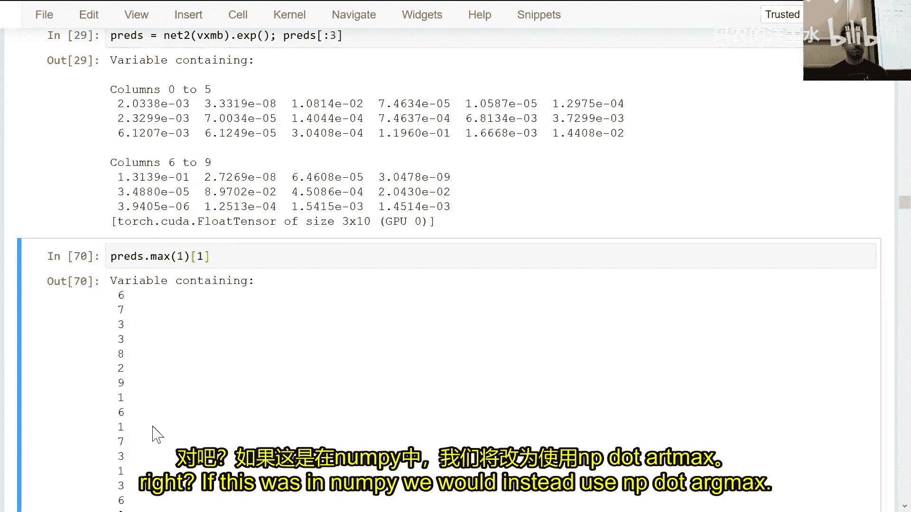

哎。嗯。All right。

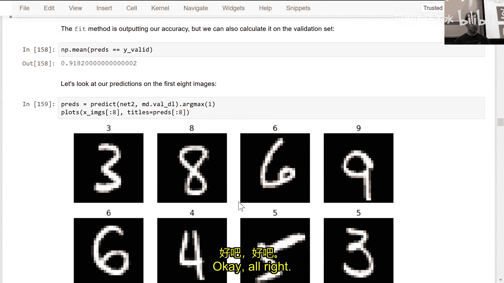

So here are the predictions from All。Hand created logistic aggression， and in this case。

Looks like I got old but one。

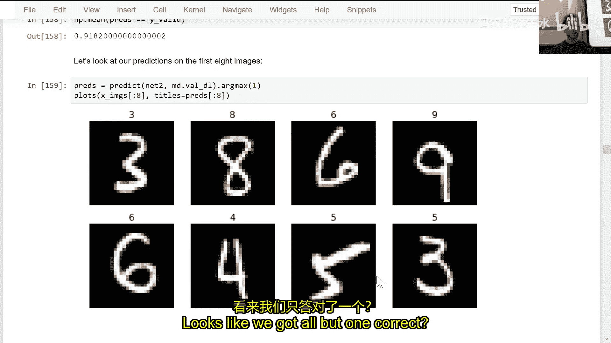

So the next thing we're going to try and get rid of in terms of using libraries is we'll try to avoid using the matrix multiplication operator。

 and instead we're going to try and write that by hand。嗯。So this next part。

 we're going to learn about something which kind of seems。嗯。

It kind it's going to seem like a minor little kind of programming idea。

 but actually it's going to turn out。That at least in my opinion， it's the most important。

Programming concept that we'll teach in this course。

 And it's possibly the most important programming kind of concept in all of。

All the things you need to build machine learning algorithms， and it's the idea of broadcasting。

And the idea I will show by example， if we create an array of 10，6N four and an array of 287。

 and then add the two together。嗯。It adds each of the components of those two arrays in turn。

 and we call that element wise。So in other words， we didn't have to write a loop right back in the old days we would have to have looped through each one and added them and then concatenated them together。

 we don't have to do that today it happens for us automatically。So in Numpy。

 we automatically get element wise operations。We can do the same thing。With pie torch。

So in first day， I would just add a little capital T to turn something into a pipeto tensor And if we add those together。

It's actually the same thing， so element wise operations are pretty standard in these kinds of libraries。

It's interesting not just because we don't have to write the full loop。

But it's actually much more interesting because of the performance things that are happening here。

The first is if we were doing a fall loop。Right。If we were doing a fall loop。

So that would happen in Python。Even when you use Pytorrch， it still does the full loop in Python。

 it has no way of like optimizing a full loop， and so a full loop in Python is something like 10。

000 times lower than in C。So that's your first problem。 I can' of remember it's like 1000 or 10000。

The second problem then is that。You don't just want it to be optimized in C。

 but you want C to take advantage of the thing that your all of your CPUs do to something called Cindi single instruction。

 multiple data， which is your your CPU is capable of taking。Eight things at a time。

In a vector and adding them up to another vector with eight things in in a single CPU instruction。

so if you can take advantage of CD， you're immediately eight times faster。

 It depends on how big the data type is it might be four might be 8。

 The other thing that you've got in your computer。Is you've got multiple processes。Notultiple cause。

So you've probably got， like if this is inside happening on one side one core。

 you've probably got about four of those。Okay， so if you're using Cd， you're eight times faster。

 if you can use multiple cores， then you're 32 times faster， and then if you're doing that in C。

 you might be something like 32 times00 times faster right And so the nice thing is that when we do that。

It's taking advantage of all of these things。Okay， better still if you do it。In pieytorrch。

 and your data was created with。Dark coder to stick it on the GPU。Then your GPU can do about 10。

000 things at a time。so that'll be another100 times faster than C。All， so this is critical。

To getting good performance is you have to learn how to write luus code by taking advantage of these element wise operations。

 And like it's， it's a lot more than just plus。I could also use less than。And that's going to return。

011， or if we go back to nuumply。False church true。

And so you can kind of use this to do all kinds of things without looping。 So， for example。

 I could now multiply that by a。And here are all of the values of a。As long as they are less than be。

Or we could take them in。This is the percentage of values in A that are less than B。

So there's a lot of stuff you can do with this simple idea。But to take it further right。

 to take it further than just this elementwise operation。

 we're going to have to go the next step to something called broadcasting。

 so let's take a five minute break， come back at 217 and we'll talk about broadcasting。😊，嗯。So。

Broadcasting。This is the definition from the Nie documentation of broadcasting。

 and I'm going to come back to it。In a moment rather than reading it now。But let's start。

By looking an example of broadcasting。So， a is a。Aorray。With one dimension。

 also known as a rank1 tensor。Also known as a vector。We can say a greater than zero。So here we have。

A rank one tensor。And a rank zero tensa。A rank zero tensor is also called a scalar。

The rank1 tensor is also called a vector。And we've got an operation between the two。

Now you've probably done it a thousand times without even noticing that's kind of weird that you've got these things of different ranks and different sizes。

 So what is it actually doing but what it's actually doing is it's taking that scalar and copying it here。

 here， here。And then it's actually going element wise。10 is greater than zero。

Six is greater than zero， minus4 is greater than 0， given giving us back the three anunces。

And that's called broadcasting Broing means。Copying。One or more axes of my tensor。

To allow it to be the same shape。Has the other tensor。It doesn't really copy it though。

What it actually does is it stores this kind of internal indicator that says pretend that this is a vector of three zeros。

But it actually just like rather than kind of going to the next row or going to the next scalar。

 it goes back to where it came from if you're interested in learning about this specifically they set the stride on that axis to be zero。

 that's a minor advanced concept for those who are curious。So we could do。A plus1。

It's going to broadcast the Sc of one。To be 111 and then do element wise Ed。

We could do the same with a matrix right Here's our matrix。

 two times the matrix is going to broadcast2 to be2，2，2，2，2，2，2，2，2。

And then do element wise modification。 so that's our kind of most simple version of。Broadcasting。

So here's a slightly more complex version of broadcasting。Here's an array called C， right。

 so this is a frank1 tensor。And here's our matrix M from before。Our rank 2 tensor。

 we can add M plus C。So what's going on here？One，2，3。Four， five， six， seven， eight， nine。That's M。

And then C。10。20。30。You can see that what it's done is to add that to each row。11， 22， 33。1425，36。

 And so we can kind of figure it seems to have done the same kind of idea as broadcasting a scalr。

 It's like made copies of it。And then it treats those。As if it's a rank2 matrix。

 and now we can do El wise addition。Does that makes sense now that's yes。

 can you pass that Devon over there？So as it's like by looking at this example。

 it like copies it down making new rows， so how would we want to do it if we wanted to get new columns I'm so glad you asked？

ふす。😊，So。Instead。We would do this。10，20，30。And then copy that 10， 20 30。10，20，30。

And now treat that as our matrix。So to get nuy to do that， we need to not pass in。A vector。

But to pass in。A matrix with one column， a rank two tensor。Right。So basically， it turns out。😊。

That nuy is going to think of。A rank one tensor for these purposes， as if it was a rank 2 tensor。

 which represents a row。 so in other words， that it is one by3。 So we want to create a tensor。

 which is three by one。There's a couple of ways to do that。1 is to use N dot expand dims。

 And if you then pass in this argument， it says， please insert a length one axis here， please。

 So in our case， we want to turn it into a。3 by one。 So if we set expand in C comma 1。呃。Okay。

 so if we say expand in C comma 1， it changes the shape to 3 comma 1。

So if we look at what that looks like。That looks like her。A column okay， so if we now go that。Plus。

 M。You can see it's doing exactly what we hoped it would do。hich is to add 10- 2030 to the column。

102030 to the column 102030 to the column。Okay。Now。

 because the location of a unit access turns out to be so important。嗯。

It's really helpful to kind of experiment with creating these extra unit axes and know how to do it easily and NP dot expand Ems isn't in my opinion。

 the easiest way to do this， the easiest way。The easiest way is to index into the tensor with a special index nu。

 and what nu does is it creates a new axis in that location。Of length one。Right， so this is。

Going to add a new access at the start。Herle length one。This is going to add a new axis at the end。

At length，1。Or why not they're both？Right，So if you think about like a tensor。Which has like three。

Things in it could be of any rank you like。Right， it can just add unit axes all over the place。

 And so that way， we can kind of。Decide how we want our broadcasting to work。

So there's a pretty convenient。嗯。Thing in Ny called Brocast2。

And what that does is it takes our vector。And broadcasts it to that shape。

And shows us what that would look like。Right，So if you're ever like unsure of what's going on in some broadcasting operation。

 you can save broadcast 2。 And so， for example， here， we could say like rather than3 comma 3。

 we could say M dot shape。and see exactly what's happening going to happen。

 and so that's what's going to happen before we add it。To M， right。 So if we said。

Turn it into a column。That's what that looks like。Make sense， so that's kind of like the intuitive。

Definition of broadcasting。 And so now hopefully， we can go back to that nupy documentation and understand。

What it means， right？Broadcasting describes how numpy is going to treat arrays of different shapes when we do some operation。

 The smaller array is broadcast across the larger array by smaller array。 they mean lower rank。

Tensor， basically broadcast across the the higher rank tensor so they have compatible shapes that vectorizes array array operation。

 So vectorizing generally means like using Cd and stuff like that so that multiple things happen at the same time。

 over looping occurs in C。 but it doesn't actually make needless copies of data it kind of just acts。

As if it had， so there's our definition。Now in deep learning。

 you very often deal with tensors of rank four or more。

 and you very often combine them with tensors of rank one or two and trying to just rely on intuition to do that correctly is nearly impossible。

 so you really need to know the rules。So here are the rules。Okay， here's M dot shape。

 here's C dot shape。 So the rule are that we're going to compare the shapes of our two tensors element wise。

 We're going to look at one at a time。And we're going to start at the end。

So look at the trailing dimensions。And then go。Towards the front。

And so two dimensions are going to be compatible。When one of these two things is true。

 so let's check， right， We've got our， our M and C compatible。 M is 3，3。C is。3， right。

 so we're going to start at the end trailing dimensions first and check。 Are they compatible。

 They're compatible if the dimensions are equal。 Okay， so these ones are equal。

 so they're compatible。Right。All right， let's go to the next one， Oh oh， we're missing。

C is missing something， so what happens if something is missing as we insert a one。Okay。

 that's the rule， And so let's now check are these compatible， one of them is one， Yes。

 they're compatible。Okay， so now you can see why it is that numpy treats。The one dimensional array。

As if it is a rank to tensor。Which is representing a row。

 It's because we're basically inserting a one at the front。Okay， so that's the rule， So for example。

嗯。This is something that you very commonly have to do， which is you start with like。

An image like 256 pixels by 256 pixels by three channels。And you want to subtract。

The mean of each channel。Right so you've got 256 by 256 by3 and you want to subtract something of length 3。

 So yeah， you can do that absolutely because three and three are compatible because they're the same。

😊，256 and empty is compatible because it's going to insert a one。

 256 and empty is compatible because it's going to insert a one。so you're going to end up with。

This is going to be broadcast over。All of this axis。

 and then that whole thing will be broadcast over this axis。

 and so we'll end up with a 256 by 256 by3。Effective。Tensa here。来。So interestingly， like。

Very few people in the data science or machine learning communities understand broadcasting and the vast majority of the time。

 for example， when I see people doing preprosing for computer vision， like subtracting the mean。

 they always write loops over the channels right And I kind of think like。

It's it's like so handy to not have to do that。 And it's often so much faster to not have to do that。

 So if you get good at broadcasting， you'll have this like super useful skill that very。

 very few people have。And like it's an ancient skill， you know。

 it goes all the way back to the days of APL。So APL was from the late 50s。

standss for our programming languagengu。And Kenneth Iverson。

Wrote this paper called Notation as a tool for Thought。In which he proposed a new mass notation。

And he proposed that if we use this new math notation。

 it gives us new tools for thought and allows us to think things we couldn't for。

And one of his ideas was broadcasting， not as a。Computer programming tool。

 but as a piece of math notation。And so he ended up implementing。

This notation as a tool for thought as a programming language called AL。

And his son has gone on to further develop that。Into a piece of software called J。

 which is basically what you get when you put 60 years of very smart people working on this idea and with this programming language you can express very complex mathematical ideas often just with a line of code or two。

And so I mean， it's great that we have J， but it's even greater that these ideas have found their ways into the languages we all use。

 like in Python， the nuumpy and Pytorrch libraries right these are not just little。😊。

Kind of niche ideas， these like fundamental ways to think about math and to do programming。

 let me give an example of like this kind of notation as a tool for thought let's。Let's look。

 here we've got C， right？Here， we've got C。None， right， Not this is now up two square brackets。

 right， So this is kind of like a a one row。Rak2 tensor。Here is another column。So what is？呃。

And mean just round ones。Okay， what's that going to do？Have a think about it。

If anybody want to have a go can even talk through your thinking。 Okay。

 can we pass the check over there。 Thank you。Kind of outer product Yes， absolutely。

 so take us through your thinking， how's that going to work？So。

The tal elements can be directly visualized from the squares。😊，10 cross 10。

20 cross 20 and 30 cross 30。And if we multiply the first row with this column。

 we can get the first row of the matrix。So finally， we'll get a three cross three matrix。

And so to think of this in terms of like those broadcasting rules， we're basically taking。

This column， right， which is of rank。嗯。3 comma 1， right and this kind of row。

Sorry that's dimension 3 comma 1 and this row， which is of dimension1 comma 3 right and so to make these compatible with our broadcasting rules right this one here has to be duplicated。

Three times because it needs to match this。Okay， and now this one is going to have to be duplicated three times to match this。

Okay， and so now I've got two。Marices to do an element wise product of。And so as you say。

There is our out of product。Now， the interesting thing here is that suddenly now that this is not a special mathematical case。

 but just a specific version of the general idea or broadcasting， we can do like。And add a plus。

Or we can do an order greater than。Right or whatever。

 right So it's suddenly we've kind of got this this concept。That we can use to build。New ideas。

 And then we can start to experiment with those new ideas。 And so， you know， interestingly。

 nuI actually uses this sometimes。嗯。For example， if you want to create a grid。

This is how Numpy does it。Actually， this is kind of the sorry， let me show you this way。

If you want to create a grid， this is how Numpy does it。 It actually returns。Z， one， two， three。

 four。And。Zero，1，2， three4。One is a column， one is a row。So we could say like， okay。

 that's x grid comma y grid。And now you could do something like。Well， I mean， we could obviously go。

Like that。And so suddenly we'd expanded that out。Into a grid， right。Yeah。

 it's kind of interesting how like。Some of these like simple little concepts。

Kd of get built on and built on and built on。 So if you lose something like APL or J。

 it's this whole environment of layers and layers and layers of this we don't have such a deep environment in Nmpay。

 but you know you can certainly see these ideas of like broadcasting coming through in simple things like how do we create a grid in Npay。

So yeah， so that's。That's broadcasting。 And so what we can do with this now。

Is use this to implement matrix modification ourselves。Okay。Now why would we want to do that Well。

 obviously we don't right matrix multiplication has already been handled perfectly nicely for us by our libraries。

 but very often you'll find in all kinds of areas in machine learning and particularly in deep learning that they'll be。

Particular types of linear。Function that you want to do that aren't quite。Done for you right so。

 for example， there's like whole areas。Ced like。Tenser regression。And tensor decomposition。嗯。

Which are really being developed a lot at the moment。 And they're kind of talking about like。

 how do we take like。Higher rank tensesors and kind of turn them into combinations of rows。

 columns and faces， and it turns out that when you can kind of do this。

 you can basically like deal with really high dimensional data structures with not much memory and with not much computation time for example。

 there's a really terrific library called tensly， which does a whole lot of this kind of stuff。

for you。So it's a really， really important area。 It covers like all of deep learning。

 lots of modern machine learning in general。 And so even though you're not going to like define matrix modification。

 you're very likely to want to define some other。Slightly different tensor product， you know？

So it's really useful to kind of understand how to do that。

So let's go back and look at our matrix and our our。2 D array and one D array， rank two tensor。

 rank one tensor， and remember we can do a matrix model location。

Using the at sign or the old way N dot mapmo。 Okay。

 and so what that's actually doing when we do that is we're basically saying， okay，1 times 10 plus。

2 times 20 plus 3 times 30 is 1，40。 And so we do that for each row。

 and we can go through and do the same thing for the next one and for the next one to get our result。

You could do that in torch as well。We could make this a little shorter。Okay， same thing。嗯。Okay。

 but that is not matrix multiplication。What's that。在。Eleement wise， specifically。

 we've got a matrix and a vector， so。Broadcasting， okay， good。 So we've got。

 this is element wise with broadcasting， but notice。The numbers it's created，1040。

90 are the exact three numbers that I needed to。Calculate when I did that first。

Pace of my matrix modification。So in other words， if we sum this。Over the columns。

Which is axis equals 1。Where get our matrix sector product。Okay。So we can kind of。

Do this stuff without special help from our library。So now。

Let's expand this out to a matrix matrix product。So a matrix matrix product。Looks like this。

 This is this great site called matrix Mo， dot X， Y， Z。

And it shows that this is what happens when we multiply two matrices。Okay。

 that's what matrix modification is operationally speaking。 So in other words。

 what we just did there。Once we first of all， took the first column。With the first row。

To get this one。And then we took the second column with the first row。To get that one。

That so we're basically doing。The thing we just did， the matrixtri vectoror product。

 we're just doing it twice。Okay， once。With this column and once with this column。

 and then we cancatenate the two together。Okay， so we can now。Go ahead and do that。Like so。

M times the first column dot sum。M times the second top column that sum。

 And so there are the two columns。Of our matrix modification。O。So I didn't want to like。

Make our code too messy。 So I'm not going to actually like use that。 but like we have it there now。

 if we want to， we don't need to use。Torch or nonpmetric multi anymore。 We've got。

 we've got our own that we can use using nothing but elementwise operations， broadcasting and some。O。

So this is our。Logistic regression from scratchratch class again， I just copied it here。

Here is where we instantiate the object， copy it for the GPU。

 we create an optimizer which we'll learn about in a moment and we call fit so the goal is to now repeat this without needing to call fit。

So to do that。嗯。We're going to need a loop。Which grabs a mini batch of data at a time。

 and with each mini batch of data。We need to pass it to the optimizer。And say。

 please try to come up with a slightly better set of predictions for this mini batch。 So as we learn。

 in order to grab a mini batch of the training set at a time。

 we have to ask the model data object for the training data loader。

We have to wrap it in iter to create an iterator or a generator。

And so that gives us our data loader Okay， so Pytorrch calls this a data loader we actually wrote our own fast AI data loader。

 but it's basically the same idea。嗯。And so the next thing we do is we grab the X。And the Y tensor。

 the next one from our data loader。Wrap it in a variable to say I need to be able to take the derivative of the calculations using this because if I can't take the derivative。

 then I can't get the gradients and I can't update the wes。

And I need to put it on the GPU because my module is on the GPU。

And so we can now take that variable and pass it。t2。The object that we instantd。

 our logistic regression。 Remember， our module， we can use it as if it's a function because that's how P torch works。

And that gives us a set of predictions。As we saw him seen before。Okay。

So now we can check the loss and the loss we're defined as being a negative log likelihood loss object we're going to learn about how that's calculated in the next lesson and for now think of it just like root means square error but for classification problems。

So we can call that also just like a function。 So you can kind of see there this very general idea in pi torch that you know kind of treat everything ideally like it's a function。

 So in this case， we have a loss negative log likelihood loss object。

 We could treat it like a function。We pass in our predictions。

And we pass in our actuals right and again the actuals need to be turned into a variable and put on the GPU because the loss is specifically the thing that we actually want to take the derivative of so that gives us our loss。

And there it is， that's our loss，2。43。So it's a variable and because it's a variable。

 it knows how it was calculated， it knows it was calculated with this loss function。

 it knows that the predictions were calculated with this network。

 it knows that this network consisted of these operations， and so we can get the gradient。😊。

Auttoomatically， right？So to get the gradient。We call L dot backward。 Remember。

 L is the thing that contains our loss。So L dot backward is something which is added to anything that's a variable you can call dot backward and that says。

 please calculate the gradients。Okay， and so that calculates the gradients and stores them inside that that the basically for each of the。

Weights that was used due to the parameters that was used to calculate that， it's now stored。

A dot grad。 we'll see it later。 It's basically stored the gradient。 Okay。

 so we can then call optimize a dot step。 And we're going to do this step manually shortly。

 And that's the bit that says， please make the weights a little bit better。

 And so what optimizer dot step is doing。Is it saying like， okay。

 if you had like a really simple function。Like this。Then what the optimizer does is it says， okay。

 let's pick a random starting point。RightAnd let's calculate the value of the loss。

 so here's our parameter。Here's our loss， right， let's take the derivative。

The derivative tells us which way is down。So it tells us we need to go that direction。

And we take a small step。And then we take the derivative again， and we take a small step。

 derivative again， take a small step， derivative again， take a small step。Until eventually。

 we're taking such small steps that we stop。 Okay， so that's what。Gradian descent does。Okay。

How big a step is a small step。 Well we basically take the derivative here。

 So let's say derivative there is like 8 and we multiply it by a small number， like， say，0。01。

And that tells us what step size to take。This small number here is called the learning rate。

And it's the most important hyperparameter to set if you pick too small a learning rate。

Then your steps down are going to be like tiny， and it's going to take you forever。

To big a learning rate and you'll jump too far。And then you'll jump too far。

And you' diverge rather than converge。Okay。We're not going to talk about how to pick a learning rate in this class。

 but in the deep learning class we actually show you a specific technique that very reliably picks a very good learning rate。

嗯。So that's basically what's happening， right， So we calculate the derivatives and we call the optimizer that does a step。

 in other words， update the weights based on the gradients and the learning rate。

We should hopefully find that after doing that we have a better loss than we did before。

 so I just reran this and got a loss here of 4。16。And after one step。It's now 4。03 Okay。

 so it worked the way we hoped it would based on this mini batch。

 it updated all of the weights in our network to be a little better than they were as a result of which our loss went down。

Okay。So let's turn that into a training loop。We're going to go through 100 steps。

And grabra one more mini batch of data from the data loader。

Calculate our predictions from our network。Calculate our loss from the predictions and the actuals。

Every 10 goess will print out the accuracy。 Just take the mean of the， whether they're equal or not。

嗯。One pi torch specific thing。 you have to zero the gradients。 Basically。

 you can have networks where like you've got lots of different loss functions that you might want to add all of the gradients together right So you have to tell pi torch like when to set the gradients back to0 right So this just says set all the gradients to0。

Calculate the gradients， that's quite backward and then take one step of the optimizer。

 so update the weights using the gradients and the learning rate。And so once we run it。

 you can see the loss goes down。And the accuracy goes up。Okay。So。That's the basic approach。

 and so next lesson we'll see。What that does。 Allright， we'll look at it in detail。

 We're not going to look inside here， as I say， we're going to basically take the calculation of the derivatives as。

That's a given， right， but basically what's happening there。In any kind of deep network。

 you have kind of like a function that's like， you know a linear function and then you pass the output of that into another function that might be like a value and you pass the output of that into another function that might be another linear linear layer and you pass that into another function that might be another value and so forth right so these these deep networks are just functions of functions of functions so you could write them mathematically like that and so。

All Back prop does is it says let's just simplify this down to the two version。As we can say， okay。

 U equals f of x。Right， and so therefore， the derivative of G of F of x is we can calculate with the chain rule as being。

She dash you。F dash x。And so you can see we can do the same thing for the functions of the functions of the functions。

 And so when you apply。A function to a function of a function。

 You can take the derivative just by taking the product of the derivatives of each of those layers。

 and in neural networks， we call this back propagation。So when you hear back propagation。

 it just means use the chain rule to calculate the derivative this。

And so when you see a neural network defined。Like here， right？Like if it's defined sequentially。

 literally all this means is。Apply this function to the input。Apply this function to that。

 apply this function to that， apply this function to that。

So this is just defining a composition of a function to a function to a function to a function。Okay。

 and so， yeah， So although we're not going to bother with calculating the gradients ourselves。

 you can now see why it can do it， right， as long as it has internally。You know。

 it knows like what's the what's the derivative of to the power of what's the derivative of sine。

 What's the derivative of plus and so forth。 Then our Python code。

And here it's just combining those things together。

So it just needs to know how to compose them together with the chain rule and where it goes。Okay。

Okay， so I think we can leave it there for now and yeah。

 and in the next class we'll go and we'll see how to write our own optimizer and then well have solved MNIS from scratcht ourselves。

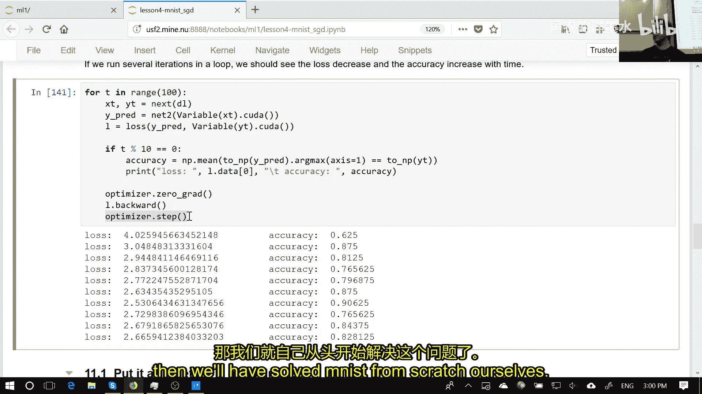

See you then。