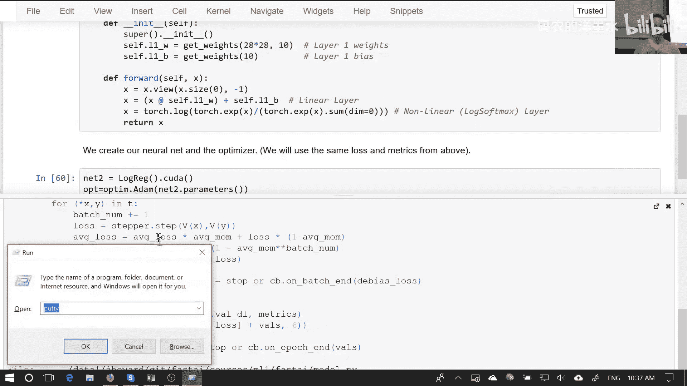
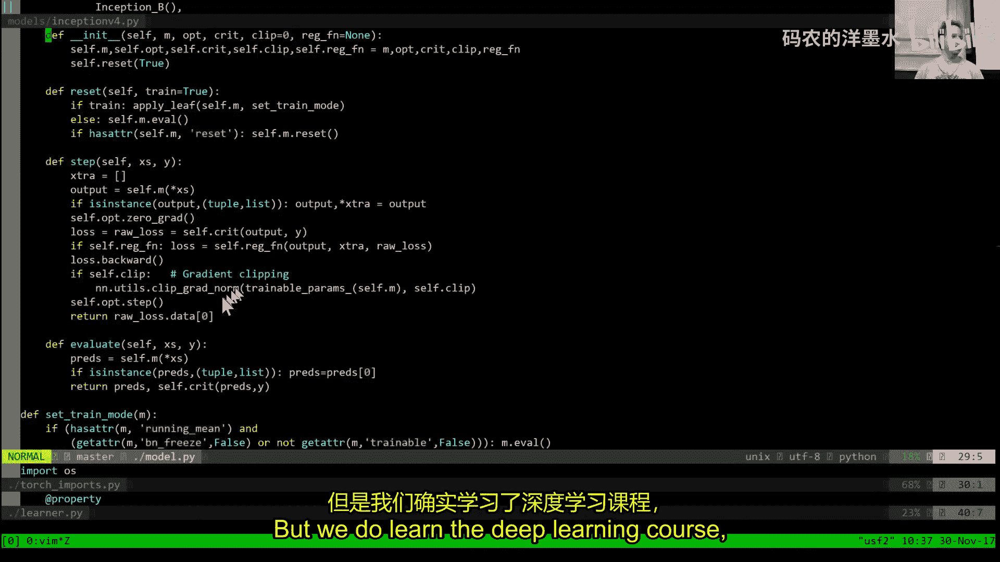
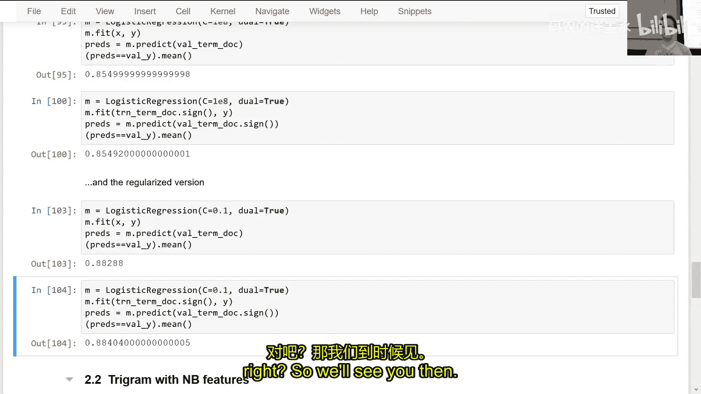

# 【全集】旧金山大学-面向程序员的机器学习-中英字幕-1080P-p10-Lecture-10---自然语言处理--BV1YAvYBAEG3_p10-

Well， welcome back to machine learning， one of the most exciting things this week。

Almost certainly the most exciting thing this week is that Fast AI is now on PIP so you can Pip install Fast AI。

嗯。And so thank you to Prince and to Km for making that happen to USF students who had never published a package before。

 and this is one of the harder ones to publish because it's got a lot of。

Depenencies so it's you know probably still easiest just to do the condo end update thing。

 but a couple of places that it would be handy instead to p and store fast AI would be well。

 obviously if you're working。Outside of the repo and the notebooks then this gives you access to Fast AI everywhere also I believe they submitted a pull request to CAgle to try and get it added to the Cagel kernels so hopefully you'll be able to use it on Cagel kernels soon。

And yeah， you can use it at your work or whatever else。 So that's that's exciting。 I mean。

 I'm not going to say it's like officially released yet。 You know， it's still very early， obviously。

 and we're still。You're helping add documentation and all that kind of stuff。

 but it's great that that's now there。嗯。Couple of cool kernelels from USF students this week。

 I thought I'd highlight two that were both from the tax normalization competition， which was about。

Trying to take text， which was。呃。Written out you know you know a standard English text they also had one for Russian and you're trying to kind of identify things that could be like a first。

 second third and say like that's a cardinal number or this is a phone number or whatever and I did a quick little bit of searching and I saw that there had been some attempts in academia to use。

Deep learning for this， but they hadn't managed to make much progress and actually noticed so Alvea's kernelel here。

 which gets 0。992 on the leader board， which I think is like top 20 is yeah。

 it's kind of entirely heuristic and it's a great example of kind of feature engineering in this case the whole thing is basically entirely feature engineering。

 So it's basically looking through and using lots of verticalal expressions to figure out for each token what is it you know and I think she's done a great job here kind of laying it all out clearly as to what all the different pieces are and how they all fit together and she mentioned that she's maybe hoping to turn this into a library which I think would be great right know you could use this to。

Grab a piece of text and pull out what are all the pieces in it。It's the kind of thing that。

The natural language processing community hopes to be able to do without like lots of handwritten code like this。

 but for now this is。It it'll be interesting to see what the winners turn out to have done。

 but I haven't seen machine learning being used really to do this particularly well。

 perhaps the best approach is the ones which combine this kind of feature engineering along with some machine learning。

I think this is a great example of effective feature engineering and this is another USF student who has done much the same thing。

 got a similar kind of score but used her own different set of rules again。

 this gets you it would get you a good leaderboard position with these as well。

So I thought that was interesting to see examples of some of our students entering a competition and getting kind of top 20 is results by。

 you know， basically just handwritten heuristics and this is where。For example， computer vision was。

Six years ago still basically all the best approaches was a whole lot of like carefully handwritten heuristics often combined with some simple machine learning and so I think over time。

You know， the field is kind of。Definitely trying to move towards automating much more of this and actually interesting very interestingly in the safe driver prediction competition was just finished。

One of the Netflix Pri winners won this competition。

 and he invented a new algorithm for dealing with structured data。

 which basically doesn't require any feature engineering at all。

 so he came first place using nothing but five。Deep learning models and one gradient boosting machine and his basic approach was very similar to what we've been learning in this class so far and what we'll be learning also tomorrow which is using fully connected neural networks and and one hot encoding and specifically embedding which we'll learn about but he had a very clever technique which was there was a lot of data in this competition which was unlabelled so in other words where they didn't know whether that。

Driver would go into claim or not or whatever so unlabeled data so when you've got some labelbeled and some unlabeled data。

 we call that semiupervised learning and in real life most learning is semisupervised learning like in real life normally you have some things that are labeled and some things that are unlabeled so this is kind of the most practically useful kind of learning and then structured data is the most common kind of data that companies deal with day to day。

 so the fact that this competition was a semiupervised structured data competition made it incredibly practically useful。

And so what his technique for winning this was was to。Through data augmentation。

 which those of you doing in the deep learning course have learned about。

 which is basically the idea like if you had pictures you would like flip them horizontally or rotate them a bit。

 data augmentation means creating new data examples which are kind of slightly different versions of ones you already have and the way he did it was for each row in the data he would like。

At random replaced 15% of the variables with a different row。

So each row now would represent like a mix of like 80% 85% of the original row。

 but 15% randomly selected from a different row and so this was a way of like。

Randomly changing the data a little bit。 And then he use something called an auto encoder。

 which will。Probably won't study until part two of the deep learning course。

 but the basic idea of an autoenr is your dependent variable is the same as your independent variable。

 So in other words， you try to predict。Your input， which obviously is。

Trivial if you're allowed to like like you the identity transform for example。

 trivially predicts the input， but the trick with an auto encodecoder is to have less activations in at least one of your layers than your input。

RightSo if your input was like a 100 dimensional vector and you put it through a 100 pi 10 matrix to create 10 activations and then had to recreate the original0 long vector from that。

 then youve basically you had to have compressed it effectively and so it turns out that that kind of neural network。

 is forced to find。Crelations and features and interesting relationships in the data。

 even when it's not labeled， so he used that rather than doing any he didn't do any hand engineering。

 he just used an auto encoder。You know， these are some interesting kind of directions that if you keep going with your machine learning studies。

 you know， particularly if you。Do part two with a deep learning course next year you'll learn about。

You can kind of see how。Feature engineering is going away and this was just。Yeah an hour ago。

 so this is very recent news indeed， but this is one of the most important。😊。

Freakthroughies I've seen in a long time。Okay， so we were working through。

A simple logistic regression trained with SGD for MNT。And here's the summary of where we got to。

We have nearly built a module， a model， a module and a training loop from scratch。

 and we are going to kind of try and finish that。 And after we finish that。

 I'm then going to go through this entire notebook backwards right so having gone like top to bottom we're then going to go back through bottom to top so。

You know， this was that little。Pand written and endO module class we created。We defined our loss。

 we defined our learning rate and we defined our optimizer and this is the thing that we're going to try and write by hand in a moment so that stuff。

That and that we're dealing with from Pytorch， but that we've written ourselves and this we've written ourselves。

 So the basic idea was we're going to go through some number of epochs。

 So let's go through one epoch。And we're going to keep track of how much for each mini batch。

 what was the loss so that we can report it at the end。

We're going to turn our training data loader into an iterator。So that we can loop through it。

 loop through every mini batch。 And so now we can go and go ahead and say for tensor in。

The length of the data loader， and then we can call next to grab the next independent variables and the dependent variables。

From our data load， from that iterator， okay？So then remember we can then pass the X tensor into our model by calling the model as if it was a function。

 but first of all， we have to turn it into a variable。

 Last week we were typing variable bla dot coa to turn it into a variable a shorthand for that is just the capital V。

s a capital T for a tensor capital B for V for a variable。

 That's just a shortcut in fast A So that returns our predictions。

And so the next thing we needed was to calculate our loss。

Because we can't calculate the derivatives of the loss if we haven't calculated the loss。

 so the loss takes the predictions and the actuals okay so the actuals again are the Y tensor and again we have to turn that into a variable。

Now， can anybody remind me what a variable is and why we would want to use a variable here？Slash。

I think once you turn into variable then it tracks it so then you can do it backward on it so can when you turn into variable it it can track like its process of like know as you add the function。

 as the function starting layered within each other。

 it can track it and then do backward on it back propagates and does the right so right。

 so a variable capes track of all of the steps。To get computed。

 And so there's actually a fantastic tutorial on the Pytorrch website。So on the P Torch website。

 there's a tutorial section。And there's a tutorial there about autograd。

 Autograd is the name of the automatic differentiation package that comes with Pytorch and it's an implementation of automatic differentiation and so the variable plus is really the key。

The key class here because that's the thing that turns a tensor into something where we can keep track of its gradients。

 So basically here they show how to create a variable， do an operation to a variable。

 and then you can go back and actually look at the grad function。

 which is the function that it's keeping track of basically to calculate the gradient right So as we do more and more operations to this a variable and the variable calculated from that variable。

 it keeps keeping track of it。 So later on， we can go dot backward。

 and then print dot grad and find out the gradient right And so you'll notice we never defined the gradient。

 we just defined it as being x plus 2。Squared times3， whatever， and it can calculate。The gradient。

Okay so that's why we need to turn that into a variable， so L is now a variable containing the loss。

 so it contains a single number for this mini batch， which is the loss for this mini batch。

 but it's not just a number， it's a number as a variable。

 so it's a number that knows how it was calculated。

So we're going to app that loss to our array just so we can。Get the average of it later， basically。嗯。

And now we're going to calculate the gradient， so L dot backward is a thing that says calculate the gradient。

 so remember when you recall call the network it's actually calling our forward function so that's like CA go through it forward and then backward is like using the chain rule to calculate the gradients backwards。

And then this is the thing we're about to write， which is update the weights based on the gradients and the load rate。

Zero grad will explain when we write this out by hand。Okay。And so then at the end。

 we can turn our validation data loader into an iterator。And we can then go through its length。

Grabbing H X and Y out of that。And asking for the score。Which we defined up here to be equal to。

Which thing did you predict？Which thing was actual， And so check whether they're equal， right。

 and then the main of that is going to be our accuracy。Could you pass that over to Chen X？はい。

What's the advantage that you converted into an iterator rather than like use normal， I dont know。

 Python loop or。We're using a normal Python loop。So it's still this is a normal Python loop。

 So the question really is like。Compared to what， right， so like。The alternative。

 perhaps you're thinking of would be like we could use like a something like a list with an indexer index Okay。

 so， you know， the problem there is that。We want。There a few things。 I mean。

 one key one is we want each time we grab a new mini batch。 We want it to be random。

 We want a different， different shuffled thing。 So this。You can actually kind of iterate from。

Forever you know you can look through it as many times as you like So there's this kind of idea it's called different things in different languages but a lot of languages are call it like stream processing and it's this basic idea that rather than saying I want the third thing or the ninth thing It's just like I want the next thing right It's great for like network programming It's like grab the next thing for the network it's great for UI programming it's like grab the next event whether somebody clicked a button it also turns out to be great for this kind of numeric programming。

 it's like I just want the next batch of data。It means that the data like can be。

Kind of arbitrarily long as we're describing one piece at a time。Yeah， so， you know， I mean。

 and also I mean I guess the short answer is because it's how Pytorrch works。

 Pytorrchs data loaders are designed to be called in this way。

 and then so Python has this concept of a generator， which is like a different type of generator。

I wonder if this is going to give be a snake generator or a computer generator。 Okay。

 a generator is a way that you can create a function that， as it says， behaves like an iterator。

 So Black Python has recognized that this stream processing approach to programming is like super handy and helpful and supports it everywhere。

 So basically anywhere that you use for in loop anywhere you use a list comprehension those things can always be generators or iterators。

 So by programming this way， we just get a lot of。Flexibility， I guess。

Does that sound about right Terrence， you're the programming language expert。

 did you do you want to grab the box so we can hear？

So Terrence actually does programming languages for a living， so we should ask him。Yeah I mean。

 the short answer is what you said， you might say something about space。

 but in this case that all that data has to be in memory anyway because we've got No。

 it doesn't have to be in memory in fact most of we could pull a mini batch from something In fact most of the time with pipe torch the mini batch will be read from like separate images spread over your disk on demand so most of the time it's not in memory but in general you want to keep as little in memory as possible at a time And so the idea of stream processing also is great because you can do compositions you can pipe the data to a different machine you can yeah yeah the composition is great you can grab the next thing from here and then send it off to the next stream which can then grab it and do something else which you guys all recognize of course the command line pipes and redirection thanks Ernce。

It's a benefit of working with people that actually know what they're talking about。All right。

 so let's now take that and get rid of the optimizer。

Okay so the only thing that we're going to be left with is the negative log likelihood loss function which we could also replace actually we have a implementation of that from scratch that Jeant wrote in the notebooks。

 so it's only one line of code as we learned earlier。

 you can do it with a single if statement so I don't know why it's so lazy as to include this。

So what we're going to do is we're going to again grab this module that we've written ourselves。

 the logistic regression module， we're going to have one epoC again。

 we're going to loop through each thing in our iterator again。

 we're going to grab our independent independent variable for the mini batch again。

 pass it into our network again， calculate the loss So this is all the same as before。

 but now we're going to get rid of this optimizer dot step。And we're going to do it by hand。

So the basic trick is。As I mentioned， we're not going to do the calculus by hand。

 So we'll call L dot backward to calculate the gradients automatically。

 And that's going to fill in our weight matrix。 So do you remember when we created our。

 let's go back and。Look at the code for。Here's that module we built。

 so the weight matrix for the linear layer weights we called L1W and for the bias we called L1b so they were the attributes we created。

So。I've just put them into things called W and B just to save some typing basically。

 so W was our weights， B is our biases。And so the weights， remember。

 the weights are a variable and to get the tensor out of the variable， we have to use dot data。

 so we want to update the actual tensor that's in this variable。 So we say weights dot data。

Minus equals。 so we want to go in the opposite direction to the gradient。

 The gradient tells us which wears up and we want to go down。Whatever is currently in。The gradients。

Time is the learning rate。So that is the formula for。Gradian descent。All， so as you can see。

 it' it's like。As as easy thing as you can possibly imagine。

 it's like literally update the weights to be to be equal to whatever they are now minus the gradients times the load rate。

And do the same thing。For the bias。Does anybody have any questions about that step in terms of like why we do it or how did you have a question。

 do you want to correct that？Not that step， but when we do the next stop deal the next here yes yes。

 so when we reach the end of the loop， how do we grab the next element？So this is going through H。

Each index in range of length， so it is going0，1，23 at the end of this loop。

It's going to print out the main of the validation set， go back to the start of the epoC。

 at which point it's going to recreate a new iterator。Okay， so basically behind the scenes in Python。

 when you call ItA on this， it basically tells it to like reset its state to create a new itertor。

And if you're interested in how that works the。嗯。The code is all available for you to look at。

 so we could look at like MDd。traindL。Is a fast AI do data set model data loader。

 So we could like take a look at the code of that。So we could take a look at the code of that。

And see exactly。How it's being built， right？ And so you can see here that here's the next function。

 right， which basically is。Keeping track of how many times it's been through in the self。

i and here's the Ed function， which is the thing that gets called when you create a new iterator and you can see it's basically passing it off to something else。

 which is a type data loader and then you can check out data loader if you're interested to see how that's implemented as well。

So the data loader that we wrote basically uses modi threading to allow it to have multiple of these going on at the same time。

It's actually great， it's really simple， it's like it's only about a screen full of code。

 so if you're interested in simple multi threaded programming， that's a good thing to look at。😊，Okay。

 now。Oh， yes。Why have you wrapped this in a four epoch in range one since that'll only run once because in real life we would normally be running multiple epochs so like in this case because it's a linear model it actually basically trains to as good as it's going to get in one epoC so if I type three here。

It actually。嗯。It actually won't really improve after the first epoch much at all。

 as you can see right but when we go back up to the top we're going to look at some slightly deeper and more interesting versions which will take more epochs so you know if I was turning this into into a function you know I'd be going like。

You know， death， train model。And one of the things you would pass in is late number of epochs。

Kind of a thing。Okay， great。So one thing to remember is that。

When you're you know creating these neural network layers and remember like this is just as as Pytorch is concerned。

 this is just it's an N end dot module， it could be a we could be using it as a layer who could be using it a function。

 we could be using it as a neural net， Pytorch doesn't think of those as different things right so this could be a layer inside some other network so how do gradients work。

 So if you've got a layer which remembers just a bunch of we can think of it basically as its activations right or some activations that get computed through some。

Either nonlinear activation function or through some linear function。And。From that layer。

WeIt's very likely that we're then like， let's say， putting it through a matrix product， right？

To create some new layer。And so each one of these， so if we were to grab like。

One of these activations。is actually going to be used to calculate every one of these outputs。Right。

 and so if you want to calculate the。The derivative， you have to know how this white bite tricks。

Impacts that output and that output and that output and that output right。

 and then you have to add all of those together to find like the total impact of this， you know。

 across all of its outputs。And so that's why in pieytorrch。

You have to tall when to set the gradients to zero right because the idea is that。

 you know you could be like having lots of different loss functions or lots of different outputs in your next activation set of activations or whatever all adding up。

Increasing or decreasing your gradients， right， So you basically have to say， okay。

 this is a new calculation reset。Okay， so here is where we do that right。

 so before we do L dot backward， we say reset， okay， so let's take our weights。

Let's take the gradients， let's take the tensor that they point to。And then0 underscore。

 Does anybody remember from last week what underscore does as a suffix in Pytorch。Yeah。

I forgot the language， but basically it changes it within the place right there。

 that language is in place。Yeah， exactly， so it sounds like a minor technicality but it's super useful to remember every function pretty much has an underscore version suffix。

 which does it in place。😊，Yeah， so normally zero returns a。A tensor of zeros of a particular size。

 so zero underscore means replace the contents of this with a bunch of zeros。All right。So that's。

That's it right， so that's like SJD from scratch and if I get rid of my menu bar we can officially say it fits within a screen。

哎。So of course， we haven't got our definition of logistic aggression here。

 that's another half the screen， but basically there's not much to it， yes fish。

So later on if we have to do this more the gradient is it because you might find like a wrong minima。

 local minima is that what so you have to kick it out and that's what you have to do multiple times when the surfaces get more complicated why do you need multiple epochs。

 is that your question Well I mean a simple way to answer that would be let's say our learning rate was tiny。

Right。嗯。Then。It's just not going to get very far。There's nothing that says going through one epoch is enough to get you all the way there。

So then you'd be like， okay， well let's increase our learning rate and it's like yeah sure。

 we'll increase our learning rate， but who's to say that the highest learning rate that learn stably is is enough to learn this as well as it can be learned and for most data sets for most architectures。

 one Epar is very rarely enough to get you。So the best result you can get to。嗯。You know。

 linear models are just。They they're very nicely behaved。 you know。

 so you can often use higher learning rates and learn them more quickly。 Also they。They don't。

 you can't like generally get as good a accuracy， so there's not as bar to take them either。 So yeah。

 doing one epoC is going to be the rarity。 All right， so let's go backwards。So going backwards。

 we're basically going to say， all right， let's not write。Those two lines again and again and again。

 Let's not write those three lines again and again and again。

 Let's have somebody do that for us right， So that's like that's the only difference in that version in this version is rather than saying dot0 ourselves rather than saying minus gradient times are ourselves。

There's are rep for us， okay？There is another wrinkle here， which is this approach to updating。

The weights is actually pretty inefficient， it doesn't take advantage of momentum and curvature。

In the DOL course， we learn about how to do momentum from scratch as well， Okay。

 so if we actually just use plain old SGD。嗯。Then you'll see that this learns much slower。

 so now that I've typed to plain old SGD here， this is now literally doing exactly the same thing。

As our slow version， so' have to increase the learning rate。Okay， there we go。

 so this is now the same as the one we wrote by hand。So then， all right。

Let's do a little bit more stuff automatically。Let's not， you know。

 given that every time we train something， we have to loop through epoch。Flip through batch。

 do forward， get the loss， zero the gradient， do backward， do a step of the optimizer。

 Let's put all that in a function。Okay， and that function is called fit。All right， there it is。Okay。

 so。Let's take a look at fit。Fit。😡，Go through H ApoC。Gu through H batch。Do one step。

Cae track of the loss。And at the end， calculate the validation And so then step。

So if you're interested in looking at this， this stuff's all inside Fastai。 model。

And so here is debt， right？Zro the gradients calculate the loss。 Remember。

 pipeage tends to call it criterion rather than loss。Right， do backward。

And then there's something else we haven't learned here， but we do learn the deep learning course。

 which is gradient， so you can ignore that。

So you can see now like all the stuff that we've learned when you look inside the actual frameworks。

 that's the code you see。So that's what fit does。And so then the next step would be like， okay， well。

 this idea of like having some。Weights and a bias and doing a matrix product in addition。

Let's put that in a function。This thing of doing the logof Max。 Let's put that in a function。

 and then the very idea of like first doing this and then doing that。

 this idea of like chaining functions together。 Let's put that into a function。

And that finally gets us to。 so sequential simply means do this function， take the result。

 send it to this function， etc cetera， and linear means create the weight matrix， create the biases。

O。So that's。That's it， right？So we can then， you know， as we started to talk about。

 like turn this into a deep neural network。By saying， you know。

 rather than sending this straight off into 10 activations'。Put it into say 100 activations。

 we could pick whatever number we like。Put it through a value to make it nonlinear。

Put it through another linear layer， another value。

 and then our final output with our final activation function。 right， And so this is now。

A deep network。So we could fit that。And this time now because it's like deeper。

 I'm actually going to run a few more epochs right and you can see the accuracy increasing so if you try and increase the learning rate here it's like 0。

1。Further， it actually。St has to become unstable。 Now I'll show you a trick。

This is called learning rate andneing， and the trick is this。When you're。Traing to fit to a function。

 right， You've been taking a few steps。Step， step， step as you get close to the middle。

 like get close to the bottom。Your steps probably want to become smaller， right， Otherwise。

 what tends to happen is you start finding you're doing this。Right。

 and so you can actually see it here， right， it got 93， 94 and a bit， 94，6， 94，8。

 like it's kind of starting to flatten out。Now that could be because it's kind of。

Done as well as it can， or it could be that it's going to going backwards and forwards。

 So what is a good idea is is later on in training is to decrease your learning rate and to take smaller steps。

Okay that's called learning rate andneing So there's a function in fast AI called set learning rates here you can pass in your optimizer and your new learning rate。

And you know， see if that helps and very often it does。You slow down。

About about an order of magnitude in the deep learning course， we learn a much。

 much better technique than this to do this all automatically and at a more granular level。

 but if you're doing it by hand， you know， like an order of magnitude at a time is what。

People generally do。So you'll see people in papers talk about learning rate schedules this is like a learning rate schedule so this schedule just a moment Erica will I just come to Ernest first has got us to 97 and I tried。

kindind of going further and we don't seem to be able to get much better than that so yeah so here we've got something where we can get 97% accuracy Yes Erica so it seems like you change the learning rate to something very small。

10 times smaller than we started with so we had 0。1 now it's 0。

01 but that makes the whole model train really slow so I was wondering if you can make it so that it changes dynamically as it approaches closer to the Yeah pretty much yeah so so that's some of the stuff we learn in the deep learning course is these more advanced approaches。

这个始。So how it is different from using AdamM optimizeizer or something that's the kind of stuff we can do。

 I mean you still need a kneeling as I say we do this kind of stuff in the deep learning course so for now we're just going to stick to standard SGD。

I had a question about the data loading I know it's a fast AI function。

 but could you go into a little bit detail of how it's creating batches。

 how it's learninging data and how it's making those decisions sure。嗯。

It'd be good to ask that on Monday night so we can talk about it in detail in the De learning class。

 but let's do the quick version here， so basically there's a really nice design in Pytorrch where they basically say let's create a thing called a data set。

And a data set is basically something that looks like a list， it has a length。

and so that's like how many images are in the data set。And it has the ability to。Index into it。

Like a list。 right So if you had like D equals data set。

You can do length D and you can do D of some index right that's basically all a data set。

Is as far as Ptorrch is concerned， and so you start with a data set it's like， okay。

 D3 gives you the third image you know， or whatever。

And so then the idea is that you can take a data set and you can pass that into a constructor for a data loader。

And that gives you something which is now iterable， right？ So you can now say it。

DL and that's something that you can call next on。And what that now is going to do is if when you do this you can choose to have shuffle on or shuffle off。

 shuffle on means give me random mini batch， shuffle off means go through it sequentially。

And so what the data loader does now when you say next is that basically assuming you said shuffleicle calls true is it's going to grab。

 you know， if you've got a batch size of 64， 64 random integers between zero and length and call this 64 times to get 64 different items and jam them together。

So fast AI uses the exact same terminology and the exact same API we just do some of the details differently so specifically particularly with computer vision you often want to do a lot of so much preprocessing data augment like flipping changing the colors a little bit rotating those turn out to be really computationally expensive。

 even just reading the JPEex turns out to be computationally expensive so Plytor uses as an approach where it fires off multiple processes to do that in parallel whereas the fast AI library instead does something called multi threadreading which is can be a much faster way of doing it Yes younet。

So an Ipoch is there a realpoch in the sense that all of the elements so it's a shuffle at the beginning of thepoch something like that Yeah yeah。

 I mean not all libraries work the same way， some do sampling with replacement some don't when actually the first AI library hands off the shuffling off to the actual Ptorrch version and I believe the Ptorrch version yeah actually shuffles and an epoch covers everything once I believe。

Okay， now the thing is。When you。Start to get these bigger networks。嗯。Potentially。

 you're getting quite a few parameters。so I want to ask you to calculate how many parameters there are。

 but let's remember here we've got 28 by 28 input into 100 output and then 100 into 100 and then 100 into 10。

and then for each of those we've got weights and biases。So we can actually。Do this。Nettop parameters。

Returns a list。Where each element of the list is a matrix， actually a tensor。

Of the parameters for that not just for that layer， but if it's a layer with both weights and biases。

 that would be two parameters right so basically returns us a list of all of the tensors containing the parameters nu elements in pytorrch tells you how how big that is so if I run this。

Here is the number of。Crameters in each layer。 so I've got 784 inputs。

 and the first layer has 100 outputs。 so therefore the first weight matrix is of size 78400。

and the first bias vector is of size 100 and then the next one is 100 by 100。

And there's 100 and then the next one is 100 by 10 and then there's my bias okay so there's the number of elements in each layer and if I add them all up it's nearly 100。

000 and so I'm possibly at risk of overfitting。Right。

We might want to think about using regularization。So a really simple。

 common approach to regularization in all of machine learning is something called L2。Regcularization。

And it's super important， super handy， you can use it with just about anything and the basic idea anyway。

嗯。L2 reization， the basic idea is this， normally would say our loss。

Is equal to let's just do IMSE to keep things kind of simple， it's equal to our predictions。

 minus our actuals， you know squared， and then we sum them up， take the average。

 take the square root okay。So。What if we then want to say， you know what。

 like if I've got lots and lots of parameters？Don't use them unless they're really helping enough。

 right Like if you've got a million parameters and you only really needed 10 parameters to be useful。

 just use 10 right So how could we like tell the loss function to do that？

 And so basically what we want to say is hey if a parameter is 0。That's no problem。

 It's like it doesn't exist at all。 So let's penalize a parameter。For not being zero。

So what would be a way we could measure that？How can we calculate how unzero our parameters are？

Can you pass that to Chen X， please earn？You calculates the average of parameters that's my first can't quite be the average plus yes Taylor yes。

 you figured it out Okay think so I think if we assuming all of our data has been normalized standardized however you want to call it we want to check that they're like significantly different from zero not the data the parameters parameters rather would be significantly the parameters don't have to be normalized or anything that is calculated so significantly different from zero I just assuming that the data has been normalized so that we can compare them yeah got it right and then those that are not significantly different from zero we can and I think Chen she is going to tell us how to do that you just figured it out right。

The mean of the absolute value could do that。 That would be called L1， which is great。

 So L1 would be the。Absolute。Value of the weights average， L2 is actually the sum。

Square roots some of squares Yeah， yeah， and exactly。

 So we just take this we can just we don't even have to square root。

 So we just take the squares of the weights themselves。 And then like we want to be able to say like。

 okay。How much do we want to penalize not being zero， right？

 Because if we actually don't have that many parameters， we don't want to regular much at all。

 If we've got heaps， we do want to regular a lot， right？ So then we put a。A parameter yeah。

 right except I have a role in my classes， which is never to use Greek letters。

 so normally people use alpha， I'm going to use a okay so。

So this is some number which you often see something around kind of1 E Neg six to1 E Neg four。Ih。

 right？嗯。Now。We actually don't care about the loss。When you think about it。

 we don't actually care about the loss other than like maybe to print it out。

 All we actually care about is the gradient of the loss。Okay， so the gradient。Of that。Right is。That。

Right so there are two ways to do this， we can actually modify our loss function。

To add in this square。Penalty。Or we could modify that thing where we said weights equals weights minus gradient times learning rate to subtract that。

As well。We're actually sorry to add that as well。And。

These are roughly these are kind of basically equivalent， but they have different names。

 This is called L2 regularization， right， this is called weight decay。

So in the neural network literature。You know， that version kind of。

how it was first posed in the neural network literature whereas this other version is kind of how it was posed in the statistics literature and yeah you know their equivalent as we talked about in the deep learning class。

 it turns out they're not exactly equivalent because when you have things like momentum and Adam it can behave differently and two weeks ago a researcher figured out a way to actually do proper weight decay in modern optimizes and one of our fast AI students just implemented that in the fast AI library so fast AI is now the first。

Library to actually support this properly。 So anyway， so for now， let's do the。The version which。

Pietorrch calls weight decay， but actually it turns out based on this paper two weeks ago was actually L2 regularization。

 it's not quite correct， but it's close enough， so here we can weight decay is 1 E egg3 so it' is going to set our penalty multiplier A to 1 E egg3。

And it's going to add that to the loss function。Okay， and so let's make a copy of these cells。

Just so we can compare， hope this actually works。Okay， and we'll set this running， okay。

Because is now optimizing。Oh， except if you actually， so I've made a mistake here。

 which is I didn't rerun。This cell， this is an important thing to kind of remember since I didn't run this rerun this cell。

Here when it created the optimizer and saidNe dot parameters。

 it started with the parameters that I had already trained。

 so I actually hadn't recreated my network。Okay， so I actually need to go back and rerun this cell first to recreate the network。

 then go through and run this。Okay， there we go， so let's see what happens。

So you might notice something kind of counterintuitive here。Which is that。That's our training error。

 right Now you would expect our training error with regularization to be worse。Does that makes sense。

 right， because we're like we're penalizing parameters that specifically can make it better and yet。

Actually， it started out better， not worse。So why could that be？

So the reason that can happen is that if you have a function。That looks like that。

It takes potentially a really long time to train。R else。

 if you have a function that kind of looks more like。

That is going to train a lot more quickly and there are certain things that you can do which sometimes just like can take a function that's kind of horrible and make it less horrible。

 And its sometimes weight decay can actually make your functions a little more nicely behaved and that's actually happened here So like I just mentioned that to say like don't let that confuse you right like weight decay really does penalize the training set and look so it's strictly speaking。

The final number we get to for the training set shouldn't end up being better。

 but it can train sometimes more quickly？诶。Yes， can you pass it to Chnxi？I don't get it， Okay。

 Why making it faster， like the time matters， like the training time matters。

 No this is after one epoch。Right， so after one epoch。诶。

Now congratulations for saying I don't get it， that's like the best thing anybody can see。You know。

 so helpful。This here was our training without。Wait， okay。Okay， and this here is our training with。

 wait， okay。So this is not related to time， this is related to just an epoch。Right after one epoch。

My claim was that you would expect the training set， all other things being equal to have a。

Worse loss with weight decay because we're penalizing it。You know， this has no penalty。

 this has a penalty， So the thing with a penalty should be worse。And I'm saying， oh， it's not。

That's weird。And so the reason it's not。I because in a single epoch。

 it matters a lot as to whether you're trying to optimize something that's very bumpy。

Or whether you're trying to optimize something that's kind of nice and smooth。

If you're trying to optimize something that's really bumpy。

 like imagine in some high dimensional space， right？

You end up kind of rolling around through all these different tubes and tunnels and stuff， you know。

 or else if it's just spo， you just go boom。ButIt's like imagine a marble rolling down a hill where one of them you've got Lagan。

It's a called Lombard street in San Francisco， it's like backwards forwards， backwards forwards。

 it takes a long time to drive down the road right whereas else you know if you kind of took a motorbike and just went straight over the top。

 it just went boom right。So kind of the shape of the loss function surface you know impacts or kind of defines how easy it is to optimize。

 and therefore how far can it get in a single epoch and based on these results it would appear that weight decay here has made this function easier to optimize。

So just to make sure it's。The penalizing is making the optimizer more than likely to reach the global minimum No。

 I wouldn't say that。 My claim actually is that at the end。

It's probably going to be less good on the training set， and indeed。

 this does look to be the case at the end。After five apochs。

Our training set is now worse with weight decay。 Now， that's what I would expect， right。

 I would expect， like， if you actually find， like， I never use the term global optimum because。

It's just not something we have any guarantees about we don't really care about we just care like where do we get to after a certain number of epochs we hope that we found somewhere that's like a good solution and so by the time we get to like a good solution the training set with weight decay the loss is worse。

Because it's penaltyity。Right， but。On the validation set， the loss is better。

RightBecause we penalized the training set in order to kind of try and create something that generalizes better。

 So we've got more know the parameters that are kind of pointless than now zero and it generalizes better so all we're seeing is that it just got to a good point after one epoch。

It's really overs saying。So is it always no， no if by if you men does weight decay always make the function surface smoother。

 no it's not always true， but it's like it's worth remembering that。

If you're having trouble training a function， adding a little bit of weight decay may help。And。

What so by regularizing the parameters， what it does is it movement out the loss loss。 I mean。

 it's not， it's not why we do it。 You know， the reason why we do it is because we want to penalize things that aren't 0 to say like。

Don't make this parameter a high number unless it's really helping the loss a lot right set it to zero if you can because setting as many parameters to zero as possible means that it's going to generalize better it's like the same as having a smaller network so that's why we do it。

But it can change how it learns as well。So let's okay， just one moment， Eric。

 so I just wanted to check how we actually went here so after the second epoch， yeah。

 so you can see here it really has helped right after the second epoch。Before we got to 97% accuracy。

 now we're nearly up to about 98% accuracy。Right， and you can see that the loss was 0。08 versus 0。

13 right so adding regularization has allowed us to find a you know。3% versus 2%。

 so like a 50% better。Solution Yes Erica so there are two pieces to this right one is L2 regularization and the weight decay No they're the same so my main was they the same thing right so weight decay is the version if you just take the derivative of L2 regularization you get weight decay so you can implement it either by changing the loss function with a squared loss penalty or you can implement it by adding the weights themselves as part of the gradient。

有。Yeah， I's just gonna finish the questions。 Yes， I can you pass that to Davidvis。

Can we use regulation convolution layer as been absolutely， so a convolution layer just is whites so。

Jeremyer， can you explain why you thought you needed weight decay in this particular problem？

not easily， I mean， other than to say it's something that I would always try。

 you're feeding found Well yeah。I mean， okay。Even if I， yeah， okay， that's a good point， you。

If my training loss。Was higher than my validation loss than I'm underfitting。

So there's definitely no point recognizingizing if like that would always be a bad thing。

 that would always mean you need like more parameters in your model。

In this case I'm overfitting that doesn't necessarily mean regularization will help。

 but it's certainly worth trying Thank you Anne that's a great point that's one more question。Tyler。

 do you want to pass that over there？So how do you choose the optimal number of epoch。嗯。

You do my deep learning course。That's a long story and lots of do it by heroically it's a bit of both we just don't。

 as I say， we don't have time to cover。Best practices in this class。

 We're going to learn the kind of fundamentals。 Yeah， Okay， so let's take a。

Six minute break and come back at 1110。そね。All right。

So something that we cover in great detail in the deep learning course but is like really important to mention here is is that the secret in my opinion。

 to kind of modern machine learning techniques is to massively over parameteraize the solution to your problem right like as we've done here you know we've got like 100。

000 weights when we only had a small number of 28 by 28 images and then use regularization okay it's like the。

Direct opposite of how。Nearly all statistics and learning was done for decades before and still most kind of like senior lecturers at most universities in most areas have this background where they've learned the correct way to build a model is to like have as few parameters as possible right and so hopefully we've learned two things so far you know one is we can build。

嗯。Very accurate models， even when they have lots and lots of parameters。

 like a random forest has a lot of parameters。 And you know， this here。

 deep network has a lot of parameters， and they can be accurate。

 And we can do that by either using bagging。Or by using regularization okay and regularization in neural nets means either weight decay。

Also known as kind of filter regularization or dropout， which we won't worry too much about here。So。

 like， it's a。It's a very different way of thinking。

About building useful models and like I just wanted to kind of warn you that once you leave this classroom。

 like even possibly when you go to the next faculty members talk。

 like there'll be people at USF as well who，Entirely trained in the world of like。

Models with small numbers of parameters。 you know， your。

 your next boss is very likely to have been trained in the world of like models with small numbers of parameters。

 the idea that they are somehow。More pure or easier or better or more interpretable or whatever。

I am convinced that that is。Not true， probably not ever true， certainly very rarely true。

And that actually。Models with lots of parameters can be extremely interpretable。

 as we learn from our whole lesson of random forest interpretation。

 you can use most of the same techniques with neural nets， but with neural nets they even easier。

 right？ Remember how we did feature importance by randomizing a column to see how changes in that column would impact the output。

Well， that's just like a kind of dumb way of calculating its gradient。

How much does burying this input change the output with a neural net we can actually calculate its gradient？

So with pi torch， you could actually say， what's the gradient of the output with respect to this column？

you can do the same kind of thing to do a partial dependence plot with a neural net。And you know。

 I'll mention for those of you interested in making a real impact， nobody's written。Basically。

 any of these things for neural nets。So that whole area needs like libraries to be written。

 blog posts to be written， you know， some papers have been written。

 but only in very narrow domains like computer vision。

 as far as I know nobody's written the paper saying here's how to do structured data neural networks。

 you know， interpretation methods。So it's a really exciting， big area。啊。

So what we're going to do though， is we're going to start with applying this with a simple linear model。

And this is mildly terrifying for me because we're going to do NLP and our NLP faculty expert is in the room。

 so David just yell at me if I screw this up too badly。And so NLP refers to， you know。

 any kind of modeling where we're working with natural language tests and interestingly enough。

We're going to look at a situation where a。Lydia model is pretty close to the state of the art for solving a particular problem。

 It's actually something where I actually surpass this be state of the art in this， using a。

Her current neural network a few weeks ago。 But this is actually going to show you pretty close to the state of art with with a linear model。

 We're going to be working with。The AMMDBD data set， so this is a data set of movie reviews。

 you can download it by following these steps。U。And。Once you download it。

 you'll see that you've got a train and a test。Diirectory？And in your train directory。

 you'll see there's a negative and a positive directory， and in your positive directory。

 you'll see there's a bunch of text filess。And here's an example of a text file。

 so somehow we've managed to pick out a story of a man who has unnatural feelings through a pig as our first choice。

 that wasn't intentional， but it'll be fine。嗯。So we're going to look at these movie reviews。

And for each one we're going to look to see whether they were positive or negative。

 so they've been put into one of these folders， they were downloaded from IMDB。

 the movie database and review site， the ones that were strongly positive， went in positive。

 strongly negative， went negative， and the rest they didn't label at all。

 so these are only highly polarized reviews。So in this case， you know， we have an insane violent mob。

 which unfortunately is too absurd， too off putting， those in the area will be turned off。

 so the label for this was a zero which is negative so this is a negative review。

So in the first A I library， there's lots of little functions and classes to help with。

Most kinds of domains that you do machine learning on for NLP。

 one of the simple things we have is texts from folders。

 that's just going to go ahead and go through and find all of the folders in here with these names and create a labeled data set and you know don't let these things。

Ever stop you from understanding what's going on behind the scenes。 We can grab its source code。

 And as you can see， it's tiny， you know， it's like five lines。 Okay。

 so I don't like to write these things out in full， you know， but hide them behind at functions。

 So you can reuse them。 but basically， it's just going to go through each directory。

 And then within that。 So I go through。Yeah go through each directory and then go through each file in that directory and then stick that into this array of texts and figure out what folder it's in and stick that into the array of labels。

That's how we basically end up with something where we have an array of the reviews and an array of the labels。

 Okay， so that's our data。 So our job will be to take。That。And to predict。That。Okay。

And the way we're going to do it is we're going to throw away like all of the interesting stuff about language。

 which is the order in which the words are in now this is very often not a good idea。

 but in this particular case， it's going to turn out to work like not too badly。

 So let me show what I mean by like throwing away the order of the words。

 like normally the order of the words matters a lot。 if you've got a not。Before something。

 then that not refers to that thing right so but the thing is when in this case。

 we're trying to predict whether something's positive or negative， if you see the word absurd。

 appear a lot，Then maybe that's a sign that this isn't very good。So， you know， cryptic。

 maybe that's a sign that it's not very good。 So the idea is that we're going to turn it into something called a。

Term document matrix， where for each document each review。

 what is going to create a list of what words are in it。Rather than what order they're in。

 So let me give an example。 Can you see this okay？Okay。So here are four movie reviews that I made up。

This movie is good， the movie is good， they're both positive， this movie is bad， the movie is bad。

 they're both negative right so I'm going to turn this into a term document matrix so the first thing I need to do is create something called a vocabulary a vocabulary is a list of all the unique words that appear。

Okay， so here's my vocabulary， this movie is good， the bad， that's all the words。Okay。

And so now I'm going to take each one of my movie reviews and turn it into a vector of which words appear and how often do they appear And in this case。

 none of my words appear twice， So this movie is good， has those four words in it。

Where else this movie is bad， has。Those four words in it。Okay， so this。

It's called a term document matrix。And this representation we call a bag of words representation right so this here is a bag of words representation of the review。

 It doesn't contain the order of the text anymore。 It's just a bag of the words。

 What words are in it。 It contains bad is movie this。Okay。

 so that's the first thing we're going to do is we're going to turn it into a bag of words representation and the reason that this is convenient。

For linear models is that this is a nice rectangular matrix that we can like do math on。Okay。

 and specifically we can do a logistic regression， and that's what we're going to do is we're going to get to a point where we do a logistic regression。

Before we get there though， we're going to do something else， which is called naive basease。

So SKL has something which will create a term document matrix for us， it's called count vectorizer。

 okay， so we'll just use it。Now in NLP。You have to turn your text into a list of words。

And that's called tokenization。 Okay， And that's actually non trivial because like。

 if this was actually this movie is good。Dot， right， Or if it was this。Movie。Is good like。

How do you deal with like that？Punctuation， or perhaps more interestingly。

 what if it was this movie isn't good。So how you turn a piece of text into a list of tokens is called tokenization right and so a good tokenizer would turn this movie isn't good。

Into this， this space， quote， movie space is space and God space。 right。

 So you can see in this version here。If I now spit this on spaces。

 every token is either a single piece of punctuation or like this suffix ant is considered like a word right that's kind of like how we would probably want to tokenize that piece of text because you wouldn't want good full stop。

To be like。An object， right， because it does there's no concept of good full stop， right。

 or double quote movie is not like an object。All right， so。

Tokenization is something we hand off to a tokenizer。FastAI has a tokenizer in it that we can use。

So this is how we create our term document matrix with a tokener。

S can Learn has a pretty standard API， which is nice， I'm sure you've seen it a few times now before。

 So once we've built some kind of model， I think we can kind of think of this as a model just ish This is just defining what it's going to do。

 we can call fit transform to。To do that， right， So in this case。

 sp transform is going to create the vocabulary。Okay。

 and create the term document matrix based on the training set。Transform is a little bit different。

 That says use the previously fitted model， which in this case means use the previously created vocabulary。

 We wouldn't want the validation set and the training set to have。You know。

 the words in different orders in the matrices right because then they'd like to have different meanings。

 so this is here saying use the same vocabulary to create a bag of words for the validation set Could you pass that back in please？

What if the violation set has different set of words other than training set Yeah that's a great question so generally most of these kind of vocab creating approaches will have a special token for unknown sometimes you can you'll also say like hey if a word appears less than three times call it unknown but otherwise it's like if you say something you haven't seen before。

 call it unknown so that just become a column in the bag of words is unknown。Good question All right。

 so when we create this term document matrix of the training set， we have 25。

000 rows because there are 25，000 movie reviews and there are 75，132 columns。

What does that represent， What does that mean， There are 775132。

 What can you pass that to div just a moment， can you pass that to div。

All vocabulary one what do you mean so like the number of words union of number of words。

 the number of unique words， yeah， exactly good okay。Now。Most documents。Don't have most of these 75。

000。Whats。So we don't want to actually store that。As a normal array in memory because it's going to be very wasteful。

So instead， we store it as a sparse matrix。 and what a sparse matrix does is it just stores it。

As something that says whereabouts are the non zeros， right， So it says like， okay， term number。

 so document number one。Word number 4。Appears and it has four of them， you know。

 document  one term number243 has that that appears and it's a one right and so forth。

 that's basically how it's stored there's actually a number of different ways of storing and if you do Rachel's computational linear algebra course you'll learn about the different types and why you choose them and how to convert and so forth but they're all kind of something like this right and you don't really on the whole have to worry about the details。

The important thing to know is it's efficient and so we could grab the first review。Right。

 and that gives us。75，000 long spas。One long， one row long matrix okay with 93 stored elements。

 so in other words， 93 of those words are actually used in the first document。

We can have a look at the vocabulary by saying back to riseor。

gapfe feature names that gives us the vocab， and so here's an example of a few of the elements of G feature names。

U。I didn't intentionally pick the one that had Aussie， but you know that's the important words。

 obviously。I haven't used the tokenizer here I'm just spitting on space。

 so this isn't quite the same as what the vectorizer did。

 but to simplify things let's grab a set of all the lowercased words by making it a set we make them unique so this is roughly the list of words that would appear right and that length is 91 which is pretty similar to 93 and just the difference will be that I didn't use a real tokenizer right。

嗯。So that's basically all that's been done there is's kind of created this unique list of words and mapped them。

We could check by calling vectorer vocabulary underscore to find the idea of a particular word。

 so this is like the reverse map of this one right so this is like integer to word。

 here is word to integer and so we saw absurd appear twice in the first document so let's check train term doc0 comma 1297 there it is as two。

Right or else， unfortunately， Aussie didn't appear in the unnatural relationship with a pig movie。

 so zero comea 5，000 is zero。Okay， so that's our term document matrix。Yes。

So does it care about the relative relationship between the words？As in the ordering of the words。

 No， we've thrown away the orderings。 That's why it's a bag of words。

And I'm not claiming that this is like。Necessarily a good idea。 What I will say is that， like。

The vast majority of NLP work that's been done over the last few decades generally uses this representation because we didn't really know much better。

 Nowadays， increasingly， we're using recurrent neural networks instead。

 which we'll learn about in our。Last。Deep learning lesson of part one。

 But sometimes this representation works pretty well。

 and it's actually going to work pretty well in this case。Okay， so and in fact。

 you know almost like that when I was at Fastma， my email company。

 a lot of the spam filtering we did used this next technique， naive B。

 which is as a bag of words approach， is kind of like， you know， if you're getting a lot of。

Email containing the word Viaggra and it's always been a spam and you never get email from your friends talking about Viaggra then it's very likely something that says viaaggra regardless of the detail of the language is probably from a spammer so that's the basic theory about like classification using a term document matrix Okay so let's talk about naive bees。

And here's the basic idea。 We're going to start with our term document matrix。哎。And these first two。

Is our corpus of positive reviews。These next two is our corpus of negative reviews。

 and so here's our whole corpus of all reviews。 so what I could do is now to create a。Probability。

I'm got to call the， as we tend to call these more generically features rather than words， right。

 This is a feature。 movie is a feature is as a feature。 right。

 So it's kind of more now like machine learning language。 a column is a feature。 We'll call those。

 We often call those F in naive phase。 So we can basically say the probability that you would see the word this。

Given that。The class is one， given that it's a positive review。

 is just the average of how often do you see this in the positive reviews？Right？

Now we've got to be a bit careful， though， because。嗯。If you never， ever see a particular word。

In a particular class right so if I've never received an email from a friend that said Viaggra。

 that doesn't actually mean the probability of a friend sending me an email about Viaggra is zero。

 it's not really zero。Right I hope I don't get an email， know， from Terrence tomorrow saying like。

Jeremy， you probably could use this you know advertisement for Vigra， but you know。

 it could happen and you know？😊，You know I'm sure it'd be in my best interest so so what we do is we say actually what we've seen so far is not the full sample of everything that could happen。

 it's like a sample of what's happened so far so let's assume that the next email you get actually does mention Vigrara and every other possible word right so basically we're going to add a row of ones。

😊，Okay， so that's like the email that contains every possible word。 So that way， nothing's ever。

Infinitely unlikely。 Okay， so I take the average of。

All of the times that this appears in my positive corpus plus the ones。Okay， so that's like the。

The probability that。Feature equals this appears in a document given that class equals one。

And so not surprisingly， here's the same thing。For probability that this feature。

 this appears given classical0 same calculation， except for the zero rows。 And obviously。

 these are the same because this appears。Twice in the positives， sorry。

 once in the positives and once in the negatives， okay。Let's just put this back to what it was。

All right。So we can do that for every feature。For every class。Right。

So our trick now is to basically use a base rule to kind of fill this in。

So what we want is the probability。That。Given that I've got this particular document。

 so somebody sent me this particular email or I have this particular IMDB review。

 what's the probability that it's class？Is equal to。I don't know。 Poitive， right。

 So for this particular movie review， what's the probability that its plus is positive right。

 And so we can say， well， that's equal to the probability。That we got this particular。Movie review。

Given that， its class is positive。Multiped by the probability that Add movievie reviews class is positive。

Divided by the probability of getting this particular movie review。That's just pay this rule。

OkayAnd so we can calculate。All of those things。But actually， what we really want to know。Is。

 is it more likely that this is class 0 or class 1， right？ So what if we actually took。

Probability that's plus1 and divided by a probability that's plus zero。What if we did that， right？

 And so then we could say， like， okay， if this number is bigger than one。

 then it's more likely to be class 1， if it's smaller than one， it's more likely to be class 0。

 so in that case， we could just divide。This whole thing。by the same version for class0。

 which is the same as multiplying it by the reciprocal and so the nice thing is now that's going to put a probability D on top here。

 which we can get rid of。Right， and a probability of getting the data given class0 down here and the probability of getting class。

0ero here。 right。 And so if we basically， what that means is we want to calculate the probability that we would get this particular document。

 given that the class is one。Times the probability that the class is one。

 divided by the probability of getting this particular document， given the class is zero。

Times of probability that the class is zero。So the probability that the class is one。

Is just equal to the average of the labels。Proability that the class is0 is just one minus that。

So there are those two numbers， right I've got an equal amount of both， so it's both 0。5。嗯。

What is the probability of getting this document given that the class is one。

 Can anybody tell me how I would calculate that？Can somebody pass that please？Thank you Davis。Yes。

Look at all the documents which have classical one and one divided by that will give you。

So remember though it's going to be for a particular document。 So for example， we'd be saying like。

 what's the probability that。This review is positive。 right， So what， so you're on the right track。

 But what we have to going to have to do is're going to have to say， let's just look at。

The words it has。And then multiply the probabilities together。For class equals one， right。

 So the probability that。A class one review has this。Is。Two thirds。

 the probability it has movie is one is is one， and good is one。

 so the probability it has all of them is all of those multiplied together。Kina。And the kinder。

 Tyler， why is it not really， can you pass it to Tyler？So glad you look horrified and skeptical。

Were choice is not independent so that doesn't so nobody can call Tyler naive。

Because the reason this is naive Bes is because this is what happens if you take Bayes's theorems in a naive way and Tyler is not naive anything bad right So naive Bayes says。

 let's assume that if you have this movie is bloody stupid。

 I hate it but the probability of hate is independent if the probability of bloody is it independent of the probability of stupid which is definitely not true。

 and so naive Bes ain't actually very good， but I'm kind of teaching it to you because it's going to turn out to be a convenient piece for something we're about to learn later it's okay right I mean I I would never choose it like I don't think it's better than any other technique that's equally fast and equally easy but you know。

 it's a thing you can do and it's certainly going to be a useful foundation。So。

So here is our calculation right of the probability that this document。

Is that we get this particular document assuming it's a positive review。

 here's the probability given it's a negative and here's the ratio and this ratio is above one。

 so we're going to say I think that this is probably a positive review okay so that's the Excel version。

And so you can tell that I let Jannet touch this because it's got latex in it。

 we've got actual math so here is the same thing， the log count ratio for each feature f for each word F and so here it is written out as Python so our independent variable is our term document matrix。

 our dependent variable is just the labels of the Y so using nupy。This is going to grab the rows。

Where the dependent variable is one。Okay， and so then we can sum them over the rows to get the total word count。

For that feature across all the documents， right plus one because that's the email。

 Terrence is totally going to say me something about Vigra today。 I can tell that's that's that。

 Yeah， Okay， so do the same thing for the negative reviews。Right。And then of course。

 it's nicer to take the log because if we take the log。

 then we can add things together rather than multiply them together and once you like multiply enough of these things together。

 it's going to get kind of so close to zero that you'll probably run out of plotting point so we take the log。

Of the ratios。嗯。And then we can， as I say， we then multiply that or in log。

 we subtract that from the add that to the ratio of the class。The whole class probabilities。

 all right？So in order to say for each document， multiply the bays probabilities by the counts。

 we can just use matrix multip and then to add on the log of the class ratios。

 we can just use plus B and so we end up with something that looks a lot like our。

Logistic regression right but we're not learning anything right not in kind of a SGD point of view we're just we're calculating it using this theoretical model okay and so as I said。

 we can then compare that as to whether it's bigger or smaller than zero not one anymore because we're now in log space right？

And then we can compare that to the mean and we say， okay， that's 80% accurate， 81% accurate。

so naive days。😊，You know，s not， it's not nothing， it gave us something， okay？It turns out。😮。

That this version where we're actually looking at how often a word appears。

Like absurd appeared twice， it turns out at least for this problem and quite often。

 it doesn't matter whether absurd appeared twice or once， all that matters is that it appeared。

So what people tend to try doing is to say， take the term。

Document matrix and go dot sign dot sign replaces anything positive with one and anything negative with negative one。

 we don't have any negative counts。 obviously， so this binizes it So it says it's I don't care that you saw absurd twice。

I just care that you saw it。So if we do exactly the same thing with the binized version。

 then you get a better result。嗯。Okay， now this is the difference between theory and practice。

 right in theory。Naive base sounds okay， but it's， it's naive。 unlike Tyler。 It's naive， right。

 So what Tyler would probably do would instead say rather than assuming that。

I should use these coefficients R， why don't we learn them？Does it sound reasonable Taylory。 Yeah。

 okay， so let's learn them。 So we can， you know， we can totally learn them。

 So let's create a logistic regression。😊，And let's fit。Some coefficients。

 and that's going to literally give us something with exactly the same functional form that we had before。

 but now rather than using a theoretical R and a theoretical B。

 we're going to calculate the two things based on logistic regressionggress， and that's better。Okay。

 so。So it's kind of like， yeah， why？Why do something based on some theoretical model。

 because theoretical models are never。Going to be as accurate pretty much as a data driven model。

 right， because theoretical models， unless you're dealing with some。I don't know。

 like physics thing or something where you're like， okay， this is actually how the world works。

 There really is no， I don't know。 we're working in a vacuum and this is the exact gravity and blah。

 blah， blah， right， but most of the real world。This is how things are like it's better to learn your coefficients and calculate them。

 Yes， you know。Jeremy， what's this dual all equal through？

Hoping you'd ignore not notice but you saw it basically in this case our term document matrix is much wider than it is tall there is a reformulation a mathematically basically almost a mathematically equivalent reformulation of logistic aggression that happens to be a lot faster when it's wider than it is tall so the short answer is if you don't put that here anytime it's wider than it is tall put dual equals true and it'll run this runs in like two seconds if you don't have it here it'll take a few minutes so like in math there's this kind of concept of dual versions of problems which are kind of like。

Acquivalent versions that sometimes work better for certain situations。嗯。Okay。

 so here is the binized vision。Right， and it's， yeah it's about the same， right。

 So you can see I've fitted it with the。The sign of the do of the do term doc matrix and。

Predicted it with this， right？Now the thing is that this is going to be a coefficient for every term。

 was about 75，000 terms in our vocabulary。And that seems like a lot of coefficients given that we've only got 25。

000 reviews， so maybe we should try regularizing this。

So we can use regularization built into SKL's Lo regression plus which is C is the parameter that they use a small this is slightly weird。

 a smaller parameter is more regularization right so that's why I use 188 to basically turn off regularization here so if I turn on regularization set it to 0。

1 then now it's 88% okay which makes sense you know you wouldn't you would think like 75。

000 parameters for 25，000 documents you know is likely to overfit indeed it did overfit so this is adding L2 regularization to avoid overfitting。

嗯。I mentioned earlier that as well as L2， which is looking at the weight squared。There's also L1。

Which is looking at。Just。The absolute value of the weights， right？I was。

Kind of pretty sloppy in my wording before I said that L2 tries to make things zero。

 that's kind of true， but if you've got two things that are highly correlated。

 then L2 regularization will like move them both down together it won't make one of them zero and one of them non-zero So L1 regularization actually has the property that it'll try to make as many things zero as possible whereas L2 regularization has a property that it tends to try to make kind of everything smaller we actually don't care about that difference in really any modern machine learning because we very。

 rarely try to directly interpret the coefficients we try to understand our models through interrogation using the kind of techniques that we've learned The reason that we would care about L1 versus L2 is simply like which one ends up with a better error on the validation set and you can try both with SK learns logistic regression L2 actually turns out to be a lot faster。

Because you can't use dual equals true unless you have L2 and L2 is a default。

 so I didn't really worry too much about that difference here。

So you can see here if we use regularization and binized。We actually do pretty well。Okay。So。嗯。Yes。

 can you pass that back to Wie， please？Before we learned about elastic net， right。

 like combining L1 and L2 can do that Yeah， yeah， you can do that is that but I mean。It's like。

 you know， with deeper models。Yeah， I've never seen anybody find that useful。Okay。

So the last thing I'll mention is that you can， when you do your count vectorizer。Where that was。

 when you do your count vectorizer， you can also ask for ngramms。 right by default， we get unigrams。

 that is single words。 but if we if we say。N gra range equals one comma 3。

 that's also going to give us bygrams and trigrams by which I mean， if I now say， okay。

 let's go ahead and。Do the count vectorizer get feature names now my vocabulary includes a bigram。

Right by vastt， by vengeance and a trigram by vengeance fulls stop by0 miles。

 right So this is now doing the same thing。 but after tokenizing。

 it's not describing each word and saying that's part of a vocabulary。

 but each two words next to each other and each three words next to each other。

 And this this turns out to be like。Super helpful in like taking advantage of bag of wood approaches because we now can see like the difference between like。

You know， not good versus not bad。Versus not terrible。

Right or even like double quote good double quote， which is probably going to be sarcastic right so using trigram features actually is going to turn out to make both naive bay and logistic aggress quite a lot better it really takes us quite a lot further and makes them quite useful。

I have a question about the。Token niceizer。 So you are saying some max features。 So how are these。

Bgrams and tris selected， right so。Since I'm using a linear model。

Didn't want to create too many features。 I mean， it actually worked fine even without Max features。

 I think I had something like。I can't remember 70 million coefficients， it still worked right。

 but just there's no need to have 70 million coefficients， so if you say max featureses equal 800。

000 the count vectorizer will sort the vocabulary by how often everything appears。

 whether it be unigram by gram trigram and it will cut it off。After the first 800，000 most common。

N gras。 N gram is just the generic word for unigram by gra and trigram。

 So that's why the that the train term doc dot shape is now 25000 by 800000。 And like。

 if you're not sure what number there should be。I just picked something that was really big and you know didn't。

Didn't worry about it too much。 And it seemed to be fine。 Like， it's not terribly。Sensitive。

All right。Okay， well， that's we're out of time。 So what we're going to see next week。 And by the way。

 you know， we could have。Replace this logistic regression with our Ptorrch version。

 and next week we'll actually see something in the Fast AI library that does exactly that。

 but also what we'll see next week sorry next week tomorrow is。

How to combine logistic regression and naive base together to get something that's better than either。

 and then we'll learn how to move from there to create a deeper neural network to get a pretty much state of the art result for structured learning。

 All right， so we'll see then。

