# 【全集】旧金山大学-面向程序员的机器学习-中英字幕-1080P-p11-Lecture-11---嵌入--BV1YAvYBAEG3_p11-

So let's just， yeah， let's start by reviewing。Kind of what we've learnt about optimizing。

Multi layer functions with S GT。 And so the idea is that we've got some data。

And then we do something to that data， for example， we multiply it by a weight matrix。

And then we do something to that。For example， we put it through a soft max or a sigmoid。

And then we do something to that， such as do we cross entropy loss or a root means grid error loss。

Okay， and that's going to like give us some scalar。Oh。でわなはちゃ。The。

So this is going to have no hidden layers， this has got a linear layer。

A nonlinear activation being a softm and a loss function being a root mean squared error or a cross entropy。

 and then we've got our input data。こ。我你啊。Non nonlinear。What。So for example， if this was sigmoid。

Or or softmax， and this was cross entropy。And that would be logistic regression。嗯。So it's still a。

 yeah。Crossenttropy， Yeah， let's do that next short。For now it think of it means great error。

 same thing， some lost action， for now， we'll look at cross entropy again in a moment。嗯。

So how do we calculate the derivative of that with with respect to our weights， right？ So really。

 it would probably be better if we said。X comma W here。

 because it's really a function of the weights as well。 And so we want the derivative of this。

With respect to。Al wes。linear function。OhSo sorryrry， I put it in the wrong spot。G F of x comma W。

I just screwed up， that's why that didn't make sense。All right。So to do that。

 we just basically we do the chain rule， so we just say that this is equal to h of U。And。U equals。

诶 jf。Of， J do equals。G or V。And v equals F。Of x。So we can just rewrite it like that。 right。

 And then we can do the chain rule。 So we can say that's equal to H dash。

 The derivative is H dash U by。G dash B by F dash x。Happy with all that so far， okay。So。

In order to take the derivative with respect to the weights， therefore we just have to calculate。

That derivative with respect to W using that exact。For明了。So if we had in there， yep。DH原工。な。诶。Yeah。

 so so D of all that DW would be。Yeah。嗯。So then if， if we， you know， went further here。And had， like。

Another linear layer。All， let's give a bit more room。Now the linear layer。I cover。I don't know，W2。

So we have another linear layer。There's no difference to now calculate the derivative with respect to all of the parameters。

 we can still use the exact same。Chain rule， right？

So don't think of the multi layer network as being like things that occur at different times。

 it's just a composition of functions。And so we just use the chain rule to calculate。

All the derivatives at once。 You know， there's， there're just a set of parameters that happen to appear in different parts of the function。

 But the calculus is no。No different。 So to calculate this with respect to。W 1 and W2， you know。

 it's， it's just， you just increase。YouW， you can just now just call it W and say W1 is all of those weights。

えっともうかくぞく。So the result， that's a great question。 So what you're going to have then。It is。诶。

A list of parameters， right？Here's W1。And like it's probably some kind of higher rank tensor。

 you know， like if it's a convolutional layer， it'll be like a rank 3 tensor or whatever。

 but we can flatten it out right and well just make it a list of parameters there's W1 here's W2 right it's just another。

Based of parameters， right？And here's our loss。Which is a， you know， a single number。So， therefore。

Our derivative。It's just a vector of that same length， right？

 It's how much does changing that value of w affect the loss。

 How much does changing that value of w affect the loss。Right。

 so you can basically think of it as a function like， you know， y equals。A X1 plus Bx 2。

Plus C right and say like， oh， what's the derivative of that with respect to A， B and C。

 and you would have three numbers， the derivative with respect to A and B and C。

 and that's all this is right it's a derivative with respect to that weight and that weight and that weight and that weight and that weight that weight。

嗯。To get there inside the chain rule。嗯。We had to calculate， and I'm not going to go to detail here。

 but we had to calculate like。Jacobians， so like the derivative， when you take a matrix product。

Is you've now got something where you've got like a。A weight matrix。And you've got an input vector。

 These are the activations in the previous layer。 right， and you've got。Some new。Output activations。

 right。 And so now you've got to say like， okay， for this particular， sorry， for this particular。

White。嗯。How does changing this particular weight change？This particular output。

 and how does changing this particular weight change this particular output and so forth。

 So you kind of end up with these。Higher dimensional tensess showing like for every weight。

 how does it affect。Every output， but then by the time you get to the loss function。

 the loss function is going to have like a mean or a sum or a something， so they're all going to get。

Add it up。In the end， and so this kind of thing like。I don't know。

 it drives me a bit crazy to try and。Calculated out by hand or even think of it step by step。

 because you tend to have like。You just have to remember for every input in a layer。

 for every output in the next layer， you know， you're going to have to account for every weight for every output。

 you're going to have to have a separate。Gragt。嗯。One good way to look at this is to learn to use pi torches like dot grad attribute and dot backward method manually and like look up the the pi torch tutorials and so you can actually start setting up some calculations with a vector input and the vector output and then type dot backward and then say type dot grad and like。

Look at it， right， and then do really small ones with just two or three items in the input and output factors and like make the make the operation like plus 2 or something。

 and like。See what the shapes are。 Make sure it makes sense Yeah， because it's kind of like。This。

Vectctor matrix calculus is not like introduces zero new concepts to anything you learn in high school。

 like strictly speaking， but getting a feel for how these shapes。Move around。

 I find took a lot of practice。 you know， the good news is you almost never have to worry about it。

Okay， so。We were。Talking about then using this kind of logistic regression for NLP and before we got to that point we were talking about using naive Base。

To NLP。And the basic idea was that we could take a document。

A review like this movie is good and turn it into a bag of words representation consisting of the number of times each word appears。

And we call this the vocabulary， this is the unique list of words and we used the SKL count back to riser to automatically generate both the vocabulary which in SKL learn they call they call the features and to create the bag of words representations and the whole group of them then is called a term document matrix and we kind of realized that we could calculate。

The probability。That a positive review contains the word this by just。

Averaging the number of times this appears in the positive reviews， and we could do the same for the。

And we could do the same for the negatives。And then we could take the ratio of them to get something which if it's greater than one。

 was a word that appeared more often in the positive reviews or less than one was a word that appeared more often in the negative reviews。

Okay。And then we realized using Bes rule and taking the logs that we could basically end up with something where we could add up the logs of these。

 plus the log of the ratio of the probabilities that things in class1 versus class zero and end up with something we can compare to zero。

 if it's bit greater than zero， then we can predict a document is positive。

 or if it's less than zero， we can predict the document is negative， and that was our basees rule。

Right。So we kind of did that from math first principles and I think we agreed that the naive in naive B was a good description because it assumes independence when it's definitely not true。

 but it was an interesting starting point and I think it was interesting to observe when we actually got to the point where like。

 okay， now we've calculated。The the ratio of the probabilities and took the log and now rather than multiply them together。

 of course， we have to add them up。 And when when we actually wrote that down， we realized like， oh。

 that is。You know， just a standard。Weight matrix。Product。Plus a bias。Right。

 and so then we kind of realized like， oh， okay， so like if this is not very good， accuracy。

 80% accuracy。Why not improve it by saying， hey， we know other ways to calculate a bunch of coefficients and a bunch of biases。

 which is to learn them in a logistic regression so in other words。

 this is the formula we use for a logistic regression。U。

And so why don't we just create a logistic regression？And fit it。Okay， and it's going to be。

Give us the same thing， but rather than coefficients and biases。

 which are theoretically correct based on， you know。

 this assumption of independence and based on Bay's rule。

 there'll be the coefficients and biases that。Are actually the best in this data。

So that was kind of where we got to。The kind of key insight here is。Like。

Just about everything I find in machine learning ends up being either like a tree or。You know。

 a bunch of metrics products and monoities right like everything seems to end up kind of coming down to the same thing including as it turns out。

 bases rule， and then it turns out that nearly all of the time。

 then whatever the parameters are in that function，Nearly all the time。

 it turns out that they're better learnt than calculated based on theory and indeed that's what happened when we actually tried learning those coefficients。

 we got you know， 85%。系。So then we noticed that we could also rather than take the whole term document matrix。

 we could instead just take them the you know ones and zeros for presence or absence of a word and you know sometimes it was you know equally as good but then we actually tried something else which is we tried adding regularization and with regularization。

 the binaryized approach turned out to be a little better so then regularization。

Was where we took the loss function。And again， let's start with RMSC and then we'll talk about cross entropy。

Lst function was。Yeah predictions。Minus our actuals。Sm that up。Take the average。Plus。A penalty。

And so this specifically is the L2 penalty， if this instead was the absolute value of W。

 then that would be the L1 penalty。嗯。We also noted that we don't really care about the loss function per se。

 We only care about its derivative。 That's actually the thing that updates the weights。 So we can。

 because this is a sum， we can take the derivative of each part separately。

 And so the derivative of this part was just。That。And so we kind of learned that even though though these are mathematically equivalent。

 they have different names， this version is called weight decay and it's kind of what's used。

 that term is used in the neural net literature。对。嗯。So cross entropy， on the other hand。

 it's just another loss function like root means grid error。

But it's specifically designed for classification。and so here's an example of binary cross entropy。

 So let's say this is our， you know， is it a cat or a dog， so let's just say is cat。1 or a zero。

 so cat， cat， dog， dog， cat。And these are our predictions。 This is the output of our。

Final layer of our neural net or our logistic regression or whatever。All right then。

All we do is we say， okay， let's take。The actual。Times the log of of prediction。

And then we add to that one minus actual times the log of1 minus the prediction。

 and then take the negative of that whole thing。来。So I suggested to you all that you tried to kind of write the if statement version of this。

 so hopefully you've done that by now， otherwise I'm about to spoil it for you， so this was。

Why times log。Why。Plus。1 minus y times log。1 minus y。Right and negative of that。Okay。

 so who wants to tell me how to write this as an if statement？give try。 So if y equal to sorry。

 if y equal to one， then return log Y。Otherwise。Well， else return one on this one， good。

that's the thing of brackets and your take seat minus something good。

 So the key insight Chen she's using is that y has two possibilities，1 or0。 Okay。

 and so very often the math。Can hide。The key insight。

 which I think happens here until you actually think about what the values it can take， right。That's。

That's all it's doing。 It's saying， either give me that or give me that。

 could you pass that to the back question？I， if I'm missing something。

 but do you not need two variables in that statement。 you got why。

Shouldn't it be like Whitehat in the why or something yeah， thank you。As usual。

 it's may missing something。Okay。Okay， and so then the， you know。

 the multi category version is just the same thing， but you're saying， you know。

 it for different more than just y equals1 or0， but y equals 0，1，3，3，4，5，6，7，8，9， for instance。Okay。

嗯。And so that you know that loss function has a you can figure it out yourself and particularly simple derivative and it also you know another thing you could play with at home。

 if you like is like thinking about how the derivative looks when you add a sigmoid or a softm before it。

 you know it turns out at all。Turns out very nicely because you've got an XB thing going into a logggy thing。

 So you end up with， you know， very well behaved。Terriatives。The reason， I guess。

 there's lots of reasons that people use IMSC for regressiongress and cross entropy for classification。

 but most of it comes back to this statistical idea of a best linear unbiased estimator。

 and based on the likelihood function， it kind of turns out that these have some nice statistical properties。

 it turns out however in practice， root means grid error in particular。

The properties are perhaps more theoretical than actual and actually nowadays using the。

The absolute deviation rather than the summer's quas deviation。Can often work。别了。So in practice。

 like everything in machine learning， I normally try both for a particular data set。

 I'll try both loss functions and see which one works better。

 and of course it's a CAgll competition in which case you're told how CAgll is going to judge it and you should use the same。

Lost function as capitals evaluation metric。All right。So yeah。

 so this is really the key insight is like， hey， let let's not use theory but instead learn things from the data and you know we hope that we're going to get better results。

 particularly with regularization， we do， and then I think the key regularization insight here is hey。

 let's not like try to reduce the number of parameters in our model that instead like use lots of parameters and then use regularization to figure out which ones are actually useful and so then we took that a step further by saying。

 hey， given we can do that with regularization， let's create lots more features by adding diagramgrams and trigrams。

You knowBgrams like byvast and by vengeance and trigrams like byvegeance full stop and bivea mileses and you know just to keep things a little faster we limited it to 800。

000 features butll even with the full 70 million features it works just as well and it's not a hell of a lot slower so we created a term document matrix again using the full set of ngrams。

For the training set， the validation set， and so now we can go ahead and say。

 okay our labels is the training set labels as before。

 our independent variables is the binized term document matrix as before and then let's fit a logistic regression to that。

And do some predictions and。We get 90% accuracy。So this is looking pretty good。Okay。嗯。So。

The logistic a。Let's go back to a naive phase， right in a naive phase。

We have this term document matrix。And then for every feature we're calculating。

The probability of that feature occurring， if it's class1。

 that probability of that feature occurring， if it's class2。

 and then the ratio of those two and in the paper that we're actually basing this off。

 they call this P， this Q and this R， right？Maybe I should just fill that in。He。Here。

Maybe then we'll say probability to make it more obvious。Okay。And so then we kind of said， hey。

 let's， let's not use these ratios as the coefficients in that。And that matrix multiply。

 but let's instead like。Try and learn some coefficients， you know。

 so maybe start out with some random numbers。And then try and use stochastic gradient descent to find slightly better ones。

So you'll notice some important features here there are。Vecta is a vector of rank1。

And its length is equal to the number of features。And of course。

 our logistic regression coefficient matrix is also the length one。

 sorry rank one and length equal to the number of features and we're saying like therere kind of two ways of calculating。

The same kind of thing， right， one based on theory， one based on。Data。

So here is like some of the numbers in R right remember it's using the log so these numbers which are less than zero represent things which are more likely to be negative and these ones here are more likely。

 so this one here is more likely to be positive。And so。Here's either the power of that。

 And so these are the ones we can compare to one rather than to zero。So I'm going to do something。

That hopefully it's going to seem weird。And so first of all， Im going to talk about。

 I'm going to say what we're going to do。And then I'm going to try and describe why it's weird。

 And then we'll talk about。Why it may not be as weird as we first thought。

 So here's what we're going to do。 We're going to take our term document matrix。

And we're going to multiply it。大啊。So what that means is we going we can do it here in Excel， right。

 so we're going to say。Let's grab everything in our term document matrix。

And multiply it by the equivalent value in the vector of R。

 so this is like a broadcasted element wise modification， not a matrix modification。Okay。

And that's what that does。Okay， so here is the value of the term document matrix。Times R。

 in other words， everywhere that a0 appears there， a0 appears here， and every time a1 appears here。

 the equivalent value of R appears here。So we haven't really。We haven't really changed much， right。

ve just we've just kind of。Changed the ones into something else to into the into the R's from that feature。

 And so what we're now going to do is we're going to use this。As our independent variables。Instead。

 in all logisticistic aggression。Okay， so here we are multipier x， x and b。

 x naive phase version is x times R， and now let's do a logistic regression。

Fitting using those independent variables。And let's then。Do that for the validation set。Okay。

 and get the predictions。And。Now and behold， we have a better number。Okay。So。

Let me explain why this hopefully seems surprising。嗯。Given that we're just。Multiplying。Oh。

 I picked out the wrong ones。 I should have said。Not Coth。Okay， that's actually a。

I got the wrong number okay so that's our independent variables right and then the logistic regression has come up with some set of coefficients let's pretend for a moment that these are the coefficients that it happened to come up with right？

嗯。We could now say， well， let's not use this set， let's not use this。Set of independent variables。

 But let's use the original binized feature matrix， right， and then divide all of our coefficients。

By the valuesies in R。And we're going to get exactly。The same result mathematically。You know。

 we've got our。诶。X naive Bay version of the independent variables。 and we've got some。

Some set of weights， some set of coefficient， so call it W。Right， W1， let's say。

Where it's found like this is a good set of coefficients to making our predictions from， right？

But X and B。Its simply equal to。X。Times， as in element wise times。2。Right， so in other words。

 this is equal to。X。Times。啊。Times the weights。And so like we could just change the weights。

To be that。And get the same number。So this ought to mean that。

The change that we made to the dependent variable shouldn't have made any difference。

Because we can calculate exactly the same thing without making that change。So that's the question。

Why did it make a difference？So in order to answer this question。

 I'm going to try and get you order try and think about this。 in order to answer this question。

 you need to think about like， okay， what are the things that aren't。Mathematically the same。 Why is。

 why is it not identical， What are the reasons like， come up with some hypotheses。

 What are some reasons that maybe。We've actually ended up with a。Better answer。

 And to figure that out， we need to first of all start with like。

 well why is it even a different answer， Why is that different to that。Its a subtle。嗯。All right。

 What do you think， I was just wondering if there was two different kinds of multiplications。

 You said that one is the element was multiplication。 No。

 they do end up mathematically being the same。 Okay， pretty much there's a minor wrinkle， but not。

 but it's not that。 It's not some order operations thing。Lets try， cant she？You are on aroll today。

 So let's see here you go。 I feel like the features are less correlated to each other。I mean。

 I've made a claim that these are mathematically equivalent。So what are you saying really， you know。

 why are we getting different answers？Yes。It's good Cleveland coming up with hypotheses。

 We need lots of wrong answers before we start finding the right ones。 It's like that。

 you know I a warmer hotter colder， you know Erest， are you gonna get us hot。

 it anything to do with the regularization Yes， and is the fact that when you so let's start there right so Erest's point here is like okay Jeremy you've said there equivalent but their equivalent outcomes but you got you went through a process to get there and that process included regularization and they're not necessarily equivalent regularization like our loss function has a penalty So yeah。

 help us think through earnest how much that might impact things Well is dumb I'm just noticing that the numbers are bigger in ones thatve been weighted by the naive are weights and so these are bigger and some are smaller some are bigger but there are some bigger ones like the variance between the columns is much higher the variance is bigger Yeah I think that's a very interesting insight。

That's all I got， okay， so build on that。在哪。Prince has been on a roll all month so actually I'm not sure that's is it also like considering the dependency of different words is that why it is performing better rather than all words independent of each other Not really。

 I mean it's you know again， theoretical you know， theoretically these are creating mathematically equivalent outputs。

就。They're not doing something different， except。As Ernest mentioned。

They're getting impacted differently by regularization。So what's。So what's regularization right。

 regularization is we start out with our。That was the weirdest thing I forgot to go into screenwriting mode。

And it just turns out that you can actually write an Excel， and I had no idea that was true。😀は。😊。

I still use screenwriting road so I don't kill up my spreadsheet I just I never tried so our loss was equal to like our our cross entropy loss。

😊，You know， based on the。Predictions， oh， the predictions。And the actuals plus。Our。Paalty。So。

If you're。If your weights e large。Right then that pace。Gets bigger。RightAnd it drowns out that piece。

 but that's actually the piece we care about， right， We actually want it to be a good fit。

So we want to have as little regularization going on as we can get away with。 We want。

 so we want to have less。Whites。So here's the thing， right？Our value， yes， can you pass it over here？

less weights did you mean lesser weights I do Yeah yeah。

 and I kind of use the two words a little equivalently， which is not quite fair， I agree。

 but the idea is that weights that are pretty close to zero are kind of not there。嗯。

So here's the thing， our values of R。You know， and I'm not a Bay and weie。

 but I'm still going to use the word prior， right， They're kind of like a prior for like， we think。

That the。The different levels of importance and positive or negative of these different features。

Might be something like that， right？ We think that， like， bad。You know， might be。

More correlated with negative than。T good。 right， so our kind of implicit assumption。诶。

The before was that we have no priors。 So in other words， when we'd said。Squared weights。

 we're saying a nonze weight is something we don't want to have。But actually。

 I think what I really want to say is that。Differing from the naive Bay expectation。

Is something I don't want to do right， like only vary from the naive base prior unless you have good reason to believe otherwise。

Right， and so that's actually what this ends up doing。 right， We end up saying， you know what。

We think this value is probably free。Right and so if you're going to like make it a lot bigger or a lot smaller。

 right that's going to create the kind of variation in weights that's going to cause that squared term to go up right so if you can。

 you know just leave all these values about similar to where they are now。

RightAnd so that's what the penalty term is now doing， right。

 the penalty term when our inputs is already multiplied by R is saying penalize things where we're varying it from our naive base。

Prior。Can you pass that。Yeah。Why multiply only with the r not constant like r square or something other when the variance would be much higher this time？

Because our。Our prior comes from an actual theoretical model， right， So I said。

 like I don't like to rely on theory， but I have， if I have some theory。Then， you know。

 maybe we should use that as our starting point rather than starting off by assuming everything's equal。

 So our， our prior said， hey， we've got this model called Naive Bayes。

 And the Naive Bayes model said。If the naive Bay's assumptions were correct。

Then R is the correct coefficient right in this specific formulation。

That's why we pick that because our prior is based on that theory。Okay。

 so this is a really interesting insight which I。Never really see covered。

 which is this idea is that we can use these like， you know， traditional machine learning techniques。

 we can imbue them with this kind of Bayesian sense。By， by starting out。You know。

 incorporating our theoretical expectations。Into the data that we give our model， right。

 And when we do so， that then means。We don't have to regularize as much。 And that's good， right。

 Because if we regularize a lot。ButLet's try it。Let's go back to。You know， here's a。Oh。Remember。

 the the way they do it in the SKL logistic ag is this is the reciprocal of the amount of regularization penalty。

 So we'll kind of。Add lots of regularization by making it small。So that like really hurts。

That really hurts our accuracy， because now。It's trying really hard to get those weights down。

 the loss function is overwhelmed by the need to reduce the weights and the need to make it predictive kind of now seems totally unimportant。

Right， so。So by kind of starting out and saying， you know what。

 don't push the weights down so that you end up。Ignoring。The the terms。

 but instead push them down so that you try to get rid of， you know。

 ignore differences from our expectation based on the naive based formulation。So that。

Ends up giving us。A very nice result which actually was originally this technique was originally presented。

 I think about 2012， Chris Manning， who's a terrific NLP researcher at Stanford and Car Wang who I don't know。

 but I assume is awesome because his paper is awesome， they basically came up。

With this with this idea and what they did was they compared it to a number of other approaches on a number of other data sets。

 So one of the things they tried is this one is the IMDB data and so here's native Bay SPBM on Bgrams。

And as you can see， this approach outperformed the other linear based approaches that they looked at and also some。

Restricted bosman machine kind of neural netbased approaches they looked at Now nowadays。

 there are better ways。 you know there are better ways to do this。 And in fact。

 in the deep learning course， we showed a new state of the art result that we just developed fast AIA that gets well over 94% but still。

 you know， like particularly for a linear technique that's easy， fast and intuitive。

 This is pretty good。 And you'll notice when they when they did this。

 they only used bys and I assume that's because they I looked at their code and it was kind of pretty slow and ugly。

 know I figured out a way to optimize it a lot more as you saw。 And so we were able to use。

Here trigrams， and so we get quite a lot better so we got 91。8 versus a 91。2。

 but other than that it's identical also I mean they used a support vector machine。

 which is almost identical to a logistic regression in this case。

So there's some minor differences right so I think that's a pretty core result and。You know。

 I will mention。You know， what you get to see here in class is the result of like。

Many weeks and often， many months of research that I do。

 And so I don't want you to think like this stuff。It's obvious。 It's not at all。

 Like reading this paper。There's no description in the paper of like why they use this model。

 how it's different， why they thought it works， you know。

 it took me a week or two to even realize that it's kind of like mathematically equivalent to a normal logistic regression and then a few more weeks to realize that the difference is actually in the regularization you know。

 like this is kind of like，Machine learning， as I'm sure you've noticed from the cargo competitions you enter。

 you know， like you come up with a thousand good ideas。999 of them， no matter how confident you are。

 they're going to be great。 They always turn out to be shit， you know， And then finally。

 after four weeks， one of them finally works。And kind of gives you the enthusiasm to spend another four weeks of misery and frustration。

 This is the norm， right and and like。😊，Fores sure the best。

Practitioners I know in machine learning all share one particular trait in common。

 which is they're very， very tenacious。also known as stubborn and bloody-mined。

 which is definitely a reputation I seem to have， probably fair。

 along with another thing which is that they're all very good coders。

 you know they're very good at turning their ideas into code。嗯。So yeah， so， you know。

 this was like a really interesting experience for me working through this a few months ago to try and like figure out how to how to at least。

😊，You know how to explain why this at the time kind of state of the art result exists。

And so once I figured that out， I was actually able to build on top of it and make it quite a bit better。

 and I'll show you what I did， and this is where it was very。

 very handy to have high toch at my disposal because I was able to kind of create something that was customized just the way I wanted it to be and also very fast by using the GPU。

So here's the kind of fast AI version of the NBSVM。

 actually my friend Stephen Meroddy who's a terrific researcher in NLP has christened this the NBSVM plus plus which I thought was lovely。

 so here is even though there is no SVM it's the logistic regressiong。

 but as I said nearly exactly the same thing。嗯。So let me first of all show you like the code so this is like we try to like once I figure out like okay。

 this is like the best way I can come up with to do a linear bag of words model。

 I kind of em it into fast AI so you can just write a couple lines of code So the code is basically hey I got to create a data class for text classification。

I want to create it from a bag of words。But here is my bag of words。 Here are my labels。

Here is the same thing for the validation set and use up to。2000 unique words per review， which is。

Plenty。诶。So then from that model data， construct a learner。

 which is kind of the fast AI generalization of a model。

 which is based on a dot product of naive Bays and then fit that model。And then do a few apochs。

And after five vpochs， I was already up to 92。2 so this is now like， you know。

 getting quite well above this linear baseline。So let me show you the code for that。

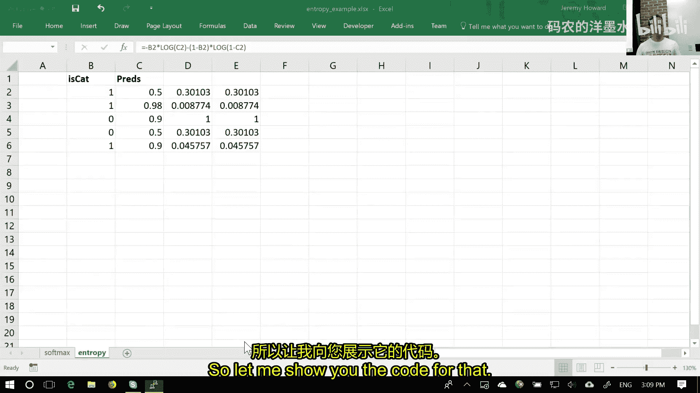

So the code is like。Horrifyingly short。That's it。Right， and it'll also look on the whole。

 extremely familiar， right if there's a few tweaks here。 Pre this thing that says embedding。

 pretend it actually says linear。 Okay， I'm going to show you embedding in a moment。

 pretend it says linear。 So we've got basically a linear layer where the number of features coming with the number of features as the rows。

 And remember， S K learn features means number of words basically， And then for each row。

 we're going to create。One weight， which makes sense， right， for like a logistic regression。

 every every so not for each row for each word。 Each word has one weight。嗯。

And then we're going to be multiplying it by the R values。 So for each word。

We have one R value per class， so I actually made this so this can handle like not just positive versus negative。

 but maybe figuring out like which author created this work， there could be five or six authors。

 whatever and basically we kind of use those linear layers to get the value of the weight and the value of the R and then we take the weight。

Times the R。And then sum it up。 And so that's just a do product。Okay， so just a simple dot product。

 just as we would do for any logistic regression and then do the softm。So the very minute week。

That we add to get the better result is this， the main one really is this here， this plus something。

And the thing I'm adding is。It's a parameter， but I pretty much always use this。

 this version of this value to point for。So what is this too？So what this is doing is it's， again。

 kind of changing the prior。 right， So if you think about it。

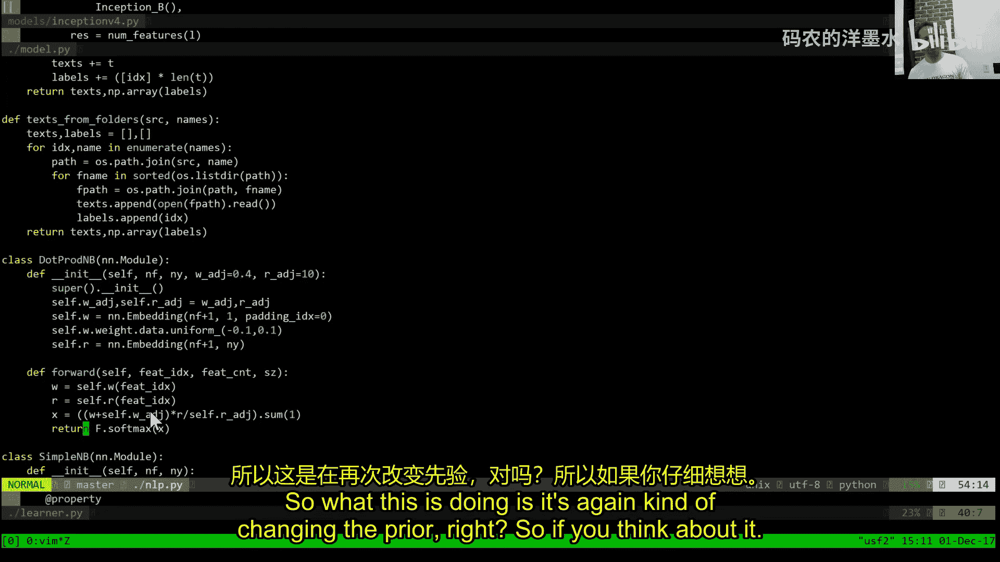

Even once we use this。R times the term document matrix as are independent variables。

You really want to start with a question， okay， the penalty terms are still pushing W down to zero。

 right， So what did it mean？For W to be 0。 right， So what would it mean if we had， you know。

Coeicient，0，0，0，0，0。so what that would do when we go， okay， this matrix times these coefficients。

We still get zero。So a weight of zero still ends up saying。

 I have no opinion on whether this thing is positive or negative。On the other hand。

 if they were all one。Then it basically says， my opinion is that the na phase coefficients are。

Exactly right。Okay。And so the idea is that I said。Zero is almost certainly not。The right prior。

 right， we shouldn't really be saying if there's no coefficient。

 it means ignore the naive base coefficient。One is probably too high。

 right because we actually think that naive Bay is only kind of part of the answer And so I played around with a few different data sets where I basically said。

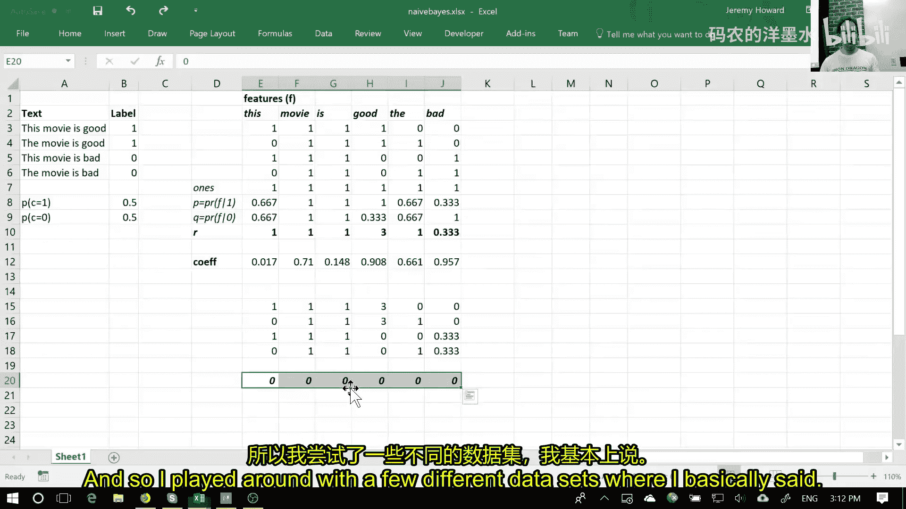

Take the weights。And add to them。Some constant。Right and so zero would become。In this case， 0。4。

Right， so in other words。The， the regularization。Penalty is pushing the weights not towards 0。

 but towards。This value。And I found that across a number of data sets， 0。4。Works pretty well。

And it's pretty resilient so again， this is the basic idea is to kind of like get the best of both worlds。

 you know where we're learning from the data using a simple model but we're incorporating you know our prior knowledge as best as we can and so it turns out when you say okay。

 let's tell it know weight matrix of zeros actually means that you should use about you know about half of the values。

That ends up working better than the prior that the weights should all be zero。Yes。

Is the the weights the w is it the point for the amount of regularization required the the amount of so we have this term where the we have the term where we reduce the amount of error the prediction error RMSC plus we have the regularization and is it w the point for not the amount of regularization required so W are the weights。

So this is calculating our activations。Okay， so we calculate our activations as being equal to the weights。

诶。Times the R。十。So that's just our normal。诶。A normal linear function。

 right so so the the thing which is being penalized is。My white matrix。That's what gets penalized。

So by saying， hey， you know what， don't just use W， use W plus 0。4。So that's not being penalized。

It's not part of the weight matrix。Okay， so effectively the weight matrix gets。Pot4 for free。

So by doing this， even after regularization， then。Every。

I'm sorry every feature is getting some form of weight some form of minimum weight or something that not necessarily because it could end up choosing a coefficient of negative 0。

4 for a feature and so that would say you know what even though naive Bay says it's the R should be whatever for this feature。

 I think you should totally ignore it。Yeah。Great questions。Okay。呃。Weted at 20 h。Okay。

 let's take a break for about eight minutes or so and stop back about 25 to4。Okay。

So a couple of questions at the break。 The first was just for a。Kind of。

Reminder or a bit of a summary as to what's going on。Yeah， right， and so here we have。W plus。

I'm br it out， yeah， plus。Adjusted weight and weight adjustment。Times。Right。

 so so normally what we were doing。嗯。So normally what we are doing is saying， hey。

 logistic regression is basically W X， right， I'm going to ignore the bias。

 and then we were changing it to be w dot times。X。And then we were kind of saying。

 let's do that bit first。Right。Although in this particular case， actually now I look at it。

 I'm doing it。In this code， it doesn't matter。 obviously， in this code， I'm actually doing。

I'm doing this bit first。嗯。And so。嗯。So this thing here actually， I called it W。

 which is probably pretty bad， it's actually W times x。Right， so， so instead of。W times X times R。

 I've got W times X。Plus。A constant。Times are。Right。So the key idea here。Is that。Regularization。

Can't draw in yellow， that's fair enough。Regularization。Wants the weights to be zero。Right。

 because we're trying to， it's trying to reduce。That。对。And so what we're saying is like， okay。

 we want to push the weights towards zero because we're saying like， that's our like。

Default starting point expectation is the whites of zero。

And so we want to be in a situation where if the weight are 0， then we have a model that like。

Makes theoretical or intuitive sense to us， right？This model， if the weight says zero。

 doesn't make intuitive sense to us， right， because it's saying， hey。

 multiply everything by zero gets rid of all of that and gets rid of that as well。

And we were actually saying， no， we actually think our is useful。 we actually want to keep that。

 right。So instead， we say， you know what， Let's take that piece here and add。0。4 to it。

So now if the regularizer is pushing the widths towards0。

 then it's pushing the value of this sum towards 0。4。And so therefore。

 it's pushing a whole model to 0。4 times up。Right， so in other words。

Our kind of default starting point， if you've regularized all the weights out altogether is to say。

 yeah， you know， let's use a bit of R， that's probably a good idea。Okay。嗯。So that's the idea， right。

 That's the idea is basically， you know， what happens when。When that's  zero。

 right you and you want that to like be something sensible because otherwise。

Regularizing the weights to move in that direction wouldn't be such a good idea。

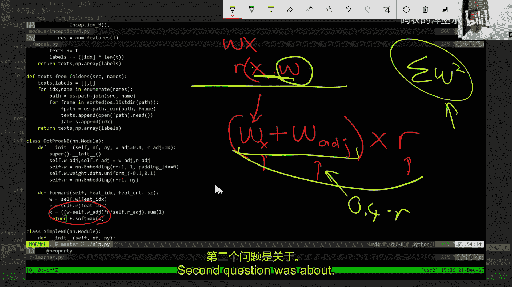

Second question。Was。About。Ngramms。So the n in N gra can be uni by， try， whatever， one， two， three。

 whatever grams， so for this movie is good。It has four unigrams， this movie is good。It has three bis。

This movie， movie is。Is good。It has two trigrams。This movie is。Movie is good。Okay。Can you pass it。

So yeah， do you mind go back to the W A DJ stuff the 0。4 stuff。 Yeah。

 so I was wondering if this adjustment will harm the predictability of the model。

 because think of extreme case if it's not 0。4， if it's 4000。

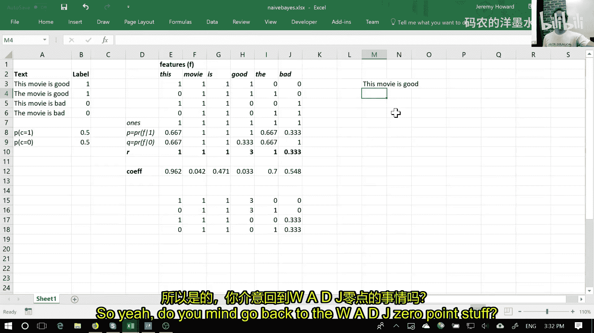

And all coefficients will be like right essentially So， so exactly。 So。

 so our prior needs to make sense。 And so our prior here。 and， you know。

 this is why it's called dot prior to N B is our prior is that this is something where we think naive base is a good prior。

 right？ And so naive Bay says that R equals。P over。That's not how you write P。P over Q。

 I have not had much sleep。 P over Q is a good prior。 And not only do we think it's a good prior。

 but we think。Our。Times x。Plus B is a good model。That's， that's the na based model。

 So in other words， we expect that。You know， a coefficient of one。Is a good coefficient， not。

 not 4000。 So we think specifically， we don't think we think 0 is probably not a good coefficient。

 but we also think that maybe。The naive phase version is a little overconfident。

 so maybe one's a little high。So we're pretty sure that the right number。

 assuming that our model underneath E based model is as appropriate is between zero and1。No。

 but what I was thinking is as long as it's not 0， you are pushing those coefficients that are supposed to be 0 to something not 0 and make the。

Like high coefficients， less distinctive from the coefficients。 Well， but you see。

 they're not supposed to be 0。 They're supposed to be R。Like， that's what they supposed to be。

They're supposed to be R， right， And so， and remember， this is inside our forward function。

 So this is part of what we're taking the gradient of， right， So it's basically saying， okay。

 we're still going， you know， you can still set。Self。w to anything you like。诶。

But just the regularizer。Wants it to be zero。And so all we're saying is， okay。

 if you want it to be zero， then I'll try to make zero be。You know， give a sensible answer。

That's the basic idea。 And like yeah， nothing says point4 is perfect for every data set。

 I've tried a few different data sets and found various numbers between 0。3 and 0。6 that are optimal。

 but I've never found one where  point4。Is less good than zero， which is not surprising。

 And I've also never found one where one is better right So the idea is like this is a reasonable default。

 but it's another parameter you can play with， which I kind of like， right。

 It's another thing you could。Use。Bread search or whatever to figure out for your data set what's best。

 And you know， really the key here being。Every model before this one， as far as I know。

 has implicitly assumed it should be zero because they just they don't have this parameter right And you know。

 by the way， I've actually got a second parameter here as well。

Which is the same thing I do to R is actually divide R。By a parameter。

 which I'm not going to worry too much about it now， But again， it's。

 it's another parameter you can use to kind of adjust what the nature of the regularization is。

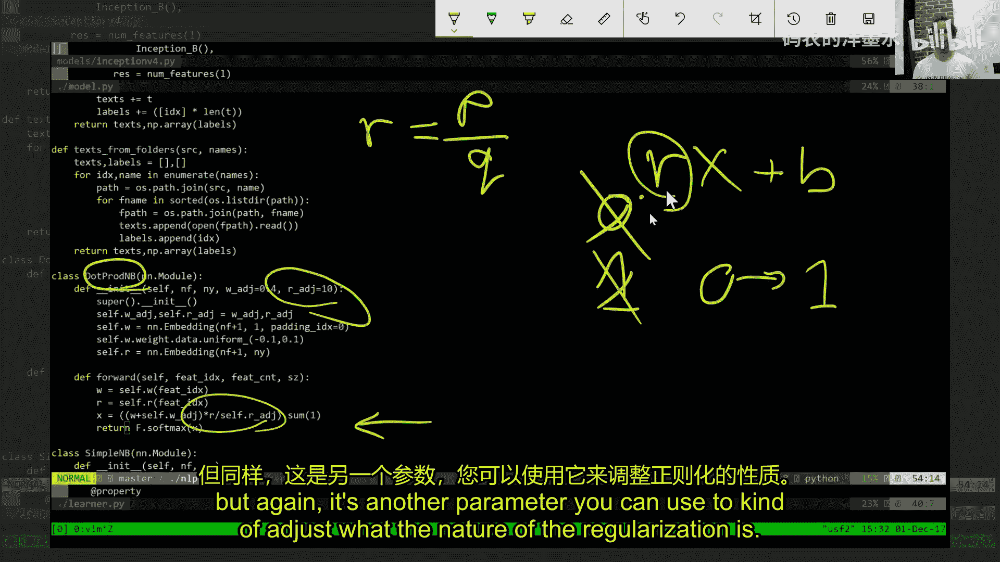

You know and I mean in the end I'm an empiricist， not a theoretician。

 you know I thought this seemed like a good idea， nearly all of my things that seemed like a good idea turned out to be stupid this particular one。

 Dave Good results you know on this data set and a few other ones as well Okay could you pass that youll start there。

Okay I'm sure a little bit confused about the w plus w adjusted so you mentioned that we do w plus w adjusted so that the coefficients don't get set to0 that we place some importance on the priors。

 but you also said that the effect of learning can be that w gets set to a negative value which effectively turns w plus w0。

 so if if we are we are allowing the learning process to needs set the priors to0。

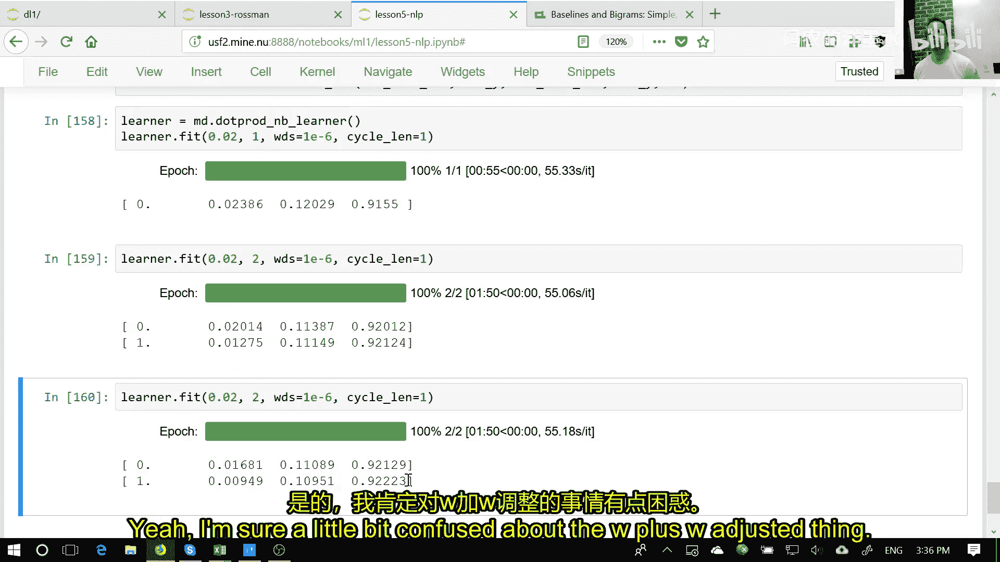

Thats not the prize。So why is Dar in anywhere different from just having W Yeah。

 great question because of regularization， because we're penalizing it by that。 so in other words。

We're saying， you know what， if the best thing to do is to ignore the value of R。That'll cost you。

 you're going to have to set W to a negative number。so only do that if that's clearly a good idea。

 unless it's clearly a good idea， then you should leave。Leave it where it is。

That's that's the only reason。 Like all of this stuff we've done today is basically entirely about。

You know， maximizing the advantage we get from regularization and saying regularization。

Pushes us towards some default assumption。 And nearly all of the machine learning literature assumes that default assumption is。

Everything's zero。And I'm saying， like it turns out， you know。

 it makes sense theoretically and turns out empirically that actually。

 you should decide what your default assumption is， and thatll give you better results。

 So would it be right to say that in a way， you are putting an additional hurdle in the along the way towards getting all coefficients to 0。

 So it will be able to do that。If it is really worth it Yeah， exactly。

 so I'd say like the default hurdle without this is is making a coefficient nonzero is the hurdle and now I'm saying no the hurdle is making a coefficient not be equal to point R。

Yeah。P。So this is sum of the w square into c。Some of to some sda or C penalty constant。 Yeah。

 yeah time something So the weight decay should also depend on the value of C if it is very less。

Like Fc is sorry by say to you meanus。Yeah a so if a is 0。

1 then the wage might not go towards  zero then we might not need grade decay so well whatever this value。

 I mean if the value of this is zero then there is no reization right but if this value is higher than zero then there is some penalty。

Right， and， and presumably， we've set it to nonzero because we're overfitting。

 So we want some penalty。 And so if there is some penalty， then。

Then my assertion is that we should penalize things that are different to our prior。

 not that we should penalize things that are different to zero。

And our prior is that things should be。You know， a about equal to R。Okay， let's move on。

 thanks for the great questions。 I want to talk about。Ebedding。

I said pretend it's linear and indeed we can pretend it's linear。

 let me show you how much we can pretend it's linear as in NN dot linear， create a linear layer。😊。

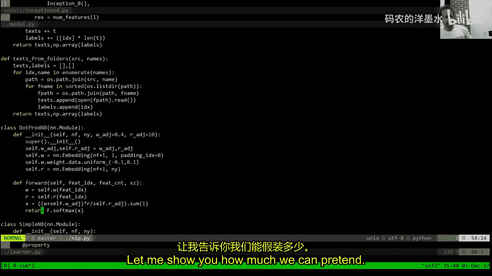

Here is our。Data matrix。Here are our coefficients if we put in the R version。

 here are our coefficients R。Right， so if we were to。Put those into a column vector。Like so right。

 then we could do a matrix multiply of that。By that。Right， and so we're going to end up with。

So here's our matrix。Heres a vector。Okay， so we're going to end up with。1 times 1 plus 1 times 1。

1 times 1，1 times。3。zero times 1，0 times 0。3。 and then the next one，0 times1。

 one times one and so forth。 Okay， so that that the matrix multiply。You know of。This independent。

Variable matrix。By this coefficient matrix is going to give us an answer。

So that is just a metrics modelplay。So the question is like， okay， well。

 why didn't Jeremy write an N dot line， why did Jeremy write an end dot embedding？

And the reason is because if you're a coal， we don't actually store it like this because this is actually of width 800。

000。And of height， 25，000。So rather than storing it like this。We actually store it as。0ero， one， two。

 three。喂。One， two， three， four。0，1，2。5。F， two， four， five。Okay， let know the ones one that。

That's actually how we store it。That is this bag of words contains。Which word indexes？

Does that make sense？Okay， so that's like。This is like a sparse way of。

Of storing it right is just list out the indexes in each sentence。So given that。

I want to now do that matrix multiply that I just showed you to create that same。Outcome， right。

 but I want to do it from this representation。So if you think about it。All this is actually doing。😮。

Is it saying one hot， you know， this is basically one hot encoded。

It's kind of like a dummy matrix version， does it have the word this， does it have the word movievie。

 does it have the word is and so forth。So if we took the simple version of like。

 does it have the word this1000？Oh。and we multiplied。That。By that。Right。

 then that's just going to return。The first item。That makes sense。So in general。A one hot encoded。

Vectctor times a matrix。Is identical to looking up that matrix to find the n row in it。

So this is identical to saying find the zero， first， second， and fifth。Coeics。

So they're exactly the same thing。It doesn't。 like in this case， I only have one。

Coeicient per feature， right， But actually， the way I did this was to have。

One coefficient per feature for each class。So in this case it's both positive and negative。

 so I actually had kind of like an a positive and an R negative。

 so R negative would be just the opposite equals that。Provided by that Now in the binary case。

 obviously it's redundant to have both， but what if it was like what's the author of this text is it。

Jeremy or Savannah or Terrence， right。 now we've got three categories。 We want three values of R。

 right。 So the nice thing is that in this sparse version， you know， you can just look up， you know。

 the zeroth。And the first and the second and the fifth。And again， it's identical。

 mathematically identical。Two model plane by a one hot encoded matrix。But。When you have spars inputs。

It's obviously much， much more efficient。So this。Computational trick。

Whi is mathematically identical to， not conceptually analogous to。

 mathematically identical to multiplying by a one hot encoded matrix is called an embedding。

Right so I'm sure you've all heard or most of you probably heard about embeddings like word embeddings。

 word to V or glove or whatever， and people love to make them sound like there's some。

Amazing new complex neural net thing they're not embedding means make a multiplication by one hot encoded matrix faster by replacing it with a simple array lookup。

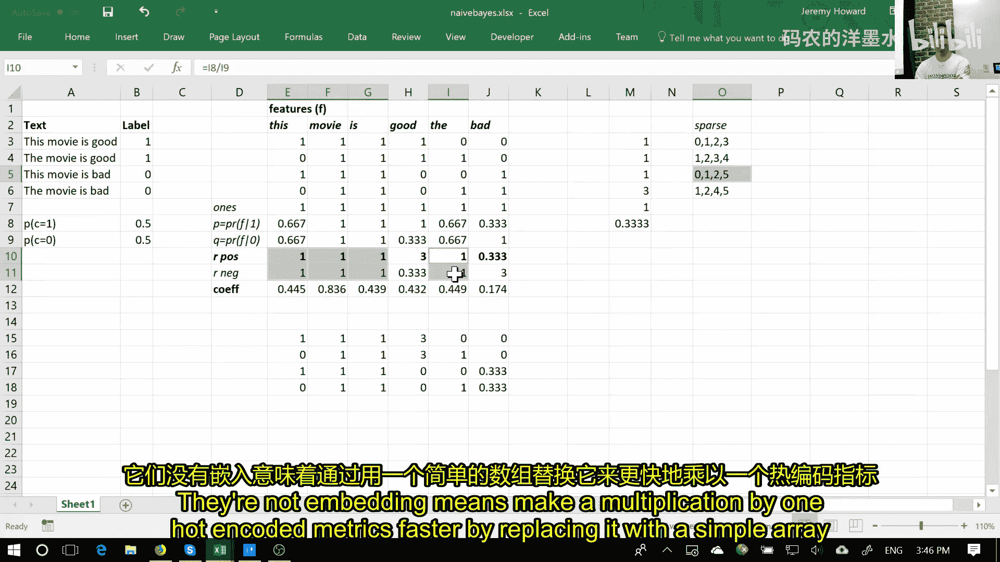

OkaySo that's why I said you can think of this as if it said self。tw equals Nn dot linear。

And F plus one by one， right， because it actually does。The same thing。

RightIt actually is a matrix with those dimensions。 This actually is a matrix with those dimensions。

 It's a linear layer。嗯。But it's expecting that the input we're going to give it is not actually a one hot encoded matrix。

 but is actually a list of integers。Right the indexes for H。Word or for each item。

 So you can see that the forward function and fast AI automatically gets for this learner。

For feature indexes， right， So they come from。The sparse matrix automatically。

 Ny makes it very easy to just grab those indexes。Okay， so in other words there， we've got here。

 we've got a list of。Each word index of a of the 800，000 that are in this document。

And so then this here says look up each of those in our embedding matrix。

 which has got 800000 rows and return。Each thing that you find。Okay， so mathematically identical。

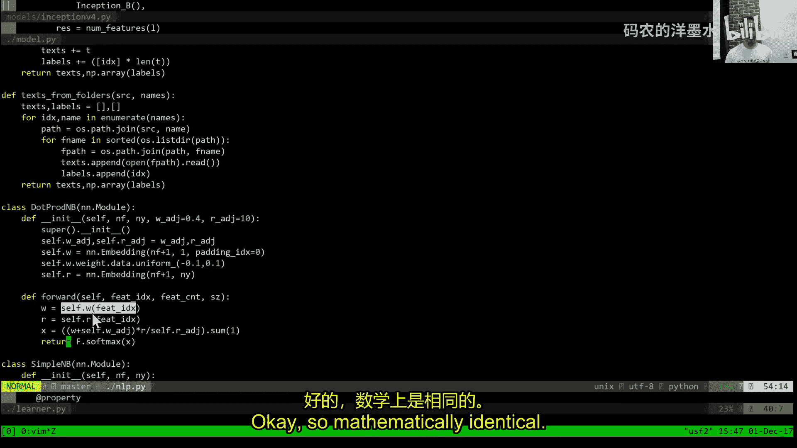

To。Multiplying by the one hot encoded matrix。Does that make sense？

So that's all an embedding is and so what that means is。嗯。We can now handle。

Building any kind of model like a， you know， whatever kind of neural network where we have potentially very high cardinality categorical variables as our inputs。

We can then just turn them into a numeric code between zero and the number of levels。And then。

 we can learn a。You know， a。A linear layer from that as if we had one hot encoded it。

Without ever actually constructing the one hot encoded version。And without ever actually doing that。

 matrix multiplay。Instead， we will just store the index version and simply do the array lookup。

And so the gradients that are flowing back， you know， basically in the one hot encoded version。

 everything that was a0 has no gradient， so the gradients flowing back is best go to update the particular row of the embedding metrics that we used。

Okay and so。That's fundamentally important for NLP， just like here， like you know。

 I wanted to create。

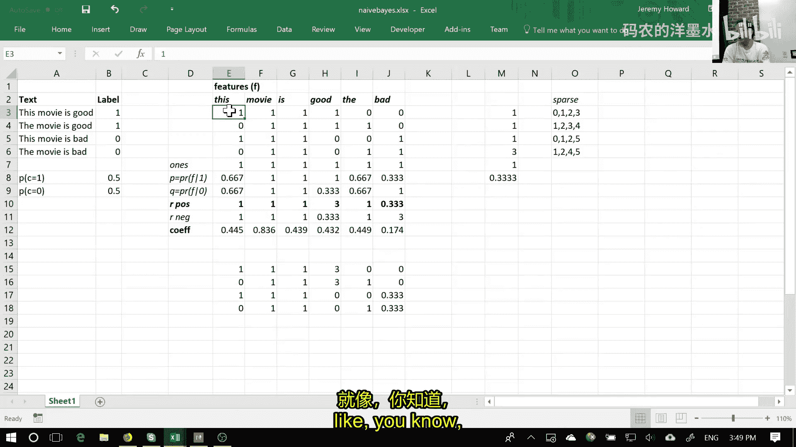

A pie torch model that would implement this。This ridiculously simple little equation and to do it without this trick would have meant I was be in a 25。

000 bay adhere it's the 800，000 element array。Wwhich would have been kind of crazy right and so this trick allowed me to write you know I would just replace the word linear with embedding。

 replace the thing that feeds the one hot encodings in with something that just feeds the indexes in and that was it that it kept working and so this now trains you know。

 in about a minute。

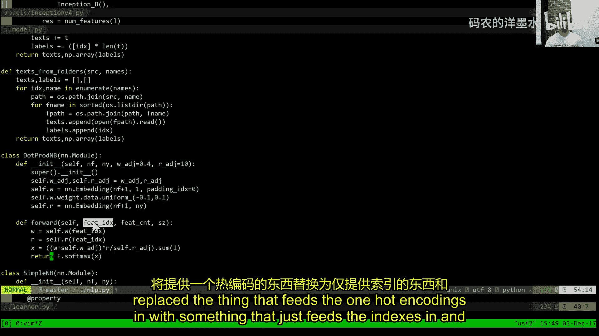

Per epoch。嗯。Okay。So。What we can now do is we can now take this idea and apply it not just a language。

But to anything。For example， predicting the sales of items at a grocery。Yes， where's the P pass up？

Just a quick question。 So we are not actually looking up anything， right。

 We are just saying that now that array with the indices， that is the representation。

So the represent， so we are doing a lookup， right， The representation that's being stored the but for the bag of words is now not。

1，1，1，00，1， but01，2，5， right， And so then。We actually have to do our， our matrix product， right。

 But rather than doing the matrix product， we look up。

The zero thing and the first thing and the second thing and the fifth thing。

So that means we are still retaining the one hot encoded matrix No。

 we didn't there's no one hot encoded matrix used here this here's the one hot encoded matrix。

 which is not currently highlighted。We've currently highlighted the list of indexes。

And the list of coefficients from the weight metrics。Does that makes sense。ok。嗯。

So what we're going to do now is we're kind of going to go a step further and saying like。

 let's not use a linear model at all， let's use a multilayer neural network。

And let's have the input to that potentially be include some categorical variables and those categorical variables we will just have as numeric indexes。

And so the first layer for those won't be a normal linear layer。

 there'll be an embedding layer which we know behaves exactly like a linear layer mathematically。

 and so then our hope will be that we can now use this to create a neural network for any kind of data。

 and so。There was a competition on Kagel a few years ago called Rosman。

 which is a German grocery chain。Wherere they asked to predict the sales of items in their stores and that included a mixture of categorical and continuous variables and in this paper by Gore and Brkhan they described their third place winning entry。

hi was much simpler than the first placed winning entry， but nearly as good。

 but much much simpler because they took advantage of this idea of what they call ND embeddings。

In the paper they thought， I think that they had invented this。

 actually had been written before earlier by Yoshio Benggio and his co-authors in another cacal competition which was predicting taxi destinations。

 although I will say I feel like Gore went a lot further in describing how this can be used in many other ways。

 and so we'll talk about that as well。So。So this one is actually in the is in the deep learning one repo。

 okay， deal1， lesson three， okay because we talk about some of the deep learning specific aspects in the deep learning course。

 whereas in this course we're going to be talking mainly about the feature engineering and we're also going to be talking about you kind of this embedding idea。

嗯。So let's start with the data， right， So the data was， you know， store number one。

On the 31st of July 2015。Was open。They had a promotion going on。It was a school holiday。

 It was not a state holiday， and they sold 5263 items。So。That's the key。Data they provided。

 And so the goal is， obviously， to predict sales in a test set that has the same information without sales。

They also tell you that for each store。It's of some particular type。

It sells some particular assortment of goods。Its nearest competitor is some distance away。

The competitor opened in September 2008。And there's some more information about promos。

 I don't know the details of what that means。Like in many Kago competitions。

 they let you download external data sets， if you wish。

 as long as you share them with other competitors so people oh they also told you what state each store is in。

 so people downloaded a list of the names of the different states of Germany。

They downloaded a file for each date in Germany for each week， some kind of Google trend data。

 I don't know what specific Google trend they got， but there was that for each date they downloaded a whole bunch of temperature information。

诶。That's it， and then here's a test set。Okay， so。I mean。

 one interesting insight here is that there was probably a mistake in some ways for Rosman to design this competition as being one where you could use external data because in reality。

 you don't actually get to find out next week's weather or next week's Google trendsds。You know。

 but you know， when you're competing in Kale， you don't care about that。

 you just want to win so you use whatever you can get。嗯。

So let's talk first of all about data cleaning， you know。

 there wasn't really much feature engineering done in this third place winning entry。

 like particularly by cattleal standards where normally every last。

Thing counts this is a great example of how far can get with a neural net and it certainly reminds me of the claims prediction competition we talked about yesterday where the winner did no feature engineering and entirely relied on deep learning。

嗯。The laughter in the room， I guess is from people who did a little bit more than no feature engineering in that competition。

😊，So， you know， I should mention， by the way， like。

I find that bit where like you work hard at a competition and then it closes and you didn't win and the winner comes out and says this is how I won like that's the bit when you learn the most right Like sometimes that's happened to me and it's been like。

Oh， I thought of that I thought I tried that and then I go back and I realized I like had a bug there。

 I didn't test properly and I learned like oh okay like I really need to learn to like test this thing in this different way sometimes it's like。

Oh， I thought of that but I assumed it wouldn't work。

 I've really got to remember to check everything before I make any assumptions and you know。

 sometimes it's just like， oh， I did not think of that technique。Wow。

 now I know it's better than everything I just tried because like otherwise， somebody says like， hey。

 you know， here's a really good technique。 You're like， okay， great， right。

 But when you spent months trying to do something and like somebody else did it better by using that technique。

 that's pretty convincing。Right and so like it's kind of hard like I'm standing up in front of you saying here's a bunch of techniques that I've I've used and I've won some casual competitions and I've got some state of the art results。

 but it's like that's kind of secondhand information by the time it hits you right so it's really great to。

Yeah， try things out and and also like it's been kind of nice to see particularly I've noticed in the deep learning course quite a few of my students have you know I've said like this technique works really well and they've tried it and they've got into the top 1 of a ca competition the next day and they're like。

Okay， that that counts as working really well。 So so yeah， capital competitions are。

Helpful for lots and lots of reasons， but you know one of the best ways is what happens after it finishes and so definitely like for the ones that are now finishing up make sure you you know watch the forums。

 see what people are sharing in terms of their solutions and you know if you want to learn more about them like feel free to ask。

The winners like， hey， could you tell me more about this so that people are normally。

 pretty good about explaining？And then ideally try and replicate it yourself right and that can turn into a great blog post you know or a great kernel is to be able to say。

 okay， such and such said that they use this technique。

 here's a really short explanation of what that technique is and here's a little bit of code showing how it's implemented and you know here's the result showing you you can get the same result。

 that can be a really interesting write up as well。嗯。Okay， so， you know， it's。

 it's always nice to kind of have your data。😊，Reflect。Like。I don't know。

 be as kind of easy to understand as possible， so in this case the data that came from Kagll used various you know integers for the holidays。

 we can just use a ballian of like was it a holiday or not？So like just clean that up。

We've got quite a few different tables， we need to join them all together I have a standard way of joining things together with pandas。

 I just use the pandas merge function and specifically I always do a left joint。

So who wants to tell me what a left join is？Since it's there， why don't you go ahead。

So you retain all the rows in the left table and you take so you have a key column you match that with the key column in the right side table and you just merge the rows that are also present in the right side table now that's a great explanation good I don't have much to add to that the key reason that I always do a left join is that after I do the join。

I always then check if there were things in the right- hand side that are now null because if so。

 it means that I missed some things I haven't shown it here。

 but I also check that the number of rows hasn't varied before and after if it has。

 that means that the right- hand side table wasn't。Unique， okay。Even when I'm sure something's true。

 I always also assume that I've screwed it up， so I always check。

So I can go ahead and merge the state names into the weather I can also。If you look at the。

Google trendsd table， it's got this weak range which I need to turn into a date in order to join it and so the nice thing about doing this in pandas is that pandas gives us access to you know all of Python right and so for example。

 inside the series object is a dot STR attribute that gives you access to all the string processing functions not just like CA gives you access to the categorical functions Dt gives you access to the date time functions so I can now split everything in that column and it's really important to try and use these pandas functions because they you know they're going to be vectorized accelerated through you know often through CMd at least through you know C code。

So that runs nice and quickly。嗯。And then， you know， as per usual。

 let's add date metadata to our dates。嗯。In the end， we are basically deormalizing all these tables。

 So we're going to put them all into one table。 So in the Google trend。Table。

 there was also there were mainly trends by state， but there was also trends for the whole of Germany。

 so we kind of put the Germany you know the whole of Germany ones into a separate data frame so that we can join that so we're going to have like Google trend for this state and Google trend for the whole of Germany。

And so now we can go ahead and start joining both for the training set and for the test set。

 and then for both checks that we don't have zeros。嗯。My merge function。

I set the suffix if there are two columns that are the same I set the suffix on the left to be nothing at all。

 so it doesn't screw around with the name and the right hand side to be underscore by and in this case I didn't want any of the duplicate ones so I just went through and。

Deletd them okay， and then we're going to in a moment we're going to try to create。A competition。

 you know， the main competitor for this store has been opened since some date。

And so you can just use pandas to date time passing in the year。The month。And the day。

 and so that's going to give us an error unless they all have years and months。

 so we're going to fill in the missing ones with the 190001。Okay。

And then what we really we didn't want to know is like how long has this door been open for at the time of this particular record。

 so we can just do a date subtract。对。嗯。Now， if you think about it。

 sometimes the competition you know， opened later than this particular role。

 So sometimes it's going to be negative， and it doesn't probably make sense。To have negatives。

 meaning like it's going to open in X dayss time。Now， having said that， I would never。

Put in something like this without， first of all， running a model with it in and without it in。Right。

 because like our assumptions about。About the data very often turned out not to be true。 Now。

 in this case， I didn't invent any of these pre processing steps。 I wrote all the code。

 but it's all based on the third place winners Github re， right so。

Knowing what it takes to get third place in the cable competition。

 I'm pretty sure they would have checked every one of these preprocessing steps and made sure it actually improved there。

Their validation set score。O。嗯。So what we're going to be doing is。

Creating a neural network where some of the inputs to it are continuous and some of them are categorical。

 And so what that means in the in the neural net that， you know， we have。

We're basically going to have， you know， this kind of initial weight matrix， right？

 And we're going have this。This input feature vector。

 right And so some of the inputs are is going to be plain continuous numbers like， you know。

 what's the maximum temperature here or what's the number of kilometersmets to the nearest store。

And some of them are going to be。One hot encoded。Effectively， right。

 but we're not actually going to store it as one hot encoded。 We're actually going to store it as。

The index。And so the neural net model is going to need to know which of these columns should you basically create an embedding for。

 which ones should you treat as if they were kind of one hot encoded and which ones should you just feed directly into the linear layer。

Okay and so we're going to tell the model when we get there which is which。

 but we actually need to think ahead of time about like which ones do we want to treat as categorical and which ones as continuous in particular things that we're going to treat it as categorical we don't want to create more categories than we need and so let me show you what I mean。

The third place getters in this competition decided that the number of months that the competition was open was something that they were going to use as a categorical variable。

And so in order to avoid having more categories than they needed。They truncated it at 24 months。

 They said anything more than 24 months， I'll truncate to 24。

So here are the unique values of competition months open， and it's all the numbers from0 to 24。Right。

So what that means is that there's going to be， you know。

 an embedding matrix that's going to have basically an embedding vector for things that aren't open yet for things that are open a month。

 for things that are open two months and so forth。They absolutely could have done that。😮。

As a continuous variable， right they could have just had a number here。

 which is just a single number of how many months has it been open。

 and they could have treated it as continuous and fed it straight into the initial weight matrix。

What I found， though， and obviously what these competitors found is。

Where possible it's best to treat things as categorical variables。

and the reason for that is that like when you feed something through an embedding matrix。

You basically mean， it means every level can be treated like totally differently， right？ And so。

 for example， in this case。Whether something's been open for zero months or one month。

Is right really different。RightAnd so if you fed that in as a continuous variable。

 it would be kind of difficult for the neural net to try and find a functional form that kind of has that big difference。

 It's possible because neural nets can do anything but you're not making it easy for it Where else if you used an embedding treated it as categorical then it'll have a totally different vector for zero versus one So it seems like particularly as long as you've got enough data that。

That treating columns as categorical variables where possible is a better idea。

 And so I say when I say where possible， that kind of basically means like。

Where the cardinality is not too high。You know， so if this was like。You know。

The sales ID number that was like uniquely different on every row。

You can't treat that as a categorical variable， right。

 because' itll be a huge embedding matrix and everything only appears once or detto for like kilometers away from the nearest door。

To two decimal places， you wouldn't make a categorical variable， right？

So that's kind of the rule of thumb that they both used in this competition， in fact。

 if we scroll down to their choices。Here is how they did it right Their continuous variables were things that were genuinely continuous。

 like number of plummetres away to the competitor， the temperature stuff。Right the number。

 the specific number in the Google trend。Where else everything else。

 basically they treat it as categorical。Okay。Okay， so that's it for today， so yeah。

 next time we'll finish this off we'll see how to turn this into a neural network and yeah kind of wrap things up so see you then。

