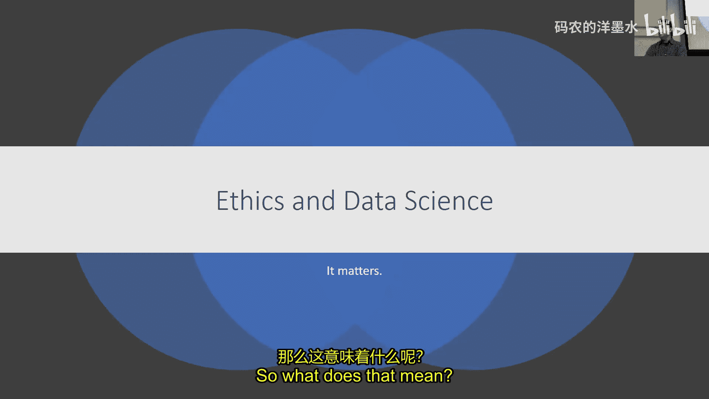
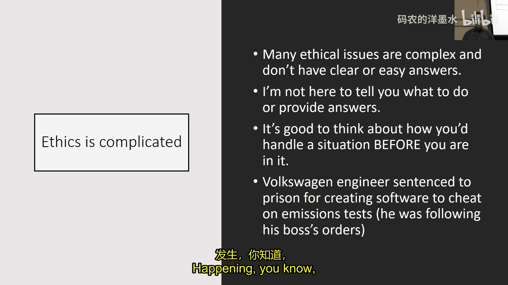
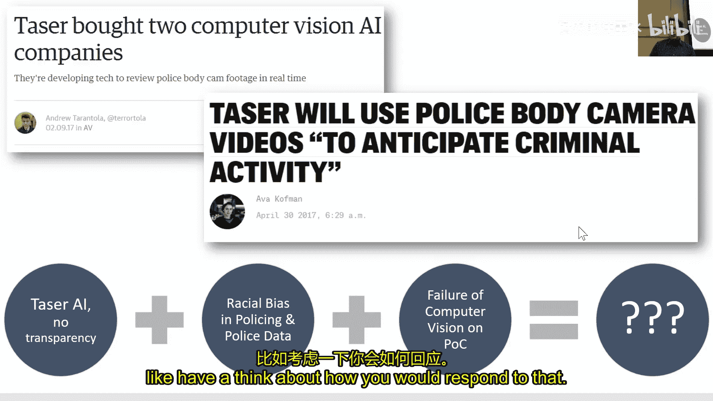
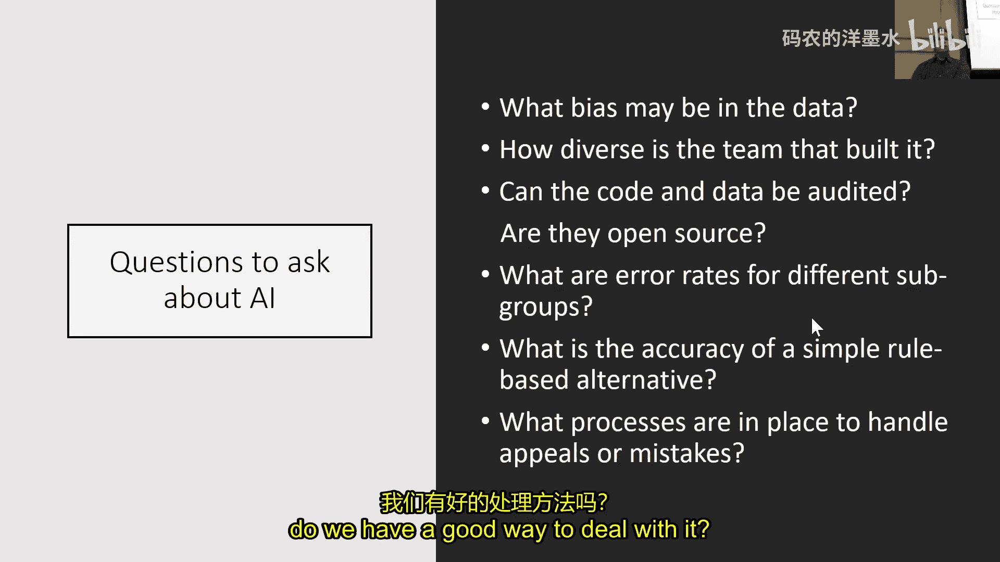
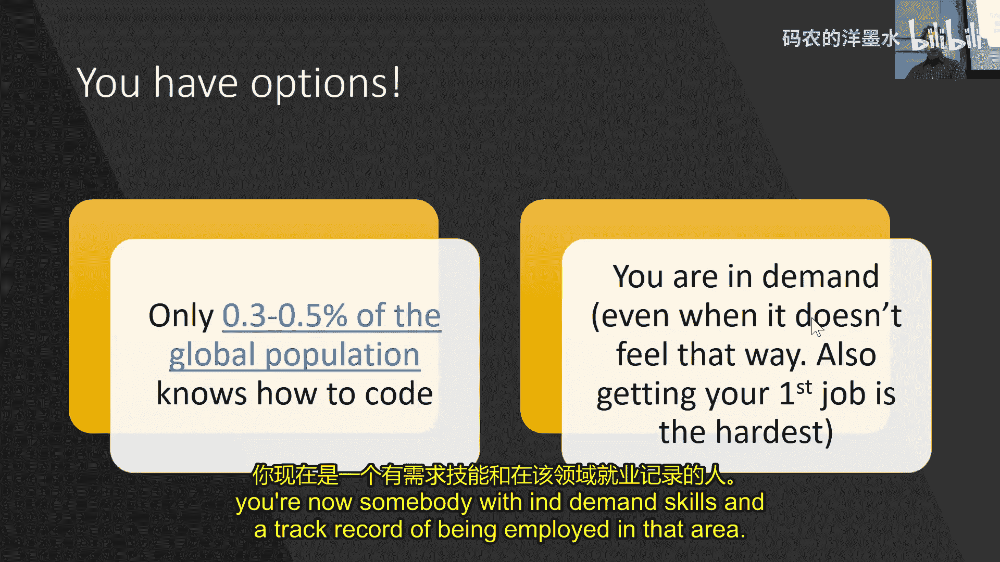
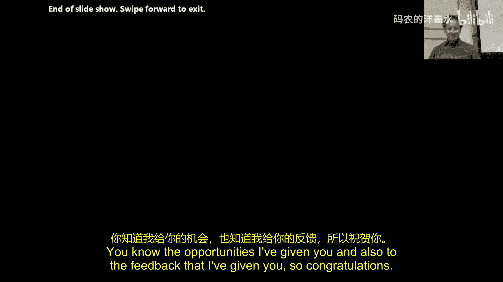

# 【全集】旧金山大学-面向程序员的机器学习-中英字幕-1080P-p12-Lecture-12---罗斯曼--BV1YAvYBAEG3_p12-

I thought what we might do today is to like。Finish off where we were in this Rusman notebook。

 looking at。Time series， forecasting and structured data analysis。 And then we might do a little。

Manyni review。Like everything we've learned because believe it or not， this is the end。

 like there's nothing more to know about machine learning other than everything that you're going to learn。

Next semester。And for the rest of your life， but anyway， I got nothing else to teach。😊，Yeah。

 so we'll do a little review and then we'll cover like the most important part of the course。

 which is like thinking about like。How are ways to think about how to use this kind of technology？

Appropriately and you know， effectively in a way that's hopefully a positive impact on society。嗯。

So last time we got to the point where we talked a bit about。

This this idea that when we were looking at like building this competition month open derived variable。

 but we actually truncated it down to be no more than 24 months。

 and we talked about the reason why being that we actually wanted to use it as a categorical variable because categorical variables thanks to embeddings have more。

Flexibility and how the neural net can use them。And so that was kind of where we left off。

So let's like keep working through this because。What's happening in this notebook is。Stuff。

 which is probably going to apply to most time series data sets that you work with。

And as we talked about， like although we use D do apply here。

 this is something where it's running a piece of Python code over every row and it's。

That's horrifically slow， right， But so we only do that if we can't find a。

Vactecterized pandas or nupa function that can do it to the whole column at once。But in this case。

 I couldn't find a way to convert a year and a week number into a date without using arbitrary Python。

啊。Also worth remembering this idea of a Lambda function。

 any time you're trying to apply a function to every row of something or every element of a tensor or something like that。

 If there isn't a vectorized version already， you're going to have to call something like。

Data frame dot apply， which will run a function you pass to every element。

 So this is something like in a kind of。It's basically a map in functional programming。

Since very often the function that you want to pass to it is something you're just going to use once and then throw it away。

 it's really common to use this。Lambda approach， so this Lada is creating a function。

Just for the purpose of telling D F tot apply what to use， right， So we could。

We could also have written this in a different way， which would have been to say。呃。To find。Create。

Promo。2 cents。On some value。P 10。And then we can put that in here。Okay。

 so that and that are the same thing。So one approach is to define the function and then pass it by name。

 or the other is to define the function in place。Using Lambda， All right。 And so if you're not。

Comfortable creating and using lambmbdas， you know。

 good thing to practice and playing around with DF tot apply is a good way to practice it。呃O。

So let's talk about this durations section， which。May at first seem。A little specific。

 but actually it turns out not to be what we're going to do is we're going to look at three fields promo state holiday and school holiday and so basically what we have is a table of for each store for each date。

Does that store have a promo going on at that date？

Is there a school holiday in that region of that store at that date。

 is there a state holiday in that region for that store at that date？This kind of thing is you know。

 like their events and time series with events are like very， very common。

 like if you're looking at oil and gas drilling data you're trying to say like the flow through this pipe you know here's an event representing when it set off some alarm you know or here's an event where the drill got stuck or whatever right and so like most time series at some level will tend to represent some events。

So。The fact that an event happened at a time。😡，Is interesting itself。

 but very often a time series will also show some something happening before and after the event。

 so for example， in this case， we're doing grocery sales prediction if there's a holiday coming up。

It's quite likely that sales will be higher before and after the holiday and lower during the holiday。

If this is a city based store， right， because you've got to stock up before you go away to bring things with you。

 and when you come back you've got to refill the fridge。For instance， right？So， it's。

Although like we don't necessarily have to do this kind of feature engineering to create features specifically about like this is before or after a holiday。

 the neural net， you know the more we can give the neural net like the kind of information it needs。

 the less it's going to have to learn it， the less that it's going to have to learn it。

 the more we can do with the data we already have the more we can do with the you know the size architecture we already have so feature engineering even with stuff like neural nets is still important because it means that we'll be able to do。

You know， get better results with whatever limited data we have。

 whatever limited computation we have。So the basic idea here therefore is when we have events in our time series as we want to create two new columns for each event。

 how long is it going to be until the next time this event happens and how long has it been since the last time that event happened。

 so in other words， how long until the next state holiday， how long since the previous state holiday。

Okay， so that's not something which I'm aware of as existing as a library or anything like that。

 so I wrote it here by hand and so importantly I need to do this by store。

So I want to say like for this store， when was this store's last promo。

 so how long has it been since the last time it had a promo。

 how long it will be until the next time it has a promo。For instance。All right。So。

Here's what I'm going to do。 I'm going to create a little function that's going to take a field name。

 and I'm going to pass it each of promo and then state holiday and then school holiday so let's do school holiday。

 for example， so we'll say field equals school holiday。😊，And then we'll say。

Get elapsed school holiday comma after。 So let me show you what that's going to do。

 So we've got a first of all， sort。😊，By store and date。So now when we loop through this。

 we're going to be looping through within a store， so store number one， January the 1st。

 January the 2nd， January 3rd， and so forth。And as we loop through each door。

 we're basically going to say like。Is is this row a school holiday or not and if it is a school holiday then we'll keep track of this variable called last date。

 which says this is the last date and where we saw a school holiday and so then we're basically going to append to our result。

The number of days since the last school holiday， that's the kind of basic idea here。

 So there's a few interesting features。One is the use of zip。 so I could actually write this。

Much more simply， right， I could say。Let's go through well。

 we could basically go through like for row in Df。E rows。

And then grab the fields we want from each row。It turns out this is 300 times slower。😊。

Than the version that I have and basically like iterating through a data frame and extracting specific。

Fields out of a row has a lot of overhead。What's much faster is to iterate through a nuy array。

So if you take a series like Df dot store and add dot values after it。

 that grabs a nuy array of that series Okay， so here are three nupy arrays。 One is the store Is。

One is。Whatever field is， in this case， let's say school holiday。And what is。The date。

So now what I want to do is loop through。The first one of each of those lists。

And then the second one of each of those lists and then the third one of each of those lists。

And like this is a really， really common pattern， I need to do something like this in basically every notebook I write and the way to do it is with zip so zip means loop through each of these lists。

One at a time and then this here is where we can grab that element out of the first list。

 the second list and the third list okay so if you haven't played around what with zip。

 that's a really important function to practice with。

 like I say I use it in pretty much every notebook I write all the time you have to loop through you know a bunch of lists at the same time。

All right， so we're going to loop through every store， every school holiday， every date， yes。😊。

So is it moving through like all the possible combinations of each of those or just111 Yeah exactly one one yeah exactly thanks for the question so in this case we basically want to say let's grab the first store the first school holiday the first date so for store one January the first。

School holiday was true or false And so if it is a school holiday。

 I'll keep track of that fact by saying the last time I saw a school holiday was that day okay and then append how long has it been since the last school holiday right and if the store I is different to the last store I I saw。

 then I've now got to a whole new store in which case I have to basically reset everything。

s pass that to her？What will happen to the first points that we don't have like last holiday Yeah so I just set I basically set this to。

Arbitrary starting point， it's going to end up with like the。

 I can't remember it's the largest or the smallest possible date。Thanks。And you know。

 you may need to。Replace this with a missing value afterwards or some， you know， a zero or whatever。

嗯。You know， the nice thing is though thanks to。Rals。

 it's very easy for a neural net to kind of cut off extreme values。 So in this case。

 I didn't do anything special with it。 I ended up with these like negative a billion day times。

Stamps， and it still weped。Fine。Okay， so we can go through and so the next thing to note is。

There's a whole bunch of stuff that I need to do to both the training set and the test set so in the previous section I actually kind of added this little loop where I ago for each of the training data frame and the test data frame through these things right so I kind of you know each cell did for each of the data frames。

I've now got a whole coming up a whole series of cells that I want to run first of all for the training set and then for the test set。

 so in this case the way I did that was I had two different cells here。

 one which set DF to be the training set， one which set to be the test set and so the way I use this is I run just this cell。

And then I run all the cells underneath。so it does it all to the training set。

 and then I come back and run just this cell and then run all the cells underneath。Okay。

So like this notebook is not designed to be just run from top to bottom。

 but it's designed to be run in this particular way。

 And I mentioned that because like this can be a handy。Trick to know， like you could of course。

 put all the stuff underneath in a function。That you pass the data frame to and call it once with a test set and once with a training set。

 But I kind of like to。Experiment a bit more interactively。 look at each step as I go。

 So this way is an easy way to kind of run something on two different。

Data frames without turning it into a function。Okay， so this is going to。

 if I sort by store and by date， then this is keeping track of the last time something happened。

 and so this is therefore going to end up telling me how many days was it since the last？

School holiday， so now if I thought。Date， descending。And call the exact same function。

Then it's going to say how long until the next。Schore holiday。

So that's a kind of a nice little trick for adding these kind of event timers。

 arbitrary event timers into your time series models。So if you're doing， for example。

 the Ecuadorian groceries competition right now， you know maybe this kind of approach would be useful for various events in that as well。

Do it for state holiday， do it for promo， here we go okay。嗯。The next thing that we look at here is。

Rolling。Functions。嗯。So rolling functions is how we rolling in pandas is how we we create what we call windowwing functions。

So。Let's say I had。Some data。You know， something like this。Right。And this is like date。

And I don't know， this is like sales or whatever。What I could do is I could say like okay。

 let's create a window around this point of like seven days right， so it'd be like okay， this is a。

Seven day window， say right， and so then I could take the average sales in that seven day window and then I could like do the same thing like I don't know。

 over'll be here。All right， take the average sales。Over that seven day window。 Okay。

 And so if we do that for every point and join up those averages， you're going to end up with。

A moving average Okay， so the kind of the the more generic version of the moving average。

Is a window function。I something where you apply some function to some window of data around each point。

Now， very often the windows that I've shown here are not actually what you want。

 if you're trying to build a predictive model， you can't include the future as part of a moving average right so quite often you actually need a window。

That's ends here。So that would be our window function。and so。Paands， lets you create。

Arbitary window functions using this rolling here。 This here says how many time steps do I want to apply the function to？

This here says if I'm at the edge， so in other words， if I'm like out here。

Should you make that a missing value because I don't have seven days to average over or you know what's the minimum number of time periods to use so here I said one and then then optionally you can also say do you want to set the window at the start of a period or the end of a period or the middle if the period okay and then within that you can then apply whatever function you like？

Okay， so here I've got my weekly。By store。Somes。Okay， so there's a nice， easy way。Of getting。

Kind of moving averages or whatever else。 And you know I should mention in pandas。

If you go to the time series page on pandas， there's literally。Like look at just the index here。

 time series functionality was all of。This， this， this， right。

 there's lots because like was Mckininney who who created this。

 he was originally in hedge fund trading， I believe。 And you know。

 his work was all about time series。 And so， I think like pandas originally was very focused on time series。

 and still， you know， it's perhaps the strongest part of pandas。 So if you're playing， like。

 if you're playing around with time series computations。

 you definitely owe it to yourself to try to learn this entire。

APpiI and like there's a lot of kind of conceptual pieces around like timestamps and date offsets and resampling and stuff like that to kind of get your head around。

 but it's totally worth it because。Otherwise， you'll be writing this stuff as loops by hand。

 it's going to take you a lot longer than leveraging what Padas already does。

 and of course pandas will do it in highly optimized C code。For you factorize the see code。

 whereas your version is going to loop in Python。 So definitely worth， you know。

 if you're doing stuff in time series， learning the。The full pandas time series API。

It's about as strong as any time series API out there。Okay， so at the end of all that。

 you can see here's those。Kind of starting point values I mentioned。

Slightly on the extreme side and so you can see here the 17th of September store one was 13 days after the last school holiday。

 the 16th was 12， 1110， so forth okay we're currently in a promotion。

Here this is one day before a promotion here we've got nine days after the last promotion。

And so forth， okay？So that's how we can add。Kind of event counters to a time series and probably always a good idea when you're doing work with time series。

So now that we've done that， you know we've got lots of columns in our data set and so we split them out into categorical versus continuous columns。

 we'll talk more about that in a moment in the review section。

 but so these are going to be all the things I'm going to create an embedding for。

And these are all of the things that I'm going to feed directly into the model。So for example。

 we've got like。Competition distance， so that's distance to the nearest competitor。

Maximum temperature。And here we've got day of wake， right？嗯。So here we've got。Maximum temperature。

Maybe it's like 22。1， say use centeggrade in Germany。

We've got distance to nearest's competitor might be 321 kilom。7。 and then we've got。Day of week。

Which might be， I don't know， maybe Saturday as a six。Okay。So these numbers。

Here I'm going to go straight into。Now vector， right。

 the vector that we're going to be feeding into our neural net。22，1。321。7。Okay。

 we'll see in a moment'll actually we'll normalize them， but more or less。

But this categorical variable we're not， we need to put it through it embedding， right。

 so we'll have some embedding matrix。Right of。If there are seven days。By I don't know。

 maybe dimension 4 embedding， okay， and so this will look up the sixth row。To get back the。For items。

Right， and so this is going to turn into。Length  four vectorta。Which will then add。Here。Okay。

 so that's how our continuous and categorical variables。That' going to work。So then， all of our。

Categorical variables， we' turn them into pandas categorical variables in the same way that we've done before。

And then we're going to apply the same mappings to the test set right。

Saturday is a six in the training set， this apply cats make sure that Saturday is also a six in the test set。

For the continuous variables， make sure they're all floats because pitorrch expects everything to be afloat。

So then this is another little trick that I use。Both of these cells define something called joined sand。

One of them defines them as the whole training set。One of them defines them as a random subset。

And so the idea is that I do all of my work on the sample， make sure it all works well。

 play around with different hyperparameters and architectures， and then when I'm like， okay。

 I'm very happy with this I then go back and run this line of code。To say， okay。

 now make the whole data set be the sample and then rerun it。So this is a good way again。

 similar to what I showed you before， it lets you use the same cells in your notebook to run。

 first of all， on a sample and then go back later and run it on the full data。Okay。

 so now that we've got that join s， we can then pass it to Proc DF as we've done before。

 to grab the dependent variable。To deal with missing values， and in this case。

 we pass one more thing。Which is two scale equals true。D scale equals true will subtract the mean。

And divide by the standard deviation。And so the reason for that is that if our first layer。You know。

 it's just a matrix multiply， right， so here's our set of weights。And our input is like。I don't know。

 it's got something which is like 0。001。😊，And then it's got something like which is like 10 to the six。

Right， and then our weight matrix has been initialized to be like random numbers between 0 and one。

 right， So weve got like 0。6，0。1， et cetera。 Then basically， this thing here is going to have。

Grads that are nine orders of magnitude bigger than this thing here。

 which is not going to be good for optimization。Okay。

 so by normalizing everything to be mean at zero standard deviation of1 to start with。

 then that means that all of the gradients are going to be you know， on the same kind of scale。

We didn't have to do that in random forests。Because in random forests。

 we only cared about the sort order。We didn't care about the values at all。

ButBut with linear models and things that are built out of layers of linear models like AE neural nets。

 we care very much。How about the scale？Okay so D scale equals true normalizes our data for us Now since it normalizes our data for us。

 it returns one extra object， which is a mapper， which is an object that contains for each continuous variable。

 what was the mean and standard deviation it was normalized with？The reasona being。

That we're going to have to use the same。Mean and standard deviation on the test set。right。

 because we need our test set and our training set to be scaled in the exact same way otherwise they're going to have different meanings。

Okay， and so these。😊，Details about making sure that your test and training set have the same categorical coats。

 the same missing value replacement and the same scaling normalization are really important to get right。

 because if you don't get it right， then your test set is not going to work at all。Okay。

But if you follow these steps， you know， it'll work fine。

We also take the log of the dependent variable， and that's because in this caval competition。

 the evaluation metric was root mean squared percent error。

So root means grid percent error means we're being penalized based on the ratio between our answer and the correct answer。

We don't have a loss function in paytorrch called root means squared percent error。

 we could write one。That easier is just to take the log of the dependent because the difference between logs is the same as the ratio。

Okay， so by taking the log， we kind of get that for free。

 You'll notice like the vast majority of regression。

Competitions on CAle use either root mean squared percent error or root mean squared error of the log as their evaluation metric。

 And that's because in real world problems， most of the time we care more about ratios than about raw differences So if you're designing。

Your own project， it's quite likely that you'll want to think about using log of your dependent variable。

So then we create a validation set and as we've learnedt before， most of the time。

 if you've got a problem involving a time component。

 your validation set probably wants to be the most recent time period rather than a random subset。

Okay， so that's what I do here。When I finished modeling and I found an architecture and a set of hypercameters and a number of epochs and all that stuff that works really well。

 if I want to make my model as good as possible， I'll retrain on the whole thing。Right。

 including the validation set， right now， currently。

 at least past A I assumes that you do have a validation set。

 So my kind of hacky work around is to set my validation set to just be one index。

 which is the first row。 Okay， and that way， like all the code keeps working。

 But there's no real validation set。 So obviously， if you do this， you need to make sure that your。

Final training is like the exact same hypercrameter， the exact same number of epochs。

 exactly the same as the thing that worked because you don't actually have a proper validation set now to check against。

嗯。I have a question regarding get elapsed function which we discussed before so in get elapsed function we are trying to find when is the next holiday like when will the next holiday come how many how many times why as so every year the holidays are more or less fixed like there will be holiday on 4th of July 25th of December and there is hardly any change so can't we just look from previous years and just get a list of all the holidays that are going to occur this year。

嗯。Maybe， I mean， in this case， I guess like that's not true of promo， right。

 and some holidays change like Easter。So like this way I get to write one piece of code that works for all of them。

嗯。You know， and it it doesn't take very long to run。 So， yeah， so there might be ways if you。

If your data set was so big that this took too long。

 you could maybe do it on one year and then kind of somehow copy it。 that yeah， in this case。

 theres no need to。 And I， you know， I always。Value。My time over my computer's time。

 So I try to keep things as simple as I can。Okay。So now we can create our model and so to create our model we have to create a model data object as we always do with FAS AI。

 so a columnlumar model data object is just a data a model data object that represents a training set a validation set and an optional test set of standard columnlumar you structured data and we just have to tell it which of the variables should we treat as categorical。

Okay， and then pass in our data friends。So for each of our categorical variables。

Here is the number of categories。It has okay。So for each of our embedding matrices。

This tells us the number of rows。And that embedding metricss。

And so then we define what embedding dimensionality we want。嗯。

If you're doing light natural language processing。Then the number of dimensions you need to capture all the nuance of what a word means and how it's used has been found empirically to be about 600。

It turns out that when you do NLP models with embedding matrices that are。That are smaller than 600。

 you don't get as good a results as if you do if there's the size 600 beyond 600。

 it doesn't seem to improve much。I would say that human language is one of the most complex things。

That we model。 So I wouldn't expect you to come across many if any categorical variables that need embedding matrices with more than 600 dimensions。

At the other end。嗯。You know， some things may have pretty simple kind of causality， right。

 so for example。嗯。Let's have a look。State holiday。You know， maybe if something's a holiday。

Then it's just a case of like， okay， at stores that are in the city， there's some behavior。

 there's stores that are in the country， there's some other behavior， and that's about it。You know。

 like maybe it's a pretty， pretty simple relationship。So like ideally。When you decide what。

Embbedding size to use。You would kind of use your knowledge about。

The domain to decide like how complex is the relationship and so how big embedding do I need？Right。

 in practice。You almost never know that。You would only know that because maybe somebody else has previously done that research and figured it out like in LP。

So in practice， you probably need to use some rule of thumb okay。

 and then having tried your rule of thumb， you could then maybe try a little bit higher and a little bit lower and see what helps。

 So it's kind of experimental。 So here's my rule of thumb。 My rule of thumb is。Look at how。

How many discrete values the category has are the number of rows in the embedding matrix and make the dimensionality of the embedding half of that。

So for day of week。Whi is a second one。8ight rows and four colors。So here it is there， right？

The number of categories divided by two， but then I say， don't go more than 50。

Right so here you can see for store there's a000 stores only have a dimension earlier 50 why 50 I don't know。

 it seems to have worked okay so far like you may find you need something a little different actually for the Ecuadorian groceries competition。

 you know， I haven't really tried playing with this。

 but I think we may need some larger embedding sizes。But it's something to fiddle with， Prince。

 can you pass that left？So as your variables， the cardinality size becomes larger and larger。

 you're creating more and more like bigger and bigger wider embedding imagess on you therefore massively risking overfitting because it's choosing so many parameters of the model can never possibly capture that variation unless your data is actually huge That's a great question and so let me remind you about my kind of like golden rule with the difference between modern machine learning and old machine learning in old machine learning we control complexity by reducing the number of parameters。

In modern machine learning， we control complexity by regularization。So so short answer is no。

 I'm not concerned about overfitting because the way I avoid overfitting is not by reducing the number of parameters。

 but by increasing my dropout or increasing my weight decay。Okay， now having said that。

 like there's no point using。More parameters for a particular embedding than I need。

 like because regularization。Like is penalizing a model by giving it like more random data or by actually penalizing weights。

 so we like we'd rather not use more than we have to。

But the kind of my general role of thumb for designing an architecture is to you know be generous on the side of the number of parameters。

 but yeah in this case， if after doing some work we kind of felt like， you know what？

The store doesn't actually seem to be that important。

 then I might manually go and might change this to make it smaller you know。

 or if I' was really finding there's not enough data here。

 I'm either overfitting or I'm using more recization than I'm comfortable with again you know then you might go back but I would always start with like being generous with parameters and yeah in this case this model turned out pretty good。

Okay， so now we've got a list of tuples containing the number of rows and columns of each of our embedding matrices。

 and so when we call get learner to create our neural net。

 that's the first thing we pass in is how big is each of our embeddings。

And then we tell it how many continuous variables we have。

We tell it how many activations to create for each layer， and we tell it what dropout use。Page layer。

Okay， and so then we can go ahead and。Call fit。Okay。So then we fit for a while。

And we're kind of getting something around the the0。1 mark， All right。

 so I tried running this on the test set and I submitted it to Kagle during the week。

 actually last week。And。Here it is。Okay， private score107。Tablet score 103。Okay。

 so let's have a look and see how that would go。 So 107 private 103 public。 So let's start on public。

 which is 103。Not there。Out of 3000。Got to go back a long way。Here it is， 10。3， okay， 340th。Ah。

 that's not good。So on the public leader board， 340th， let's try the private leaderboard。

Which is 107。Oh， fifth。So like hopefully you're now thinking， oh。

 there are some CA competitions finishing soon， which I entered and I spent a lot of time trying to get good results on the public leader board。

😊，I wonder if that was a good idea and the answer is no I wouldn' the CAle Public leader board is not meant to be a replacement for your carefully developed validation set。

So for example， if you're doing the iceberg competition， which ones are ships。

 which ones are icebergs， then they've actually put something like 4。

000 synthetic images into the public leaderboard and run into the private leader board。so。

This is one of the really good kind of。Things that tests you out on Kago is like are you creating a good validation set and are you trusting it right because if you're trusting your leaderboard feedback more than your validation feedback。

 then you may find yourself in 350th place when you thought you were in fifth。Right。So in this case。

 we actually had a pretty good validation set right because as you can see。

 it's saying like somewhere around 0。1 and we actually did get somewhere around 0。1。😊，Okay。

 and so in this case， the validation set， that's sorry。

 the public leader board in this competition was。Entirely useless。SoCan you use the box， please。

So in regards to that， how much does the top of the public leader board actually correspond to the top of the private leader board because in the churn prediction challenge there's like。

🤢，For people who are just completely above everyone else， it totally depends， you know。

If they randomly sampled the public and private leader board。Then it should be extremely indicative。

 but it might not be right so in this case。Okay， it's questioned。Oh here it comes so in this case。

 the person who was second on the public leader board did end up winning。嗯。SDNT。Am 7th。Right。In fact。

 you can see the little green thing here， right else？This guy jumped 96 places。

If if we had entered with a neural network， we just looked out， we would have jumped 350 places。

 So it yeah， it just depends。 and so often like。You can figure out whether the public leader board。

 like sometimes they'll tell you， the public leader board was randomly sampled。

 Sometimes they'll tell you it's not。 generally， you have to figure it out by looking at。

The correlation between your validation set results and the public Le board results。

To see how well they're correlated。啊。Sometimes if like two or three people are way ahead of everybody else。

 they may have found some kind of leakage。Or something like that。

LikeThat's often a sign that there's some。Trick。Okay。So that's Rusman。 And that brings us to。

The end of all of our material so let's come back after the break and do a quick review and then we will talk about ethics and machine learning so let's come back in five minutes。

So we've learnt。Two ways to train a model。One is by building a tree。And what is with SD。

Okay and so the SGD approach is a way we can train a model。

Which is a linear model or a stack of linear layers with nonlinearities between them。

Whereas tree building specifically will give us a tree and then tree building we can combine with bagging to create a random forest or with boosting to create a GM or various other slight variations such as extremely randomized trees。

So it's worth like。Reminding ourselves of like what these things do。嗯。So let's look at some data。嗯。

So if we've got some data。Like so。Actually， let's look specifically。😊。

Let's look specifically at categorical data， right？Okay， so categorical data。

There's a couple of possibilities of what categorical data might look like。 It could be like okay。

 so let's say we've got zip code like so we've got line 4 double03， is's our zip code right。

 and then we've got like sales。And it's like 50。And like 94，131， sales of 22 and so forth， right。

 so we've got some categorical variable。So there's a couple of ways we could represent。

That categorical variable， one would be just to use the number， right， And like。

 maybe it wasn't a number to start， You know， maybe it wasn't a number at all。

 Maybe a categorical variable is like San Francisco， New York。Mumbai。And Sydney。

But we can turn it into a number just by like arbitrarily deciding。To give them numbers， right。

 So like it ends up being a number。 So we could just use that kind of arbitrary number。

So if it turns out that zip codes that are numerically next to each other have somewhat similar behavior。

 then the zip code versus sales。Shart might look something like this。For example。哎。Or alternatively。

😊，If the zip code versus sales sorry if the two zip codes next to each other didn't have in any way similar sales behavior。

 you would expect to see something that looked more like this。Like kind of just all over the place。

 right？Okay， so there are the kind of two possibilities。

So what a random forest would do if we had just encoded Z in this way？Is it's going to say。

 all right， I need to find my single best split point。 Okay。

 the split point that's going to make the two sides have as small a standard deviation as possible or mathematically equivalently have the lowest root means whatever。

 So in this case， it might pick。嗯。Here。As our first bitpoint， because on this side。

There's one average， and on the other side。And's the other average。Okay。

 and then for its second split point。It's going to say， okay， how do I split this？

And it's probably going to say， I would split here。Right because now we've got this average。

This says。This average。And then finally， it's going to say， okay。

 how do we split here and it's going to say， okay， I'll split there。 right。

 So now I've got that average and that average。 Okay。

 so you can see that it's able to kind of hone in。😊，On the set pits it needs。

 even though it kind of does't greedily top down one at a time。

 the only reason it wouldn't be able to do this is if like it was just such bad luck that the two halves were kind of always exactly balanced。

But even if that happens， it's not going to be the end of the world it'll spit on something else。

 some other variable。 And next time around， you it's very unlikely that it's still going to be exactly balanced in both parts of the tree。

 So in practice， this works just fine。😊，In the second case。😊，RightIt can do exactly the same thing。

 right， it'll say like， okay， which is my best first split， right。

 even as though there's no relationship between one zip code and its neighboring zip code numerically。

 we can still see here if it's bits here。😊，There's the average on one side and the average on the other side is probably about here。

and then where would it split next？Probably here。Because here's the average on one side。

 here's the average on the other side。RightSo again， can do the same thing。

 It's going to need more splits because it's going to end up having to kind of narrow down on each individual large zip code and each individual small zip code。

 But it's still going to be fine。 Okay， so when we're dealing with。

Building decision trees for for random forests or GBBMs or whatever。 we tend to encode our variables。

 just as。Orinnals， okay。On the other hand， if we're doing a。A neural network。

 or like the simplest version， like a linear regression or a logistic regression。

 the best it could do。Is that？which is no good at all and did over with this one。

It's going to be like that。An ordinal is not going to be a useful encoding for a linear model or something that stacks。

Linear and nonlinear models together。So instead， what we do is we create a1 hot encoding， right。

 so we'll say like you know。This is10，0，0， his 0100， His0010，0001。And so with that encoding。

 it can effectively create like a little histogram。Right， where it's going to have a different。

Coeicient for each level。And so that way it can do exactly。What it needs to do。

 Can you pass that back， please。At what point does that become like too tedious for your system？

Or does it not pretty much never。嗯。Because remember， in real life。

 actually we don't actually have to create。That matrix， instead。

 we can just you know have the four coefficients。RightAnd just do an index lookup to grab the second one。

 which is mathematically equivalent to multiply by the one hot encoding。So that's no problem。嗯。

One thing to mention， you know， I know。You guys have kind of been taught quite a bit of more like analytical solutions to things and in analytical solutions to like a linear regression you get。

You can't solve something with this amount of cuity， in other words。Sydney。

You know something is Sydney if it's not Mumbai or New York or San Francisco， so in other words。

 there's 100% coity between the fourth of these classes versus the other three and so if you try to solve linear new aggression analytically that way the whole theme falls apart now note with SGD we have no such problem like SGD why would it care right we're just taking one step along the derivative。

It cares a little right because like in the end， the main problem with colineity is that there's an infinite number of equally good solutions。

😊，Right， so in other words， we could increase all of these and decrease this or decrease all of these and increase this。

 And they're going to。Palance out， right？And when there's an infinitely large number of good solutions。

 it means there's a lot of kind of。Flat spots in the loss surface， and it can be harder to optimize。

 right， So it's a really easy way to get rid of all of those flat spots。

 which is to add a little bit of regularization。 So if we added a little bit of。

A little bit of weight decay， like1 E next7， even then that basically says these are not all equally good anymore。

 the one which is the best is the one where the parameters are the smallest and the most similar to each other and so that'll again move it back to being a nice loss function yes。

Could you just clarify that point you made about why what hot coding wouldn't be that？Tedious， sure。

嗯。If we have a one hot encoded vector。And we are multiplying it by a set of coefficients。

Then that's exactly the same thing as simply saying， let's grab the thing where the one is。Right。

 so in other words， if we had stored this as a zero， you know， and this one。Has a one。

 and this one is a two。Then it's exactly the same as just saying， hey。

 look up that thing in the array。And so we call that version an embedding right。

 so an embedding is a is a weight matrix you can multiply by a one hot encoding and it's just a computational shortcut but it's mathematically the same。

So there's a key difference。So the first know key difference is between like solving linear type models analytically versus with SGD with SGD。

 we don't have to worry about。Colinearity and stuff or at least not nearly to the same degree and then the difference between solving a linear or single layer or multilayer model with SGD versus a tree a tree is going to be like it's going to complain about less things right so in particular you can just use ordinals as your categorical variables and as we learn just before we also don't have to worry about normalizing continuous variables for a tree but we do have to worry about it for these SGD。

Tined models。So then we also learn a lot about interpreting。Random forests in particular。

And if you're interested， you may be interested in trying to use those same techniques。To interpret。

Neurural net。So if you want to know which of my features are important in a neural net。

 you could try the same thing， try shuffling each column in turn and see how much it changes your accuracy and that's going to be your feature importance for your neural net。

And then if you really want to have fun。Recognize then that shuffling that column。

Is just a way of calculating how sensitive the output is to that input， which in other words。

 is the derivative。Of the output with respect to that input。

 and so therefore maybe you could just ask Pitorrch to give you the derivatives with respect to the input directly and see if that gives you the same。

kindd of answers you could do the same kind of thing for a partial dependence plot。

 you could try you know doing the exact same thing with your neural net。

 replace everything in a column with the same value， do it for 1960，1961。

1962 plot that I don't know if anybody who's done these things before。

 not because it's a rocket science， but just because I don't know， maybe no one thought of it or。

It's not in our library。 I don't know。 But if somebody tried it， I think you should find it useful。

 make a great blog post， maybe even a paper， if you wanted to take it a bit further。

 So there's a thought that something you can do。 So those most of those interpretation techniques are not particularly specific to random forests。

 things like the tree interpreter certainly are because they're all about like what's inside the tree。

 Can you pass it， to Karen。We are applying three interpreters for neural nets。

 how are we going to make inference out of activations that the path follows， for example？So。

 how are we going to like in three interpreter。 We are like。

We're looking at we are looking at the parts and their contributions of the features in this case it will be same with activations I guess the contributions of each activation and their path Yeah maybe I don't know I haven't thought about it how can we like make inference out of the activations。

So I'd be careful to say the word inference because not people normally use the word inference specifically to mean the same as like a test time prediction。

 you mean like make some kind of interrogate the model。 Yeah， Yeah， I'm not sure。

 we should think about that。 Actually， Hinton and one of his students just published a paper on how to approximate a neural net with a tree for this exact reason。

 which I haven't read the paper yet。 Could you pass that。

So in linear regression and traditional statistics。

 like one of the things that we focused on was statistical significance of like the changes and things like that and so in thinking about a tree interpreter or even like the waterfall chart。

 which I guess is just a visualization。I guess where does that fit in like because we can see like oh yeah。

 this looks important in the sense that it causes large changes。

 but how do we know that it's like traditionally statistically significant or anything of that？嗯。

So most of the time I don't care about the traditional statistical significance and the reason why is that nowadays the main driver of statistical significance is data volume。

 not kind of。Practical importance and nowadays most of the models you build will have so much data that like every tiny thing will be statistically significant。

 but most of them won't be practically significant So my main focus therefore is practical significance which is does the size of this influence impact your business you know statistical significance only you know like it was much more important when we had a lot less data to work with if you do need to know statistical significance because for example。

 you have a very small data set because it's like really expensive to label or how to collect or whatever or it's a medical data set for a rare disease you can always get statistical significance by bootstrapping。

 which is to say that you can randomly resample your data set a number of times train your model a number of times and you can then see the actual variation in predictions so that's with bootstrapping。

You can。Turn any model into something that gives you confidence intervals。

 There's a paper by Michael Jordan， which has a technique called the bag of Little bootstraps。

 which actually kind of。Thanks this a little bit further and well worth reading if you're interested。

you pass it to Prince？So you said we don't need one hot enco matrix in。

If you are doing random forest or if you are doing any previous models。

What will happen if we do that and how bad can our model be if you do do one hot encoding for random Yeah we we actually did do it remember we had that like maximum category size and we did create one hot encodings and the reason why we did it was that then our feature importance would tell us the importance of the individual levels and our partial dependence plot we could include the individual levels so。

It doesn't necessarily make the model worse it may make it better。

 but it probably won't change it much at all in this case。

 it hardly changed it This is something that we have noticed on real data also that if cardinality is higher。

 let's say 50 levels。And if you do one hot encoding， the random forest performs very badly and yeah。

 that's right。 If the card now， that's why we have that in that's why in fast AI。

 we have that like maximum categorical size， you know。

 because at some point your one hot encoded variables become too spa right So I generally like cut it off at six or7 Also because like when you get past that。

 it kind of becomes less useful because the feature importance is going to be too many levels to really look at。

呃。So can it not just。Not look at those levels which are not important and just gives those significant features as important。

 Yeah， yeah， I mean， it's it's it's it'll be okay， you know， it's just like。

Once the cardinality increases too high， you're just splitting your data up。You know too much。

 basically。 And so in practice， your your ordinal version is likely to be， its likely to be better。

Okay，Yeah， so little there's not time to kind of review everything but I think that's the kind of key concepts and then of course remembering that you know the embedding matrix that we can use is likely to have more than just one coefficient。

 will'll actually have a dimensionality of a few coefficients。

 which isn't going to be useful for most linear models but once you've got multilayer models。

 that's now creating a representation of your category which is kind of quite a lot richer and you can do a lot more with it。

Let's now talk about the most important bit。

We started off。Early in this course， talking about how actually a lot of machine learning is kind of misplaced。

 people focus on predictive accuracy， like Amazon has a collaborative filtering algorithm for recommending books。

 and they end up recommending the book which it thinks you're most likely to write highly。

And so what they end up doing is probably recommending a book that you already have。

Or that you already know about and would have bought anyway， right， which isn't very valuable。

 What they should instead have done is to figure out like which book。

Can I recommend that would cause you to change your behaviour？

And so that way we actually maximize our lift in sales due to recommendations。

And so this idea of like the difference between optimizing influencing your actions versus just kind of improving predictive accuracy。

Improving predictive accuracy is a really important distinction which is like very rarely discussed in academia or industry kind of crazily enough it's more discussed in industry。

 it's particularly ignored in most of academia so it's a really important idea which is that in the end the idea。

 the goal of your model presumably is to influence behavior and so and remember I actually mentioned a whole paper I have about this where I introduce this thing called the drivetrain approach where I talk about like ways to think about how to incorporate machine learning into like how do we actually influence behavior。

😊，So， you know， that's a starting point， but then the next question is like， okay。

 if we're trying to influence behavior。What kind of behavior should we be influencing and how and what might it mean when we start influencing behavior like。

Nowadays， a lot of the companies that you're going to end up working at。Are bigger ours companies。

 and you'll be building stuff that can influence millions of people。So what does that mean？

嗯。So I'm actually， I'm not going to tell you what it means because like I don't know。

 all I'm going to try and do is make you aware of some of the issues right and make you believe two things about them first that you should care。

And second， that they're big current issues，The main reason I want you to care is because I want you to want to be a good person and show you that like not thinking about these things will make you a bad person。

 but if you don't find that convincing， I will tell you this。

Volkswagen were found to be cheating on their emissions tests。

The person who was sent to jail for it was the programmer that implemented that piece of code。

They did exactly what they were told to do。And so if you're coming in here thinking， hey。

 I'm just a techie， you know， I'll just do what I'm told。 right。

 Thats that's my job is to do what I'm told。 I'm telling you， if you do that。

 you can be sent to jail for doing what you're told。Okay， so so A。

 don't just do what you're told because you can be a bad person and B， you can go to jail。Okay。

Second thing to realize is。In the heat of the moment。

 you're in a meeting with 20 people at work and you're all talking about how you're going to implement you know this new feature and everybody's discussing it and there's some part you know and everybody's likely we could do this and there's a way of modeling it and then we can implement it and here's these constraints and there's some part of you that's thinking。

Am I sure we should be doing this？😮，That's not the right time to be thinking about that because it's really hard。

So like step up then and say， excuse me， I'm not sure this is a good idea。

 You actually need to think about how you would handle that situation ahead of time。

 so I want you to like， think about。About these issues now， right。

 and realize that by the time you're in the middle of it。Right。

You might not even realize it's happening， you know。

 like it'll just be a meeting like every other meeting and a bunch of people will be talking about how to solve this technical question。

Okay， and you need to be able to recognize like。Oh。

 this is actually something with ethical implications。So Rachel actually wrote all of these slides。

 I'm sorry she can't be here to present this because like she's studied this in depth and you know。

 she's actually been in difficult environments herself where she's kind of seen these things。

Happening， you know， and， and we know how hard it is， right。

 But let me give you a sense of like what happens， right， So。

 so engineers trying to solve engineering problems is， you know。

 and causing problems is not a new thing right so。

In Nazi Germany， IBM， the group known as Hoorth， Holth was the original name of IBM and it comes from the guy who actually invented the use of punch cards for tracking the US census。

 the first mass wide scale use of punch cards for data collection in the world right and that turned into IBM。

 and so at this point this unit at least was still called Holith。

 so Holith sold a punch card system to Nazi Germany。And so each punch card would let code。

 you know this is a Jew 8 GFCC 12 General execution for death by gas Chaber6。

 and so here's one of these cards describing the right way to kill these various people right and so a Sw judge ruled that IBM's technical assistance facilitated the tasks of the Nazis and commission of their Cris againstst humanity this led to the death of something like 20 million civilians。

So according to the Jewish Vi Library， where Ive got these pictures and quotes from。

Their view is that the destruction of the Jewish people became even less important because of the invigorating nature of IBM's technical achievement。

 only heightened by the fantastical profits to be made。哎。So this was a long time ago， and you know。

 hopefully you won't end up working at companies that facilitate genocide。Right。But， perhaps。

 you will。Because perhaps you'll go to Facebook who are facilitating genocide right now。

And I know people at Facebook who are doing this。And they had no idea they were doing this right so right now in Facebook。

 the Rohingya in the middle of a genocide， a Muslim population of Myanmar。

 babies are being grabbed out of their mother's arms and thrown into fires， people are being killed。

 hundreds of thousands of refugees， when interviewed the Myanmar generals doing this。

 say we are so grateful to Facebook for letting us know about the Rohingya fake news that the words they use the Rohingya fake news that these people are actually not human that they're actually animals。

Now， Facebook did not set out。To enable the genocide of thehingya people in Myanmar。 No， instead。

 what happened is they wanted to maximizeim impressions and clickiques。

 right And so it turns out that for the data scientists at faces。

 their algorithms kind of learn that if you take the kinds of stuff people interested in and feed them slightly more extreme versions of that。

 you're actually going to get a lot more impressions。 and the project managers are saying。

 maxim these impressions。 and people are clicking。 And like it creates this。This thing， right。

The the。The potential implications are extraordinary and global。

And this is something that is literally happening， this is October 2017 it's happening now。

Could you pass that back there？So I just want to clarify what was happening here so it was the facilitation of like fake news or like inaccurate media Yeah so what happened was let me go into it in more detail so what happened was in mid 2016。

Facebook fired its human editors and so it was humans that decided how to order things on your homepage。

 those people got fired and replaced with machine learning algorithms。

And so the machine learning algorithms written by data scientists like you。You know， they had nice。

 clear metrics and they were trying to maximize their predictive accuracy and be like， okay。

 we think if we put this thing higher up than this thing， we'll get more click。

And so it turned out that these algorithms for putting things on the Facebook news feeded。

Had a tendency to say， like， oh， human nature is that we tend to click on things which like。

Stimulate our views and therefore like more extreme versions of things we already see。Okay。

 so this is great for the kind of Facebook revenue model of maximizing engagement。

 it looked good on all of their KPIs and so at the time， you know。

 there was some negative press about like， you know。

 I'm not sure that the stuff that Facebook's now putting on their trending section is actually that accurate。

😊，But from the point of view of the metrics that people are optimizing at Facebook。

 it looked terrific。嗯。And so way back。To October of 2016。

 people started noticing some serious problems。 For example。

 it is illegal to target housing to people of certain races in America。 That is illegal。 And yet。

 a news organization discovered that Facebook was doing exactly that。 in October 2016。

 not because somebody in that data science team said like。

 let's make sure black people can't live in nice neighborhoods， right， But instead， you know。

 they found that their automatic clustering and segmentation algorithm found there was a cluster of people who。

Didn't like African Americans and that if you targeted them with these kinds of ads。

 then they would be more likely to select this kind of housing or whatever。

 right But the interesting thing is that even after being told about this three times。

Facebook still hasn't fixed it and that is to say these are not just technical issues。

 they' are also economic issues right when you start saying like the thing that you get paid for。

 that is ads， you have to change the way that you structure those so that you know you either use more people that cost money or you like less aggressive on your algorithms to target people you know based on like minority group status or whatever。

 you know， that can impact revenues。 And so the reason I mention this is you will at likely at some point in your career。

 find yourself in a conversation where you're thinking。

I'm not confident that this is like morally okay， the person you're talking to is thinking in their head。

 this is going to make us a lot of money and you just you don't quite ever manage to have a successful conversation because you're talking about different things。

You know， and so when you're talking to somebody who may be more experienced and more senior than you and they may sound like they know what they're talking about。

 right， just realize that their incentives are not necessarily going to be focused on like。

How do I be a good person？You know， like they're not thinking， how do I be a bad person。

 but you know， the more time you spend an industry in my experience。

 the more desensitized you kind of get to this stuff of like， okay。

 maybe getting promotions and making money isn't the most important thing。So for example。

 I've got a lot of friends who are very good at computer vision and some of them have gone on to create startups。

That seemed like they're almost handmade to help authoritarian governments sured there。You know。

 they're citizens and when I ask my friends like， have you thought about how this could be used in that way？

You know， they're generally kind of offended that I ask。You know。

 but I'm asking you to think about this like， you know， wherever you end up working。

 if you end up creating a startup like。Tools can be used for good or for evil right and so I'm not saying like don't create excellent object tracking and detection tools in computer vision because yeah。

 you could go on and use that to create like，A much better surgical intervention robot toolkit。

 right？IJust saying， like。Be aware of it， think about it， talk about it。You know。

So here's what I find like fascinating。 And there's this really cool thing。 actually。

 that meetup dot com did。 This is from a meetup dot com talk that's online。 They。

 they think about this。 They actually thought about this。 They actually thought， you know what。

 if we built a collaborative filtering system like we learned about in class。😊。

To help people decide what meetup to go to。It might notice that on thehu in San Francisco。

A few more men than women tend to go to techie meet us。

And so it might then start to decide to recommend teching meetups to more men than women。

As a result of which， more men will go to tech meetups。

As a result of which when women go to techie meetups， they'll be like， oh， this is all man。

 I don't really want to go to techie meetups。😊，As a result of which。

 the algorithm will get new data saying that men like tech meetups better， right。

 And so it continues， right。 And so like a little。A little bit of kind of that initial push from the algorithm can create this runaway feedback loop and you end up with like almost all my old tech meetups。

 for instance， right and so this kind of feedback loop is a kind of subtle issue that you really want to think about when you're thinking about like what is the behavior that I'm changing with this algorithm that I'm building。

So another example which is kind of terrifying， is in this paper where the authors describe how a lot of departments in the US are now using predictive policing algorithms。

Where can we go to find somebody who's about to commit a crime？And so you know that the algorithm。😊。

Simply feeds back to you basically the data that you've given it right so if your police department has engaged in racial profiling at all in the past。

 then it might suggest slightly more often， maybe you should go to the black neighborhoods to check for people committing crimes as a result of which more of your police officers go to the black neighborhoods as a result of which they arrest more black people as a result of which the data says that the black neighborhoods are less safe as a result of which the algorithms says to the policemen。

 maybe you should go to the black neighborhoods more often and so forth。And this is not like。

You know， vague possibilities of something that might happen in the future。

 this is like documented work from top academics who have carefully studied the data and the theory。

 right this is like serious scholarly work it's like no this is happening。Right now and so， you know。

 again， like I'm sure the people that started creating this predictive policing algorithm didn't think like how do we arrest more black people right。

 you know， hopefully they were actually thinking gosh。

 I'd like my children to be safer on the streets， how do I create you know， a safer society？

But they didn't think about this。This nasty runaway feedback loop。

So actually this one about social network algorithms is actually an article in the New York Times recently about one of my friends Renee Dereta and she did something that was kind of amazing。

 she set up a second Facebook account like a fake Facebook account and she was very interested in the AntiVax movement at the time so she started following a couple of。

Antivaaxes and visited a couple of antivax links。And so suddenly。

 her news feeded starts getting full of anti vxa news， along with other stuff like。

Cem trails and deep state conspiracy theories and all this stuff。 And so she's like。

Starts clicking on those， right and the more she clicked。

The more hardcore far out conspiracy stuff Facebook recommended。

 So now when Renee goes to that Facebook account， the whole thing is just full of。Angry。Crazy。

 far out conspiracy stuff。 like that's all she sees。 And so if that was your world。

Then as far as you're concerned， it just like this continuous。

Reminder and proof of of of all this stuff。 right， And so again， it's like this。

 this is to answer your question。 This is the kind of。

Runaway feedback loop that ends up telling me and my generals， you know？

Throughout their Facebook homepage that Rohingya animals and fake news and whatever else， right？

So you know it it's a lot of this comes from also from bias right and so like let's talk about bias specifically。

 so bias in image software comes from bias in data and so most of the folks I know at Google Bra building computer vision algorithms very few of them are people of color。

And so when they're training the algorithms with， you know， photos of their families and friends。

 they are training them with very few people of color and so when faceaceApp then decided we're going to try looking at lots of Instagram photos to see which ones are like no。

 upvoted the most。Without them necessarily realizing it the answer was like， you know。

 light colored faces， so then they built a generative model to make you more hot and so this is the actual photo and here is the hotter version。

Right， so the harderter version is like。More white。Less nostrils。You know， more European looking。

This did not go down well。To say the least。 So like the， the， so again， you know。

 I don't think anybody at faceap said like。Let's create something that makes people look more white。

 right， They just trained it on a bunch of images of the people that they had around them， Okay and。

This has kind of you know， serious commercial implications as well。

 They had to pull this feature right， and they had a huge amount of negative pushback like as they should。

 right Here's another example， Google Photos created this photo classifier， airplanes， Grscrapers。

 cars， graduation， and oh gorillas。😊， so like think about how this looks to like most people。

 like most to most people， they look at this， they don't know about machine learning， they say。

What the fuck somebody at Google wrote some code to take black people and call them gorillas like that's what it looks like。

😡，Right now we know that's not what happened。 right， We know what happened is， you know， the team。

 you know， of， of。Folks at Google computer vision experts who have none。

 if or few people of color working in the team built a classifier using all the photos they had available to them。

 And so when the system came along， came across， you know， a person with dark skin。 It was like， oh。

 I've only mainly seen that before amongst gorillas。 So I put it in that category。 right So again。

 it's the bias in the data creates a bias in the software。 And again。

 the commercial implications were very significant。 Like Google really got a lot of bad P from this。

 as they should， this， this was a photo that some， you know， somebody put in their Twitter feed。

 They said， like， look what， look what Google photos just decided to do。😊。

You can imagine what happened with the first international beauty contest judged by artificial intelligence。

 basically， it turns out all the beautiful people are white Okay。

 right so like you kind of see this bias。In image software， thanks to bias in the data。

 thanks to by lack of diversity in the team is building it。

 you see the same thing in natural language processing。

So here is Turkish O is the pronoun in Turkish which has no gender。

 there is no he or versus she no he versus she but of course in English we don't really have a widely used ungendered singular pronouns。

 so Google translate converts it to this。Okay， now。

There are plenty of people who saw this online and said like。Literally， so what？You know。

 it is correctly feeding back the usual usage in English。 Like this is， you know， it's， it。

 I know how this is trained。 This is like word to V vectors。 I was trained on Google News， Corpus。

 Google Books， Corpus。 It's just telling us how things are。And from a point of view。

 that's entirely true， right？The biased data to create this biased algorithm。

Is the actual data of how people have written books and newspaper articles for decades？嗯。

But does that mean that this is？The product that you want to create。You know。

 does this mean this is the product we have to create？

RightJust because the particular way you've trained the model means it ends up doing this。

 you know is this actually the design you want and can you think of potential negative implications and feedback loops this could create and you know if any of these things bother you then now lucky you you have a new cool engineering problem to work on like how do I create unbiased NlP solutions and now there are some startups starting to do that and starting to make some money right so like you know these are opportunities for you it's like hey。

 here's some stuff where people are creating screwed up societal outcomes because of their shitty models like okay well you can go and build something better so like another example of the bias in Wordve word vectors as restaurant reviews rank Mexican restaurants worse because Mexican words tend to be associated with criminal words in the US press and books more often。

Again， this is like a real problem that is' happening right now。嗯。So， you know。

 Rachel actually did some interesting analysis of just the plain Word to V word vectors where she basically pulled them out and you know。

 looked at these analogies based on some research that had been done elsewhere and so you can see like Word to V like the。

The vector directions show that father is to doctor as the mother is to nurse。

 man is the computer programmer， as woman is the homemaker。And so forth。 Right， So like it's。

 it's really easy to see。What's in these word vectors？You know。

 they're kind of fundamental to much of the NLP or probably just about all of the NLP software we use today。

So like here's a great example。😊，So a Pro public has actually done a lot of good work in this area。

Judges， many judges now have access to sentencing guidelines software。

And so sentencing guideline software says to the judge。For this individual。

 we would recommend this kind of sentence。And now of course， a judge。

Doesn't understand machine learning。 So like they have two choices， which is either do what it says。

Or ignore it entirely， right， And some people fall into each category。 right。

 And so for the ones that fall into the like， do what it says category， here's what happens。

For those that were labeled higher risk。The subset of those at labeled high risk。

 but actually turned out not to reoffend。was about a quarter of whites。

And about a half of African Americans right so like nearly twice as often。

 right people who didn't reoffend were marked as higher risk。

If they were African American and vice versa， amongst those labeled lower risk。

But actually did reoffend。Turned out to be about half of the whites。

And only 28% of the African Americans like so like this is data which I I would like to think nobody is setting out。

To create something that does this， right， But when you。Start with。Bias data， right and you know。

The data says that。Whites and blacks smoke marijuana at about the same rate。

 but blacks are jailed I think it's something like five times more often than whites。 like， you know。

 the the nature of the justice system in America， at least at the moment is。That it's not。

 it's not equal。 It's not fair。 and therefore， the data。

That's fed into the machine learning model is going to basically support that status quo and then because of the negative feedback loop。

 it's just going to get worse and worse， right？I'll tell you something else interesting about this one。

 which research called Ed Gong has pointed out is here are some of the questions。

That are being asked， right， So let's， let's take one。嗯。Was your father ever arrested。

So your answer to that question is going to decide whether you're locked up and for how long。Now。

 as a machine learning researcher， do you think that might improve the predictive accuracy of your algorithm and get you a better askd？

It could well， but I don't know， you know， maybe it does， me try it out and it's like， oh。

 I've got a better of Rquad。So does that mean you should use it？Well， there's another question， like。

 do you think it's reasonable to lock somebody up for longer because of who their dad was？

And yet these are actually the examples of questions that we are asking right now。

To offenders and then putting into a machine learning system to decide what happens to them。 Okay。

 So again， like whoever designed this。Presumably， they were like laser focused on technical excellence。

 getting the maximum area under the ROC curve， and I found these great predictors that give me another 。

02。And I guess didn't start to think like， well。Is that a reasonable way to decide who goes to jail for longer？

So like putting this together， you can kind of see how this can。That you know， more and more scary。

 we take a company like Taser and Tasers are these devices that kind of give you a big electric shock basically。

 and Tas has managed to do a great job of creating strong relationships with some academic researchers who seem to say whatever they tell them to say to the extent where now。

 if you look at the data， it turns out that there's a much higher know there's a pretty high probability that if you get tased that you all die。

It happens， you know？Not unusually， and yet you know the researchers who they've paid to look into this have consistently come back and said。

 oh no， it was nothing to do with the Taser， the fact that they died immediately afterwards was totally unrelated。

 it was just a random。You know， things， things happen。

 So this company now owns 80% of the market for body cameras。

And they started buying computer vision AI companies。

And they're going to try and now use these police body camera videos to anticipate criminal activity。

And so like what does that mean Okay， So is that like， okay。

 I now have some augmented reality display saying like。Ts this person。

Because they're about to do something bad。You know。

 so it's like it's kind of like a worrying direction and so。You know。

 I'm sure nobody who's a data scientist at Taser or at the company that they bought out is thinking like。

You know， this is the world I want to help create， but they could find themselves in， you know。

 or you could find yourself in the middle of this kind of discussion where it's not explicitly about that topic。

 but there's part of you that says like，I wonder if this is how this could be used。And you know。

 I don't know exactly what the right thing to do in that situation is because like you can ask and of course。

 people are going to be like， no， no， no， no。嗯。So it's like， you know， are you going to， you know。

 what could you do， No， you could like。Ask for some kind of written promise。

 you could decide to leave。 You could， you know， start doing some research into the legality of things to say like a why。

 would it at least protect my own， you know， legal situation。 I don't know。

 Like have a think about how you would respond to that。

So these are some questions that Rachel created as being things to think about right so if you're looking at building a data product or you know using a model。

 like if you're building a machine learning model as for a reason。

Okay you're trying to do something right so what bias may be in that data because whatever bias is in that data ends up being a bias in your predictions。

 potentially then biases the actions that you're influencing。

 potentially then biases the data that you come back and you may create a feedback loop。

If the team that build it isn't diverse。You know， what might you be missing so for example。

One senior executive at Twitter。Called the alarm about major。

Russian bot problems at Twitter way back well before the election。That was the one。

Black person in the exact team at Twitter。The one and shortly afterwards， they lost their job。Okay。

 and so like definitely having a more diverse team means having a more diverse。

Set of opinions and beliefs and ideas and things to look for and so forth。

 So non diverse teams seem to make more of these bad mistakes。U。Can we audit the code。

 is it open source， check for the different error rates amongst different groups。

 is there like a simple rule we could use instead that's like extremely interpretable and easy to communicate and like you know if something goes wrong do we have a good way to deal with that？

So when。When we've talked to people about this and a lot of people like have come to Rachel and said like I'm。

I'm concerned about something my organization is doing。 You know， what do I do？

Or I'm just concerned about my toxic workplace， what do I do？And very often。You know。

 Rachel will say like， well， have you considered leaving and they will say， oh。

 I don't want to lose my job。But actually， if you can code， you're in like 0。3% of the population。

If you can code and do machine learning。You're in probably like 0。01% of the population。

 you are massively massively in demand。嗯。So like realistically， you know。

 obviously it' an organization does not want you to feel like you're somebody who could just leave and get another job that's not in your interest in their interest。

 but that is absolutely true right and so one of the things I hope youll leave this course with is enough self-confidence。

To recognize that you have the skills you know to get a job and particularly once you've got your first job。

 your second job is an order of magnitude easier right and so you know this is important not just so that you feel like you actually have the ability to act ethically。

 but it's also important to realize like if you find yourself in a toxic environment which is pretty damn common unfortunately。

 like there's a lot of shitty，Tech cultures， environments， particularly in the Bay Area。

 right you find yourself in one of those environments。嗯。

The best thing to do is to get the hell out right and if you don't。

Have the self confidence to think you can get another job。You can get trapped。Okay， so you know。

It's really really important to know that you are leaving this program with very in demand skills and particularly after you have that first job。

 you're now somebody with in demand skills and a track record of being employed in that area。

Okay， great。So yes。This is kind of just a broad question。

 but what are some things that you know of that people are doing to treat bias in data？嗯。You know。

 it's kind of like a bit of a controversial subject at the moment。

There are like people are trying to use， some people try to use an algorithmic approach， you。

 where they're basically trying to say， how can we identify the bias and kind of like subtract it out？

But like the most effective ways I know of the ones that are trying to treat it at the data level。

 so like start with a more diverse team， particularly a team involvement， you know。

 which includes people from the humanities like sociologists， psychologs， economists。

 people that understand feedback loops and implications for human behavior。

 and they tend to be equipped with。You know， good tools for kind of identifying and tracking these kinds of problems。

 And so and then kind of trying to incorporate the solutions into the process itself。

 let's say there isn't kind of like a。You know， some standard process I can point you to and say here's how to solve it。

 you know， if there is such a thing， we haven't found it yet， you know it requires。

A diverse team of smart people to be aware of the problems and work hard at them is the short answer。

Can you pass that back， please？This is just kind of a general thing I guess for the whole class。

 if you're interested in this stuff that I wrote a pretty cool book， Jeremy。

 you've probably heard of it， Weapons of Math destructionstruction by Kathhy O'Neill。

 it covers a lot of the same stuff just more。More on the topic yeah， thanks for the recommendation。

 so Kathy's great， she's also got a TEed talk。I didn't manage to finish the book because it's so damn depressing。

 I was just like， yeah， no more， but yeah， it's very good， all right。😊，Well that's it。

 Thank you everybody has been。😊，This has been really intense for me。

 you know obviously this was meant to be something that I was sharing with Rachel。

 so I've you know ended up doing one of the hardest things in my life。

 which is to teach two people's worth of course on my own and also look after a sick wife and have a toddler and also do a deep learning course and also do all this with a new library that I just wrote so I'm looking forward to getting some sleep。

 but it's been totally worth it because you've been amazing like I'm thrilled with how you've。

You know， reacted to the kind of。You know， the opportunities I've given you and also to the feedback that I've given you。

诶。So congratulations。

