# 【加利福尼亚大学】图形模型中的学习 ｜ Cs274b ｜ Learning In Graphical Models (Spring 2021) -BV1Tqx6zrEMj_p11-

Today is going to have a little bit of a change of direction for us。

So we've been talking kind of about various I guess deterministic algorithms for sort of inferring latent variables and models first and then learning parameters and now we're going to kind of talk about the you know one of the two big families of approximate methods right so for models where we can do things exactly one of the big ways that we do approximations is just by doing sampling or simulation right so we sort of simulate for the parameters or variables we don't know we sort of simulate what their values could have been would likely to have been and this is this is what's called a Monte Carlo method okay and so this is going to be a few lectures about this so we'll get started。

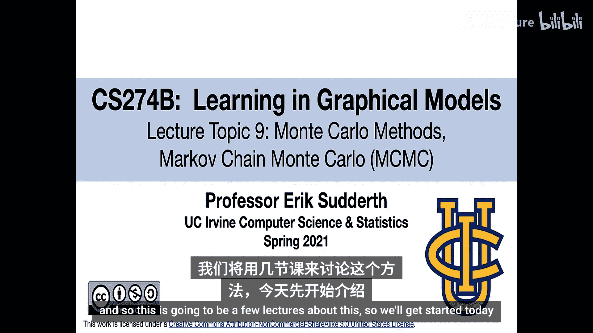

Today。嗯。And the high level idea behind why Monte Carlo methods work is very simple。

And it comes from basically just the law of large numbers， right。So first。

 imagine I have a set of L samples from some distribution。Okay。

 so we're going to use this superscript to indicate the different samples。ok。

And just a bit of notation if you haven't seen before we're going to use this sort of delta with a sub hell to be a delta function set with that sample and so this is you can think of this something that if I take the integral of the delta function times another function I get the value of the function at that point all so you can think of this as kind of like a distribution that's kind of like infinitely high and infinitely narrow at that point。

U。And so a Monte Carlo method says， if I have a set of samples from a distribution。

RightSo if I have I want to know what the expected value of F is。

 which is the integral of F times p and this could be hard to do because F is complicated or p is complicated or both right if x is us from。

you know， rich high dimensional variable， well I can always approximate this by taking L samples from the distribution P so you take samples from P you evaluate your function each of those samples and then you just average those numbers right you take the mean of your samples。

Okay。And this estimator has the nice property that no matter what L is， no matter how big it is。

 it's always unbiased， which means the expected value of the estimator。

It is the same as this true integral。Okay。So now I won't exactly equal this right if I'm using samples。

 this is a random variable so there'll be some variability around this。

It's an easy thing to analyze right so if you just plug in this estimator and sort of say。

 well what would its variance be， it's easy to figure out that this is basically its variance is the variance of this original function F。

So the variance of the function F。嗯。Times1 over L。Okay。

So basically the I have an estimator that as I get more samples。

 the variance goes down and down okay， and this is kind of a you know， classic things。U。

And so you have this variance and then you have， you know correspondingly you have laws of large numbers that you can write in various ways。

 I'm not going to really get into the distinctions between the weak and strong laws in this class。

 but basically are these say in different ways that as the number of samples grows large。

 basically my estimator and the true value this integral become equal with probability one。He。Okay。

And then we're not going to focus on it， but you can also sort of characterize the errors right as as the L gets bigger。

 you have a sort of central limit theorem here， at least when this assuming your true variance is finite which sort of says that you know what the distribution of the errors will be right the distribution of errors you make in your estimate will have。

🤧A Gaussian distribution right and so given all this right if。You， this is kind of。

 although classically， you know， you think of this often for you know。

 analyzing a data set and analyzing your properties of things you would compute from that data set。

 you can also use this in a computer to sort of use simulation to do computations that would be hard to do exactly。

 okay。

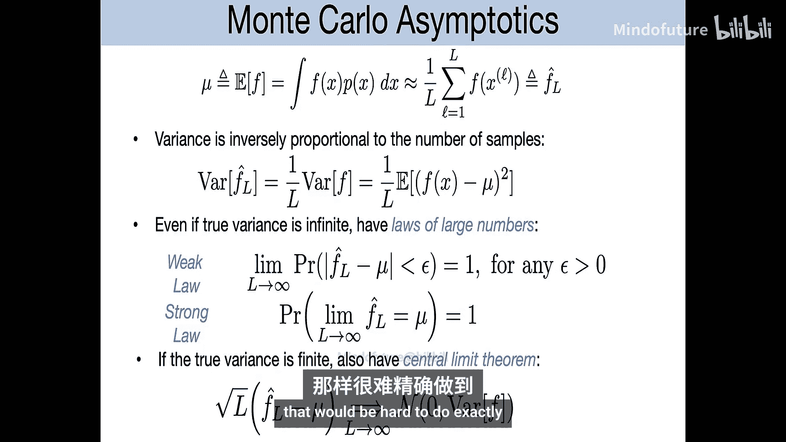

And so the convention right in sort of computer Monte Carlo methods。

Is that we have a source of independent random variables which follow a continuous uniform distribution right so they have this probability density function right so they are uniform between zero and1 okay so any kind of real number between zero1 as equal probability okay and we'll call these like u1。

 u2 u3。And so the way that Monte Carlo methods they usually assume that you have something that gives you these and then you transform them to get samples from whatever distribution you really care about。

Okay。😊，And I'll say a little bit later about where these come from。

 but kind of any software package where it does almost any sort of scientific computing or machine learninger statistics has something that generates。

Numbers that look like this okay and they're not truly random right because the operations in your computer are deterministic so but they they're a stream of numbers that behave as though they were samples from this and those are what are called pseudo random numbers。

And so like， for example， in Python， nuPy has a nice pseudo randomtina number generator。

That you can use all right so a little later in this lecture I'll say where these come from right now let's just assume that you have a black box that gives you samples from this uniform distribution。

And now you want to use those to get you know， analyze some other more complicated distribution。

 okay？

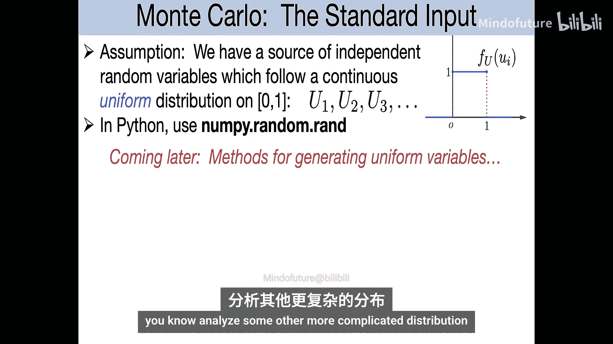

All right。So we'll build up to some cases right so first let's suppose I had some discrete distribution that I wanted to。

Sample from right like let's suppose here at the bottom this was my probability mass function。

 so I had this discrete distribution P of x that puts probability at these six points。U，And so。

 you know， we haven't emphasized it here， but an alternative representation of a distribution instead of the probability mass function is the cumulative distribution function or CDF。

Okay， and so the CDF looks like this right is by definition it's the probability that x is less than equal to sum value。

 not just the sum of these probability mass functions。

 so you get this kind of staircase shape right where there are jumps at each of these values where it takes positive probability。

This is something that starts at zero and then increases to one for any distribution。是。All right。

So now。Now this function is not invertible right because it kind of is like constant over points and jumps so it's not truly an inverttable function。

 but there's sort of something like an inverse and it looks like this right you give me a number so remember that the CDF maps sort of like whatever the support of X is。

 whatever the values my random variable can take to numbers between zero and more。

So now this I'm going to have an inverse function H of U。

 which is going to take numbers between zero and1 and map them back to values of x。

And it's going to look like this， you're going to say I'm going to， you know。

 search over values of x and I'm going to find the smallest value of x。

That's grave and equal to my value of you。 so if you want this say if I wanted to sort of evaluate each of you at like。

 let's say， you know， 0。6， what would I do， I would say you would draw like a horizontal line at 0。

6 and you would say what would be the first x value at which the CDf gets bigger than 0。

6 in that case it would be right here。Okay， that's the first one where you jumped from below 0。

6 to above。Okay this is kind of equivalent to sort of like saying you pick a point between zero and one here。

 you go across and you see you know which of these steps in the staircase you hit and then you pick the x value corresponding to that step。

 that's graphically what it means。What this equation means。Can you set that。All right。

 now what's interesting is if you say， so now suppose I sample number a uniform number between zero and1 and I put it through this function H。

Okay， so that's a valid thing to do， right， because H this inverse CDf takes numbers between0 and1 and math and the values x。

And so if U is a random variable and you know from your basic probability that if I take a random variable I take a function of it。

 I get another random variable so the question is is what is the distribution of this random variable X？

And it turns out its distribution is exactly this P of x。Okay， and you can check that， you can say。

 you know， well， what's the probability that x is some value k？Well。

 that'll be the probability that my you know random number u sort of lives between Fx of k minus 1 and fx of k。

 right。That it。Basically， the probability that like I map to this value of x will be the probability that I。

 my U live somewhere in this range here in this range here okay？And that is。

Equal to this original probability mass function value。Okay， and so if you do this。

 you can immediately take samples from a uniform to convert them to samples from any discrete distribution you wanted to。

And to see why this works， if you want to get intuition， if you look at it， right。

 you'll for values of x that have large probability。

 you have big big jumps in the staircase in the CDF。

 and thus there's like a higher probability that your uniform goes in there。

 whereas for values of x that have low probability。

 you have sort of small steps in the staircase and thus there's a lower probability that you goes in there。

Good。So it's a little easier almost to see graphically， I think， than to see the equations。

 but this is the proof that this would work。看。All right。

 so if you had any discrete random variable you wanted to simulate。

 you can take a single continuous uniform， transform it in this way。

 and you get something that exactly follows that distribution。All right。

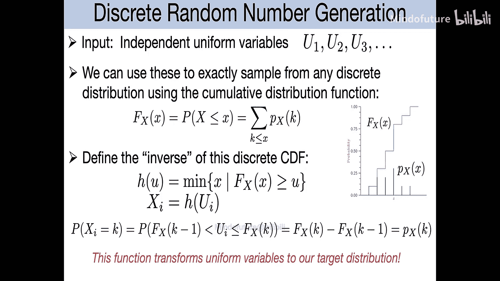

嗯。And this is just this is an example of this right this is they took they used pseudorandom numbers to simulate。

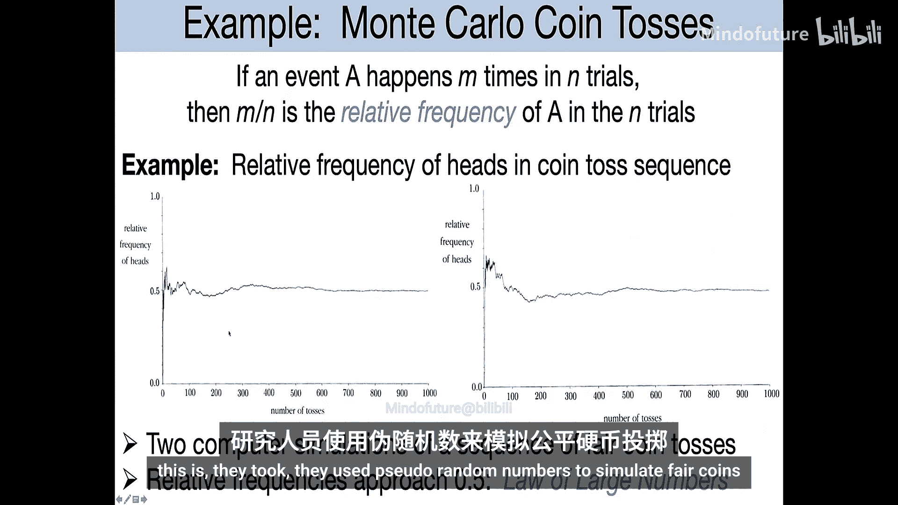

Fair coins okay， now this CDf thing becomes very simple I want to simulate a fair coin and I take my number between zero and1 I just threshold it out a half。

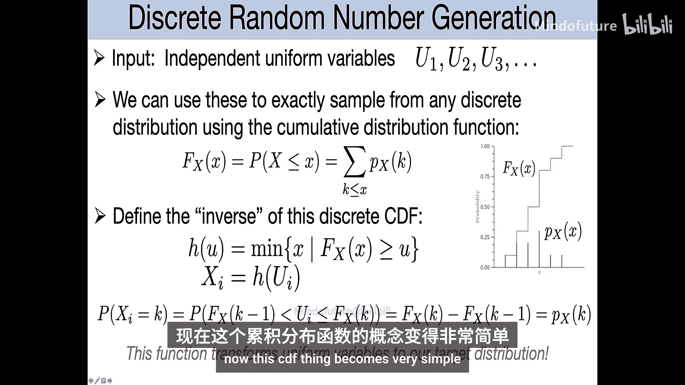

And I say if it's above a half， you get value one， if it's below a half， you get a value zero。

And then this is kind of then showing that if you wanted to sort of say， you know。

 if I have this Bnoulli distribution and you know I could simulate from it and I wanted to say compute it's mean。

 this is just showing as I take an average of different numbers of tosses。

 you can see that you get some variability， but then eventually it converges to a half right from the law of large numbers。

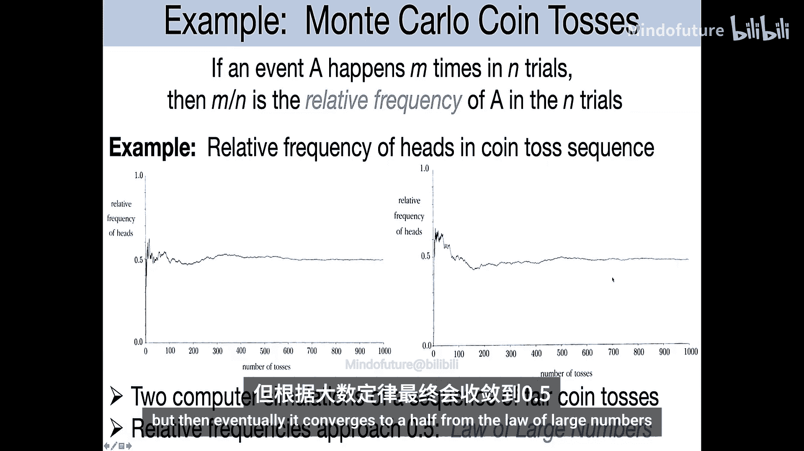

看。All right。U。Now， what if I have， suppose I want to sample instead from a continuous distribution？

Okay。😊，Well， if I have a continuous distribution， you can still define the CDf and that's a function that is。

Moottonically increasing and if my distributions continuous。

 this is going to be an invertible function。Okay， so'm going to let me define H to be the inverse of this CDF right that's something that maps numbers between0 and1 back to you know whatever the support of my distribution is。

And let's suppose that I take a uniform number and put it through this inverse CDF。Okay， well。

 given what I just showed you， you probably won't be surprised to learn that that will actually give me a sample from the continuous distribution I want。

Okay and this is kind of the proof right you can say you know well what's the probability that my x I generate this way is below some value x。

Well， that's the probability that my H of my uniform is below x。And now this H function is inverible。

So that's the same as the probably my uniform being less than H inverse of x and H inverse is just the CDF。

OkayAnd now if I say， you know， what's the probability that a uniform？

A number that's uniform between 01 is like less than 0。7 it's 0。7， it's just that number。Okay。

 and so that's why you get the right probabilities。

So this is an easy way you can transform uniform variables to any continuous distribution that you want。

 assuming it's easy for you to compute this inverse CDF and there's distributions where that's a kind of nasty thing and hard to work with。

 but if that's easy to do， this is an easy way to generate samples。

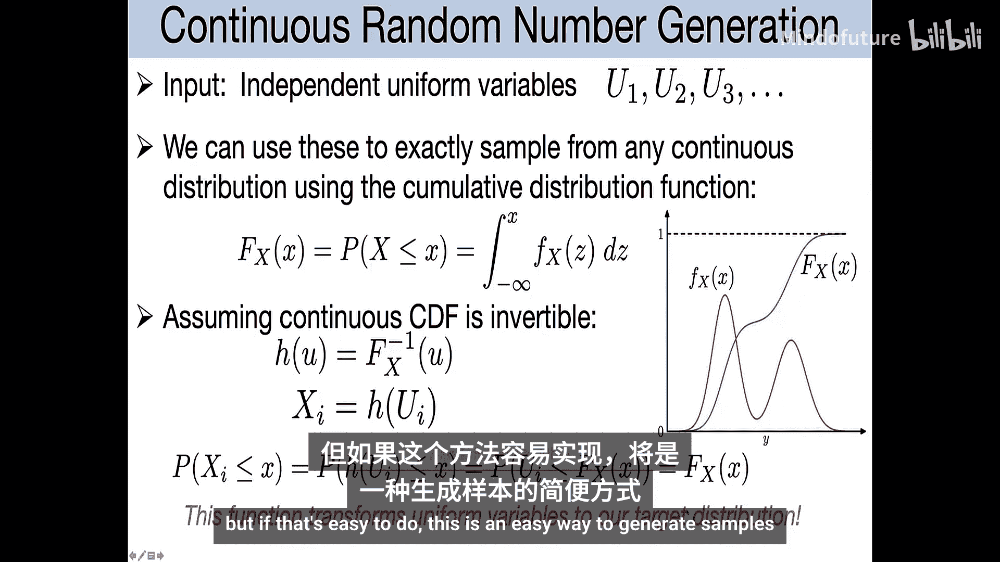

All right， so just to give you a concrete example that works out easily。

 so if I have an exponential distribution。One of the classic distribution on positive numbers。

 it CDF looks like this。So for an exponential distribution。

 the CDF is 1 minus e to the negative theta x。Where this theta is one over the mean right so this theta is defining the mean and the expected value is one over theta so these are sort of the CDS for exponential distributions with different thetas。

Co。So now what would I need to do， well， to if I wanted to simulate exponential variables。

 first I need to work out the inverse CDF。Okay， and so you can see that you know what what I can do is you know I kind of like subtract one from both sides of this equation and then I have to take a natural log to cancel the E and so on so you and then if you then you know divide by theta unit with this term right so the inverse cF is negative one over theta times the natural log of1 minus e that's the inverse of this function。

And so this says that now if I take something that's uniform between zero and one。

I take its natural log。So that'll be a negative number right so the natural logs only between zero and one is a negative number。

And then I take negative one over theta times that， I get a sample from an exponential distribution。

And note right I have this one over theta factor， you can see that that is the mean of the distribution right so you're kind of scaling this thing by this this thing so that by this constant so it has the right mean。

系。And if you look right so nuPI for example， has a function inside it that simulates exponential random variables and if you were to look at the source for that function。

 this is what it would do literally。it calls another function that gives it a uniform variable and then it takes you know。

The natural log scales it and gives you。The exponential variable， so it does exactly this。Okay。

 so I just wanted to like be clear it's like because a lot of times theres there's a the packages from Monte Carlo。

 they have a whole bunch of distributions built in you say sample this， sample that。

 and I just want it's not very mysterious what they're doing。Usually they're doing this。

For some distributions， they don't do this and that's usually because。

This inverse CDF is somehow nasty and if this is hard to work with。

 then sometimes they do something more exotic。But if this is not too complicated。

 then they basically always do this。可。Um， by the way， right， because。

Uniform distributions are symmetric I could have also instead of the one minus u I could have just put you here right because if I take a one minus a uniform I guess think that's still uniformly distributed between zero and one so this would also work it would also give me samples from the correct distribution。

So these transfers are not necessarily unique， but they'll give you something that has the right distribution。

Okay， any questions on that？No。Okay。

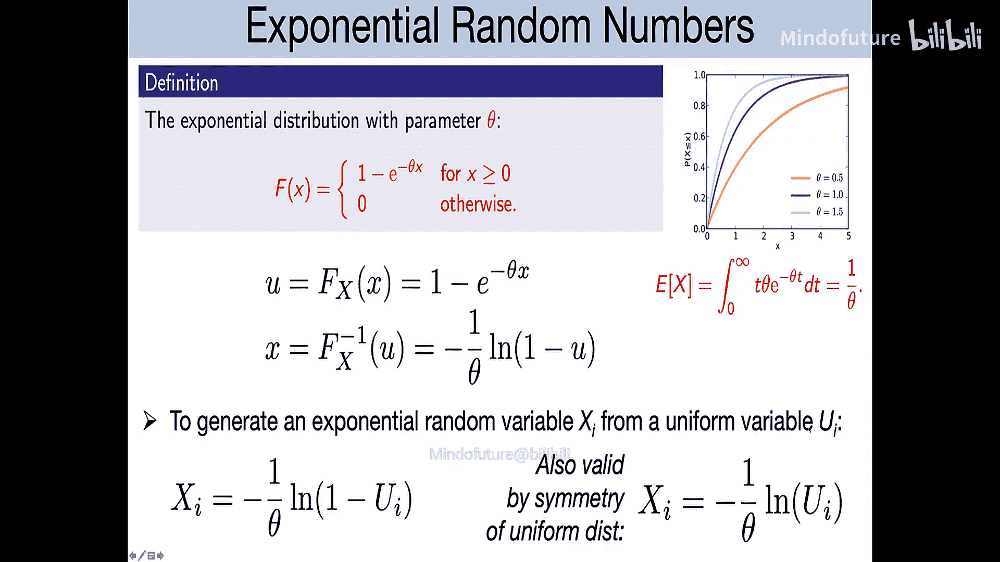

清楚。Okay。U。哦。All right so we're assuming we have a source of independent random affairs we call continuous uniform。

 but this is an old slide that mentions that MatTLb does this。

 but also Python also has functionality so。The way that you generate these is。U。

Using sort of a like a dynamical system that's chaotic right so so the random number generator has an internal state and how it works is you know there's like a value of the state and each time you generate a number you change that state。

And by chaotic， I mean that the function of which you're changing is not like a nice function。

So they try to's function one of these functions where if you change the input slightly。

 the output changes by a lotft。So it's very unstable。

And you can imagine if I have something that's deterministic but's sort of highly chaotic and unstable。

 then it might look to me almost like a something that's random okay。

 and so that's how these random number generators work。

The simplest types of random number generators work with basically just actually use a linear function right so these are not the best generators but they do they are they can be effective and the idea is that so here this U bar is going to be an integer so a large integer like an integer that's 32 bits or 64 bits or some larger number。

And then。M here is going to be like the the largest value this integer could take。

 so like two to the 64th you're doing 64 bits。And so。

This I get numbers between zero and1 by taking my integers and dividing by himm and then the integers evolve by basically just taking linear functions。

 sort of modulular M so they stay in the right ring。

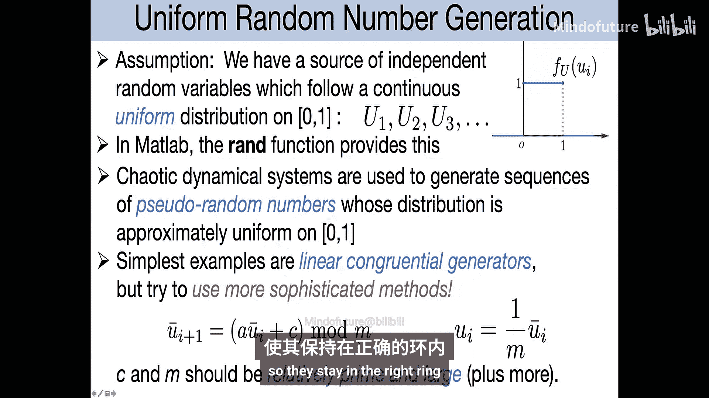

🤧So let me just give you an example of this in pictures right so you have some seed that would be like your' starting integer okay and here's an example like let's suppose I use the function I have m equals9 right so i'm going to the state of my generator is integers between zero and eight and let's suppose I set this a。

To be two and c to be zero so basically what you do is the way your generator works is you multiply by two and then if you get above。

9ine you sort of divide by nine throwing the remainder and so you can think of this as saying what does you do you start at one。

 then you jump to two， then you get to four， then you get to eight。Then two times8 is 16。Right。

 which moduleular9 is seven， so you get to seven and two times  seven is 14， mod9 is five。

Two times five is 10。Mod9 is one。And I'm back to where I started。Okay。

So you go through this cycle of six integers。So I didn't get all of the nine integers and so you can see that actually why didn't I get that because well there's also if I start at three I go to six。

And then two times six is 12 mod nine is three， and so you just oscillate between three and six。Okay。

So so so this would be not a good generator right because you know depending on where you start you might only basically go between two values and that wouldn't look very much like a uniform sample right on the other hand let's suppose I set。

A to four and C to one。U，Then if you kind of move through， if you evaluate this。

 you'll see you go from zero to one to five to three to four to eight to six to seven to two to zero。

Okay and so you kind of go through all of the possible integers between zero and eight and if you look at it。

 you know if I didn't tell you this equation that wouldn't be a terribly obvious pattern right it's going through them in a kind of sort of random seeming way。

Okay。😊，And so the idea is now， you know， you're going to do something like this。

 except instead of there being nine points on your circle， there's going to be like。

Two to the 64th points under your circle or something， right a much larger number。

If you're using a big integer。Okay。All right and so there's a lot of work on so really like like designing these type of generators。

 this is really not really like a statistics problem。

 it's really more of like a mathematics problem and actually a lot of like kind of like number theory and stuff goes into that so aside of a very specialized topic。

You know， if you think if you think about a little bit you should want you know。

 the CM should be sort of relatively prime and large right so it's kind of you don't want things to have common factors that's what'。

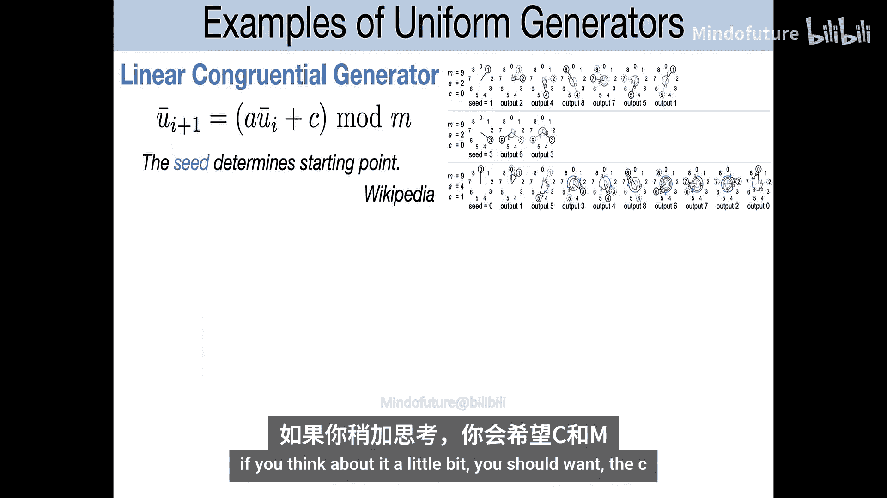

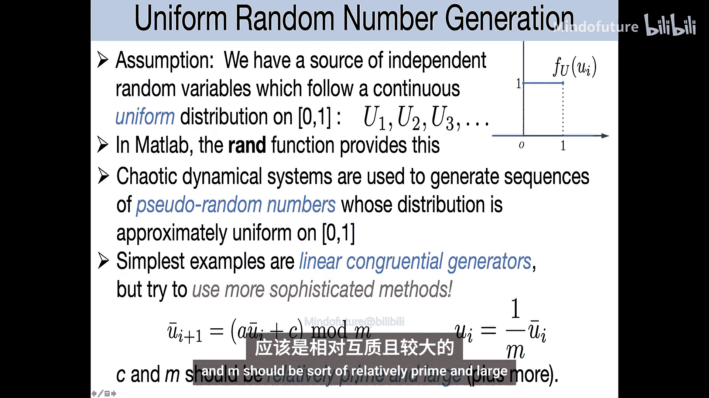

Kind of causing a problem here， but then you need some other good properties too。

And it really does matter if you get these right， I will mention so there was back in the 1970s。

 there was a random number of generator called RA U。

And it was a simple version of this idea okay so what they did is the way that they modify their integers is that you you took the so first of mod two to the 31 that's because they're using。

32 bit。Integerters and maybe throwing away the sign bits that you actually have 31 to sort of for 31 bits to work with。

And so here's the function and I think I think this was a function that was that was picked by you know。

 a software engineer and they they take the current value， they multiply this number 65， 539。

 Does anyone even want to guess why they picked 65， 539。

It has something to do with like powers of two right things to the it's not a power of two。

 but it's almost a power of two。And is it the biggest prime you can fit in 32 bits or？No。

 before 22 or 32， no， it's not because that's only that's way under two to the 32。

That's like on the order of two to the 10th of  a000 so that's。

UTwo of the 15th or something in that neighborhood。No， so the reason that they did it is because。

You know， computers。You know， main the mainframe that they were using to， you know。

 do their big scientific simulation in the 70s was。Wte lower than your cell phone。And。Just like。

 you know with。Arabic numerals on paper multiplying by 10 is really easy。

 you just add zeros and a computer multiplying by powers of two is really easy because you just sort of shift the bits。

So if you multiply by a shower of two， you just kind of shift your bits over so it was very fast so they could make it sort of very fast。

Which was good。However。This is a plot is if you take triples of values。

 so you take like sort of like there's a sequence of U's， you take you know， U1，2，3 or U 456。

 you take like triples if I plot those in 3D space。

Those should be like kind of just fill the cube uniformly if I truly have uniform variables。

But instead， if you look at them， right， they basically lie on these planes exactly。

And I don't have time to explain how they lie on these planes。

 there's kind of some fun papers that have analyzed this。So。

There's strong correlations and basically there's like。

Like literally like hundreds of scientific papers whose results were made invalid because of this。

People like in physics and chemistry， were using this to do simulations for their stuff and the results have jump。

Because they had a bad number， random number generated。So。It really matters。

Can I ask a quick question on that previous slide so I guess i'm a little bit confused here maybe this is a bit of my lack of number theory knowledge。

 but in those sorts of sequences based on the seed that you're showing and sort of is the bottom one considered the best one because it cycles through all of them？

Yeah， yeah okay， and I'm just wondering like that seems bad to me because that means there's like a negative correlation between like seeing yourself and seeing yourself again on the next one。

 which you wouldn't really get in an Iid sample。Right。

 like there's a chance to use like sit at the same spot， right？

Or like you go to one and then two and then back to one the problem is if。

If this is the full state of the generator is this integer。

And so the way to think about it is is if you if you get back to where you started before seeing。

All the integers。Then in that case， whatever you didn't get to is basically impossible to generate。

So you are basically saying that there's parts of that interval between zero and one that are probably exactly zero。

And that's bad if you want a uniform distribution。Okay。

 but isn't the cyclic behavior also bad in terms of like true。Randomness， no。

 because the way to think about it is that even if I can't go exactly to the same point。

Remember if I'm doing like if I'm using 64 bits， the the difference between like two neighboring things here is like basically at the level of like floating point precision at your computer。

So these would be like two uniform numbers that differ only in like the 15th De bowl place or something like that。

Okay， and so rules sorry。And in fact， so this， you know， this I said， you know， 3164。

 this is what real random numbers look like today。

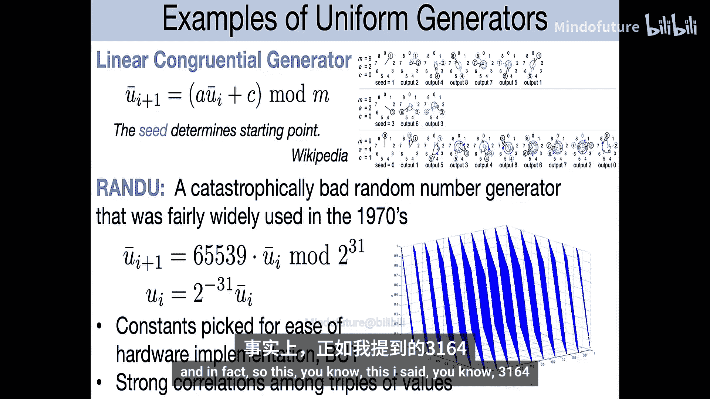

So the one that NPot randomom uses is called a meseane twister， it has period two to the 19，937。

That's a pretty big number。That's way bigger than what atoms in the universe。And this is。

This is like the flow chart for how it works for its internal states。

 how it's transforming things and so on。Okay。I have no idea how this works at all okay so but I show this because I really think it's important that basically you should probably never try to implement your own pseudoranom ofgener。

Um， there are people who basically spend their careers trying to get the details of this right。

 and it's very tricky and very easy to screw up。there's a lot of actually。

 there's benchmarks out there where what they do is they， they take a generator and then you say。

 can I can I test？I run tests on， I want to say， can I distinguish this from numbers that are truly random？

Okay， and then they basically say you know， they have some things they have passed those tests a lot there's a lot of interest in this in part because these random numbers are used in cryptography。

And in cryptography， numbers， if there's a way in which your numbers are not truly random。

 you basically can break the crypto system。So。That's why it's important but also。

 but then on the statistics and machine learning side we can use these if your numbers are not random enough you will be you will get basically get biases in your。

Your simulation results。So but if you use a good generator like most， you know。

 like Python like MAla like R like any of these kind of things I' built in。

They're basically indistinguishable from。嗯。Truly random numbers。

Right or a way to think about it is they're indistinguishable given。

And the amount of data you could generate with like a practical amount of computation。Okay， yeah。

 so basically it you know， as we all know， these aren't really random。

 but the correlation is so low that we can think of them as effectively independent of each other。

And there are， you know， there are。Places where people get， you know。U。

Truly random numbers right you can like you know set up a photo detector and count。

How many photons when photons arrive and you know from certain theories and physics。

 there's some things there that essentially we think would be truly random but that kind of stuff is not although I know someone know one's hard to pitch Intel that they should build that into their that kind of thing into their processors and if this never happened so so we have to usually make do with these pseudoran numbers。

Com。哦。And you know why is the standard pseudo number just uniform between zero and one。

 it's just kind of a simple convenience。Distribution， so it's kind of the convention that's used。

You know。You could。You could transform something from that was from some other family too。

 but it's an easy thing to work with。Thank。Um。

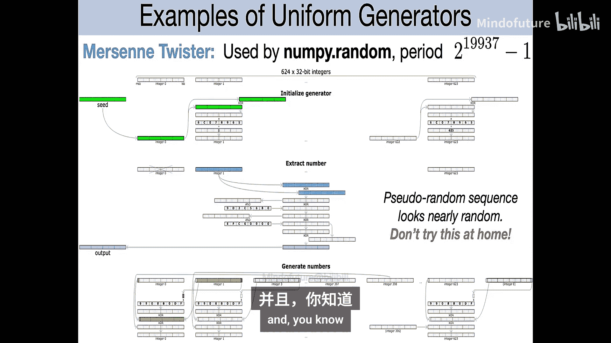

And you know。U。This stuffs used all the time in different parts of science。

You know so when you see these。嗯。Plos。Of you know trajectories of storms and so on。

 sometimes there's like different models that make different of。

 but also sometimes you know multiple of these curves of the same color are essentially different runs of the same model。

Where basically they say they have a model they say， well， I don't know。

Although I understand the physics that in principle I could predict how the weather would evolve。

 I can't simulate things at a finite enough scale and I don't have the sensing to know you at like a centimeter scale exactly what you every point in the atmosphere looks like now so there's uncertainty as where that is and that uncertainty is representing a random numbers and then you they run each they run many simulations to get a sense of like what's the range of possibilities of what could happen。

So this type of stuff is used a lot。For these kinds of systems， right？嗯。Okay。So。

So how can we let me link this back up to graphical models and so on we're going to talk now about a whole sequence of。

Moonnie Carly methods from some very simple things to some fancier things。

And one of the simplest things is is a method for simulation of。Directed graphical models。嗯。

Now suppose I have some directed graphical model。And。Um let's， you know。

 now if I look at this model right， now I already know from the way it's factorized like I know the marginal distribution of node one。

But。I don't actually if I want to say， you know what's the marginal distribution of like node four。

 that's not directly accessible to me right right because you know。Noode you sample node one。

 and then that influences nodes two and three and those。Together， generate node4。Okay。😊。

And so could you， we could use like the junction tree algorithm or something like that to get the exact marginal of node for。

Um but here's a， but if you had a more complicated model that could get computationally expensive。

 so here's another approach。So first， what I'll do is I'll pick an order of the variables in the graph。

That's kind of consistent with the partial order， so I pick a total order the variables where basically for every node its parents proceeded。

So like in this graph， my order could be one， two， three， four， five。

I didn't have to be that I could pick you know， one， three， five， two， four。

Basically just some order where when you get to a node， you've already， its parents come before it。

And then what you do is you just go through an order and you simulate the nodes。

 so basically I start by like say simulating node one。

And then I with one random number and then now that I know node1。

 I think I know what the distribution of x2 given x1 is so that I simulate x2。

And then I know what the distribution of x3， if given one is， so I simulate x3 and so on。

Right so then with like five uniform numbers， I could simulate。All of these variables in this model。

Okay。And that would give me one sample from the joint distribution。Okay。And。U。Now。

If I want now to get， let's say like F， let's say F could be， you know。

 say I want to know what's the probability that node4 takes a particular value， I could do that。

 you know， let's say you know， 10 or 1000 or 10000 times。Draw like 10。

000 samples of the joint configuration。And just count how many times。you know。

 note4 took the value I care about and divide that by my 10。

000 right and then that will give me an estimate that's unbiased and then the limit as my number of samples go big gets closer and closer to the truth。

啊。And so。This Marnie Carlo has a has a very different sort of it's has some different trade offs than the you know the exact inference methods we talked about but junction tree right so junction tree is a method that you know your。

Your answer always has zero error or you know， maybe just whatever sort of like floating point round up but essentially zero error。

 but it could be fast or it could be really， really slow。

 it could be totally intractable right depending on what the graph structure is。

Whereas with Monte Carlo， decide you can decide how much computation you're willing to spend by picking the number of samples。

Right， so like if you if you have an hour of computing time to get your answer， you can say， well。

Start drawing samples and you know stock when you get to an hour， do however many you can。

So what's the trade off， the trade off is you don't get the exact answer。

 you get an answer that is sort of like the truth plus some noise from the fact that you simulated a finite number of times。

Okay。And so the nice thing is that you know， I don't have to in doing this simulation。

 I don't have to like enumerate the exponential number of joint states。

 I can just simulate one variable at a time due to this directed structure。So it's a nice approach。

Also， I can compute the expected value of functions that are not just about a single node。

 but are complicated。Right， so let's suppose you know you'd say， you know。You know。

 imagine I have a big graph with lots of binary variables and you say， well。

 what's the probability that you know， the number of binary variables that are active is more than 10 or something like some folks that depends on all of them。

And things are dependent that's a。Complicated thing， but as long as I can， you know。

 simulate and evaluate my function， it's good。 And so another nice thing is that this function can be。

嗯。Very complicated。Right it could be， you know take all the variables in your model and it's some black box that does really strain you know really exotic things。

 that's okay as long as you can evaluate the function on any evaluated variables you can use the Monte Carlo so you don't need it to be differentable you don't need it to be nice。

 you don't need to be able to do anything， you know clever with it。🤧Okay。

 ask a question on this yeah。So what if your graph has cycles。

 how do you do this ancestral sampling in a cycle？So。Well， there's so first I have a directed。Graph。

So for any， you can't have directed cycles or it's not a valid graphical model。

So for a directed graphical model， it had to be acyclic。

Now there could be this is sort of a loop from the perspective of loopy belief propagation。

 but that's okay。You can't now this approach as I've described。

 it can't be applied to like an undirected model or just a factor graph where you don't have this sort of like conditional factorization。

So this is something that's special unlike the other methods we talked about。

 this something that takes advantage of。The directed graphical model factorization so I can do this for a directed model。

 I couldn't do this for like an undirected markovend field。

There'll be some fancy methods coming later we can apply to Mark government bills。Okay， thank you。

UAnother thing though， that you immediately see is that here I've talked about you know computing like let's say。

 marginals at the prior。Because you're simulating all the variables and that's that's can be useful there's times in which you're interested in my understanding what are the。

Bses of my model， but more frequently we actually you know care about the posterior given data right we observe some those。

And so here， like if I say， if node4 is observed， how would I modify this process to account for that？

Right， it's not。You can't do just what I've done here and get the right result。

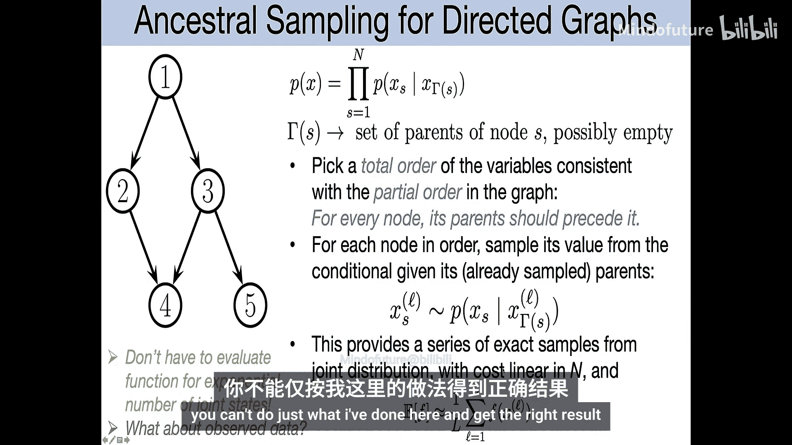

So， but there's a slight extension that let you do that， something called an important sampling。

 that's what I'm going to talk about thanks。

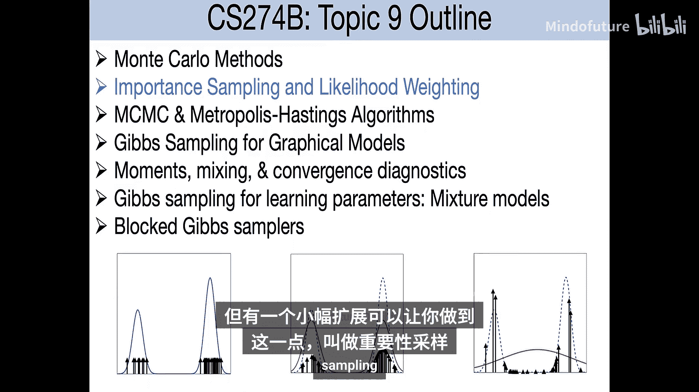

Okay。So right this is just the summary， this is the kind of general Monte Carlo setup。

And it what does it assume， it assumes two things， it assumes I can evaluate my function at any point。

In order to get this approximation to integral， I have to be able to evaluate the function。

I mean that's a pretty usually that's a pretty mild assumption if you can't even evaluate your function。

 then you have a hard problem so so but it assumes something that actually in some cases is really hard to do。

 it assumes I can sort of exactly simulate from my distribution。

And so if I have like x is high dimensional and of a complicated distribution。

 it may be that I can evaluate the PDF at any point， but that drawing samples is hard。Okay。嗯。Right。

 so for example like。Even if I have discrete variables， it can be hard right if you think about here。

嗯。啊。

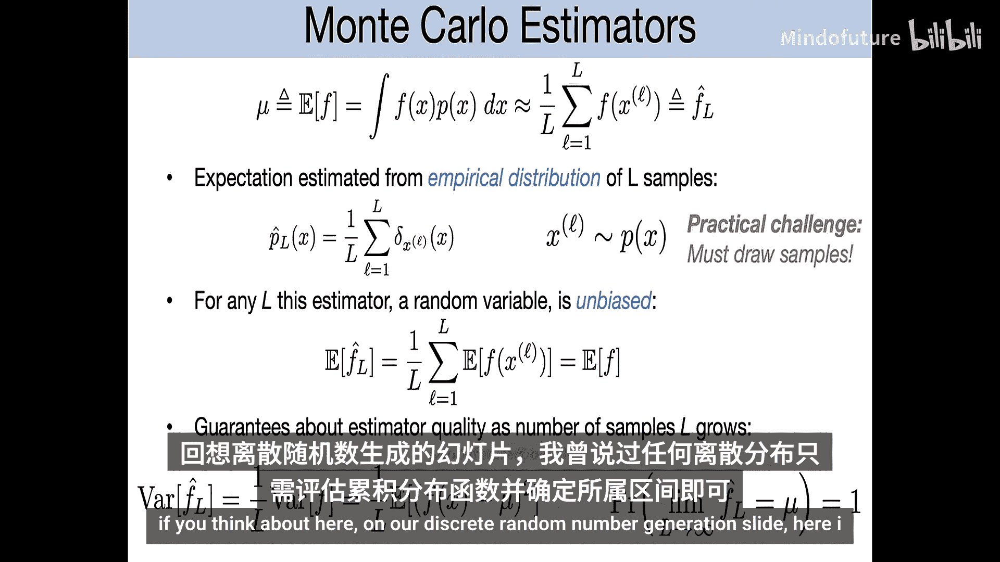

On our discrete random number generation slide。Um here I said， oh， you know。

 any discrete distribution， you know， you just evaluate the CDf and， you know。

 figure out which bin you fall into。Now， the problem is is that you know。

Imagine I tried to apply this to just simulate kind of like。

A graphical model that has you know lots of discrete nodes and do it all at once well。In principle。

 you could do that， but the problem is is that your CDF is going to kind of have an exponential number of steps in it and has a step for kind of every joint configuration of my variables。

And so it's not going to be copied for the same reason you can't you sort of like enumerate all possible combinations it's it's not going to be。

Computationally tractable to simulate that way so there's lots of cases like that where the this basic Monte carlo simulation kind of doesn't work because it's too hard to just draw efficiently sort of draw exact samples from your distribution。

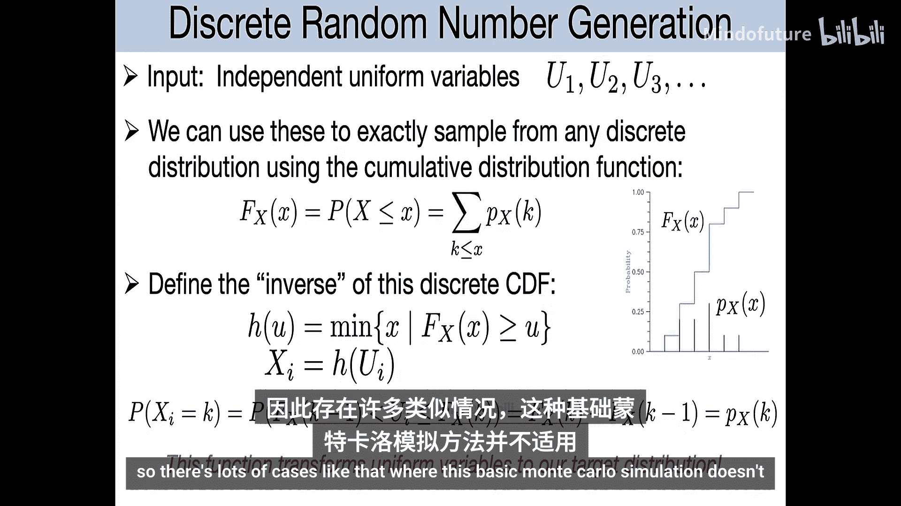

Okay。All right， so important sampling is a very kind of general purpose way of trying to deal with that。

So here's the idea I'm going to have a distribution this is the thing I would like to sample from I want to evaluate expectations with respect to and this is called the target distribution so P of x and so now we're going to say that P of x is some P star of x times a normalization constant。

And。It's going to be okay if I don't know what this normalization constant is。

And so that's convenient， think about like remember when we talked about factor graphs。

 right factor graphs， the probabilities of product of factors times some normalization concept that might be hard to compute。

Okay and so the reason I have this P star here is we're going to say that I may not know this normalization concept。

 like I know that it exists in principle， but I may not be able to compute it numerically。嗯。And then。

I'm going to assume that sampling from P is hard。But I'm going to build another distribution。九。

And Q is going to be called the proposal distribution Q I might also not be able to easily evaluate as normalizer。

 so Q will be some Q star divided by a normalization constant。Yeah。

And the only the only strict requirement is that Q of x has to have。

Be have positive probability everywhere that P of x has positive probability， so basically if。

IfIf there's for any x that is possible to generate under P。

 it also has to be possible to generate it under Q。Okay。嗯。But that's it。And you know。

 you can and right now， Q can kind of be arbitrary other than this condition。

The way to think about it is， as we'll see more in a minute。

 a good Q would be one where Q is somehow similar to P， but easier to work with。So think of it。

 think of like Q is something that like you would try to engineer some computationally simple approximation to P。

系。All， so now my integral， my expected value of F。Well I can is you know the integral of I have some function I care about times this distribution that's why I want to integrate well I can write this as F of x。

Times I can sort of multiply and divide by Q of x and rearrange terms。

So I can now write this as F of x times this function， what's called the weight function。

 so this W of x is the ratio of P over Q。Times Q of x。Okay。And sort of trivially， right。

 the Q of x here and the Q and the denominator of the weight would cancel and the integral value hasn't changed。

Okay by the way， this condition。That q of x is positive or p of x is positive。

 that's what's making sure I don't divide by zero here right because then that would be a problem。

All right， and now if you look at this， this this is an expect you can think of this as an expected value but。

Not an expected value with respect to P， it's like an expected value where the distribution is Q。

Right so you can think of this as the expected value of the function f times W with respect to the distribution Q。

And so now what I can do is I can sample。From Q。And then evaluate F times W at each of my samples。

And average those values to get a Monte carlow estimate。

And theversion of important sampling that's most widely used does something slightly fancier to deal with this fact that we don't know the normalizers。

What it does is it says I'm going to have a W star。

 which is going to be the ratio of the unnormalized densities， so it's kind of p divided by Q。

 but where you haven't used your normalization constants。

And so what I do is I draw a bunch of samples from Q。

And so I get to design the proposal so basically I can you make something that's simple enough to sample from。

And then I evaluate this W star at each of my samples。And those will be positive numbers。

And then I take those positive numbers and normalize so they sum to one。

Right so you can see this W subL is going to be there's a positive weight on each sample and they won't be uniform。

 some will be bigger some will be smaller in the sum the one and then I take a weighted。嗯。

Average of my function values。So remember in the basic Monte Carlo method you sampled a bunch of times。

 you took an unweighted mean you just took an average weight them equally。

 so here i'm kind of doing the same same idea if I'm doing a weighted average。Right。

 and now look at these weights basically。If I have for an x where P over Q is bigger than one。

 so that's like a point where the proposal is too small。

 so like I'm sampling points in that part of the space less frequently than I should。Then。

So if Q is less than p， then that point will kind of get a bigger weight that it'll have a high weight。

On the other hand， suppose for at x， p is less than  Q。In that case。

 I'm kind of my proposal is putting too many points in that part of the space。

And then those function values get a smaller weight。

And this is so this is how you you're sort of correcting right you're sort of like saying depending on the ratio of P andq you you give things larger or smaller weight if you and this does it kind of it's kind of all a little magical almost like this。

Does this exactly right so that you get。嗯。啊。So he has the right expectation。Okay。

So this is asymptotically。Unbiased this means that the turns out there is bias。

 the expected value of this is not the true function that has to do with the fact that that you're ignoring these normalization constants。

But that bias。Gets smaller and reduces to zero as you get more and more samples。Okay。

And you could actually ask。So if you think about like a Monte Carla method， right。

 if I have the right mean， then basically what I would like is my variance of my estimator to be as small as possible because that would say that on average。

 the difference between my estimate and the true value is small。So then you might say that， well。

 what would be a good cue， what would be the cu that would make the variance as small as possible？

And it turns out actually you might， when you first see this， you might say， well。

 the best Q would be to setq equal to P。But in fact， that's not true， you can do better than that。

So if you say overall Q， what would be your best choice， it would be to take P。

Times the absolute value of that。And then sort of renormalize that。So in fact。

 can I don't actually want to simulate from P， I would actually。

 if my goal is to evaluate the expected value of some particular function F of x。

 if I put more samples in regions where F is big in magnitude， I can do better。

 I will get an estimate that converges faster。啊。Um。And that's actually so this actually。

There are some problems where you use this， even though you can simulate from P because it lets you get smaller variants。

Get more accurate answers for sort of per you know unit of computation。嗯。嗯。

To find out that this is the minimum variance proposal actually。

 I'm not going to like go through this in depth， but it's actually not it's an easy proof and it uses the Jensen's inequality that we mentioned。

I guess this was in the virtual lecture on the EM algorithm。

 but the idea is that you would if you say， you know， what is the variance？OfMy function。

 this is the thing that determines how good my estimator is。

Then you can see I have this thing that depends on the expected value of f squared times w squared。

And now I can lower bound， right， so the square。Is a convex function？

So the expected value of Fw squared is less than or equal to the expected value of F times W squared。

And so this gives me a lower bound， and it turns out that this choice of Q achieves that bound。Okay。

So this is kind of the lower bound on the possible variance of any estimator and then Q achieve that。

看。All right。And。Okay。I wish I had a better sort of practical illustration of this。

 but but you can imagine there's a lot of there's a part of probably in statistics that。

Where people go by。What's called rare vent simulation。嗯。😊，You know。You know。

 so like imagine you have a。Like sometimes people do this right so Mon Carlo has also used a lot in like computer systems。

Right where you have， let's say some distributed system and you want to know you well what's the probability that like I exceed this resource and so that you know I run out and can't serve my clients or you know what's the probability that there's a bad race condition or something like that and so you can you simulate many times to sort of get estimates of those probabilities。

Now here's the problem though， suppose you have a。You know， if you have a good system。

 suppose that like your you know， your failure cases you want to find are rare。 so you say， you know。

 well I want to find， you know， I think the probability is like on the order of like， say you know。

 one in a billion or one in a trillion times。Okay and so you want to estimate probability failure buts it's rare right you know you'd have to do trillions well that's the probability you're going to have accurately you're going to have to see many failures right so you know if a failure happens one in every you know 10 to the 12 times if you want to estimate what the real probability of failures you might need to do like 10 to the 15 or more simulations and that's very slow。

Okay， so the idea is that， you know， I have a distribution here。And I'm interested in like， you know。

 the probability of some that I've fall in some corner of the space that has low probability。Okay。

And if I just simulate from this distribution， you know， most of my samples don't program it's like。

 you know， you didn't fail， you didn't fail until eventually you get to this corner of the space。

Instead， what I can do is I can essentially with important sampling， you say that。嗯。😊。

You make a bias distribution right， you take a distribution that。You think about， you know。

You simulate your system in a biased way such that failures are more common。

 and then you use the important sampling to correct for that bias when you estimate probabilities。

Okay。Here's another picture okay sos。A。嗯。This is this happens to be a mixture of two Gaussians。

 right a sum of two Gaussians and so if I wanted to sort of evaluate a function expect a value of some function on this distribution。

 if you just drew samples they would look like this。

 so this is just set of the locations of a set of samples from this mixture of two Gaussians。

Now here is you know one possible proposal distribution the red curves would be one proposal you could do and in this case let's suppose I did this is a mixture of two Gaussians but they there're the。

They're sort of equal in probability where they should be unequal， like in the true distribution。

 the right Gaussian is higher probably in the left here there。

Equal and also these their variances are wrong， so these red Gaussians have a variance that's a little too big。

Okay， so then when I take my samples， so that's the locations of these arrows are the samples and then the height of these arrows is the weight。

P over Q and so you can see right， so I get。High weight in the middle here and that's because。

My proposal has probably that's too low there。Right that' sort of like red is below the blue there on the other hand。

 out here the red is above the blue， I put too many samples there so I have lower weight for those points。

Okay。Okay。Now here is a different proposal。This is actually a single Gaussian proposal that has the same mean and variance as this mixture。

In this case you can see that it's not a good proposal because there's you know a whole bunch of the samples get near zero weight right so this is like in this whole area in the middle where the true distribution is probably almost zero and the proposal has high probability。

And then on the other hand， you have these points over here where you know。

 the small number of points that you kind of where your proposal happens to line up give high weight。

Okay so if you look at it right even though you drew dozens of samples。

 there might be only about six of them that have reasonable weight here。Okay。

 so I'm just showing visually if you。Computed。The variance of this proposal， basically this W。

 this P over Q ratio would sometimes is very big， and so it has large variances。

And this hurts downstream task， here's one way that which weighted samples are used beside just evaluating expectation is estimating the density。

And so this is not really our focus right now， but there's something called a kernel or pars and window density estimator。

 something called a nonparmetric density estimator and the idea is if I have a bunch of samples and what I do weighted samples is I put a little Gaussian with some small variance on each one and then that gives me an approximation to my true distribution that doesn't make any functional form amount of shape right so if I take these samples and I put little Gaussians on each one and add them up you get this curve here which is pretty close to this truth it doesn't know that there's two Gaussians but it gets a pretty good estimate。

Now if I take these weighted samples and then I take you weighted so then I get little weighted Gaussians and I add them up。

 then I would get this here and you can see it's again a pretty good approximation of truth。Okay。

 and it's if I didn't do these weights， I would get something that was biased that didn't mine up。

 so the weights is important。On the other hand， if I on this one on the right， if I put weights here。

 you can see that I get。A kind of poor approximation。

Like I have two modes here instead of one and not just because I have this proposal doesn't match the target well。

Now。With this proposal， I still have。The right asymptotics right is in the limit as I draw a large number of samples。

 I'll get exactly the right expectation， it's just that the variance is bigger。So kind of the。

There's like a the variance of your estimator is always some constant divided by L。

 and that constant is much bigger here than it is here。

And what that means is that I would forgivegiven in accuracy， I will have to draw more samples。

So so this is sort of illustrating that， you know， whatever number of samples was used in this figure like would not be enough probably for this proposal if if this was the best proposal you had you would you would have to spend more CPU time。

 you would have to draw more samples to actually get an estimator you could trust an  estimate you could trust。

Okay。Questions about that。Can you repeat again how you use important sampling for rare sampling？是。

Yeah， so you were。

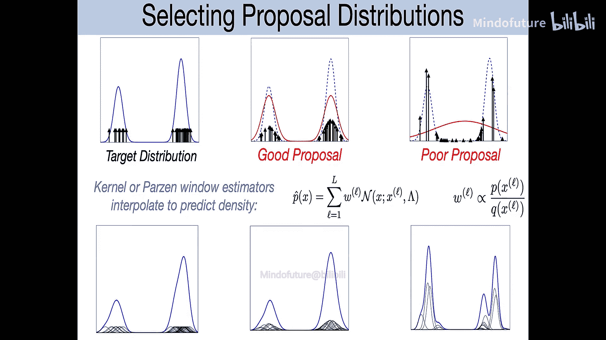

。The idea would be you would just。Um。You would have a cu that if this was your you know。

 the space here， you would have a queue that kind of put its mass over in this part of the space。

Right so kind of didn't bother sampling in these regions kind of only sampled over here。

And then your Q might。Let's say。Get have 50% of its samples inside E and 50% outside。Okay。

 and then you， but then you use this importance ratio。

 the ratio of P to Q to decide how much you should reweight that to get an unbiased estimate。

So we choose the queue to no no there's another question of how do you how do you pick the queue right and that's not always easy but but。

I mean there' there are methods that try to like learn the queue and and that's more advanced。

 but but the idea is that that it lets you there's a lot of problems where you can like。

Engineer and the idea is that， you know you can。You can put a lot of like heuristics and your own insights into designing the queue and then kind of then use this important sampling framework to correct for it。

And then you end up with something that still has the right answer and expectation。Okay。Yeah。

 thank you。So。Yeah。U。And this can really。This issue of， you know the。

How good my proposal is it really does。嗯。Matter。This is another example， so this is a I have like a。

A target， it's a one dimensional random variable that I want to estimate the mean of。This line here。

 you know here is， I think like the true mean of the random variable。

And it has heavy tails like's like a Kausi distributions。

 this is a distribution that sort of relative to a Gaussian decays to zero very slowly。

 so there's like way more extreme events than a Gaussian。Okay。And now I if I take a Gaussian。

Samples from some Gaussian proposal， some reasonable Gaussian。Um， and then sort of say， you know。

 well， what does my estimate look like as a function of the number of samples？嗯。

Using usingsing important sampling， this is you know what you get and now this is a log scales this is a thousand00 samples。

 10，00，100，000 a million samples。So that seems like a lot for scalar variable if you look at it。😊。

And suppose you didn't know truth， suppose you just saw this。This plot。You might look at it and say。

 oh， it seems like I'm kind of converging to the answer。But look。

 you're in fact way off and what's happening is that there's an occasionally a sample that gets huge weight。

And that really adjusted。Okay。And now here's a different proposal that has tales that better match the true one better and the。

Um，You know， you get a much more accurate estimate。So but the point is that you know。

 I mean this is a toy problem where the truth could be computed exactly in general these methods are a little dangerous because you won't know it can be hard to know。

 you know that if you have this bias or not。And right， the variance here， here's the formula。

 the variance of my estimator is the variance of the product of my function and this weight。Okay。😊。

And this weight， this P over Q， basically if unless this weight， if it's not bounded above。Right。

 so basically with。What's really bad for this variance is if this weight can be big and that's basically if there are when is that to be a big number。

 that's if there's x's that are very rare in Q， but have moderate or high probability in P。Right。

 and so hopefully that's intuitive that would be bad right if I if I have a。

A part of my space that's relatively common under the true distribution， but but is。

Very rare under your proposal， you very rarely sample there in the proposal will then to actually。

 you know， put。You know samples there so you get the right expectation you're going to have to draw a very large number of samples and so then you'll be if you do a whole number of samples you'll have big variance。

And in fact， there's a lot of this is this is a case there's actually。😊。

It's not hard if you're not careful to have proposals where this variance is actually infinite。

Because if this isn't bounded， then you can get a random variable here with infinite variances。Which。

 of course， is bad for convergence rates。Okay。And so because of this， we often end up not。

If you have a big concat distribution designing a proposal that's good enough to cover the whole thing it's hard。

 often this is more of a building block that we use within more complicated Monte Carlo methods as opposed to being the solution by itself。

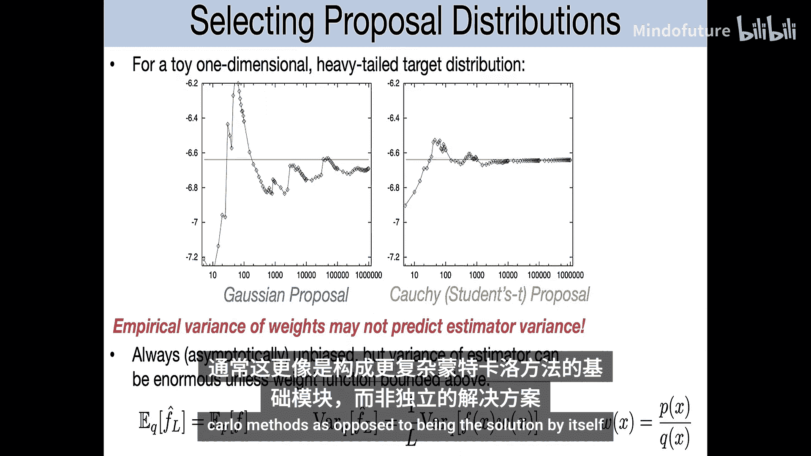

But。It does give us a way to。U。Work with。In the inference for directed models to handle the case where I have some observations。

So here's like。Like saw we saw before， so I have a directeded model。

 and we talked before about how I could use normal money Carload to just like simulate from the prior。

But now suppose I want to know something about the posterior given some observations。

 so like x2 and x5 are observed， I'm interested in the posterior of the other three variables。Okay。

So I want。Here I have the O is I'm going to use O for the observed variables and H for the other variables。

 these are the ones that are not observed， they sometimes call them hidden。So like in this case。

 it'd be like oh would be nodes two and five and the hidden would be one， three， and four。Okay。U。😊。

And so I mentioned this posterior right， so I have the。U。When I can think about it right。

 my posterior is sort of proportional to the joint。And again。

 I'm going to think of it meaning there's two parts here。

 there's like the variables that are hidden and then there's variables that are observed。

 which in which case you know they're actually random they're observed。

And so how we can do important sampling in this case is we'll， like before。

 we'll pick an order of the variables。Where every notice is precede by his parents so we could do like one。

 two， three， four。Five， say one， two， three， four， five， just keep it simple。

 I'll go in numeric order。And then。Now the values of the observed variables will be fixed。

I'm not going to change them and then so I go in my order and for only the hidden nodes I sample them given their parents。

So how would this work here， so I would simulate x1 from its prior？Then I would simulate x3 given x1。

Again， kind of from the prior。And then I would simulate x4。

Given whatever sample x3 I did and the value of x2 that was observed。Okay。

 so you can kind of see this is sort of partially accounting for my observations。

So I'm pretty like when I simulate x4， I count for x2。But on the other hand， right。

 I sampled x1 from its prior， whereas really， you know， x2 has an influence on x1。

 I give if I observe x2， then kind of by Bay rule that changes what values of x1 are like haven't accounted for that。

And then I have x5 here that influences x3 and then indirectly x1 and x4。

 and I haven't accounted for that。Okay， so this is a distribution。😊。

But it's not the rightful steor distribution。That's a question here。

So does the number of times you need to sample a node or simulate the node depend on the in degree。

 the number of parents。Because I could imagine if you'd have a lot of parents。

There's a lot of combinations of the valuess of those variant。And therefore。

 you need to sample it more often。Well， so for。For each in this case， each sample。Is like。

A joint configuration of all the variables in the graph。So for each sample。

 you sample each variable once。Okay okay and then i'm going to repeat that I see l times which is this parameter it could be 100。

 it could be 10 it could be 10000 I got it so all the variables that are unobserved are being sampled in equal number of times。

However。Um。Your intuition is right that if I have a variable that has。嗯。Like a large， you know。

 many parents say or something like that if I have large degree。

And also if I just have a lot of variables in the model then。You know。

s there's like many combinations of things and the if you use a small number of global samples of the model。

 you may have a big variance。Okay。And so then you may need to draw more samples。To get。

But each sample is still going to have one value for each variable yeah yeah I thought it was they were being sampled independently okay。

 thank you。Yeah， so like this is a process， so this is going to give me a value。

 if I do this process once， I'll get a value of x1， x3， x4。And then I'm going to do that many times。

嗯。Yeah， thank you。Um。So。And so I can think of my proposal as。Looking like this。

 like my proposal is now going to be a distribution that takes。

For the hidden variables samples them from basically the correct terms。

But then from the observed variables， you， it just fixing them to their observations。

So this is like a function that's one at the observations and zero otherwise。

 and now I can computee my weights。Then the kind of the terms for the hidden variables cancel。

Right so I get some cancellation here because essentially you know I'm using。

But terms from the correct distribution here and you get a very simple result。

 you say the weight is just going to be the product over all of my observed nodes of the probability of that node given its parents。

So this is why it's called this method is called likelihood waitinging because if you。

Take this proposal and evaluate the weight， it's just sort of the likelihood of all the nodes that are observed。

Given whatever the parents were。Okay。Okay。

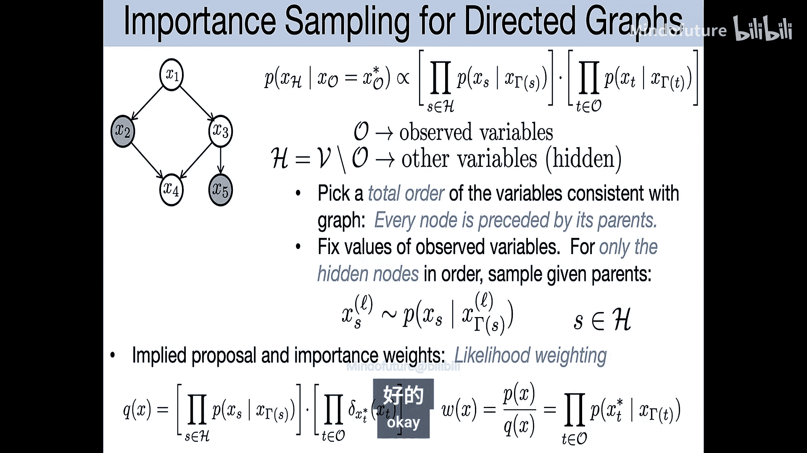

So this works。But not well。so it's a it's it's a you can see it's a very simple method so unurpri it's been around a long time it was one of the earliest methods that people people tried for these types of models back going back to the 80s so this is a paver from 1996 and so what they have a。

😊，I believe。A 146 node belief network， so belief network just means directed graphical model has 146 nodes。

Multly connected belief network from a medical domain so this is a network it's actually it's a bit like that alarm network that you saw in homework one that's kind of a bigger version of that。

So that one had like 30 some variables， this one has like 146 variables。Okay。U。😊，And the。

Although it had 1146 variables， the structure was such that they were able to run the so Ladson and Spiegelhalter algorithm。

 that is the Junction tree algorithm， Lason and Spiegelhalter were the original folks who developed that。

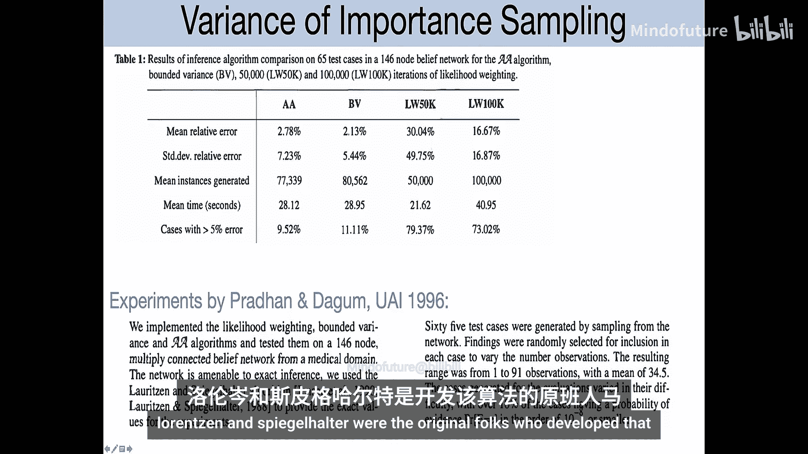

So they were able to run the junction tree algorithm and get exact marginals。

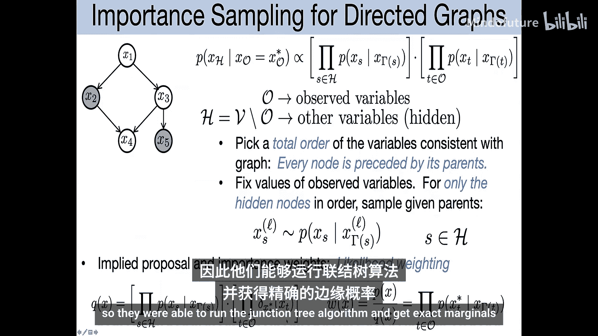

And。Of course， in this medical diagnosis right they're interested in doing some observations the probably some others and so they compared this is like the the。

You know， what is their error from the true？Marginals。

And they did it and measured in come kind of percentage way。

 but you can see that here LW50k is that apply that method I just did with 50，000 samples。

LW 100K is applied that method I just did with 100，000 samples。And you can see that you know。

 with 50，000 samples， they have 30% air with 100，000 samples， they have 16% air。

So it's going down as kind of the law ocean numbers predict， but that's still， you know。

A pretty big hair。And， you know， 100，000 samples is。You know， a lot for what's not a huge model。

so you could push this smaller if you could do a million samples or 10 million or whatever。

So you know， I guess I guess this this is kind of a method that's really like it's very simple right you didn't have to do any complicated analysis。

 it could be very simple to implement， but it's it's you're really you know putting putting a high computational burden you might have to draw a lot of samples to get a good result。

Okay。To see why you might need。

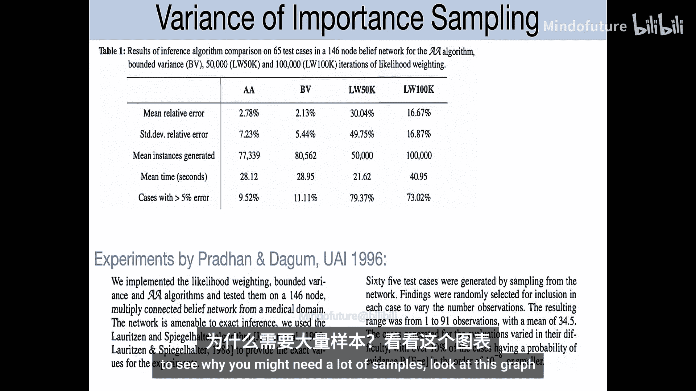

A lot of samples。U。Look at this graph， let's say let's say that x1 was like I don't know let's suppose this was a tiny graph from one of those medical domains and x1 was like。

Pss or absence of some disease。Okay， and let's suppose that this is a disease that's rare。

That occurs， you know， one out of every 10，000 people。But given x5， given test result x5。

 unfortunately now you're probably that you have a disease is really high。Okay。

 well then when you simulate x1 from its prior， you're almost always going to say healthy， healthy。

 healthy， healthy because that's like， you know。Much more likely。And so when you do that。

 you're going to kind of get。All these samples that say oh healthy， healthy。

 but then when I get down here， I have， you know。Basically weight zero and then occasionally you're going to get a sample that you know。

That was rare out of the prior， but aligned with your data。Okay， and so basically。

 if you have either a large number of observations。

Or a case where you know the observations are really influential where the posterior is very different from the prior。

 this method will be ineffective， you'll need a large number of samples。

If your observations are kind of only weakly informative， then it could be really effective。

 it could give you a good result with a small number of samples。

Another bit of intuition right the weight here is a product over all the observed nodes and so if you think about if I have a bunch of like kind of random variables as I take their product their variance is going to get bigger and bigger so in general as。

I get more observations that's going to potentially be kind of like。You know。

 a bigger variance in your post。

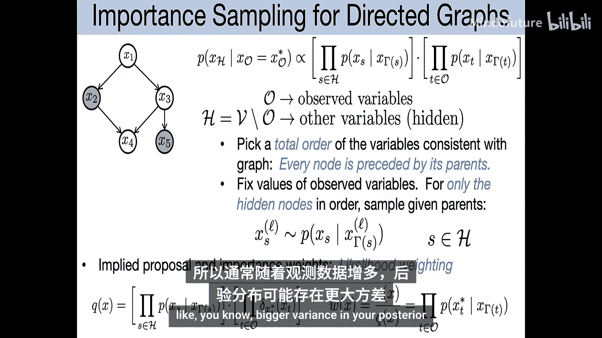

Okay。😊，And so here they were showing right in this case likelihood waiting was their baseline and they had some。

I forget I don't even remember what these methods are。

 but they had some methods AA and BV that were able to get lower errors。

Um and we're not in this class I'm not going to talk specifically about these methods。

 but we're going to talk about other methods that。Do better than this basic likelihood waiting。

By kind of accounting for dependencies more when dropping samples。下。

SoBut it's a good approach of that。Good， all right。

 so we're going to move on to the so that's that's it for the basic the sort of simple important sampling。

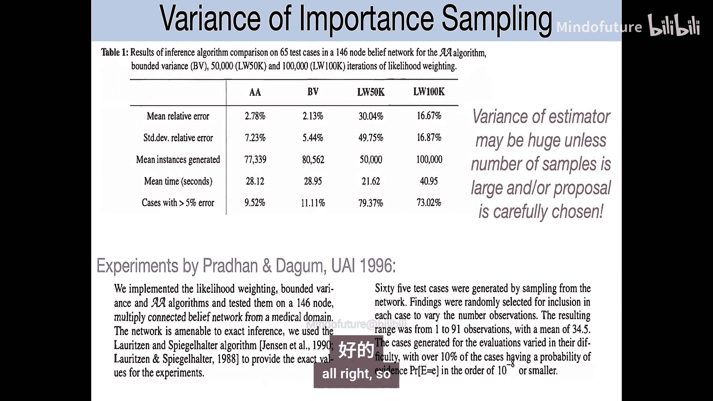

Next class we're going to move on to Markov chain Monte Carlo or MCMC methods。

 including the metropolis Hastings algorithm the Gib sampler and so these are some of the most famous。

Widely used really useful ways of doing inference， so I think if you haven't seen them before。

 it should be。I think a really interesting topic， so I'll stop here for today。

 but I'd be happy to take more questions if anybody has them。

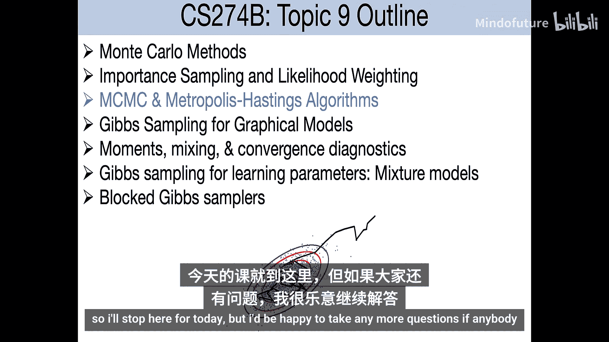

嗯。Can you explain again how they computed the error for dis method？So they。Pick a model。

Where are they。Knew the true result from the junction tree algorithm。

And then I think this relative error is just like。Sometimes you describe error as a proportion like you say you know estimated estimated probability estimated mean divided by true mean minus true mean like normalized by the true mean so it's like how big is your error is a fraction of the thing you're trying to do sometimes that makes it more interpretable。

But so yeah yeah。I mean， you know， this is always this case right of course often when you really want to do this method you would you'd be applying it to some model where you can't run junction tree。

 but sometimes you know you pick models where you with extra computational cost。

Right it wouldn't surprise me if they like。especially back in the '90s。

 like if it took a couple days to get their junction tree resolved。

 but they let a computer do it so they could do an assessment。

If you don't have like the base like the Juctionry they had before， how do you evaluate？

That is a real problem right because you don't know now。

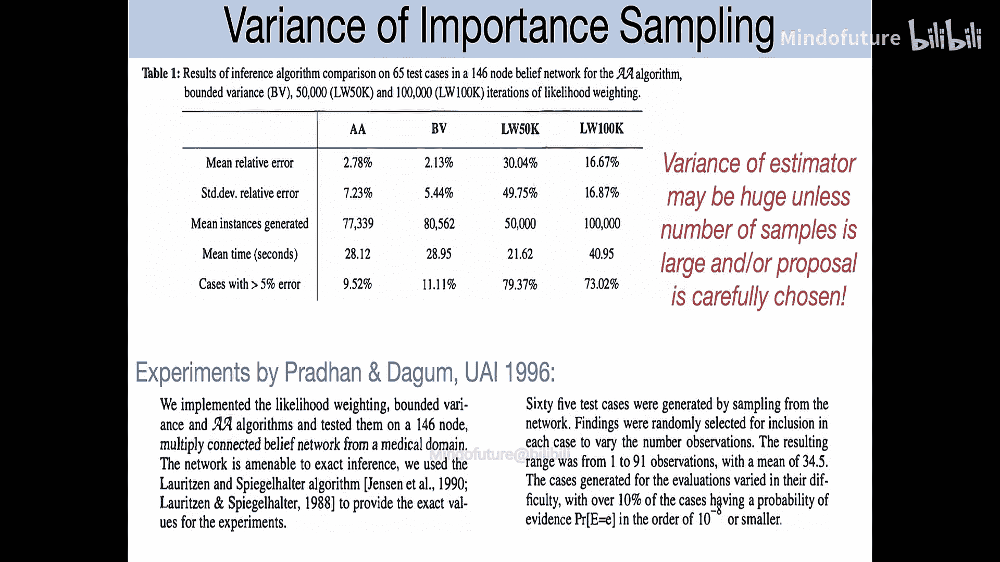

嗯。Yeah， that's the thing that's like if all you have。

You can make a plot of what my estimate is versus the number of samples。But you know。

 you can get this case where it looks like， you know， imagine I was drawing samples。

 I look here and I say， oh， maybe I'm converging， you know， oh nope， you know。

 maybe I'm converging right and you wouldn't know that you still have this bias。So。

Um if you have a bound， like so for example， if I have an upper bound on this weight。Then I can。

Sometimes if I know things about W or about Q and P and F， then I can get an upper bound on this。

 and then that lets me then you know it guarantees on the variance。Okay。So。

 but unfortunately for a lot of practical applications。You may not have that。U。

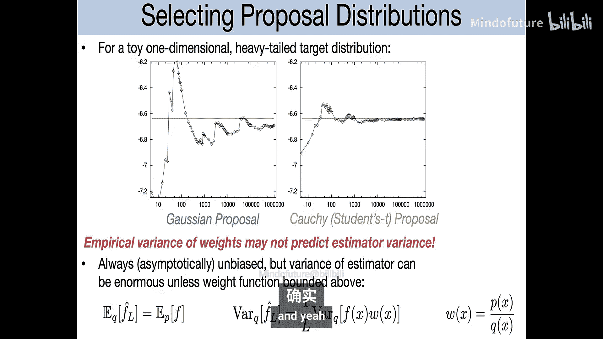

And yeah， so this is actually going to be a recurring theme even for the Markoff chain Monte Carlo methods。

 is that with these。Sampers。They have this good property that they're all exact in the limit and that you can run with a finite amount of computation and get an approximation。

对。😡，Sort of like knowing， is my finite on approximation computation enough to have a good？

Approxiation or do I have a really bad approximation and just don't know it？That's very hard to know。

Okay。So I could drawback of these sampling methods， yeah， I really， I mean。

 I'm not aware of any really like general purpose。Ways of providing guarantees。

the guarantees are more specialized they're like for this particular family of models or this particular type of proposal。

In this regime， then you know that。knowIt has low variance or something like that。嗯。Right。Yeah。Yeah。

 thank you， sure。

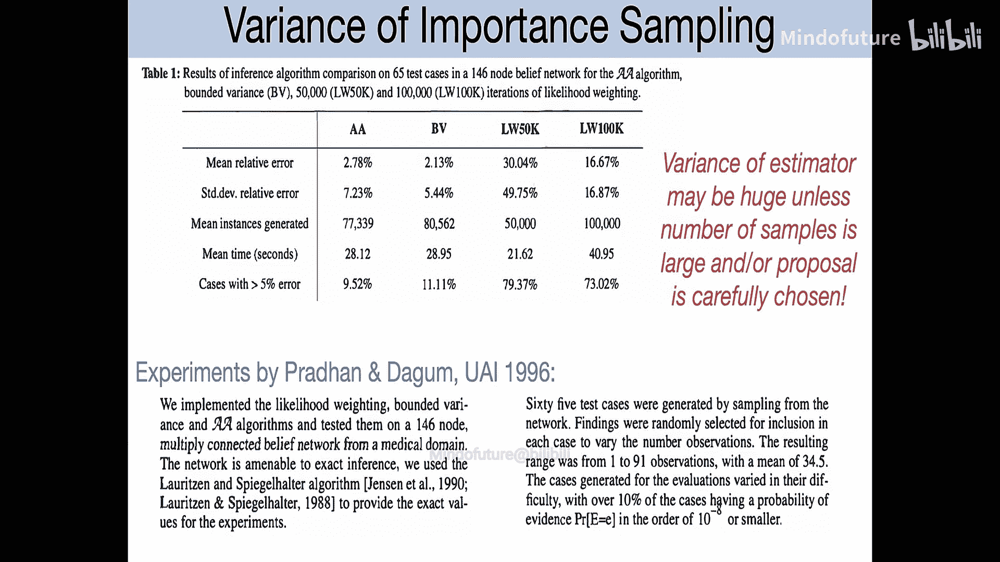