# 【加利福尼亚大学】图形模型中的学习 ｜ Cs274b ｜ Learning In Graphical Models (Spring 2021) p01 P01_讲座_1A-_应用和算法概述 -BV1Tqx6zrEMj_p1-

Okay， so I'm going to go ahead and get started， welcome everyone to CS 274B learning in graphical models。

I'm Eric， I'm the instructor and I'm on the faculty here at UCI I do research in machine learning applications in computer vision。

 but also lots of other sort of scientific areas involving spatial and temporal data we have a TA this quarter to high how who I think is online。

Hi everyone， I'm Dahai and I will be a TA of this course and hopefully we can improve together。😊。

Thank you， great。

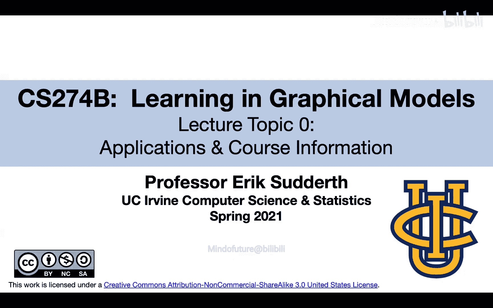

So。Let's see so the standardclaimer disclaimer right so I'm recording these lectures。

 the although the Canvas website like my slides are public to the world。

 the lecture recordings are not public， I only put them on you just so basically only people who are in the class can see them。

So don't feel like you know your questions you ask are going to be visible for the world to see Some of you have your cameras turned on if you're comfortable doing that that's great because it makes me feel like I'm talking to people not to you know just by computer screen and which doesn't talk back to me and so it is it is more fun if I have that also sometimes it lets me see if people are understanding or not by those expressions so it's still I wish you are all together in a in-person classroom that's a lot more fun but you know the visual feedback better than nothing you know we have not。

You know the class is not huge I see there's a little over 30 people on the zoom now there's about 40 students who are registered today and so you know there should be plenty of opportunity to like kind of ask questions i'm happy to stop you know I'd rather take time to explain so you don't understand then just plow through things and so to ask questions a couple options you know you can kind of use the raise hand feature to get my attention。

And then you know I can call on you and you can unmute and ask it。

 you can also there's a chat window， you can type a question there and I will try to keep an you know watch that in the corner of my eye and answer questions that come in there。

So probably all kind of a standard for everybody at this point。嗯。And so you know。

 I'll just kind of dive in to what we're going to talk about today and in this class which is kind of learning from structured data and so graphical models are a part of machine learning and and I guess if you want to think about how how graphical models different from machine learning broadly I think of there as。

Two big ways。One way is that we're often interested in graphical models where we're interested in explicitly representing probabilities and uncertainties。

 so I don't care just about making predictions I want to sort of understand how likely different outcomes are。

So there's sort of a probabilistic take on machine learning and then the second is that it's often you know in applications where not only kind of the inputs。

 but the outputs， the things I want to predict are of themselves high dimensionmenional and structure right so these are just some examples where you know I have you scientific applications where you know I might from satellite remote sensing data want to predict the temperature you know of the C surface at every location in the globe right or given a video of a hand moving I might want to predict you know not just say that's a hand but actually predict its three dimensionmenional pose like exactly in 3D with some model of where it is right or I might want to predict something about a structure of a protein from its data or this bottom is an application called speaker diization where you're given an audio sequence of people talking。

 you don't know who the people are and you don't know how many there are and your goal is to sort of output。

sortt of what's called a diarization， basically saying， you know。

 how many people were in the meeting and when was each one speaking？Okay。

And so this is a little different from what you tend to see as your initial kind of machine learning applications of you know classification or regression where even if the the input is a document or an image or something rich and complicated the output is often something simple like you know which object category is this image right or is the sentiment of this review positive or negative right so it's focusing on cases where the output the thing you want is itself a little more high dimensional in structured so that's kind of if you want the highest level theme for what is tying together the things we're going to talk about in this class。

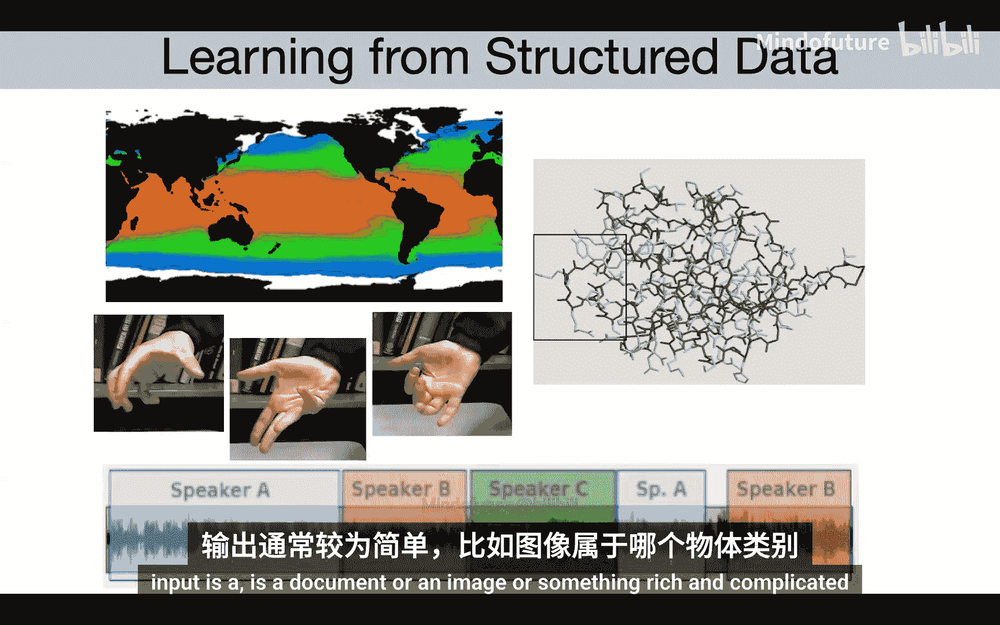

嗯。😊，And and so what are probabilistic graphical models。

 so these are some examples of probabilistic graphical models here and so so the graphical and graphical models is graph as in a set of nodes connected by edges so classic graphs that that you often learn about in the earliest parts of computer science and there's several different varieties of graphical models we'll talk about all of them。

 they have kind of complementary properties sometimes some use directed graphs like that's on the left some use undirected graphs like on the right。

 and there's also some that use hypergraphs， which you can think of as like a graph where the edges might connect more than two variables more than two nodes I said variable because for all of these in all of these sort of graphical models what makes it a probabilistic graphical model as opposed to any old graph is that the node。

These are the circles here are always random variables okay so that's the semantics in a graphic models at the nodes of your random variables。

 it could be discrete， they could be continuous， they could be low dimensional high dimensional okay。

And the graph specifies the course structure of the joint distribution， Okay。

 so you can't from the graph， I can't read off you know。

Is the probability what are the probabilities， you know。

 is the probability that x takes a value high or low， I can't tell that。

 but it turns out I can tell things about。The way the joint distribution factorizes into local terms。

 which turns out to be equivalent to notions of independence or conditional independence of the random variable。

Okay， so the graph is kind of telling you is which things are directly related。

 which things might be independent conditioned on other things。

 that kind of so you can kind of read off that high level even without knowing the numeric probability values by looking at the graph。

And so it's both an interpretable thing for humans。

 but then there's also a whole bunch of algorithms that exploit the graph right you know algorithms that use graphs and manipulate graphs is a very classic area and computer size and here we can use the graphs to get algorithms that allow us to reason about interesting high dimensionsional distribution tractable right so often we might go from a naive thing that would be exponential in the number of variables to things that would be linear or lower or polynomial in the number of variables by exploiting the graph。

😊，And we'll be talking to some about those kinds of things。Okay。Right。Okay。

 so I'm not going to have a lot of real technical material today。

 I'm more going to be just giving you a high level view of what are some of the applications。

That the methods we'll tosh on link to and give you a little bit of preview of some of like what some of the technical methods look like and then kind of at the end all have administrative information so your questions about what are homeworks and projects and things of that that's coming at the very end of the election okay。

There's a question about are these graphs and the random variables are they always human built and are you or can you learn them directly from the data and the answer is it's a good question the answer is both things can happen。

And so there's times in which the graph comes from a human， so for example。

 like I showed here I showed some。You know a couple of these applications here kind of were scientific applications so sometimes the structure of the graph might come from knowledge the scientist has they say you know I know something about which things will be dependent on what given my scientific background and then that will give you the graph structure and then you use data to kind of learn the there's numeric values that go with the graph but then there's other times that you actually learn the structure of the graph itself you can say I'm going to use the data to learn which edges are present and not which things are dependent and not so you can do both。

冇事好。嗯。嗯。Okay。So I want to start with a simple case。

 which is a model that you don't really need graphical models for， but it's one that kind of is。

 I think most of you have probably seen， hopefully， which is the hidden Markov model or HM， okay？

So when you learn about HMs there's a way in which graphs are often learned which is not the way graph models there's a little confusion here the thing you often learn about with HMs is what's called a state transition diagram so if an HMM is a mark is based on a Markov chain and in that Markov chain I have a set of states like if I'm modeling language I might have you know states for verbs and nouns and determiners and then I have sort of probabilities of transitioning between those and then you sort of by randomly walking forward to these probabilities I can generate sort of sequences of English text okay。

or for more continuous domains like you might have sort of a different Gaussian distribution for each of your states and so then you kind of random transition between these different states and then sample observations from a Gaussian and that's what this lower right is showing。

So we can the graphical model view of this is that I have a set of states。

 so ZT will be the state at time T and in the classic a that's a discrete variable takes one of K values。

 that's the number of states。😊，And then those evolve according to a Markov chain and that's what these edges here are showing at the top。

 you notice that for each of these ZTs like Z4 has a single other variable that points to it Z3 and that's because in a Markov chain。

 if I say the distribution of the state at time T it depends only on the distribution at time t minus1 is independent of the past。

So that markov property Markov chains is kind of encoded in this graph structure here。

And then the other part of a hidden Markov model or HMM is that the observations， right。

 so like the observation at time T depends only on the state at time T。

 it doesn't depend on all the other times。So that's what this graph says and just by looking at this graph。

 you didn't know anything about HMs but you knew the semantics of graphical models and you gave me this graph。

 I would know that the joint distribution of observations in states factorizes like this as a product of P of Zt given Z2 minus1。

 that's because of these edges and as a product of P of Xt given Zt， that's these edges。Okay。

 so you can kind of think of this， this isn't called a direct to graphical model because it uses direct edge is the I thing of like is a flow chart for how you would generate。

Simulate this distribution， you'd say I'd sample Z1 then Z2 then Z3 and then Z4 then Z5 and then condition on these I would sample x1 given Z1。

 x2 given Z2 and so on。Okay， and so there's lots of of course lots of applications of HMs so for example in natural language you know they give you simple but still effective models for things like part of speech tagging or named identity detection you can also use them again the variables could be discrete or continuous and so in these are used a lot in speech recognition where the X are continuous these might be something like often they're like how much energy there is a different frequencies in a short amount of time。

Yeah and then the Z would be something like not words but more like phome so which part of a word is a person trying to say okay so you have a model of which phome sequences are more and less likely and that connects to knowledge about the language that's being spoken and then you have another model of how phoneme sequences connect to and so at one point in time basically this HMM just like this was the state of the art and speech recognition if you go back about 15 years or so these days there are some fancier extensions of it but these ideas are still kind of kind of used in those systems。

Okay。You can also apply these same kind of ideas in other domains and it turns out that this sequential structure is used a lot in areas like robotics because you want to reason what's happening over time and so here's an a cute little toy figure where they're imagining that I have you know this robot that's walking around an environment and to make a nice picture it's 1D so originally it's probability sometimes these pro are called beliefs but just think of this as a probability it doesn't know where it is it has a uniform probability for each position it could be。

And then it says a you know see I see a door and so from my map I know that there's three locations of doors and so then I can use essentially Bayase rule and we'll see that kind of generalizations of a bayase rule show up and reasoning in these models I can get a posterior distribution over where the robot thinks it is given that observation right so now it says what could be it's probably in front of one of these three doors is probably not in between unless it's sensor malfunction。

And then as it moves along， you know， it can these evolve and it gets new observations and so on and so forth until it keeps track of where it is okay。

And。And so these are used a lot right， so you have the state。

 like if you imagine if I assume I have a robot that's driving around and on the ground that doesn't fly。

 I might think of the state as kind of this three dimensionmenal thing that it's the position。

 so the Xy location of it plus it might be little model the orientation。

 which way the robot's facing because of course that's going to affect what its sensors observe。

And now these are continuous variables in the world。

 some sometimes you might treat them as continuous in your model。

 sometimes you might discretize so divide the world up into you know little like I don't know one meter by1 meter squares or something like that to keep things tractable you could do either so that that's what this is illusrating it's like there's multiple positions as well as orientations you have there' 3D space of locations。

And then you can have sort of distributions over， you know。

 if I'm at a current location I tell the robot to drive right。

 well it turns out that the you know motors are imprecise。

 so if you tell the robot you know drive exactly to the right one meter。

 it's not going to end up exactly the right one meter there'll be some distribution over where it exactly or it really ends up right due to the imperfections of the mechanical system。

So that's that and now I take many steps I will have some other larger distribution and you can use kind of algorithms with these graphical models or hidden markov models to compute what those distributions are efficiently。

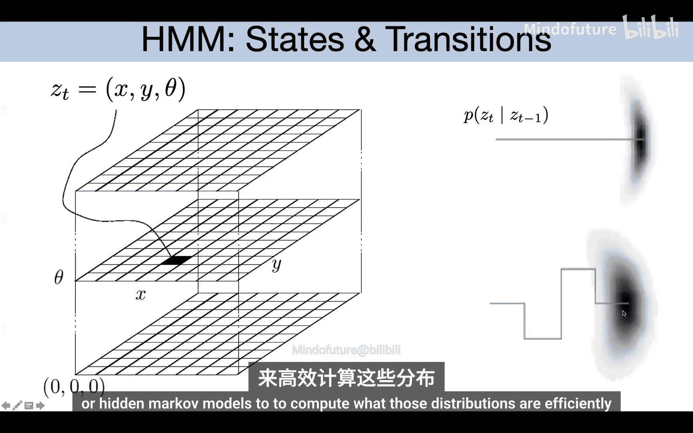

OkayAnd so this is an old example， but this is just to show you that these have been around for a very long time so this is a mobile robot that was then working driving around in the museum and locating itself。

😊，This must have been the early 90s， maybe the 80s I show this because these are essentially though exactly the same algorithms that people use with the LDarR sensors and self driving cars today right so these things have a long history。

and so this is just this is just showing that， you know。

 given some model of their observation a given state， they could you know。

 sort of have a build a model of where the walls are in the environment and then given that right。

 as they drive around they get a set of observations。

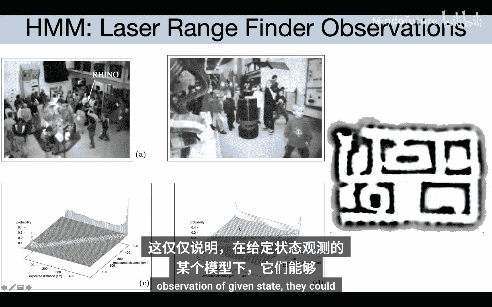

And sort of there might be in this case using a laser seeing how long a laser takes to bounce back to get noisy estimates of distance to the walls。

 they start off with not knowing where they are and then as they navigate more right they start to get a closer and closer estimate of where they are okay。

And by then doing inference using efficient algorithms， inference algorithm is hidden mark。

 which by the way have a nice property that they have copy of occasionalal cost that's linear in the time steps you can run them in real time on the robot they can accurately keep track of where they are whereas this says raw oometry this is just if you just sort of like keep track of what you told the motors to do using motor sensors。

 you can see that there's kind of this drift where they no longer have a good estimate of where they are in the environment。

可。All right， so this is all kind of you know， hit the HMM， which is you know talked about。

 for example， in 274 are the perfect for this class， is it just an application of that。

But so where do graphical models come in often。You have more complexity than just a robot driving around in a knowing map and here's one step of more complexity。

There' this is a classic problem in robotics called SlamM。

 SM stands for simultaneous localization and mapping and the idea here is you drop the robot down in some environment and not only does it not know where it is。

 it doesn't have a map of the environment。And so it wants to simultaneously keep track of where it is it moves around and build a map and and you know it turns out there's lots of reasons that practical reasons you want to do this you know you could try in some domains you could try to use GPS to not have to do this but if you want robots that can work in tall urban environments or robots that can go into mines and rescue people then you need to be able to do this kind of thing and so people work hard in robotics on it and so now this is a graphical model for slam okay。

Where now the X's here are like the location of the robot and so there's like a markup chain on the X's because you kind of say that you know the robot is moving from location to location over time and now there's some landmarks in the world and in the simplest case you're going think of a landmark is just like an interesting feature some distinctive part of the environment that you can pick out like a corner on the building okay and so you don't know there's so you have this landmark but you don't know you know where it is okay so there's that's what these Ls are so this would be like there'd be two landmarks。

That I don't know where they are。And then， but now I guess some observations。

RightAnd my observations kind of depend both on the robot pose and the landmark location you can think about that these are kind of。

Often you'll get information about their relative location so as I's driving around I see some landmarks I get information about their pose and now I want to do inference to uncover both the robot pose as well as the landmark。

😊，And you know this is to be simple， this has two landmarks。

 but really you would have dozens or hundreds， so this is an example where they were showing in a park I think the blue is the true location of the vehicle from a GPS and the yellow is their sort of estimate of where it went using only local sort of camera observations and then they also have these landmark locations recovered all right。

 so just to give you kind of a sense for what some of these are。Um。

 but there's lots of other interesting things you can do by saying， you know。

 generalizing this Markov chain that only evolve a sequence to more complicated things。

Another type of generalization is to a markov tree。

Ex and so here's these have a long history in the computer vision world in that people are interested in people as well as a lot of other objects kind of have articulated structure right so you have a set of you know parts of your body that are connected by joints that can move okay and so here you know this was a this is some older work with the very simple model there' there's fancier modern versions of this today where they have in this case they have like a model this would be like a graphical model that would have looks like nine nodes corresponding to the you know upper and lower parts of each limb and the torso okay。

And then this is kind of some early work on this where they're you know given an image they're sort of like estimating what the pose is of that person given the image here's some other things with RGB images and so you know there's there's both you know there's algorithms for saying you know finding the pose efficiently right you know you need efficient algorithms for this you can't just test everyone you can if you if you wanted to say。

This pose estimation as a classification problem。Well。

 even if you very coarsely discretize okay if you very coarsely discretize this space of poses you would have。

 I don't know somewhere on the order of like hundreds of thousands of locations。

 you know translations plus maybe several rotations so that may be sort of on the order of 1 million to 10 million locations for each part and if I have nine parts then the sort of like space you have to search over is something like 10 million raised to the ninth power so it's like as think of that as that problem。

 you couldn't just enumerate all those check each one and see what's the best but using graphical models。

 you can inefficient so that it you know would run and sort of like milliseconds on a modern computer search over all these poses automatically and find the one that best matches the image and so there's both efficient algorithms for finding the best location of these things as well as something that we'll talk about those。

First in the class， and then later on we'll talk about suppose I have a data set where people have sort of marked the locations of the body parts。

 how can I then learn the parameters of my graphical log such that when I run inF。

 I do a good job of estimating it。Okay。And that's actually what this is showing。

 this is from a paper where they were looking at a couple methods for doing these parameters and this conditional likelihood thing is one that does a better job。

All right。嗯。And there's lots of generalizations of this， you can do this and instead of in 2D。

 you can also think about estimating 3D locations to find you know。Say the pose of a hand。

Here's another one where they're looking at， this is kind of a computer graphics application where you have data from a laser scanner of a person and you're interested in estimating the locations of the parts of their body in 3D so you have this graphical bottle describing the parts of the body and how they connect。

And then given some scan of a person， you have these inference algorithms that kind of start with what are called particles you can these as stochastic guesses for where the parts are。

 and then as they run they refine until they eventually get a very tight estimate of where the pose is。

嗯。

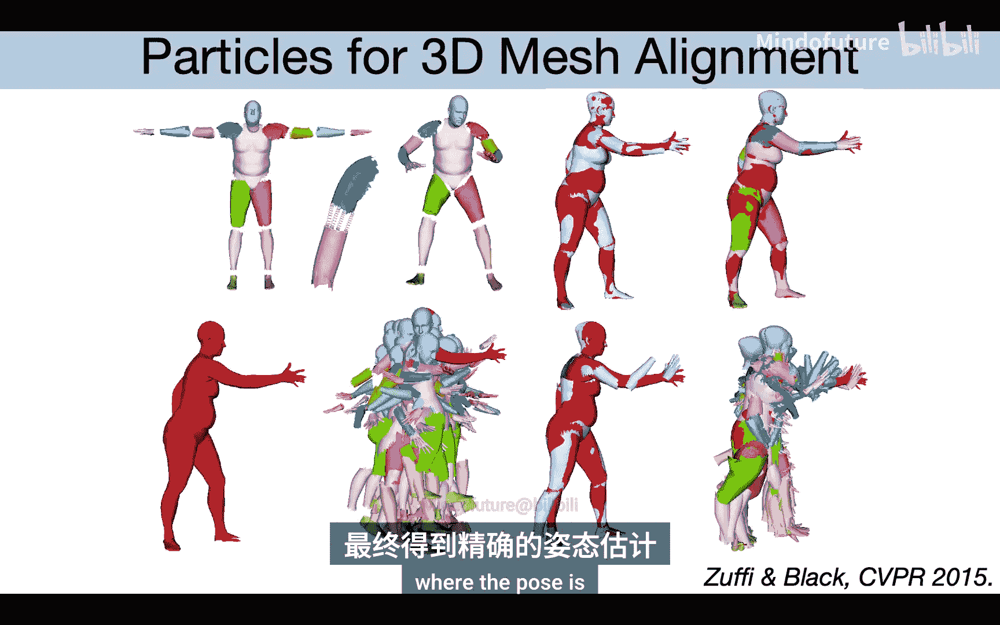

Switching gears away from that， I'll talk about a few other types of applications。

Here's an application to remote sensing so this is kind of that sea surface temperature problem I did so the idea here is I want to estimate the temperature of the at every location on the globe but the problem is is I don't actually have dense observations right I don't have observations in every location so in this domain by the way why do I want to estimate temperature right so it turns out that it has lots of implications for being able to understand what's going to happen both in the short term and long term of weather and climate so it's a big interest to scientists。

嗯。You can， it turns out you can。Get estimates of temperature using satellite measurements。

And so that's what this is showing， this is showing locations in which for a particular data set they had estimates。

 but now note that they don't have them everywhere right so they have them along these kind of parabolic tracks and that's just because of the way that the satellites orbit the earth。

But then you notice in these tracks there's some you know。

 kind of parts of the tracks that are missing anyone want to have a guess what those are？Cllos。

Turns out that the sensing modality they're using if there's thick cloud cover can't see through it。

 right so you have board dropouts from there。And now given this， they want now a dense field。

 like that says for on some resolution like you know you know at 10 meter squares or or something like that at every location in the ocean。

 you know， what is the。The temperature and sorry it's a little blurry。

 but this is now showing estimates of that showing not only these are estimates of the mean of that。

 but also the variance or standard deviation。And so I told you these are probabilistic models and so here this has this structure that looks like this because it's sort of like estimating that its uncertainty is lower where the cell had direct observations has higher uncertainty elsewhere and you can imagine that if you're a scientist working with this you know just the guess isn't good enough you really want to know how certain it is for your subsequent reasoning。

And the model that does this is actually kind of what's called a multiscale model where it in order to capture the dependencies among these temperatures。

 it has it sort of uses this tree， this is showing a small level but it's actually a very deep tree that then sort of captures at multiple scales the spatial dependencies across large areas of the ocean。

嗯。There are models like this that are also used for image analysis。

 modeling images and various sorts， and so it turns out that also when I'm doing image processing image manipulation that multiscale representations are very widely used。

And so this is what's called a wavelelet don't worry if you don't never see a wavelelet before it's not really the focus of this class and not the big deal but the idea of a wavelelet is that to model the structure of an image what I'm going to do is I'm going to look at derivatives and if I have 2 feetd I can take derivatives at multiple orientations so this is sort of saying like how much energy basically how rapidly does the intensity change at different directions so this is kind of showing like horizontal edges in the image you can see there whereas this one is showing more vertical edges and then these two are showing diagonal edges so you're modeling how much change theres from light to dark at different directions as well as different spatial scales so sort of sort of finer scales as well at coarser scales。

Okay。All right， and you can get these sort of responses by taking these particular sort of filters。

あ呃。And so now if I have these sorts of things， I can now look at modeling their statistics。

 I can say that you know， if I have a particular set of you know， filter responses at some location。

 how does that connect to the filter responses that say you know。

 nearby positions at a finer scale at various orientations。

 and I can connect all these things together in a multiscale tree structure。

 sort of a graphal model that captures all of these connections？Okay。All right。

And so now I've shown i've been emphasizing some kind of simple graphs。

 so graphical models are both used at kind of a simple level to， you know illustrate。What's going on。

 you know give the pilot idea different model but also at a very detailed level to show you kind of everything that's going on in the model Okay so now I'm going to show you a scary detailed graphical model。

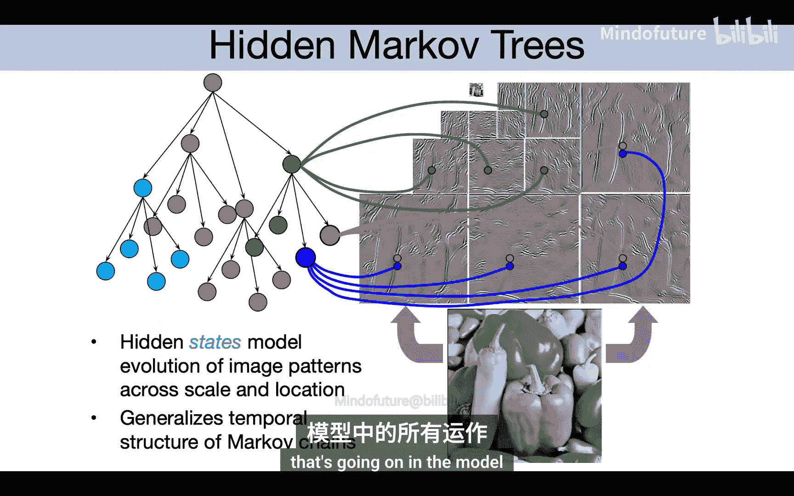

OkaySo's a real one for this domain， so what is going on？Okay。

 well this is applying this type of model to the problem of image denoisy。

 I want to be able to take an image that's been corrupted by noise and remove it to get a clean image。

Okay and how am I going to do this well what I want to do is it turns out some methods try to do this by pretending this is the first image you've ever seen。

 but it turns out you can do much better if you have sort of say no no。

 it's easy for me to get lots of examples of clean images of images that are not corrupted by noise that are the sort of images you could take with a camera。

And I can get you know thousands or millions of these right as many as I can handle computational so I have a big data set of images。

 so this is going to be like my training data that now i'm going to learn the statistics so given a big data set like this I want to learn essentially。

😊，The statistics of these wavelet decocompositions。

 So this is say like if I have eye training images and I have these。You know。

 a set of trees in each one， these wavevelet trees， I'm going to learn how my exodus。

 my observed statistics relate to some hidden states， okay。

Right and so now there's a bunch of parameters that I need to learn and you can think of these as like like in a Markov chain yeah probably have next state given the current state so I have to learn analogs of that and then I also have sort of like models of in a state you know what are the way that coefficients look like it turns out that if you normalize things right you can use Gaussians for that so there's some Gaussian covariance matrices I have to learn。

So that's what this part is the saying and now once I learn all of these parameters。😊。

This is kind of the training phase now these parameters can then let me do denoisising。

 where now if I don't observe the real image X， I observe that these ws just like X with additive noise。

 I can then do inference in this model to remove that noise。Okay。

 so this is kind of a flow chart of parameter Re training test that's showing exactly what relates to what at a kind of visual level。

Okay。All right。

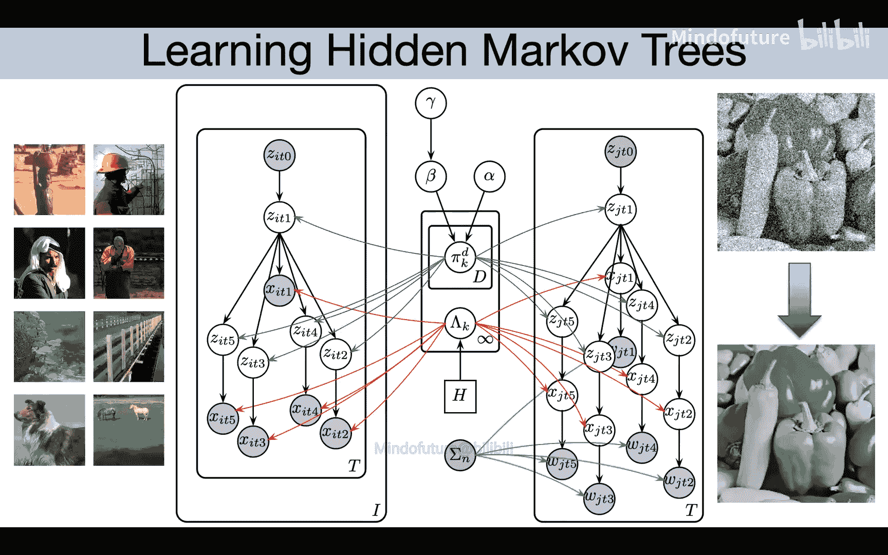

Okay and so there's lots of examples of this i've shown you these trees。

 but there's other types of models， so it turns out there's models that for 2D data that work more kind of in as a as an undirected model。

 so it's model local correlations between sort of like pairs of pixels。

And so in this case the shaded nose which are observed are like you know the observed image you its intensity。

 color texture and then the hidden nose of the property I'd like to estimate and so for example。

 you know you can take a graphical model like this and do inference and given sort of stereoosis given a pair of cameras that are close to each other side by side。

This is estimating given images the depth of points in the world right so here the yellow and green are close and the red and blue are far right so they're automatically estimating what's closed and what's。

ar so the idea here is that you know you may or might not know that almost all of the sort of practical test of self drivingriving cars。

 they have these LiAs right these lasers that sit on top of them。

 which don't always don't work in all conditions and are very expensive and so the idea here is if I just have a couple of cheap cameras could I still get that same information about the depth of objects in the world。

系。And so again， right the output here is not like I see a car。

 the output is this really high dimensional thing， it's like you know。

 for every one of hundreds of thousands or millions of pixels I want to estimate。

How far is the object at that pixel？Okay。嗯m。This is here， this is doing object recognition。

 but this is now doing。嗯。Rather than doing you know just sort of like saying it's a there's a person and just saying put a box around it right it's trying to be fancier and sort of like pixel by pixel so this is what sometimes called semantic segmentation I want for every pixel label you know which category of object it is。

Okay and these two columns， I don't know， this is basically showing comparing a less fancy and a more fancy method and so the less fancy method makes some silly mistakes that the more fancy method fixes。

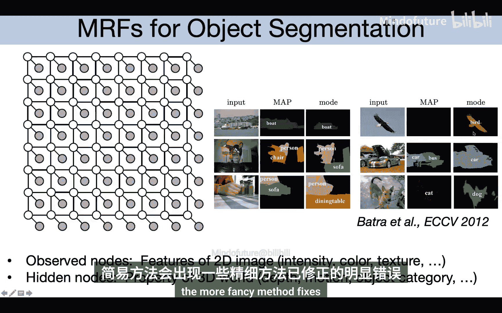

Okay。One more example of that segmentation you can see you can get some really beautiful results so this is these are images and on the right is the output of inference and what's called a conditional random field is a type of graphical model and again so it's estimating these different categories that kind of pixel level accuracy。

And so we're going to talk about different types of algorithms and one of the things that we'll talk about is that you know as you have these models when I do inference there's different styles of algorithms so one type of of style is things that。

Do simulation or sampling using pseudo random numbers。

 so this is what's called Markov chain Monte Carlo MCMC methods so you'll learn something about MCMC。

Here's a lovely result from MCMC on this image。Unfortunately it takes 36 hours for just one image so it's a little slow there are also methods that are。

OrDo what's called variational inference， so they basically pose。

The optimal statistical inference has an optimization problem。

 and then you sort of bound or relax or approximate that problem so that you have tractable optimization algorithm。

And if they do that， they get this result on the right， which is very similar， but now takes 0。

2 seconds instead of 36 hours。😊，So nice， so we'll talk about how these types of algorithms work。

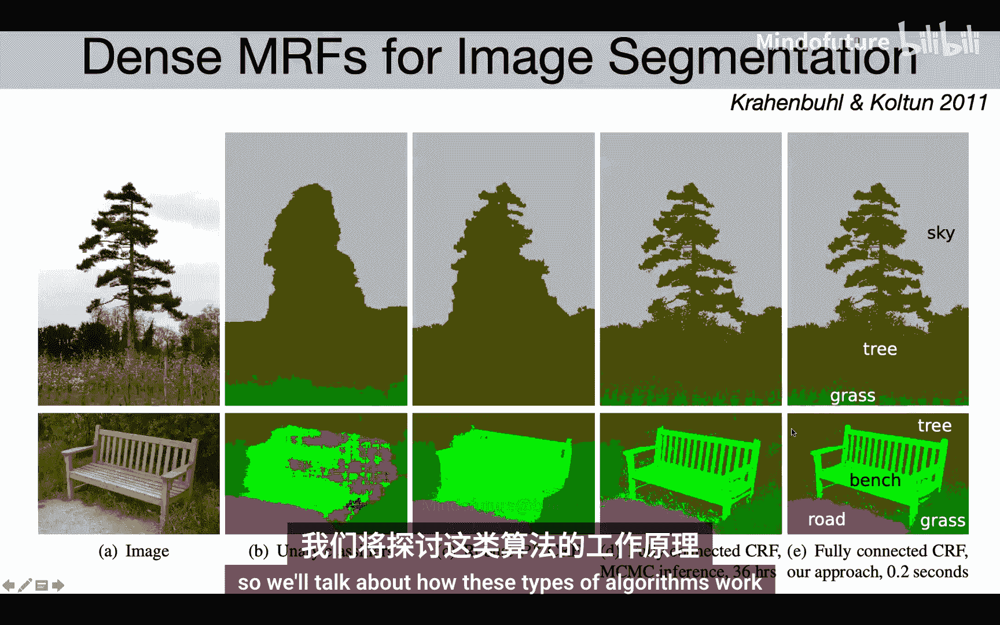

U。呃あ。Another shifting gears completely I just kind of want to show you the breadth of applications is so。

It turns out that one another way that the inference algorithm gra model is used is to solve kind of constraint satisfaction or constrained optimization problems。

And a simple example of this is air correcting codes。

And so what are air correcting codes rank well if I'm going send information like I have some bits I want to send to someone and I'm going to send it over some channel that's going to corrupt them so there's a lot of noise as you can imagine in wireless communication channels whether youre trying your cell phone is trying to talk to a tower or a deep space satellite is trying to talk back to the Earth and so what do you do basically you add redundancy so if I want to send you 200 bits what I might do is I might actually send you know 250 or 300 bits where I send the original bits plus some extras that are that are redundant so these extra bits will be functions of the original bits and then the idea is if I add some redundancy then even if some of the bits in my message get flipped I'll be able to correct those errors and recover the original message。

and so this is really key right if you sort of said。

 you know if were if you had a cell phone you say you know what fraction of packets would like if I just sent them it didn't do air correction what fraction of them would have all the bits come through uncorrupted it would be vanishingly small right I don't know if it's one in a thousand but is very slow so how these work is that they use what are called a parity checks。

And so basically you think about is I have some bits I want to send and in these parity checks。

 which are these node collect them， they basically say that the mod to sum of the bits he them has to be even。

Which is this sorry， the mod2 sum has to be zero， which is the same as that the number of ones has to be even。

哎。And so you can imagine that if I had this parity check， if you flipped any one bit。

 then the number of ones would suddenly become odd and you would say， aha， I know there was an error。

And so that would let you maybe you couldn't correct the error， but you could detect it。

 but now if you have several of these parity checks that overlap in interesting ways。

 you can actually correct the errors。Okay， and so this is an example of that where I have I'm trying to send a message in this case it's a binary image。

 so this is the image I'm trying to send on the right。Okay。

 just so we could visualize it and I sort of like have the image plus these parodity bits and they're corrupteped by noise in this case I think about 10% of them are flipped。

And then as I run inference， this is sort of iterations of an inference algorithm we'll talk about called。

It's actually called loopy belief propagation that's why the password is loopy for the class so the loopy belief propagation algorithm as you can see as it runs it gradually is。

😊，Removing these errors until when it converges， you have recovered the original uncruped image。

And it turns out that the very best state of the art air correct decoconing algorithms are that。

And the world are using these message passing algorithms for inference and graphical modelss。

And this was actually a very major development and kind of on the order of 10 to 20 years ago。

 this was all worked out the theory that these would do this as to the extent that now these are the standards that when they deploy when NASA deploys new satellites they use these algorithms to do the decoding because they're the best they can do you can imagine they care a lot about you know having low power airfree transmission of to be space satellites and the same algorithms are also running on chips embedded in your phones so we'll talk a little bit about how these things work too。

呃。Prickt changing yet again， I know we have folks from lots of different areas in here。

 not different scientific areas as well。One another application to see give you a sense is that theachine uses this protein structure prediction right so a protein is a sequence of amino acids。

Um and and so it's today with sequencing technology it's pretty easy to figure out what the amino acid sequence is。

 but it turns out what can be very hard is predicting。If the sequence of amino acids。

 what is the complicated 3D structure that it's going to fold into？

U this is it's hard enough to the point that there's some cases in which you can try to make your proteins form crystals and then image them with with Xray crystallography。

 but that's a hard of thing that my understanding is that sometimes a student will get their PhD just for finding the structure of a single protein。

Right for several years of doing that so there's a lot of interest in computational methods that would say given just the sequence because in principle we know the physics。

 we know what connects to what we know how things attract to ripul。

 can we predict the structure computational and it turns out because of the way physics works that you know for example that the attractive and repulsive forces if you say you know how much to different if you like gravitational types of attractions right you know they're you know strong when things are close and not when they're far away and similarly there's certain repulsive forces that say you can't intersect but if you get far enough they have no impact that gives you essentially a graph structure and so thus you can use graphical model algorithms to do inference in these things so this is actually showing if I have in 3D the locations of two different molecules you would have interactions that look like this so you would have some this would be like I think of like a sort of a normalized probability。

And so if they're far apart。😊，Then that this goes to some constant that's kind of like non interaction and then there are attractive forces so attractive forces like Mananderw's forces that says as they get closer they kind of like that's more likely to happen they're kind of like are pulled together a little that's why。

They fold in anything interesting essentially， but then if they get too close， you know。

 then the probability of that happening sort of falls to near zero because essentially you can't have。

Two electrons in the same space at the same time so but now given this kind of interaction。

 you can do methods that try to automatically estimate the structure and so this this is a little bit of a messy diagram but these are now estimating these are continuous variables you're trying to say you know these little parts of the protein i'm trying to estimate where are they located this is some a true estimate that comes from in this case this was one where they were able to get get truth from crystallography and and these are shown of showing estimates for different things now this looks a little messy but what's going on the left this is an algorithm that's trying to explicitly model uncertainty so it's saying for each these little parts of it you know which are the possible locations so it's giving you multiple hypotheses about that。

Okay and it turns out that you can give sort of really。

 really good state of the art results for some of these protein structure prediction problems。Okay。嗯。

Shifting gear yet again， so I've mentioned that applications of graphical models to image data and sort of computer vision there's also many applications to text and language data。

And so one of the real classic graphical models in this space is this called LDA or latent Deishly allocation and this is what's called a topic model and so the idea is if I have text you might say that you know every text document you know sort of discusses a mixture of different topics right so in this case there might be sort of these blue words that are more sort of on computational things and then I have these yellow words that are about genetics and you know the red words about other types of biology。

😊，And so there are sort of probabilistic models that say， you know， I'm going to assume。

 think of these are sort of like generalizations of clustering models。

And so think about a clustering model， if I had a collection of documents would kind of like try to group the documents into different types of things。

It turns out that's not always the most useful because often a single document。

 a single news article will talk about multiple things right so if instead of scientific documents you had news articles you might have one you know that talks about you politics and immigration in the same thing right so don't want to like have it be just one type of document you want to split the words apart。

And so there are these nice models that basically sort of say that I assume that a document will have some fraction of its words from different topics。

So it'll have some fraction from the purple， some from the yellow， some from the blue。

 and then there's this sort of association of which words go to which topics。😊，Okay。

 and so LDA as a graphical model， this is a model that takes a set of documents。

 each of which has a set of words and then infers， you know you know。

 which topics each document is talking about and then simultaneously also infers the topics themselves。

So which words are common in each topic and so you can think of this as kind of a generalization of the you know mixture models or k means for clustering that capture this kind of it's sometimes called an ad mixture that you think about each document could be a part of multiple clusters not just one。

Okay，And so the graphical models are used a lot in these kinds of generalizations。Okay。

Another example application of this there's some this is one actually we'll do a version of this and one of the homework assignments is to models of network or relational data so this is where it's a little confusing right I've been talking about graphs from folks describing the structure of random variables well there's some applications where the data itself is a network so think of like a social network where you have you know a bunch of users and you have you know which pairs of them are friends okay or there could be many other types there's also work on modeling like biological networks right I have a network for a model of the brain and I want to know know which regions are interacting with each other。

And so some of the most successful models and networks are based on what are called latent communities and so the idea is there'll be a set of communities out in the world and each person will have sort of some partial membership in each one and they could think of these communities is like some of them could be related to your job。

 some could be related to your hobby， some could be related to where you went to school some be related to where you live and sort of the union of all these things is what determines the sort of interactions a person has。

And so now then they'll be， this is a little more detailed sign that I wanted to go in now。

 but now there's a generative model that sort of says， you know。

 to determine whether there's an edge between users。

 they kind of each sort of randomly choose one of their communities and then theres there's a for every pair of communities there's a probability of an edge between the pair。

And then you sample from that probability to determine whether an edge would be present。In this case。

 it was a high probability so it turned out to be present。

 or if I picked a different pair of communities， you might end up with a low probability。

And it was absent。Good。And so these can be used to understand a network so here's a little example。

 so in this case they were looking at rather rather than the social network it was a database called Little Ss okay so Little Ss is a data put together by social scientist。

 why is it Littles because it's the opposite of big brother。

And it's basically what they did is the people in the database are basically people at the peaks of sort of politics and industry。

 so think of like CEOs， senators， you know high people in these spaces and so what this database has is they went out and they researched sort of links between these people。

 many of which they probably don't want to be public。

And they shove them all in this database Okay and so。

The raw data has the version we were that was looked at to make this analysis had 18，831 notes。

 so almost 19，000 people。Now if you take。TThis is the top 200 green notes it's basically the 200 most connected people so if you take those 200 people and there's some graph of their connections to each other and you just。

Take some like graph layout program and say plot that for me， it shows you this thing on the left。

So here the size of the node is proportional to degree。So basically it's you see nothing。

 it's just like， whoa， ges lots of people catch to lots of other people。

 you can't see anything that's going on。But what can I do Well instead I can say let me take this full data set and let me run statistical inference using a graphical model to estimate the community structure so I figure out what the communities are and how much each person is a member of each community so now each person is going to have this mixed communities and now if I take these save 200 people and I ask to do a layout where essentially people who are close into 2D have similar community distributions and people who have far have distinct community distributions you get this very nice interpretable structure where you have clusters of people who are in the same community and then you can also find individuals who act as kind of bridges between multiple communities。

嗯。It's hard I bet you can't see it in Zoom but if you if you look out if you sort of look at this offline you find sort of you know there's one of these it's like a cluster of it just from a few years ago so it's like you know people in the Obama White House and then at certain companies and you can find links between them and stuff so there's kind of lots of interesting insights you can get from this kind of thing you can often do quantitative tasks like once you find the community structure you can do link prediction right so you can often we only have partial observations of networks because know maybe we can't query all pairs of people to figure out and so you can you know use your prediction for where should there be other links and that's by the way that's also what some of the social networks would do when they when they might suggest hey you know。

You think so and so should be your friend right so you could algorithms for that if you've covered the community structure you can by finding the missing links。

 maybe those are ones you'd like to suggest that people would have to make them happier。嗯。Yeah。Okay。

Well， I think is maybe the last one so one more we've got is。so。So confession。

 I don't really play video games anymore I did when I was a lot younger。

 but anyone if anyone likes to play video games on the Xbox Live system。

 Xbox has this sort of player matching system。For trying to sort of match up people and they want if you clearly if you're trying to match people to play games online。

 you want them to be at similar ability levels because if one is way better than the other。

 that's not so interesting。And so it turns out that system which was called truerue skill was actually developed by folks at Microsoft Research and uses inference in an enormous graphical model to do and so the idea is that i'm going to have each person is going to have a number that is kind of a so the real number that's a hidden number and this is going to be their skill so think of it as like you know more positive numbers mean they have higher skill or negative numbers mean they have lower skill they're more of a no okay and you don't know what these are okay so what you have is that you have the outputs of matches right so so players play each other or maybe teams play each other and then you see who wins and who loses。

And so they constructed a model where the probability of people of who wins and who loses depend on the difference in their latent skills。

Okay， and then， so if you know， if you have almost the same scale。

 it'll be close to 5050 if there's a big gap。Then the Moore skill will almost certainly win。

And then they do inference in this big model to give and match outcomes to uncover the skills of players and thus do that okay so this is an example to that they also this was this figure is showing from a fun example where they took historical data of sort of chess masters and by looking at their game outcomes used to estimate the skill of each player and how those evolved over time。

嗯。呃。That's Bobby Fisher right there。Gary Casbroz。Some other folks。Any요。So this one I give you。

You know， before we dive into the real details of the algorithms and stuff。

 give you a sense that there's many， many ways in which graphical models and graph structure can map on the data and applications。

Okay。嗯。I'll pause， I guess if anyone has a question on。that was intentionally a whirlwind。

 I don't expect you understand all of them， many of those will be coming back to you later in the class it's more just like a teaser。

 right？嗯。Okay。Now I'm going to do even more of a teaser so here I'm going to have some slides that are even less comprehensivehen I just want to give you a sense for some of what the like technical material and ideas will be。

And so it turns out， sorry。あ go ahead。Yeah， sure how do we call you， first of all。Eric。

 you can call Eric， okay， okay， cool， so did you talk about the logistics？

No that i'll do that at the very end so in about oh okay， okay， great great okay， thanks。You mean。

 you mean in terms of the。As homeworkworks and things like that， that's period。

That's the boring part， I wanted to the fun part first。呃。All right， so。U。

So there's you know many so it turns out that you know。

The power of graphraphing law is not only that you can describe lots of different data and lots of different probability distributions with them。

 it that you can then exploit the graph to get efficient algorithms。

Okay and so a lot of the algorithms not all， but a lot of them are variants of what are called message passing algorithms and so the idea here is I have have this graph this I。

😊，The variables and their neighbors and the idea is that the algorithms at each iteration or the algorithm it's going to be sending a message was just like a function right or a vector of values actually it's a better way to think about it so at each iteration it's going to be sort of sending some vector of values to its neighbors and then that node will be sort of taking those values from its neighbors with what it knows about the distribution to compute new values that sends to us underneath。

😊，Okay。Okay and and this is just showing， this is an example of you know。

 these messages it turns out for a particular algorithm called belief propagation。

 you can compute the marginal probability of one node by taking the product of these incoming messages。

And then the messages get updated according to a particular equation we'll see here。

 I don't expect you to understand this， but I'll observe that this is a generalization of dynamic programming algorithms。

So in fact， you can think of a lot of these things as if you've seen dynamic programming as kind of generalizations of that in various ways。

This is an example of now I'm showing you before I showed you you know given images of you know forces or people estimating the location of the body so those what you going think of those as like the most likely estimates but this is actually showing as now probabilities so this is now for different models it's kind of showing you know the probability that there is a part at different locations and so it is captured uncertainty so like if I highlight this one here this sort of like dark blue that's spread around as showing that you know for this image it kind of you know well thinks the arm is up but you know it model is not so great so maybe this arm is going down to。

All right。And there's some very interesting results that you can apply these same algorithms to graphs that have many cycles。

 so here's a graph that has lots of cycles and it turns out you can still get very nice estimates of things。

 this is sort of a geological reconstruction problem。Um。There is。

There was a nice question earlier about whether the graphs would be specified or learned and it turns out that you can be either and it turns out that there's actually a connection between graph structure learning。

And feature selection。Right？So one of the things you probably many of you have seen is right when I talk about like classification methods or regression methods。

 often you say that well， I might have a big set of features and then maybe to improve efficiency or avoid overfitting。

 I want to kind of like throw away some of my features and keep others right in there various algorithms for doing that。

One of the algorithms for doing that， one of my favorites is something called Palso。

 which uses kind of sparse regularization methods L1 regularization to uncover a sparse set of features if you haven't seen it before don't worry。

 I'll teach you about it。And so it turns out that actually。😊。

Feature selection is kind of the same as graph structure selection so and the way to think about this imagine that I start with a set of nodes。

 I can say that you know。My starting set of graph is the fully connected graph where there's an edge between all pairs。

Okay， and then what do I want to do， I want to throw away some of those edges in the fully connected graph to get a sparser。

 more interesting graph that captures my data better。

Okay and so there are di sufficient algorithm for doing that here's an example and not for a super interesting data set but this is a this is like 100 different words and this is basically so the data here is I have 16。

000 postings to news groups and thinking about so every one of these postings is represented as like 100 dimensional binary vector saying for each word whether it occurred or not and now I want to try to model the sort of like cooccurrence patterns which words tend to occur together or not。

And this is a graph that's sort of showing that right and so this is basically showing there's an edge between pairs of words where they have a strong dependence now note this could be either a positive dependence or a negative dependence right so basically pairs of things that are connectinging here of either a strong probability of occurring together or conversely it could be a pair that like very rarely occurs together if you see one you're unlikely to see the other。

Okay， so this is capturing。So you see some you know you have some sports related things here。

 you have some religion related things here， you have some computer related things let me see if I can find。

There's some interesting examples where in this type of graph you capture the polysseemmi。

 so words have multiple means。So here I have the word system。

 which connects to you know windows and software and program and Mac， but also connects。

To space and the connection around sort of outer space okay so it's you can think about those connections are capturing the multiple meanss of that。

Yeah。I'm going to kind of skip a few things here， I have a couple slides introducing you know we'll be talking about Markov chain Monte Carlo methods or MCMC methods。

 so there's famous examples like the metropolis Hastings algorithm than the G sampler and it turns out that these these are very nice nicely with graphical models in that the local graph structure makes the individual steps of these more efficient。

If you don't know anything about MCMC， it's a really cool topic and I'll be happy to teach you about in this class。

 I'm not going to assume you have any background。嗯。嗯。Here's one more just to give you a。

This is I guess almost more of another fun example than that you know one of the applications that that we end up looking at a lot is sort of modeling structure of temporal data right so this is another generalization of an HMM where you know I have noisy observations but I might have sort of multiple states I want to estimate and here's an example of an application of that。

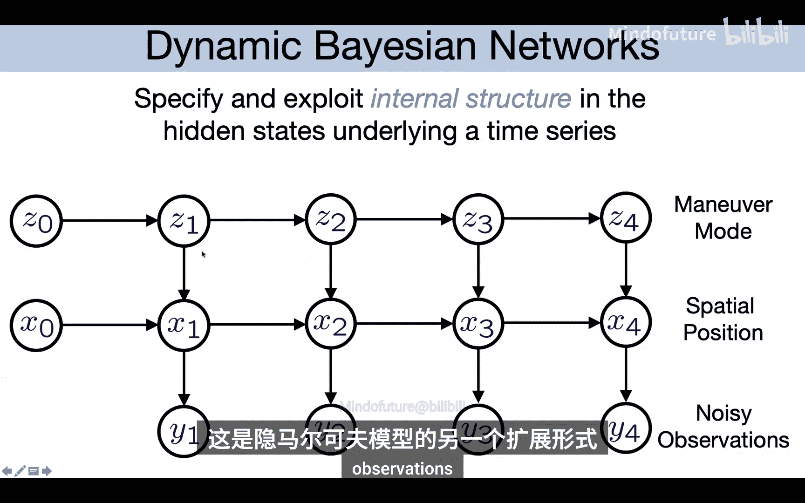

I'll play a video， people see the video moving。Okay so let me show you what's going on so this is a intratracortical brain computer interface。

 so there is a person here in the foreground。Who's paralyzed， he's a quadripleic。

 can't move his arms or legs。And so he is a part of a clinical trial in which a small set of electrodes were implanted in his motor cortex。

That is what you see here is sort of temporarily reading out in the motor cortex。

And then what's happening is he is as sort of as a proxy for developing an interface for computers and software to help people like this person to be able to better communicate and interact with the world。

 he is。嗯。Basically playing a game where a target appears on the screen and he has this white cursor and his job is to move the cursor to hit the target。

And he does this by actually， it turns out that he thinks about moving his hand or arm because it turns out that that sort of the wiring is still there that when they think about moving their hand or arm。

 then the neurons that would try to move the hand or arm fire in the brain。

 even though he's paralyzed in his spines where there's no connection。

And then there is what the neuroscientists call a decoder。

 so it is in real time looking at the firing of these neurons and using that to predict where he wants to move and that is what is causing this cursor to move。

Okay， and the statistical model， so there is a graphical model that is the statistical model of how movement intention relates to cursor firing and real time inference in that graphical model is then causing this cursor to move and and hit the target。

And the difference between the top and bottom， this is a kind of a simple of if you want a simple model and simple algorithm that tends to be a little more weightavy and noisy and the bottom is a fancier graphical model that does a better job of inferring that movement intention。

😊，嗯。So。Anyway， lots of cool things you can do with this kind of stuff so we'll talk about the efficient algorithms that you need to be able to。

 you know， of course， for this to be practical， you really need to be able to sort of run in real time。

Okay。

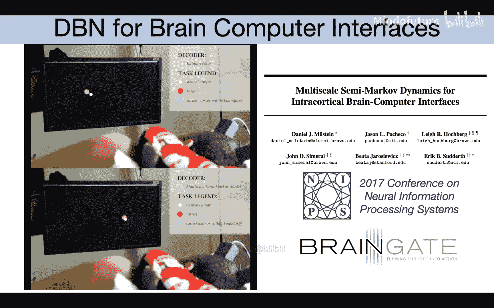

And。I'll skip that one。And。Last。The thing I will mention briefly is that we will talk a bit about how to scale up to big datas so if anyone has seen anything of kind of recent area world of deep learning。

 one of the things you've seen is that you know how do these learning algorithms scale to these huge data sets where they use typically stochastic gradient to so when I'm sort of optimizing each step you random with of sample your data it turns out when you want to learn the parameters of probabilistic models like this you can use the same idea using algorithms are called stochastic variation inference in generalizations of that and so this lets you in this case it's letting you learn one of those topic models I talked about before these probabilistic models of text data from millions of documents and do it attractively。

And also so something that I will mention this is something I'll talk about at the very end of the class it'll be more kind of a high level rather than getting into the details because the details get well details get messy and honestly they're still being developed in the research community but there's some very interesting work now that's starting to sort of if you think want sort of tie together sort of probabilistic graphical models that'll be the focus of this class as well as kind of deep learning methods and the idea here is that you know imagine in this case this is an application where they're trying to from this is like a depth video they're trying to model the behavior of mice for an application where a biologist are trying to sort of understand how they behave in different conditions。

And so the idea is that， you know， you have very these videos。

 which you think of as a collection of pixel that very high dimensional。😊。

And you know somehow you'd like to learn sort of this manifold of kind of you know ways in which they can observe and maybe also different types of behaviors that the mice whatever and so there are sort of probabilistic models that do that that have a graphical model part like a Markov chain part that's capturing something about you know。

 you know the mouse is kind of different types of behavior it's doing and when it's doing them and so on。

 and then there's simultaneously a neural network part that's then sort of saying how do these you know lower dimensional interpretable behaviors relate to the highdial image I actually observe。

Okay and I can't assume that that relationship is just like you know a linear and Gaussian that's something that people knew in graphical models for a long time because that wouldn't capture the images but nevertheless you can think about sort of hybrids that do this right and so the idea you can think about it is how does this connect well I have a you know a graphical model that I've been talking about that these are like the different behaviors you know the motion of the mouse and so on and then if you say you know this what is the probability you know given the mouse is in some latent state of the observation that。

Distribution is model modeled by a nonlinear neural network and you can simultaneously learn the parameters of this as well as。

As the neural network Okay so this is this is kind of heading towards a， you know， unlike。

What you usually learn about your first evening learning class of just trying to make accurate classification decisions。

 this is more trying to use those as a building block for probability distributions with structure。

And so these ideas do come together， but that'll be coming kind of towards the end。All right。

I've talked a long time sorry I like the applications so but there's not a lot to say about the administrative side it's pretty straightforward so the prere right for this class it's CS274b the prerec is CST274 a unsurprisingly and my understanding is so that prere is usually not formally enforced by UCI so if you have not actually taken 274 a that's。

😊，It's okay with me if you want to go for it but you should look it over and be sure you're comfortable with the kind of material there okay and so you know I would definitely expect that young one's very comfortable with multivariable calculus linear algebra。

 partial derivatives， all that kind of stuff。sudden you're very comfortable with probability theory。

 not like advanced stuff， but the basics of probability distributions， densities， that kind of stuff。

 expectations， I'll expect that。That's good to coming every lecture。

You know I'll assume that you've had the kind of s of things you would see in a basic machine learning class like if I say naive Bs logistic regression support vector machine EM for mixture models PC I'll assume that like those are things you already know and then if I like say this is like PCA but it's different in this way that that's a helpful analogy to you right so i'm going assume that that kind of stuff is like familiar to you so there's a homework zero which will go out hopefully later today if not tomorrow that's not graded it's not mandatory but it kind of is some questions that basically review some of this material they're like questions that if you know 274a you should be able to do okay with so I encourage you to kind of look through that and be sure you truly are comfortable with it。

For the homeworks as well as the projects will require a mix of some kind of you know mathematics and derivations as well as some programming。

 there's a change which I predict will be positive for most of you so in previous years this class has always used MATLAB for all of the homeworks。

You say why MATLA well the reason is there's a couple reasons one is that if you actually go back five to10 years ago。

 almost all of machine learning research use MATL that was the dominant language and there are several kind of libraries and packages for graphical models in MATLA that are kind of nice supporting things that we could build on。

 but nevertheless I know that these days the world's moving away from MATLB and it's not the favorite and so your TA and I are going to to shift the computational parts of the homeworks to use Python。

Instead。And I have my fingers crossed that it's a smooth shift so we're going to but you know you guys are going to be like any things and so there may be a bug or two in the things and I apologize in advance for that。

 but overall my these days my feeling is that most students who take this class have a lot more experience with。

😊，You know P and Python and that kind of thing then Matlab and so overall I hope this will make it easier for everybody okay。

嗯。And again， the goal for this class is kind of you， it's an advanced class。

 the goal is that to really give you an understanding of not just how to use packages or graphical models。

 but really how things work and how you could develop extensions。

The website on canvas it's structured as kind of you know I don't give mandatory readings it's actually for each topic we go through you'll notice that there's。

Set of readings from several different resources and this is just because I found that there's a lot different people prefer different things there's different books some are more mathematical some are a little more algorithmic you know and some people like one or the other and so there's no exams I'll say that in advance right there's no exams in this class's it's a homework and projects right so you know there's given that the readings are more like a resource for you to learn what you need to right and so so you can explore。

This middle book this David Barber's Bayesian reason machinech learning has all these books have some kind of graphical model thing but this has more and it's you know there's electronic version that's free online so that's a good place to start but then I know many people have one of these other books that's up here or and then as also as we get to some of the second half of the class they'll be some of the things where essentially the readings will be like you know tutorial articles or get to more like the recent research literature basically。

So。U。Here's there's one very nice tutorial article I'll have some readings for I throw this up here because when I said you know readings may require mathematical maturity here on the right is like a little example of an excerpt from this。

Right so they're talking about the cumulative function。

 which is the log normalization function of a graphical model and you know talking about certain of its properties and so on and giving a proof of those properties okay and so I just I just throw this up there that like you know I mean this is maybe more mathematical than the average thing will read but it's like not not unusual right so you know you know just and again no exam coming but nevertheless right if you look at this you're like I want nothing to do with anything like that then。

😊，You may。Not enjoy my lectures okay。And I try， I really do try to get a lot of intuition and pictures and examples。

 I work on computer vision， I love pictures， but that being said I also and really as a classroom I'm trying to make you understand the mathmatics that support things。

😊，So that you can build on things rigorous way。Full disclosure。

 I like to do full disclosure the first section。U。Homeworks so homeworkworks are half the grade and the way I do it is with this class is just rather than kind of hitting you with weekly homeworks there's just three homeworks each one is out for two weeks and so you know because of that they're a little heftier that kind of gives you some flexibility in how you would work on them and they kind of combine a mixture of some mathematical derivation some algorithm designer programming each one will have some real data will give you where you have to analyze it and make plots and that kind of thing okay。

As I said， we're switching to Python， we have a kind of interesting set of examples。

 you'll look at you know expert systems for medical diagnosis， air correcting codes。

Tracking based on the famous colon filter and something called a particle filter。

Relational models for social networks for voter behavior data。Various things。

 so I think it'll be a nice usually that's been a popular thing。So as I said。

 know homework zero is going to go out now， which is fund graded。

The first grade in homework goes out at the end of week two and then is due at the end of week four。

Basically because you need two weeks of lectures before I can barely ask you to start working on your homework。

And then so there's half homeworks， half is a final project。嗯。So。So the， you know。

 we ask people to work in， you know， small teams of like sometimes if there's extenuating circumstance。

 we let solo projects， but usually it's better for everybody easier for you to get them left done if you work in small teams。

There's a lot of flexibility as on what you do， basically some application of you know。

 graphical models to some。To some data that's interesting to you and it has those two things then it can make up for a nice project。

 there's a page on canvas with a lot more details if you want to start reading for those who are are PhD students who have graduate research。

 we definitely encourage you to try to find a project that connects to your research。And so the。

So stepping back， the main parts of the project are that there's some presentations that are given at the this is like the end of week 10。

 so like basically the very end of classes。And then a week after that there's a report you have to submit so this is this is finals week June 10th is very finals week and then I set two deadlines earlier there's like a proposal deadline on May 13th where you kind of have to sit a short like。

We have a list of exactly what you need to do but kind of have figured out what you're going to do and have some preliminary ideas for it and stuff and then a week before that we set a deadline to like you know find your team and tell us your topic。

You know， so we give some points for these earlier deadlines these are here mostly by the way so that。

You don't we're into trouble right so we force you to do this proposal thing so that you don't get to。

Week find and say， oh， I haven't done a project， so to get everybody started。

So I'll be happy to talk more about that later。So that's all I have。

We're at the end of the lecture time 150， if anyone needs to go feel free to sign off if anyone has a question。

 I'd also be happy to answer that now。professorfes， quick question。

 so how many people should be in the small team， like three people， two two people？

We recommend two to three or is' an absolute upper limit of four。So。

So okay I would say the usual is three if you only have two that's okay if if you if you want to make a group of four that's okay we do a when grading we do a little bit of you know。

There's some modulation of expectations by group size。

 so you know if you have four people then we might expect you to do a little more than if it's two people That being said though theres there's still a sort of like set of things we need to do so if you do a project that's like a solo project or two people you probably are in for more work overall。

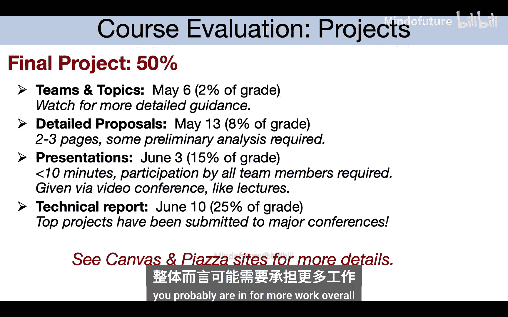