# 【加利福尼亚大学】图形模型中的学习 ｜ Cs274b ｜ Learning In Graphical Models (Spring 2021) p02 P02_讲座_1B-_有向和无向图模型 -BV1Tqx6zrEMj_p2-

Okay。Welcome everybody， I'm going to go ahead and get started。Um。

And we're going to sort of dive into sort of what is the， I guess the the key property that defines。

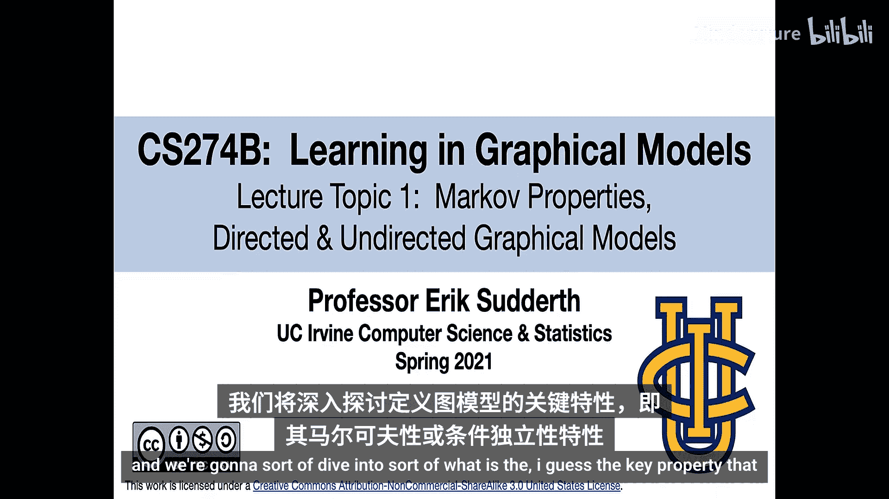

Graphical models， which is their Markov or conditional independence properties。

And and so I'm also today going to sort of talk more precisely about what these different types of graphical models I mentioned last time that there were。

Models based on directed graphs and models based on undirected graphs as well as sort of more complicated models based on hypergraphs and so I'll sort of talk about how these different things are defined and how they relate to each other。

Okay。So kind of the easiest one to understand is that a is the directed graphical model and so first。

 know you know from the kind of chain role of callbilities。

Baically the definition of conditional probability that if I have any distribution p of x。

 I can always overend variables， I can always write it as p of x1 times p of x2 given x1 times p of x3 given x2 and x1。

 all the way up to p of x n given the first and minus one variables。

Right so I can factorize it this way。And in fact I could write this factorization for any ordering of the variable。

 so if' in variables there's like in factorial ways to order them and for every one of those orderings this factorization would be true okay。

So what a directed graphical model says is that I'm basically going to sort of take this factorization and I'm going to simplify it。

 I'm going to say for some distributions。In some of these conditional things。

 they won't actually depend on all the variables that came before。

 they'll only depend on a subset of them right there's a simplification。And we。

Describe that using a graph okay， and so here this get S is going to be like a node in the graph。

So like in this graph on the left， I have five notes。And gamma of S。

 so here this is the capital Greek letter gamma gamma S is going to be the parents of nodedes right and so in a directed graph the parents are the other nodes that point to it。

So the nose from which you have an incoming arrow。And that could be empty。😊。

And so a directed graphical model says the joint distribution is the product over all the nodes of the probability of the variable that node。

 given the variables at its parents nodes。系。Okay， and so like in sorry I could I ask you a quick question on this so are we are we assuming？

So we are assuming。Meorless。Right like we're seeing that this is a markov。嗯。

This is like like haven't explain anything about Markov， yeah。

I'm just talking about the factorization of the distribution。

 I haven't anything about how that relates to independence。Okay。

 so so when you say set of parents of nodes， it could be both nodes that are pointing to that node and up no right nope。

😡，In a graph， the parents are the node that directly point to that note。

The nodes that are farther up those are called ancestors， not parents。Okay， and graph theory。Okay。

So like in this graph here， the parents of node four are nodes two and three。

Noode one is not a parent of nodede4。It's an ancestor， it's sort of like a grandparent。

 but not a parent。And。啊。Okay。And so。So for this graph， right， if we read off this formula。

 it says the joint probability is I have P of x1， so I have P of x1 condition on nothing because node one has no parents。

 it set of parents is empty。Then I have p of x2 given x1 times p of x3 given x1 because x2 and x3 have a single parent node one。

Then I have p of x4 given x2 and x3 because node4 has two and three as parents times p of x5 given x3。

And so I can think of this as。m coming from taking this general factorization where I take the probability of each variable given everything that before and kind of dropping some terms。

 saying that you know some of these probabilities there's actually not dependence on all of them。

 there's only dependence on a subset。嗯。And so it turns out that this is valid if and only if the。

The graph I have is a directed acyclic graph。And so what that means is that there are no directed cycles。

 so if I start the node and follow edges in the direction of the arrows。

 it has to be impossible to get back to where you started。So you see in this graph， right。

 although there's sort of loops here， there's no way to start at a node and follow the edges and get back to where you start。

And so'm going i'm not going to prove that there's there's sort of proofs in some of the readings。

 but it turns out that that you have a valid joint distribution if defined this way if and only if the graph is。

Acyclic right has no directed cycles。Yeah。嗯。All right。So that's the graph Now。

 so here I've told you what the。The variables， you know what depends on what that the distribution of x4 depends on x2 and x3 so you can think of that sort of sort of loosely meaning that x2 and X3 cause X4 although it gets a little settled if you wanted for causality from data。

 but I haven't told you you know what these probabilities are numerically。So。Coupled with this。

 you would also have some sort of representation of the probabilities and what those are will depend on whether the variables are just continuous or discrete and also how many values they take but let's look at the simple case let's suppose all my variables are binary so every one of the variables is zero1。

So if I had this graph here。Right well， if I had p of x1。

 I can think of that as being defined by by just a vector of two numbers right I have two numbers that sum to one。

 I have the probability that x1 equals zero and the probability that equals one。

And then I can think of P of x2 given x1 as being defined by kind of a2 by2 matrix right so for each possible value of x1 there's a distribution of x2。

So I have the distribution of x2 given x1 equals zero。

 that's like one column of this matrix and the distribution of x2 given x1 equals1 that's the other column of this matrix。

系。All right。By the way， this bit right here， this relationship between x1 and x2 is exactly like in a markup chain。

 what the relationship would be between the variable at time t minus1 and time T。All right。

 and so I'd have you know other sort of little matrices representing this and then here if I look at x6 well x6 has two parents and so now I have I have more distribution so it's a distribution of x6 for each possible combination of x2 and x5 values so here I have sort of four distributions which I can think of as putting in this kind of 3D array so for each possible combination of x2 and x5 values there's a distribution over x6。

Okay。All right。Now， now what's nice is that by using this graphical representation。

 you see immediately I'm going to get。Savings， right， because if I had a。

Just an unconstrained distribution over in binary variables。Well。

 I would need sort of two to the n probabilities right because there's a probability for every possible combination of those variables so you have something that grows exponentially。

I mean strictly speaking you only need two to the n minus one numbers right because then you know they sum to one but still you have that exponential growth right so to describe a general distribution over six binary variables I would need what is。

Two to the sixth is 64 right， so I would need kind of 63 numbers to describe parameters to describe that。

Whereas if I have this graph structure you can see that I have a much smaller number of parameters right if you account for the sum to one constraint I sort of need one number to specify p of x1。

 two numbers to specify P of x2 given x1， four numbers to specify P of x6。And so in general。

 although the joint distribution is because you cost that's exponential in the number of variables。

If I have a directed graphical model， I have the， if you say， you know。

 how much does the number of parameter scale， it'll be linear with the number of nodes。

But an exponential only in the number of parents。Okay that's sometimes called the fanions so that's basically the number of things so it can kind of grow if I have a lot of parents of a node but I have sort of can scale to very large sets of variables and so here I'm just talking about number of parameters but you can think about that that affect storage but that also is going to turn out to affect computation if I have many more parameters I also have to manipulate them when I do reasoning and it's also going to affect learning right so in general if I have more parameters and the sample complexity。

 the amount of data I need to estimate my parameters from data will also be growing。

So all of these things will be reduced by having this graphical representation。系い。

And right if I had non- binaryary variables right well then you would just kind of you would have sort of a table for you know if I had variables that took a larger number of discrete values you would just have sort of bigger tables right that had all combinations of however many values they take on right so in principle that's simple although of course if you have variables that have take on a very large number of possible values it could get kind of messy。

All right。so let me look at a simple， we're going to look at kind of some toy models to get intuition and then talk a little bit more about some more real models。

I just a simple model where。There's an alarm that may or might not go off at a house。

And I have two things that might cause the alarm， that could be a burglary。

Or the alarm could also be triggered by an earthquake。Okay， and and then finally。

 there are two neighbors who live near the house named John and Mary。

 and either one of them might call if they hear the alarm to report it。All right。

 so here is one potential graphical model for this okay。

And so what this model says is that there's some probability that there's a burglary。

There's some probability that there's an earthquake and that earthquakes and burglaries are independent events。

Okay so under this model there's no I'll show with this formally later。

 but under this model there's not any sort of dependence between them right so these occur independently。

So that' that's of course assumption maybe it's not a good assumption right maybe maybe burglars wait for earthquakes and then take advantage of that to break into houses。

 but under this model those are assumed to be independent so you can think of when I'm modeling data。

O beginning of the graph structure as encoding certain assumptions formally。

OkayAnd those may or may not be good， but then you can use the data to check whether they are good assumptions or not so in this case right we have a。

U。Maybe this is a home in Irvine because it looks like the probability of earthquake is actually bigger than the probability of burglaries。

And and then now I have earthquake and burglary are both parents of alarm okay they both point to alarm and so now I have a distribution so I have a probability that the alarm occurs for each combination of earthquake and burglary so you can see that there's a very low probability if there's no earthquake or burglary right there's you know a very small chance that maybe some a false alarm for some other reason and then if there is you know an earthquake you sometimes get a false alarm there's burglary you have a high probability of that。

All right。And then finally， now you have neighbors who， you know， John and Mary。

 which have certain probabilities of if they hear the alarm。

Now note right so these are the assumption is that given alarm John and Mary act independently so they're not courting with each other so they each kind of there's a sec independent probably that they might be home。

I think they hear an alarm and you know tell you about it kind of being a good neighbor okay。

All right。嗯。And right， so you can think of right so formally you can think of where does this。

Distribution come from it says that you know I have the the joint probability of all these things and I can sort of factorize them。

 I can always no matter what the distribution was， I can always write it as you know probability of earthquake and burglary times P of a given E B times finally P of。

J and m given AEB so this top equation would be true for any distribution over five variables that's always true and then this graphical model then makes some other assumptions it says i'm going to assume p of e comma b is p of E times p of B so again that that's that's the definition of independence。

And it's going to assume that P of J and M， they only depend on a and that they are conditionally independent given A right so P of J and M given A is P of J given A times P of M given A I note that's conditional independence。

Not independence。Allright。And you know， so again， so why is this useful well like if I count here right。

 it looks like I have four， five， six，7， eight，10 numbers to define this distribution right whereas if I look at the joint distribution of these variables I would need there's five variables so I need 32 numbers right or maybe only 31 if you say they have to sum to one buts still much larger and you can imagine this is only five variables if I had you know hundreds or thousands of variables。

 the savings from using the structured representation would be much bigger。Okay。Does that make sense？

Okay。All right。And so there's been， you know， over the years various various work that really using these heres here's a。

A classic network that was called the alarmlar network that has。37 variables。

And so what this is actually kind of essentially like a medical diagnosis network that comes from real data where they have various kinds of measurements。

 there are variables here for various kinds of measurements like blood pressure， EKG。

 so on and so forth， and then they also have some other structure here that's informed by doctors about different parts of the physiology of the patient as well as different sort of activities that could go on right so could the person could be intubated。

 they could be a kink in the tube that has certain effects and so on and so forth。Um。

 and so you have， in this case right， there there are 509 parameters for this particular defining the distribution。

 right， whereas rather a general distribution over 37 binary variables would have like 10 to the 11th parameters。

Okay。and。So， you know， how do you get to these？These 509 parameters well it's by imposing structure on this where would that structure come from well often it's kind of a mixture of things there might be some structure that comes from you know the insights of like a physician or a medical professional so sometimes these were called expert systems because in formulating these graphs they might talk to an expert in the domain like an expert in medicine to help figure out which things are most likely to be related to others。

Um。But also then you might you know use data to sort of figure out which dependencies are strong and weak and which should be included and we'll talk more about that as we get later on in the class。

And these have really been applied this is one from a paper that。

From I guess I guess it's about a decade ago at this point。

 but they they looked at actually applying these to some。To real IC at。

This was at UC San Francisco so by the way that this is a real problem I understand because you know if you've ever seen an ICU there's a whole bunch of different medical machines and doing various monitoring and you the state of the art when this was done I think a lot of extent still it is each of one has its own kind of little rules for saying you know when is my job is to model blood pressure and when is there blood pressure you know you know outside the nominal range and if it goes outside the range it'll start beeping to warn the nurse that there might be a problem right and so there's lots of machines each working independently the problem is that there's lots of kind of normal events in an ICU that can cause anomalous readings right so so for example that if you're going to turn a stopco to be able to sort of draw blood from a patient that will cause another。

Whose job it is to sense blood pressure to think that the patient's blood pressure has dropped to zero。

Because you no longer have a connection there and then it sets off the alarm and it turns out that these alarms go off so often that the sort of standard practice in the ICU is they just disable most of the alarms。

They just turn them off completely because there's so many false alarms they're pointless and so the of course that's not great because then if there's a real problem maybe they won't be alerted fast enough and so the idea here is that if I have a system that's using this sort of graphical structure that's taking all of this data together and using it to do reasoning can I do better about predicting these things okay and so this was an example of a。

😊，For this particular name Michael these like self edges here that's kind of a shorthand it's a self edgege would not be correct as I've described Dr Rael model this is a shorthand for them saying that these things like the mean blood pressure and so on are temporal variables and so they're evolving over time and so there's like a you know at this time and like at some you know every second or whenever there's a blood pressure now that influences the blood pressure at the next second so that's kind of what that means。

And you know so they have these time series of data and by doing reasoning they were able to these are ROC curves on the left。

 they were able to to the DBN that's dynamic Bay networks that's the sort of temporal graphical model is able to do a lot better than some you discriminative baselines like kind of based on like something like a support vector machine and in fact you know here they're comparing to the physician you can see that the physician you know if physicians annotate the data they kind of never have false positives。

 they never have mis mistakes but they miss some true events。

 they maybe only find half of the true events so by using the automated system you can find more of them。

All right。Um。O。So。Now I'll just show you lots of modelss that you know about you can you can use graphical models just as a way of visualizing them right so for example。

 the graphical model for a Markov chain would look like this right they would just have a set of variables right if I have a markov chain where P of x1。

 I have P of x2 given an x1 and x3 given x2 and so on。

The graphical model for a Markov chain would just look like this where every variable has connected to the one immediately before in time。

Okay。嗯。If I if I took this graph here， right where you can see that each of these variables is connected to the two previous variables before in time。

 well， that is the graphical model for a second order Markov shape。

So where the distribution of each the state at each time point depends on the two previous time points。

 this is kind of a widely used generalization of Markov chains is to kind of like rather than just condition on the previous time finish on a couple times okay and so you could also visualize that as kind of adding an edge to the graphical model。

Okay。There's various applications of one sort of domain which people have thought about applying these things to a medical diagnosis。

In which I have a set of diseases。Okay， so among a number of diseases。U。

And then I have a set of possible findings， think of these are symptoms the patient might have or results of different。

Lab tests， there have been practical models built like this where there are know hundreds of diseases。

 thousands of findings。And then the arrows are basically seen。

The the graph structure is saying you know for each finding which diseases could cause that right so if my finding is shortness of breath。

 well there's some diseases that would cause shortness of breath and others that's not really something that they cause right or or if there's you know a low white blood cell count there'll be other diseases that do that okay。

Um， and the idea is that by reasoning this， you can maybe， you know。

 figure out for a particular combination of the findings which diseases might have done。Okay。嗯。Now。

 by the way， if you look at the structure of this graph， right the diseases have no。

Parents all there's a bunch of diseases that have no parents and then the findings have a subset so kind of the generative structure is that you sample the diseases independently。

Okay， and then condition on those you produce the findings and so there's kind of a reason what I think is you know a reasonable part of this model。

 which is that the findings are are directly influenced by a sparse subset of possible diseases。

And then there's another assumption here that maybe is more questionable that the occurrence of different diseases is independent。

 so it's assuming that different diseases occur independently。Which maybe is not right， but。Okay。Now。

 as we start talking about models with lots of variables in them。

 sometimes there's various shorthand that we do in terms of the pictures to help us visualize what's going on。

So。So first one convention is that。You notice that I have some of these nodes that are kind of shaded gray。

And so a convention that's widely used is that shaded nodes are observed。

And the open or unshaded nodes are not observed or they're latent or they're hidden。Okay。

So sometimes because usually when I define models like this。Most of the time。

 what I'm interested in in terms of a final application is that you know you observe some of the variables。

Now， given that， you know， reason about what that tells you about the other variables you didn't observe。

 right， you can imagine that， you know， most problems if I want to sort of make。

Predicted prediction you can boil it down to I observe some things make predictions about the other things okay and so this shading is used are the things you observe okay。

So this graph would be like I have a variable y， and then I have these four variables。😊。

Here and you know， this graph would say that these x1。

 x2 x3 x4 are conditionally independent given y。And the shading is saying that they're observed。

Now this is if I have you know four variables but you can imagine if I had 10 or 20 or 50 it could get kind of unwieldy to draw out 50 little nodes so there's a shorthand that's often that's used called plate notation and。

This。Graph right here， so if I draw a box with a integer in the corner that integer kind of denotes like a replication of the random variables Okay and so what this says this is。

This here is shorthand for the graph on the left if D was4。

So it basically says that you have four copies of this variable that are all conditionally independent。

 given why。看。All， so that's a common shorthand。By the way， graph。

 this is the graphical model for probably the first probabilistic model that's taught in every machine learning class。

 does anyone recognize what it is？Nive bears， yeah， this is naive bes。

So this is naive Bays model says there's a class or category that'd be Y in theation we've done here。

 and then it says that the features are conditionally independent given why that's the naive part of the naive Bays model。

Okay， so this would be like the graphical model for a phase。O。All right。

 so any any questions on that before I dive into the next part， which is going to talk about。呃。

Undirected graphical models。Okay。嗯。So by the way， so I was that first part I was calling these models like this with this directive structure。

Directed graphical models okay because they use directed graphs so it turns out that often in in some parts of the literature you'll see the word Bayesian networks used to refer to these okay so just you know people say Bayesian network they usually mean a directed graphical model。

That terminology is not great。Because when you learn directed graphic models from data。

 you can use either Bayesian or non Bayesian methods。

And because you can do Bayesian learning of the undirected models I'm going to talk about yeah。

 so it's sort of a kind of an accidental terminology is not the best terminology。

 but just so if you hear Bayesian network that usually is going to be the same thing as what I'm calling a directed graphical model。

All， so an undirected graphical model is using an undirected graph instead of a directed graph you won't be surprised。

And so I in an undirected graph， I have a set of nodes right。

 and I'm going to have again a random variable for each node。

And then I'm also going to have a set of edges okay。

 and so for right now an edge is going to link a pair of nodes。

These are undirected edges right so the edge S comma T is the same as the edge t comma S there's no error or directionality to them。

 they're just undirected pairs。And now in an undirected model。

 we're going to use gamma to indicate the neighbors of a node。Okay。

 so what does this say the neighbors of node T are the set of nodes。

 right the members of the nodes such that ST is an edge。诶。

So all this says is like one of the neighbors of node one， nodes two and three。

Right what are the neighbors of node4， it's only node3。

 what are the neighbors of node3 it's all the other nodes。

 node three is connected into everything in this graph。All right。So there's another concept。

That from graph3， that shows up with these pundirected models， which is a clique。

So a clique is a fully connected subset of nodes， so it's a subset of nodes in which there's an edge between all pairs。

Okay， so for example， x3 and x4 are a clique like you can have two node clickiques if they're connected by an edge。

X1， x2 x3 forms a cleeique， so this set of three nodes is a clique because if I take every pair of those。

 there's an edge between them。On the other hand， if I took x3， x4 x5。

 that's not a clique because there's no edge between x4 and x5。

and then so you like a maximal clique a is a clique that's not a strict subset of any other clique right so a maximal clique is a cl where if you added any other node to it。

 it would no longer be a clique。😊，All right。So that's all just kind of like。

You know graphs graphs used for lots of things and again a graphical model。

 which is undirected graphical models are often called Markov random fields or MRs。

So if you ever heard of an MRF， that's the same thing as the undirected graphical model。

Says there's going to be a random variable for each node。And sometimes we'll use notation。

 right we'll say that if a is a subset of the nodes。

Then x sub a will be kind of the variables at all those nodes so that's notation we'll use a lot。

 so we'll be talking about kind of like。You know， a subset in the nose and I'll talk about the variables at that subset。

Okay。So。Um。So again， remember， we have this convention that shady denotes observation。

And for undirected graphical models， they have the intuitive part of undirected models is the connection between observations and independence and so in particular in an undirected model。

 there's a connection between graph separation and conditional independence。And so so we say that。

Here are three sets of variables right I have set A is like all the variables on the left set C is all the variables on the right and B is these two nodes in the middle。

And so we say that a set B separates A from C， if all paths from A to C have to pass through B。Right。

 so think about if have if I take two nodes like I take this one on the right and this one on the left。

 a path is kind of a sequence of edges that gets you from one variable to the other。Okay。

 and B separates A from C if no matter where I start an A。

No matter what I pick as my start in A and no matter what I pick as my destination in C。

 if I try to get from A to C by walking along edges， I have to pass through B。That makes sense。Okay。

Okay， and so now we have a definition， a key definition。

 we say that a probablyley distribution is Markov with respect to the graph。If and only if。For any B。

 anytime B separates A from C。Then the variables in A and the variables in C are conditionally independent given the variables in B。

Okay。So this holds this P of XA and Xc given xb that has to equal p of XA given xb times P of xc given xb。

This holds any as long as B separates A from C。That makes sense。questionestion professor。

 so the sets A， B and C are defined as the graph is defined beforehand right。

So they are defined so the idea here is that so someone defines a graph。

And then for a distribution to be Markov it says if you pick any aBc that satisfy the separation property。

 then this conditional independence equation has to hold Okay so any aBC any aBc right so here illustrated one of course the the。

know for many graphs the number of possible ABC you could pick that would separate is actually exponentially big right there's a whole bunch of combinations of things that would separate each other。

Yeah。Yeah， thank you。And so there's two ways to think about this independence。

 one is this factorization， another is that if I say what's the distribution of a given B and C。

 that's the same as the distribution of A given only Xb。

That's another way of writing the conditional independence statement right or if I say you know what is distribution of C given B and A。

 then that's the same as C given only B so somehow if I observe B that tells me everything I need to know to reason about C A is irrelevant。

Okay。So this is actually this thing。At the bottom， this is called the global Markov property。

And a special case of this is what's called the local property， which says that。For every node。

 given its neighbors， that node is independent of everything else in the graph。If you think about it。

 right remember the neighbors were the nodes that have the neighbors of a node are the ones that are connected to that node by an edge。

And so clearly， if I have any path from that。😊，To that， to a node。

 it has to go through one of its neighbors。Right？So the local Markov property says if I say what's the distribution of a node given all the other nodes。

 so here this is the set of all nodes except S。That's the same as the distribution of that node given only its neighbors。

Okay。All right， so just to give you some examples， right， you know。

 if I look at this graph at the top。What would it say so for example you could read off you know dozens of independent statements here。

 but for example， A and E would be independent given D。Right？In fact， E is independent E given D。

 E is independent of all of these other variables。A and F。Would not be independent。Given the。Right。

 because if I take A and F， even if I observe D， there's still a path from B to C to G to F。Okay。

And we'll see in a minute， know what's going on there is that what these paths mean is that the reason A and F are not independent is because。

 well， a kind of is correlated or influence as B， and then B is correlated with C and C is correlated with G and G is correlated with F and thus indirectly A and F。

May have statistical dependence。Okay。We're not， by the way。

 when I talk about this independent statement， I'm not talking about approximate independence or correlation being epsilon or something。

 and I'm sort of like saying are they truly independent you know right or is like correlation truly zero。

 right？Okay。嗯。You know， and if you get to more here's a more complicated graph right and like in this more complicated graph right if I had。

 you know， if I observe EF， if I observe EF that kind of cuts the graph into two pieces so then observing EF the variables AC would be independent from the variables KL say。

Yeah。So you can see that suddenly you get a very sort of like a lot of kind of structure encoded in a very compact way by putting a graph。

All right。He。So。嗯。So okay。I've told you that maybe if you had a connection between graph separation independence。

 that maybe that would be like an intuitive and nice thing。

 but now I haven't told you how to make a distribution that would actually have this property。Okay。

All right。so now I'm going to tell you about some families of probably distributions that satisfy this Markov property always。

And so one is what's called a pairwise Markov random field。So here's what a pairwise given a graph。

 I define its associated pairwise mark our random field like this okay so I have a product over all the edges of a function so this function is we're going to denote by psi this is the Greek letter psi so I havesi STT of XsxT。

And this is。Not a probability by itself， this is what's called a potential function。Okay。

 so it's at the moment think there's an arbitrary non negative function。

 so it takes values that are greater and equal to zero for any excessN Xt。Okay。

And so here I have you can think about for any X， I'm going to take a product over all the edges。

 so for every edge I'm going to evaluate a function of the two variables linked by that edge okay。

And that's going to give me some positive number。So I get a positive number for each X。Okay。

 but now to have a distribution right， you need one。

 the probabil of each state is positive and they have to sum to one。Okay。And so。

This Z is I have a normalization constant out front。

 which is just you can think of it as like the thing I need to make things sum to one so here I take。

I take the product of these potentials and I sum over all texts。Now note this x。

 this is all joint configurations of the random variables。Okay， so if X。If the variables are binary。

 for example， if I have n binary variables， this sum has two to the n terms。Okay。

So it may not or may not be easy to compute on my computer， but conceptually if I have。

A finite number of discrete variables， it'll be a finite sum。Okay。Okay， and that'll give me。

A number that if I divide by that number that normalizes this， that's sum to one。Okay。

And so this is a normalization constant。嗯。It is sometimes called the partition function。

For reasons that。Will seem mysterious if you haven't little explored statistical physics right so these models are used a lot in in we're used a fair bit in physics and that terminology comes from there。

So first these。Potential functions， right they don't encode they're not。

 you can think of them as like relative probabilities。

But they don't even necessarily have to be like they're not numbers between zero and1， for example。

 right so for example， if I had two variables I could make their potential be you know three if there's zero0 or11 or one。

 if there's01 or 10。That would be a valid potential function because it's greater and than equal to zero for each thing。

Okay and so how should you interpret this potential it's not like a probability it's not a probability it's more like a relative probability right so kind of what this potential is saying is that you know the probability that x1 and x2 take the same value。

Is three times bigger than the probability that take different values？Okay。

But it's not really interpretable， so it's not interpretable in isolation in the same way that the conditional probabilities in a directed graphical model work。

And by the way， the reason that this normalization is a function。

Is because it depends on the numbers that you put in these potentials。Right。

 so you can think of these。The numbers and these potentials would mean like parameters of your probability distribution。

 and then this normalization constant is a function of those parameters。

So that's why it's a partition function。

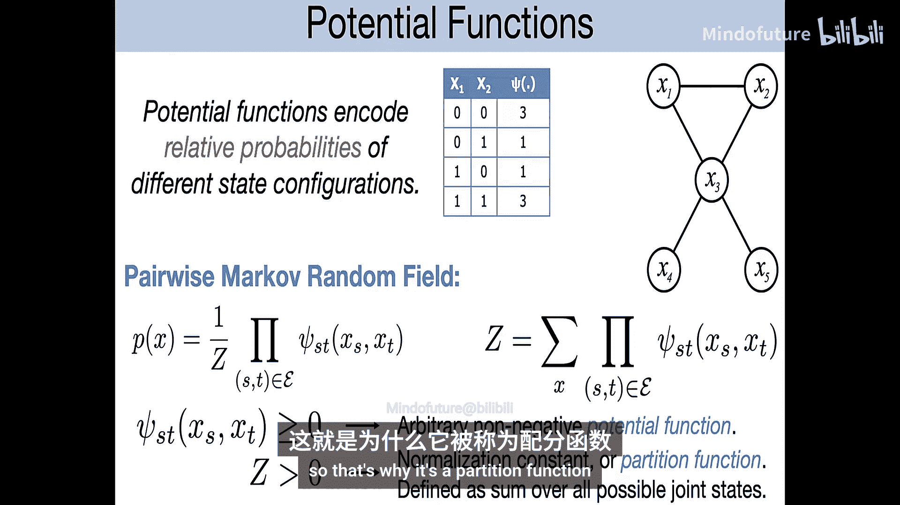

Okay。So here are examples of results of de inference in pairwise Markco random fields。

So in this case， they are we have a large grid structured model， okay， where the grid。

Corresponds to kind of the spatial grid of the pixels in an image。Okay。

And so in this model we have these observations right you can think of these there are these gray nodes and these white nodes so the gray nodes are observed and this is sort of like saying。

Basically， you know what is， if you think of like a little patch around a pixel in the image。

 kind of you know what's observed in that patch with some property of its intensity and color and texture and so on and so forth in the computer vision world they do lots of fancy things capture that。

U。And then this。Hidden variable here would be some property of the world I want to estimate okay and so here are two examples for different properties so here one example is stereo vision right so where I have I have actually two images side by side I'm only showing one of them and I want to estimate depth of the points in this world okay and so although depth is continuous to make these models easier they often treated as discrete so you might say you know I'm going to have like 50 possible depths that a point could be and I want to sort of estimate which of those 50 depths is most likely。

Okay， so then at each pixel there'd be a variable that takes like one of 50 values for saying which of my 50 depth bins is that pixel。

Correspond to and these colors are sort of like showing that where， you know。

 the kind of green is close to the camera and the red and blue is far from the camera。Okay， in fact。

 these are showing。So using I haven't gone to how you what algorithms would produce this yet。

 but these are showing you know given a model like this when I condition a particular image。

 this is a map estimate of the depth so this is sort of showing you what think are the most likely depths given that。

Or another way these are used is that at each pixel you say， you know。Instead of a depth。

 you have a discrete variable that says which object categories is that pixel and so you have some library of object categories like birds and cars and buses and persons and chairs and boats and so on。

And maybe you also have this black as like a none of the above categories right because there'll be parts of your image that are maybe not in your library of categories。

 and then you want to estimate you know what each one is。Alright。Okay。呃。

All right so does that make sense and so and then these potential functions here what what do the potentials look like well the potentials end up being things like saying you know you know like objects take up physical space in the world right so they kind of say that you know if I have a pixel that's some category then usually the category。

The pixels adjacent to it， have the same category。It's more likely to have the same category。

 and it's less likely that they're a different category。

And then they might even have something fancier where they say， okay。

 and then if it's a different category， I'm more likely to see， you know。Um，Uh， you know。a person。

 you know， a person in a chair then a person sitting on a bird or something。

 I mean that's a little contrived， but they do they do kind of capture these dependencies between things along those lines。

On the depth thing at the top right they say that you know if I have a point in the world that's at some depth right well because objects you know are like have physical support again like nearby pixels will usually have similar depths right they could be a little closer they could be a little farther it's more rare to have a big jump in depth you do sometimes have a big jump of depths from the boundary of an object that's called it an occ contour but doesn't happen as much。

Okay， and so that's kind of what those captured。Now。

 also you can see that this model has certain independence assumptions。So。

What would be the independence assumption of this model？Like each pixel is independent of each other。

Well， now， in fact， under this model， if I take the top very top right corner of the image in the very bottom left。

 they're actually dependent。😡，Because there's a path between them， right if I start up here。

 there's some path。That connects them， however， note that what this says is if I take either a row or column。

 so if I take like one column of pixels。Then it would say that condition on this one column of depths。

That the right half and the left half are independent of each other。

So that if I observe like one column of depths or one row of depths， then the you know。

 the rest of the bottom of the image is not useful for breaking the top。And by the way。

 that's clearly false， it's not true， but it's kind of like an approximation that this model makes。😊。

All right。Can I ask a quick question about that？If you were to add or just increase the density of this graph with more connections to make that statement not true。

 do you gain any performance or is it just mostly lost？As far as computational cost。

Oh no you do you can and yeah so in fact there are extensions of this that say that。

Every pixel instead of being connected to the four neighbors。

 there's like some larger region that it's connected to。But it turns out that when you do that。

 then there is a trade off because you have more parameters to estimate。

 so sometimes it's harder to fit those and also we'll talk later about inference inference can get harder。

But yes， there are kind of。This is kind of almost the simplest model。

For this type of task and there are fancier versions of it。Okay， thank you。Okay。All right。

 so I've told you that these pair wise。

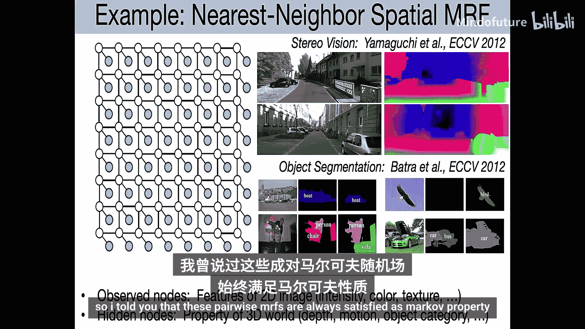

Um。MFs。Are always。Satisfy this Markov property， but it turns out they're not the most general thing that does。

There's something more broad that's called an undirected Markov random field it's called an undirected MRF because it satisfies this Markov property。

And this is going to bring in this notion of cliques， remember the cliques。

For the fully connected subsets of nodes。So an undirected MRF says that the joint distribution。

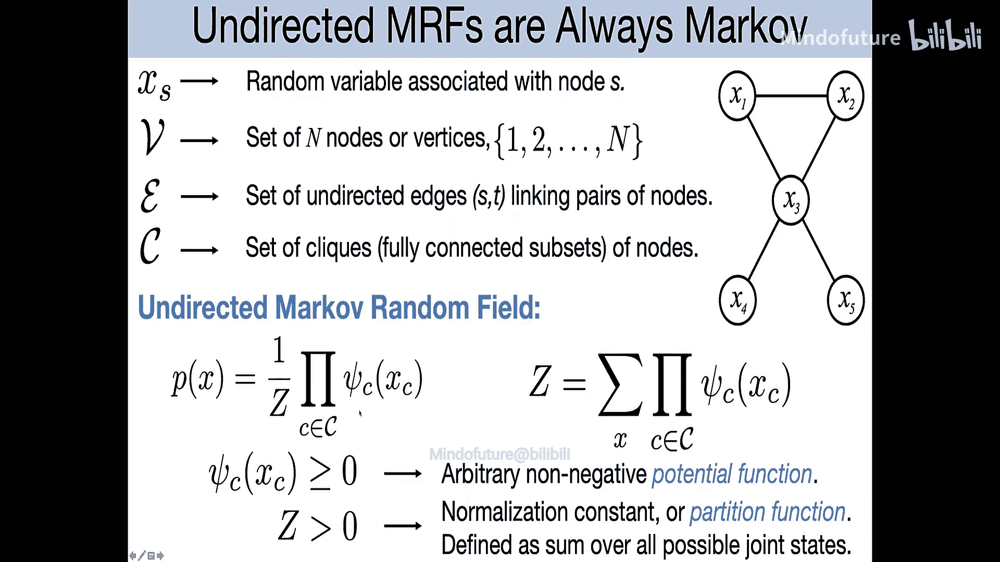

Is the product of potentials for all of the cliques。

 so for every clique in the graph I will define one of these potential functions。

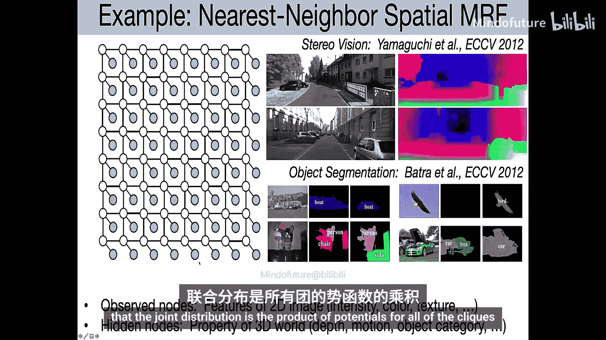

Okay， so I have a function for every set of nodes that's sort of in one of these fully connected cliques。

And then the same way， these are sort of non negative things sort of the probabilities that I normalize so they sum to one。

Okay， so again， so the set of difference was here I had product over edges of the potential on every edge。

Now I have product over cliques of a potential in every clique。Okay。All right。So。

Let's look at some examples。So for this graph。On the left。

The maximal cliques are just pairs of nodes if I take any set of three nodes。

 there's no set of three nodes that are all connected by edges。So in this case， the。

 if I say you know the product over potentials on the cliques is the same as what I call a pairwise MF。

Okay。So in the middle here， right this is a complete graph。All pairs are connected。

And so what does this say， well， this this sort of says the joint distribution is there's a function of all the nodes that I normalize。

Um，And so， you know， this sort of truly shows that basically。

I can represent any distribution with an undirected graph because if I add enough edges。

 then I don't make any independence assumptions and I can represent anything。But of course。

 if I have a very， very dense graph， it's the graphical the algorithms we're going to learn about and so on may not be useful。

Right， so in general， kind of。The things we'll talk about are only going to be practically useful if I have sufficient sparsity to the graph I'm working with。

And then you know on the right here， if I say you know what would be you know the distribution that factorizes with respect to this graph。

 will it be one in which I have some three weight potential functions right so this is like a function of three variables because x1 x to x4 that's a clique。

X2， x3， x4， that's another clique。And then I have these pairwise clicks x3 x5， x3 x6。Okay。

 so you can have kind of different dependence order in different parts of the model。Okay， and。Again。

 what is the Markov property， it says that suppose I think of these functions as。As like， you know。

Prameterters right so and then I plug in any numbers I want to define this function you define those numbers arbitrarily。

If I take。Functions like arbitrary functions that factorize this way， and then I go check。

Do these mark out properties that I talked about before， right， do these properties of。嗯。

Graph separation， applying independence。That will always hold true no matter which numbers you plug in。

Okay， so if you take any， if you parameterize this way。

 then you're guaranteeing that those Markov properties will always be true。Okay。

II haven't shown you that that's true， I'll give you a hint for why that's true in a minute。咳。Okay。

Now， when you think about this stuff， it's useful to think about what happens when I。

 if I start with a graph if I marginalize some variables。

 I sort of sum them out of the model or I observe some variables or condition on them what happens。

And so first is that suppose I have this graph here right so I have three variables and they have this graph right so I have an edge between A and C and an edge between C and B so that says the joint distribution would have to factorize like this。

Okay。Probably if ABC is some function of A and C times some function of B and C okay。Now。

 if I marginalize over C， right， thinking about if I just take this and I sum over all values of C。

 they don't get some function that depends on both A and D。Okay。And so in general， right。

 if I sum over see， then A and B are not going to be independent， right。

 there'll be dependence between them。Right why is that， well， even though in the original model。

 there's no like function that involves A and B， you can think about it that A influences C and C influences B and thus indirectly A and B are dependent on each other。

看。嗯。On the other hand， suppose that I condition on C。If I observe C。

 you can look about what happens if I think of C as a fixed constant， well then I have one。

 I have a function that depends only on a and I have another function that depends only on B and I take the product。

And that's exactly the definition of conditional independence。And so， you know。

 I told you so that the graphic property was that C separates A from B so they should be conditionally independent。

 but you could also easily check that using this formula。Okay。Okay。Now。

 I want to start to give you a hint for why。嗯。Well， both， you know。Why this is true。

 as well as how we're going to have algorithms exploit the structure of graphs for efficiency。

And to do that I need to remind you of something that's going to seem really trivial but is not okay and so the distributive law that that you all learned about so long ago that you've I'm sure forgotten when you learned it right the basic distributive law of addition says that if I have you know a times B plus a times C that's the same as a times B plus C and here's a nice sort of visualization of that in terms of like areas of rectangles。

And so normally this is just like thought of as a sort of trivial identity that you use in simplifying things in algebra I'll observe though。

 that there is like a computational difference right so if you wanted to like compute you know this with numbers on your computer and you said how many floating point operations like how many ads and multiplies do I need right well on the right I need only two one ad and one multiply whereas on the left I need three operations so it'd be a small savings。

Okay。All right。But。Yeah。If I have。More variables that take on more values then you get kind of more interesting structure right so for example。

 let's suppose I have a why that takes。A vector a y values from one to n so I have y1 y2 up to1 and I want to compute x times you know x times y1 plus x times y2 plus x times y3 so on。

 but it's the same as summing up the y's and multiplying by x。Okay。

Or let's suppose that x and y were both vectors and I wanted to take you know take every entry of x times every entry of y and sort of take the product of all pairs and sum them up right so that's what saying this I take。

The sum overall in， the sum overall all in of Xi times Yj。

That is the same as I just sum the values of x， I sum the values of y and multiply them once。Okay。

But note on the right， this is order M plus in operations， whereas on the left。

 this is order M times n operations。Okay。And the same thing holds if I have more， right。

 if I have three vectors。And I want to say， you know。

 what's the product of take all combinations of X Y Zs， that's the same as I sum the x's， sum the y。

 sum the zs， and multiply them together， I'll get the same result。嗯。All right。

 so I mean this is not super deep， but I write it down here very explicitly because as you get the kind of notation and stuff it can get a little confusing right but this disbutive law is just sort of capturing this basic structure of how I can combine。

Multiply themselves。Okay。Now。Let's suppose instead。

It's going to turn out when I want to do reasoning。

Sor of inference in models like like this i'm going to end up with things like this i'm going to have like like some function。

 let's say G that depends on x and y。And then I'll have another function， H that depends on x and z。

 and now let's say I want to sum over both Y and Z。Now why is something that's going to show up。

 we think of it as like imagine that， you know。The GNH were like potentials in my Markov random field。

 and I wanted to compute the marginal distribution of like some variable x。Well， to get a marginal。

 then you sum over the values of the other variables。Okay。

 so that's you're going to get structures like this when you decide to compute marginal distributions。

And if I wanted to compute something like this， right？Note that this G depends on y， but H does not。

H depends on Z， but G does not。And thus， I could get exactly the same result。

By taking the G function， summing in over y， taking the H function。

 summing over z and multiplying the result。Okay。That's the distributive law。But no。

 there's some savings here right so let's say that I wanted for some fixed X。

 I wanted to compute this quantity。Well， if Y and Z just each take on K possible values。

 here I have all Yz pairs， so this takes order K squared operations。Wheres on the right？

These sums each have k terms， so I do you know。K terms， k terms and multiply once。

 so that's only linear in K。So I've gone from quadratic to linear in K。

And now if I wanted to do this， if I thought of this as like a function of x。

 so I want x takes on K possible values。Well， then if I wanted to compute this for all X。

I would be on the right， I would have k squared cost， whereas on the left I would have K cubed cost。

Okay， so you can start to get some savings。All right。

 so we're going to come back to the savings at the next week when I talk about inference algorithms。

But now that we've。Sort of understand the distributive law I can use it to talk about this connection between factorization and Markov okay so right here i'm going to i'm going to just for a couple slides here to make the formulas little i'm going to drop the x's so i'm just going to let like assumeoom12。

3，4 five six7 or like the the random variables instead of like x1 x2 x3 it just makes things a little shorter。

So imagine I had this graph right， well then the if this is and I want to sort of see why does factorization imply that these Mark out properties will hold？

That things are conditionally independent。So first if I factorize with this graph then I'm going to have one potential for each clique right so the potential for one two3。

 one for two34， one for456， one for 5 six7， I have the product of these things normalized。Okay。

And now。嗯。Something that you'll see a lot is this proportionality symbol right so the proportionality symbol means you know you know the left side equals the right side。

Up to some positive constant you multiply so that it sums to one。

Okay so people use this a lot when writing days rolling and things so it's going to show up a lot and you know this normalization concept this one over z doesn't matter for checking whether things factorize so I can kind of ignore that。

Okay。All right， so now let's suppose I want to sort of check。Are one and seven independent？Given for。

Okay， now from my graph separation property， the answer should be yes。

I think about all paths from one to seven have to go through four。

 so thus it should be the case that one and seven are independent given for。Okay。So let's check。

 how would I check well let's say that what is the distribution of one and seven given four I would take up to a normalization constant then that I take the joint distribution of one through seven and I have to sum over two。

 three， five and six， the ones that weren't involved。So now I take my potentials and I sum over two。

 three， five， and six。And now。I'm going to apply。The distributive law。

 because I note that there are these first two terms depend only on two and three。And not five， six。

And these next two terms depend on five， six， but not。Two， three。Okay。And so thus。

I could take these first two tus some over two， three。Take these next two terms。

 some over five six and multiply the results， and I would get exactly the same outcome。Okay。

But no I have some nice savings here， computationally， I mean。

 the computation is not the point right now， but just to if each of these variables had k values。

This。This here would have there'd be sort of order K to the fourth operations to do this sum here。

 whereas down here it would be only order K squared。可。All right。

And now here I have the distribution here I have you know something that depends if I sum over two。

 three， I get something that depends only on one and four， and if I sum over five， six。

 I get something that depends only on four and seven。

 and those things will be proportional to p of1 given four times p of seven given four。Okay。

And so then if you are careful with all these normalization constants I've lost over here。

 you can show that indeed。That given。X4， x1 and x7 are conditionally independent。

 so this is the definition of conditional independence。Okay。嗯。

And so I mean this is just this is not a proof， this is a special example the general proof is almost the hard part is really like the notation more so than。

And anything really deep， but I'll say that you know。

WhyWhy does you end up getting conditional independence is that if B separates A from C。

 so if I have B separate A from C， then I'll have some potentials that depend on X A and Xb。

And I'll have some other potentials that depend on XB and Xc。

But there's no potentials that simultaneously depend on X A and Xc。

They'll be if B separates A from C， then there will be zero potential functions that depend on both a variable in XA and a variable in Xc。

Because if they did， then there would have to be an edge between those variables and that would violate my assumption that their separation it'd be like a shortcut path。

And so this is the reason。That this factorization always implies。Markov。Okay， so。

Any questions on that， does that make sense？Okay， now what's kind of it。Cool what。

Less obvious and deeper is that。This is essentially an if and only if。

That you satisfy the global Markout property if and only if。You factorize into clickiques。

 so I've sort of argued one way， I've sort of said that if I factorize into cliques。

 I go to global Markup， it turns out the other way is much harder to prove。Um。

 it it's the kind of thing that was actually a an open problem for several years before mathematicians were able to show it。

Um。But so here's the statement so this is called the hammermersley Cliford theorem and it says that。

A distribution defined as a normalized product of non negative fleet potential functions is always Markov in fact of correspondingse Ho graph。

 that's kind of what I've been telling you about。There's another direction thats a reverse and so this is where I say it's almost if and only the F。

 it says if I have a distribution that's strictly positive so that says for all x's。

 they have positive probability。So this is a really now distributions where some states have probably exactly zero so if I have any strictly positive distribution。

嗯。If it's Markov， then it can always be factorized into this product of potentials on clees。

Now you may ask why do I need this positively， it turnss out。

 so this factorization and cl potentials， by the way， it's not unique。

That's easy to see right so imagine I had。look at this。Sorry， this formula at the very。Top here。

Imagine I had I took the first cl potential and multiply it by seven and I took the second one and I divided it by seven。

Then I would get。The same distribution because those would cancel。

So that's as another reason these cl potentials are not necessarily interpretable or I could take all my cl potentials。

 I could multiply all of them by 10， and then that scaling up by 10 would get canceled by the1 over Z here。

Okay， so。Okay。嗯。So it's not unique。😊，There do exist。嗯。呃。Sort of degenerate Markov distribution。

 these are distributions where P of x equals zero for some states， which do not factorize。

They're weird， there's no nice example I can show you。

Like like it's like a strange with several it's their weird counter examples so so so this is really the best you can do but but in kind of in practice it's this theorem is what we need because it sort of says that。

If if we sort of parameterize our model with factorized potentials and then learn it from data。

 it will always satisfy this Markov property。Okay。好。And just stepping back this。

 there's several ways in which this Markov property。Goes right so one one is。That。We can。You know。

 if I have this if it's if I have inencies that gives me a sparse graph structure and we'll see later that the sparse graph structure leads to more efficient algorithms。

 so if I have fewer edges then I can get more efficiency， I can compute marginals faster okay。

Another way it goes is that if I here's my model and I write it down as a graph。

 then someone else can look at it and be like， oh， if this is your model， then you are。

Even if you didn't think about it， you're making all of these conditional independence assumptions and I can start looking at those and say。

 are these reasonable or not for this domain？As a way of trying to assess whether the model is good。

And there's yet a third way which you know we've had some questions before about where were the graphs come from in probability in statistics and machine learning there's a whole huge rich literature on basically tests for independence right so you have two variables in some data and I have a statistical test for the independent or not so you can imagine by starting to run various tests for independence and condition independence I could use that to figure out what the right graph structure for my data is。

So all of these are kind of interwoven directions that get explored。Good。All right。Okay。

 so I'm going to go ahead and and quickly give you an explanation for what factor graphs are because they're kind of a simple extension of。

嗯。The undirected graph and so a factor graph is one in which I have these variable nodes。

 but now I also have instead of edges I have called hyper edges and so a hyper edge is a generalization of an edge and a graph so this called hypergraph you about it as like in a normal graph an edge always connects a pair of variables and a hypergraph and edge a hyper edge。

Connects a subset of variables of any size。Right so instead of just like an edge that connects two variables。

 I can have edges that connect three variables or four or 25 variables or whatever。Okay。

That's a hypergraph。Sometimes these are drawn as kind of bipartite graphs。

where I have the variable nodes and then I have these hyper edges connecting them and so we're going to draw these little block squares for the hyper edges。

And they're going to be linked to like a subset so here this is like a three way edge linking x1 x2 x3 and I have a two way edge linking x3 x5 and a two way edge linking x3 x4。

Okay。And so there was something called a factor graph， it's atyp ofographical model。

 it just says that I have a potential function。On one of the potential functions for each of these factors。

 so for every one of my factors， I have a potential function and I multiply them and scale so they sum to one to get my probabilities。

系。UAnd。Basically this is。The motivation for these things is they're more precise。

 so suppose I told you that this was my undirected graphical model。Okay。Well， in fact。

 there could be many ways to like factorize a distribution that would be like mark up on this graph。

So I told you that I could have a pairwise markov random field。

That would look like this where I have fact a potential function for every pair of variables linked by an edge。

Or I could have potentials that are like on only the maximal cliques。

 so I could that would be like having these three way factors。

Or I could using the heterogeneous right I could have like a three way factor here and then I could have like some two way factors here and so all of these。

Sort of factor graphs would have the same you know。Undirected graphic football。And so。Why is this？

In some sense that's a useful observation because from the perspective of like checking conditional independence they're all kind of equivalent but from lots of other perspectives they're not equivalent right you know so for example。

 suppose I think about you know how many parameters do I have to estimate to fit these to data well if each variable takes on k values for the pairwise model I have k squared numbers in each of these potentials for this model have k cubed numbers。

Right you know， and so that could be a big difference it also affects that so。Anyways。

 so that's why these were proposeds they're kind of a little more fine grain view and so especially if you have higher order potentials。

 I think the factor graphs are a nice way of being explicit。

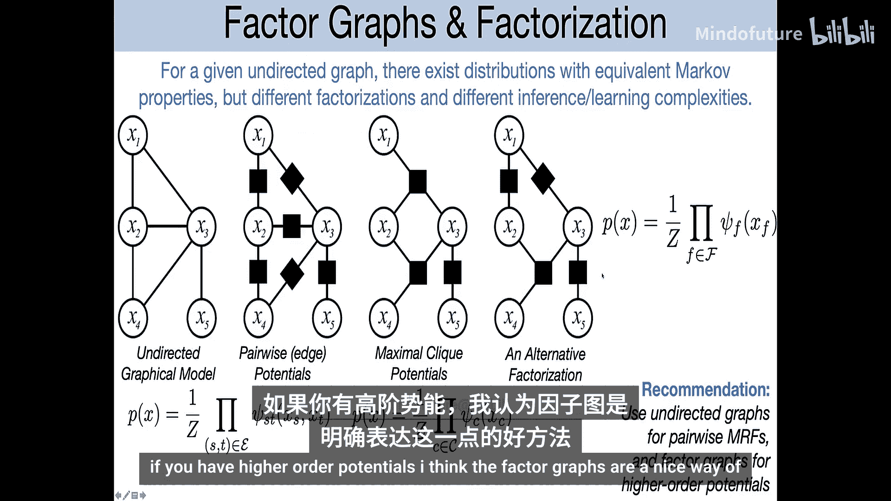

About that Okay， and you know， coming back to this problem right， if I wanted to draw this the same。

Marha ran a fields revision before as factor graphs right well to be explicit I would put a little factor node that says for every pair of variables sorry there。

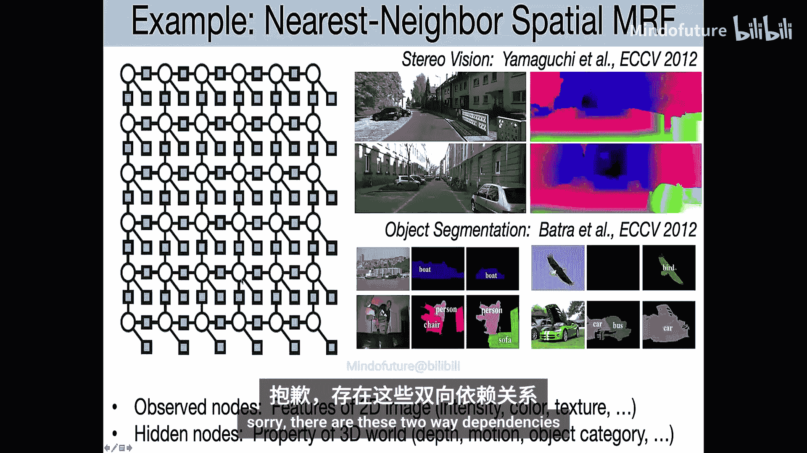

There are these two way dependencies。But by the way there are also some work that at that's looked at higher order dependencies。

 so this is work where they looked at sort of like using some what's called segmentation some low level kind of color based clustering to get larger sets of pixels that they think should all have the same label right so this says that you know they'll take like a big chunk of pixels they say these are all adjacent in the same color of green and so whatever label you sign to these they should be the same。

And so you can enforce that by adding these higher order potentials and kind of the difference between the oh I forget which real are which。

 but kind of as you go down this column， they're sort of adding in more and more higher order potentials and getting sort of better and better predictions of the data okay so you can look at sort of extensions with higher order dependencies。

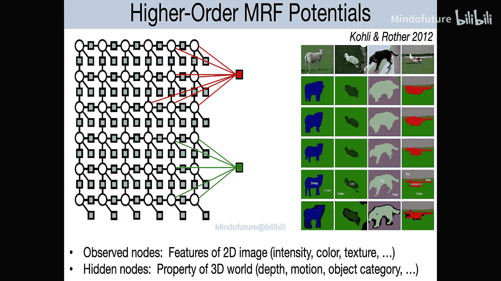

嗯。I mentioned error correcting codes in the first lecture and so these are ones actually that the people who developed factor graphs were working and coding that's where they came from first because there you really do have these higher order potentials。

And so。This was again， the idea that I'll add redundancy so that even if I get some noise added to the thing I want to send。

 I can correct that noise and remove it。And so what is this graph here， this graph first these。

These variables here are binary variables because I'm transmitting bits， so they're binary。

And then I have two things， I have the code， which I have these what are called parity check factors。

 so I have these factors that are connected to a subset of the variables。And they。

That basically equal one if the set of bits is even that means it part could be part of a valid code word or zero if the sum of the connected bits is odd so this basically says it's not one of my valid code words Okay so you're excluding those。

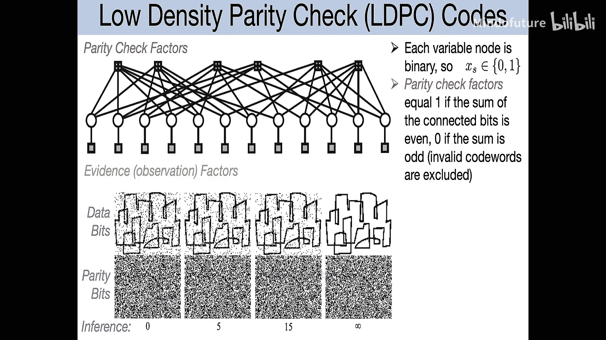

And then I also have these。Sort of factors that connect to single variables so these kind of one way or unitary factors and these basically are encoding the probability the observation。

RightSo if you have like a 10% probability of of about。Of a bit being wrong。

 then this factor would say that you know， I'm going to equal 0。

9 if this variable equals the bit I received and I'll equal 0。

1 if it's flipped to the other variable。Okay。And then when you do inference in this model。

 which we'll talk about inference later， you can do accurate recovery。Okay。嗯。

I have some final slides here on talking about how directed graphs and factor graphs relate to each other。

 but I think since I'm out of time I will wrap up here。

And come back to these at the start of the next lecture。

 but I would be happy to take any questions anyone has now。嗯。you know。

 if you're trying to get a high level story， I'll come to this next time。

 but I think the good high level story on these different models is that kind of the。

The directed models right had this。The factorization was pretty intuitive right this idea of you know some variables cause others that was where they came from right and on the undirected models its it's sort of the markov properties that like graph separation means and it I think of as the intuitive thing and then the factorization is honestly a little weird this product of clickque potential it's a little bit of a strange thing but that's just mathematically what you need to capture。

This graph separation independence property。Okay， and then these factor graphs are these kind of like or hypergraphs are this more detailed view of factorization that's basically gets useful as we dive into developing algorithms。

Can I ask a question on this slide？Looking at the center figure and the one on the right。

 let's take x3 to x5 for the black box and the factor graph。In this case。

 is that equivalent to what we see on the right because its central junction is just connecting x3 and x5 or is there more nuanced to that？

No， that would be equivalent， yeah。Yeah， so so like。If。

I think maybe it's even clearer from this other slide I went。Through。Right， so if you took。

In this case， if you took。This what I've labeled as pairwise edge potential。

 that you take these as your factors， then you know。

 the factor graph and the what I call the pairwise markov random and field are the same thing。

Or if you if you said no， let me instead do the version of a Mark I random field where I have potentials on cliques rather than just pairwise that would correspond to this。

Set of factors here。Great thank you and so the point is just that that you know if I only give you this undirected graph。

So it's unambiguous， it's ambguous as to which way you parameterizing in your model。

 is it the parawise case or is it with higher order cls？And so a lot of times。

People just draw the undirected model and then， you know。

 somewhere else and their paper report they write。Text explaining what they mean or they write an equation saying what they mean。

 but sometimes it it's useful to be more explicit graphically about which one you mean and that's where the factor graphs come in。

The way I think of it is that if I have， you know。

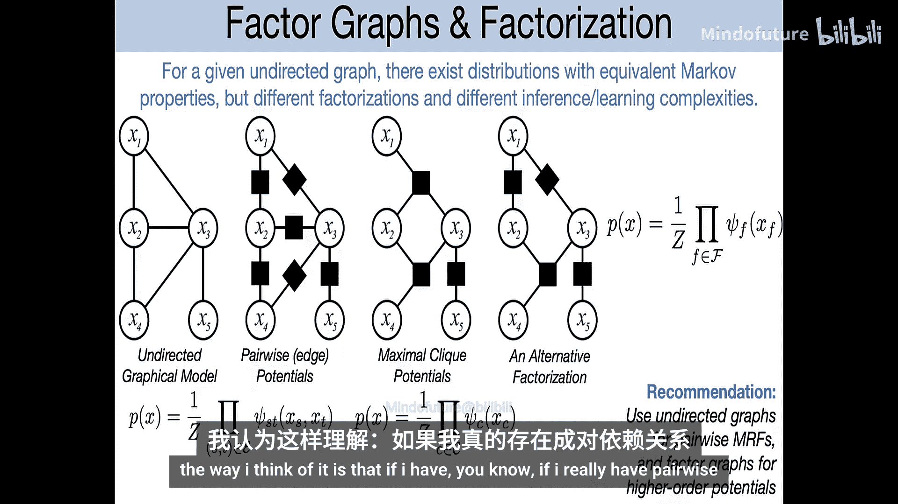

If I really have pairwise dependencies then when I draw this factor graph it looks messy it's like why' I put all these ugly boxes on top of my edges I should just erase them right so the undirected graph is nice for a pairwise。

But on the other hand， if you truly have。You know， higher order dependence like this。

 then the factor graph is like a useful thing to do。对。

Can you go back to that slide of the different vector graphs for a second？

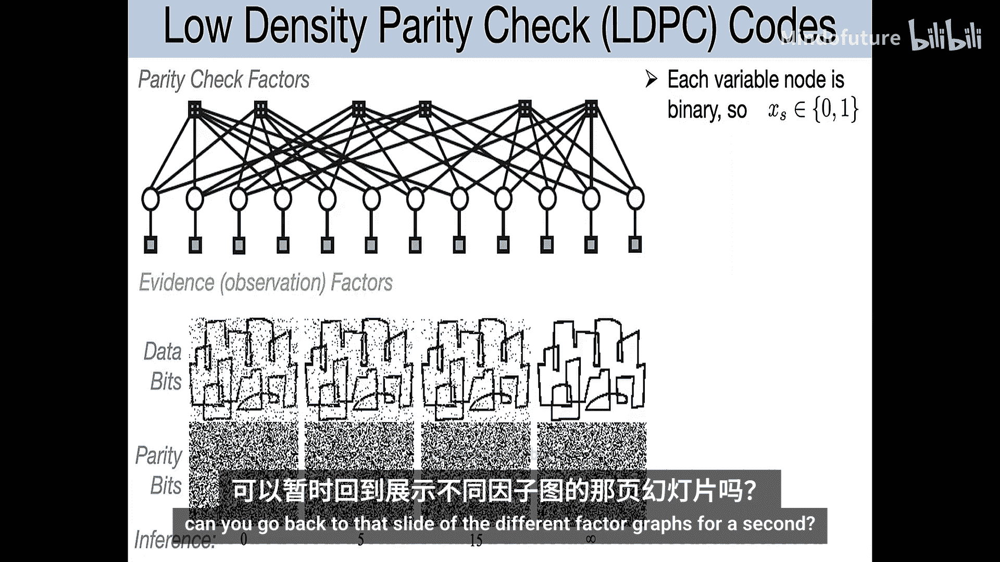

When I was just at yeah yeah。What is the why would you use the like third one versus the fourth one？

Going from what to write。Well， I mean， I here I。I mean I you know this is this is abstract I haven't told you why what the variables mean so there's not it's not clear why any would be better than the other Sure but there is a trade off right so that a way to think about it is that。

First， this one in the middle is strictly more expressive。And by that， I mean if I take。

Any suppose I had to take any numbers and plug them in to the parawise potentials on this one on the right。

Then I could define this three way potential to equal that product of pairwise potentials。

And have the same model。But not vice versa。And the easy way to see that's vice versa is that suppose each variable takes you know。

K values on the right， I would have two k squared parameters。And on the left。

 I would have K cubed parameters。RightAnd so in general， this is bigger on the left。

So and really this is kind of almost like if you think about like what's the bread and butter of machine learning。

 it's like it's model selection， it's like trading off you know the kind of like complexity versus how will it fix the data。

 am I underfitting overfitting and so all of those kind of issues or what will come in later in terms of understanding how I should decide between these these different。

Priravaitizations。It like that kind of makes sense yeah， thanks yeah。So。So like。At one level。

 like if I knew the true distribution， then you would just use lots of higher dependencies。

But but these low order things can be useful because maybe you can estimate them well with less data right so you can avoid overfitting better and or we'll see that when you have lower order dependencies you get more efficient algorithms right so they could be the difference between something that's tractable and intractable to do the inference you want to for those kind of questions。

than you。Yep。

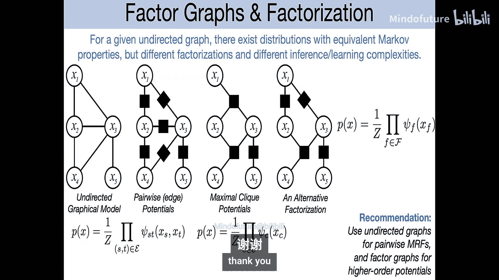

U。And I should say like here you know I talked about this higher order dependence so the original paper that that introduced this you know I don't know they spent a little bit of a page explaining their higher order thing and then they had like several pages of rather complicated mathematics describing how they could generalize their inference algorithms to still to still work for this model so they actually had to do rather clever things so so that that gives you a little bit of a sense for like。

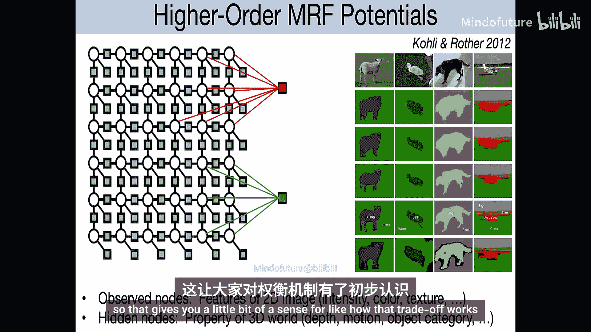

How that trade off works。