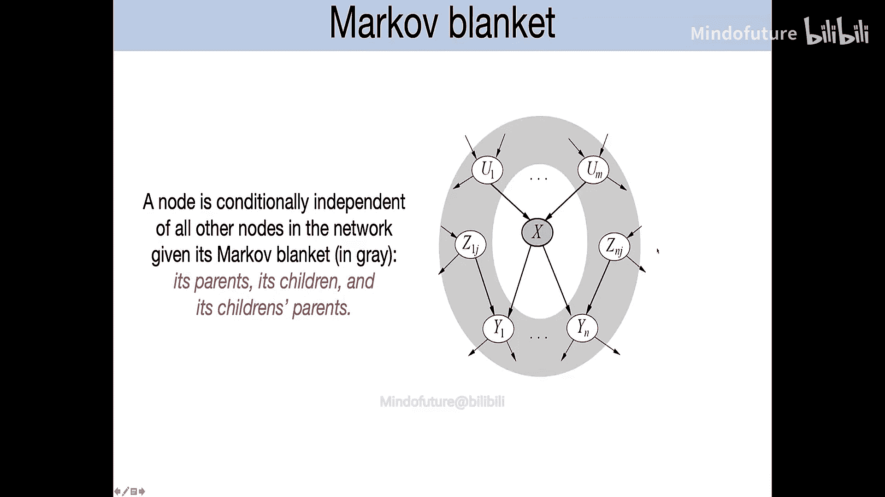
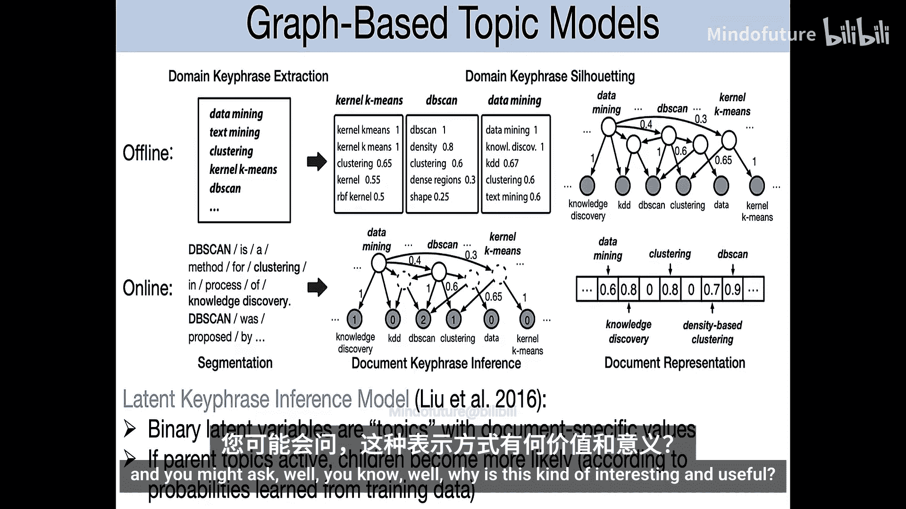
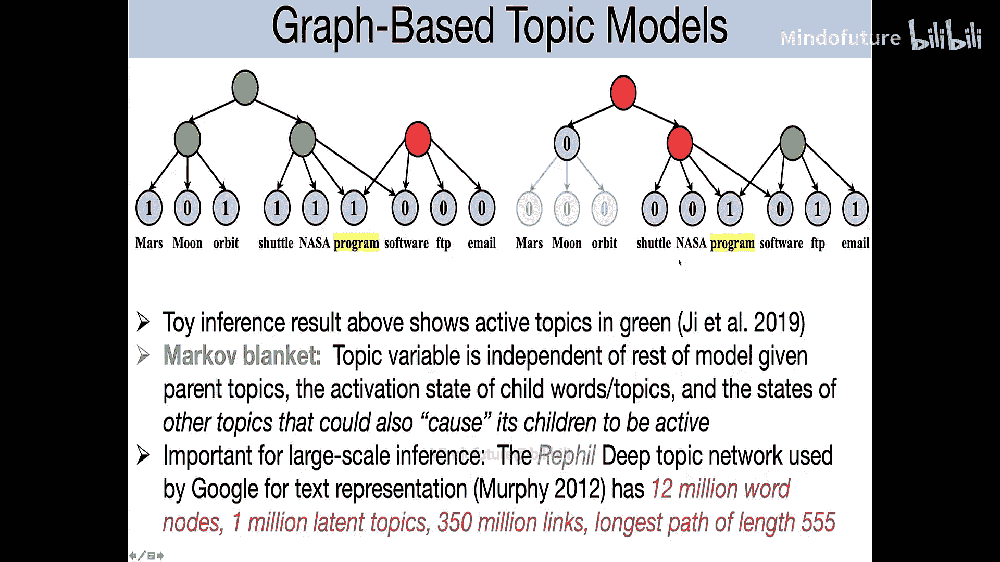
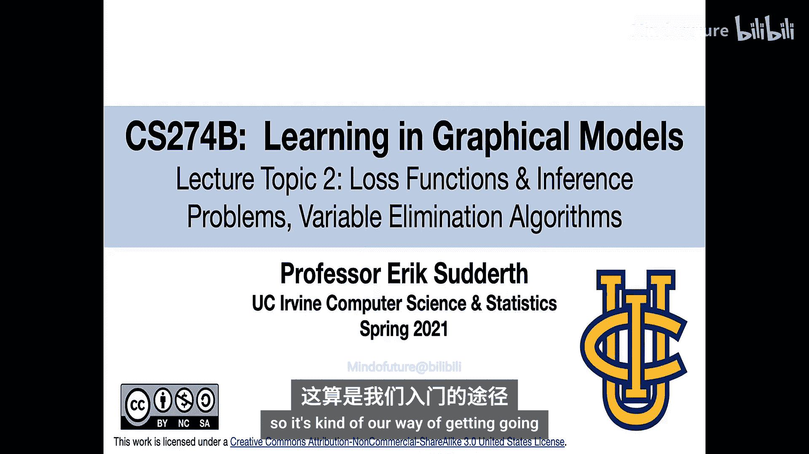
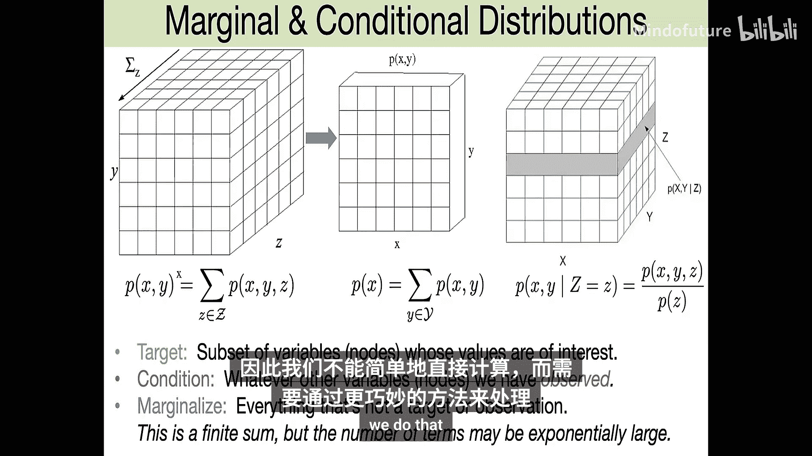
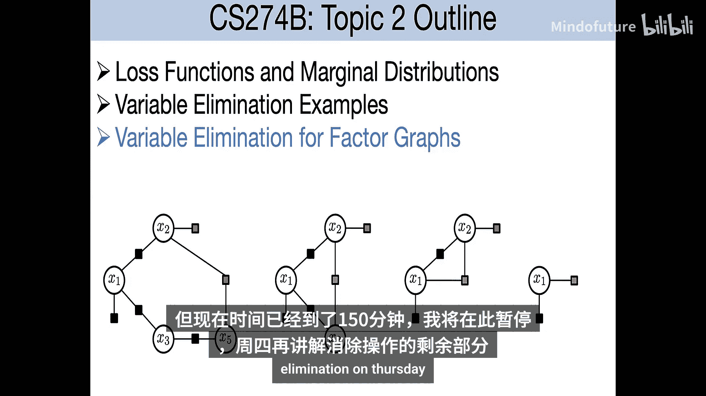

# 【加利福尼亚大学】图形模型中的学习 ｜ Cs274b ｜ Learning In Graphical Models (Spring 2021) p03 P03_讲座_2A-_推理问题__变量消除算法 -BV1Tqx6zrEMj_p3-

I'm going to go ahead and。Get started and so I'm going to kind of today we're going to kind of wrap up our tour of the different types of graphical models and then move into a little bit of talking about how we can do inference sort of of algorithms that efficiently do inference in these models。

Um。😊，And so remember last time you know we talked about the factor graph is kind of this sort of more。

 I guess a little more flexible framework for talking about sort of structure and probability distributions and the idea was that the joint distribution is going to be a product of these potential functions and so I have a graph which has circular nodes for the variables and then these squares are essentially sort of like what are called factor nodes are kept of the variables and these are sort of indicating which subsets of variables each factor depends on so this graph here says that there's one there's one factor that sort of has a three a relationship between x1。

2，3 and then there's another2a relationship between x3 and x4 and a2a relationship between x3 and x5 and the overall distribution is it just the product of these' a function for each factor sort of normalized so it's a distribution so it sums to one。

嗯。And we talked about some applications of these last time。

And we'll see many more I wanted to mention though， that we can think of。

You know represent a directed graphical model in this factory graph framework if that was convenient to us so it's not like it's a separate thing and so if I wanted to write。

A directed graphical model as a factor graph， the most straightforward thing is you make a graph where there is one factor for every node and that factor is equal to the conditional distribution right in a directed model I have these probabilities of a variable given its parents so these factors are connecting each variable and its parents so it's a function of that variable and its parents。

And so for the variables to have no parents like at the top I have these one way factors so this is just sort of like this one way factor here or unitary factor is encoding the prior probability of x1。

 this is the prior probability of x2 this factor is P of x3 given x1 and x2 okay and so you can see that you know with this factor graph I could easily sort of write this directed model as the special case of this okay。

Now you are sort of losing some information though this is why we don't just throw away directed models so in particular in the directed model we have the fact that these local factors are actually conditional distributions right so that if I sort of condition on the parents this is a distribution that sums one for each node and so you can't see that from this factor graph so sometimes that matters and then you' lost some information also in the directed graphical model right we know that because these are locally normalized conditionals that you don't need this global normalization constant right that normalizer partition function Z is just one。

So this is just why you know， they they kind of。Capture some things sort of there's differences between them。

You can also write a directed graph as an undirected graph。

And this is sometimes a convenient thing to do， so if I have this directed graph here and I want to write it as non directed graph。

What I do is I first I keep all the directed edges， but I drop their direction。

 so I take all these directed edges and I turn them into undirected。

But then I have to add some extra edges right so you can see that if I just dropped these edges I wouldn't be able there's sort of a three way dependence where the distribution of x3 depends on x1 and x2。

And I couldn't capture that in kind of a model where I just had these edges。

And so I need to add an extra edge， okay， and so in particular you take all pairs of nodes that have a common child。

Okay， and you add an edge between them okay and there's there's some， you know。

 I guess colorful terminology associated with this right so you are sort of linking or marrying the pairs of those with a common title and so this undirected graph you form by doing that is called a moral graph。

Not my name this is what the graph theory community calls it okay so right so again what do I have to do to convert directed to undirected I have to take all the pairs of nodes that have a sort of common child like so think about x1 and x2 work together to determine distribution of x3 and I have to add an edge between them okay。

And now if I do this， now this undirected graph will have a clique。

For the every if you say the conditional distribution of each node and its parents。

 that'll form a clique and so I can express it as the undirected model。2。Okay。And finally。

 I can convert undirected graphs to directed graphs and the way I can do this is I can kind of I pick some order。

And then I basically go through in that order and I kind of check the inencies implied by the structure of the uned graph right and then I sort of like add the edges I need to or not depending on that dependence right so in this case right if I picked the order x1 x2 x3 x4 I would get this directed graph。

Okay， and sort of there's no edge from x1 to x4 because in the undirected model。

 x1 is condition of x4 given x2 and x3。So you can do this too now the problem is is that the result is sensitive to the choice。

Of node order。Okay and it's not easy to find the best order right there's a exponentially there's a factorial number of orders and it turns out that if you if you under some definition what the next the best order is it actually would be n hard to find that order okay so in general you know you lose something。

So I show you all these conversions just to sort of show you that it's possible。

 but you can kind of see that when each time when I do the conversion I potentially lose something right so there's some kinds of structure that some models capture better than others and this is why all three of these types of graphical models exist and they're all used because depending on what your application is one or the other may be better。

However， it's important to know about these conversions because you know imagine you have a directed graphical model and you know there's some really fancy software package for inference and this software package is written to assume you have undirected models well you might be able to still make use of that by sort of converting your directed model to an undirected model and then running the inference algorithm。

Okay， so it's important to know these conversions， but it's not the case that like there's there's one。

Best typoographical model， right？Okay。All right， and so then the last thing that I haven't really talked about yet right we is we've talked about for undirected models。

 you know， both Markov properties and factorization and there was this interesting connection between them in terms of graph separation。

For the directed models I talked about factorization。

 they have this intuitive kind of what causes what factorization。

 but I haven't talked about the Markov properties and so that's the last thing I want to go over here so what are the independence properties of been directed。

Graph。Right。Okay， so start off with kind of a little toy example and then we'll kind of scale up。嗯。😊。

And so so the first thing to remember is right in a graph like this。

 it's not going to be the case that you know， the only things that are dependent are the things that are directly linked by edges right because in general I might have things that are you know far apart in the graph。

 but if there isn't a path between them that could still cause dependence。

Okay and so this was this toy Bay network where we said you know there's an alarm at a house that could be caused by either an earthquake or a burglary and then your two neighbors John or Mary might if they hear the alarm sort of report it to you okay all right。

 and so let's suppose you observed John right observe John or John reports that they heard the alarm。

Okay， well then， you know， for example， that gives me information right so that if I observe John。

 then the fact that there is an alarm becomes more likely and then that also will increase the odds that there was a burglary。

Okay。Right so you have this indirect chain， okay， so observing John。Will make burglary more likely。

 okay？But let's suppose and you know。Let's suppose I alternatively。

 if I observed just that there was an alarm， that will make， for example， that M more likely。

But you might ask， okay， well， what happens if I observe， you know， both the alarm。

 like I heard the alarm myself and also my friend John told me about the alarm。Well， in that case。

 given the structure here， the。J right doesn't provide any additional information about M or about the burglary or anything else right and so in particular if I observe the alarm then that J becomes independent of everything else in the model so that's an example of conditional independence。

Um。And so now I want to talk about in a directeded model how you can read these inencies directly from the graph。

Um。So。Now of course， right if I wanted to figure out are things independent or not。

 I can always do it by just sort of computing probabilities and checking whether equation told right so for example in this model if I you know I wanted to say you know how are J and M related given A you could you know say。

 well I know P of M and I know like P of M given A and I know P of M given A and J these are all things you could look up from the model specification we have have earlier and if I compute these things I'll say that a P of M given A equals P of M given A and J right and so that says that you have a conditional independence right that M and J are conditionally independent given A。

Okay。So。And this is just I I'm going to skip the details。

 but this is sort of an example of how you could prove this， not just for these numbers。

 but in general。Right so what they're showing here is if I wanted to say are J&M independent given A I can take the structure of my model now note here that the factorization structure of the graph is coming in right here。

 so that's of key part and then once I have that I can just kind of group terms and simplify things and verify that indeed things factorize and factorization implies independence。

All right。Okay， now what about？J and B given a right do I want to say you know what's the relationship between J and B given a and I could do the same kind of thing right I could compute probabilities and I will again find that J and B are conditionally independent。

Given a okay， so it's starting to feel like， you know。

 well maybe we kind of have the same kind of graph separation thing like we did right because because just like we had in the in the undirected models right sort of alarm is in between J and B and thus you know given alarm J and B or independent okay。

All right。But it turns out there's a subtlety。Which is why we talk about this separately of it。

 so you might ask， well， how are let's focus on these first two earthquake and burglary？Okay。

And so well， by construction。U。嗯。Earthquake and burglary are independent of each other。は。

They're sort of marginally independent。That's the exception of the model， but you can say， well。

 what about given A？Okay what happens given A？Well， and so first。

 the structure of this model was there's an alarm that basically becomes more likely to occur if there's an earthquake or if there's a burglary。

Okay， so what does that say， well that says that given that theres an alarm。

 then suddenly it becomes very likely that at least one of those things happened。

 at least there was an earthquake or a burgo， probably at least one of them happened。

But now you don't have to have both happen and you just at least one。

 and so that actually is a form of dependence。Okay。And so in particular， if I look at you know。

 what is the probability of given an alarm that there was a burglary。

 if I compute that for this model， that'll be a little over a third。

 so much higher than the you know one in a thousand0 chance of a burglary a priori。RightBecause。

 you know， if there was an alarm and well， it was probably caused by something。

But now let's say that you hear that you say， oh， wait。

 there was actually an earthquake today as well。And if I say。

 you know what is the probability of a burglary given alarm and earthquake， it's very small again。

 it's down at like 0。003。Right， because the reasoning is that， you know， there was an alarm。

 it was probably caused by either an earthquake or a burglary， but if I know there was an earthquake。

 then I don't have to， you know， then I say， well， then probably there wasn't double and lucky。

 I didn't have two a reds happen， probably there wasn't a burglary。That makes sense。

 so that's kind of the reasoning chain and that comes out of this。And so。

They're not conditionally independent， in fact， A and B， E and B are independent。

 but they become dependent given A。😡，Okay and so this is sometimes called explaining away right so if you have this structure we have a variable with multiple parents often it's the case that these are like multiple causes and you know given that this variable is true。

 suddenly you know that at least one of these causes is probably true but you don't know which one and that gives you a form of dependence between those causes。

Um， so this dependence， by the way， to see another way for Y am my method to hold if I converted this graph to an undirected graph。

Well， that moral graph， as we called it would have this extra edge and you could see that then you know。

 given an alarm， there would still be dependence between earthquake and burgrkberry。

But not give alarm， not between John and Mary。Okay。And so again。

 is there why is you have difference on these two sides of this of alarm。

 it's because here you have this V structure where these two arrows both point to alarm and here we have John and Mary are conditionally independent give alarm Okay so that difference man。

Okay。All right， so weve kind of show this all as an example。So here's kind of the general structure。

Go to get the general structure， let's look at。This is know if you kind of ignore relabellingings。

This is all possible graphs that have three variables and two links。Okay。

 there's just kind of these four possibilities。Um。And。And in A， B， and C， these graphs on the left。

You can check and this is just showing the rules how you check with the rules of basic probability。

 kind of using you know Bay's rule and factorization to check that given and C that A and B are independent of each other。

In all three of these cases。By the way， this graph in B and C， these two graphs。

 doest even recognize what those correspond to？Markov chains yeah these are markov chains right so this is a markov chain and so this that a and B are conditionally independent given see this is kind of the standard in a markov chain if I condition on the present state then like the past and future are independent。

Okay so this is like markov chains and then this one's like a common cause right this is like I have a variable that given that variable A and B are kind of each dependent on it。

 but they're conditionally independent given that okay。Right。Um。On the other hand。

 here I have the opposite， so in this case。So here。

 given C the A and B are independent for this graph on the right。

 given C A and B are dependent or not independent。Okay。

 so and this is this sort of explaining a way where I have two things that could cause C and they become coupled。

Now if I don't observe C， if I just look marginally I kind of had the reverse。

 so if I think of like marginalizing out C so I don't observe it， well in these three graphs。

 A and B are dependent。Right because kind of C is， you know。

 B causes C and then C causes A and thus A and B， if I don't observe C。

 then A and B become dependent。Okay so in this case they are not independent or dependent whereas on the right here they are if I don't observe C。

 they are independent so they are independent and then when I observe C they become dependent and these are kind of the reverse。

Okay。Okay。And you know， it's not。Too important to you know know how to like do this in general。

 but I want to just make you aware that there is kind of a general rule that you can follow and the textbooks kind of prove in more detail why this is correct。

 but how you could in a computer using the graph sort of automatically check any dependence or conditional independence property you wanted to。

Okay。And so。We have they have a notion of what's called a collider。

 so we're going to be reasoning about paths in the graph。

And a collier is going to be a path that contains。Two or more incoming arrows right so in this case if I think about a path from A to B。

 C is called a collider because it has two incoming arrows to it。Okay。😊。

Whereas here this sea is not a collider because it only has one incoming。Cararrow。Okay。And。

And now if I have， you know three sets of nodes， I have like an x and a Y and then a C。

 and I basically want to test our X and Y independent given C。

Then what I have to do is I have to look at all possible paths。

 so I look at all paths from a node in X to a node in y。And I say a path is blocked。

If basically there's you have to treat these two cases differently。

 so if you have a node that's a collider so a collider is again this kind of V structure thing where I have thing。

 then the path is blocked if the collider is not observed。And on the other hand， for nonclider nodes。

 the path is blocked if the node is observed， you kind of have this reverse property。Um， and if。

There is a colllier on every possible path then you say the sets are what are called de separated。

Okay。😊，And this de separationparation implies that they're commercially independent。Okay。Okay， so。

Take away， you can reason about this stuff， but it's a little more complicated than it is in the undirected graphs where it was just like a graph separation notion。

Okay， so I think it's easier again to just look at some examples right so if I look at in this case。

Right if I say。If I say given A our B and C are independent and the reason is that well， given a。

Then that kind of blocks this path from B2 C。And then this path down here is this V structure where if I don't observe D。

 then there's no dependence there。Okay。So in this graph， B and C would be independent given A。

 on the other hand， in this graph。B and C are not independent given A， and that's because given A。

 B and C become coupled here。看。U。Okay。So。Another example right I mentioned these kind of medical diagnosis graphs where you have a set of diseases。

And a set of findings okay， and so here you have this classic structure where the you know the diseases are independent a priori。

But then once I observe some findings。That， you know， then the diseases become dependent or coupled。

And why does that happen right if so if someone you know。

 comes into my office and I discover that they have very high blood pressure。Well， then， you know。

 I mean then probably it's true that they have at least one of the diseases that causes high blood pressure。

Okay。Right but then if I do further tests and I say aha I'm pretty sure that they have disease X which causes high blood pressure。

 then now suddenly I no longer need to think that they might have a second disease that also causes high blood pressure right it's not it's possible but it's not sort of needed to explain the data so this is a form you get condition on the findings you get dependence between the diseases which is why inferenceferen in this model doesn't anything useful right because it kind of lets you reason about how different diseases relate。

Um。Right， this is a silly sort of little example of this right in which I have noses。

 you know a couple symptoms and two diseases either the common cold or the Martian death flu。

 which differs from the common cold and that it may also cause spontaneous combustion。

And and right so you know， for example， in this model， right if someone came in and they said， oh。

 I have a headache， so if you observe that headache is true。

 well then suddenly you know this common cold and margin deficit become dependent right because now suddenly you say that will they probably have at least one of those things。

Okay， because otherwise it would be unlikely that they would， I mean。

 there's a possibility that they have a spontaneous headache that'd be less likely than it being caused by something。

Okay。Um。But then you would have interesting reasoning where if you say， you know， you know， aha。

 you know， I observe that they have not visited Mars。

 well then the probability of the Martian death flu may go down and it becomes more likely that they just have the common fold。

Okay。I I'll talk another version of this type of graph in a sec。And so in general， right。

 people sometimes use the terminology of the Markov blanket and the Markov blanket of a node is just the set of other nodes that I have to condition on such that given those nodes。

 it becomes independent of everything else。😊，Okay， and so in an undirected graph the Markov blanket was just the neighbors right we said that given my neighbors a note is independent of everything else。

Because all paths have to go through the neighbors。For a directed model。

 it's slightly more complicated， so a node is conditionally independent of all the other nodes in the network。

 given its Markov blanket where the Markov blanket is its parents。

And it's children and so those are the kind of the obvious ones。

 those are the things that you know where there's direct edges。

 but you also have this third set you have this， it's children's parents。Okay。

 and so these are these nodes that， you know， for the children。

 these are the other things that could have caused that child state。And so in general。

 for an undirected model， you need to know those things as well to make yourself independent。Okay。

So again this why do I need the children's parents it's kind of the same reason that when we talked about。

This example here， when we talk about the moral graph if I said what would I need so that earthquake was independent of the rest of the model。

 well it's not independent given only alarm， it's independent given alarm and burglary。Okay。

All right， question professorfe so oh what is the difference between parents and children's parents I'm not really sure because parents are already equal no so for node X。

In this model， the parents are you， so these are nodes that have an edge。

 an arrow pointing from U to X。The children are Y， so these are nodes where they go X to that。

And then the children's parents are the Z。So these are nodes who， you know。Have a。

Have an arrow going to win。Where both X and this node both have a sort of common child。Okay， okay。啊。

 thank you。And these become coupled because if I know why。

 then that introduces dependence between these two。

Okay。To give you another example where these things show up。

 it turns out there's a lot of kind of hierarchical graphs like this that are used for modeling sort of the structure of text。

 so they're a variant of what's called a topic model。

This is kind of a slightly messy figure from a paper。

 but the idea here is that they want to have representations of text or documents that you know are not just like you know whether each word occurs but are more kind of higher level things so they build up various phrases of kind of common short phrases that might occur so here's a couple that they picked that you might show up in the like database data mining space you know you'd have different phrases in different spaces and then they build a graph where you have the phrases。

And then you also have these latent nodes that they think of as topics and these are binary nodes。

 and you can think about as when these nodes are positive。

 it becomes more likely that their children are positive， right？Right so for example。

 when this node becomes positive， then its children， which are clustering and kernel canines。

 both become more likely to occur。So you can give these as like a way of like modeling correlation among these things okay and so you know。

 just like you know， if you do PCA or something you model correlation。

 this is a different way that's more adapted to kind of discrete data and uses more of a kind of graph based structure。

Okay， and。And and so they have this graph and then what they do is that given you know。

 a a document or some piece of text where all of these sort of like。

You know short phrases you can say whether each one's present or absence then they do probabilistic inference and we'll talk about how they do that later to get the probability that each of these nodes is active and that gives us a representation of the document so you have this document where for each of these sort of topic nodes you have this probability between zero and one that it's active or not。

And you might ask well you know well why is this kind of interesting and useful heres here's a really simple example of this and so this is for a set of words a kind of a simple graph and you can see that we have this word program right which has two meetingss right so the program could show up in kind of a computer science context related to software an FTP and email and so on or it could show up in terms of the space program。

😊。

Okay。And so now I have this word that's caused by and those。

 you know so if you just tell me that you know， the word program occurred in a document and find other documents that use the word that also have the word program。

 well that is not going to be necessarily the best kind of information retrieval result because you'll be mixing up these two meanings okay and this example is small and contrive but this really shows up all the time。

 lots of words have lots of different meanings。And so what this is showing here is this is saying that by looking at the full pattern。

 so in this case， if I had a document that you know included the words you know。

 program FTP and email， you would infer that kind of this green topic is active and that these other red topics are inactive。

Right whereasas conversely if I had a document that included the words Mars orbit。

 shuttle and NASA program， it would infer that these kind of green topics over here are active and this red one is inactive and so if by doing that it disambigus the use of the word program。

系。Okay。And so in a model like this， right， this this， if you want to say， you know。

 what would the Markov blanket be， this is like basically says if I take one of these topic variables I want to infer。

 it's independent of the rest of the model given what， given its parent topics。Okay。

 the activation state of its child word topics。 So if I want a reason about like let's say this one here。

 I need to know it's parent。And I need to know its children。

 and then I also need to know the states of other topics that could cause its children to be active。

RightSo not only these children， but also like this node here。Okay but if I knew that， right。

 if I had a hypothesis for， you know， what is this node， what is this node。

 then everything else in the model would be independent。P it。Okay。

 so like this one over here now in this in this model。

 this is not so interesting right because it's only got four of these late topics。AndBut of course。

 this is just a toy example。 and so these are use at scale。 so there's a。

There's a deep topic network like this that is called refill。

 which was a sort of promising redo of representation called fill that's used within Google for text representation。

They don't really release all the details， but they've kind of Kevin Murphy is one of the textbook authors of the books I recommend has you know works at Google and was able to read some high level information and so they use something like this for representing text for like their ad sense and it's very large right so it has。

12 million of these word notes。1 million latent topics。350 million edges about。

Linking towards to topics and the longest path， like if you sort of like chain of topics is about length 555。

嗯。And they take a documents and they do a version of probabilistic inference in this to get。

AtThis million length one million sort of latent representation that they didn't use to do interesting things on top of。

Okay， and so you can imagine when if I want algorithms that operate at that scale。

 it becomes really important to say， you know， okay。

 if I want a reason about a particular topic node， you know。

 I need to be able to say out of the one million topics， which are the like a few dozen。

 let's say that are directly related to it as opposed to more indirectly related。Okay。走。All right。

I promise a bit of topic question， but do they handwrite all these 1 million latent topics or I sure how so they use they use graph structure learning algorithms okay yes。

 so they use methods that。That。Sort of like。They're。

 they're kind of iterative methods so you can think about what they do is they identify the the。

Sort of sets of。Small sets of words that are really strongly dependent。

RightYou can think about like if my baseline was a model with no latent topics。

 that would be a model that just says all the words are independent of each other and I'm just I just model like the frequency of each word occurring。

and then as I add these topic nodes I'm basically adding dependencies。

 some correlations or dependence， and so you find sets of words that are strongly dependent and add topic nodes for them。

And then you kind of recursse that now you say okay now now I have words and topics and now I find clusters of words and or topics that are strongly dependent and add more and you do this many。

 many times。Thank you， yeah， but no it'ss it's not。

 so I guess the process by which they do this has some interpretability。

 the graph itself is not going to be interpretable。

But somehow that's the power of it is that it gives you this very rich。

 high dimensional representation。Any other？Questions on that。Okay。

 so there's two ways you can do inference in a big model like this there are what are。Called。

MCMC methods or Mark opportunity money Car methods and there's also you can apply what are called variational inference methods and we'll talk about both of those types of methods later in the class。

Okay。

Um。So I am going to shift now to。My。啊我'事。Next。See。嗯。嗯。嗯。Carraccus。Okay。

 everybody see a new set of slides？Okay， I'm shifting。

 the slides are sort of divided by conceptual topics， not days of the week。

I find that a cleaner way to lay things out， so we're shifting to the next big topic。

Which is inference algorithms。And so we're going to talk about a simple way of doing inference today called variable elimination。

 which you can think of as kind of well one way to do inference would be to。

I had a big graph with lots of variables to kind of one at a time sort of simplify the model by appropriately removing variables until it got small enough that I could kind of like reason about it by brute force Okay and so that's what elimination algorithms are and so I'm going to talk about this and they're not really like the state of the art way you would do inference but they're a building block for lots of fancier things we'll talk about so it's kind of our way of getting going。

。Okay。Um。So now just to give you some terminology， this is not like universal terminology。

 but it's pretty widely used in this part of sort of probabilistic machine learning。

So when I say inference。This is a little bit like what you think of happening at like test time in your first machine learning class inference is going to say given a model with like known parameters so like I have a graphical model I know the graph structure and I you know if there's like these conditional distributions in the directed graph I know all those probabilities。

Okay now I'm going to say you know now you you observe the values of some variables and I want to estimate the what are called the hidden variables。

 the variables I didn't observe so I want to estimate their values or maybe find their marginal distribution something like that okay so that's inference and that's what I'm talking about today。

Um。Learning is a little more like training right so learning will be given multiple data instances。

 estimate the parameters for a probabilistic model。Okay， so again。

 this is like the difference between， I think of that like those topic graphs I just talked about for text。

In France would be like I've already learned my graph structure and now I give you the words in a document and you need to figure out which topics are most likely to have caused those words。

Okay， whereas learning would be， we'll find the graph structure itself as well as all the probabilities that are in that graph structure。

Yeah。嗯。Okay。And so。Like to be really concrete about this， right if I'm doing the medical diagnosis。

Inference would be like given the observed symptoms for a particular patient and further the probabilities that they've contracted various diseases。

Okay whereas learning would be like if I have a big database at patient diagnoses。

 learn the relationships between diseases and symptoms。对。

Or if I'm doing detecting objects and images， inference would be like， you know， here's an image。

 tell me what object categories are in it。Um。Or whereas learning would be， okay。

 I have a database with lots of images in which you know people have labeled objects， you know。

 figure out what's the relationship between the objects's labels and like， you know。

 the image features。Okay。All right so this is just like terminology that's at least in this part of machine learning very standard and so I am going to be talking about inference right now because it's simpler and also it's a building block like a lot of algorithms for learning actually use inference as a subroutine like for those who haveve seen the EM algorithm or expectation maximization right the E step of EM。

😊，Which is learning parameters essentially doing inference。

 so you sort of have to understand the inference before you get to the learning。U。Okay。All right， so。

Wm up we'll look at the easiest inference problem in the world， by the way。

 your first supervised machine learning class is basically all about this problem。

And so this problem is if I have two variables x and y right and I have a distribution right and I say you know I have the distribution of joint is p of x times p of y given x。

 that's what this graph says。Okay， then there's two inference problems I could have right I could have you know sort of observe X and one of a reason about y or I could observe y。

And one a reason about X。Okay。So by the way， if I wanted to compute。

Here the marginal of x is given to me as part of the model， if I wanted to compute the marginal of y。

 I could do that。Am I just taking the joint distribution of x and y and summing over x？

If I did that sum， I would get P of Y。嗯。So now if I wanted to do inference here。

 if I wanted to say you know what is here， well it's really easy if I observe x。

 given the way the models factorize I already know P of y given x thinking about there's a table of P of y given x values and I just look up。

The row corresponding to the particular X I observed。And that's how we get that probability。

Now what about on the right here， let's suppose I observe y， so I have a model defined like this。

 and I observe Y and I want to compute P of x given y。How would I do that？Somebody's rule。

Ba褥 baseroll。Right I said what is p of x given y well that's p of y given x times p of x divided by p of y and you know I have。

P of x and P Y given x are part of my model specification from this graph。

 and then P of Y I get from this formula here。Okay， all right。U。And again， you know。

 when I'm talking about computing these things， one thing I want to。

Emphasize is is that you know we're often with graphal what'll just think about two variables sets of variables and so we'll talk be thinking about you know if I have like three variables if I marginalize I get a joint distribution over two so in a sense this distribution in the middle is kind of both you know it's a joint distribution of x and y but it's also kind of a marginal of this distribution over three variables。

Okay， so this notion of like。Marginalization conditioning can get a little more complicated because I generally have many variables。

 you observe a subset， you want a reason about another subset。Okay and。In general。

 like the formula for inference and models is they'll be you know you can think about that usually your variables in your model are divided into three groups there's like a target and these are like the ones you care about these are the ones that like。

I'm interested in inferring their values because these are the things that would let me make predictions or you know i'm modeling a scientific problem and these are the things that are relevant to my scientific conclusions or whatever it is so there's some variables you really care about。

Then there'll be some other variables you observe， you actually observe， okay？

And you're going to condition on those right you're going to say I have given these。

 I want the targets and then often for a lot of models there's a third set there's a whole bunch of other variables that maybe you don't really care about but they're in your model because thats just kind of what the natural way to structure the model。

And so in general， you want to then marginalize those away。

 you want to properly have a load that you'd like to sum over the values of everything that's not your target or an observation。

Okay。And so for right now， we'll get to models with continuous variables later in the class for right now for the purposes of this lecture in the few after I'm assuming every variable in the model。

Is discrete。Okay。And so in that case， in principle， these are like trivial things to do。

You could write down one equation of E done， but the problem is is that in general the like this marginalization。

 for example， involves sums where the number of terms in the sum is kind of exponential in the number of variables your model。

So we can't just do it sort of naively and we'll need to be more clever about how we do that。Okay。

Okay。All right， so I want to mention to kind of motivate。Um。Some of the classic algorithms。

 there's some a little bit of decision theory that comes in to how we to motivating them and so。

This is a little bit of review， so right？Decision theory talks about， you know。

 if I need to make predictions a way of kind of like understanding what the optional predictions to make would be okay。

So let's do a setup like I have a set of observed data that can take values in some space。

And then I'm going to have some unknown no enter hidden variables that I want to estimate。

 and I'll assume that this x is a discrete variable。For now。

And then I'm going to have in decision theory， I talk about having an action。

So I have an action that I take and then there's a loss that depends on the true value of x and the action。

So for different types of things and for the special case of decision I're going to look at now。

 I'm going to assume that my goal is to estimate this X。Okay。

 so my action is going to be to pick an x value。Okay。Um and so of course， if you knew X。

 you would just， you know， u test all actions and pick them one the smallest， but in general。

 I don't know X。You I have noisy information about x from Y。And so thus， in decision theory。

 it says that， well， the right thing to do is I should compute the expected loss。

 I should say given my observations why compute the expected loss。

Of particular action so this row of a given y， this says if I take action A。

 given I have observation Y on average， what will be my loss。Okay。😊。

And so this expected value just involves a sum right I have you know overall possibilities of x I have the probability of the x value times the loss if that x value is true。

right， and then so decision theory then says you should compute this expected loss and because losses are bad。

 what you should do is you should pick the action that minimizes this expected loss。

 so I should take this expected loss of each action and pick the action。That's as small as possible。

 and that's my best decision。For an observation。Okay。All right。Um。Now。A challenge。Is。

For graphical models， often this decision space。It is so so I mean even if you didn't realize that you've probably done something like this before。

 so in general like you know the sort of probabilistic models for classification。

Like if I am using like a naive B classifier or something like that。

 implicitly your action is going to be picking one of the classes and you are what you're doing is you can it turns out that the standard ways you make prediction with those models are equivalent to you know computing some expected loss for each possible category you could predict and then picking the one where that's smallest。

嗯。UNow the problem is is that by the way we'll see that there's a challenge for graphical models is that this decision space is exponentially large right think of those image problems where you know my goal was to like for every pixel in the image predict。

😊，m，You know which category it is？Right？So well， the number of possible images is sort of like the you know。

 the number of categories raised to the number of pixels and so I can't just kind of enumerate them all and check each one and any more efficient algorithms for finding the best decision。

Okay。All right。So。So we're this is that decision theory setup copied from the previous slide I'm going to estimate the hidden variables X from observation ratio Y via。

Taking this loss。And now suppose x is like actually a whole bunch of variables。

 I think of it as like it's a bunch of variables in a graphical model， so x is actually in variables。

 x1 x2 up to exit。Well， a lot， not always， but a lot of the losses that people like to use in practice actually decompose into a sum of there's a loss for each variable。

In the model， okay， and let me give you really concrete examples。

I might have for each variable in the model， I have XI is like you know， like the category at Pix I。

 and then AI is like my prediction of the category at Pix I。and this indicator notation。

 this is just a variable that's one if my prediction is wrong and zero if my predictions right。Okay。

 so this is basically this loss here is just a count of basically， you know。

 for how many variables in the model or for how many pixels if I was doing sort of image segmentation is my prediction wrong？

Okay and so this is by the way called the hamming loss after hamming who this was first used in like coding theory and air correcting codes。

 but it's basically like saying you know I care about I want to minimize the number of nodes where my predictions wrong so that's a pretty intuitive thing you want to do right or another standard thing would be if your variables are more like real numbers or they have in order。

U then then you might want to minimize the square difference between the。True。

 you know the true value of that variable and your prediction。

And so if I want to minimize the squared error， that's the quadratic loss， right。

 then that's you sum that up over all the notes。U。And。For any loss that decomposes in this way。

 you can kind of。sortrt of simplify the sum a little so that it depends only on this。

 the loss depends only on the marginal distributions of each node。Okay， so this final loss。

 if I want to minimize this， you can think about it's a sum of terms for each node。

Because expectations are linear and it turns out all you need to compute is the marginal distribution of each nodeome given your observations。

And so kind of for this reason， I think a lot of， there's a lot of inference on it we basically say。

 my job is given a graphical model。To， you know， and where you observe some variables for all the variables you didn't observe。

 find its marginal distribution。so find the probability that it takes each value and so that you can use this to get estimators。

 it also tells you how if you have。High or low uncertainty in that variable， that kind of thing。Okay。

嗯。嗯。By the way， as a sort of like result I'm guessing you've seen before I know it shows up in like 274A is that the if I want to minimize this quadratic loss。

 the best thing to do is to predict the posterior mean of my variable。

So predicting the mean always minimizes the expected square distance。Um。All right。

 any questions about that？好看。嗯。So I've mentioned this thing of computing marginals。

 there's another loss which is different。The a different loss you could pick is one that basically doesn't care about you know how many variables you get right。

 it just says I want to get everything right。So another loss。

Of that you can pick would be one that you say， I have lost zero if my prediction and truth exactly match。

And I have sort of lost one otherwise。So I don't I don't care if I get you know。

 some nodes right and some nodes wrong， I just care whether I'm totally right or if I make a mistake。

Okay。And in this case。😊，The thing that minimizes。This loss。

Is to find out of in your posterior distribution， basically predict whatever state has the highest probability。

And so this loss is what motivates the maximum all posterior or map estimator right so as a classic estimator for a variable you say I just predict whichever values is most likely。

😊，はい。U。So let's look at that， so now if you look at this if I said you know what does the map estimator look like and imagine I have a factor graph well the map estimator says right you should compute P of x given y of the probability the hidden variables given observations。

And take the X that maximizes them。And so then if I you know， given my observations。

 I will have some。Factor graph structure for X's。And now I want to maximize overX。

But now I can make a few simplifications， I can also。This one over z。

 this normalization constant z doesn't depend on x。

 so I can drop that if I just care about finding the max。

And sometimes it's useful instead of kind of for both。For numerical reasons。

 among other reasons that。Since this product of terms can have bad numerical behavior instead of maximizing a product。

 you take logs and so you convert this product of potentials to a sum of log potentials。

And you maximize this sum of terms。Okay， so that's a very common thing。U。By the way。

 there's a connection we'll see later between the negative log probability and energy in physics。

 and so if you you could also instead of maximizing this sum you could put a minus sign and minimize this a negative sum。

And that is the same thing as what is widely called energy minimization。Okay。

 so sometimes you hear people talk about this method is doing energy minimization of some sort。

 that is essentially another way of thinking about kind of math estimation and the structure models we're talking。

Co。Okay。All right so this has been a little abstract I wanted to set up the big picture I think rather than me belaing this more it's easier going to be easier to sort of go into a few examples of how elimination algorithms can work。

Okay。Okay。So one。Type of inference problem that is actually pretty easy doing code as an undirected graphical model is a constraint satisfaction problem。

 so problems people don't usually think of as being probabilistic right these kind of classic problems you learn about in an algorithms or optimization class。

And so so for example， one of these problems is what's called。

Graph coloring right so the graph coloring problem is given some graph and I have some set of possible colors like I have you could have three colors or four colors your question is can I is it possible to assign a color to every node in the graph such that all pairs of adjacent nodes have a different color。

Right， so the idea is like I want a color in the states of。In this case， Australia。

 but can I color in these nodes so that you know any two that have a border have a different color？

Okay， so that's the classic graph coloring problem。

So I can write that problem as an undirected graphical model。

But either a Markov reino field or factor graph。Okay， and so I have。A set of constraints。

 alpha thatll involve subsets of variables okay and then I have factors that I can say for each of my constraints I will have it。

 just have a factor that's just one and zero so the factor will be one if that constraint is satisfied and zero if the constraint is violated。

Right， so in this case， it would be you know for。Everyone for every one of these sort of sets of variables that are in a clickique here。

 you want to say if I look at x2， x4， x5 or all three of those variables have different colors or to two of them。

Have the same color and that would determine whether you get a one or zero here。Okay。And now。

 right if I define a product of these factors， again， their ones or zero。

 so their product is going to be one or zero。Well， if you think about it。

 if I take the max over all possible X。Well， that'll be one as long as there is at least one way to color the graph that satisfies all your constraints。

And on the other hand， if that's zero， then you know that the graph coloring problem is infeasible right with that number of colors。

 there's no way to color the graph。Okay。And then if I say， you know， on the other hand， if I said。

 you know， what is the arg max over x of this， that would give you， you know。

 a feasible coloring if one exists。Okay。Even by the way， the。Partition function。

 right this normalization constant actually is interesting in this context of constraint satisfaction problems because if you look right。

 what was if this was this thing that if I wanted this to be a distribution it was this constant I would divide by so I motivated by probabilities。

But here you can see this already has an interpretation in this problem and that if I sum over all x of this product of factors。

😊，Well， this pra factor again， is going to be one if for the x's that are feasible and zero for the ones that violate constraints。

So this Z is going to be basically count of the number of solutions。

 so it'll be like would if you could estimate Z it would be an estimate of how many different ways are there to color this graph that satisfy all constraints。

And in some applications， that's actually of interest。

Gra coloring is this kind of a funny abstract problem。

 but there's lots of like real world optimization problems that are equivalent to this after some transformations。

Okay。All right， so does that kind of makes sense。Okay， so I'm going to talk about， you know。

 a little bit about how we could do inference for this graph coloring problem。

 although what I'm going to say， it would essentially apply to any factor graph。

That looked like this。Okay。And you can think about that there's kind of two。Strategies。Right。

Conditioning and elimination and here they are just at a high level， so conditioning says。

So you know， I again， my goal here is going to be define this this maxim， this optimization。

 say over all possible。Joint configurations X， find the best one。So well。

 one way that I could do this would be to condition， so I take one of my variables。

And I'm assuming all the variables are discrete so they have a finite with a finite number of possible outcomes。

 so I just say well this variable could be you know I don't know a value between1 and k， let's say。

 so for each possible value of a， if I condition on that then condition on that young that I get kind of a simpler graphical model。

Where this is no longer a variable and I just have sort of potentials left between the other ones。

And so now what I can do is I can condition on each value of k。

 and then I can kind of recursively say now， you know。

 go optimize over this model with one fewer variable。Okay， and then if I keep doing that。

 eventually I'll get to a point where I can do the optimization efficiently。Um， you know。

 so various ways to see that one is that， you know， eventually as I reduce variables。

 I'll get to the point that even if I was naive and said。

 tell me all joint configurations of the variables in the model that wouldn't be too many。

Right like if I have binary variables， well if I have 10 binary variables you know two to the 10th is 1024 that's not that big of a number for a computer these days。

 so you know even if you didn't ignore any structure you could just test all two to the 10 bit strings and find the best one。

Okay。We'll see that you can be smarter than that and so in particular these typesps of inference problems I'm talking about we'll see that if you have a graph that is a chain or a tree so it has no cycles then we can find the optimum efficiently in closed form so like in this case if when I condition on a then I've sort of gotten rid of all the cycles and we'll be able to very efficiently find the optimum for each of these cases。

OkayAll right， so that's one strategy， the other strategy is kind of elimination。Okay。

 and the idea here would be that if I， you know， if I have a variable。

 if I kind of sort of sum or marginalize it out of my graph。

 then I get a model with one fewer variables。Um， and so if I wanted to like compute the marginal of like node G。

 well you can kind of just eliminate variables， sum them out one at a time until all you're left with is G and then that will' have its marginal。

Okay。But when I do this elimination， what we'll find is that you will add dependencies between its neighbors。

Okay， so you'll kind of will remove a variable， but you have to add extra edges to account direct for the effects of that variable on the distribution。

Okay。All right， so。So。Imagine that I had sort of a really simple。Pace， okay， I had。

So I'm going to talk first about this conditioning case and then we'll come back to elimination later。

So imagine I have the simplest graph， I have two variables x and Y， so I just have two variables。

And let's assume that each variable can take three values and sort of motivated by this graph coloring thing。

 we're going to call the variables sort of RGB for red green blue so like the three colors okay。

And so I have this F is the thing I want to maximize。😊。

So the F is this function that I want to maximize。And so you know there's a value of this function for each possible combination of the variables taking their value the RGB right so each two variables each taking three colors that's three squared or nine combinations right so here that's this table is just saying for all of these nine combinations。

嗯。嗯。You know what the。This function is that I want to maximize。Okay。All right。

 so now in this case and I wanted to find。呃。嗯。You would just list them all。

 but we want to think about ways of kind of building up to bigger problems where you wouldn't want to just enumerate everything。

And the idea here is that， you know， if I had this table， I can。Condition by say， well。

 let's suppose I simplify by fixing x equal to B。Then if I fix x equal to B。

 then I kind of get a smaller model that has one fewer variable。

 it only has y right and so you have this kind of little slice of the big table where you only have three values。

And then if I， know said， well， what if I fix y equals R。

 well then suddenly I would now have kind of a unique。Configuration。

So that I can kind of recurse on this to get a search over possible configurations right and so the idea here would be that imagine that I。

Started with this model here and I said， okay， well what I'm going to do is I'm going to start by fixing x4。

To be red。Okay， so you think about what's the change going to be。

 well now x4 is red now have a variable with one fewer model， one fewer variables。

And now its neighbors are all so the edges from x4 kind of go away。

 it gets taken out of the model so I have a simpler graph。

 but now I have sort of a potential on the neighbors that basically say， you know well。

 whatever color you are， you can't be red。Okay，Because otherwise you would be violating that constraint。

and then you could recurse this by fixing the value of another variable until you get to a small enough one that you can kind of solve more directly。

and you kind of do this recursively right so you can think of this like conditioning this is actually connected to there's a lot of kind of in in algorithms as well as in artificial intelligence there's a bunch of classic algorithms that are kind of search based right so you you sort of search for different possible solutions through a tree and you can think of that's kind of like what this algorithm would be doing。

😊，U。嗯。Now。The alternative。嗯。Oh， so。We now we need to talk about a little bit about now if we're going to do this kind of algorithm。

 what what it will look what it means conceptually if I kind of combine。Cost functions， okay。

So imagine that I have a function that depends on x and y。Okay。

 and another function that depends on Y and z。And then I add them up。Okay， so mathematics。

 this is I just make you a new function that is， you know， F of x， Y plus f of y and z。

But in in terms of you know， a table right you're kind of like expanding out now suddenly I have to look at not just the possible values of x and y。

 but the all values of X Y and z， and then for each X， Y。

z combination I take the sum of the corresponding entries of these previous two tables。

That makes sense， so this is kind of what's when I talk about。

Functions of discrete variables and adding them up this is kind of what would be going on。嗯。

Behind the scenes。嗯。So that is how I sort of expand a cost function again I can also talk about。

There's a notion of kind of reducing the number of variables in this cost function。

And now if I have a function that depends on x and y。

 and let's suppose my goal is to maximize overall values of x and Y。Well。

 what I can do to eliminate a variable when I say if I want to eliminate y from this function。

 what I do is I say for each possible x， I say。Pick the Y that makes this function as big as possible。

😡，So I can say， suppose x equals B。What's the best I could value this function I could get well it would be five when y equals G so I would get a five here。

And on the other hand， let's suppose x equals G。Now， given x equals。G。

 value the best value could get with y would be six， so I plug that in here and given x equals R。

 the max overall possible y is four and I plug that in here。睇。So you can think about this。

 if I want to find the best joint configuration of x and y。

 one way to do that is for each possible X， find the best y。

And now then maximize over these threes and you'll get the same result。

Could you repeat here where we choose the maximum value？What was that？

Could you repeat here why we choose the maximum value？So wide Max here， this would be if my goal was。

To。Findine the max of this function。开。If I want to find the max of a thumb。

 so this would be like if I want to do map estimation。啊。Okay， thanks。

So and so why does this work right， well it works kind of for a trivial reason。

 which is that when I talked before about this distributive law for sums and the distributive law also holds for Max。

 it's such a simple thing that we don't normally talk about it。But if I wanted to say， you。

 I have a plus two numbers， a plus B and a plus C， and I want to find the max of those numbers。Well。

 I could instead find the max of B and C and add A to the result。Okay。So。

 so just like there's a distributive law involving sums and products。

 there's also a distributive law involving sums and maxes。Okay。And so put another way。

 like suppose I another way to think about this is that suppose I had a function。

 I had one function G of X Y and another function H of xz。

 and I want to maximize this sum over both Y and z。Well。

I can do that optimally by taking this first term G of X Y and maximizing it over Y。

And taking the second term H of x Z， maximizing it over Z separately。Okay。

Because only this term depends on Z， only this term depends on y。Okay。Um。However。

I can get efficiency savings by doing this。RightBecause if Y and z each have K possible values。

 then this on the left here， this naively would take kind of order K squared operations。

 you'd have to take all Yz pairs and test every pair。But on the right here， I say no， no， no。

 I can kind of maximize over y that takes k operations and then max over z that takes k more and sort of have an order K instead of an order K square it costs。

看。All right。So that's kind of why those methods are working。嗯。And。

So now if I want now to sort of like。Maximize in this variable emination fashion。

 what am I going to have to do right I want to sort of take a graph like this and I'm going to maximize over。

A E， D， C over find the max over all the variables of this model。

Well the elimination you have to have an order and computational efficiency does depend on order right so let's suppose we decide to eliminate B first。

Okay。Okay， so you can see that， you know， I have these functions here and there's a subset that depend on B right I have a function here for every edge。

And so I take the subset of functions that depend on B。Okay。😊。

And I sort of collect those and I put them together and now I say I'm going to maximize this over B okay and that will give me a new function。

 I'll call it lambda of B that depends on the neighbors of B in this graph right depends on DC C E and a this case all things so this is basically saying for each you know configuration of A D。

 C and E what was。Um， the， you know， the the value of this sum。

 if you set B to be best for that configuration。Okay。And now then I can iterate this process。

 now I can say， well let me eliminate C， then eliminate D。

 then eliminate E and so on until eventually I've eliminated all the variables。Okay。

Now you can also think of this as being graphically right if I eliminate B。

 then I get a new model in which there's relationships between kind of all the variables that were neighbors of B。

Okay。嗯。And so。If。啊。I go to this next case here right if I eliminate x4 so I kind of I have my constrained optimization problem and I eliminate x4。

 then now I get a relationship between the neighbors of x4， right？which were x2。

 x3 and x5 and basically I say that you know， well when I eliminate x4。

 now I can only have two colors if I was trying to find three colors for the total graph。

 well if I've used one for x4 I only have two left。For the remaining notes。Okay。

 and so you get a constraint between them。嗯。Now， if you look here。Here when I did my elimination。嗯。

You'll note that here。There's kind of a lot of dependencies were added when I eliminated node B。

Right because node B was kind of right in the middle of the graph and was highly connected。

And so we'll see that although this will give me the right optim。

 it's probably not smart from a computational efficiency perspective。😊。

Okay and in fact it would be better if I wanted to do elimination on this graph I would be better off to start with one of the nodes that's sort of more on the edge so like one of these nodes like D or e that only has two neighbors because then I will add kind of less dependencies and I will get the。

Solution I want with fewer operations。A professor， a question for the variable elimination part。

I'm not sure how you get。Like for the second line， how you got Max。Over E And D for FD。

And how you get max question who C or FA and， I'm not sure how you， how you get that。Well。

 the idea here is now I have。Okay， so did you follow this first part of how I would maximize over B and so now you can think about this all this lambda。

 even， even though I got it by this maximization operation， it's just a function at this point。

So it's a function that you give me any ADCE values and I give you a number。Okay。

And so now if I want to now eliminate C， what I do is I say for each possible value of。

Of the other variables right， of A E and D， I find the C that makes the sum of these three terms。

 F of AC， F of C E， and this lambda as big as possible。And then pick the best one。Okay。

And then you just repeat that process。Okay。Good question。嗯。So this part was intentionally a little。

Hand wavy high level will give you some intuition and so the next thing we're going to go to is is kind of more explicitly talking about how this elimination would connect to the factor graph structure and I think some of the details will become clearer then and but as we are at 150 now i'll stop here and i'll do this last part of the elimination on。

On Thursday。