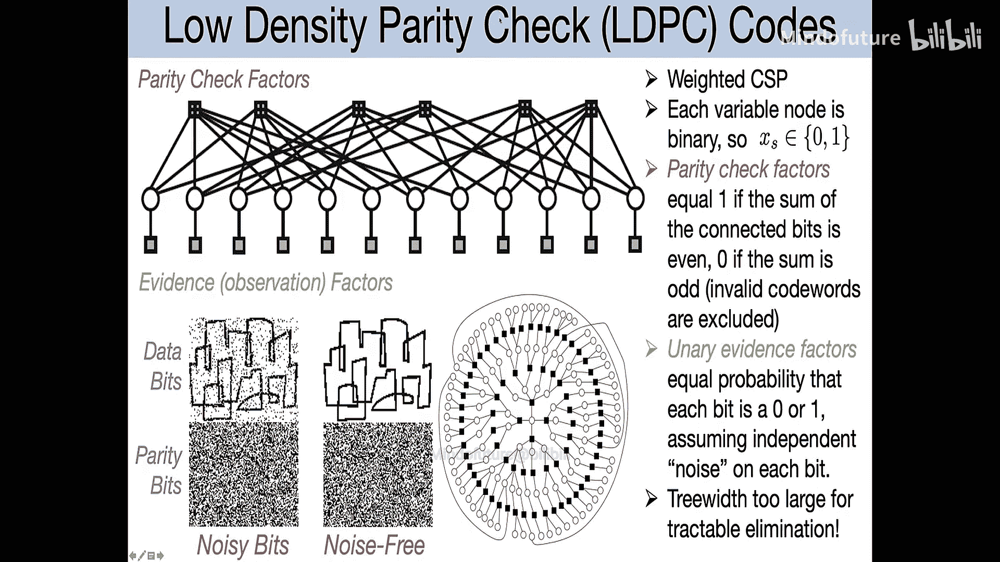
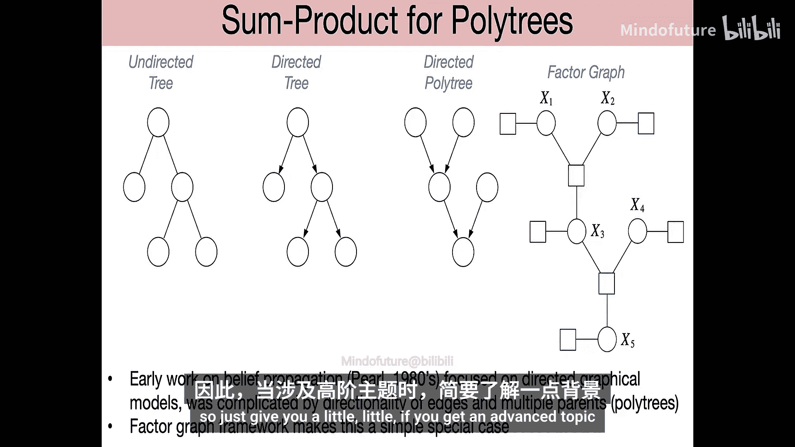

# 【加利福尼亚大学】图形模型中的学习 ｜ Cs274b ｜ Learning In Graphical Models (Spring 2021) p04 P04_讲座_2B-_消息传递算法__信念传播 -BV1Tqx6zrEMj_p4-

Okay， welcome。Today I'm。Going to keep talking about elimination algorithms。

And kind of get into a little more mathematical detail on how these work for factor graphs， okay？Um。

And these are both， you should think of this as kind of simultaneously an algorithm that sometimes is useful in terms of giving inference results we care about and also sort of a building block for a little more sophisticated things that are going to come next。

Okay。All right， and so these things to get their simplification。

 they're going to leverage this distributive law that Ive mentioned before， right。

 which sort of says this thing that if I have， you know sort of a product of functions that so for example if one only depends on y and one only depends on Z and I want to sum are marginalized over y and Z I can have。

You know。have computational efficiency savings by noting that only the first function depends on y so I can sum that up first。

 only the second function depends on Z， I can sum that up first and then multiply the result。嗯。

So sort of appropriately changing the order of products and sums can give you the same result but give you a savings。

Rightrrect。So I'm going to sort of rather than giving you the general algorithm because you when you talk about the general algorithm graphic models。

 you often get kind of overwhelmed with just the notation and abstraction。

 I want to talk about how it would work for a particular directed model， okay。Okay。

 so I'm going to have this this particular model that has six discrete variables。

 each of which can has also known one of K states。All right。

 and so this is the joint distribution it factorizes like this and so you know this from the graph so from the graph you know it factorizes way from the graph you don't know the numbers right you don't know you know what it what numbers between zero and one these probabilities take on okay but we're going to assume those are defined。

And now I'm going to be interested in a particular inference problem。

 I'm going to pick a particular one， I'm going to say I want to compute the marginal distribution of x1。

Given that I observed x4 and x6。Okay， so I say I observe X4 and x6。

I want to know x1 that's the thing that I'm interested in that's relevant to me。

 and then I want to then sum or marginalize over x2， x3 and x5。

Okay so I can get that by if I take the joint distribution and here I'm using these bars right so the x4 bar x4 is like a random variable at x4 bars is like the particular value it took on in my observation。

And so I plug in those particular values， and then if I take this joint distribution and sum over x2 x3 and x5。

Okay。Then that would give me the marginal right or more specifically I have to sum these over and then you know to get the right conditional I have to have the denominator which makes things sum to one Okay so if I compute this sum and then normalize so it sums to one that would give me the marginal I herema。

Okay。😊，And again， this is both a conditional distribution because I have some observations and that's also a marginal distribution because I'm interested in。

 you know， the distribution of only x1 integrating over x2，3， and 5。😊，对。And so note right。

 I could do this some， I could get this result in several ways， right。

 I could sum over x5 then x3 x2， but I could also sum over x2 then x3 and x5。

So I have different orders I can do this sun and they'll give me the same result。

 but there might be differences in the computations if I start to be clever about things okay。Right。

Now。Now if here I have n variables each taking case states。

 so if I just naively wanted to compute this。Marginal， the number of operations I would need。

 basically the number of ads and multiplies。Would the order？N K to the fourth。Okay。

 y K to the fourth， because I have， you know， k values for x5， k values for x3， k values for x2。

 so that's k cubed combinations。And then I that's to like compute this for a single value of x1。

 but I need to compute the distribution over all possible values of x1 so I actually do this k times one for each possible x1 value and that's k to the fourth。

And then the n is because each term in the sum is a product of n of these conditionals。

 one for each variable in my model。嗯。😊，So for this little graph it's probably not a big deal assuming k isn't too big。

 but you can imagine right in general this is going to be exponential in the number of variables I have to marginalize over so if I had a bigger graph where I had to marginalize over 100 variables this would be intractable。

Okay。All right。All right so。So what am I going to do so I'm going to first convert the。嗯。

Model to do try to do inference more efficiently I convert the model to a factor graph and then I'm sorry for this part of the slides there's a little notation i'm using phi to denote the factors instead of psi so it's not important these are the sort of potential functions or factors like we saw before just for these slides they were made using phi okay。

And so this happens to be a conditional p of x6 given x2 and x5， but for my inference purposes。

 I don't care about that right it's just some function of x6 x2 and x5。Okay。

And and so and then from this point on， everything else I'm going to describe would be equally valid if my model wasn't a directed model。

 like if it started out as an undirected model or factor graph， okay。

 so the fact that it's directed is not actually very important to the inference problem I'm talking about today。

系。All right。And then now the second thing is remember that some of these variables were observed X4 and x6。

 I know their values I observe them to take some values and of course this is like when I apply these graphic models in practice that's almost always the case right you're usually interested in predicting something given observations of something else that's what we do in machine learning and statistics。

Okay， so。I'm gonna。嗯。Call think of these as new potentials right so in my original model。

 I had a pairwise potential between x4 and x2。and now I'm going to say if I fix x4 to a value to whatever my observation was。

 I get a new function that depends only on x2。Okay。Or here if I fix x6 to the value I observe。

 I get a new function that depends on x2 and x5， the other neighbors， okay？

Okay and I'm going to call these these are going to be denoted by M M is for message and so we're going to start talking about message passing algorithms and I can in some sense I can think of like M6 as a message that variable6 sends to variables x2 and x5 it's sort of information that it's sending to them based on the fact that variable6 was observed to take a particular value x6 bar。

Okay and again another way of thinking about it is that like I can think of this potential phi6 of x6 x2 x5 as like a three dimensional array or three dimensional table and one like there's a value for each combination and then when I observe x6 taking a particular value I get like a 2D slice out of that and then that's what this M6 of x2 x5 is。

Is that clear？か。All right。All right， so now here's my model， right。

 so I'm going to kind of the elimination algorithm is going to。

Simplify this model to compute that margin I care about by removing or eliminating one variable at a time。

All right。And so first， I have to pick a unobserved variable for elimination。Okay。

And so I'll talk in a minute about how you would make that selection。

 but here let's just say I pick x5。Okay。😊，All right。

 so now what I'm going to do is I'm going to say I know p of x1。

 x2 x3 x5 is proportional to this product of things， and now I want to sum that over x5。

And then I would get the distribution of only x1 and x2 x3 integrating over x5。And obviously。

 if I can do this， then you can think of like a recursive algorithm where you eliminate variables one at a time until all your left is with this the things you care about。

Okay。Um。And when I do this some。What I'm going to do is I'm going to。

I'll see an equation what this means what you're going to do is you're going to take all the factors which depend on that variable so like i'm going to take these two there are two factors that are linked to x5 and I'm going to replace them by a single equivalent factor that kind of links these neighbors so there's going to add marginalize X5 I'm going to get a new relationship between x2 and x3。

Okay。Right， and how does that work right， Well， what I'm going to do is I'm going to say when I sum over。

X 5。What I'm going to do is I'm going to get take， I'm going to say in this product here。

 there are two terms that depended on x5。I have this 55 and the M6。

Those are the only terms that depend on x5 so now what I can do is I can buy the distributive law。

 I can sum over x5。Of the product of those two terms and that gives me a new function that depends only on x2 and x3。

 and that's what this green factor is here。嗯。And that is now the distribution of x1 and x2 and x3。

Given my observations， integrating over x5。Okay。Okay。And。

It turns out that this if you say how expensive is this in this case it takes order k cubed operations so why k cube well there's two ways to see that one is that。

This sum has k terms， and then I have to evaluate this sum k squared times right for each x2 x3 pair I have to evaluate this sum over x5 so that's k times k times k is k cubed。

Also， though， it turns out that you I can think of this55 as like a matrix。And M6 as another matrix。

 and in fact， if you look carefully at what this sun is doing， this is a matrix matrix product。😊。

according to the standard definition， you learn about a product of two matrices when you take your personal linear your algebra class。

Okay。And if I have two k by K matrices， the cost of know computing the product。

 at least in the standard way， is kke。Second。So order cake。

 although you know for those who think about complexity。

 you know matrix products are a very fast operation。

 so it this is a pretty scalable thing to do even with Big K。All right。And now I iterate。

 so now I have。I go back and sorry this is the same graph I had here okay。

 so now it depends only on x1， x2 and x3 and I have this this M5 was the thing I just got from my eliminating node five。

And now I pick another node to eliminate， in this case， let's say I eliminate x3。嗯。

Um and so to eliminate x3， I say， okay， well， now I have。Two of these factors depend on x3。

 I have the phi3 as well as the M5。And so I take their product and I sum over。X3。

And then I get this order again， get this new factor with order K cubed operations。

And that gives me this new factor graph here。嗯。And then finally。

 I have only one variable left remember I wanted the marginal of node one， so now I sum over x2。

And here now it's actually a little faster kind of because there's only a x2 only has one neighbor x1 that doing this marginalization is only k squared instead of k fu operations。

Yeah。And now after I do that， right， now I have this product of the original potential on node one that was its' prior as well as this message from two to one。

And those are two if I take their product， those are like two vectors of positive numbers。

 and then I just normalize them so they sum to one。Right。This is a little bit。

 you know why does this give you the right inference with those a little bit like Bays rule right how do you get the posterior Bays rule you take the prior and your likelihood that you multiply them and you normalize so they sum to one so that's kind of what's going on here。

And then if I do that， I get now the marginal。Okay。U。

And it was faster right this was sort of scaled as the steps were like K cube instead of K to the fourth。

For this little toy graph， that's not a massive savings。

 but you can imagine if I had a much bigger model， you could get much bigger savings and we'll see examples of that。

Yeah。Okay。So this is kind of the general idea right so and and and the algorithm is kind of working and there's this duality between。

There's there's an algebra thing going on where you sort of marginalize on a variable for the node you're eliminated and make a new factor right so you say if I want to eliminate node3 then I kind of replace all the factors connected to node3 with a single equivalent factor linking its neighbors so this is like saying you know I'm going to figure out you know x1 influences x3 x3 influences x2 so you' can think get this marginalization is saying on average integrating over possible x3 values what's the sort of average relationship between x1 and x2 that's what this is computing。

Okay。And so there's like an algebra side of it。and then there's this kind of corresponding because in factor graphs。

 there's a connection between the way the distribution factorizes in the graph structure。

 there's a corresponding like graph manipulation that goes on where you say I， you know。

 I remove a node from the model and I replace the factors linked to that node by a single factor joining neighbors。

Okay。嗯。And by the way， so historically this if you know start doing things in this space。

 you may run across this so I want to mention it historically undirected graphs existed before factor graphs were invented。

 and so historically this algorithm would have been presented in terms of undirected graphs。

Remember we talked about there being potentials on cliques。

And what you would do is you would remove a node and you would add edges between all pairs of its neighbors to form a clique。

Okay， and that was the classic way of talking about it。

 I think this view in terms of the factor graphs is a little more simple and explicit as is of what's going on。

So that's why I focused on it。Okay。😊，And then the overall algorithm， right。

 is you take whatever model you have， convert it to a factor graph。

Make these evidence factors for observations。And then you have to choose an elimination ordering。

Where the query note is lost。And then you literally remove nodes until you get your marginal award。

So any questions on the big idea？Kind of make sense how it would work。Okay。嗯。2。So。

Complexity of this right so so at some level the only reason this is interesting is computational complexity right because if i'm talking about discrete variables right you know in principle there's no there's no like you know deep mathematical issues right I could compute every marginal I wanted to by some finite sum the issue is that if you do it naively you have this exponentially large number of terms so it's all about trying to save on that by using the graph structure。

UAnd so so terminology， so the elimination cliques are the kind of， you know， the sets of neighbors。

Of the eliminated nose。Right so like when I eliminate node five。

 I kind of get this clique that involves x2， x3 and x5。And the cost of marginalization。

Is basically exponential and the number of variables in each elimination clique right you can see that for this graph we had kind of you know triples of variables that were connected together when I eliminate and so I had this K cube cost。

Right and so if you somehow had like you know， 10 variables that were rolling together。

 you would have like a k to the 10th cost when you it came time to do an elimination。

So it's basically exponential in the largest of the cliques that's generated in your elimination order and also that you have similar storage because you kind of have to represent these factors。

Okay。So there's something called the tree width of a graph。Okay。

 and so the tree width of a graph says over all possible elimination orderings。😊。

So out of all ways in which you're going eliminate notess。Um。

The tree with is the smallest possible max elimination cleeique size。Minus one。Okay。😊。

And so this definition is picked so that the the the tree with of a graph that's a tree so if you have a tree a graph of those cycles。

 it's tree with is one。Okay。Because if I have a tree， I can kind of you always have some。

Le leaves in a tree right these are the nodes that have no only a single neighbor and you can kind of recursively eliminate the leaves one at a time。

Okay。All right。USo， so but this is sort of an abstract definition。

 right because it says over all possible elimination orderings。And right if I have in node。

 there are in factorial orderies for the elimination right this is basically that same。You know。

 the elimination is the same which。得系。Which order do I do this sum right so here if I want to eliminate three variables there would be six ways to order it。

 but in general if I had n things to eliminate I would an inial。So I can't just enumerate them。Um。啊。

And so you might ask。Okay， well then how do I find the best elimination ordering？

bad news is that's NP heart。So we probably can't do it。Um。嗯。

So it's one of these classic graph algorithms that is computationally aren graph problems。However。

 you know this is this is kind of forgiven an arbitrary graph finding this the optimal e ordering there are a lot of graphs graphs that have structure they have spatial or temporal structure that let you kind of easily engineer good orance and there's also some heuristics that are often effective okay and so to be clear it's not。

Critical that I find the optimal elimination ordering。

 basically if I knew the optimal elimination ordering。

 then I could compute my marginal with the minimal computational cost。Okay。

 but if I get an elimination ordering that's like slightly suboptimal。

 I still get exactly the right marginal， I just spin a little extra computation。to get it。

And so that's why this is an area that is is not a big deal in practice because you still get the right answer。

 you just may。You know， waste a little CPU cycles to do it。看。Okay。Now。嗯。😊。

There are various ways that you can， you know， lots of you know， heuristics for doing the orders。

 but the one of the most common ones that often works very well is。

You basically you take all the nodes in your graph and basically you say all the nodes I want to eliminate and compute the degree。

 compute the number of neighbors of all those nodes and just pick the one that has the smallest degree。

Or if there's multiple with the smallest degree， just pick one of them randomly。

And so this does not guarantee that you will have over the sequence of many eliminations。

 you will have keep your cluster or clique size as small as possible。

 but it's sort of like saying for my next elimination。

 I want to greedily make the clique size as small as possible。Okay。😊，So like in this case。

 if I wanted to compute the marginal of， you know， x zero。

Well I guess first you would eliminate x6 because it's independent of the others and then you would say。

 well， you know， this x5 is at the edge， it only has two neighbors。

 whereas all these other nodes have three or more neighbors， so I would eliminate that next。

Right and then you would once that's gone then like x4 only has two neighbors and you eliminate that and so on。

 so you can see you're kind of like picking off nodes that are kind of the edge。

And so that tends to work pretty well sometimes you wait if you have variables that some of the variables like take two values and some of the variables take a thousand values。

 you can imagine that that influences things and so you you could wait by that too。😊，All right。

 so let's look get a couple examples just to be sure everyone's。Getting the tuition。All right。

 so now suppose I have this graph， this is a tree right， it's a graph with。

No cycles and so here I've drawn it as as a paraed marker random field。

 so anything about there's a factor between every pair that's linked by an edge and suppose I want to compute the marginal of x1。

Um。Where should I put x0 in the elimination order？Should it be like the first thing I eliminate the last thing somewhere in the middle？

What do you think？That should be the last， right， because it has the greatest degree。Yeah。

Exactly right， so first imagine you eliminate x0 first。If you limit。

 x0 depends on all the other nodes， so you would kind of get a factor that links everything together。

And the if I have， you know， one， two， three， four， five， six variables here。

 you would need a table that has like k to the six entries in it。Whereas if I instead。

 let's suppose I wanted to eliminate like x3。Well then， you know。

 there's only one factor events on x3， there's this x0 x3 link， and so I sum that up。To get you know。

 to eliminate it and that only cost case squared operations so you can kind of like eliminate these leaves one at a time very efficiently and then once these are all gone。

 then eliminate x zero。Okay。Yeah。And so in this graph。

 the tree with is one because if I pick any order that eliminates x0 last。

 then the cliques at each step of elimination are of size two。

 I just have these sort of like have to consider two variables at a time。Okay。All right。Now here。

 okay， here's a graph， so this is actually the graph for a Markout chain。Okay。

 so I have these variables that are in a sequence where there's parawise relationships between each one if I want to compute the marginal。

Of x1。Does it matter what order I eliminate things in？Like should I eliminate x4 or x5 or x6。

 are those all equally good or doesn't matter which one I do first？

I guess it never matter because you reduce a path。Have length gray to a path of length k minus1。

 no matter which node they choose。Is that true？Well。

 that's the reason this is kind of a trick question right because that's the people think that however。

 it matters， here's the reason suppose I go to eliminate x4。Okay。Well， x4 has two neighbors。

RightSo basically I have to sum over x4 for every possible x3 x5 pair。

And so eliminating X4 to build a new potential that links x3 and X5 would have cost KQ do computations。

You'd have to basically consider all x3， x4 x5 triples。On the other hand。

 let's suppose I want to eliminate x6， then x6 only has one neighbor。

 so I only have to consider pairs。So yeah， so in fact， for this one。

 you need to there's only one optimal order and basically you eliminate x6。Then next five。

 then X four， the next three， the X two。And if you did that， it would be k squared。

instead of k cubed。But thank you for falling into my chat。So。嗯。Okay。U。And all right。

 so so you're seeing a pattern if the graph is a。AThese graphs have no cycles and all of them have。

Tree with one and as I mentioned， you know， every tree。

 every graph on those cycles would have tree with one no matter topology。

And there's an easy proof of that， you can imagine if。

I always have leaves on trees and you just eliminate them， recursively eliminate the leaves。

 and that'll be efficient。So how about this graph？嗯。I want to you to next one。

 so this is a graph that is not a tree it has cycles。Oh。How about this one， where should I？

Start or not start eliminating variables。You should not start from x or x5 since they have degree 3。

 you should start at the edges x4 x3 or x6， since they have degree2 right the least degree。Yeah。

Yep that's basically right， so if I eliminate like x6。Then I kind of have to consider x3， x6。

 x5 triples。Right， whereas the same thing if I eliminate x3， if I eliminate like x2， I'd have to。

 you know， consider sets of size4， you know， x1 x2， x3， x5 values and that'd be more expensive。

So in this case， the tree with is。2。Okay， and that's also that first graph I did a really detailed example on that also had the tree with it too because you had to consider triples of nodes。

So graphs that have a single cycle or that have a small appropriate topology of a small number of cycles would have treatment them too and if you have the many cycles you could have a higher treatment okay。

😊，U。All right。U。And however。U。Efficient elimination orders do not always exist。看。

And so here is a model that's used a lot in like computer vision and image processing and spatial statistics and stuff。

 I kind of mentioned this these models where you have a spatial grid。

Right where these these points are could be pixels or locations in on the ocean or whatever something like that and so and you're modeling you know spatial relationships okay and so if I have。

In nodes。Then the tree width is provably square rooted。So basically。

 if you try to do elimination to get a module of a node。

 you're going to end up with sort of like cliques that are you know， size， square rooting， okay？

And this is bad okay right why is this bad think of it like you know in a not huge imagine I had a not huge image so like a thousand0 by thousand pixels so I have a million pixels arranged in 1 thousand by000 grid that would not be a terribly big image him these days and imagine I wanted to predict some like binary variable like at each pixel is a category there or not so I have binary variables。

What this says is that you you know to run the elimination。

 I'm going to need order two to the 1000 operations。At some level。

 I'm going to have to consider all possible combinations of 1000 binary variables。

 so clearly not tractable。Okay。If you want to see why this is。😊。

Imagine that I've kind of just start eliminating along the first column so I eliminate this variable and then this one and this one and this one and this one and this one。

As I kind of at each step， I'm kind of adding sort of dependencies among all the variables in the second column and once I've eliminated a column。

 I have basically a graph that's fully connected or there's a relationship between all pairs of variables in the second column。

And so you can think about it as you know， you can think of like a spatial grid as almost like a markup chain where you have like all the variables in the first column linking to all the variables in the second and the third and that's。

Kind of， you know what the structure that shows up in the elimination algorithm in terms of complexity。

P。So。This doesn't mean you can't use these models， it means it's the reason that the majority of this class is going to be not about the elimination algorithm about a different。

Ways for efficiently computing approximate marginal distributions and interesting models。

For a lot of models like this， we can't do it exactly。Okay， any questions on that？好好。

You might also ask， can I exactly compute modules with an algorithm that's substantially more efficient than elimination。

 and at least for a general version of this model the answer is no。

So there's hardest results for these marginalization problems。Okay， and just to give you。

 you know a sense right， you know， coming back another example I talked about was these air correcting codes and where I had the you know。

啊。datata I want to send and I'm going to get sort of some corruption of that with noise and then I add in these these factors which are these sort of redundancy constraints do you going think of this as like a weighted version of a constraint satisfaction problem？

And where the nodes are binary。And and so but this is also going to be a case。

 although you know I've shown a little example if you look at a big a big a practical number of bits。

 you're going to have so many many so many complicated cycles and things in the graph that it's also the tree with is going to not be tractable so this is a model where although in principle I could get excellent results by computing the marginal of each bit with elimination and then you know predicting the most likely value that would give me excellent decoconing results it's not computationally tractable and so we end up meeting other approximate algorithms to do this that we'll be talking about actually next week。

か。All right。So that's all I have to say on elimination we're about to go to a something that kind of the next step fancier the belief propagation algorithm。

 but are there any questions on。What I've covered so far before I make that shift。

。Okay。嗯。So let me bring up the next。

。Slides。嗯ello。Everybody see this new set of slides on leaf propation for Markov trees。か。Good。Yeah。嗯。

Okay， so。Now， one thing that I talked about the。Complexity of the elimination algorithm。For。U。

The you know， the like that grid structured model。How it was intractable。

 but note that that would be to， you know， when I ran elimination。

 I was would just be computing the marginal of like a single variable。Like for one pixel。

 so you'd be computing the marginal of the pixel on the upper left。

 given the evidence from the whole image。Um， but， you know， usually if I want to do like， you know。

 predict what category is at each pixel in an image， say I don't want， you know。

 the marginal for one pixel so I want the marginal for all the pixels。

And so I said elimination was slow and then if you were to like just run that algorithm naively like a million times once every pixel。

 of course， that'd be even worse。So， but intuitively。

 that seems like that should be wasteful right because again， if I have that big grid。

 somehow the computations I need to do to compute，The marginal on the pixel on the upper left and the one who's like one pixel over from it。

 a lot of that should be shareable。There's a whole bunch of big part of the graph you have to marginalize in either case。

Right， or even if I look at this little tree and make it call current tree。

 suppose I want to compute the marginal of x1。😊，And I want to compute the marginal of x2 well then in either case。

 I need to marginalize over x4， x5 and x3。And maybe I can share those computations。

And so that is what the algorithm I'm going to talk about now does。It says I have some。

Graphical model and so we're going to again focus on factor graphs。U。

W whichhich if you start with a directed mod， will' say you're going to convert it to a factor graph before you burn an inference。

And my goal， the inference goal here at the bottom is going to compute the marginal distribution of every variable。

 so my goal is to like find the marginal of every variable and do that efficiently。😊，看。Okay。

All right。Um。And so again， we're going to sort of set things up the same way we did when I talked about elimination。

 so you take your directed model， I convert it to a factor graph， if you have observations。

 you convert those to these lower order evidence potentials like I talked about before。

 so we're going to kind of assume that that's all been done right so you do this conversion if you have observations or directedness to get the factor graph that's input。

And so our general problem formulation is that I have a factor graph within unobserved discrete variables。

And again， it could be that， you know。You have observations you don't it doesn't matter right you just you have some factor graph that encode codes that and now my goal is to compute the marginal distributions of all in variables right so again the marginal of node I what do I do I have to sum over the other n minus one variables。

看。And this notation， this x sub， so this script V， this is the notation for the set of all nodes。

 and so this is saying this。This is saying the set of sum over the variables and the set of all nodes except I。

 so this is sort of shorthand for this sum on the left。Com。All right。Okay。And so you might ask， okay。

 well， what makes this computation problem easy？Or hard and it turns out it's actually in most at least sort of broadly speaking。

 the question of whether the original graph was directed or undirected doesn't really matter。

It's kind of equally easy or hard and you add a case that doesn't really impact the complexity。

And so that's why we focus on this kind of factor graph structure because that。

We remove the directed part because that doesn't help us， it turns out。U and again。

 also this question of， are you computing marginals of the prior or the posterior given data。

 that doesn't matter。Um。嗯。However， I'm going to look at two simplifications and we'll talk later about whether we can relax them。

First， I'm going to assume that the factor graph is a tree。So it has no cycles。嗯。

And I'm going to assume that the factor graph has only pairwise factors。

 so each factor links two variables as opposed to three or four or10 variables。嗯。

And by constraining this， this is sort of partially it makes things more efficient and partially it makes it easier for me to explain what's going on okay。

 so we're going to focus on this special case。You know。

You can still do a lot with this special case right so for example I talked before about these graphical models for the estimating the pose of the body and these are a lot of practical methods for this are based on these pairwise markov trees where basically you have a node for each part of the body。

 know upper arms， lower arms torso head and so on you have these kind of pairwise relationships that come from the kinematic structure right you know that you know because there's a joint at my shoulder there's only so many ways that my torso and upper arm can be related to each other and so you can encode all of it in this structure that you used to estimate。

Body pose from images。Okay。Okay。And again， this is just here as a reminder。

 we're going to be exploiting this distributive law just like we did for elimination。Okay。

 so I'm going to assume I have some tree structured pairwise factor graph。

 and so again I'm going to talk about a special case first and then before kind of giving you the general case。

And so here's kind of a simple case， right so I have a tree。

Over n variables and so if I have this sort of pairwise tree over in variables it's always going to have n minus one factors right if you have sort of a tree over over n nodes you'll have n minus one edges。

And so that are the so in this case there are four variables and the joint distribution is a product of three factors there's one that's saying what's the relationship between x1 x2。

 one for the x2 x3 and one for the x2 x4 relationship。Okay。Right， and so now。

My goal is going to be to find the marginal distribution of x1。Okay， and to do that。

 I need to take this and I need to sum over x2， x3 and x4。Okay。

And you won't be surprised I'm going to use the distributive law as we've been talking about to help simplify this。

Okay， so in particular， I can note that。😊，There's only one of these factors that depends on x4。

That's because x4 is a leaf of this graph。And there's also only one of these factors that depends on x3 because x3 is also a leaf。

So what I can do is I could take this single factor summit over X4。This single factor summit over x3。

And multiply the results。And I would get the same answer。Okay。

 but I'll get a lot of computational savings by doing this。🤧Okay， and now in。

So the algorithm I'm describing is called belief propagation and belief propagation works by passing messages。

😊，And so we're going to think of these two， the outcomes of these two sums as。Messages。

And so there's a subscript here， this M42， this is the message that node4 sends to node two。

So I can think of this as like information that node4 sends to node two。

 because that's what this arrow。Okay， and it's a function of x2 right I'm going to of it as like a vector whose length is the number of possible states of x2 and's and there's just a number in each one。

Okay。Okay and same thing， this M32 of x2， this is a function of x2 that node3 sends to x2 and I get by summing over this。

Okay。And so again， these operations are， I mean， I've written them as math。

 they're very simple in terms of code， you think of this like this。This psi 24 of x2 x4， right。

 this is like a think of this as like an array or matrix。And then this is like saying， you know。

 if I sum over the rows of it， I would get a vector and that's what this message is。

Well'll sum over the rows or columns depending on which way you've index it。Okay。All right。

And so now that I have computed these things。I've marginalized over two of the variabless。

 but I haven marginalized over x2。And now I do that next I marginalize over x4。

 then over x3 and then I take these messages and this potential and use that to compute the message from node two to one。

 and that comes from this particular message update equation where I take the message from three to two。

The message from four to two， I multiply them by this pair wise potential between x1 and x2。

 and then I sum over x2。Okay， and kind of from the distributive law。

 you can see that this is going to give me the same result as if I just kind of naively computed this sum。

 but I will have a computational efficiency savings。

This might be the most important slide about algorithms in the whole class。

 so ask a question if you havet。This is really the key idea about how we're going to get efficiency for computing these modules。

Makes sense。Yep， okay。Good。Okay。🤧U。Okay， but now I said this is computing this。

This is basically the elimination algorithm， right if I said I wanted to for this graph。

 I wanted to compute。The marginal of x1， and I did it by eliminating x4 and then x3 and then X2。

 this is just a way of thinking about those elimination operations。But now I told you。

 I don't just want the marginal of x1， I want the marginals of all the variables。Okay。All right。So。

So there is this sequence of messages。That。I need it。Where I computed。I marginalize over x3。

 I marginalize over x4 and I could do those kind of independently and then this。

Message from two to one， I needed to have already computed these as inputs so this was like a function that said takes the orange in the blue and computes the purple as an output right if I go back right you compute the。

The blue and the orange and you compute the purple as an output of those。Okay。Now let's suppose。

That was to compute。The marginal of x1， not suppose I want to compute the marginal of x2。Well。

 I could sum over x3 first。And note like， you know。

 if I sum over x3 to marginalize here over here it's the same thing。

 it'll be exactly the same result。Okay。😊，And same way， if I sum over Rex4 here。

 it'll be exactly the same。But then I also have to sum over x1。

And that's a different operation than I did here because here I didn't somes when I wanted this margin。

Okay， but if I take these same two messages， I computed here and then compute one more new message。

 which is the message from one to two。That will give me then the information I need to get the marginal x2。

Okay。And you could like take out a piece of paper。嗯。嗯。啊。

And redo kind of what I did in the previous slide to check this。嗯。嗯。Um。

Let's suppose I want to compute the marginal of x3。Well， I can sum over X4 the same as I did here。

 I can sum over X1 the same as I did here， but then I will now have to then put those things together and get a。

 you know， then when I sum over X2 get this new quantity that gets me by marginal of x3 so there's kind of a new message being computed here。

Okay。And so more generally。I can。Get the marginals for all the nodes by computing。

Two of these messages for every edge。So for every edge or factor， my model。

There's two messages there's kind of a like for this factor here there's a message that two sends to three and then three centss to two and if I have all once I compute all these messages I can compute。

The marginals for every node in the model。Kind of in parallel efficiently。Okay。

So the idea is that there's if I think about what I have to do to do variable elimination of everyone in the model。

 there's a lot of shared structure。Okay。And I can， if I'm clever exploit that structure。

 and that is exactly what this algorithm that's called belief propagation。That。Okay。

So you can compute all marginals at all nodes by combining the incoming messages。

And each message as long you compute once。😊，and so now I've kind of drawn in pictures how this works。

 but I now I want to tell you for an arbitrary graph。How I compute these messages and marginals。Okay。

Okay。So。Um。So I'm going to again remember our notation that this gamma of T。

 this was the set of neighbors of node T。Okay。😊，So this is the set of nodes in the graphs such that ST is one of my factors。

 one of my factors in the model。And so I'm going to let P of t of xt。

 this is the marginal distribution of Xt， and this is if xt is like a discrete random variable taking k of t states。

 this is like a vector of k of t numbers that sum to one。Okay。And so in this algorithm。

This is the belief propagation algorithm or special case of it。I compute the marginal of Xt。

Just by taking the product of the messages from my neighbors。

 so there's a message that every node neighboring node sends to node XT， I take the product of those。

So you can go these are non negative vectors if I take the product of non negative vectors。

 I get another non negative vector and then this proportionality thing says I just normalize that so it sums to one。

Okay。So that's the formula it's very simple formula， right forget getting marginals。And what about？

How do I get？Messages now and remember right there's for every factor or every edge there's two messages there's a message from S to T that's a function of xt and a message from T to S that's a function of excess。

Okay， because why are there two， right you can think about it like you know。

 the message from S to T is sort of what I need to do when I want to marginalize XS。

To learn about XT。And the message from T to S is what I need to do when I want to marginalize Xt to learn about excess。

And these messages come from a formula that so let me just go back so you can see it remember before there was this formula that what did I do to get the message from two to one。

 I took the message from three to two， the message from four to two， I multipied them。

Then I multiplied by this pairwise potential。And then I summed over x2。

That was the right thing to do。And that is， it turns out always what you do you take。

So what is this little little？When we unpack the notation， this is take all。

 if I want to compute the message from T to S。I take all of the neighbors of T except for S。

 so this is the set of neighbors of node T excluding node S。Okay。😊，So like of node。啊。

T has degree D that has D neighbors， this is like a product with D minus one terms。

 that's all but one of the neighbors。And so kind of the picture hopefully gets the idea so I take the messages for all of the other neighbors so in this case it has like four neighbors total and then I take the other three neighbors I multiply their messages together。

Then I multiply by。嗯。This pairwise potential， and then I sum over Xt。Okay， and the you know。Again。

 make sure does this make sense， these are functions of Xt。These messages are all functions of Xt。

This is a function of X and Xt。Then when I sum over Xt， I get a function that depends only on excess。

Okay。And it turns out implementing this is super simple in code， right because basically。

This product here is if I represent my messages by vectors。

 then this just is like taking vectors and doing an element wise product。

And then this product bysi and a sum， this is a matrix vector product。

So if you represent your p si by a matrix， that's just a matrix vector product。Okay。

 so it's very simple kind of like numerical in your algebra libraries or allow you to do this。Okay。

Okay。Now this is sometimes also called the sum product algorithm。

 and you might ask why is it called the some product algorithm and it is literally because that's a sum and that's a product。

So honestly， I don't think this is the most impressive algorithm name anyone's ever come up with。

You might hear about the some product algorithm and this is the sum product algorithm， some product。

So I'll get to this a little later。I'm making fun of the little。

 there's a reason that there's the sub product is because if instead of wanting to compute marginals。

I want to compute。Map estimates for modes。Sort of do optimization。

 it turns out there's a closely related document one that does this where instead instead of the sum you have a maximization。

Okay， and so so that'll be coming， that's why this an anyway。

 this is why that's why this is called some product。Okay。嗯。And。So this is also called。

Belief propagation or BPP。Okay， and。So why is it called belief propagation well there's a couple of answers to this one is sort of historical。

So the you know， these algorithms were original， the earliest versions of this algorithm kind of were were there's earlier analogs。

 but some of the earlier versions were in the 1980s。

Developed in the 80s when they were interested in like expert systems so this is like I talked about these graphs that you might use for medical diagnosis or something like that。

And you know then you can think about you know I wanted to I would want to compute you know my belief in the values of certain variables right these probabilities are representing how much does the system believe that the person has various diseases so that's why the belief and you know propagation because you're propagating messages in the graph so that's where the belief propagation name historically came from。

Um。It's the word belief is still used now because so I haven't quite given a formal proof。

 but it turns out if you apply this to any factor graph that is a tree，That has no cycles。

 this will compute the true marginal distributions soll give you exactly the marginal distribution so there's not an approximation algorithm it gives you it's just an efficient way of computing the correct mars。

However， there's something that we're headed to next。

 there's an algorithm called loopy belief propagation。

That sort of runs the same algorithm on a graph with cycles and in that case it turns out that it gives you not the correct marginals。

 but it gives you approximations to that and so sometimes these approximate marginals are called beliefs to sort of distinguish them from the fact that。

They're not the real thing they're in approximation。Okay。Why would you want approximations。

 well for a live entry models it turns out that you know computing the true marginals might be。

NmpP hard and so we don't think we can do it， so approximations are the best you can do。Okay。嗯。So。

I think everyone has hopefully seen a little bit of hidden Markov models in either 274A or a related kind of class。

Right so we talked about this earlier how HMs were a special case of a directed graphical model and when you learn about HMs。

One of the first things you typically learn about is the forward backward algorithm。

Right so what was the forward backward algorithm right this is saying if I want to compute the marginal distribution of the state at some time I can compute these messages forward these are often denoted by alpha and so the alphas are like the probability of the state given all the observations in the past。

And then you also you have this backward recursly use these betas， these are sort of。

mA sort of like probabilities of states given observation in the future， okay？Um。And then you。

You compute these。Alpha is according to an equation and the beta is according to an equation。

 and then if you multiply the alpha times the beta and normalize。

 you've got the marginals of the node。And and so this was like so for example， if you。

 when you do like the EM algorithm to learn HM from data， this is what you have to do in the E step。

 is this forward backward。All right。Well。😮，嗯。It turns out that if you look at this carefully。

 this is exactly the same as this belief propagation algorithm。😊，So if I take this。

 the factor graph for here and I apply the sum product。equations。

That I showed you on the previous slide， you will recover these alpha beta update equations exactly。

Okay。And again， you know， remember there's like for each edge。

 there's two messages as a forward there's kind of a， you know， two directions on each edge。

 that's why you have this sort of both the alphas and the betas。Okay。

 and so you can see that you take your message， you take your alpha， you take， you know。

 your current alpha， you multiply it by some these terms。

 there's kind of the likelihood and the transition， and then you sum。

 you have that same sum and that gives you the next alpha。And you know。

 there's only one incoming message， not several because this is a simple graph where every node only has two neighbors。

 not more neighbors。So that was actually historically that people realized that， hey， you know。

 this came first， but then people assumed realized that you could do this over more complicated models like tree structure models。

 say。So it's a generalization of that idea are there any questions on that connection？Okay。All right。

So then now there's this question of how do I compute？

These messages like turn it here I have a set of equations。

 how do I turn it into an actual algorithm and one thing is this question of how do I decide you know when and how to compute these messages。

Right， and note I had this。And it's not trivial because messages depend on other messages when I want to compute。

The message from T to S， right that's a function of the messages from other neighbors of T。Okay。

 so like these would have to have some value。Okay。And。So there's。

your decision is how do I update the message is what's called a schedule？

And there's different ways you can do this， so one is you know kind of a synchronous you know parallel schedule which basically says you have rounds and every round you say for every node。

You know。You go through all the messages and you say。

 you compute the messages that I have the inputs for already。You might say。

 well how does this get started well it get started because if I have a node that's a leaf。

 then this product here。It is empty right so this this set is empty and this term in the product goes away。

 we could see that in our simple examples for the nodes that were。嗯。

Like back here for the x3 and x4 that relieve， right， I can compute。

Like the message from three to two and the message from four to two。

 just by summing over the local potential， I don't need more information。Okay。嗯。And so。

So you would start by like saying at the first iteration。

All these leaves send their outgoing messages and then at the next iteration now suddenly you know like this node here has these two messages so it can compute this one going out and this node here has these two messages compute this one and then at the third iteration now you can compute the rest of the messages。

Okay。Okay。🤧U。And and or there's other versions， there's like a sequential basically you can think of like you can take you have a tree so you pick some node to be the root。

And then you kind of pass messages from the leaves to the root and then from the root back to the leaves and that would do it too right so if you do something like that。

The computational cost of all of these algorithms to compute all marginals。Is order in k squared。

Right， why is it N case squared because I have each of these。This kind of。

Multiply by the potential in sum， which I said was like a matrix factor product that is k squared cost。

There's case states， that's case square operations。And I have to do this。Basically twice per edge。

And on a tree within nodes， there's n minus1 edges， right， so you have two times n minus1。

 but that's order in edges。Okay， so that's why you have this order in casese square。Which obviously。

 so that now is linear in the number of variables and this is much better again if I just do the naive brute force thing for a general model that's order k to the。

😊，So exponential rather than linear in the number of nodes， so you obviously get a huge savings。

From the structure that this Markov tree provides。Okay。All right。But note， no this is if I wanted。

 if you know you just have like a graphical model with data saving on your laptop and you want to compute marginals。

 this is what you would do， but notices not the only option。

 you can also do things like initialize the messages like arbitrarily， make them uniform。

 make them random and then at each iteration， you know all the nodes sort of take messages from their neighbors and compute outputs and they can do this in parallel。

 it doesn't even have to be synchronous。And if you do that， eventually you'll converge。

You have an algorithm that would because the tree structure will be guaranteed to converge and so sometimes isn't done in progress you have parallel hardware or there are things like people use graphical models and like sensor networks so I have a bunch of sensors in an environment that I want to do inference about and then I do distributed computation where the sensors do like little local computation and then send like message to other sensors。

And so it's kind of nice it's an algorithm that's easy to like distribute it and parallellyze。So。

 you know， this isn't always important， but in some applications it makes it a nice thing to use。

Okay。All right。Um。U。So there's proofs， so I've decided that because I think it's really not。

The most important thing for a lot of folks I'll skip。

You know I'm not going to do a formal proof of correctness that this does indeed compute the marginals。

 I hope that the examples I gave to give you intuition for why it does。

And there's in several of the readings， there's more formal proofs。

UmUm but if you want intuition for why it works， here's the intuition okay。

 so if I have a graph that's a tree。Okay， then I can think of for any node in the model。

 I can think of its neighbors as each forming subrees。RightSo if I have Xi， it's neighbors， you know。

 JKL， each form of subre。And given XI， those subtes are conditionally independent。

They have to be conditionally independent because if they were not independent。

 they would have to be like a path。That you know， went between like this tree and this tree that didn't go through Xi。

 and then that would mean I have a cycle。Okay， so as long as I have a tree。

 so just like in a markov chain。Given the present state。

 the past and future are independent in a tree， if I give the set present state。

 kind of all the subtes around me are independent of each other。Okay。😊，Um。

 and so sort of formally I can think of there being， you know， if I have。Um。If I。呃。

So here this is just saying take all the potentials in sub subgraph of the overall model。

 then I can say that I can write。V。😊，The joint distribution as as the product over。

All the neighbors of a node of kind of the potentials in those subgras， okay？

And then because these are independent by the distributive law。

 I can instead I can instead of you know summing everything jointly。

 I can kind of sum over each subgraph independently so I can marginalize this tree。

 then marginalize this tree， then marginalize this tree and multiply the results and I get the same answer。

Okay。So that's what this is saying。And then now this。嗯呃。Marginal of the thing is exactly what that。

Belief propagation message I defined is。And then that message recursion is kind of something that you can sort of prove by induction from the leaves。

 gives you computes this thing I'm showing here correctly。So that's kind of it' sort of be like。This。

Factorization argument plus part of an induction argument over the message is how you would formally prove that this gives you the right mark。

Okay， but hopefully it doesn't seem。Two mysteries。Okay。All right。

 so there any questions on this algorithm， does it make sense kind of operationally what it's doing？

You feel ready to implement it on homework one？Because that might be coming a normal point。 so。あ。

Not usually hopefully shouldn't be do bad。All right。So。I。嗯。😊，I made two assumptions in。

Before I said that the。The graph was a tree。And I also said that the factors were pair wise。

 they only involve pairsa variable。So it turns out the graph as a tree part is really fundamental to at least。

You know。The belief propagation giving you the exact marshals okay。

 so that's that's really like where its efficiency comes from。However。

 when I said that I'm going to assume that the factors only have pairs of variables。

 that's not essential， that was just because it makes the equations a little simpler and it's like easier for people to think about the first okay？

And so if your graph is。😊，A tree， it has no cycles。But has potentials that are not pairwise。

 they involve groups of three or four or larger numbers of variables。

You can still get a version of the algorithm。That gives you the right marginals， okay？Okay， so like。

 you know。Pairs， here's a kind of a variant on that previous example where I still have four variables in a tree。

 but now I kind of instead of like these pairwise relationships， I have this three way factor。

So what we call psi G， so there's this three way factor G relating x2， x3 and x4。Okay。But you know。

 I can still apply the distributive law and I can do that to compute， you know。

 first sum over x3 and x4。U。And I can think of that as a message that this factor G。

Sends to node two。Okay， so if I summing over three and  four。

 I get a message from G to two and then I then apply this other update like I did before to get a message from two to1 and that would finally give me the marginal of node one。

And so。So now in a factor graph， in a general factor graph。

 there's a slightly more complicated way of writing the some product disbelief propagation algorithm and there's going to be two types of messages。

There's going to be M， what I'll call M， which are the messages from a factor to a variable。Okay。

So that's like the blue arrows， these are messages from a factor to a variable。

 and then there's also going to be messages from variables to factors， that's like this red edge。

 that's like a message from a variable to a factor。Okay， and you're going to compute。You know。

 like the red from the blue， which will then be used to compute more blue and so on， okay？Okay。

UAnd that's because in this kind of general factor graph， I have， you know。

 the structure of factors adjacent to variables， variables adjacent to factors。And so the。

Marginal probability of a node is going to be kind of the same as what I had before。

 you take all the neighboring factors。Okay， and you take their messages and you multiply and normalize so they sum to one。

Okay。And。Now I have two updates I had say， how do I compute？

The message from a variable to a factor where you take the products of the messages from the other neighboring factors to that variable。

And you multiply them together right so to get this red arrow。

 I just take these three blue messages and I multiply them together。Okay。And by the way。

 note that's the same as kind of taking this marginal and kind of dividing out an extra message it's like dividing out the message that comes from。

FT。Just an observation。Right， so that's how I compute the m bars。

 the variable de factor messages from the Ms， the factor of the variable messages。

And then the converse， I kind of have the similar structure。

 it just like the same structure I had before to get the messages。From factor to variable。

 you take the other incoming variable to factor messages。Okay。

 and multiply by the potential for that factor and then sum over all variables except the destination。

And so this is where there's a difference right when I had。You know。In the pairwise model。

 there were always each factor is connected to two variables。

 so you are always sort of summing over one to get a message to the other here if I have a factor that's like in this case。

 the factor is connected to three variables， so to get the message to。

Here I have to sum over these other two variables。Okay。😊，Or if I had a。诶。Um you know。

 like a factor checking 10 variables to compute the out message to one and' have to sum over the other nine。

so you can still do this in principle， although now in general。

 the complexity here is going to be exponential in the degree of a factor。Okay。

 so if you have a factor that's a really high degree， then this will be an expensive algorithm。嗯。

All right。And just to be an ambiguous right， you know， if I have a factor。Of。嗯。Dgrreee one。

Well for a factor of degree one， there's kind of you know no other neighboring nodes and nothing else to sum over so this just becomes the message is a copy of the potential of that factor that's what this simplifies to。

And also if I have a variable of degree one， like a variable who only has one neighbor。

 then kind of this set is empty and the message from that is just kind of a constant， okay all one。

Okay。All right。And and this is indeed a generalization of what I saw before right so if I have a factor of degree two then then you know。

 this is what this specializes to and then if I kind of put together these two equations I recover exactly what I had before so there's kind of for the general case it's simpler to write it in terms of these two types of messages。

For the pairwise models because some simplifications occur。

 it's easier to write it out in terms of only one type of message。But it's doing the same thing。Go。嗯。

All right。And so you can compute the marginal distribution of each variable。

Right compute the margin of a node by taking the product of incoming message from its factors。

 I'll observe that you can also compute。From this， I'm not going to prove it。

 but it turns out that using the same arguments。You compute the marginal distribution of each factor so if you said I want to compute the marginal of all the variables that are adjacent so like tell me the marginal of these three variables that are adjacent to this factor I can also compute that by taking the a set of messages times that factor potential so you get kind of the marginal of that。

Click。And so it will turn out actually。a question I saw there was a question on Piazza that I had a chance to respond to about what are where do these factors come from and so they're often learned from data。

and it turns out that the algorithms willing from data are going to need to know the marginal distributions of variables on factors and so being able to do this is going to be important for those algorithms that are coming a little later。

Okays。All right。嗯。That's what I just said。And。Last so just a quick。

A couple quick observations of this first， so this algorithm gives you exact marginals。😊。

For any factor graph， that's a tree。And so that might include some undirected graphs with cycles so like on the left here here I have an undirected model。

But I have this three way cl。And so if I convert this to a factor graph， you could see that in fact。

 the factor graph has no cycles。😊，And so then if I ran belief propagation on this。

 I would get the right marginals， even though there's a cycle here in the undirecty model。

 so the thing that has to have no cycles is the factor graph not necessarily。

Like the undirected graph that it came from。Just a subtle point。Um。

 I will also say that there's some like there's a very famous lovely book by Judah Pearl。

 who's a distinguished professor at UCLA who did a lot of this work in the 1980s。

And it's great in a lot of ways， but I'll say if you go try to read some of the early literature on belief propagation because you're curious about it。

 it will seem it's a lot messier and more confusing than what I've described today。

If you thought today's lecture was confusing it can be worse and the reason is that at that point they were focusing on directed models and so in a directed model there's kind of a difference here between on the what they call here is a directed tree so this is a tree of directed nodes where each node has only one。

😊，Parent versus this thing is sometimes called a poly tree， it's a tree。

 but one in which you know you have multiple parents。Okay。

 and they had the version of leaf propagation had like different rules for trees versus poly trees and like one way of doing messages if you're going one way on an arrow and one way on another and it all kind of worked out。

 but it was more complicated。Whereas if you just say， well。

 whichever version of the directed model you have， you convert it to a factor graph。

And if I have this poly tree， I'll get this kind of three way factors and then run the algorithm I described on the factor graph。

 you'll always get the right result。Okay so the factor graph is a more recent。嗯。Um。

Factor graphs were invented about。And like。About 20 years ago。So old。

I'm sure everyone's ones standard， but younger than some of the a lot younger than some of the other things we'll be talking about in this class。

Like Mark a random fields， for example， date to the 1920s。In physics。对。All right。

 so just give you a little little， if you get to advanced topics。

 it's fun to get a little sense of the history。

