# 【加利福尼亚大学】图形模型中的学习 ｜ Cs274b ｜ Learning In Graphical Models (Spring 2021) p05 P05_讲座_3A-_连接树__循环信念传播 -BV1Tqx6zrEMj_p5-

Okay。😊，So I am going to continue today talking about belief propagation。

So there's one more kind of detail I want to get to about thinking about how this would work on real sort of tree structured models。

 and then we're going to dive into ways of handling graphs with cycles。And so。

We've thus far been focusing on this problem of。Computing marginals， distributions。

But there's a related problem。Which is that in general for an undirected model right you might not we've sort of abstractly sort of said that the distribution is equal to the product of potential functions divided by some normalization constant okay and so this normalization constant is defined as you know you basically。

The thing you need so it sums to one so abstractly you you know for every possible X。

 you evaluate this product and you sum those up okay， and then by dividing that sums to one。

The problem is is that this is all joint configurations of the variables so in general this is kind of like exponentially big it's exponential in the number of variables in the model okay but。

So you may say， well， why do I care and it turns out that actually in a lot of models。

 this Z ends up being something that's actually interpretable and relevant to you。

So to give you an example， we've talked about these tree structured models that you might use for like estimating the pose of a person and actually but what i'm going to talk to you is not specialized about this it'd be true for any directed model so imagine I have a model with a bunch of variables and let's say it's my starting model is like a directed graphical model like this okay and then there's some of the variables that are observed i'll call those y and then there's some of the variables that are hidden okay。

And so now I have this distribution over x and Y， that's a product of potentials， okay？

And so I'll assume that you know originally， right， you。

 it's a distribution over x and Y so it sums to one。

So but now suppose you know given my observations I want the conditional distribution of x given y equals some particular value y bar okay well what will that be out that says I take my same potentials and I take I just plug in that particular value of y bar and if I multiply those and normalize I would get this。

Conditional distribution of the hidden things given the observations。All right。But now if you say。

 so what is this Z？What is this right well this is you know， just by definition。

 I take the product overall all my potentials。And I sumit over all x right。

 I have a distribution over x， I have to sum over x to get the normalization constant。

And in this case， right that says if I take the。Joint distribution of x and Y bar and as sum over x。

 this is the marginal probability of my observations。So this says under my model。

 integrating over the hidden things I don't know， the probability of the variables I observed and that is exactly what that normalization constant is equal to。

This shouldn't be shocking right you know that like in the you know。

 if I if you think about Bay's rule right Bay's rule has in the denominator of it kind of the probability of your observed data。

 that's the thing you normalize by。So but just point out that this is what the Z is and there's a lot of cases where this is something that's useful to you right so we'll see this later in this class if you haven't encountered before。

 but often for example， this is a key quantity and model selection。

Right so if you have multiple models and you want to say which fits my data mess。

 a lot of the methods boil down to you know for each model compute the probability of your data under that model and then you compare those values right and maybe you you know you pick the model that has where that's highest maybe with some correction for model complexity or something like that okay。

Okay， so hopefully that makes sense that we might be useful to actually compute Z。

 we might want to do that。

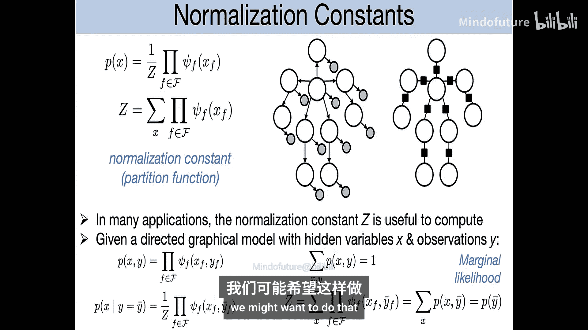

All right， so well how could we do that so the top of this slide is just the same some product algorithm exactly like we talked about before okay。

And then， you know for any node， right， we can a kind of induction argument。

 this is kind of I talked about this last time and sort of the explaining why somepri was correct。

That if I take the product of incoming messages， then that will be a equal to basically I take my potentials and that's equal to the sum over every variable except node S。

Right so if I take like the incoming message to x1。

 that will end up being the sum over all the other variables except that。And thus。

 if I kind of propagate messages up to some node， any node I want it won't matter if I take my model and I propagate messages up to one node like let's say X1 and then I sum over this message product。

That should get me the normalization constant。Okay。

 so if I just kind of take my message product and sum over the last right that gives me a function of excess and then if I were to just compute the sum of those values kind of the normalizer I need to get the module that would also be this global。

Normalization constant okay。Okay。However， although this would work fine。In this model。

 there's going to be a。Practical problem if I had a much bigger model if I had a model with dozens or hundreds of variables。

 this might not actually give me the right answer if' my computer does anyone have a guess as to what the issue might be。

Well。The thing you need to keep in mind is that on a computer。

 right we this is these equations that I've written down are true if you think about you know representing sums and products exactly as real numbers。

But in a computer we don't do that right we represent them using you know there's floating point representations of numbers that use a finite number of bits right you might use either 32 or 64 bits to represent that a floating point number。

and you know depending your representation and what happens is if I take a you know。

So suppose I start with a sum number like like five and I start multiplying it by numbers less than one like I multiply by 0。

1 and I multiply by 01 again and 0。1 again right well in you know real arithmetic that gives you a sequence of numbers that's steadily decreasing okay。

 but is always positive。ふ。However you do it on your computer eventually after you do that multiplication。

😊，I don't know on the order of like 15 20 times you know eventually that number is going to get so small that it'll just underflow it and it'll say it's zero so instead of being like a small puzzle number it'll say it's exactly zero so it'll underflow to zero。

And so you can imagine if I imagine like I had a directed model so all my numbers of my potentials are like between zero and one。

 if I do lots of these subp updates， they get smaller and smaller and smaller and eventually I start getting numerical problems where things like underflow to zero。

Okay。You you can identify this in the code because if you might start to see like you know warnings of like dividing by zero or things like that of invalid numbers right because what' will happen is everything will underflow to zero and then you when you start to other updates you get bad behavior okay so。

The workaround for this is that when you implement the some product algorithm。

 typically what you do is after every message update。

You have this vector of positive numbers and then you go ahead and basically normalize it so it sums to one。

So like if I have this message， I'll call my normal message update here like an M prime。😡。

Then what I do is I just compute the sum of the values of that message。

 and then I sort of renormalize it so it sums to one。Okay。

 and then I do the same thing for this message update right the normal one is like this M prime and I get M by normalizing m prime so it sums to one。

啊。Um and you know why sum to one， well there's an interpretation of suming to one imp probabilities。

 which is convenient and also kind of like， you know。

 one is like right in the middle of the floating point range in a computer right you kind of if you get really small numbers they over underflow to zero and really big numbers。

 they like overflow to infinity。Okay， so。so anyway。

 this is just something that you do and it's a kind of thing that like on a little graph with a small number of variables it won't matter。

 you'll get the same result， but if on a big model you can start getting wrong answers if you don't do this normalization due to numerical issues okay。

All right。嗯。Okay， so now this is like an issue if I just want to compute marginals that I need to do this normalization。

 but now what if I want the normalization concept right now if I'm doing this normalization at each step。

 then that equation I showed you before about getting the global normalization concept will no longer hold。

Okay。However， it turns out there is a trick that if you wanted that global normalizer you can still get it。

 I think it's easier to show this by an example。Okay。😊，All right。

What I told you before is that if I wanted to compute the。😡。

normalormalization concept what I could do is I could sort of take my distribution。

 I could sum over x3。That would give me this M32， sum over x4， that would give me M42。

 then I sum over x2。And then that gives me the message to node one and finally if I sum over node1。

 I would get Z the normalization constant。All right。Now。

 let's suppose that you to be you know numerically robust。

 you want to after you compute each message， you want to normalize it。As so it sums to one。Okay。

So that would look like this， right after I compute。😡，The message from four to two。

 I normalize it by some constant， I'll call it z4 for variable4 so it sums to one when I compute the message from three to two I normalize it so it sums to one or I compute this message Iize it so it sums to one I compute this normalize it so it sums to one。

Okay。And now you think about I have you know these one over z's and now if I multiplied by those same z's out here。

 I would I wouldn't change the result right this would still be equal to this Z here thinking about I've kind of like multiplied by one right the so I multipied by Z1 z2 ZZ4 and also divide by Z1 z2 Z3 Z4。

Okay， and now if I wanted to compute the overall Z。😊。

It would be equal to the product of these local normalizers。

And then something you would typically do for robustness began to kind of like not underflow overflow as you would say the log of Z would be the sum of these log normals。

Okay。So you don't actually have to do this in your implementation， you know but。

In the sense that we don't for the homework， you don't have a need to compute the Z。

 but I'm just telling you you could do it if it was useful to you and it is a good idea to do this sort of normalization of your message updates。

Um。To avoid underflow okay？Any questions on that？Okay。All right。

 so those are kind of the last details in some product。And so now at this point。

 our biggest limitation of the methods we've talked about is that it assumes the graph is a tree。

And of course， we're going to be interested in many models that are not trees。

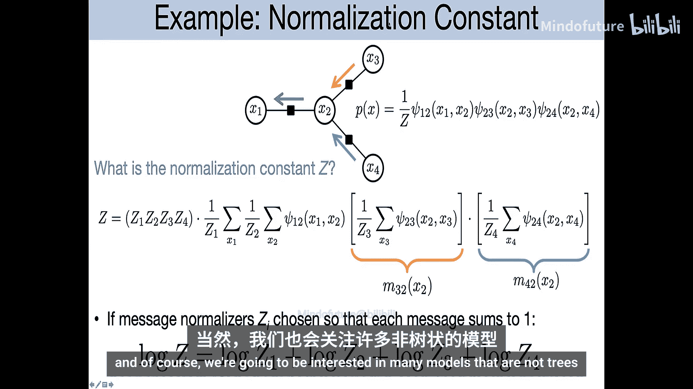

嗯。😊，I want to。shifthi here to talking about how we can deal with graphs。With cycles。All right。

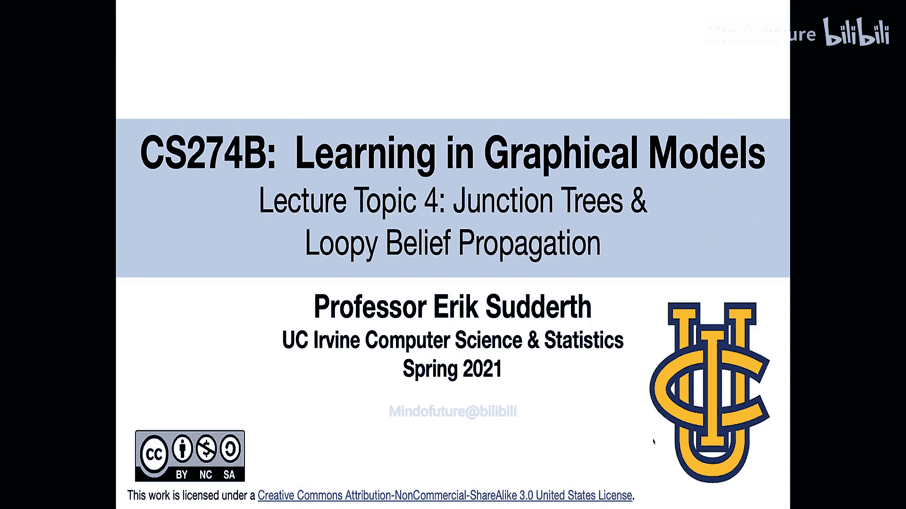

And so。嗯。So I'm going to talk about。Two perspectives on graphs with cycles。There's， there's kind of。

诶。Two ways that we can look think about graph with cycles。

 one is that we convert the graph with cycles to a equivalent tree。And then run。

The same algorithm I've been talking about on that tree。And this will give me the exact marginals。😡。

But there's a cost in that when I do this conversion。

 I kind of end up at a model where the variables are bigger， they take more model。

 take more possible values， and so computation cost goes up。

Okay and that's what the junction tree algorithm does Okay so we're going to talk about junction tree and lead into it and then this the latter part of this lecture i'm going to come to a different method。

 this loopy belief propagation method， which。Doesn't do this conversion。

 kind of runs a message fetch on the graph of cycles。

 and so it's faster but gives answers that are approximatex。

 so it doesn't give me the exact marginals， it gives me an approximation to them。Okay。U。Let's see。

So there was a actually I just saw there was a question I think about the last part about。A factor。

Connecting to nodes and so I think this is in relation to the normalization constant material to。

Keep that that example to keep it easier to understand I did the special case where are the factors connect to nodes。

 however， if I had。A model where the factors connect more than two nodes you could still compute the normalization constant for those models using a related approach so it's a little messier to write it down。

 but you could still do it okay and when you implement。

If you have a model where it's not pairwise where the factors spread multiple ways。

 this idea of normalizing factors， normalizing messages so they sum to one is still a good idea。

You still have the same numerical problems？Yeah， so that last bit of that slide was one of these。

 you know， look at a special case because it makes it a little easier to see what's going on。

 you could generalize it。Okay， all right。All right。

 so to get to this something called the Junction tri algorithm。

 I need to talk about a slightly different way of thinking about the elimination algorithm from what I emphasized。

Before。And the kind of way that junction tree is most classically presented and emphasized is using undirected models。

Random factor graphs so again remember i'm going to be switching gears now to this undirected model where I have a set of nodes and then I have a set of cleaiques these are the fully connected subsets of the nodes so for example like in this model x1 x2 x3 or a clique。

This there's an edge between all pairs。And then my distribution is a product of potentials on all the cliques。

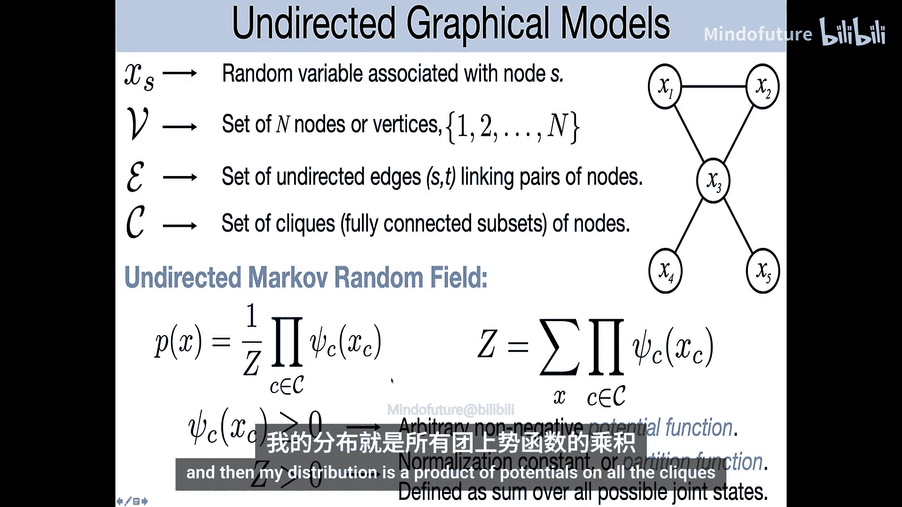

，All right。Okay。All right。And you can think of the junction tree as kind of a method that kind of like sort of says。

 well， there's really strong dependencies within a clique。

 and so I'm going to kind of think of making larger variables that are kind of like all combinations of variables in the original model in the clique。

Okay。And so here's the idea so i'm going to make for each cl C i'm going to make a variable z sub C that's basically like the set of all variables that are in。

😊，You know that are members of that clique right so like for example in this model I would have a Z123 would be a variable that would like takes。

 you know all possible triples of x1 x2 x3。Like so if these were binary Z12。

3 would take two cubed or eight possible values， it's like basically all x1 x2 x3 combinations okay。

And then I have another clickique， like I have an edge， a clique it's x3x4。

 so there'll be a variable Z34， which kind of takes all possible x3x4 pairs。Okay。All right。

 and so here's what I'm new so imagine here I'm going to have I have these three cliques。

 so I'm going to have these three three z variables and then I'm going to say my distribution of theses is going to be the product of these potentials evaluated on the Z Cs okay。

Now one first thing to think about is this are these the same distributions right if I sampled from this distribution。

And then just， you know， there was like a correspondence between the Z' and the x's。

 would that give me the same thing as if I sampled from this original？P of x distribution。

What do you think？I mean， they have the same distribution， right？So。So I think I think it's a yes。

Yeah。So that's kind of the the。The wrong answer i've tricked you into so thank you so if you think about it they're not quite and here's the thing right so。

look at x3， x3 is a part of all three of these cliques。😡，It's a member of this x1x2x3。

 and it's also a member of x3x4。So if I sample from here。

 there'll be kind of one value of x3 and Z12，3。And another value of x3 and z34。

And they might not be the same。So it's a different distribution because I have these multiple copies of x3 running around that I haven't set to be equal。

嗯。So。嗯。😊，So we've had these multiple copies of the variables。So。Here's so I could correct that。

 right I could say。I take all pairs。Of cliques。Okay。

And I add a new I'm going to call this phi right so here this was Pi in the original potentials I had these new potentials phi which are just consistency things。

 so this phi basically says that you know click C and D if they both have a copy of the same variable。

 then those variables basically have to agree。So I'm going to rule out cases where the copies of the variable are not consistent with each other。

Okay so I'm like making extra copies of variables because it'll be simplifying my life later。

 but I need to be sure that they they agree with each other。

Okay so that's kind of what this says in a complicated way it says that you know the if S is in both cliques C and D right so it's in the intersection of C and D so like in this case this variable3 is in both of these cliques。

 then I'm going to have this constraint that basically says you know it's one if if the copies take agree with each other they take the same value and zero otherwise so I'm saying it's impossible to like have your copies of that variable disagree。

Okay。All right。So now this。Now if I were to sample from this distribution。It would。

Define the same joint distribution， but now the problem is is right I have this consistency constraint between all pairs。

Right so there's an edge here that's where these edges here are coming from is these consistency constraints and you know if youre think about that's basically like a fully connected graph so that that'll be kind of。

Maybe not easy to deal with。Okay。Okay， however， I can take advantage of one more thing， right？

In this case， I have three copies of this variable x3。There's one in this cl， one in this cl。

 one in this cl。And remember the equality right， equality is a property called transitivity which is a really simple property right it says if A is equal to B and B is equal to C。

 then a has to equal C。Okay。And so what that says is that like if my copy of x3 here is constrained equal this one。

And this one is constrained equal this one。Then these two copies over here must be equal to each other。

 even though they're not kind of directly constrained。😡。

They're indirectly constrained by this path in the moment。Okay。And if you look at it。

 now I have what I want， I have a model that this defines the same distribution。And it's a tree。系。

And so now if I did inferencevers in this model， I could use my tree structured algorithms and get the exact。

Marginals。Okay。😊，All right， so now kind of the questions that come up is all right， okay。

 fine you show me this one example， but you know how many you know edges do I need for this kind of global consistency and when can you build this like。

You know，T structured Cea graph， when is this possible to do， when is enough？

And there's so there's some very nice theory about this and this leads to something called the。

Ajunction tree algorithm。Um。And so just to give you a sense of where we're going here so this is a topic that there's there's a lot of kind of like interesting graph theory and things that show up into it there's actually some other courses taught by some other like professorfessor Dter here at UCI that really go in great depth on this and I'm so I'm intentionally in this class not going great depth I'm just going to give you kind of like a high level view of how this works give you some intuition for what the results are but i'm not going to be proving things in this part okay。

Just so you're aware， this is going to be more like a bird's eye view of what these algorithms looks like because it's good to know that they exist and can be used。

嗯。Okay。Sorry， excuse me， before you move forward， can you repeat again how we define a click？

TheSo the click of nodes， I mean that a click of nodes is a。

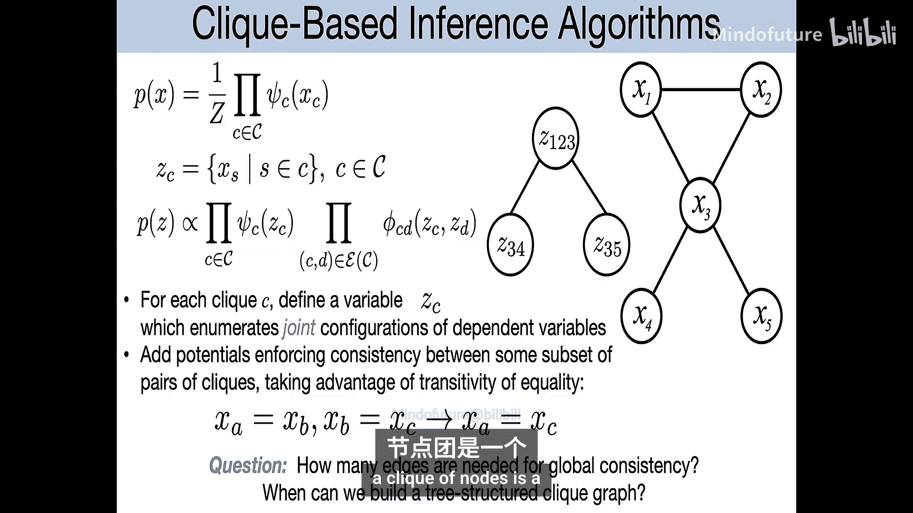

A fully connected subset， so it's a set of nodes in which。

All pairs of them have an edge between them。系 right。

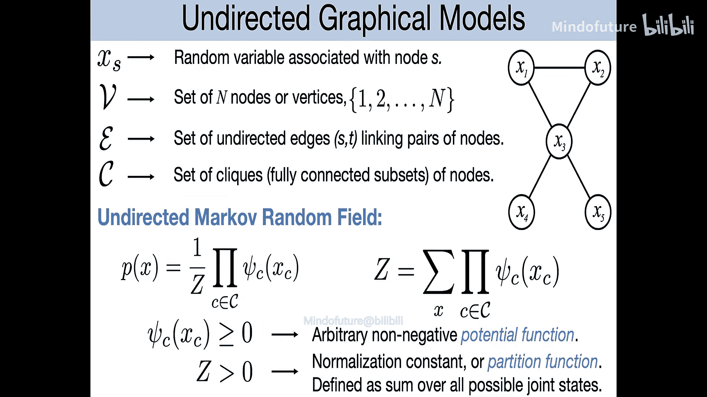

And so these three Z's， these are the maximal cliques of this graph right so x1 x2 x3 is a cleaique because there's an edge between all pairs。

And if I added any other node to that set， it would no longer be a clique。Because for example。

 there's no edge between x2 and x5。So cliques are like kind of dense subgraphs where there's like an edge between all pairs。

は。Yeah， thank you so。嗯。And again， so like a clique。

 right that's a clique is like a concept that comes from graph theory。

Nothing to do with graphical models right and it's used in lots of other ways and other parts of graph theory。

 but it turns out for these undirected models。Because of the markout properties that we went through before。

 there's this connection between cliques and factorization and that's why they show up here。Okay。

All right。Okay。Okay。So we talked about。It's elimination algorithm before。That sort of said that。

If I eliminate variables one by one what am I going to do right if I I'm going to take a variable I want to eliminate and I am going to when I marginalize that。

I make dependencies between its neighbors in the graph and I can represent that by kind of adding an edge right so if I marginalize node six。

Because there's a relationship between x2 and x6 and x5 and x6。

 that's going to add a new dependency or edge between x2 and x5。Okay， okay。And so I make。

There's going to be a three way clique involving x2， x5 and x6 that's generated when I eliminate。

Note6。And so now if I think about writing this on。A model eliminating one by one。

 right when I eliminate x6， I add this edge。And now I'm to this this simpler graph where x6 is removed。

 but now there's a dependency added between x2 and x5， okay？And now if I take that。

 if I eliminate x5 that will add an edge between x2 and x3 right and then when I eliminate x4 I don't have to add an edge right there's no edges induced and I can eliminate x3 eliminate x2 and so on so you about this process of graphical process of eliminating nodes and adding edges to all their neighbors。

And so。There is the elimination algorithm implicitly generates a set of cliques。

 so if I think about it as this algorithm runs there are these sort of cliques that are generated there's one here that involves nodes two five six。

And then I have a next one that involves nodes。2， five， three， sorry。

 and then the next one that involves nose42 and so on。嗯。

And so what I've drawn here is all those cliques right， this is the clique when I eliminate node six。

 the clique when I eliminate node five， clique when I eliminate node4， cl when I eliminate node3。

 cl when I eliminate node two， then eliminate node one。Okay。Okay。

So these are the fully connected subsets that are generated as this thinking about if I run the elimination and just keep track of where I have to add edges in the model。

 I could figure out what these these cliques are。Okay。Okay。And then Profe good question。

 so I think last class we discuss something about。Like the efficiency of the aliition order affecting the computation right so I think the previous slide eliminated like the six not six verse right。

 but not four has like the lowest degree if I see there because it's also only one degree so that is like the optimal order。

 right？U。It turns out that it doesn't。Matter because kind of node for in this case。

 if I go back node。嗯。Well so first right now i'm just saying some elimination order will generate us instead of cliques that's all i'm saying and if you pick different elimination orders you will get different sets of cliques and the size of those cliques will depend on the order and that is definitely true so why making now is you can think of any particular elimination order' generated instead of cliques。

To your specific question， in this case， you're right that if you eliminated the smallest degree first。

 you would start with X4。In this case， eliminating x6 verse is equally good kind of because the reason is that an x4 is kind of dangling by itself。

 so if I eliminate it。X6 and then x5 and then x4， it's kind of no different。

What would be a bad idea in this case would be if you。呃。Let me see， I think if I started。

Actually actually x2， if I started by eliminating x2。

 that would not be a good idea because then you would kind of add a bunch of edges。か。

And so that so anyway each of these orders gives you a different set of cleaiques and now what's a clique tree well it it's basically a tree where the nodes are the cleaiques and then you've added edges and so right that's why I haven't told you how you should add those edges okay and there might be many trees for a set of cleaiques but so' that's what this is this is a set of edges connecting these cleaiques。

Okay， so that's a clique tree。嗯。Sometimes when we look at these。

It's interesting to look at what are called the separator sets and this is member each clique。

Has a subset of variables。The separators will say for each of these cliques。

 I've connected by an edge， I just sort of say which variables do they have in common？Okay。

 thinking about like here I have x2 x5， x6， x2， x3， x5。

 these have these two cliques have two variables in common， x2 and x5。Okay。U。And these two。

Similarmely， if you look at these two cliques， they have two variables in column x2 and x3， okay？U。

And these are in this world kind of drawing with squares。So I'm sorry。

 so this is although this is using squares， this is these separators are different than what the squares mean in a factor graph。

 okay， so although this is using squares it doesn't mean the same thing。

It's it's one of these things where you know there's only so many shapes that people can usually draw on a piece of paper so the you know there's circles and squares and they sometimes get reused for different things in different contexts okay so so again so these ovals or circles are representing the cliques clusters of variables and these squares are representing the overlap between them。

啊。Okay。U。It's not clear right now why I'm doing this I confess right that's coming right now okay so this is just to give you like a way of thinking about what that elimination algorithm did and now I want to show we can do something useful with it。

 which is this junction tree algorithm。Okay and。嗯。😊，so。嗯。

Here's the big picture of what we've done Okay， so remember we talked about if I had the elimination algorithm。

That was。A way to compute the marginal of one variable。

 you ran elimination and it gave you the marginal of just one variable at a time。

And that could be applied to either a tree。or to a graphless cycles。

 in either case it gave you the right marginal， but it would be particularly efficient for a tree and could be computationally expensive for the graphless cycles。

Okay， then the belief propagation algorithm said， well。

 let's suppose I have a tree and you don't want one marginal you want all the marginals。

 then this someproduct or belief propagation can give you all the marginals efficiently in a tree。😊。

Okay， and so the junction tree algorithm is something that's sort of basically saying。

 let me get all the marginals efficiently， even though my graph has cycles。😊，Okay。

And you can think of this as basically， what is junction tree， you convert your graph。😊。

Your original graphical model， you convert it to a special tree of cleaiques。

Which is called a junction tree， and then you run belief propagation on that tree。Okay。

 so the idea is I want to convert my take my model that has cycles。

Convert it to an appropriate tree so that then I could run this belief propagation I already understand and get the right marginals。

Are there any questions about the strategy， please ask because。

I'm going to get into details and it's good I want you to give you get a sense of what the big picture is。

O。Okay。Okay。So。Now a clique tree， there's a property that's called the Junction tree property， okay？

And here's what it says， the Junction tree property says if I take。

Take any variable from the original model and look at the cl nodes that contain that variable so the subset of cliques so like like you could pick like I don't know let's say。

X3 and you can say find the set of cliques that contain x3 in this case there's。Two of them。

This one has x3 and this one has x3 and those cliques are connected。And the model。Okay。😊。

Or let me pick another example， if I pick like x5， right there's two cliques that contain x5。

 this one and this one and they are also。Connected。There's two cliques that contain x1。

 this one and this one， and they are connected。Okay。And so kind of going back to my example。

 the very start of the lecture， I could represent。Their distribution kind of ignoring redundant constraints right so if I constrain like this copy of x2 equal this one。

Sorry， or this copy of x3 and equal this copy of x3。

 then that would be sufficient to make sure everything is consistent representing the right distribution。

All right。Okay， so that's the junction tree property now note not all cl trees are junction trees。

So this is a clickique tree that does not satisfy this junction tree property。

RightThere's a variable here where the kind of。Copies of that variable are not constrained to be consistent。

 does anyone see which variable it is？Is it the x to x form？No， well。

 so this is it's the consistency is about single variables Exp4 is okay。

 x4 is only in a single clique。X2 is also okay because x2 is and actually in this case。

 every one of these cliques。U。So there's kind of a copy of x2 everywhere。

 the one that's a problem is x3。So there's a copy of x3 here。And a copy of x3 here。

 and then these two things say nothing about x3。是。So this tree would kind of not represent the right distribution and represent a distribution where they were like。

The thing that was x3 in your original model， there were two copies of it and kind of you know。

 one copy interacted with one part of the model and one copy interacted with another。And。

And that's not the same distribution， so it we't give you the right results okay。不か。

So this is just this junction tree definition， okay？And so here's a slightly more formal。

Definition right so a clique tree is a junction tree if for every pair of cliques V and W。U。

 all cliques on the path between V and W and notice' a unique path because it's a a in a tree because there's a unique path between the two pairs of nodes。

Then all cliques on that path contain any shared variable。Okay。😊。

So like in this model right there are four cliques the cliques are all just pairs of nodes there's no there's no triple of nodes that's fully connected and so here's one。

Tree。Um that is。嗯。Not a junction tree。So which variable is violating this junction tree property here？

C， right C。Yeah， exactly there's a C here and a C here。Um， and you know， no。Good， all right。

 so then how should I redraw these edges to make a junction tree on these cliques？嗯。

To just slow a edge from A the city， right？So I could add an edge here。

 but then it would no longer be a tree。So then I have to take away one of the other edges。

But if I take away this edge， you'd violate the junction tree property for D。

 you take away this edge， you'd violate it for B， you take away this edge， you'd violate it for a。

 so you can try to draw all the trees you want， you'll find that it's impossible to make a junction tree for these cliques。

There's no way you could do it。Okay。😊，So all right， so now I have this problem right。

 how can I find a tree that has this junction tree property？

And how can I be sure that at least one exists because in this case。

 it turns out that it doesn't exist。Yeah。And it turns out that the way that you generally make junction trees is that you take your graph and you augment it with additional edges。

So suppose I take this graph。Okay， and I add an edge。But when I add an edge， the cliques get bigger。

 you can never like you can never like you know， shrink the size of a like remove a clique by adding an edge when you add edges。

 you just like make more things connected and add more cliques。

And so if you think about it if I add edges as the original distribution still factorizes over this edge or the extra things。

 but now my clickiques are bigger。In this case now I would have two cliques that have this ABC and this BCD。

 and if I connected them， I could have a simple tu node tree representing the distribution。嗯。Um。

 so basically the idea is that what you can do is you will add edges。

 hopefully not too many to make the cliques of the model a little bigger until it factorizes。

To be able to construct a junction tree， and then you can run your tree based。Inference。嗯。

And now there's a question that comes up with okay。

 which graphs have junction trees like I I sort of。I didn't prove it。

 but it would be easy to check by checking all trees that these nodes have no junction tree。

 but when I add this extra it does。嗯。

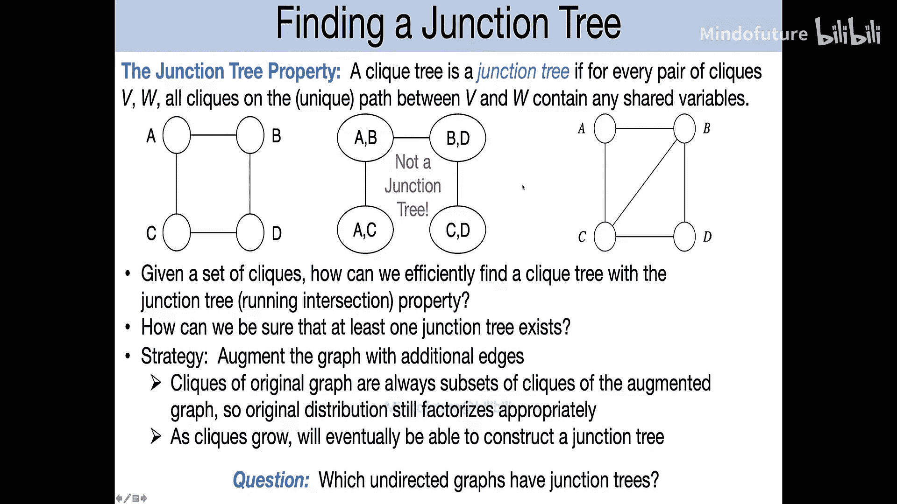

And。Okay， and well the interesting part is that there's this is kind of a something that has this simple kind of graph theory。

Answer。All right， so again so this is like when I add this extra edge。

 this is the junction tree I can now make， I can say oh there's a click on ABC。

 a clickique on BCD and they're connected by an edge。They share BC income。好的。Um。So。More。呃。

Term is from graph theory these these for some of you will dissolve earlier stuff for some I know it's a little new and so in a graph a chord。

Is an edge between two non adjacent nodes in a cycle。

 so if I take a cycle like a to B to D to C back to a。

Then this like edge from B to C would be a cord。Because it cuts across it。Okay。😊，Okay。

A cycle is chorless if it contains no chords， okay， that's intuitive enough。And a graph is。

Triangulated or cordal。If it contains no cordless cycles of length。Four or more。Okay。

 so basically this says that if I in a graph that's triangulated。

 if I find any cycle of length four or more， there has to be at least one edge that kind of shortcuts the cycle。

Cuts across it。Okay。😊，And it's called， I think the reason this is called triangulated is because if you have like a planar graph when you've drawn in a piece of paper。

 when you triangulate it， you tend to get lots of like triangles。Like you can see here。

 when I triangulate this graph I adding an edge， I get these two triangles。In的 in对。All right。

 so here's the big theorem。The maximal cliques of a graph have a junction tree， if and only if。

The graph is triangulated。So if you say how many edges do I need to add such that I can make a tree and do exact inference。

 I basically have to add enough so that I have this triangulation property。Okay， no more。And no less。

U。And。There's there's kind of actually a pretty lovely proof for all this and but it gets a little involved and so I'm not going to talk about it at all if if you have some background in this stuff I encourage you to look at you know some of the readings there's it's not craz involved but you know it's a few pages to sort of establish this。

U。嗯。So。So here is an example。Of a graph。And this graph is triangulated。Okay。

And you can see that because if I take any long， like if I take the cycle like B to A to D to C back to B。

 there's an edge that cuts across。Right？So if you take any cycle and you can kind of see right it has this sort of like shape of three triangles put together。

Okay。And so then。The maximal cliques the sort of largest subsets of nodes where you can add another and have it be fully connected there are three of them here these three triangles right so I have AB D。

BCD and CDE， these are the three cliques of this graph。我看。All right。All right。So。And。Okay。

 so I told you that if the graph was triangulated， then there has to exist a junction tree。

But only one of these two。Trees on these cliques is a junction tree。Which one's the junction tree？嗯。

Okay。I see the far left one。Well it's at comparing these two things on the cliques so kind of the this one and this one so it turns out it's not this one here。

And the reason it's not this one here is because I have a copy of B here and a copy of B here whereas no B here。

 so there's kind of these two copies of B are not， there's no B on the path between them。

Whereas this one does？Okay， so this one on the right is the junction tree and you could check that by sort of saying。

 okay， there's an A A is only here， B the B copies are linked by an edge。

 the C copies are linked by an edge。There's a D everywhere。And so on， okay that's how you verify。Now。

 what do you notice about these separators here？Comparing here and here。

Well if you look at it right in this tree on the right， there's kind of。

I've picked my edges to connect。Cleiques that have more variables in common。Right， so like here。

I have an edge， each of the edges are between cleas that have two variables in common。

 whereas here there's only one variable in common。Right are you going about it？On the right。

 I sort of like said， let me， I'll put edges between the top and the middle triangle and between the middle and the bottom triangle。

And whereas this thing that's not a junction tree， I said， well。

 let me put an edge between the top triangle and the bottom triangle that only have a single variable of common D。

And that's kind of。If you think about if I want to efficiently represent like consistency constraints。

 that seems like maybe not the most efficient thing to do。

And thus you end up not actually representing all the constraints you want to。Okay。So。嗯。

So billion is a tuition， there's actually a cleeique tree。

Is a junction tree if and only if it's a max weight spammning tree。

So I don't know if I know all the folks who've totally like had undergrad CS algorithm and seeing Max expandingning trees。

 but some of you may have not。UA Max weight standing tree says I have some graph and now there's like a number on every edge。

Okay。And these are like positive numbers set， and now what I want to do is I want to pick the tree structured subgraph such that the sum of the weights。

 the sum of the numbers on the edges is as big as possible。Okay。

And it turns out you can do that very efficiently， a greedy algorithm is optimal。

 so you start by you taking the largest weight edge and then you take the second largest weight edge that connects to it and then the third largest weight edge that doesn't sort of you know make any cycles and so on。

 so if you just pick edges one at a time greedily you can solve that optimal。

And that turns out is also the optimal thing to do if basically I say I have a make a graph where the nodes are the cliques。

😊，And the edges， the edge weights， are going to be the cardinalities of the separator sets。

RightSo if I think about for this original graph right so this edge would have weight two。

 this edge would have weight two， but this one over here would only have weight one。

And then I find basically。Maximize the sort of like these cardinality separator sets。

 how many variables they share， and that will give me my treat okay。Okay。

 and to turn out this algorithm is。At worst quadratic and a number of maxal cliques。

 it could be faster depending on kind of like the structure of the cliques。

 so it's somewhere between linear and quadratic depending on the。But the original graph。

A structureuc looks like。Okay。All right。So。嗯。So。Here is now the kind of junction tree algorithm at a high level。

 and then I'll go through in picture as it says。First， you triangulate the undirectected model。

 you add edges。Right until you have this triangulation property。

Any elimination ordering generates a valid triangulation so if I just。

Eliminate pick an elimination order eliminate the node one at a time I will get the。

A triangulation and so that's just linear and graph size， so it's easy to get some triangulation。

However， if you say。It turns out that if you say， you know。

 find the triangulation that minimizes the like size of the biggest clique you generate。

Which is what you'd want to do here to minimize computational complexity。Doing that is NP hard。Okay。

 so you can't do it optimally， you'll have to use the heuristics， but there's reasonable ones。

Then you arrange the cliques in your triangulate graph into a junction tree。

 and this is this kind of like find a max spanning tree， it's at worst quadratic in the graph size。

And then you execute the sub product algorithm on the junction tree now I have a tree and I thinking about now I have that tree。

 you just run the same sub product we learned about last week。Okay。嗯。All right。Right。

Let me walk through this and another example with some kind of。啊。Colored， colorful pictures。

So if I imagine that I have this graph here and and I eliminate nodes one at a time and I figure out the cliques that are generated as I eliminate right so as I eliminate。

Nodes one at a time， I will get like a clique of three nodes here when I eliminate F。

 two nodes when I eliminate D， three nodes when I eliminate E。Three nodes when eliminate C and so on。

Okay。Okay。And now I make。A。Graph where the nodes are these cliques all right so there were these。嗯。

This this one is a subset of this clique so I can kind of ignore it for inference purposes。

 it turns out。So there were these kind of four cliques that are not subsets of others。

This sort of like light blue， the green， the purple and the red and that's what these four colors here correspond to so I have these four cliques。

And then between every pair of cliques， I have an edge that says how many variables do I have in common？

Okay。And then you know， many of these cliques have one variable in common， everybody shares B。

 and then some pairs have two variables in common， right like the red and purple。Share both B and C。

Or the purple and blue share both B and E。Okay。And now。I find a。Max weight spanning tree。Okay。

 so that says a tree that connects these where the sum of the edge weights is as big as possible。

All right， so here these bold edges is one max weights magnitude is this unique？

No it's not so if you think about it right here， if I want to have any tree I have four four of these cliques。

 so any tree will have three edges。If I want to maximize the weight so I have to take these two edge of weight two。

 but then I just need any third edge of weight one that is still a tree， so I could pick this one。

 but I could have also picked this one or this one。Okay。

 so those would be like other ajunction trees。That would like use different cluster of variables。

 but would still give you the。It'd still give you the right marginals。

 but they would do it in a slightly different way。Okay。And so now I have these clusters of variables。

嗯。Right and so this is the junction tree， these are these separators that show their intersections。

As I said， that there'd be multiple。Valid。Junction trees， okay。

Are you any questions on that on kind of like this view and pictures of how it would work？O。Yeah。

Here's a bigger example， so I have this graph。Up here。All right。And now we have to eliminate。

 so let's suppose we start by eliminating A and E。Okay， then well in that case。

 I don't have to add any edges。But then if let's suppose that next I eliminate BMD。

Then when I eliminate B and D， I am going to generate extra edges right when I eliminate B I'm going to have to have an edge between all of its neighbors so there'll be an extra dependency added between CF and that's what's drawn there。

Okay。And then similarly， when I eliminate D， I'll get this extra edge between C and I。Yeah。

And then I think the next step they do is they like eliminate。嗯。Notode I and if I eliminate node I。

 you can see I'm going to have to add an edge between C and K。

There's no edge between C and K and the current model。

So if I that's what happens here I limit it note to I， I add that c to K edge， I eliminate F。

 I add this。See the Ja， okay。Then I eliminate G andH and so on， and so this is my triangulated graph。

咁。And then。This would be the junction tree or that graph。

So this has a bunch of cliques of in this case， there are little bigger cliques。

 there are cliques of size。F right you have these groups like have say D EHI。Oh， sorry， not those。

 but ChiI like CDhiI is a clique like that's four nodes where all pairs are connected。

So that's there。Okay。And you can see there are a range here in a tree that has this running intersection property。

And now I can do things on this tree。And get。Marginals of the variables in the original。冇。Okay。

And I kind of want to gloss over the details of how how those marginals work。

 but I will just sort of。嗯。Say that so this tree is one in which there are just these pair wise relationships so I can look at that simpler kind of pair wise version of the some product algorithm。

 This was my pair wise。Some product algorithm。系。So now I want to apply this。Two。My junction tree。咁。

And remember， so in the original graphical model， the nodes were like random variables and then the cliques were groups of variables that the distribution factorize over。

And now。In the junction tree， the nodes are cliques right in my again。

 looking at this color correspondence。No the cliques in the original model get mapped to nodes in the junction tree。

 so that again think of as just like clusters of variables。

 groups of variables that are strongly dependent。Um。Then at each node in the tree。

 there's a variable which is like all joint configurations of the variables in the original model。

Right so like at the green node its state is like all possible Bd pairs。And at the blue node。

 its state is all possible BEF triples。Okay。😊，嗯。And now I just want to run the junction tree algorithm and so you could。

You know， just run the code like you've you've created for you're working on like for homework one on this junction train you would get。

The right marginals， however these consistency constraints are very special right they're these zero ones right so there's zeros for a bunch of things and ones for where they're consistent。

And so if you exploit that， you can kind of like simplify some of the equations and make it little nicer and if you。

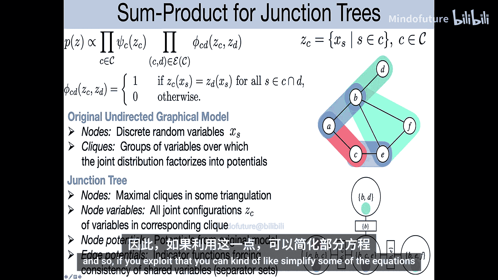

Do that it looks like this you get this algorithm that looks a lot like what we've talked about。

 so to get the marginal for a clique， I take the potential for that clickique time times messages and these mus are write messages。

From all my neighbors。In the junction tree。And the messages。

 it turns out only have to depend on the separators on the variables they share in common。

So when this clique sends a message to this clique， it's a function of B and E。

 the variables that they have in common。Okay。And you get the messages by kind of the same some product form。

Okay where this R that I'm summing over R is like for remainder so basically like to send a message from this blue to purple。

 I have to sum over all the variables that are not in their intersection。

 which is like so I sum over F because that's in blue but not purple。嗯。So。嗯。

Okay and the the computational cost of this ends up being essentially order you know I here I have the sum over all the cliques and here I have the basically the product over all the variables in that clique of the number of states so basically it's kind of you know。

number of operations is like the number of joint configurations of the variables in each clickique。

 so it's basically exponential in the sizes of these cliques。So。

May or may not be tractable right it depends on when I triangulate my graph how big the cliques get。

So somehow， if I have a graphical model that is not a tree， but is like close to a tree。

 this could be very efficient。And if I have a model that's very far from being a tree。

 although in principle this would give me the right marginals。

 it might be just completely intractable， impossible to run on any practical computer。Okay。Yeah。

So and then here is kind of the overall summary and and so again you know I kind of I think the junction tri is very important thing to be aware of。

 you know we're not really going to be we're not going to be implementing it we're not going to be stressing over the details and again。

TheWhat I encourage you to remember it as the takeaway is that one way to do inference in a graph with cycles is to essentially cluster the nose。

So that。The clusters form a tree and then do believe propagation on the tree。

And that is what the Juncction tri algorithm does and there's kind of some nice graph theory that tells you you know how much do I have to cluster and so on。

 so there's kind of some nice like mathematical graph theory results that you can exploit this in the implementation。

嗯。But。Probably more probably more of a thing to be aware of is like a black box that's available to you right that if you have certain models you could use。

An implementation of junctiontry to get marginals。Okay。

Oh one other thing I just want to mention right here I have a marginal。For each click。

But now let's suppose I care about， you know， what is the marginal distribution of like？You know。

 variable C， I want to know what is the marginal of C。Well。

 there's a copy of variable C here in the red clique and there's also a copy of it in the purple clique。

And so some them I have two copies of its marginal distribution。Um。

 but the point is that because you've done this junction tree， if you you know。

 once you've done your computation， if you if you ask say you know。

 what is the marginal variable C and。In the red cleaique， or what is it in the purple cl。

 it'll be exactly the same thing right up to numerical precision。😊。

So because you're giving the assistant， it doesn't matter。Okay。All right。

 so that was at the end of my intentionally fast tour ation trees。Any questions on that？Okay。

I have a question about， I think it was right before we got into junction trees where you were talking about the factors to make sure the variables agree。

Umm， it's probably just an notation thing， but I'm not sure why that sum or that product wouldn't always be zero。

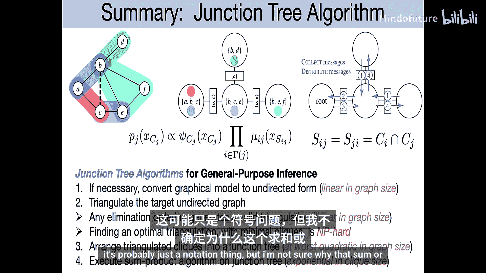

Because one of those factors are guaranteed to be zero， right？

You're talking on you're talking about I think it's this is the same equation here， right？No。

 so so just just think about it like for every one of these。

It's sort of like one of these like constraint satisfaction things that we talked about right so thing about it is like you know。

Basically， like let's look at variable。异。Or let's let me look at let me see which pair let's look at like the edge between B EF and BC so these are these cliques have。

You know， for any setting of Z， that's some value of BEF and some value of BCE。Okay。

And then so basically this potential evaluates to one as long as these two cliques basically set B and E to the same thing。

Okay， and so that。It's not like it's going to be the case that you know this is going to be zero for all combinations。

 but it's going to be zero for some combinations。Aren't we taking a product over all of them？

Ca I know what this notation means。You're taking the product is not over all possible values of Z。

 this is over a product over all edges in the graph。For a single value of Z。Okay。Right。

 so in this product。UThere are like。For this particular graph here。

 this second product only has three terms。One for each of these three edges。

And then this first product has four terms。One for each of the four cliques。咁。嗯。And then， you know。

 let's imagine that I set。All all of the very like one possible configuration was that all the variables of my model are zero。

 well in that case then you know as long as my you know my hypothesized configuration for BE and this one and for BE and this one are consistent then this will evaluate to one。

看。This is equivalent， by the way， to saying。嗯。Some overtake all joint configurations of the variables in the cliques。

And then。When you compute your marginal， throw away the ones where they're inconsistent where they've kind of said that a variable was。

 you know， took two different values at the same time and only keep the ones that are consistent。

That were all copies of a given variable are。Set to the same thing。Okay。哦。

Okay I mean so this is kind of I mean a metacom here this is like this consistency this is like a strategy that shows up actually a lot if you start learning at by different optimization algorithms there's a whole bunch algorithms like all these multiplier algorithms constrained optimization there's all these algorithms that basically have the flavor of I start with a variable and and then I make two copies of it and I constrained those two copies to be equal and it sort of seems pointless at first but then it basically gives you leeway to get extra efficiency and it's the same idea here I make multiple copies of a variable and then constrain them to be equal and at first it seems pointless but it lets me kind of then do distributed computations in this tree and get efficiency。

Okay。I'm not sure if I how well I answered that question。

 but I'd be happy to answer a follow question if there is one。Okay。Okay。So I want to。Jump to。嗯。

The other。嗯。Way of applying BPp to graphless cycles。

 which is the loopy believe propagation algorithm。And again， so junction tree。

 you can think of if I have a graph like this kind of grid that has cycles。

Dunction tree sort of like says， well， let me cluster the nose。To break cycles。

 run BPp on the tree of clusters。And it gives me the exact modules that might be intractable and then littleVBP says。

 well let me just kind of these member of the DP algorithm sort of says send a message to a neighbor given other messages。

It says。Just apply that algorithm and I'll say in a little more detail in second what this means。

 but just apply that algorithm to the graph with cycles。

And now you get this thing where you're sort of passing messages and circles and you have a kind of an system。

And you just run that and you hope for the best。You hope things converge。it sounds like a bad idea。

 but it turns out that its empirically it's often very effective， gives very accurate approximations。

 and there's increasingly a lot of theory that tells us why which all kind of cover spurts at various points in the course。

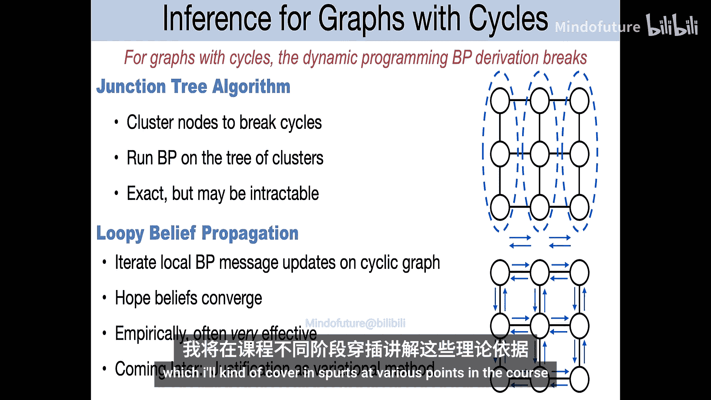

And so。Two in one step more detail to explain how this works。Right the。

This was the belief propagation algorithm right the belief propagation algorithm just said。

 you know take these。Take。EachThere's a rule by which nodes take incoming messages and produce an outcoin message。

And there's another rule by which factors take incoming messages include an out message and you can think of this as just like a function right you know if it's like you you know you take the incoming messages and there's a function which compute out messages。

And here you take incoming messages and the model potential and there's a function by which you get not coin message。

And so when we derived this。We assume the graph was tree structured。But there's no reason。

You couldn't apply the same method。On a graph with cycles。

 so locally in the graph apply the same message passing operation okay。嗯。Now， of course。

 now the problem is that if I do this I don't get exactly the right marginss I'm not going to get them right I'm going to get some。

Approxiation。Okay， nevertheless。

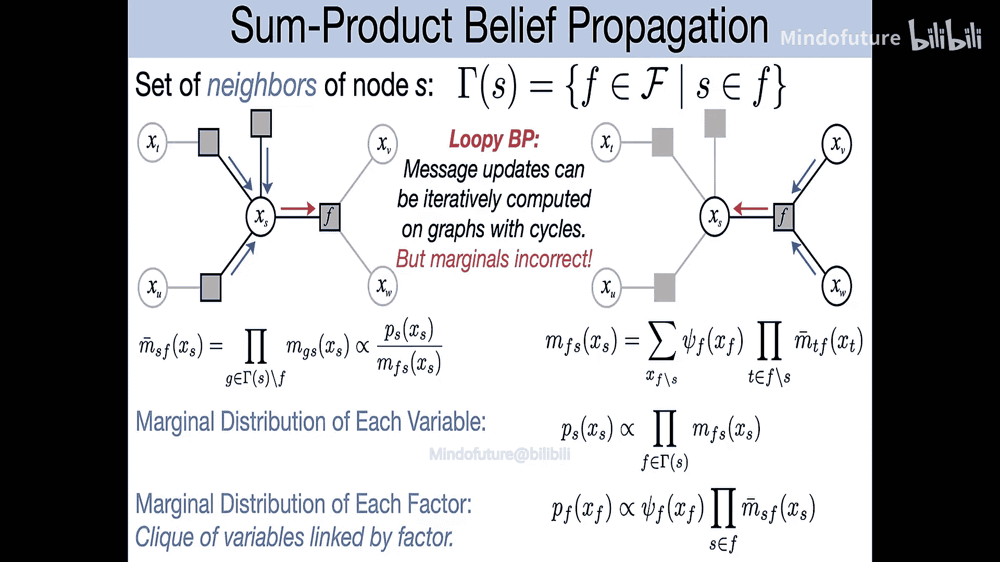

That often works quite well。And so in fact， I've shown you this example of a error correcting code and I've been sort of fuzzy as to well。

 what is this。You know， decoding algorithm that's doing So this decoding algorithm here is actually。

The loopy belief propagation algorithm， an algorithm that takes。So this is sort of saying if I。系。

Add this redundant bits and I transmit it and in this case there's I forget the exact number maybe about 10% of the bits are corrupted by noise so you kind of receive this noisy message。

And then as I run my loopyBP algorithm， right after。

This kind of message passing and this is a graph with a ton of cycles so it's a very messy graph looks something like a tree as I run this message passing after five。

15。so on iterations， eventually， so eventually it converges。

 so this infinity means eventually it after a number of iterations it converges to a fixed point and stops moving and at that fixed point。

 it turns out that in this case 100% of the errors， the bits that were flipped have been corrected。

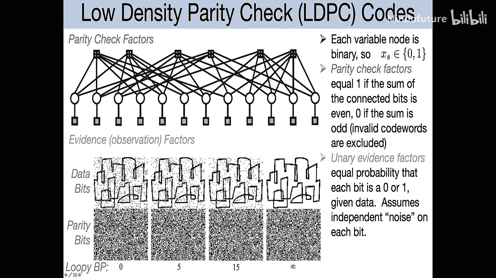

And you were back to the original。Message that was transmitted。系。Okay。

And and so when people figured out that this。Worked well and had good properties。

 It was a surprise and a big deal。 so this is the title of a paper from。

The Ne information Proing systems conference in 1997 and the title of the paper is。

A revolution belief propagation and grassot cycles and so you know academics don't usually describe their advances as revolutions right so usually you don't have these big changes but this was really a big。

Change。Let me give you。

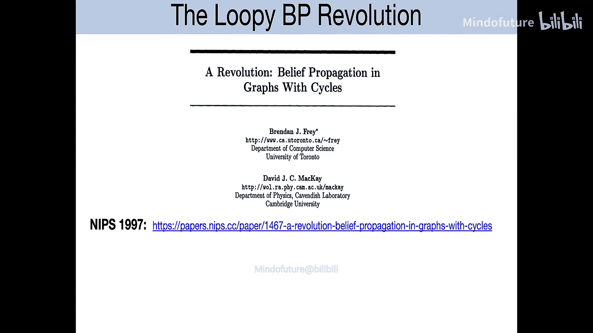

In slightly more detail， let me kind of give you a sense for how that that decoding works so here's a slightly different version of that。

Air correctioning code example。Okay。😊，Um， I can think of a thing where you have a set of bits you want to say and you have this encoder that basically adds extra bits。

 adds some redundancy。And these extra debts are functions of the original bits and so that you know that if I perturb a few of them。

 I can correct those errors。And now in this case， rather than in my example I showed before they were flipping bits here。

 they're saying， you know， your zeros and ones， you add Gaussian noise of some variants。

so you kind of this is like a model that's often used if I'm going to do like wireless communications right essentially you kind of get more like continuous numbers that are transmitted。

And then you get a decoder that tries to recover the original。Message。

And here now here's their what they're showing is the。Probability。😡，Of。啊。Of。Bit error okay。

 so this is basically the how what fraction of my bits have a mistake in them after I decode。

And it's on a log scale， this is like one in 10 bits one in 100， one in 1000， one in 10。

000 of course you want this to be as small as possible， so I'd like this to be low。

And then this is the standard deviation of the Gaussian noise so intuitively right as I if I add like a tiny tiny amount of noise。

 well even if I do nothing， even if I don't if I just kind of like you know。

Decode each bit independently if I i've added only a time amount of noise that may be correct almost all the you may made no mistakes or if I add more and more noise i'm going to have to work harder to correct them okay。

Okay。🤧So and so you have these methods that have a trade off right whereas you say as the noise for large noise。

 I make lots of errors and then as the noise decreases， I get fewer errors。

Now here this one curve repetition code， this is even if you've never seen coding。

 this is really easy to understand a repetition code says something like this if I want to send a message。

 what I'll do is I'll send the message three times。And then for each bit， I basically say， you know。

 out of the bits I received which value was most common。

RightSo if I send the message three times and if only one copy of that bit was flipped。

 I can correct it。If two of them got flipped， then I'm in trouble。

Okay and so that has that simple minded idea has a particular trade off and so there's this whole field of coding theory that essentially has been working for decades to do better than that to come up with smarter ways。

😊，Okay so that's the repetition code。Here is H is for hamming code this is like a very simple way of a very simple classic airing code's it's like if you take an undergrad class and like coding or information theory it's like you know the first code you learn about okay and so it's like slightly better than this repetition idea but not much。

😊，ok。And where you again， you want to be like down here。

 you want to be that even if I have high noise， I have very low probability there。Now。

On the right here， this is the Shannon limit so this is Claude Shannon who invented information theory in the 50s a very famous guy and he he derived that there was actually this what's called the capacity of a communication channel where there's some。

Noise level below which I can essentially correct all errors personally。

 at least in the limit where I allow myself to like send a long message。

And then you know then decode so if I if I do that there's kind of some noise level before below which this kind of shoots off to zero so this actually goes straight down to zero essentially and so below that you can。

You should be able to decode with zero error， okay？And then above that。

 it's probably impossible and so this actually you can't at these higher noise levels。

 you can't do any better than this。So people are trying to get as close to this limit as they can。

Now why do they have to work well the reason that you might ask okay so how do I get codes that approach this limit and what's maddening about this field is that it's the easiest thing in the world so basically if I just take a random code。

Um。Which basically says that， you know， I'm going to convert every message to like a string of bits and I just make that man make that mapping completely random。

Okay， so just like random randomly separate things。That's optimal。😡，Okay， that achieves this。

The catch is that how do I decode a random code and essentially the best you can do is just to like check every possible。

you know message you could have and see which one is closest and that has cost that's like exponential right so so you you have cost that would be like exponential in the message size so it's it's like you know it's the best thing you could do but computationally it's in。

Right。嗯。So。嗯。However。Here PP stands for probability propagation this is another name for belief propagation just another word that that was used what they used in this paper for belief prop the belief propagation name is more widely used。

But you could see why you could call it probability propagation two。

And these are two different TC stands for Trbocode， LDPC stands for load density parity check。

These are two different versions of codes based on graphical models that if I decode with probability propagation。

 you can see they give this performance that although it's not at the Shanon limit is quite close。

is giving me almost zero errors for fairly high noise levels。Why was this a revolution。

 so these things came out in the 90s。This concatenated code。

 this was like the state of the art in the early 90s before these came out that literally was people had spent 40 years working as hard as they could。

 there was like whole conferences that do nothing but this and this is where they got to in the 40 years。

And there were conjectures that in fact， getting above this was computationally impossible that there was a barrier you couldn't breach。

As much turns out there wasn't， you could do a lot better。And in fact。

There later was work on fancier codes where if I plotted it here。

 the gap between the coding line and the shadow limit line would be so small that you could almost not see it on this plot。

Yeah。嗯。😊，And how are these codes right so this， the way the decoding algorithms for these work is there is a code that's represented by a graphical model and it's running exactly that loopy belief propagation algorithm in that graph。

To get its estimate of marginals。嗯。Okay， so I wanted to give you a sense of the power that there could be there and then at the next lecture I will start by talking a little more about what's known about loopy VP as you know both in practice as well as in theory I had to give you a little more of a sense for how it works but I think this is a good spot to wrap up since i'm a minute or two over time but I'd be happy to take questions especially if I know I know for many people this like aircing code application is not the thing you usually work on so if you're。

If anyone has questions about this， I'd be happy to try to help explain what's going on。

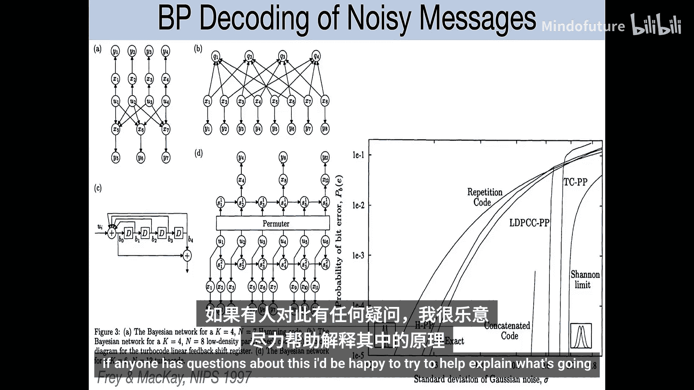