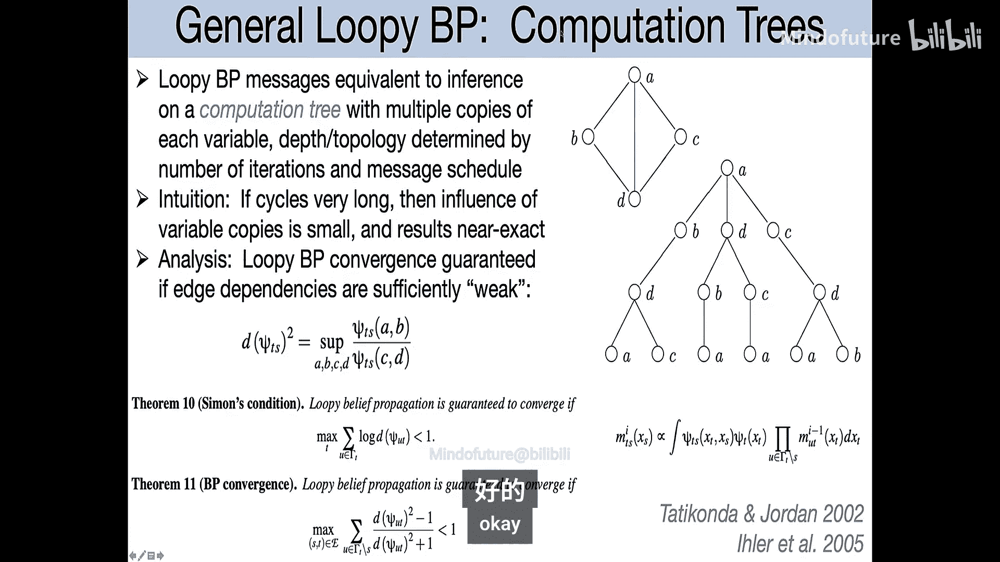
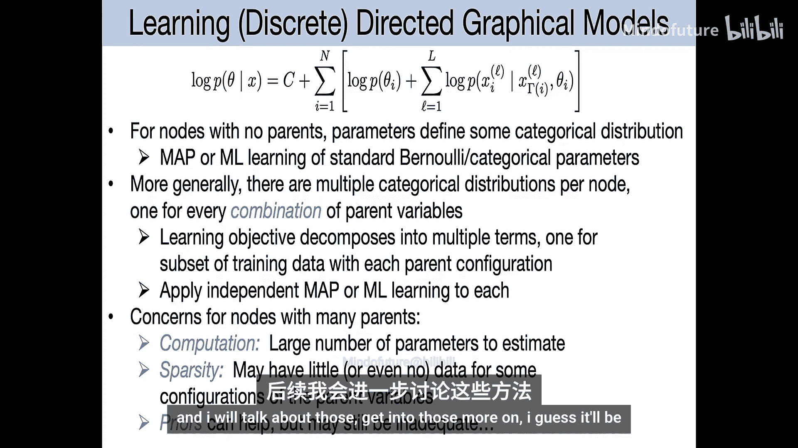

# 【加利福尼亚大学】图形模型中的学习 ｜ Cs274b ｜ Learning In Graphical Models (Spring 2021) p06 P06_讲座_3B-_学习有向图模型__L2__L1_正则化 -BV1Tqx6zrEMj_p6-

So we're going to start today by continuing our discussion of。The loopy belief propagation algorithm。

 okay？U，And so this algorithm is a simple idea， right。

 which gets its name from running you're running the normal belief propagation algorithm。

And a graph that has loops or cycles。嗯。And so even though it is no longer than in general going to give you the correct answers。

 it's an approximation algorithm with some good properties。And so。So again， this is the idea that。

 you know， this is in principle straightforward to do because。If you look at it。

 the each step of belief propagation is kind of this local thing where you update a message。

Using things that only depend on the neighbors of that node in the graph。

And so the fact that you know the graph is not a tree that if you like went on two different paths that you could eventually connect and some other part of the graph doesn't break anything about this local message update of course it does invalidate the the derivation that showed that belief propagation gave you the correct marginals okay。

And I talked last time about how it has can be really effective for some problems i'm going to go a little more into that now。

 so here was an example of a。Removing noise from a message and I talked about effect there so let me start to talk a little more about sort of understanding。

When and why you this could produce effective results， okay？

Now a first thing to note is I kind of a I don't think I emphasize this before is that if I have a directed graphical model right like I have on the upper left here and if I want if I have a leaf node that's not observed like let's suppose like let's say x6 was not observed or x4 is not observed。

If I want to kind of marginalize that variable from the model。

 it's really a sort of trivial thing to do all you would have to do is drop the corresponding factor and the way to see that is right in this。

嗯。Product here， like if I wanted to marginalize export， there's only one term that depends on export。

And because it's a conditional distribution， if I sum over x4 I just get one right if I sum this over x4 I get one for any value of x2 and so if I want the distribution of everything except x4。

 I take I just drop that term from my product right similar thing if I wanted to get rid of x6 I could just drop the P of x6 term from the product and that's because these are nodes in the model that have no children right there's no one who that they point to。

Okay。Um， so， but， you know， if I wanted to， if I was going to run loopyBP on this model right。

 if I convert this model to a factor graph。Remember the factor graph doesn't encode directionality。

 I now just think of these factors as just tables of numbers。

And now you can see there's clearly a loop or cycle。Okay， and so in general， right you might say。

 well okay， this is no longer a model that's a tree it's no longer one where I would necessarily expect it to do well so you might ask you well what's going to happen if I just run loopPBP in thisbactertro graph。

Good。But it turns out that something kind of interesting sort of happens automatically so let me first take the the message this variable x4 okay and so here is the message that you know this variable with output right and so by definition it takes the product of all the other incoming messages but X4 only has sort of one。

Neighbor right so that's just going to be a one Okay， so it's just going to be a constant。

And now if I say this factor F， if I say what message does it send to x2？Well。

 this is the equation from the previous slide， you would just be this。And now this M4F。

 that's just a one。And now if you look at this right， this is a conditional distribution。

 so if I sum over x4 I get1 no matter what x2 is， so no matter what you know specific numbers you have in these probabilities you know that it's a distribution so it sums to one。

And so thus， this message is just like a constant， it's all ones。

And it won't have any influence on the other updates， right。

 because if you think about the product and the sum product， if you multiply by one， of course。

 it doesn't change anything。And so even though you kept X4 in the model。

 it's as though it's dropped right， the inference is automatically figuring out that can do that。

and the same thing happens actually for x6 this this kind of factor that's involved in the loop right so there's a slightly more complicated argument that I can say well the message from six to G that's just a one that's just a constant。

And then if I say， well， like what's the message from G to 2？Okay。Well。

 I have this message from six to G that's a constant。Okay， and now I have this message from5 to G。

Okay and that's some vector of numbers that sums to1。

 and so now if I sum over x6 I get1 and if I sum over x5 I get one and so this will again just be constant。

So again， I get kind of constant messages， so even though I have this cycle。

 the sort of messages that come from G to 2 and G to5 are constants and it behaves as though you had removed X6 and just had this kind of tree structure okay。

Okay， so I point this out because what this says is that if you know if you kind of you could make a formal induction argument right where you sort of generalize from the leaves to one layer up and you can show that if all if you have some all the descendants so a node the descendants of a node and a directed model are you know you have your children and the nodes they point to are your children's children and so on so those are the descendants。

🤧If all your descendants are unobserved， so none of your descendants are observed。

Then the loop PPPP message is that from that node to its parents are uninformative。

 they're constants。And so that's kind of the right thing。

 because basically if there's nothing is observed。Then you don't have any it doesn't provide any information right just a bunch of unobserved variables to provide information and so loopB will actually compute the correct thing it won't sparsely give you。

Strange you know， biased messages。And thus so thus。

 if you have kind of a directographic observations， right。

 loop UDP in many cases will exactly compute the marginals。Of the prior。

And not always because there can sometimes be other issues related to the parents。

 but for some models like this it will。嗯。However， that doesn't mean it's always exact right and so if some nodes。

Are observed。Then loopPBP will only produce。Sort of possibly accurate approximate marginals。

Of the posterior。U。I think it's easy to think of this if you look at this。

 I've mentioned this medical diagnosis example a few times right where you have the set of diseases and then this set of possible findings。

And you're interested， conditioned on the findings。

What diseases now but note when this is applied right。

 there's often you know practical version of this model have like hundreds of diseases and like thousands of findings right there's thousands of possible like test doctors run possible diagnoses they could do and so usually for a patient it's not the case that like。

You you observe the value of every possible finding right there's a subset of those that are observed and many are unobserved because you basically you haven't run that test。

 you didn't have a reason to。Um。Now but from this property of uninformative messages that you can see that this graph has a ton of cycles it's very loopy。

 but if none of these findings are observed if they're all unobserved。

 then a loopyVP will return to the correct disease priors now in this case I mean that's not useful in the sense that you already knew what the priors for the disease were on the factorization this is just saying if you were naive and ran loopyVP anyway。

 it would give you the right results right it would say that well you don't have the information so the probability of a disease is it sort of prior probability。

Okay so I would do that correctly。Now， if you look at it carefully。

 you can also find out that with one observed findings， so if you observe one of these findings。Also。

 lukiP will give you the correct posteriors and the reason for that is that。

After you kind of marginalize away the unobserved findings。

This the graph that you get for the single finding that observed will always have a tree structure and it will be kind of a tree structure relating this node to its parents。

Okay。However， it's not。Necessarily this argument breaks down in general right so if I have multiple observed findings right so if I you know run 10 different tests and there's different combinations of these that use each one then this loop people will not in general。

It'd be guaranteed to give you the right results and it'll be。Approximate。Okay。Nevertheless。

In these types of models， too， the approximations are often。

Quite good so's here's kind of one of the first papers that did this I mean then there were hundreds of papers in the couple decades since this one that have exploited this to get good results with this method。

So here's in this case， they're looking at sort of smaller models and why are they looking at smaller models。

 so basically they looked at models that were small enough that they could run the junction tree algorithm that they could when they triangulate the graph the cliques are not too big and that lets them compute exact marginals and then they can say。

 you know， is loopyBP giving approximations that are good or not。

And so this is one graph structure they looked at， this is kind of motivated by some of those。

Applications of modeling like spatial and temporal data。

 so this would be like a sort of multi scale model you might use for for like spatial data that I mentioned before。

 so it's kind of a toy version of that。嗯。I think they they look at all binary variables and so they make kind of a synthetic version of this where they make random。

The probabilities， the conditional probabilities they just sort of generate that randomly to get a test case and take random observations and when they do that and then they kind of run their BPP and they get the marginal probability so in this case because the variables are binary you can think of the marginal probability just a number between zero and1 so there's like a true true probability that that variable is one and then an estimated probability that's one。

And this is a plot。Of。The true marginals。Versus the loopyBP estimates and you can look at this and you can see that you know if they were if it was exactly correct。

 these wood points would be exactly on the diagonal line and you can see that they're not exactly on the line but they're pretty close so it's a pretty accurate approximation。

 right？Um。On the right， this is an approximation produced with something called lighthood。

Waiting so like it way use a Monte Carlo method actually we'll get to that in a couple of weeks so but if you it's kind of a way that uses essentially an important sampling to simple Montecarlo method to try to estimate these probabilities and this method is exact in the limit as the number of samples goes to infinity but with finite samples it gives you noisy estimates and here know even though there using a number of samples so it's slower than the loopyVP it has worse estimates you can see that these are farther from the diagonal。

系。Here's another example， so here they're looking at。This network may look familiar to you。

 this is actually the graph structure here is the same as the structure of the alarm network that's on the homework assignment。

And in this case， they again。They took the same potentials。From the real alarm network。

And then they basically said， let me make cases where I make kind of random observations so I make random observations of some nodes and look at how good my estimates。

R。😮，And here's upper left is an example of the true marginals for some of the variables and the estimates from Ly。

BP or you can see there' a couple cases where there's like some errors right that you know here the true probability is like 。

25 and loopy Vp estimates a half， but you can see for a lot of them again it's quite close。

And this is much better if you do that that likelihood weighting Monte Carlo method right with。

200 samples it's it's basically worthless right you if you look at this right these are just noise they have no connection to truth with a thousand samples of the likely weighting method it starts to get closer but still right so you know it。

Llihood weighting might be better than the loopPVP if you could do 100，000 or a million samples。

 but that would take a long time so that's why these deterministic approximations like loopyVP are often used。

And here they're applying the PPP exactly the same way as you are in the homework right they conditionize the messages and they kind of run until kind of emergeence。

系。好。One more example， this is a toy QMR so QMR was the name of one of those medical diagnosis systems and this is toy because they make a small version of it with with only you know。

On the order of like。seven diseases and 20 symptoms or something as opposed to hundreds of each of those things。

But again， right， the LBBP estimates are very。Accurate。However。I'll note that they've not always。

 so in this case also they generated kind of random probabilities。Um。They also looked at。

A real version of this network and so I guess the version they looked at had about 600 diseases。

 400 findings。Um。And here they have social behavior so in the。

This case in their synthetic data BPP always converged。

 but actually that convergence is not guaranteeding about I have this sort of like message passing of a of a。

Dynaal system and it's not guaranteed a process like that is not guaranteed to converge and there are they found some instances of the real model where loopyppP fails to converge and the beliefs follow a limit cycle so here's an example for this is one of the nodes in the model。

And。Oh this is so three nodes right so they're plotting these three curves or like three different nodes in the model and this is showing as a function of iteration what the S the。

嗯。😊，The beliefs of those nodes are。 if you look at it。

 you can see they're kind of seem to be converging to like a kind of limit cycle where they're each oscillate between two points。

Okay。So I mean this would be impossible this would never happen in a tree。

 but in the graphless cycles like this they can。Um。Um。And so。And this is just showing， you know。

Kind of these error bars that in some of these bad cases you get this this spread where there's you know some of the variables where there's not much in spread。

 but some of them where there is wide range so this can happen this non convergence。

Can happen they hypothes that this is related to on the real models there being extreme probabilities right so。

In the real conditional distributions， they have often these probabilities might be like close to zero or close to one。

 so there's a bunch of like disease symptom pairs that like this disease would almost never cause this or this would almost always cause this。

And it turns out that those extreme numbers can actually that extreme dependence。

 as we'll see in just a sec can。Cause more issues for the Ly leaf propcagation。🤧Okay。

 so this is kind of empirical and so now I want to give you a sense for some of the theory and so i'm going to give you right now some of the simpler theoretical results about loopy VP and then at some point little later in the class I'll come back and give you a couple more advanced things kind of we need to get a little farther to be able to understand。

The more advanced things。Um。And so this is a paper and you know this paper follows a good principle for these things that if you're trying to understand。

 say well， what is this loopy message passing like when would it work， why would it work。

 start looking at simple cases right and so this paper analyzed sort of the simplest case that's not a tree which would be a graph that has one cycle。

Okay， so there's a graph with one loop and this could be like the graph on the left so this is a graph with like these black ones are ones that are observed so this is like you know the observations give you information so this is just like just literally there are four variables that are arranged in a loop。

But also the analysis here would apply to like a graph that had like a cycle and then maybe some other nodes like think of like branches of a tree daling off that cycle。

 so there could be kind of you know extra branches and things like that， but there's only one loop。

 only a single loop in the model。Um。ok。So if you think about it。

 think about how the messages work in BP right so the BP always like if I'm taking the message from one to two。

 that depends on the message from four to one。Right and the message from two to three depends on the message from one to two the message from three to four depends on the message from two to three and so on So you think about it there's kind of like this set of messages that are just going in a loop and there's actually kind of like。

There's like one loop that's the messages going clockwise and another loop that's the message going counterclockwise。

And if you have a single cycle， that's kind of what this message passing will do。

And now if you think of it right in this single case right the message update is like a linear operator right you take a product and then you take a sum and you normalize the sum and then you take a product and a sum and you normalize right so these are linear operations you can represent what happens as around a loop as kind of this product of matrices。

ok。And now if you want to know what happens when you multiply a bunch of mat to this is a long-tued thing right so it turns out like a lot of like methods and linear algebra。

 how do you solve a linear system of equations a lot of them iterative methods work by essentially you take a guess and then you multiply it by a sequence of matrices and until it converges to the solution and so it turns out you can analyze whether this thing converges and how fast it converges from the eigenvalues of your matrix that you're multiplying by so if you look at those eigenvalues then if the magnitude of eigenvalues is all less than one then that converges and then depending on sort of how far less than one they are right if they're far less than one it converges fast and that they're really close to one it'll converge slow so this is all kind of very understood things and you can analyze it take that classic theory and apply it here okay。

And so this gives you some things， this says that no matter what your potential functions are。

 this product， this LuBVP， if you have a single cycle will have a unique fixed point。

 so there's no way that you could like initialize one way and get to one set of marginals and initialize a different way and get to a different。

 they'll be only one fixed point。And also loopPpp will be guaranteed to converge as long as all the potentials are strictly positive。

 so as long as all my potentials have。Being about like all pairs of states have sort of positive probability。

Then you get convergence for sure。However， if you you wouldn't you can have nonconvergence even on a single cycle。

 if you have some zeroes， so if you think of your potentials have zeros which basically say like certain pairs of states are like impossible。

 then you can actually then get oscillations。Okay。Where as your' passing message in the circle。

 the belief that a unknown is like going up and down and up and down and it just oscillates forever。

 it doesn't converge。Okay。Um。U。And so on this graph with cycle， the LibBP modules are not exact。Okay。

However， they have an interesting and kind of cool property。

 the state with higher probability always matches the true marginals。😊，Right。

 so what that says is like imagine these are are。Binary if if the true probability of。

This node equaling one is like above a half。Then the BP's estimate will also be above a half。

It just may not be right like it might be the true probability is 0。7 and you estimate 0。8。

 but you can't have the true probability of 07 and you estimate 0。2。

They'll always be on the same side of a half。And what that means is then if you sort of round the probabilities to get guesses。

 your guesses will always be the most likely states。Co。嗯。

And there's some theory that says that faster loopyB convergence implies better marginal approximations and you see that here this is over sort of many runs of these models this is。

呃。This is let's see on the horizontal axis is a measure of convergence。

It has to do with the ratio of eigenvalues so it's of a convergence rate， so this is smaller。

 you converge faster， this is bigger， you converge slower and on the vertical axis is your error。

So this is larger errors， smaller errors and you can see that you know there's not like a one to one relationship。

 but there is a strong correlation between those things。Okay。O。

So any questions on kind of what's that saying of the big picture？On one level， it's not you know。

It's not exact， but it is kind of there isn't like a lot of good properties for such a simple approximation。

咁。O。And now。If I have a graph that is more complicated right that doesn't just have a single cycle that has mold so this would be almost this is the simple graph。

 this is the simplest graph that you can draw that basically has。

More than one cycle right so this is a graph where there's sort of like two cycles here。Okay。

You can analyze loopy BPP in terms of the what's called a computation tree so to think about it i'm passing messages around。

What's going to happen， right？To get the message， the marginal at node A。

 it'll have messages from B C and D， so they'll send it messages。

And then that message from B will depend on D， the message from C will depend on D。

 the message from a D will depend on B and C， and then if I go one more step， write that message。啊。

Like。U。That D sends to C at the previous iteration depended on B and A and so on Okay。

 so if you run this loopy message passing on a for a fixed number of iterations。

That is exactly the same as if you constructed a tree。

That had kind of like redundant copies of the variables right so it had an A and then there's like an extra copy of the A down here and then you did exact inference on this tree。

It's a little bit of a weird idea， so but that's what when I pass measured in the graphless cycles that it's the same as if I sort of built this tree where you kind of unroll the graph and then do exact inference on the tree。

And then you can start to mathematically analyze how the marginals of this tree relate to the graphless cycles and perhaps show that if they're not too far from each other。

 that your approximations would be good， okay？And the intuition is that if。

Imagine I had a graph and this is a graph where the cycles are short right I go only if I start at nodeA I can go only one。

 two， three steps and get back to a but imagine I had a lot more variables and there were cycles but they were long right so there were cycles but to kind of start a note and get back to the same place you'd had to take tens or hundreds of steps。

Okay， in that case， you can imagine that， you know， kind of the amount of correlation。

Reduces every step kind of right you have these stochastic potentials so every step it gets it reduces a little bit and kind of once you've gone all the way around the cycle。

 you know the dependence is very weak。And so thus， if your cycles are long。

 you might expect that the approximations。Get better and indeed that's what's going on in those air correcting codes。

 it turns out that when you build those codes they have long cycles。And you can formalize this。

 so there is theory that says。That LuBVP is guaranteed to converge。Even if you have lots of cycles。

 as long as the edge dependencies are sufficiently weak。Okay。So this。

So heresi is a potential between two nodes and this D here is a measure of kind of the strength so a larger number here is like a stronger potential and what is this this is the supreme or max of if I take。

Basically， if I take， think of your like potential matrix， you take the largest entry in the matrix。

And divided by the smallest entry in the matrix， right， this is just a fancy of saying you know。

 take the ratio between the biggest and smallest entries in the matrix。

Go and so if you think about it， if imagine that ratio was one， if that ratio was one。

 that would mean。The the potential matrix is just like a constant and then it actually doesn't matter you could leave it out to your model and have the same model right so that's no dependence。

So where there's strong dependences where you have， you know。

 like some entries that are really low and some entries that are really big。

Right and then actually imagine in the limit if you had like a zero in your potential matrix。

 there was a pair of variables that were impossible。

 then you know this D would be infinite right it would approach infinity。Okay。

But there's theory that says。These are real theorems right you know that they're guaranteed that so loopy VP is guaranteed to converge and love a unique fixed point if this is true okay and and what does this say this says。

For every node you take the sum over of all the potentials connected to that node of log of this D。

 so you take that log of D sum it up and as long as that's not too big as long as that's less than one。

I'm guaranteed to convert。And then there's actually another condition this is a little stronger one I don't really have time to explain where this comes from。

 but you can think about it look this has a sum over all the neighbors of a node except for one of something that depends on that potential strength and this fact that the sum over neighbors but one has to do with the fact that you have this product over all the neighbors less than one here okay so kind of basically what this is checking is that when I do this message update kind of if I perturb it it doesn't change things too much right and then you can show that it gives you convert。

Okay。Okay， so this is just to say that you know， basically that that kind of even it's not just the graph topology。

 right， we know it works for trees， but it also could work well for a graph with many cycles as long as like the amount of dependence is sufficiently weak。

So it actually really depends on whether the potentials like our stronger relationships are weaker relationships。

Okay。Okay。I this is just kind of another result i'm going to skip the details。

 but I will also show that not only can you show convergence you can also show in some cases where if you might have multiple fixed points。

 you could say， well those fixed points are not too different from each other。

Abound the difference between them。か。Okay， so this I mean so this BPp convergence world that gets into a lot of these the papers in this space are fairly you know these two papers here are fairly technical and so it's not i'm not going to dive into great depth but I wanted to give you a little bit of a flavor that there is some real theory and that's why like the if you look at like the homework where we're looking at you know。

doing approximations with this method on a graph why that would be a non crazy thing to do because there is theory saying in a lot of regimes that you you can expect those approximations to be accurate。

嗯。Okay， so that's kind of all I have to say about this right now again we'll come back to the BPP theory later。

 but if anyone has any questions about anything related to loop BPP nows a great time to ask them because I'm going to kind of shift gears to a new topic。

Yes。Okay。

。I will stop。That。And。Start。

Sharing。A new set of slides。Okay， so。U。So there's been。

Several questions have been good questions about， well。

 where do the parameters of these graphical models come from？

Okay like where do all the numbers that define the probabilities come from and that's what we're going to talk about now okay。

 so we're going to move away from inference and start talking about if I have data。

And I want to sort of estimate the parameter design model so that it fits that data well。

 how should I do that， okay？And the same kinds of methods。

 right so when you think about doing parameter estimation in simpler models。

You know you talk about often maximumim likelihood methods and then also some Bayesian methods that incorporate prior and those same methods are are。

Are widely used in graphical models okay， so that's what we're going to talk about now。All right。All。

 so just first to be sure everyone's on the same page。

We'll do a sort of whirlwind little review of maximum likelihood estimation。All。All right。

So I'm going to assumee I have some data and this has L observations and now note the notation。Right。

 so we've been using subscripts like x sub I to denote like the nodes in a graphical model。Okay。

 and we're going to keep doing that so we don't want to conflict with that。

And so given that when we have training data like a data set with L observations。

 we're going to use these superscripts and parentheses to denote the different training samples so I have X superscript 1 x superscript 2 x superscript L being like my L training examples。

Okay。😊，And so again， so that's that's done so that we can later talk about each of those examples being the variables in the graphical model and not have notation conflicts。

Okay， and the basic setup is you assume that your training data has a bunch of independent identically distributed samples from a。

Unknown member of some family of distributions， right？

And so this is how you actually draw this standard like parameter estimation setup as a graphical model。

 you say there's some parameters data I don't know， and then given those parameters。

 the different L training examples are all conditionally independent。

 so I have this plate here that denotes replication of L of these variables。RightSo for example。

 this P could be Gaussians and the theta is the mean you don't know， right that the。

The first example is people often see Okay， and then in the frequentest framework。

 you think of theta as some fixed。Non random constant I'm going to use P of x bar theta。

 even if we're not thinking of theta as a random variable it just kind of keeps it simple right so for this framework we're thinking of like some constant。

And then you know， an estimator is something that kind of guesses or learns the parameters from the data right so you say you take your data and you compute a function and it's a guess。

Of theta， right so。For example， if theta was the mean of the distribution。

 a standard estimator would be just compute the mean of your data。系。

And then the goal in this frequent framework is to have estimators that have good properties uniformly across data。

 right so you define a property of your estimator like the expected distance of estimate from truth and you say that you know I want that to be small。

 no matter what the truth data is。Okay。Right。嗯。Everyone knows what the。

The exponential log functions I'll this is just to remind you that when I write log of x pretty much always mean natural log in this class something to maybe you remember a little less is these identities at the bottom that show up basically almost on every slide and we're talking about the parameter estimations so you should remember that if I have the log of a product that's the sum of the logs so log of x Y z is log of x plus log y plus log z and also if I have like log of x to the a that's a times log X so these identities will show up over and over again。

All right。So what is maximum likelihood estimation right maximum likelihood is a procedure for estimating parameters and and it comes from this so I have some p of x given data and so by the way。

What I'm talking about could apply to either x being discrete or x being continuous right and so if x is a discrete。

 then this P of x theta is the probability mass function。If x is continuous。

 then the p of x given theta I'm writing down here is the probability density function。

And so suppose I have， you know， two candidate parameters， right？

Somewhere someone gave you two guesses for the parameters and you compute。

P of x given theta1 and p of x given theta two and you define that p of x given theta1 is is bigger well you know if you don't know anything else you know a pretty at least intuitive thing to do would be to choose the higher likelihood model right right it would certainly be a weird thing to sort of like be biased towards models that under which your data has really low probability so you should expect that good models or ones in which the data you saw has high probability it's an intuitive idea。

And and so the maximum likelihood parameter estimation basically formalizes this， it says I。

 the way I'm going to estimate my parameters is to say I'm going to maximize over all possible theta。

 the likelihood of my data。😊，So I compute the likelihood and remember because my data is independent given the。

 I take the product over the L training examples of P of XL given data and I find。

The theta hat that maximizes this。Okay， so it maximizes this function。

I could take the log of this and I wouldn't change where the max occurs and that's。

Typically what we do， that's the same as this max of this product is the same as maximizing the sum of the log probabilities。

Okay。All right。So that's。Maximum likelihood。嗯。And so I'm assuming everyone has seen maximum likelihood before and that you've seen examples of what are the max likelihood for some simple models。

Um。😊，So why？Um， you know， why do we like Max and Wetlet， well there's a few properties， right？

So first， remind you， what does consistency mean？So in the frequentest world。

 so an estimator is consistent。If my sequence of estimates theta L， so I think of like， you know。

If I have。A data set of like size 100 I get an estimate you think about it like as I add more and more data so as I get more and more data。

 you know what happens to my estimate right you would hope that as I get more and more data it gets closer and closer to whatever the parameters of the true distribution right and so consistency formalizes this it says that you know for any true theta no matter what the true theta is。

 the limit as the amount of data goes to infinity of the the probability that you know theta hat minus theta is above epsilon that has to be zero。

So this is consistency right so this is the definition of convergence and probability of these。V。

And so that consistency and then so under you know mild conditions and these are truly very mild conditions。

 the ML parameter estimates are always consistent。and you know。

 you also have sort of a central limit theorem that you can sort of characterize asymptically how big your errorss are and for large L they're efficient。

 which means that there's a lot of models for which at least in the large L limit there's no estimator that's going to have lower variance than this。

 so those are all good things。Okay。🤧Okay。So so this is not a class about those properties they're good to know right but that's something that more of a mathematical stas class we'll go into here our focus is going to be on models that are more structured and complicated and high dimensional than you usually see how could we compute things like ML estimates and do it attractively。

嗯。And。So we have this log likelihood， right， so this capital L of theta。

As the sum of these log probabilities of be given and theta and for a lot of models。

 this is a smooth and continuous function。Of the parameters。OkayAnd so if I have some smooth。

 continuous function of parameters and I want to find the max。

 what would be the standard way to do that？This is like your first calculus class so I drive of a function and I want to find the max what will be true at the point where where you're at a max right？

Right， the derivative will be here。Right so if you have kind of a smooth function。

 then any max or min will be at a point where the derivative equals zero。Okay。

 and so that is the general strategy for finding maximal likely estimates is that you know。

 you take the derivative of this log likelihood and then you look for the theta for which that derivative equals zero。

All right。🤧。So。🤧Sst possible example I can think of is a Bernoulli distribution right so Bernoulli is the name of the distribution of just a binary random variable。

Right so I have a variable that could be 01 and so the distribution of that variable will have one parameter and so this theta is basically like the probability that this variable is heads probably that it's one so I' probably theta being one and probably one minus theta of being zero that's what this equation says。

嗯。All right， and so now if I have a data set when I have a a if I take a log of this right I will get x log theta plus1 minus x log1 minus theta that's what this is and so the log likelihood looks like this I have the sum of my L examples。

And then I have， you know。The examples for the examples that are one。

 I have a log theta term and for the examples that are zero， I have a log one minus theta。Okay。

🤧All right，Um， so。How would you？I'm going to not you know get out a piece of paper and try to show you this devation because I'm guessing you've all a lot of you have seen this before right but if what would you do you would take the derivative of this with respect to theta so like the derivative of log theta would be one over theta and then here you would have a one over one minus theta and then times a minus1 and then you just simplify right move terms around solve for theta set that to zero solve for theta and what you'll find is you'll get this really。

Intuitive result that theta hat is you you count the number of ones and divide by the total number of samples。

 so your maximum likelihood estimate is just the fraction of your data that came up one and that's the maximum likelihood estimate of the mean or the probability of heads。

Okay。All right， so very easy。Okay。U。And so I'm building up here to be talking about how do we estimate parameters for。

Graphical models with discrete variables and so those variables could be binary。

 but they can also be categorical。Meaning that they take on you know。

 four or 10 or some larger number of possible outcomes。Right the alarm network and the homework。

 some of the variables are not binary， they have have up to I think four outcomes。And so again。

 a categorical distribution is a role of you know sort of a biased die you can think of it as right so in general we parameterize it now rather than by a single number。

 we have a vector of k numbers that sum to one。So if there's k outcomes。

 I have a probability of each outcome， and so each outcome has a probability between zero and one and then the sum of those probabilities equals one。

Okay。So when I'm doing parameter estimation for this。

 I'm optimizing over vectors that are non negative and sum to one and that space。

 the space of vectors that are non negative and sum to one， that's called the Sx。

Right in particularly if they sum the one's called the probability simpleplex so this here I'm showing like if I have k equals three。

 if I have。😊，three parameters， theta 1， theta 2， theta 3 that's sum to1。

 the set of points that sum to one will live on this triangle。Okay。

 and that's because you have this sort of triangular plane and you have this plane because that sum to one is a linear constraint。

 so that's why you end up in this 2D plane。Right so what you know why is there a constraint。

 it's because if I tell you the probabilities of any two outcomes。

 you know that the third one is sort of one minus those。Okay。🤧Okay。

 and so when we're often it's convenient when we're talking about a variable of k outcomes rather than describing it as like an integer between1 and k。

 we write it down as a k dimensional binary vector。So I'm going to think of my。

Variable here as a k dimensional vector where it's all zeros and then it's got a one in the spot for the outcome。

Okay， so that's a particular way of writing down so that's like。

My my sample is going to be like numbers that are zeros and then there's a single one。

Indicating okay， and then in that case， the probability right this just says， you know。

 it's the probability of seeing an outcome is is just the theta k corresponding to whatever dimension has a one has that8k。

Okay。All right。🤧So now。Now， the issue we're going to run into immediately is that when you want to do optimization of of the。

Parameterters。For a distribution like this， it's no longer the case that you can just sort of take derivative and set to zero and why is that it's because I have this constraint so I have this I have a constrained optimization problem。

These data are not arbitrary， they have to be between zero and1 and they have to sum to one。So。

 but here's a nice little lina to remember， okay？Okay。

 so let's suppose I have an optimization problem that looks like this I have this I have these k parameters that live on the simplex。

 so they're between zero and one and sum to one and I want to optimize an equation that looks like this I have the sum of。

啊。Log theta Ks times ak， so there's these numbers aK that are greater than equal to zero。Okay。

Or is is like a family of optimization problems right so you could say that you know。

Suppose that I want to maximize over theta a function that looks like this。

This has a simple solution。The solution is always looks like this。

 you take the aKs and you just normalize them soda they sum to one right so you compute this number a0。

 which is the sum of these aKs and then you divide aK by a0 and that is the optimal solution。系。

And i'm not going to prove it right so the way you the easiest way I think to prove it is to use lagGrange multipliers right so to do constrained optimization the thing you would learn about in your kind of the third calculus class or whatever is you you add a Larange multiplier of course on linear constraint and solve and so。

That proof is either trivial or completely mysterious depending on whether you remember or don't remember Lae multipliers。

 so I'm not going to do it， but if that's you know that's a very useful tool to look up。

 but if it's a little fuzzy for you you can just kind of take this as a given that this is the solution to this problem。

And now， given that， I can say， all right， well let's suppose I have a categorical distribution。

Like I'm showing u。Here。U。And。And I want to have in observations。

Okay then it turns out that the probability of those observations looks like this。

 it's the product of the K outcomes of theta K that's the probability outcome K raised to the N power where N is just a count of basically like how many times outcome K occurred in my training data。

 so I have a account of how many times outcome one outcome two outcome three similar okay。

Then the log likelihood is now just the sum of these N log theta ks and by that line I showed you before the。

The maximum likelihood estimate is just to sort of take these NKs and normalize so they sum to one。

Okay。Now the problem is is that as k gets bigger or one problem is as k gets bigger。

 you may end up just by chance with some of these counts in like being very small or zero。

 there might be an outcome that you know just happens to not occur yet in your training data and in that case。

 if there's an outcome that didn't occur in your training data。

 the maximum likelihood estimate says it has probability zero， it's impossible。Okay。And you know。

 in the asymptotic limit that motivates this in the large L limit， well。

 if you never see the outcome， then maybe it truly has probability zero。

 but if I have sort of more medium sized data sets， that could be a bad idea。And thus。

 that sort of motivates instead thinking about Bayesian methods for doing parameter estimation that give you some regularization properties。

Okay。So。Before I dive into that， are any questions on Max Le？Okay。

 I know I'm moving a little fast right now and that's because my assumption is that you have kind of seen some of these things。

 but I like to sort of set things up in the same notation I'm using and remind you if it's been a little while。

Okay。嗯。So now the Bayesian approach to parameter estimation starts off with kind of the the same approach we had before right I have some。

L and observations that sample from a distribution have a likelihood exactly like before。

 so I have the same assumption that these are independent samples from the same distribution。

But now I'm going to have an additional ingredient。

 I'm going to have a prior distribution on my parameters。Okay。

 so you think of this as sort of saying before I collected this data。What models？

What parameters or what models that I think were more or less likely。Okay。

And so this prior could just be a uniform distribution。

Or it could be some you know more informative distribution that says I have knowledge that some things are more likely than others。

 maybe because I've analyzed other related data sets。Yeah。And then。

 so the Bayesian approach to parameter estimation now says， well， I'm just going to apply Bay's rule。

To compute the posterior distribution of my parameters given my data right and so Bayes rule says what is P of theta given x？

Well， that's。P of theta times p of x given theta， where p of x given theta is this factorized form。

Divided by P of x。Okay。All right。So。That is a distribution， right， not a。Yeah。嗯。😊。

And single estimate。And so I mean， sometimes a distribution is。嗯。Good enough。Um but。Well I mean。

 it tells you certain and so but sometimes you just want a single estimate and in this case there's there's two two natural ones that are used one is what's called the maximum all posterior map estimate。

 which basically says pick the parameters that have the largest。

Pouserior probability so you take this posterior and you just find the theta that maximizes it。哎。

Or the other estimate is the conditional expectation。

 so you take your posterior distribution and you find it's mean。and note， right。

 even if x is discrete。Theta is typically continuous。

Right even if I have like data that's all discrete。

 theta are like the probabilities of different things occurring and probabilities are like continuous numbers between zero and one。

So that's why this mean involves an integral， so this is the integral of the density of theta given x times theta。

Okay。And you know you could there's a lot can be said about different estimators I'm not going to kind of dive into that now。

 you know both estimators have the property of you know picking parameters with high posterior probability right so that's intuitive I hope right you're picking the pointwise maximum here you're picking the mean and you know typically the mean kind of occurs somewhere in the middle of the posterior distribution areas of high probability。

And you know and you can formalize your choice of estimator with decision theory if that's important in an application right so for example there's a result i'm guessing you may have seen that says that if I want to minimize the squared error between my estimate and truth then this。

Setting your estimate to the posterior mean。Is optimal。

 but I'm not going to do that now so I'm just going to sort of we're going to keep track that these are two standard ways of。

Estimating parameters。Okay。So。嗯。So now let's just look at those same simple cases we saw and let's suppose I want to learn divva learning of a binary distribution or verly distribution。

So I have the same the likelihood is the same as before I have the。Probably of heads。

 raised the number of heads， times probability of tails， raised the number of tails。Okay。

So that's my likelihood， and then I have a prior。And let' let's be very simple。

 like so the probability is between zero and1 and so let's assume for right now I'm just going to say my prior is like uniform between zero and1。

 so I'm going to assume that all theta between zero1 of the same prior probability。Yeah。

So I'll do that assumption then。I could compute the posterior by bays rule， right。

 so I would take prior times likelihood divided by P of x。Okay and what is this。

 I get this the distribution that is。Theta to the number of heads in my training data times one minus theta to the number of tails。

And we theta is between zero and what。And then this P of x。

 this is some number that I get from this integral and it's basically you think of it as the number that makes this a real distribution so that if you integrate over theta。

 you get one。So。But you might ask， you know， so what is this distribution theta raised to a power times one minus theta raised to a power and so this。

I a widely used distribution it's called the beta distribution。嗯。

Right and and so you know I present it this way because sometimes if you see betas。

 it looks like well why should where does this beta shape come from and I think it's important to know that like if you you know if you just say I you know I have estimate the parameters of a renewalnewully and I assume I have a uniform prior then I'm immediately led to this beta。

Okay。And it looks like this so it has two parameters alpha beta and it looks like this right so it's theta to the alpha minus1 times one minus theta to the beta minus1 okay。

And then this b is a constant so this integrates to one these are here i'm just showing different examples of beta so the uniform distribution is a special case of the beta right both of these parameters are one you get theta to the zero one minus theta to the zero so that's just flat。

U。Here these you know the blue， red and green curves on the left。

 those are beta distributions where the parameters are bigger than one。

And you can see then you get these distributions that look like kind of like bumps of various sorts。

Okay， actually this blue curve is actually quadratic and then these are sort of like higher order polynomials and theta。

看。And conversely， I can also look at values of alpha and beta that are less than one。

 so in general to be a valid distribution， the alpha and beta have be it could be any numbers greater than zero。

And in that case， you get things that look like this。

 you have can have like these skewed distributions like so the blue is skewed to one side or red is skewed to the other where you even have this。

Green distribution that has this U shape。So remember。

 so theta was like in a Brnoulli distribution was a probability of heads， so as a prior on theta。

 what does this green curve represent？Like qualitatively， what is that saying？Yeah。

contributetribut it。What was that？嗯。欢是 good。嗯。Sorry， sorry。

 I didn't I had trouble hearing you for a sec there。U。Right so remember like 0。

5 here is a fair coin so you can think of this as as as a I don't know it's like the it's the unfair coin prior right it sort of basically says that I don't know what probably this coin is but it's probably biased I think it probably either is as probably close to zero or probably close to one。

Okay。And so in fact， these kind of priors were actually often using real data because a lot of data has sparsity。

 there's like a lot of zeros and a few ones， and so in fact these kind of settings is actually appropriate for a lot of kind of real data sets。

😊，Um。Um。And so why is it called the beta distribution。

 well that comes from the name of this normalizer， this normalr is the beta function。

 which is a ratio of gamma functions。And right now it's not important to know how or why that this turns out to be the normalization constant just to know that you can evaluate it again the gamma function is kind of this continuous interpolation of a factorial function。

嗯。More important to know is that theres a you can kind of get an there's an intuitive interpretation to the parameters here where the mean of a is alpha over alpha plus beta。

Right so like this blue curve has mean a half， you can kind of see it symmetric around here。

 so it has mean a half and the green curve here would have mean what 413s。

So you can see that it has mean413s and you can see that it's sort of like biased to be less than a half。

And then the variance has this particular form and just to note that kind of this is something that is alpha and beta get big here I have kind of like a。

Alpha times beta and here I have sort of like。Like third order polynomial， so as alpha be to get big。

 the variance gets small。Right so as this you can see that like this green curve has the smallest variance of all these distributions。

 whereas these ones over at the right have bigger variants， the more spread out。对。All right。呃。And。

And you know and then there's a formula for the mode which is not always defined right so if the parameters are big enough you get you have a unique mode。

 although sometimes you get these kind of skewed things that don't have a mode or peak。Okay。

And so more generally， right if I。I have a Bnoulli distribution， you know。

 I want to estimate parameters of a benoulli。And my prior before I see data is any beta。

So it's some beta distribution。And I can set alpha and beta to be whatever I want。

 and it's nice to have that flexibility because you can pick any of these shapes from uniform to these more non uniform。

 depending on what your knowledge is。In that case， the posterior distribution。😊。

You can see the beta has this shape of theta to a power times1 minus theta to a power。

 and the Bernoulli has that same likelihood has that same shape。

 and so thus the posterior will be another beta distribution。Okay。

 and so this is a property called conjugacy。Um， this beta prior is conjugate to the Bernoulli likelihood because the posterior distribution stays in that family。

 it's still a beta。Right。As opposed to being， you know， some other， I mean。

 you would know it would always be some probability density。

 but you wouldn't necessarily wouldn't necessarily have that be shape be exactly described by those same two parameters。

Okay。And you can think of there's a simple way to determine the posterior things。

 you take the you know your prior alpha and you add the number of head。

 number of ones or number of heads， and you take your prior beta and you add the number of zeros or number of tails。

updatedate。是。Yes。Okay。And so for reason I won't go into now there's a strong recommendation that if you want to estimate the parameters of your with in this concept of the beta。

 a good thing to use is the posterior mean。And what does that look like， well。

 to get my posterior mean， what do I do is I take the number of heads？

Remember the max likelihood estimate been said your estimate of the parameter is the number of heads divided by the total number of samples。

Here， what do I do， I take the number of heads and I add alpha to it。

So you like add some extra heads， alpha extra heads。

 and you take the number of tails and you add beta to them。

 you add beta extra tails and then normalize。Yeah。Um。If I have a uniform distribution。

 so remember a uniform distribution。Is。Corresponds to a beta where the parameters are both one。

Then you get this classic what's sometimes sort of what's called the add one estimator and so this is this thing that basically says when I estimate。

 I take my data and I have you know the count of the number of zeros and the number of ones and I add one to each of those。

And then I normalize。And this is kind of a classic heuristic。

 you can think of it as like a what is it doing it's basically like making sure that your probability estimate will never be exactly zero or one。

 both events will always be have some positive probability and it comes from exactly from this Bayesian parameter estimation perspective。

U。And so here's an example， so this is this is this is actually using synthetic data right so what they do is they they they have a coin that has a true probability of I think like。

3。75 of coming up heads that's this curve and then they use pseudo random numbers to like simulate you know data sets and then they say you know。

 if I have like five samples， what is my posterior， what is it with 50。

 what is it with 100 okay and you can see that you sort of as you get more and more you get something that kind of the variance is shrinking and it's concentrating around the true parameter value。

该。And note， as the number of samples gets big， this distribution actually is going to start to look more and more like a Gaussian。

And we know that from the central limit there。Okay。嗯。So。You can do all the same things。

As in the binary case with more outcomes and。So。Here you know I have the equations here to refer to them I think it's maybe easiest to just sort of focus on the pictures right so if I the generalization of the beta distribution to having you know more probabilities right to having a K dimensional vector that sums to one is something called the deishlay distribution。

Okay so this is a distribution on the simplex that looks like this。

 I have the product over the K dimensions of the theta k。

 this is like the probability of outcome K raised to this a number alpha k minus1。

And just like you know， betas can have different shapes， nearer ss can have different shapes。

 they can have look like a kind of bump like this， or they can also be distributions that are biased towards the corners of the simplex like lower the lower left。

 if your parameters are less than one。All right， and so again what is this doing like it's a you know it's a it's a it's a prior distribution on the parameters of a distribution right so it's a prior distribution on vectors of probabilities that sum to one。

Okay， and so this is like if I took a unit， if I have five outcomes。

 those are vectors of five numbers that sum the one。

Then if I have a uniform prior probably over those and I sample multiple times。

 these are like examples of samples you would get。And so you know they're just kind of different vectors of sum to one if instead I set my parameters to be smaller。

 then my deishlay is kind of biased more towards the edges of the simplex and you get sparse distributions。

 you get distributions that have some of the outcomes that probably near zero and then there's only a subset with high probability。

嗯。And as a sneak preview， this is kind of really useful in graphical models because we often kind of have like a you know a variable and a set of parents and you kind of want to say you know well given the parents you know which outcomes could this variable take and sometimes you know there'll be some of them that almost never occur and there's only a few plausible ones if there's like an interesting relationship between those variables so these kind of sparse distributions are often very good for modeling relationships and graphical models。

Okay。And then。If I have now several observations of a categorical variable you can compute the posterior distribution of the parameters。

 it will be another derochle， so this is all kind of exactly analogous to the binary case。And。

This is another kind of summary picture of how this works right so you have your prior de slave parameters and then given data you get these updated counts okay and so that you would kind of be going from if you started with a uniform prior as I got more data。

 things would get more and more concentrated like here and here around the true probabilities。O。Okay。

All right， any questions on。On that。All right。So let me connect。This back。To。Graphical models。

All right， so。Now。And the idea is that I'm going to be able to the reason I spent all this time telling you about the classic。

For a Bernoulli or categorical distribution， how do I estimate parameters iss because if I have a directed graphical model with。

You know， discrete variables， essentially you can apply all of that with without changes to estimates parameters and here's why if I suppose I have this simple foreign of directedive model that I want to estimate the parameters of。

Okay。Um， and well， you can think of that as really being that estimating the parameters of this model is kind of like actually having to estimate the parameters of four different distributions。

There's a prior distribution of x1。And then I have to estimate p of x2 given x1。

 and I have to estimate p of x3 given x1。And I have to estimate P of x4 given x2 and x3。

 right those are the four terms if I factorize its distribution okay。Okay。

And in the simplest case we'll give each of those distributions will have its own parameters right so there's some numbers that define P of x1 some that define P of x2 given x1 and。

So in general， we're going to let theta I be whatever vector of parameters I need to define the distribution of Xi。

Okay。So here we're kind of being more explicit right we're saying that there's a distribution of P of Xi given its parents and it depends on parameters theta I and I'm being explicit about this because now I'm not going to assume those parameters are no and I'm assuming I want to learn those from data。

嗯。And you know it's actually think of this as like you know this learning you know P of X given x gamma I this is actually the same structure as what you have in like classic regression and classification methods in machine learning right you can think of this as like basically what you would have if you were trying to sort of classify XI given X gamma I right so actually learning the parameters of directed model is very much sort of your intuition should be this is the same thing is basically I want to learn how to predict each variable given as parents。

And if I can sort of predict with high likelihood every variable given its parents。

 then I will also have a directed model that fits my full data set with high likelihood。ok。All right。

 so this is the factorization right so p of x given theta again， p of x1， P of x2 given1， x3。

 given x1， x4 given x2 and x3。And I can take a log of both sides， so then the log probability of。

My data set is the sum of the log probabilities of each of these individual terms。Okay。

So that's my likelihood and now you don't have to， you can get fancier。

 but often you assume a similar factorization for the prime。

So you assume that you know whatever prior you have。

 if you're going to do the asian estimation also factorizes in which I basically under my prior the different nodes are independent of each other。

 so if I don't know about relationships that's often a reasonable thing to do。

So the log prior probability is the sum of the log probabilities each of the parameters for each node。

Right， and if you think about if I take。These log priors and the log like that I sum them up。

 I kind of have separate terms， I have one term that depends only on theta1。

 one that depends only on theta 2 and so on， and thus I have basically independent。

Maximum likelihood or Bayesian learning problems at each node。Okay。

And so because of this factorization， you can actually kind of learn to model each variable independently and then just put those models back together。

You it doesn't have to be like a complicated， globally coupled。Pro。Okay。Okay。And so again。

 so the assumption here is like my graph is kind of like encoding the structure of like a single training example。

Right so if I'm modeling。You know， if I'm。Modeling。

 let's say like one of these expert systems or something like that， you know。

 this graph is describing， you know， the variables for like a single patient。Okay。

Or if I'm modeling text data， this is maybe describing the variables for like a single document。

And then I have a collection of L L training examples， right。

 so I basically have L copies of my graphical model。

Because I'm going to assume I have a training corpus where I have many patients or many documents that I can use to sort of learn about all the relationships I care about。

系い。Right， so then my probability， I have product over the L training examples。

The product over the end nodes and now I have this is you know。

 the probability of node I and training example L given its parents and training example L and so now you see why we sort of have this superscript for training examples and subscript for nodes in the model。

Um。And now。If I have， given these examples， I can now， if I compute the log probability。

 well these products turn into sums。And so you I can think about reversing the order of these sums so here I have the sum over the L examples。

 the sum over the n nodes， I can think of the sum over the end nodes and for each node summing over the L training examples。

And now if you look at this， you can kind of see， a。

 I have this looks like a maximum likelihood estimation problem。😊。

And I have an independent one for each of my end nodes。Okay。Okay。Okay。U。Now。

I can also again now if I have this a prior and I want to do Bayesian estimation。

 then I get the same story that the posterior will also factorize right so I have a sum over。

The log posterior will be the sort of normalization constant plus a sum over the end node I had the log prior of that node and plus the log like did and now if I wanted to do like map estimation。

 I could do my map estimation independently for every variable in the model。Yeah。Okay， now there is。

A generalization， let me actually show you a particular example。

 and then I'll come back to the general equation。U so。Okay， so let's suppose I have like。嗯。

Models for like some kind of sequential data right so this is actually here like the parameters of like a hidden Markov model and I have several sequences。

Well， once' often there a lot of applications， you might say you know。

 like the relationship between time three and four is the same as the relationship between time four and five。

 and then maybe also the relationship between Z and x doesn't vary over time。

And so instead of having like a set of parameters for every。You know。

Variable I can share them right so in particular I have some theta time and those are the parameters for sort of zt given zt minus1 and I also have a theta observation those are the parameters for x given z。

And I sort of tie them together right so there's one thing and so that's often you sometimes need to do that so you don't have like too many parameters running around in your model。

嗯。And I just want to sort of point out that that's easy to do so if I have。

 you know if BI is like the type or class for variable node I like in that example I just showed you you had sort of variables that were had a temporal parent and variables that had an observation parent and so if you have like this set of types and you want to share parameters between the types。

then what you do is you basically get a separate parameter estimation problem for the variables of each type。

😊，And you just take all the nodes that have that type and aggregate their data together and use that to parameters。

Okay so I hope I hope this this part is not mysterious。

 this is one of these things that is the notation is worse than the idea the idea is very simple right so this the idea would be if I wanted to have two nodes that share parameters I can just kind of aggregate the data from them when I estimate their parameters。

Okay。嗯。And。So last slide for today。Is now how do I actually solve these problems and so so first of all I have nodes that have no parents。

So if I have the nodes that have no parents， well， those， what is their distribution。

 it's just some categorical distribution。So you just have to estimate the Bernoulier categorical and the things I just reminded you about in the earlier part of this lecture。

 you apply with no changes。Okay。So you already know how to do that。Um。More generally， you have。

 if you have a node with some parents， then you can think of instead of having to learn one categorical distribution。

 I have to learn several categorical distributions。

 right one for every combination of my parent variables。

Wing about is like for each possible setting of my parents。

 I learn a different categorical distribution。Okay。

So if like if I have two parents and they each have。A binary。

 then I would need to learn like four categorical distributions。

 one for each of the two square or four settings of my parent food。

And so this is simple in principle， but there are issues。If I have nodes that have lots of parents。

Particularly right if I have lots of parents， there's lots of combinations of parent values。

 the number of combinations of values will be exponential， the number of parents。

And then I'm energy with computation， they have a lot of parameters estimate sparsity。

 right I may have very little or even no data for some configurations。Um。

 and so then we need to think about other ways of parameterizing and I will talk about those。

 get into those more on， I guess it'll be。

