# 【加利福尼亚大学】图形模型中的学习 ｜ Cs274b ｜ Learning In Graphical Models (Spring 2021) p08 P08_讲座_4B-_学习无向图模型__图结构学习__信息 -BV1Tqx6zrEMj_p8-

Now talk about how to do learning of undirected graphical models。

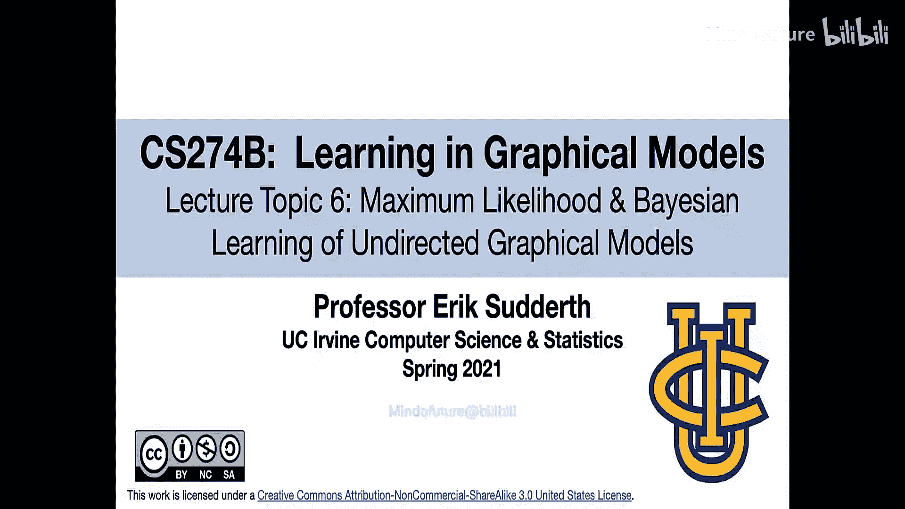

So how if you have data you can fit those parameters and it turns out that actually for the undirected models。

 so of thinking about how to learn those models naturally connects to something called exponential families of probability distributions which are used all over the place in statistics and probabilistic machine learning are really are an important thing to talk about so i'm actually going to detour a talk a bit about exponential families。

And then we'll come back and explain how this connects to graphical models and how we can make use。

Of some of the results about expial families。All right。So。

A exponential family of probability distributions is one that can be written in this form okay so first it's a family of probability distributions because there's some free parameters data right so I have a distribution over x。

For you know for any choice of theta and because theta is you can think of as like a vector of parameters that you can choose。

 you you have a family of distributions okay and then so theta will be a D dimensional vector this is this D is the dimension of the family okay they're called the theta is called the natural parameters of the distribution so it's a particular way of parameterizing。

And the way that what makes it an exponential family is the particular way that theta interact。

 so the distribution has to have this form where to get the probability you take the inner product or dot product of theta with a feature vector。

Okay。And so these features are actually formally connected to the concept of sufficient statistics。

And we'll see examples of what this would look like so but the point is that this5 x is not learnable it's something that's fixed and defines the family so even this is something that takes whatever data you have and p of x is going to compute you think about like sort of functions of that data that you think are important that you think are you'd like to capture with your distribution。

And then how do I get my distribution will I expiate this inner product of theta and p of x。

I multiply by this a function nu of x。Which you can kind of think of as being something that is called a reference measure。

 it's often volumeballs is just one so that goes away。

The thing that's special about this new vaccine it doesn't have any free parameters。

 so whatever it is， it can't be changed。And then finally， you know we have this normalization。

 the z of theta and now you start to see this is maybe looking a little bit like a undirected model right that had the same form of there you took a product of things here we take an exponent of a sum which you know has the same form and normalized so it sums to one okay so this。

Is the normalization constant？Okay。And then finally， I said note that there is a。

Theta is in some set theta and basically this set this set capital theta is basically the set of parameters for which this z of theta is finite right so for this to be a valid thing to do z of theta which is in general defined by an integral if x is continuous has to be a finite number I can't kind of divide by infinity Okay so that's that's what with this constraint so if your x was discrete you wouldn't have to worry about about this。

 but for continuous things you have to you have to。嗯。All right， so here's that setup of。

 this is that exponentialial family and again the key parts are that there's a vector of statistics that we take a do with parameters。

All right， so this if you haven't seen this before， it probably seems。Strange and arbitrary。

 but so you might say， so why is you know why do we care about exponentialial families。

 why are they studied a lot？And so so one answer is that allows simultaneous study of many popular probability distributions right so verulli categorical poisonisson exponential Gaussian gamma。

Wish artt， beta， Diishle， every single one of those distributions I just mentioned is a special case of an expial family distribution。

So thus， if you sort of establish a result of I families about how you learn them from data。

 maybe an asymptotic result， it immediately suddenly would apply to like estimation of all of those distributions so it kind of lets you study all of these things simultaneously。

嗯。嗯。By the way， when I rattle off that list， it start to say， hey。

 everything you might be exponentialential family， not quite if you want an example of a really simple distribution that doesn't have this exponential ion family form。

 a uniform distribution。So if I have a uniform distribution where you say， you know。

 I don't know the upper and lower limits and I want to learn those， you can't express it this way。

 but lots of things you can't。And it turns out that for any exponential family。

 maximum market learning is always simple。😊，So one of these things you know when you first learn about maximum likelihood you usually you go through a bunch of distributions and you say oh you know well how do I you know estimate the parameters of Bernoulli you know I set the mean to match the mean of my data how do I estimate the parameters of a Gaussian you take derivatives and you find out that oh I set the mean and variance of my Gaussian to match the mean andvari of my data it turns out that for any exponential family that is always what you do you always compute some expected statistics of your data and set the model to match them that's what maximum likelihood always is in exponential family so in some sense the reason that the solutions to maximum likelihood often end up looking kind of similar as you look at many distributions it's because they're all members of this exponential family。

Beesian learning is simple， so one thing I kind of briefly mentioned。Is that a nice thing to have is。

Property of some priors is that they are conjugate， which means that。

basicallyically when you get observations and you compute the posterior it stays in the same it's the same type of distribution as the prior so it's easy to analyze work with and it turns out that a you might ask well for some distribution what is its conjugate prior and does it exist and it turns out that you can show and under pretty general circumstances that distributions have a conjugate prior if and only if they're in the exp family。

So exponential family distributions have conjugate priors。

 most things that are non expense families and there is no conjugate prior。Um。

There's also a maximum entropy interpretation so I'm not I haven't talked about Hpy yet so this is looking ahead。

 but theres there's a sense in which if you say you know I want out of distributions that sort of make match certain statistics to my data which distribution would make the fewest additional assumptions beyond that and there's a sense in which the exponentialial family satisfies that property so it's the most random distribution satisfying certain constraints。

And you also have these nice sufficiency properties that if for an arbitrarily big data set。

 I can always kind of compress my data so finite vector statistics and do optimal learning and inference from that and so this is really a lot of the algorithms people use for kind of like learning from streaming data or really big data sets exploit this property of exponentialial families。

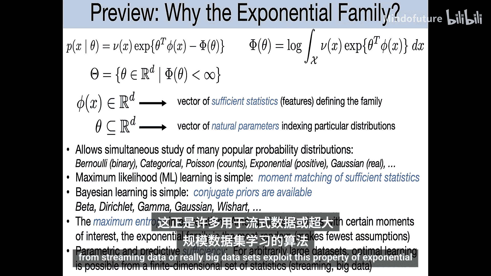

O。All right， so let's dive in a little bit， I want to remind you。

About the logistic function right this is a function that usually people encounter in the context of logistic regression right so it's this sigoid or s function that has the sigma of z is1 over1 plus e to the minus Z and just this slide is just like some identities of that I'm not going to drive all these because they're kind of simple but I'll just point out that it has symmetry right so sigma of minus z is1 minus sigma of Z so it of it's sort of symmetric about zero it has a simple derivative so if you take the derivative of this you can show it's just sigma of z times sigma minus Z so it kind of has this kind of bump shape to its derivative okay。

Um。The inverse of the sigmoid is what's called the log odds ratio Okay。

 so the sigmoid you can think of something that maps real numbers to probabilities between zero and one。

Okay，And so if you think of this like probability as like the probability of heads。

 then if you take kind of probability of heads divided by probability of tails and take the log of that that's called the log odds and that is the inverse of the sigmoid function。

看。And finally， this function， if I take the negative log of this， right you get this function here。

 this is what it looks like， and this is this negative log of this is a convex function。All right。

 a bunch of facts just just theyre they're kind of for you to refer to because they're going to be kind of showing out this in our next steps。

All right， so。嗯。😊，Here is you know probably the simplest distribution we could look at is again the Bernoulli this is just a distribution over。

Binary variables and so typically we think of parameterizing know Bernoulli by a number between zero and1 right so mu is like the probability of heads。

And so you have mu is the probability of heads， one minus U is the probability of tails。

This mu is also the mean of this distribution right so for Bulli the proligative heads is also its mean。

And so it just， mu to the x times1 minus to the1 minus x is the probability mass function over newly。

Okay， and so now I want to write the Bernoulli in an exponential family form。Okay。

And it can be expressed in this way so now the question is， you know how like。

How do we write at an exponential family right because this this is you know currently it's written in a slightly different way Okay well how can we do that right so what what we can do is we can say right so。

Um。Exential family you always have this exponent there okay so to start trying to get Eial family form let's look at the log of the Bernoulli distribution right so then I'll have you know the log of mu to the x and then from the sort of product rule of logs that's going to have plus the log of one minus mu to the1 minus X。

And then I can also write that as if I have mu raised to a power and I take the log that's the same as that power times the log of mu it's another property of logarithms okay so I have x log mu plus1 minus x log of1 minus mu。

And you can see now I can start now if I just collect terms。

 I have an x here and I have a minus x here， so this is the same as x。

Times log of mu minus log of1 minus mu。😡，Okay。Plus this other term here。Which doesn't depend on x。

Okay。All right， so from this simple argument right from this very simple derivation， we can see that。

This is if I define theta to be this log mu minus log of1 minus mu。

Then I've expressed my Brunoulli distribution in this exponential family form。Okay。So a Bnoulli is。

A distribution in the exp family For has this。The vector of statistics that phi of x that I showed before is just x。

Right so the statistic is kind of the data itself。And so the theta is the log odds。

Right the log of probability heads， minus log of probability of tails。

 and then because of what we know about the logistic function， we know that if I wanted to say。

 you know what is the mu corresponding to a given theta。

 you would take the theta and plug it in to the logistic function to get your mu back。Okay。Okay。

So so you can think of it as as a it's an exponential family distribution。

 but it's one in which the natural parameter is not the probability of has。

 the natural parameter is this log odds ratio， so it's a real number that can take values anywhere between minus infinity and plus infinity。

RightAnd so when theta is zero， then you have a sort of fair coin probably as is a half。

 when theta is positive， the probability of one is bigger than a half， when theta is negative。

 the probability of getting to one is less than half。嗯。All。And then finally。

 to finish this I'd have to evaluate this normalizer right and so that is going to be right I have to basically take e to the theta x。

And then I sum that over all possible X。So x can be  zero or1 so e to the zero is1 if I plug in x equals 1 I get e to the theta and so this。

This capital phi of theta， this is this log normalization。

 this is the log of one plus key to the theta。😊，Go。😮。

That's the thing you would need and if you look at it。

 this is this now again why is it a function it's a function because right if if I I think of theta as a parameter for so for eight different values of theta I have to plug in a different number for five theta to get distribution that integrates to one。

And so that's what this。Function this is just a plot of that function it's a convex function right it curves upward's it's roughly for as theta gets to be a large positive number this is approximately theta this sort of add one doesn't do much so the log and xonent roughly cancel so this is about an identity function up here and then etcter。

Are there any questions on this？Oh yes， can you go over why？

Can you go over y mu equals1 plus e to the negative theta again I'm not sure how you direct it well。

🤧To do that， what I could have done is I I could have。U。Simplified this。

 basically I take this equation， I take the exponent of both sides of the equation and solve from you and you would get this。

I didn't do that right here because I recognized that this was a special case。

Of the logistic function。Right so I know that if sigma of z is 1 over1 plus e to minus z。

 then if I take this log odds， that is the inverse of it so I'm kind of using that identity。

But yeah you could if you didn't remember that you could have basically take this theta equals log of mu minus right so that that theta equation I got from this previous slide here right that's how theta equallying that came from that previous slide and now if I wanted to solve from mu you just take the exponent of both size this equation and do a little algebra。

And you would come back to this equation here。Right right right and so again like on I should have probably labeled the axis to this plot on this plot right this is mu this axis is mu and this horizontal axis is the so this function is the is the correspondence for you know if I plug in for any theta you pick there's a corresponding mu and vice versa。

Okay， good。Any other questions？か。All right。And so there's lots more distributions I can express this way。

 So if I have a。A categorical distribution right again， this was like a single role of a。

Of a die right so its here muk is the probability that it takes outcome K。

I can also write that in expential family form。Okay。

 and kind of it' it's a it's sort of very much like the。呃。

The previous one just a little more notation， so I'm going to skip the details。

 but you can write this as the E to the sum from1 to K of theta K xk so I have the indicator of whether x takes a particular value k times theta K。

And then here I have my normalizer。Um。This is the you exponentiate the thetas， you sum。

 and then you take the log。So as you start running around and actually in models and sort of applied like neural network stuff you'll see the log sum X function。

 so this is kind of where that function comes from in terms of the statistical models。

And now note the mapping between the muse and the thetas is that softmax function。We saw the phone。

And and so you might say， oh， isn't it interesting that the logistic and softftm function show up in the exponentialential families。

 and in fact it's the other way around the reason that that logistic regression exists is because of this exponential family connection。

嗯。Um and so a lot of that literature on building those types of generalized linear models uses exploits exponential family ideas。

不か。Um so you probably won't be surprised I can write a Gaussian in the exp family because the Gaussian is already sort of exponent of something right a Gaussian distribution has some normals。

And then I have the exponent of a quadratic function right I have if I have a multivariate Gaussian。

 I have x minus its mean transpose， and then I have the inverse covariance。Times x minus the mean。

 okay， so that's some quadratic function of x。And so。So if you want to write that as a。

In the exponentialial family， it's convenient to parameterize it in a different way。So normally。

 right， you conventionally think of there being a mean vector and a covariance matrix。

Prameterizing a multivariate Gaussian， but you could also parameterize it。

Let's take this quadratic and expand it out。Right so if I kind of expand it out into four term into terms I will get you know those like a x transpose sigma inverse X term there's a a mu transpose sigma inverse X term and then I have a mu transpose sigma inverse mu okay so this is kind of like take a quadratic and expand out the terms you would get this this is an equivalent way to write that if you look at it you can say that in fact you can write this in terms of。

Other parameters， so if I instead of parameterizing my Gaussian by a mean and covariance。

 I parameterized it by the inverse of the covariance。

And the inverse of the covariance times the mean。Okay so there's lambda inverse covariance。

This theta the inverse covariance times the mean， then this distribution just looks like this right so I have x transpose times lambda x plus this vector here。

 the dot product is vector with x。And then this is just sort of part of the normalization constant。

 right this doesn't depend on x it's part of what makes it integrate to one。嗯。我看。

And so this is a special case of the general exponential family form right and so now if you say you know what are my statistics。

 well I have you know for every variable， I have the value of that variable and the value of that variable squared。

And also I have for every pair of dimensions of x， I have kind of the product。Okay。

 so you can think of like a Gaussian in terms of the exponential family is capturing the variable。

 the variable squared as well as the sort of correlations between different dimensions。Okay。

All right。Questions on that？Okay。And I'm not。Doing it here。

 but well of course in exponential distribution you can kind of see how that would obviously be in the exponentialential family。

 other things like a Poisson distribution for example。

 you can also write that in an exponentialential family geometric。

 lots of those things can be written this way。对。嗯。啊。OhActually， I don't have a slide on it。

 but I'll mention this。In the general definition。

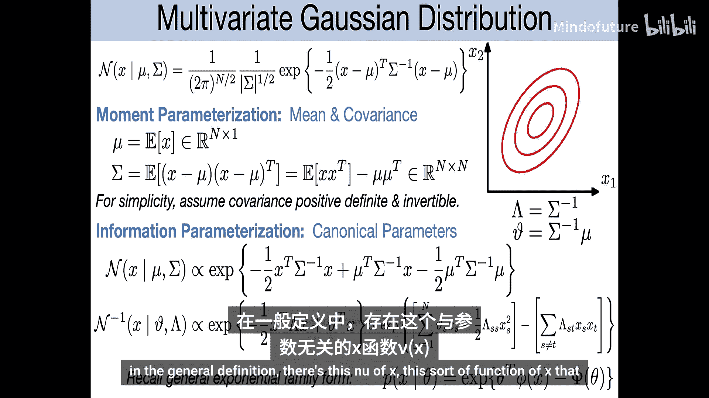

There's this new of x， this sort of function of x that doesn't depend on the parameters。

When you write a Poisson in the exponentialential family。

 that's where the kind of like one over xtorial part of the Poisson goes。

So you kind of meet that general capture a pson。看。But that's not really important for the specific things we're doing with kind of graphical models。

 so I'm not emphasizing it here。

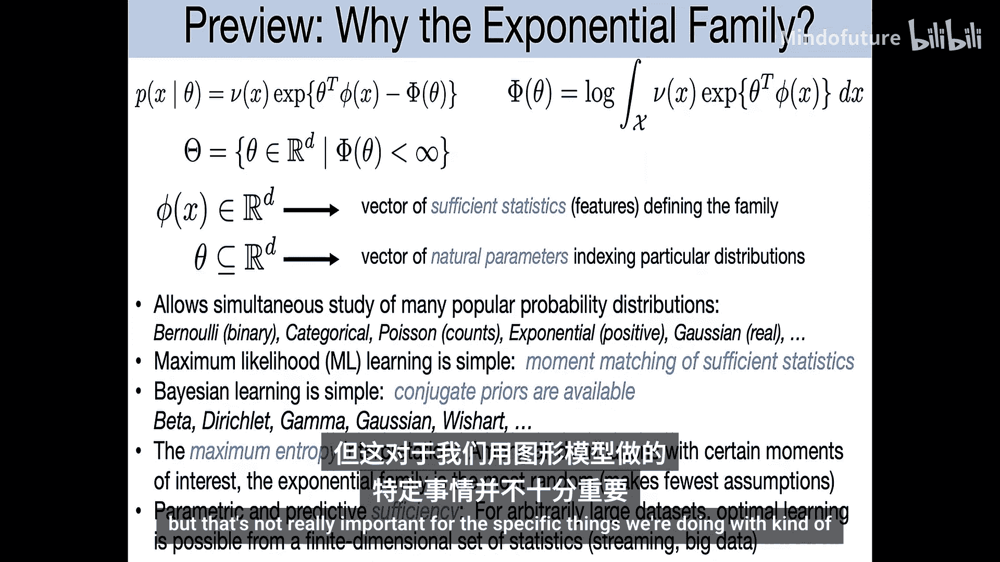

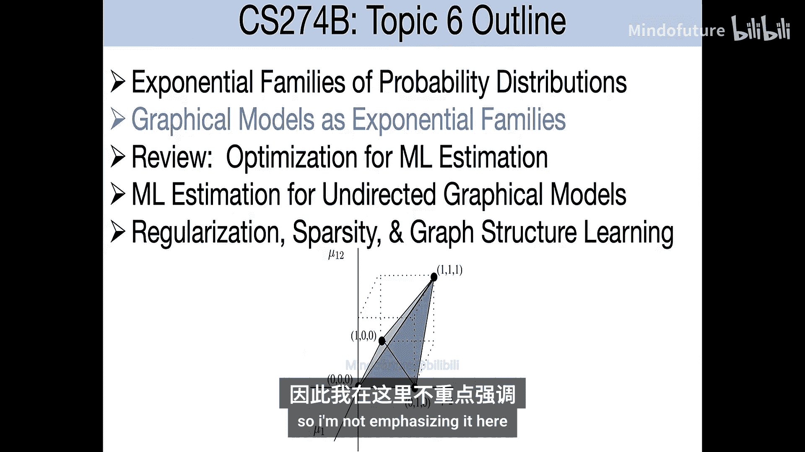

All right。Now I in if I specialize to kind of discrete variables right then some of that general some of the general form changes right so if I have a discrete variable now the normalizer will involve a sum rather than an integral。

Okay， so I have the exponent of the transpose the of x， sum over all x and take the log。

 that's my log normalizer。And then you don't have to do this， but the convention。

 the very widely used convention is that for discrete variables which have a finite number of values。

 your features are usually indicator functions so the features are just binary so you think of like the features are just saying does this variable take this value or does this combination of variables take this value？

Or are these two variables equal to each other or not， things like that？Okay。

That's kind of without loss of generality if the variables are discrete you can always make all the well in a lot of cases you can make make them binary okay so then my features is going to be kind of this binary vector of indicators and then you know I have a vector of parameters and so if there's there's no like normalization issue right so for any theta they will integrate to one。

And so we saw the Bernoulli was a special case of this to get a more interesting。

 the kind of simplest， slightly more interesting example。Would be。This， okay。

 so let's suppose I have two binary variables。Okay so I have x x is sort of x1 and x2 and they're both binary。

 so I have like two bits for possible outcomes， and I don't want to assume that these two variables are independent。

 there might be some dependence between them。Okay。And so an exponential family that captures that looks like this。

Okay， so I have a I'm going to have。Three statistics right， I'm going to have the value of x1。X2。

 so I have theta 1 times x1 plus theta 2 times x2， and then I have a third indicator。

 which is x1 times x2。So any of these are binary variables， x1 times x2。

 that's the and function so that basically is one if they're both one and it's zero otherwise。啊。

And so I have these three and then I I can say that my distribution is going to say you take you know the value of x1。

 the value of x2 and the and of x1 x2， and I multiply them by three numbers theta 1 theta 2 and this one we're calling theta 12 right so those are three real numbers。

And then you exponentiate and normalize。Okay。Right。And。So you can think of this as now these。

Three these。嗯。If I think about the expected values of these statistics and we'll see later there's a nice connection between the expected values of these statistics and the parameters。

 then what they would be is kind of you can think of this as like，The expected value of x1。

 that's just the probability that the first variables one expected value of x2 is probably that the。

ASecond variable is one， and then the expected value of their product is the probability that they're both one。

嗯。All right。And so this is kind of a， you know， this would be the exponential way of writing a distribution over two binary variables。

Um。啊。So now by the way， if I think of like these， if you think of like if you parameterizing your distribution over two variables with these。

😡，Three numbers， then in fact， you kind of have to think about constraints。Right。

 so if I take mu1 mu2 and mu12， then this sort of pyramid region is the set of。

Mu values that you could achieve from some distribution。And they're not independent so for example。

 you can see where some of these constraints from is that。

The probability that both variables are one always has to be smaller than the probability that a single variable is one。

Right so mu12 is always less than mu1 or less than equal to mu1 for any distribution。

 I think it's impossible to have it be more likely that two variables take a value than just one of them。

Right， and so there's some linear constraints between these different mus and those that's these where these faces of this plate come from。

Okay。And so if you wanted to like try to learn a distribution over two variables with dependency。

 you would have to take account for these constraints right that things you know kind of sum to one and there's inequalities on the other hand here the thetas are unconstrained real numbers I can plug at any values of thetas。

Okay。And so'm not I'm not going to quite show it here。

 but it turns out that I can capture an I can write an arbitrary distribution of over two binary variables using just。

In this form， using these three parameters。But probably shouldn't be too surprising right because you didn't think of it I just think of like the。

The matrix of the probabilities of the four。Possible outcomes well those are four numbers but they sum to one so really you only have kind of three degrees of freedom because you know the fourth one is one minus the sum of the others。

And so that's why you have these parameters。Okay， so this would be a。

The sort of standard exponential family way of writing a distribution over two binary variables。Okay。

 and later， we'll be looking at， you know， generalize this to have lots of finearies。

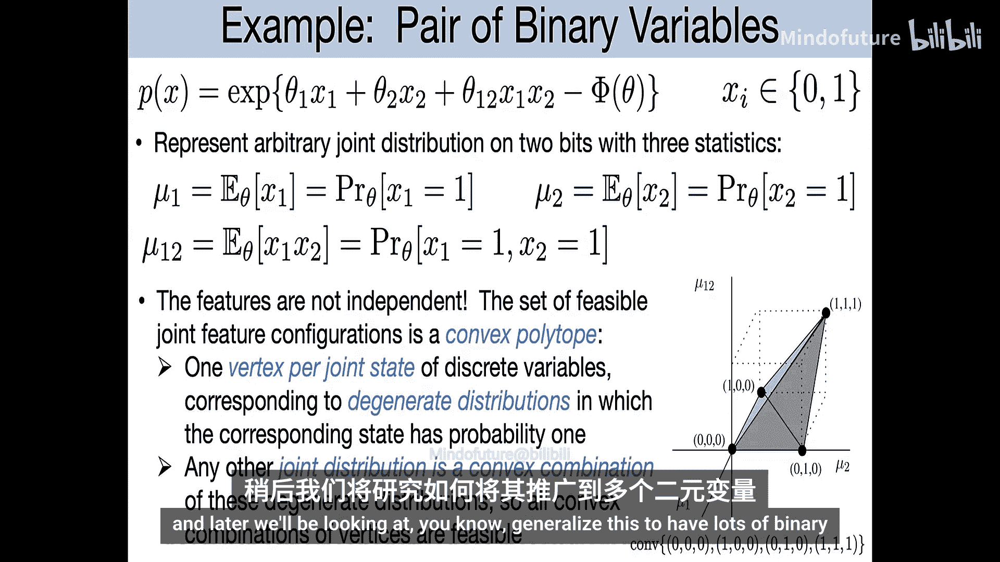

。All right。And so they head towards that generalization。

There's a really simple way that that this links into undirected graphical models right so remember this is。

WhatHow we presented factor graphs or undirected graphical models is right you have a set of factors。

And each factor is this non negative。Potential。啊。Some non negative function of x。Okay。All。

 and so now and then you multiply your factors together and you normalize so they sum to one。

And so now if I want to learn like an undirected model or a factor graph。嗯。From data。嗯。

Now you I want to have factors that are tunenable right that I can change the shape of my factors and then find the shape that fits my data the best to like maximize its likelihood or maybe I'll do some vision  estimate or something like that。

And so a convenient thing to do right because remember these size have to be non negative right they can never take a negative value。

 so a convenient way to parameterize them is to say well。

 to getsi what I'm going to do is I'm going to take an inner product between some features。

That I define。And a vector of numbers。And that could be a linear function。

 it could be positive or negative， but then I exponentiate and I'm guarantee that it's。Positive。Okay。

 so putting the exponent here is a really convenient way to make sure that you satisfy the non negativity property。

And if you look at this， right， this is essentially like if I parameterized this way。

 this is a local exponential family， seeing this is like an exp。

 this factor is like an exponential family distribution。😊，That has。Some features5hiF。Okay。

 and so this is， you think about it these features are a function of variables connected to that factor。

And there are。m you know， there could be as many of those features as you want。

 you could have a few or a lot depending on how much flexibility you want in your distribution。Okay。

And now if I define my overall distribution by taking the product of these factors。Well， you know。

 because those are e to the something， then that'll just be the same as E to the sum overall the factors of the sort of dot product for each one。

Okay， so the overall thing is like one big exponentialial family where you have kind of features from every factor。

OkayAnd then there's this global normalization concept that makes sure things sum to one。Okay。

So's kind that's the reason right so that kind of there's this natural connection between because you take sort of this product and normalize in a factor graph。

 kind of when you start parameterizing the factors you very quickly get to something that looks like an exponential family and that's why those ideas are really sort of central to learning these models from data。

Okay。Okay。So that's how I think of graphical models and exponential families connecting is by by factor graphs there's also the undirected connection is nice。

 so what I can do is so think of how your modeling effort would work you would say you would first start by picking some features to define your exponential family。

Pick whatever features you want， whichever ones you think are important。

And then you can use a factor graph to represent the structure right so for each feature I pick itll there's some subset of variables it depends on and I can basically you can draw a factor graph where the factors are saying you know I have one feature that depends on x1 x2 x3 and another feature that depends on x3 x4 and another feature that depends on x3 x5 and so on。

And now if you create an undirected graph with a cl for re factor building。

 then you can think of that undirected graph as basically visualizing the Markco properties。

So what's interesting is if you define， if you kind of pick features implicitly。

 you're making conditional independence assumptions。

When you set this way and the undirected graph can help if you visualize those。嗯。Question。

 any questions on that？Yeah， I think that see sort of a great hand I go ahead。嗯。

I haven't quite thought this through， but like in the same way that some distributions you can't express in exponential family form。

I mean， would there be graphs for which you would not？

Want to express your potentials in exp family form like is there a limitations Yeah well so the the constraint here is is that。

嗯。😊，So this is something I will actually mention explicitly kind of at the very end of the course。

Because it's sort of more of like a。I would characterize it more as a research topic than something that's really established。

Right。This exponentialial family connection， let me go back。Basically。

It's there as long as my factors are expressed。😡，In this way。Okay。But。

You could imagine that if I had， I don't know kind of。Complicated variables。

 and I thought I had a complicated distribution that maybe this isn't expressive enough。

Maybe you would want some more complicated nonlinear function of your parameters。Okay。

And so there are methods that use that， and then if the sort of log of your potential is not a linear function of the parameters。

Well， then you would still have a factor graph， but it would not be an exponential family。Go。

And an example of kind of recent work that does is there are methods that say， well。

 I'm going to make this。This factor graph， I'm going to parameterize it by like let's say some type of deep neural network。

Okay， and then try to train that to build sort of a probabilistic model of my data if you do that。

 you won't have this exponential family connection。U。On the other hand。

 there's a lot of things that are coming next in terms of if you do parameterize it in this way of interpretability and making it easy to do learning and so on and kind of if you did a just arbitrary non nonlinear parameterization kind of all that would go out the window so there's a little bit of give and take there。

嗯。Good question， though。Any other questions？Okay， so now we're going to get to the part where because of kind of how the。

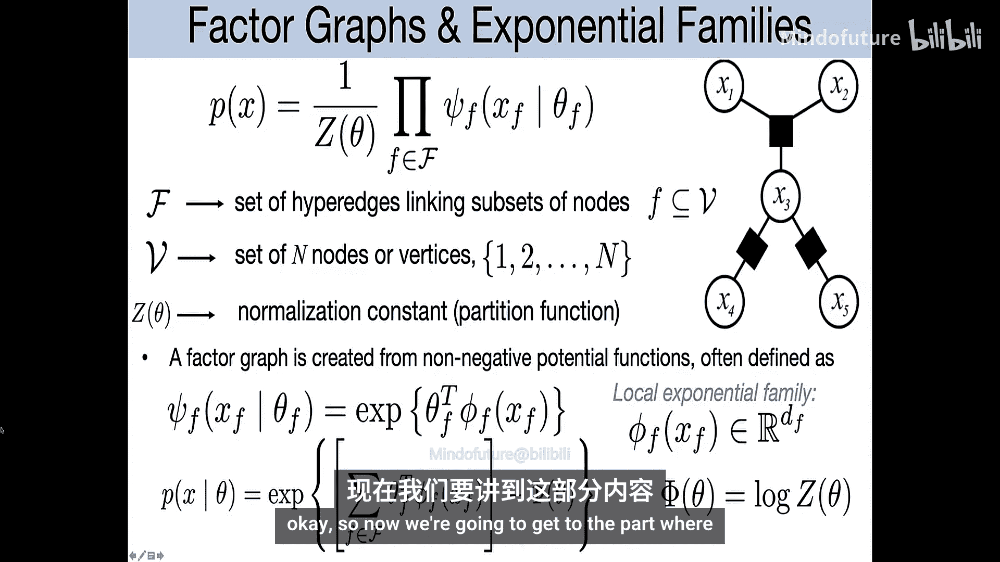

Ends of lectures fell we a little out of order so。At the end of last lecture I reminded you a little bit about gradient descent and some ideas related to that okay so that's what this part of the slides were so I'm just going to skip those except to remind you that there was a nice property of。

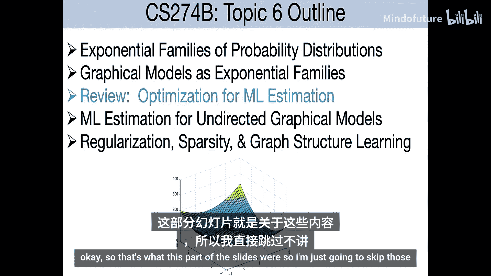

So when we in optimization they typically like to talk about minimizing instead of maximizing right。

 so usually you phrase maximum likelihood as minimizing the negative log likelihood。

And so we have this nice property that the。呃。The if you have a convex negative log likelihood。

 then at some level your life is easier right because you know you can kind of initialize any parameters and do gradient descent and you will find the global optimum。

嗯。And so the result that is coming next is that for any exponential family distribution。

This includes any like factor graph parameterized exponential family way。

 no matter how crazy your features are， if you choose this if they have this exponential family form。

The negative log like it is always con。嗯。And so somehow your life for parameter between the parameter estimation is easy okay so that's what we're going to show next and so we're going to look at look at convexity and it's important because it's going to make estimating parameters easier。

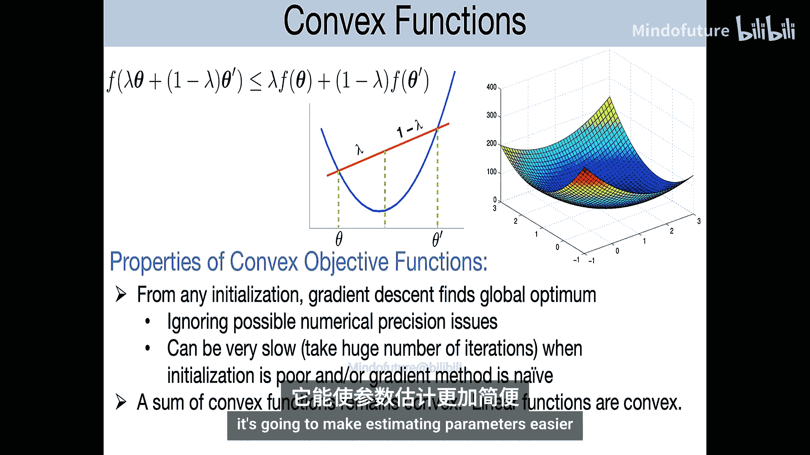

Okay。So。嗯。Now we need an identity here and。Because。Trying to do derirogvationations through Zoom。

I hate so sometimes in other years I might write something on the board here。

 but I think I'm just going to let it go there is a if you take this function，😊。

And you say a function， this log normalizer is a function of my parameter vector theta。Okay。

 if I take the derivative of this function with respect to one of its。Prameters。

And so why I'm interested in this， well， one thing is what you think about right if I。If I。

One a new maximum likelihood then i'm going to need to sort of take log likelihoods and take derivatives to figure out you know to sort of do gradient descent or find find a point where the derivative equals zero and so i'm going to need the derivative of this phi theta if I take its derivative。

Okay， and then you start doing the chain rule right so you have the log of something so you get one over a normalization constant and then you kind of。

You can under regular assumptions that hold here you can push your derivative inside the integral and then I take a derivative of E to the stop product and derivative e to something that's just e to something and then by the chain rule finally I get。

The derivative of this dot product， if I take the derivative perspective to one entry。

 I will get to theta a， I will get the corresponding entry Phi a of my feature vector。

So if you do this and simplify， what you find is that if I say what is the partial derivative of this log partition function with respect to a particular parameter of theta a。

 it is the expected value of the corresponding feature。Okay。Yeah。

Or that is to say if you did the calculus and just kind of did four lines of the chain rule。

 you would come up with it equally in this and if you look this is just the definition of what the expected value is。

Again， how do I interpret this now remember I have a family of distributions。Okay。So let me。嗯。

I this is there's a subtle deal that sometimes people get confused about so think about here right the gradient remember is a vector that says if I have a you know a set of parameters it's sort of the partial derivative with respect to each of those parameters okay so think about like if I had an exponential family with two parameters theta1 and theta2 then it would be like each point。

In the plane here would be like a different probability distribution。

So there's like a different probability distribution for each thing。

And so what we're saying is that this log normalizer， when you take its derivative。

 then the gradient vector。Is interestingly just the expected value of the statistics。

Under that distribution， right， under which distribution the one that corresponds to the sort of like theta。

 which you're taking derivative。Okay。All right。All right。So the first derivative is this。

And if you then。Take a second derivative， and then it's sort of the same thing， but messier。

 you will find that the second derivative。If I take the second derivative a partial respect to theta a and then a exposure with respect to theta B。

 I get。This， and what is this？recognize this？う。It looks like like the like a varianceance， no。

 it is the covariance。of。Feature A and feature B。So I take this partial derivative。

 I get to be covariance。Okay。All right。嗯。And so thus that's kind of for single injuries。

 but now if you put those together， what you find is that the gradient。

Which is a vector is simply the expected value of your feature vector。And the Hessian， remember。

 the Hessian was the matrix of all second derivatives。This is the covariance。

 the Hessian is a covariance matrix， it is the covariance of my feature vector。Okay。So。

So there's lots of nice implications of this， so first is that when computing gradients。

Is equivalent to finding these expected values of your statistics or moments。So basically。

 if I want to compute my gradient for learning， I end up needing to do inference to say under my current model。

 what is the expected value of a certain？Stattistic。Okay。

This is why we talk about inference before learning。

So it turns out that actually you're going to have to each step gradient to set run like a kind of inference algorithm。

Bre。If you look at now at this Hessian。Mattrix， well the hessian equals the covariance。

 and one thing we know is that for any distribution。No matter how crazy your distribution is。

 the covariance matrix is always positive definite。は。

And one thing I told you last time is that if you have a function whose hessian is positive definite。

 then it's convex。So thus， this is one way of seeing of proving that this log partition function Phi of theta is always convex。

系。And thus， you know learning is a convex problem we have no。Loal opt。Okay。So。

So now here's my general exponential family。Okay if I take the log I have this this is the key part I have the dot product between my parameters and features here were those like kind of extra terms those reference measures and kind of for learning those don't matter because note that these terms don't depend on theta。

And then I have my log normalizer。Okay。All right， and now let's suppose now I have L observations。

so then the log likelihood of my L observations will be kind of you to get the probability of L observations。

 you multiply their likelihoods or some their log likelihoods。So what am I going to have。

 I'm going to have this constant C that that's just these。

Log reference measures that those don't depend on。Data。Then I have the sum of for each。

Of my observations for each of my L observations， I have the dot product between the features of that observation。

And the theta vector。And then I have L copies of this normalizer PhiF theta。Okay。

And now if I think of the negative of this， the negative log likelihood， well。

 I have a convex function here。And then here I have a linear function of the， right note。

 no matter what my features are， this is always a linear function of theta。Okay。

 and so the sum of a linear in a convex function is convex and thus this overall function is convex and gradients have a simple form right so we told we saw in the last slide that the gradient of the log normalizer is just the expected value of the feature vector。

ok。And。Now if I take the gradient of this dot product， right？

Then you just get the sum of the features。G derivative of linear function is really easy。

And so now what I want to set this to zero， right， I should say that at the maximum likelihood solution。

 the gradient should be zero。Under these circumstances because I have a smooth。

Optimization problem with no constraints。And。So what does that say that says？That。😡。

If I just set this to zero， what does this say， this says I should pick my theta so this is true。

I should take。The features。Evaluate my feature vector on every training example and average them。

And then what do I do then I take I find the model for which the expected value of the features is exactly the same as the average of the features on my training data。

So this is is like have some empirical moments of the data and these are moments of your model and you match these things。

😊，Okay。All right。So if we come back， right？What does this say that this says that from a Bnoulli distribution？

So a lot of you have probably like found the maximum likelihood estimate of a beulli by maybe by taking the top equation and。

You know。Taking the derivative with respect to mu and setting the zero and doing algebra and so on。

 but from this identity， we know that basically the。Maximimate likelihoodhood is always going to be。

TheThe distribution that。Setets the expected value of the statistic。

 So in this case that's just the expected value of x to match。

The empirical expected value from the data in this case。

 this just says that you should take the mean of your data。And。

Set the mean of your model to match it。Okay。So that's what。This is what this equation here。

Becomes for this Bulli distribution because it says you should set the mean of the model to match the mean of the data。

And now for this really simple model。😊，Because I know that the relationship between theta and mu is given by this logistic function。

 then I can find the optimal theta hat， it's going to be the log of mu over one minus mu。Okay。嗯。Okay。

Yeah。And。Also from this identity。Right， if I。Go back to my。

Slide where I wrote a Gaussian in the expential family。You can see that immediately。

Right from looking at this exponential family form， you can immediately see that， oh。

 maximum likelihood for this Gaussian is basically going to have to take the mean。

And the sort of second moments， so it's going to have to take the first and second moments of my data and choose the model has the same first and second moments。

And so that's the same as saying take the mean and covariance of my model and match them to the mean and covariance of my data。

Okay， and so I can just see that immediately by looking at the vector。

 I don't have to actually like take any derivatives specific to this model。Okay。嗯。So。嗯。So。

And so I'll just say that。I view that this fact here。

 this kind of this structure of Iial families is definitely in the top five or 10 most useful things I know in my work in machine learning。

And the reason is because I， you know， sometimes you work on a problem you say， well。

 here's this fancy distribution that we think is going to be good for this。

Before you even like try to take derivatives or do analysis to data。

 you can just look at it and you can say aha， I know exactly what property the data this distribution cares about。

 all it cares about are the expected values of these statistics。

And I know that once I figure out how to fit it to data that's what I'm going to capture and you can say is that actually going to be helpful to me right does that capture what I mean or doesn't it？

And that insight is like really valuable without， you know。

 without just viewing it as like a black box that you would have to fit to the data and then apply to test data or something like that。

あつ。All right。So。Now。If we specialize in on the case where we have。Discrete variables right。

 so remember I told you that。For discrete variables， the features are usually indicator functions。

Okay， so then the。If that's the case， right， if my feature is just like basically something that says。

 you know。True or false did a combination of variables take this value。

 but I can remember for when we talked about two binary variables we had features a feature that was like the and of those variables。

Then in that case， the。The derivatives of the normalizer。

 they' expected values of these features and they're just going to be the probabilities of events。

 they'll be the probability。That like a particular feature equals one。

 that's what these derivatives are。Okay。And then the。

The second derivatives are going to be the sort of covariance of those features。Okay。😊，嗯。

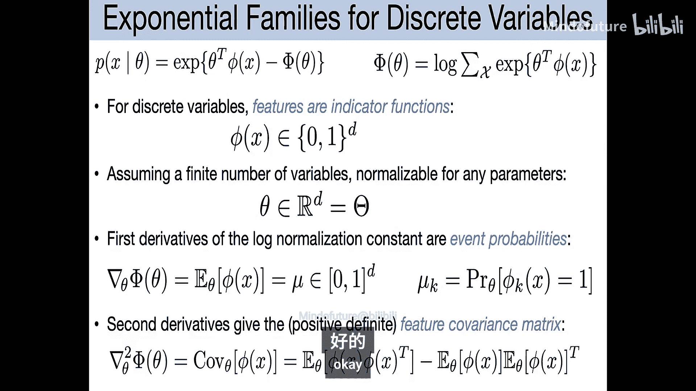

啊。Let's see what is。And I sort of went through this before the structure of。呃。

How exponentialial families link up to factor graphs we talked about that before so。

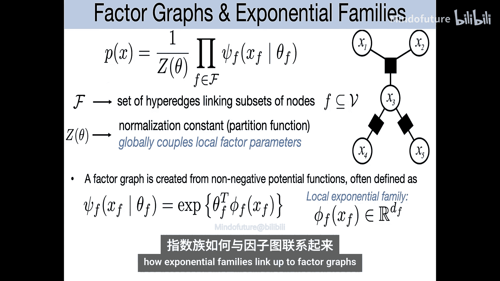

And so。Now， if I have this representation， so this is this slide， I mean， the notation。Its messy。

I'm sorry about that， but the high level idea is like what do I have now the idea is that I'm going to have a model I want to learn。

😊，So this is my distribution， it's a product of these factors。Okay， and normalize。

 and then I'm going to have L training examples。So this is like L observations of the variables that are in my model。

And now。The log likelihood of my data is going to be look like this。

 I'm going to have a sum over the all examples， the sum over all the factors of this inner product between the parameter vector for that factor and the features for that factor。

Okay。嗯。And so this is now what the kind of exponential family that I would then be learning with that previously thing。

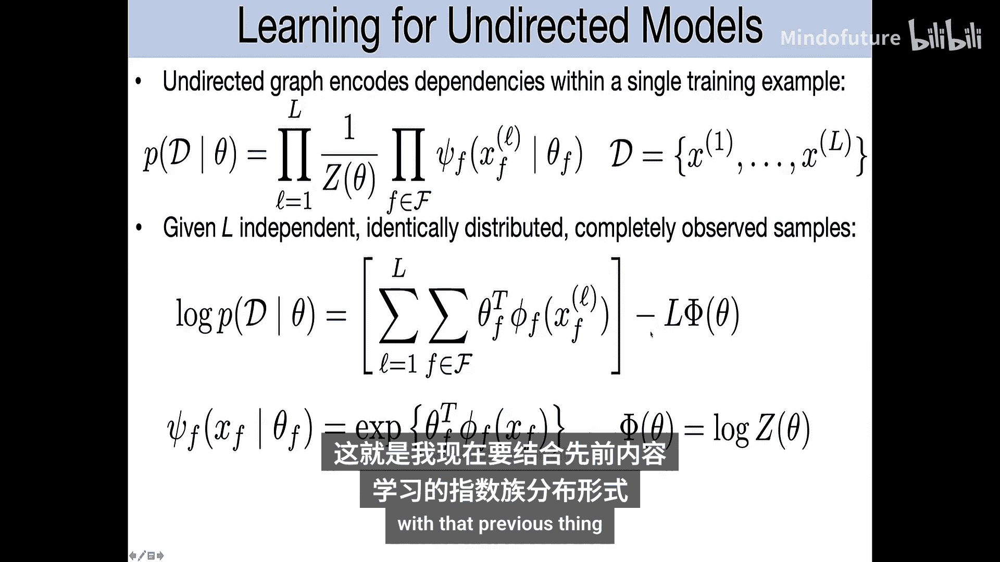

嗯。So to make this a little more concrete， right I mentioned this this sort of like。嗯。You know。

 these image crossing applications where you have。嗯。

Steo vision like so we have a pair of cameras and want to predict the depth of points in this world and I talked about this for as like an inference problem where I have you know observations of the pixel values and the depths are unknown and you want to predict them。

However， how do people actually build these models well actually they usually get some data where these the depths they want to predict are also observed right so for example。

 if you want to predict depths well you know you can outfit a car with a laser laser range scanner that used to be an exotic thing to do now have the startup in Silicon Valley are doing this and and drive around and this laser range scanner will kind of give you this is like what it gives you where I give you these noisy but pretty good estimates of depth in the world and now you can like think of this like as your data right so now you have images and depths and you have all these features of them and now you can try to sort of find a model that models what's the statistical relationship between image features and depths okay。

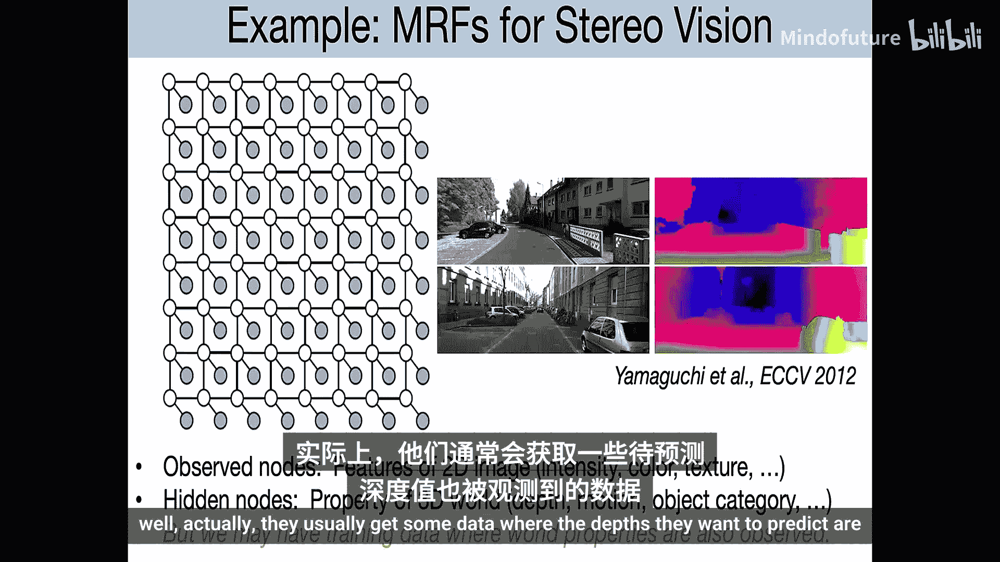

And so they do this kind of thing。And then once you fit the model parameters。

 then you could apply them to a case where you only have the images and the motivation for that is that these laser scanners。

Cost about 10，000 times more than a camera。嗯。Okay， so the。Again。

 so this is how you would have kind of。completelete observations of your data so you know the x's and you can compute your features。

And so now。Yeah。mIf I have these， you know。These these are。Independent samples。

 this is the log likelihood to and now if I take the derivative let me take the derivative with respect to the parameters and just a single factor。

 this is like a thing of this a piece of the gradient the gradient with respect to the parameters and one factor it'll look just like this right so I have the sum of the features for that factor all the things and then I have minus L times the expected value of the features。

In that factor。Okay， so what is this， this is under my current model。

 the expected value of the features in that factor。

And so to compute so this this part is easy right you just this is just like a for loop over your training data so this is easy to do this is the hard part you're thinking about what do I have to do here right this is features that depend on this so in fact what I need is I need a marginal distribution。

To compute this expected value， if I have the marginal distribution of the variables in a factor。

 that's all I need to compute this。So in fact， you would。

If you have a graph that was tree structured， then basically at every step of gradient descent。

You would run the some product algorithm to get the current marginals。

Then those marginals give you this expected value you can plug in to your gradient and then you take a step to a new model and now you do some product again and so on。

And you keep evolving the model until this gradient is zero。

 which means that the expected value of my features and the expected value and the sort of like average of the features and the data match each other。

嗯。If I had a graph with cycles。😡，Then you know， well then you'd have to think about perhaps you could do something like the junction tree algorithm。

 you can also think about things like Loiebleak propag。

 all that brings up subtleties because now suddenly you're not computing the right gradients。

 you're computing some bias gradients。

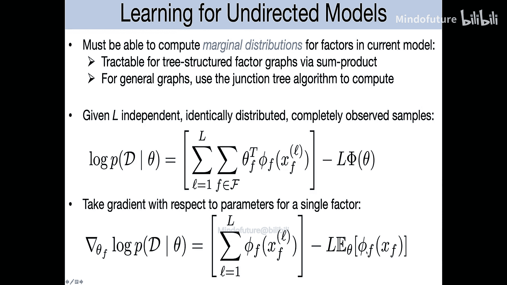

Okay。And so the。Now you know there's like details but all the packages for fitting all the algorithms that are out there for fitting undirected models to data have this structure right is that you know other than these kind of classic textbook Eial families like a Gaussian or Bernnoulli there's usually not a closed form right if I say you know how do I pick the theta so that the ded is zero you can't find it so instead you have to do optimization。

ok。And the best methods are the one at the bottom， these gradient。Assent on this log likelihood。

And so again， another bit of intuition right so think about it is that what is the gradient here。

 the gradient I told you is the is the。When the gradient is zero。

 that says that the mean of the features and the mean of the model match。But now look。

 the gradient is basically the difference between those things。Right。

 so what does this say this says that。What this will say is that if I think of my vector of features in the dimensions where the model expectation and the data expectation。

WereRe far from each other， then the gradient or derivative is big。The derivative says， oh oh。

 you have a really bad match to this feature， you need to make change this parameter a lot。

And conversely in the dimensions where you almost have the match and the gradient is small and you won't be changing that much。

嗯。So maybe another little bit of intuition there。I will mention if you start reading about。诶。

you know， methods for fitting these kind of models of data。

 sometimes you will run into algorithms that go by the name of iterative proportional fitting or generalized iterative scaling。

And so these algorithms is IPF， so the IPF algorithm what it does is it says rather than ingredient descent it does coordinate asscent。

 so a way to optimize a function of a bunch of parameters is sort of say I fix all the parameters but one and then I kind of like take that remaining one and I set it to its best value and you iterate。

So if you kind of go through one factor at a time and kind of change the parameters for that factor fixing the others。

That's what these algorithms do。嗯。I kind of think it's not worth going through the details of how their equations work think I think just understanding。

This gradient gives you most of the insight， so I'm not going to dive into that。不改。嗯。Any questions？

So I know that this bit of math in here。

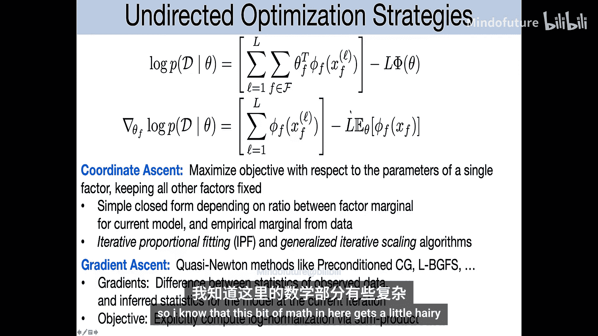

It gets a little hairy I put it in here for for completeness I encourage you if you're trying to like wrap your head around this there's really like。

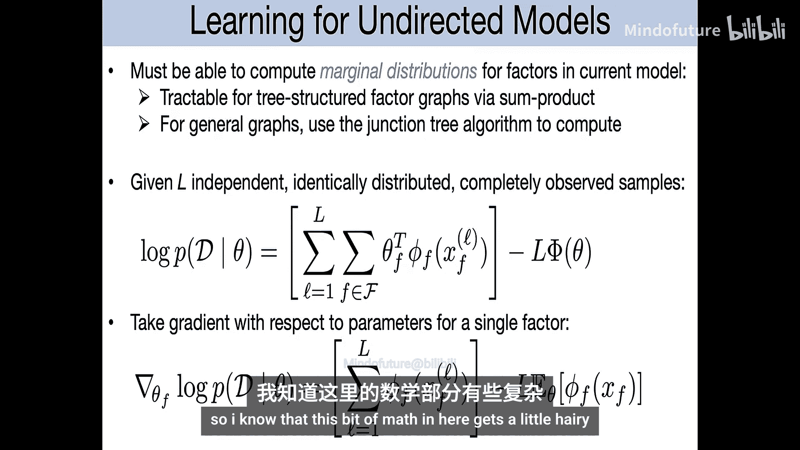

Two ideas。

The two key ideas are that if。I parameterize。My factors as E to the dot product of parameters with features。

 then my overall model is an exponentialial family。That's one。 and then the second key idea is that。

For。给你。Exponential family， no matter how crazy it is， no matter what features I pick the gradients。

The log likelihood and the gradients always have this simple form。Right where you're computing the。

The the sum of the features on your data minus the expected value of。

The features with respect to the model。Okay。

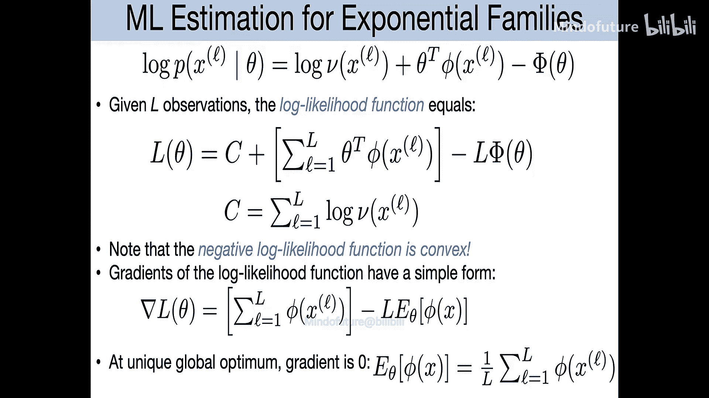

All right。Any questions on that？Okay。Oh。不。

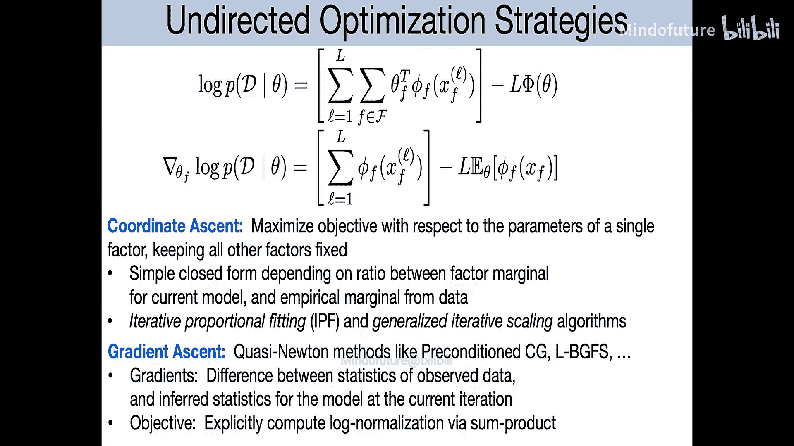

。Okay。嗯。And so now I want to。You know， if I'm going to have flexible models with lots of features。

You won't be surprised that overfitting becomes an issue and regularization becomes important。嗯。嗯。

You know， I don't know， sometimes people say， hey， you know， since I have。

You know big data sets these days I don't I have to stop worrying about regularization and my answer is it seems to be always no because and the reason that the answer is always no and forever will be no is that as soon as people get more data instead of saying oh you know I'm happy with those models I was fitting 5 or 10 years ago and now I don't have to think about regularizing them well instead they say no no I have more data now I'm going make my model 100 times more complicated。

And try to fit a yet fancier crazier model to my data and then to fit that yet fancier crazier model you need regularization so somehow I think regular never goes away because the models just get I mean if you've seen anything of the hype over over over neural networks and stuff right its kind of you get more di you just make the models bigger and bigger so you always need regularization it's the same story here okay。

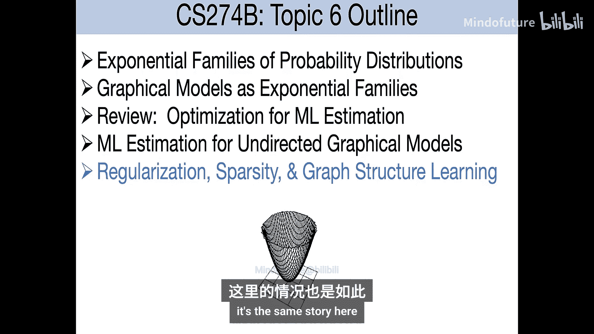

U。😊，So。I have an exponentialential family right， so I have this dot product of。

Praameter data with features V of x。so thiss just kind of what I showed you before and so but what we want to understand is sort of like。

You know what priors on exponential family parameters P of theta？Would favor？

Simple discrete distributions。So if I want to kind of bias myself to be not overfit。

 what property should that prior have？and it's it's not obvious right because these data these these kind of natural parameters are are you know they're not they're not directly like the means of the features right there's like this nonlinear mapping between the natural the thes and the means of the features so it's maybe less obvious so to understand what would make sense let's look at a few examples。

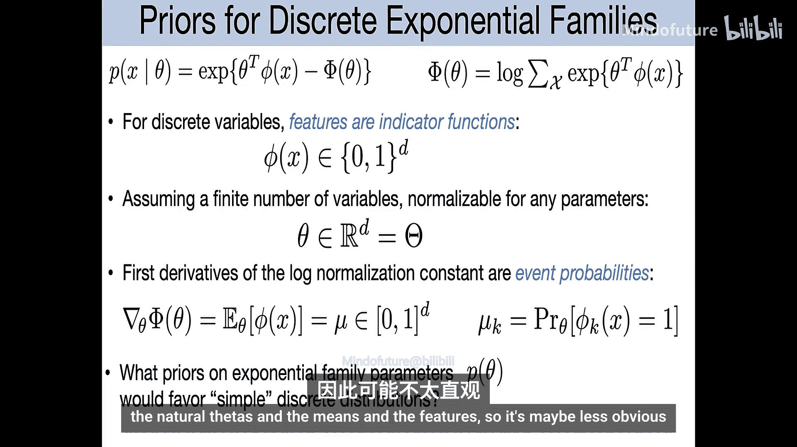

So if I look at a Bnoulli distribution。嗯。So this was the Bernoulli written in Expial family form。

And so now look at this right， so basically if theta is zero。Then I have the mu is a half。Okay。😊，Um。

And then if theta is right this is the mapping between the and new and if theta becomes much less than zero。

 so if it becomes kind of a negative number small magnitude。

 then I get a probability that's very close to zero。Okay。And if theta is much bigger than zero。

 then I get a probably is' very close to one。And so if you think about it。

 if I want to kind of like do regularization， then probably basically I want a regularizer that says。

 you know， unless the data dictates it， I should prefer theta values that are close to zero。

Because basically how you get overfitting with discrete variables is the classic examples are when I assume that this event has probably zero。

 it never happens or that this other event has probably one。

 it always happens just because my data's not big enough to see all combinations and then you generalize badly。

So usually regularization says I don't want my properties too extreme。

 I don't want them to be really， really close to zero， really close to one。

 and if I want to avoid that， then basically I should bias this data parameter to be something that's not too far from zero。

系。On the other hand， let's look here， so now what about this when I had a pair of binary variables？

So now I have。This parameter these this theta1 times x1 theta 2 x2， and then this third parameter。

Theta 12 times x1x2， this is the one that kind of models the interactions。So now to understand。

How I should think about theta 12， well let's observe that let's suppose theta 12 equals zero。

If theta't 12 equals zero， then this term that involves the interaction between them goes away。

And now I'm left with something that actually factorizes。

 it's a function of x1 times a function of x2。And so in fact， for this distribution。

The variables are independent if and only if theta 12 equals0。Okay。So basically again。

 so sort of like the simplest model often you think about like the simplest model is one in which you just assume things are independent and then the as this parameter gets big in magnitude either。

Far from zero then you get strong dependence right where positive numbers turn out to be positive correlation between the variables。

 negative numbers are negative correlation。啊。So again， kind of if you want to do regularization。

 the natural thing to do would be just like encourage it to be close to zero。

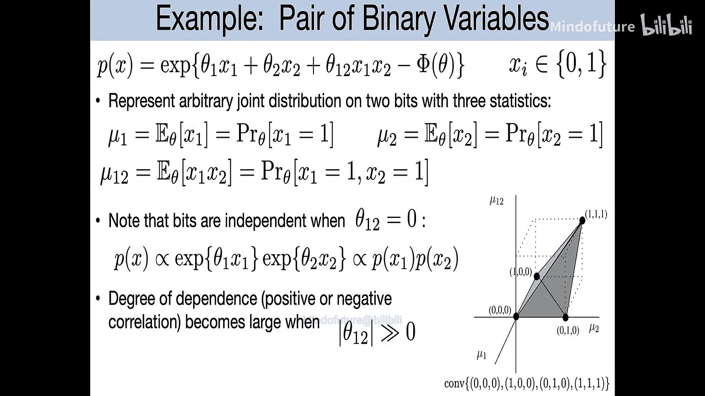

Okay， and even if I have， you know， some more complicated model where things are less interpretable。

Note。If I'm assuming this form， right that my factor is e to the theta。 F。

 note that no matter how I define my feature vector。

My subject is always that the features is a vector of finite numbers。

Then if I set my parameters to zero， then suddenly this psi just becomes a constant。

 right if my parameter， if my theta is zero， then I have e to the zero， which is one。

And right so that's like a constant and so then it's as though I erasse that factor from the model。

Okay so all this is just to explain to you why for all of these models that we're looking at。

 why if I want to do regularization I'm always going to use priors that basically bias to be close to zero。

 they say that you should if you don't have evidence from the data to pull you away your our priori expectation should be that the theta are something close to zero。

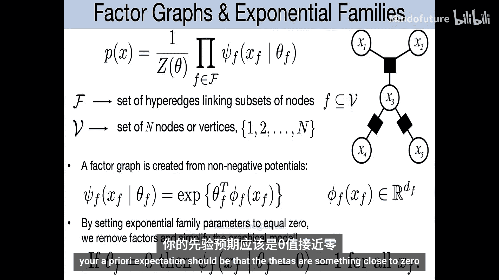

And that' right so the same things that we talked about before when I was talking about like ways of parameterizing directed models show up right so you for example。

 you could use a Gaussian the zero mean Gaussian prior。

Whi doing map estimation with a xine Gaussian p is the same as doing quadratic or L2 regularization of the theta parameters。

 so that's a very common thing to do。And note that this doesn't really the the gradient this makes a small change to the gradient and the hessian so all this all the things we。

Discuss before， sort of go through in terms of being able to use gradient descent to find the model okay。

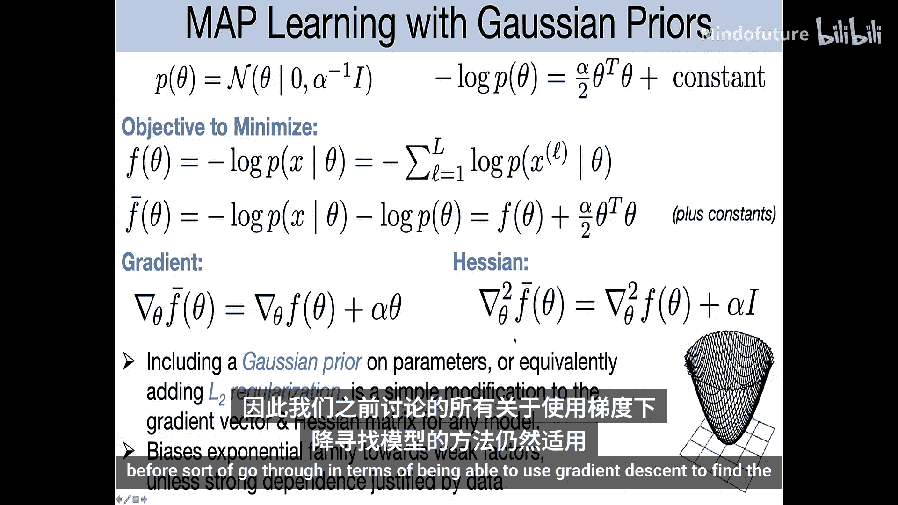

嗯。Okay， and。Right and I mean this is the equations。

 but I don't think I need that's a very simple idea right now you would have your posterior would be the terms we had before minus the L2 and now you basically your gradient is going to have。

This would be the gradient information like it and you just add this extra term。

 this kind of extra bias that pushes the parameters towards zero at each step。Okay。Okay。嗯。

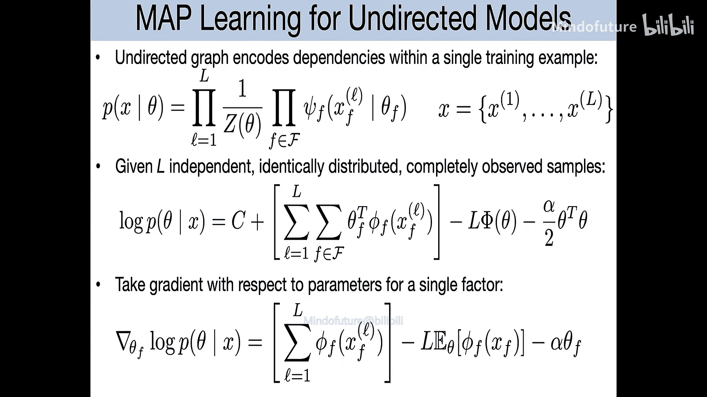

Right， and so to be。Very， you know make it very concrete right imagine that I wanted had a Bulli distribution。

And I put a Gaussian prior。so I have a Bnoulli distribution and I have this。

Gussian prioror are my parameters data。Well， the log likelihood is going to look like this。

 I'm going to compute this sum this is the sum of the data。

 so this is just the count of how many ones I got in my data。

And so I have this theta times that minus L times my normalizer minus。

Sort of alpha over two times the squared and now my gradient right now I just basically add this extra term that pushes。

啊。Pushes my。Theta is towards zero。So it's a simple modification to gradient descent。嗯。And。

And now I want to emphasize right we talked before about how sparsity could be interesting。U。But。😡。

Right so if now now suppose you say I want to figure out what the graph structure should be right which edges or factors I should include in my model。

 I have several mini canvas I say which ones should I include or not maybe about the problem of selecting。

You know， which edges or factors to include is exactly the same as feature selection。Right。

So I want to figure out which factors I should give zero which features I should give zero weight to if I give zero weight to features。

 then I erase that corresponding factor from the model right because if I have a factor that's a constant I can just leave it out and I get the same model。

And which ones I should keep。看。And then so to do that selection， again， we can use， you know。

 I spent a while talking about this last time we can use the put a Laplum prior on my thetas。

Whi again is this L1 regularization， so you sort of penalize your parameters by the sum of their absolute values。

And we talked about last time on that would have the property of giving you solutions that are sparse that set some of the thetas to zero and it's for all the same reasons。

 so although although the log likelihood is a little different for the undirected model。

 you know the L1 penalty pushing some things to zero that happens for the same reasons okay。So right。

 so now what would you do right， you would say。UmIf。

This was my log likelihood now what i'm going to do is I'm going to minimize the negative log likelihood plus。

Some lambdas， this is a regularization constant， how much you care about it times sum of the absolute values of the thetaus。

Some of their L1 norms。Okay。And there's there's various standard there's various algorithms for。

By the way， this is a little harder computationally。

 the fact that the L1 is not smooth makes this a harder optimization problem。

 but not too much harder。And there's still some nice algorithms that can。I can download。嗯。嗯。

I'm going to there's a couple fancier things here I'm going to skip I'm just going to instead show you in。

Example， hopefully you can see the lines sometimes when there's smaller lines。

They don't come through on Zoom very well can people see lines here？If not， check it out。

 check out the slides that are posted on Canva after the fact。But here's what's going on here。

 So this is a。呃。A model。That is basically。Trying to model dependencies of word usage。

And so what they took up。They have 16，000 postings from news groups' use there's this little 20 news group data set that's been around machine learning forever and so for each of these postings there are 100 words they kind of picked common words that are interesting words not just like and or the other things like that and so basically they for each each of your。

You know your postings， you have a binary vector of length 100 that says when the person did this post。

 did they use this word or not？So each person will use a different subset of words。Okay。😊。

And so now they're interested in modeling not not just the。Um， you know。

Wwhichhich words are common and now I mean that's not very interesting and they want to model dependencies of words like which words tend to either occur together or to rarely be used together。

Okay， and and so this is not actually trivial， the reason is that you know， if you think about。

If I have these binary vectors of length 100 right there's two to the 100th possible vectors right so you can't just like you know。

Think of the problem every combination， but what you can instead do is use a。A an undirected model。

 So in fact， the model they use is。嗯。Oh， I wish I should have had a slide on this but。

It is very much like this， so I told you this model you could use for a single pair of variables where you had x1 times x2 for a pair。

They basically define a feature where you have。The the the product of Xj for all pairs of words so basically that their model is basically saying they have a feature that says。

You know， did this person use these two words together， these two words together。

 these two words together？Right so you have if you have 100 words， there's like about 5。

000 pairs of words and they have a feature for every one of those pairs of words。

 basically saying where they kind of use together or not。嗯。And。And。😊，So then， you know。

 so if you just learn parameters and you just did an maximum likelihood or you did L2 regularization would you would think about I would have a graphical model that would be like a paraized market rent a field that would be a complete graph。

 there'd be an edge between all pairs。Okay。But now they can do L1 regularization。

 they can do feature selection where you throw away some of those edges。Okay。

And so and the thing is is right there's a， you think about there's an enormous right I've got 5。

000 edges， there's an enormous number of ways to like it you wanted to pick 1000 out of 5，000 edges。

 5000 choose  a000 is's huge。But here by a single convex optimization problem， I find， you know。

 essentially the best model that discards a subset to my edges and so this is a visualization of that。

Graph， it's sort of fun to look through。Offline。You know， you kind of have。You know。

 these clusters here's a bunch of sports words that are not very connected。To anything else。

 you have kind of a religion corner of the graph over here you've got。呃。Program。

 which can be related to computer terms。Can be related to problems。

You may identify with that from the homework， it can be related to research， a research program。

 and so on。So anyway。This is not， you know， often people apply this kind of thing in some other domain like they have biological data or some other sort of data that they want to analyze。

 this is sort of more of a fun example that's a little interpretable。And now。

 so this is with a particular value。😊，This is if I set that regularization concept to be 256。

If I set it to be twice as big。512。Um。You get this。

Now there are fewer nodes here and the reason is that when we set this large amount of regularization。

 there are some of these words that are essentially like modeled as being independent of the others。

 the amount of dependence is not strong enough and it just erases all their edges。

So these are kind of the words that are left that actually have one inch。And now note right。

 the edge here does not mean positively correlated。

Right it's different from that right because note these parameters， when I put a parameter。嗯。嗯。Well。

 I think I won't bounce back to the slide， but if I that parameter。

 you know there's a parameter between a pair of words at zero if you say they're independent or sort of locally independent。

Positive values send say they tend to occur together。And then negative values are opposite of that。

 right they say they rarely occur together。So edges edges here could be strong also be strong negative dependence。

 so the graph is not illustration that but you could have some edges that are saying like these two words almost never occur together and that is still a strong form of dependence。

咁。嗯。But these graphs they have all of also all of the markov properties we talked about this one's a little more interesting would hold right so you can think about that there are some of these words that you know。

You know， if I tell you whether they。A person uses a few of these words then it may break the others's words into independent components。

Any questions on this application？And what does negative correlation mean again？

So you can think about it as。Well， I basically that。In。For binary variables。😡。

A positive correlation would mean that if this variable is one。

 then the other variables is usually one。And vice versa。

 negative correlation would be that if this variable is one， the other variable is usually zero。

Or if this variable is zero， it usually is usually one。

So if you have negatively correlated binary variables。

 it means that they're usually like the opposite of each other。系。

So if there is a line in this graph and they are strongly negative。

Coorrelation with they have a strong negative correlation then there's a line as well yes so that means the work is like theyre very different such that they never called together So there's a line。

Yeah， and so I don't know。They didn't illustrate， I think， which or which。

Might have been nicer to plot， which are the positive and which are the negative。

 but they didn't illustrate that when they made this plot。Okay。嗯。

So one thing I haven't answered for you， this was actually something kind of I skipped on the previous slide is you might ask。

 well。Okay， so to compute the gradients you would have to get。You know， the marginal probabilities。

 how how are you going to get marginal probabilities？On this model that has， you know。

Two to the 100 combinations of variables and it looks like lots of cycles。

 so you don't have a tree or something like that。And the answer is that in fact。

 they couldn't use this exact likelihood， they had to plug in something that was an approximation to it。

Using something called pseudo likelihood。嗯。And I may come back to like later in the class。

 it's one of these topics I would like to cover， but I'm sort of。

There's too many good things that I might run out of time， so we'll see。

So that's what this so thinking about the pseudo likelihood is a particular way of approximating the likelihood to make this more attractive。

😊。

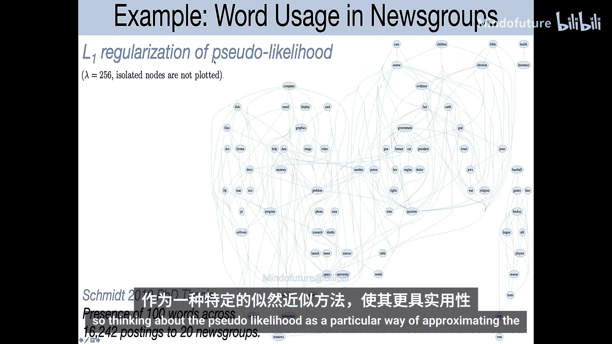

Okay。