# 【加利福尼亚大学】图形模型中的学习 ｜ Cs274b ｜ Learning In Graphical Models (Spring 2021) p09 P09_讲座_5A_第_1_部分-_学习马尔可夫树__EM_算法 -BV1Tqx6zrEMj_p9-

Today， we're going to start by talking a little bit about information theory。

 which shows up a lot in some different topics that we going later in the class。

 and then we'll move on to talking about how we can use ideas from information theory to learn three structured graphical models from data。

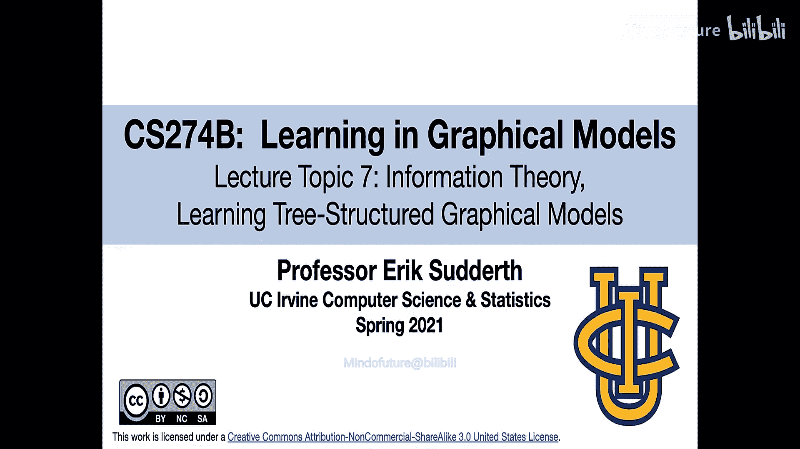

Okay， so this is a little bit of either review if you've seen some information theory before or an introduction if it's not something you've encountered。

And so the starting point for information theory is entropy。

 which is a measure of the randomness of a random variable。

 right you can think of a measure of how much uncertainty there is。

 and so for a discrete random variable x。The entropy looks like this。

 so it's defined by this formula， the sum of P of x log1 over P of x。

And so you can also think of this as the expected value of a function that happens to depend on P of x and here this P of x is the probability mass function of the random variable。

Okay。And so in entropy the convention is that use a base2 logarithm and in that case that means that the units of entropy are going to be bits。

 okay， and although I'm not really going to emphasize it in my lecture today that there are nice connections between the entropy of a random variable the number of bits you would need to compress it。

so property the entropy first it's it's always non negative it's always greater than equal to zero right you can see this because if I take。

P is a probability mass function， so if I take1 over p。

 that's a number that's bigger than one and so its log is bigger than zero。and the interpretation。

 which I haven't shown you why this holds yet， but what you should have in your mind is as you're going through entropy is that random variabless with larger entropy always have greater average uncertainty okay。

 basically that means that they're going to be harder to predict。

And you can write this another way right because log of one over Q is negative log Q you can also write the entropy as the expected value of negative log of P of x okay and so a lot of formulas will'll use that so that that's an equivalent way to write that。

And now when we evaluate entroies you know sometimes you have distributions where some events have zero probability and if you start looking at this this formula you may get concerned right because if I take。

The log of zero， that would be minus infinity。However。

 we'll use the convention that zero log zero equals zero and you can think of this as a limit that if you think of like an event that has very small probability epsilon and take the limit as epsilon goes to zero。

 this epsilon log epsilon does equal zero okay。So in any case， right so kind of the。

Events that have zero probability that kind of gives you the zero entropy。

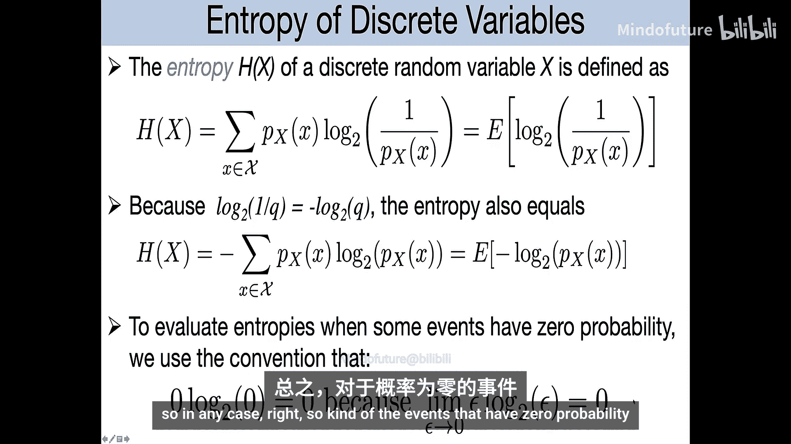

All right， so let's look at a special case if I have a Bernoulli random variable that has member one parameter P。

 that's the probability of heads。Then the entropy of a Brnoulli would be this formula right so you can write as negative P log p minus1 minus p log 1 minus p and that's the same thing as this other formula at the bottom。

And so there's not a lot of insight from just looking at that。

 but if I could just numerically evaluate this and so if I plot this as a function of P。

 I get this curve on the right。😊，Okay，And so it's largest when P is a half。Okay。

 then the entropy is one bit， so a fair coin has the largest amount of randomness you can have for a binary variable and then if this coin is biased either way。

 the entropy is less and then in the limit as you get a coin that's not actually random right where that's always heads or always tails the entropy approaches zero。

According to this particular curve， and note that this curve is a concave function of P at its curve downward。

And so。Now， this curve is is actually。Not a quadratic， but it's close to one。

 you can see and in fact， so if I evaluate the variance of a Berulli random variable right the variance of a bernoulli variable。

 you if you turns out to be P times 1 minus P。And so this red curve here on the left is the variance of scaled by four right so the variance of a fair random of variables a quarter so I sort of scale that up and if you do that you can see that the it's not the same as the entropy right the blue red curves are not the same but they're pretty similar。

And so in particular you can think about that also things with greater variance also have greater entropy and uncertainty okay and so at the moment right it's not yet obvious why entropy is an interesting alternative to variance from right here。

 but we'll kind of see it as we go later why that's the case。😊。

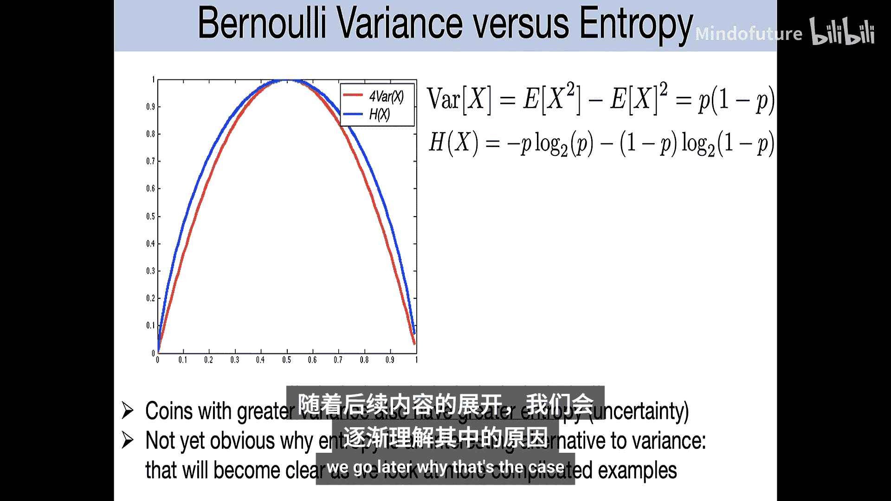

Right。More examples， if I have a uniform。😊，Random variable right so I have something that takes a uniform over M values so that's probably one over m of those M values。

 then the entropy is just going to be the log of M。Okay。😊，Right。Um。

 so we just saw a special case of this right that if we had two outcomes。

 if we were uniform over that， the interview was one， but more generally it'll be the log of in。

And it turns out that this is the the most random distribution or the most uncertain distribution you can have on m outcomes right so i'm not going to prove this right here。

 but it the entropy is if I have m discrete outcomes then the entropy of that randomarrow is always between zero and the log of m the log m is the biggest okay so if you have any a distribution that is。

No uniform that some things are more like than others， you would always end up with reduced。

Uncertainty okay。嗯。Now often we' interested in talking about sort of several random variables and so if I have say two random variables。

 the entropy of their the joint entropy is just defined like this right so it's kind of the standard entropy formula but now I use the joint。

Probability of the two variables instead of the probability of just one Okay。

 so that's the definition of the joint entropy of x or y and you think this is actually equivalent to sort of you made a。

X took on n values， Y took n values， and you made a new random variable Z that took。

That took sort of a value for all possible combinations of x and y and asked what's entropy it'd be equivalent to this Okay so that's kind of why this definition makes sense this is kind of the the the amount of randomness and a pair of random variables。

And you can extend this right if you had three random variables or more， the same notion would apply。

 you can talk about the entropy of any larger set of random variables。

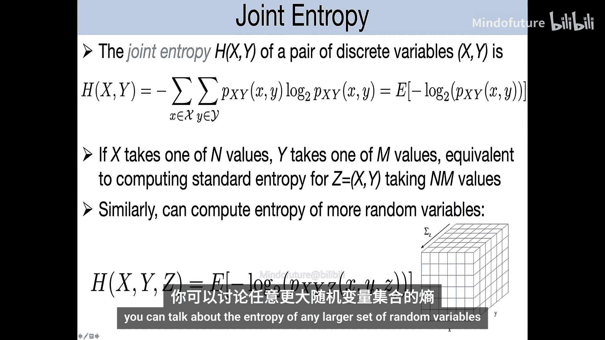

U。Now。One thing that's interesting is that。Observations。Impact entropy。

so suppose I have two random variables x and y that have a joint。呃。

Probability mass function and now let's suppose I observe x okay。

 like I observe x equals1 or I observe x equals two well then the distribution the entropy of y given x。

 I would compute that by taking the just evaluate my normal entropy but now using the conditional distribution of y given x。

And in general， right， this will be different than the entropy of y before observing x。Okay。

 so if x provides information about y and it changes the distribution。

 you'll get a different number here， so that's probably not too surprising。And in fact， in general。

 it。It could be either bigger or smaller than the entropy。Of why， okay？But。

Sort of often there's a lot of cases though， that we don't。呃。Yet know the value of x right。

 but we want to predict the expected entropy of randoms of y after x is observed right so this is how I would compute the entropy of y given x if you get an observation。

 but suppose you want to say well suppose I go collect in an observation sort of how much did I expect that to change the entropy of y？

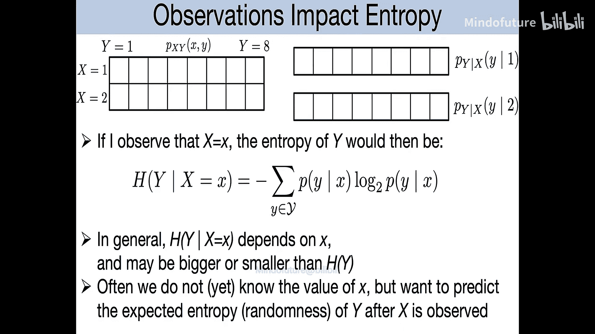

Um and。嗯。😊，This actually shows up in a machine learning context of feature selection。

Okay so suppose I you know I want to do to keep things simple， I want to do classification。

 so why is a binary。Sort of the class I want to predict like I want to predict which digit an images or I want to predict。

You know， whether in email a spam or not given the words in it。

And so I have a bunch of features right let's say I have a bunch of features like you know。

 for each pixel， whether it's black or white or for a bunch of words in my vocabulary。

 whether they appear or not in the image。Um。And so you in general。

 you expect that some of these features right， will be informative and some not for your classification decision。

And so you're interested in sort of saying， how can I select the most informative？

Features and now I could do this right there'd be lots of the damages I could reduce my computation and storage sometimes I could actually boost accuracy by kind of throwing away。

Arele noisy features and avoiding overfitting and so on。

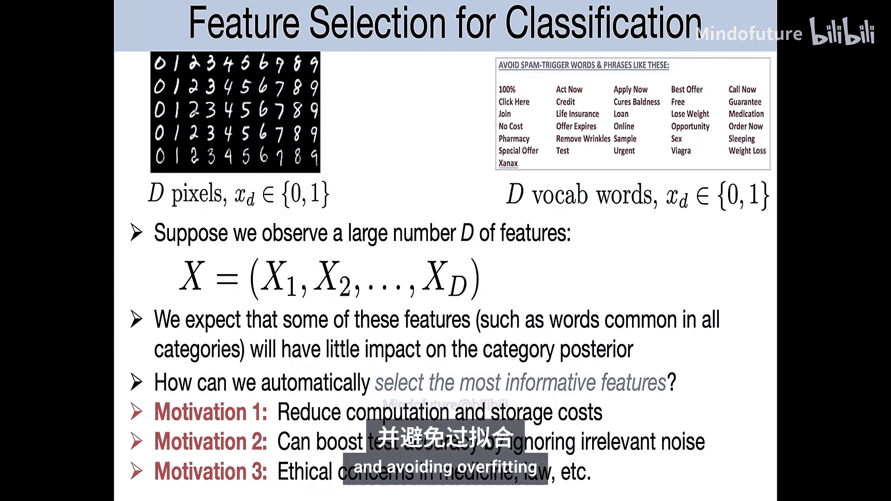

So。The conditional entropy， the entropy of the random variable of y given the random variable x is defined like this。

 okay， this says that you know this is the entropy of y given x。

And this's going to be the entropy of y given a particular value of x。

 averaging over possible observations of x。So I sort of says that while I could compute what the entropy of Y is given any observation。

 since I don't know what my observations will be yet。

 I will kind of average over those entroies given the probabilities of each observation。Okay。😊。

All right， and so and then so if you do a little algebra。

 you can say that this is the same thing as the expected value of the log probability of y given x okay so if you take the expected negative log probably y given x。

 the expectation with respect to the joint distribution of x and y you will get this conditional entropy。

对。And now if you want to see， you know， why if you want to say。

 you know why does this definition make sense， well。

 one way to see how this makes sense is that if you define conditional entry this way。

 then this entropy or uncertainty satisfies this very intuitive chain rule。诶。So in particular， right。

 if I take。😊，With that definition， if I say what is the joint entropy。

 the joint amount of randomness in x and y， well it's the randomness of x by itself plus the randomness of y given x。

Okay， so H of x plus H of y given x equals h of x y given these definitions。

And the proof is like not super interesting right it's just kind of take the rules of conditional probability and manipulate terms and so on and so forth okay。

but the high level result I think is interesting right it sort of tells you that you can talk about the the joint amount of entropy and two variables as the randomness in one plus the randomness of the second given the first。

嗯。And so note that so h of x is greater than equal is positive and this h of y given x is always positive。

 right or at least always greater than equal to zero。And so this implies that you know。

 larger group when I kind of like add extra random variables， okay the amount of。

Uncertainty or entropy can only increase， so the entropy of like two variables x and y has to be greater than equal to the entropy of x by itself。

 it could never go down。O。All right， one more quantity we wanted to define find。

 so we've talked about entroies and conditional entroies。

The third quantity is the mutual information okay and so the mutual information so it's denoted by I of x semicolon y this is the expected amount that the entropy of y is reduced by observing x right so this says I have the entropy of y sort of before you get any data and then I then I have you know the entropy of y given x and the mutual information says how much does that uncertainty go down。

Okay。Okay， so this is plugging in those chart in the previous slides that's what this would reduce to。

Okay， and so now if I start manipulating things， right， I can say that， oh， well， here I have this。

This mine sign with the log， I can kind of。Write that as plus a log of this thing in the numerator so I get this term here right so I have this log ratio of P of y given x divided by P of y。

And now if I multiply both the numerator and denominator by P of x。

I get this term right I get the expected log of the joint probability of x and Y divided by their product of the marginals。

Okay。All right， and now note this definition is， you can see from this manipulation that it's symmetric with respect to x and y。

Right， so in fact， you can think of the mutual information as。

The amount that the entropy of y is reduced by observing x or the amount that the entropy of x is reduced by observing y。

 and those two numbers are always equal to each other。对。Okay。

So it's kind of information is somehow a fundamentally symmetric quantity。

 right the amount of information that X gives about y equals the information that y gives。About x。

Okay。Again， so and we call it information because somehow it's a measure of uncertainty reduction right so the information between two variables is big if observing one reduces the uncertainty by a lot。

And on the other hand， the information is small if the。嗯。

You obbserving one only reduces informational load。And in fact。

 you can see this that another interesting property of this definition is that the mutual information always equals zero when the variables are independent。

And that's a really simple proof right if they're independent。

 then this joint probability p of xy equals p of x times p of y and now in this ratio everything cancels。

 I get the log of1 and the log of1 is zero。嗯。U。And you can also show using Jensen's inequality。

 which I'll be talking more about a little later， I'm not going to prove it right now that whenever X and y are not independent。

 so at any time they're not independent， this is always strictly positive。

So it's zero if and only if they're independent， and otherwise it's positive。

Okay so this is a nice quantitative measure of that and so in fact a lot of in statistics there's a lot of classical tests for our two variables independent or not that boil down to sort of somehow estimating the mutual information between those variables from data and then putting some threshold on that estimate。

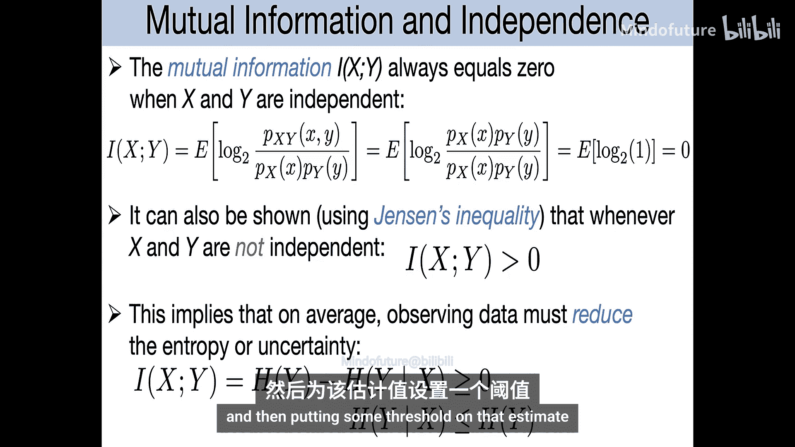

嗯。And so coming back to this feature selection problem。Um。😊。

So if I want a very classic and effective way to pick features for for classification problems is to compute the mutual information with between each feature and the class label okay so I say what's the mutual information between that and this is again defined as it's the amount of randomness in the class like how uncertain is the class before I get any data minus the amount of。

Randomness in the class label， given that I observe feature XD。Okay。

 and so a good feature would be one in which this difference is big right so the uncertainty is reduced a lot。

And so a very classic way to select features is that if you have training data。

 you use training data to estimate the probabilities。

 P of Y and P of x given Y and P of Y given X and so on。

 you can estimate those proba by count and then evaluate these mutual information and use them to select which features to keep and which to get rid of。

I'm not going to prove it that there's a nice little a bound here that gives you one idea for why mutual information could be good for features。

And so this is that suppose I take a feature Xd and then I make an optimal prediction of class Y using that feature right where here optimal means you know you compute the posterior of y given x and then you predict the class with the higher posterior probability right that'd be the optimal thing to do and then you say well now what's my probability that my prediction y hat does not equal y well that is always less than or equal to one half times the entropy of y given x。

Okay， so thus， if there's any， if I ever find a feature for which the entropy of y given x is small。

 for which there's small uncertainty in the class label given that feature。

 then I know that it's going to lead to an accurate classifier。

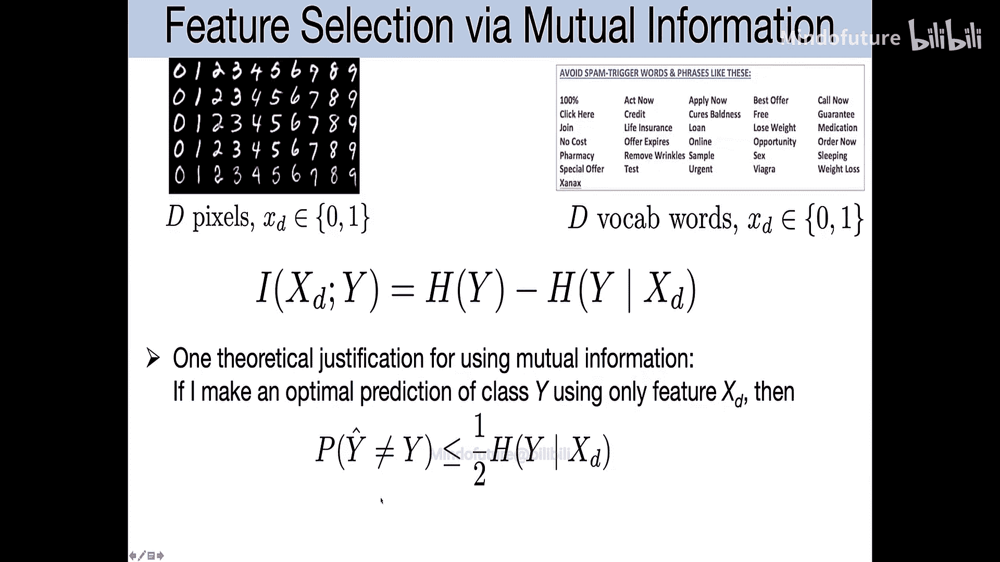

Okay here's just a little example of this is actually from the UCI's well known machine learning repository this is sort of text data and so this is text categorization where they have。

They have you know various categories and then they have a large set of words and they're using mutual information to pick which words are most predictive of categories okay and so here for different categories like sports or elections or coffee and so on these are showing you know the words that have the highest mutual information right so the presence or absence of this word is very predictive of that。

And you know， you know they're pretty intuitive right but this just gives you an example of that and so definitely this you know this text categorization is definitely a space where sometimes this feature selection is useful because if you have a really large vocabulary then depending on how much data you have you can kind of get overfitting issues if you don't do it。

Yeah。嗯。And now finally， here's here's just a way to kind of summarize what I've done it you can kind of nicely。

know， defef all of the entropy and mutual information Qua have done in terms of a Venn diagram。Okay。

 and so if I take this diagram， you know， if the sizes of the circles are the amount of randomness and x amount of randomness and y。

Then the joint randomness H of Xy is the sort of total area here。

Right and then the mutual information is kind of the area of the intersection right so it's the total。

 it's h of x minus h of x given y or equivalently H of y minus H of y given x。Okay。So anyhow。

 this is kind of a useful way to remember how all of these quantities fit together。All right。

 so there's a little information theory， important thing to know about if you haven't seen it。

And now we're going to move towards learning graphical models。

And sort of learning the structure of graphs， and it's going to turn out that when I start thinking about learning the structure of graphical models that these terms for mutual information just magically appear。

 they come up sort of from the objective I have。啊。啊。Without needing to sort of motivate them。So。Now。

I'm going to use slightly different notation okay for right now。

 so what in the first part of this lecture that was the kind of classic notation for entropy where you said the entropy was H of x for random variable x。

However， we're going to be thinking about sort of like learning the distribution so like tuning the parameters of a distribution and so thus I'm going to write the entropy as H of P where P or the parameters of of the sort of probability mass function for a discrete random variable right so H of P is just going to be the entropy of a random variable that has distribution P。

Now there's one other quantity that shows up。The in。

Information theory I haven't talked about yet and this is what's called the relative entropy。

 it's also called the Col Black Liveler divergence。

And this is a sort of sort of like a distance between probability distributions so P and Q here are two distributions on have the same support right so they're both distributions on binary variables or they're both distributions on some number of outcomes。

 whatever so they're two distributions that have the sort of same sample space X but different numbers。

And the kL divergence。Right， so this name Colbec Livebller， these were two information theorists who。

嗯。Proposed this， oh， I don't know must be like almost 70 years ago。The Calverence has this form。

 I take the sum over x I have P of x and here I have this log ratio this is called like a log likelihood ratio I have log of P over Q so I have this log probability of P over Q and I take the expected value of that with respect to P。

And so it turns out that this is， it's kind of like a distance in the sense that it's greater than equal to zero and it's zero。

 if and only if p equals  Q。Okay。However， it's not a true distance because for example。

 it's not symmetric right D of PQ is not the same as D ofqP。Okay。Right。Um。Now， note。Interestingly。

 that the mutual information。So I'll write the mutual information as a function of the joint probability of x and y so I of p of X Y that is actually the same thing as the k divergence of the joint from the marginals so this equation right here。

Which is what I get when I plug these terms into this k divergence definition is the same as when I gave you a few slides ago that I motivated in terms of these conditional entroies so this is grade than equal to zero and it's zero if and only if the variables are independent。

Okay。So we're going to be remember this I and this H because these are going to show up a lot on the next slides。

All right， and so now I want to talk about now learning。

The structure of a graphical models from data and we talked the last lecture about how you could use L1 regularization now I want to use a different approach where rather using regularization we're going to say I'm going to constrain the structure of my model to be a tree。

And then I want to find out of all possible trees find the best one。So to do that。

 I want to start talking about ways of factorizing probabilities on trees。So。

If I have any sort of tree structured model， I can always sort of write it in a factorize the distribution in a directed way by picking some node as the root。

And so it turns out it won't matter what I picked like I could pick this node blue node on the far left or this blue node in the middle。

And then what do I do， I write the distribution like this。

 I write the distribution as P of excess and then times the product over all of nodes the probability that node given its parent right so you kind of just have arrows that go outward from the root。

And you can always do this with any tree because it doesn't have  cycles。Great。And now。I'm gonna to。

Multiply I'm going to take this product and i'm going to change it slightly。

 I'm going to multiply and divide by。P of x T so I'm going to say that this this term right here。

 this is the conditional probability of Xt given its parents。

 that's the same of P of x and its parent divided by P of its parent。

And then I can multiply and divide by P of xt。And so this is the same thing and now if I regroup terms right this gives me a sort of canonical way of factorizing the distribution on a tree so if I have any distribution。

Of that markov on a tree， I can always write it as I have the product。

Over all of the nodes of the marginal distribution of that node。

 and then I also have the product over all the edges of the joint probability of the paranosone edge divided by their product of marginals。

OkayAnd this is the correct way to write the distribution of any graph that's on a tree。So kind of。

 do you think of like a particular kind of factorization of that？That doesn't have a directionality。

 right it's more like an undirected normal factorization。No， I could also write this as。

The product over the edges of the joint probability and then I have the product over the nodes of this P。

 but I have to raise it to the one minus degree right。

 so the way to think about this is it's saying if I multiply these joint probabil of all the edges。

 I kind of。Overcount the marginals of some of the nodes。

 and I have to correct for that with this first term。Okay。嗯。Okay。So。

And you can kind of start to see a correspondence here now so if I have a pairwise MRF right that would remember that was defined by non negativeg potentials right so if I have a distribution I always had a sort of potential on each node a potential on each edge if it was a pairwise marker random field。

And I can now have a canonical parameterization right I can parameterize this in terms of marginals instead right so I can write this in terms of some marginals。

Q and if I do it in this way， then this overall normalization constant equals one right so I've kind of parameterized things carefully so that I don't need to worry about this overall normalization。

Okay。And now let's suppose I pick a self consistent set of marginals right so I pick these marginals so that they're truly marginals right so this  Q sums to one and if I take QST of xS and X t I sum over Xt that has to equal。

The QS of excess。And in that case。RightThen these truly are the marginals of distribution I took P and I sort of summed over all variables where excess equals a I'd get。

The marginal of A and so on for the pairwise marginal。O。All right。Now this is going to help us。

Think about how to estimate the parameters of tree structured models。From data。Okay。

 so I'm going to take this particular canonical parameterization。

Of a tree structured model right I have the product of all the nodes of these QS of excessS product of all edges of this ratio。

Okay。And now let's for the moment， I'm going to assume I have a single fixed tree。Okay。Um。

And let's suppose I have L observations。Okay so I have L observations and they're empirical distributions right so this delta function here is something that equals one if it's argument equals the subscript and zero otherwise right so this is just kind of the fraction of my observations where XL equals a that's what this is and this is the fraction of my observations where Xs equals a and Xt equals B。

Okay。好。不是。Right。So then right if I wanted to do maximum likelihood。

 what would I do right so my maximum likelihood objective would now be you would take the sum over all your data of the log probabilities of that data point。

And because it's convenient I'm going to put a little one over L factor that doesn't change the optimum right so I'm just going to scale by one over the number of observations。

All right， so this would be now my maximum likelihood estimate， right， I should say over all cues。

That you know our real distributions， I want to find the ones that maximize the likelihood。my data。

Okay and so now you could。呃。You could。Sort of like start taking derivatives and setting them to zero and trying to solve for the cues。

However， there's a simpler way to think about it right and that's to note that this is an exponential family distribution right with particular statistics or features right so it's an exponential family where my statistics are for every variable。

😊，I have and for every possible value of that variable， I have an indicator right。

 so I have sort of indicators that say you know does excess take value a？

And then I also have for all the pairs of variables collected by an edge right for all ST and my edge set。

 I have an indicator that says does basically does excess equal a and Xt equals B right so for sort of all edges ST and all pairs of values AB。

I have another indicator there。Now。And what do we know。

 we know that maximum likelihood estimates match the expected values of these statistics。

We know that for any exponential family， the maximum likelihood matches the values of these statistics。

And thus， I know。Without doing any derivatives or anything。

 I know what my maximum likelihood estimate is right it's going to be to take。😡，These cues。

And set them to be the empirical distribution of variable。

 and I will set this QST of excessXT to be the empirical distribution of excess and XT。Yep。

So this is maybe a little bit of an illustration of the power of the exponential family framework。

 I can just look at this and I can say aha， these are the features and thus I know that I should match the expected values of those features。

Like this， and then I know that's the optimal。U。The maximum likelihood parameter estimates。Okay。

 so this is kind of a summary of that， right？If I have a data set。

 what I should do is I should compute the empirical distributions of each node as well as each pair of nodes detected by an edge。

 and then I just define my tree distribution to exactly match those probabilities。

And this is the maximum likelihood distribution on this tree。All right。So。嗯。Now。If I want。

To compute now the log likelihood， let's say you know that's the maximum likelihood。

 but what is the likelihood of that maximum？What do I do I plug in the。😡。

These cues into this equation at the top。Okay， so let me compute the log likelihood。Here。

And if I start grouping terms， you can see that， well， I'm going to have， when I take a log。

 I'm going to have the sum over all my notess。And I'm going to have the expected value of log of P hatt。

Right。And note， right， let's go back to my equation here。

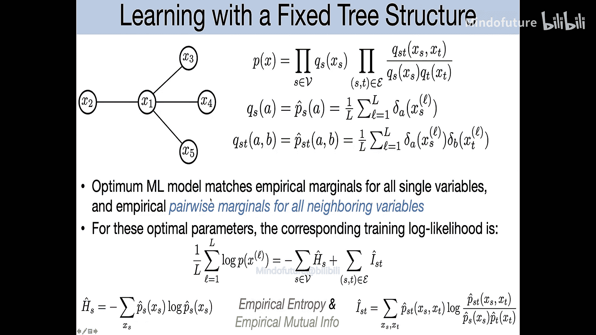

Right？The entropy is the negative expected value of log P。

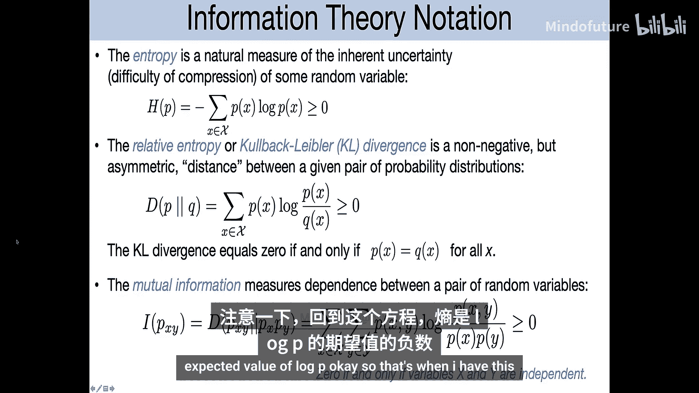

Okay， so that's when I have this。Expected value。Of。Log of P hat。

 those are the negatives of the entroies so I have the sum over all the nodes of the negative entropy of that note。

And now look at the edges right I'm going to also get the sum over the edges。

 I'm going to have the this term that's logged。Log。PST divided by P times P。

 so I'm going to have this log ratio。 And again， if I go back right the。

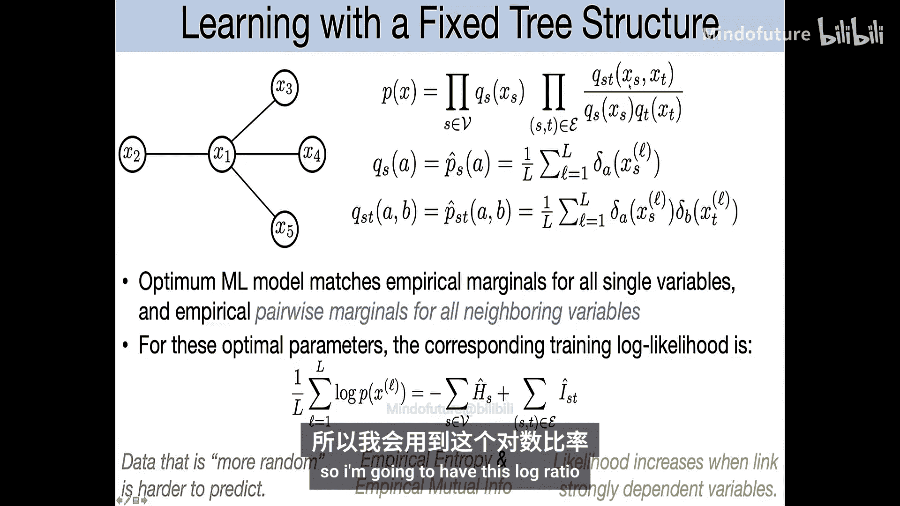

Mutual information is exactly the expected value of that log ratio。

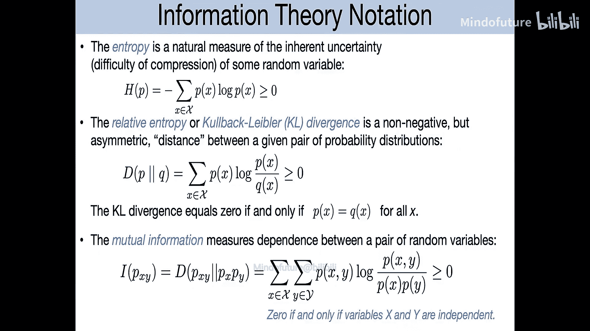

All right。So this is the training log likelihood。Okay， so you have sort of。呃。

This is something that you know deep you have these terms that are the randomness of the nodes and if this randomness is big。

 this makes the log likelihood smaller。Okay and so the way I think about that is that sort of says that well if if the intropys are bigger then that data is sort of more random has more uncertainty and then that that's harder to predict so in general if I have have variables that have a large amount of randomness then the likelihood of my models will get。

Lower right because it's going to be harder to sort of predict the values。On the other hand。

 though things get easier if I have dependence right so if the variables are dependent。

Then I get then these mutual informations will be positive， the more dependent they are。

 the more positive they are。And that will increase the log likelihood。😊，Okay。And so no now。

 this is true for any tree that I pick。Well， I if you imagine picking any tree and fitting parameters。

 this is the log likelihood that you will get from the best distribution on that tree。Okay。

So now I want to say， well let's suppose I fixed my variables and I want to optimize over tree structures。

I want to say， which edges should I pick in my tree？Five n nodes。

 I have n minus edges to arrange in a tree and how should I pick them？And so。

Right if I for any tree the again， the optimized likelihood looks like this and note this first term。

This negative of the entropyies this is the same for all treats right sometimes this is like this penalty for how random your data is and you can't change it。

 but the second term right I have basically a number for every edge that number is the mutual information between that pair of notes。

And I want to make to maximize like that， I want to make the sum of mutual informations。

As big as possible。so now if I wanted to optimize over tree structures。

 what I should do is I have this function。Of the edges I pick where I say I want to take the sum over all the edges of the mutual information。

Okay so this is equivalent to you just wait， take every pair of nodes。

 you give them a weight that's the empirical mutual information。

 and then you find the tree which maximizes the sum of edge weights。Okay。

So this is a very classic problem in algorithms that's called the problem of finding a maximum weight standing tree。

So you have a set of nodes and you want to find a tree。

 so it's a tree that has no cycles and that maximizes the sum of the weights where I have these positive weights on the edges。

And now you might worry this would be hard right because the number of trees possible trees on a set of variables is very large right it turns out it's bigger than exponential it's sort of a super exponential number so there's a huge number of possible trees。

But what's sort of magical is this is one of these graph optimization problems that you can solve very efficiently。

 and in fact you can solve optimally using a greedy algorithm and how this works is you initialize with a single edge so you pick the highest weight edge okay。

This is so you sort of put an edge between the most dependent pair of variables and then you just itly add edges one at a time。

 so you intervally add the highest eight edge that is not yet in the tree and does not introduce any cycles。

Okay and if you ever had any exact ties like you had two edges that were exactly had the same mutual information。

 you could break those arbitrarily okay now and in that case max the maximum likelihood of the tree might not be unique。

 but you will still find one of the maximum length of the trees。You know。

 in practice when we're estimating these mutual informations from data。

 so you sort of get these noisy estimates， usually you don't have ties。

 right usually they're kind of all distinct。Okay。And so it's a very simple algorithm has cost that is basically linear in the number of edges。

 so it's going to be roughly quadratic in the number of variables and you can find the optimal tree fast and so this is a great way to fit models to lots of different data sets。

嗯。😊，Here's just an example of that so this is that same data I talked about when we were talking about using L1 regularization。

Right and so again there's a different perspective here the L1 regularization said you know。

 I'm going to let my graph have cycles and then you know just try to sort of penalize edges here we're going to say there's no regularization we're going to put a hard constraint we're going to say that any tree is okay and you can't have cycles and this is if I optimize over all possible trees the best one。

For this data。They've drawn it as directed， they kind of convert。

 you could think of once I get that undirected tree I've been talking about。

 you could you know pick anyone as your root and then kind of unwrap it to a directed model。

 which is what they did for this picture you know I won't you know dive into this。

 but I think if you look at it you'll find that there's a lot of kind of intuitive structure in particular the kind of markov properties you get with this tree are pretty natural。

So I think it gives you a nice example。Of fitting this type of model to data and the good thing is because since you're working with a tree。

 every step is very efficient。

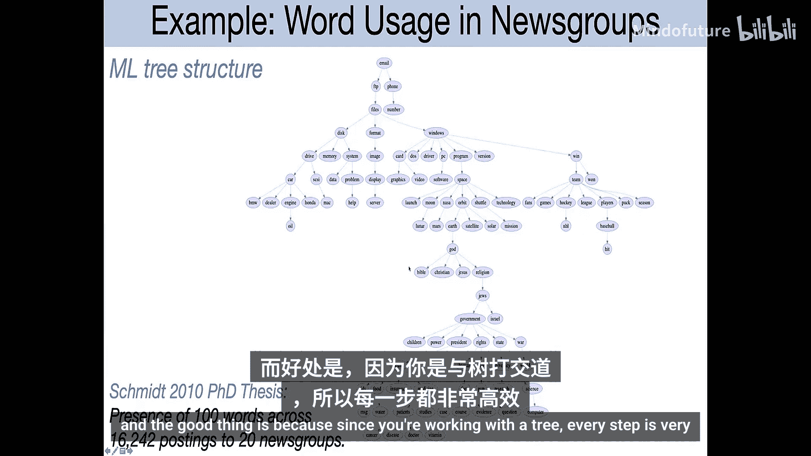