# 【加利福尼亚大学】图形模型中的学习 ｜ Cs274b ｜ Learning In Graphical Models (Spring 2021) p10 P10_讲座_5A_第_2_部分 -BV1Tqx6zrEMj_p10-

呃。🤢，Our next topic。Is the expectation maximization or EM algorithm？

Which is used in lots of different parts of statistics and machine learning。

But is actually especially useful for learning graphical models from data where you don't have complete observations。

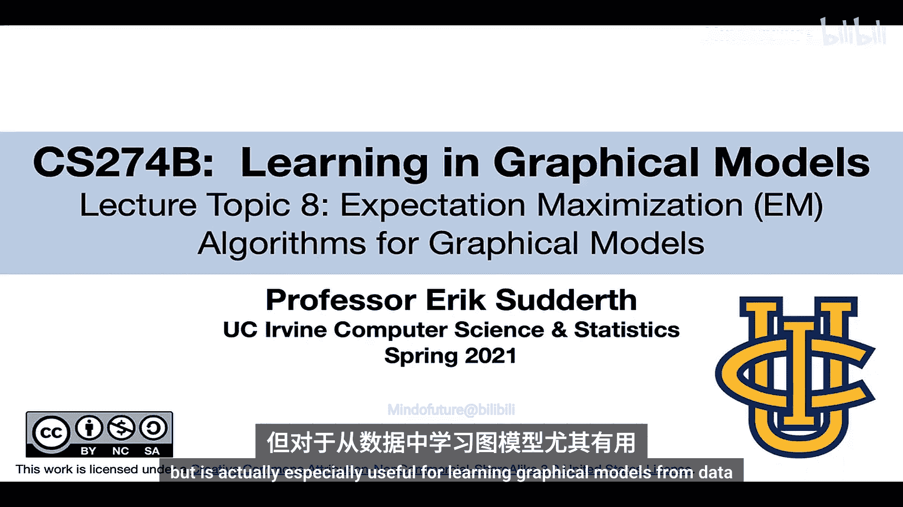

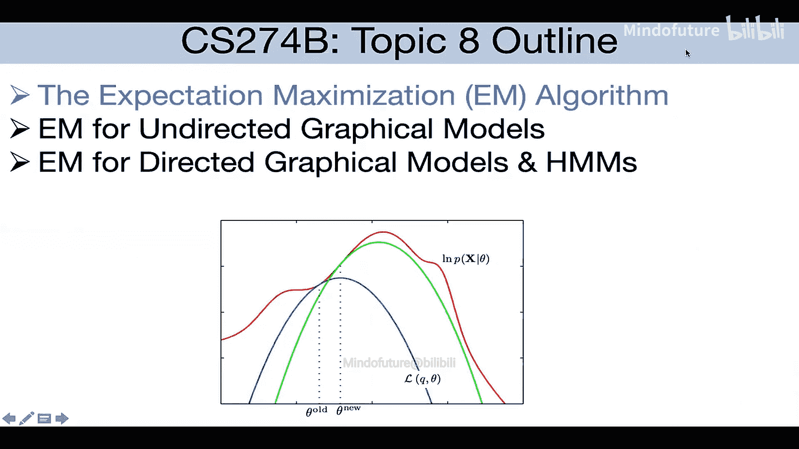

。So to get into the EM algorithm。You know， here's。If you like sort of a setup of what we've looked at so far right so if you look at。

嗯。The sort of center。Of the slide， so this graphical model sort of describes what we've sort of started the class with right the idea that you know we would know all the parameters of our probability distributions。

So in this case， like if you have a Z and an X。We know the probabilities there and now you get an observation like X and you say you know what's the posterior of Z so that was an inference problem and we looked at that in cases where maybe the structure of Z was complicated and you needed a smart message passing algorithm。

And then next we looked at parameter learning where the idea was that you would have L training examples and in those examples。

 all of your variables are observed， right？So maybe you know the。

Everything is observed and now you want to estimate like let's say the prior probabilities of z。

 as well as the distribution of x given z。But now we're interested in kind of a more complicated case where we don't know the parameters of our model and also some of the variables when our training examples。

 some of the variables are missing right so these Z's are missing。

they're not so we have these x's for all the training examples。

 but these z's which are an important part of the model are missing and this shows up a lot right because you know sometimes you' fail to click some data sometimes there's variables that。

Are useful for expressing your model， but you know you'll never be able to observe directly。

 and you still want to be able to learn those models from data。

And so the EM algorithm is a general purpose。Method for doing learning in this kind of scenario。

And you initialize EM by selecting your starting parameters right so you select values for pi and theta and this is usually done by just sort of sampling random values。

And then there's two steps， there's a E step where E stands for expectation。

 where given your parameters， you infer your posterior distribution of these variables Z。

And this is kind of the same thing as we do when we do inference and all those inference out we talked about before will show up。

And there's a second step， a maximization step or M step， where given the results from the E step。

 we fit the parameters of pi and theta。OkayAnd this has a particularly nice form for exponential family distributions。

 as we'll see。And then we iterate， we alternate these E&M steps until they converge。

 and this is a nice case where convergence is always guaranteed。

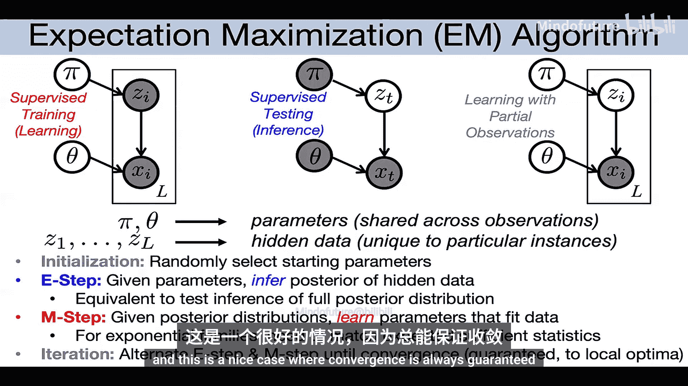

ok。So we've talked a little bit about Colx functions and so now to develop EM。

 I need to tell you about a nice property of how expectations work。With convex functions， right。

 So again， this was the definition of convexity。Which basically， you know， there's an equation here。

 but what it basically says that if I take any convex function。

 if I take a line segment connecting two points in that function， it will lie above the function。

So it's a function that curves upward。Okay。嗯。And so if this is true for any two points， right。

 that if I evaluate the function at f of lambmbda a plus one minus lambda B。

That's always going to be less to lambda f of A plus1 minus lambda f of B。if you assume this is true。

 then there's a simple induction argument， I'm not going to go through the details。

 but it's pretty straightforward to show that the following will be true if I had any set of weights that sum to1 right so I have lambda I that are greater equal to zero and the sum from1 to M of lambda I is one then it's always the case that the function evaluated at this。

Condex combination。Of Xxi's will be less than or equal to the convex combination of function values。

 right This would be true for any M， no matter how big M is。Yeah。

But now if we now put on our probability hat， this is not just a geometric property。

 I can think of this as a property of expectations。So in particular。

 if I think of this as a probability distribution where lambda I is a discrete distribution and lambda I is the probability that x takes valuexi。

 then this equation here is nothing more than saying if I evaluate my function at the mean of x。

 that is always going to be less than the mean of the function values。Okay。

 so f of the expected value of x is less or equal to the expected value of f of x。

Not if I F was a linear function， then these two sides would be equal to each other。

But usually these are not equal and for Comvex functions。

 you know that they there's an inequality that goes this。All right。嗯。

So and it turns out this is true not only for discrete distributions。

 but also for continuous distribution， so if I have any continuous distribution where these expectations are integrals。

 this equation is still true and so the proof in the continuous case is a little harder but the fact still holds that fornie convex function f of the mean of x will always be less equal to the mean of f of x。

And now when we fit models to data， we work with often log probabilities。

And so we're interested in sort of expected values of long probabilities and as we analyze those there's another identity that's going to be useful right so if I take the log or natural log。

That's a curves downward right so the logarithm is a concave function。

 it's the negative of a convex function。And so I get a similar inequality but in the opposite direction。

 so the log of the expected value of any variable always has to be bigger than the expected value of the log of that variable。

Okay， so now we're ready to develop the EM algorithm。So the idea is that I would like to maximize。

The likelihood of the data I have X， given the parameters data。Okay。

 so we're just like doing classic maximum like estimation。Now。

 the problem is my model has some other variables， Z， and these variables Z are not observed。

So thus I need to write P of x given data， I can write that as the joint distribution of x and z given data marginalized over Z okay。

And so to keep the equations a little simpler， I'm going to assume that Z is discrete。

 so this marginalization is a sum， although everything I'm going to show you would also hold for con。

All right。And so now what I can do is I can take this。P of x given z。

 and I could multiply and divide that by some other distribution  Q of z right so some sort of non negative numbers that sum to one。

咁。And if I do that， then I can think of this as having the log of an expectationtation of this P with respect to Q of Z and that by Jensen's inequality is going to be bigger than the expected value of the log of that Okay so here I have a lower bound。

And now if I take if I say that the log of a ratio is the difference of logs， I get two terms， okay？

I get this。F that depends on I have this Q of z times the log joint probability of x and z。

 and here I have this minus the sum over z of Q log  Q。对。

And we're going to write this as script L right so this is a function of both my parameters data as well as this distribution queue。

 which is sort of like an auxiliary variable。And the idea is that for any Q。

 no matter which queue I pick， as long as it's a distribution by gsen's inequality。

 this is going to be a lower bound。On the probability of the log probability of my data。

 given a model with parameters theta。Okay， so。I'll admit that if you haven't seen this before。

 this seems a little odd because I had an equation that looks simple and now I have things that look a little messy。

 but it's going to turn out that there's many models where this top。

 this sum over Z in the top equation is a hard thing to do。Right involves。

sortrt of intractable computations， whereas these terms in this bound on the bottom are in fact very easy to deal with and will lead to tractable algorithms。

And so here's the idea in the EM algorithm。So it turns out the EM algorithm is coordinate asscent on this family of bounds。

 so the idea is you start by initializing you initialize by randomly settinging some parameters data。

And so here the superscript here is going to know which iteration I am。

 so I start with parameters at iteration zero。And then the E step says I maximize this equation with respect to Q。

 so I fix the and I find the Q that maximizes it right so that's sort of pushing this bound as high as I can。

And then in the next step， I fix Q and I maximize with respect to theta。

 and I iterate until convergence。And every EM or expectation maximization algorithm we've ever seen is a special case of this process。

Where you make a particular choice of what Q of z looks like and you make a particular choice of what this P of x of z looks like。

Okay。嗯。Now to sort of understand what this is doing， I want to we're going to use information theory。

 which we saw in the previous topic also， so remember that the entropy is this measure of how uncertain or random a random variable is okay so it's this expected value of negative log of P of x right so it's entropy of a distribution p is the sum of P log p negd and that's always greater than equal to zero。

嗯。It's largest for uniform distributions it's zero if there's some state that is probably one。

 all other states are probably zero。And then another quantity that shows up a lot in information theory I haven't mentioned as much before is the relative entropy or Kobec library divergence。

 and this behaves as a distance between a pair of probability distributions right so it's written this way。

 so it's D of p these two vertical bars Q and so the divergence between P of Q is written as a way it's the sum of P times this log ratio of P over Q。

 so you take p times log P over  Q and use sum over all possible values of x。🤧And。嗯。

So why is it sort of like a distance， well it's sort of like a distance because it's great and it's always positive and it's zero if and only a p equals  Q。

So it's zero if the distributions are the same， and otherwise it's always a positive number。😡，Okay。

 however， it's not a true distance right because for example， it's not symmetric。

 so DPQ is not equal to DQP。

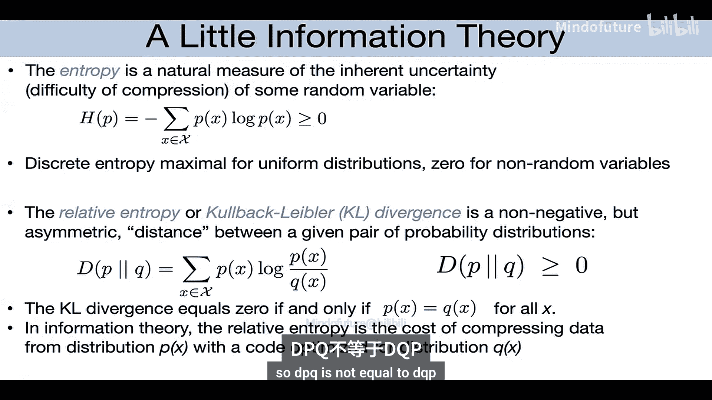

O。So。嗯。Now， if I come back to this bound in the EM algorithm。

 these two terms here have nice interpretations。Okay，The first term is the expected log likelihood。

And， and so this is something that you can think of as saying， well， I don't。

 I would like to maximize the log probability of x and Z。

But I don't know Z so given that I will average over possible values of Z with threatened rightQ。

And then if you look at the second term here， the second term that showed up in the bound。

 this is just the entropy。Okay and so these two terms are kind of competing with each other right the entropy wants Q to be spread out to be sort of like a uniform distribution or close to uniform。

And then this first term， right， it wants Q to put high probability on states that have high log likelihood and low probability on Z that have low log likelihood。

系。And when I to maximize this bound， I sort of have to fight these two competing terms。Okay。

So there's two steps to the EM algorithm。The expectation step starts by taking this function。

And maximizing it with respect to Q。诶。All right， so you know， you could。

 if you had a model like this and if say Q of z was a discrete distribution。

 you could you could think of like say well， you know。Prameterize Q。

 take derivatives to figure out what the max is， you know。

 maybe use Larrange multipliers to be sure it's a distribution that sums to one so you could do all that kind of stuff。

 but it turns out that you don't have to do this for every model you encounter because this E or expectation step at the email always has a very simple solution。

And it turns out no matter what model is， the ETP always says compute the posterior distribution of your hidden variable Z。

 given the data and the current parameters。Okay， this is always the correct E step。

 this always optimally maximizes。This function。ok。Now there's kind of detailed proofs。

In in some of the references， but it's actually a not a very complicated proof and I can here's the high level idea。

If I just kind of take this p of xz and I write it as p of x times p of z given x。

And then I kind of just manipulate terms a little bit。

Then I can write my bound as two things right here I have this log likelihood of x given theta。

 this is a thing that doesn't depend on Q I'm trying to optimize and then I have minus the k divergence between Q and P。

Right when in particular， this is the kale divergence between。

My hidden my Q of Z and the posterior distribution of Z given x。Yeah。

And so remember I told you that the KL divergence was greater than equal to  zero and at zero。

 if and only if q equals p， and so since I have a negative KL， if I want to maximize this function。

 I should set the KL divergence to zero which corresponds to setting Q of z to p of z given x and that's why this is always the solution。

so it's good to know that this is not a complicated proof。

 but the really important thing to remember is that for any model。

 the Estep is always computing this posterior。

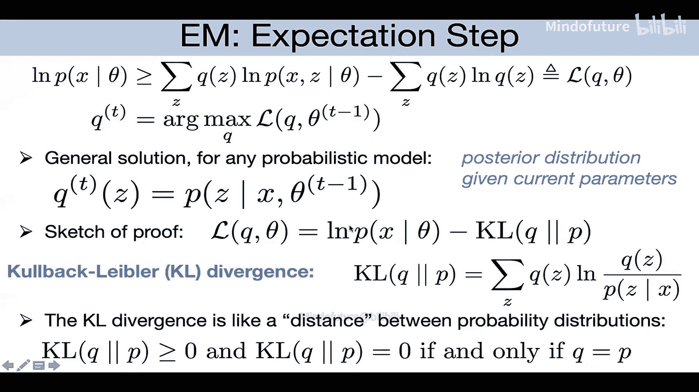

Okay。And so the way to think about it is that for some theta。

There's a true log probability of my data X given theta。And。For any Q for any Q I picked。

 I would get a lower bound on this probability right so even if I didn't know how to compute this probability I would be able to compute a lower bound。

😡，And now my goal is to find the queue that sort of pushes this lower bound as high as possible。

And so the difference between my bound and the true log probability is this k divergence and that's the same as setting the Q to be the distribution that sets this tail divergence as small as possible。

 and in fact I can set it to zero by setting Q to equal the P of Z given x。

So that's kind of the geometric view of what's happening in the E stepP。Okay， so that's the E step。

 what about the M step？嗯。So we're doing。Sort of a weighted maximum likelihood estimation problem for the M step。

 And the way to see that is that， so I have this function。

 the M step says I maximize this function over。Theta fixing Q Now if I fix Q。

 then this entropy doesn't change so I can ignore that term right so if I'm now fixed Q now that says I take up I have this log probability of x and z given theta。

Then I average that with respect to my Q of Z。And then I get a function that depends only on x。

by average over Z I get a function depends only on x and that's good because x is observed。

 but z is not， and then now I have a function that depends only on x and now I find the theta that maximizes。

Now to get intuition for what this is doing， right， you can notice that。

 let's suppose that I actually knew the hidden variables perfectly。

Right so let's suppose that in my Q distribution， it was actually not random。

 so there was like some Z hat that has probability one and all other Z prime have probability zero。

In that case， then this would just be kind of the same idea that basically you plug in this ZHAP。😡。

You plug in the value of Z hat and then you do normal maximum likelihood。But more generally。

 because these variables are not observed， you know。

 even if I know the right parameters the there'll be uncertainty on what z is and thus I need to sort of account for that uncertainty and that's why I average over possible values of Z。

When computing this bound and then finding the data。Okay。

 and so now this is a bit less generic than the EEP in the sense that now to figure out what the solution to this maxization problem。

 you really have to figure out look at you know what particular model I have and what its properties are。

 so that there's kind of a bit more variability and what the MPs look like for different probabilistic models。

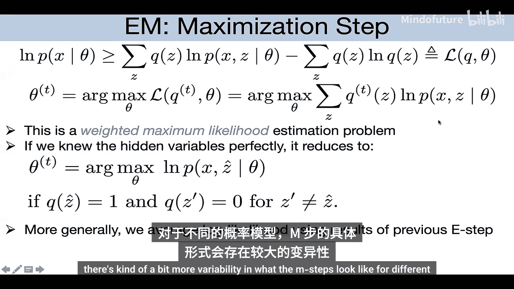

However， it turns out。A lot of times the it's simple and that's because lot it turns out it's simple if I have an exponential family distribution。

Okay。😊，So let's suppose that my。Distribution of x and z was some kind of exponential family and that means that there's some big vector of features of x and z and then my the way I get my probability is I take。

An inner product between that feature vector and some parameters data。

 I exponentiate and I normalize so it sums to one。系。All right， so now what is my M step。

 my M step says you take the expected log probability。😡，哎。So now when I take the log。

 the exponent cancels， and this is in some sense why the EM algorithm is often kind of a simple tractable thing to do because in exponentialial families。

 this log probability is easier to work with。And now I get the expected expectation of this linear function of theta minus my normalizer。

Okay。And now if I take。My my gradient。And set to zero and then use the properties of the derivatives of the log normalizer our expectations with respect to my model parameters。

W whichch we talked about before， and then what we're going to find is that the form my max elect parameters。

 I'm going to basically I'm going to compute。The expected sufficient statistics on my data where I sort of to get these expected values。

 I use the real values of data right so I use the real X as I observe。And then I kind of now。

 if pi LK， this is the probability that for data example L does z equals k， I sort of plug in。

 I get the feature with K， getting probability or weight piK。

 and then I sum that over K and I average that over my L training examples。

Okay so you compute these kind of。呃。Average sufficient statistics。

 and then set the model to match them。Okay。So this is simple for a lot of models。

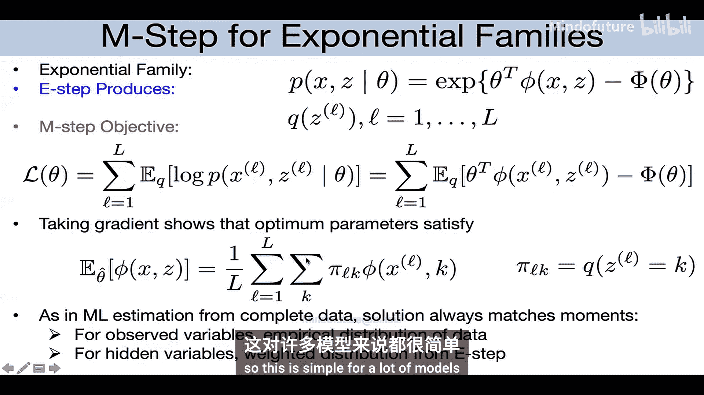

Okay， and so。This is kind of the big picture is now in the E step。

 you find the Q which pushes this bound to be as tight as possible。

 and then the M step right you basically you say I fix Q and now I try to optimize my parameter data。

But now when I optimize my parameter data given fixed Q。

 I no longer have a tight bound and so I need to iterate。

And then I bounce back and forth between these two steps until convergence。Conferring marginals。

Reinferring marginals and so on。Okay。So。So there's a bit of gory details there。

 but the the high level story is that for。Any。😊，Em algorithm。

 here's how it always works you initialize your parameters。Then in the E step。

 you find the posterior distribution of the hidden variable。

 given your data and whatever your current guess of the parameters are。

 the parameters from the last iteration。And then in the M step。

 you maximize this expected log likelihood with respect to theta。

 which for exponential families is often easy to do。And then you alternate the ENM steps。

And because for most models， if they're well posed。

 this log likelihood is bounded above because you're doing coordinate asscent on objective that's bounded above。

 you'll be guaranteed to convert。Okay。Okay。And so。Almost all of the references about EM sort of focus on it being a method for maximum likelihood parameter estimation。

Okay， but one thing I like to point out is that you can use EM for map estimation if you have a prior regularizer。

Just as easily。And here's how it works。So if I want to ignoring constants。

 if I want to sort of look at my log posteric by parameters given x。What will that look like。

 well basically I need to maximize the log likelihood。😡，Plus， a log prior。And now。

 so I have this log prior， this is the same thing that we've seen in earlier parts of the course。

 and then I have this log likelihood that is complicated by the sum or marginalization over Z。

And now I can apply the same lower bound， right so to the log likelihood the term I apply the same lower bound we saw before。

And then we。Our EM algorithm， the E step。It says maximize with respect to Q。

 and so this is exactly the same as EM for maximum like it。

 you find the posterior of your hidden variables given your data and parameters。

Why is it the same because if I'm fixing the value of the parameters。

 then the prior on the parameters doesn't matter。But then there's a change in the M step right。

 you basically maximize the expected log likelihood plus this log prior。Okay。

 and so this basically will let you bring in， you know， depending on which prior you pick， you know。

 L2 regularization， L1 regularization or other types of interesting regularizers as you fit your models。

To data， okay， so you can definitely apply EM also。To this type of map estimation problem。

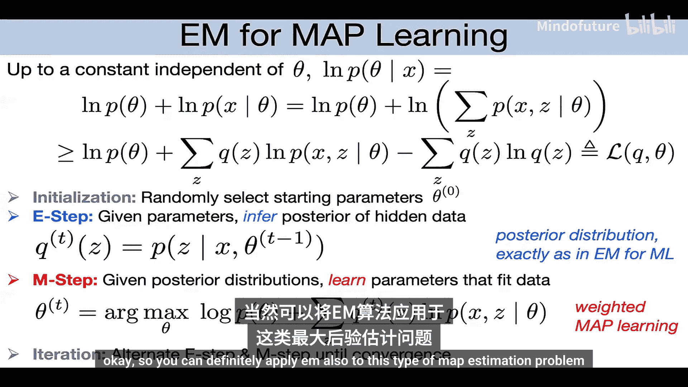

All right， so now that we've talked a bit about EM in general。

 I want to be a little more explicit about how we apply EM to graphical models。

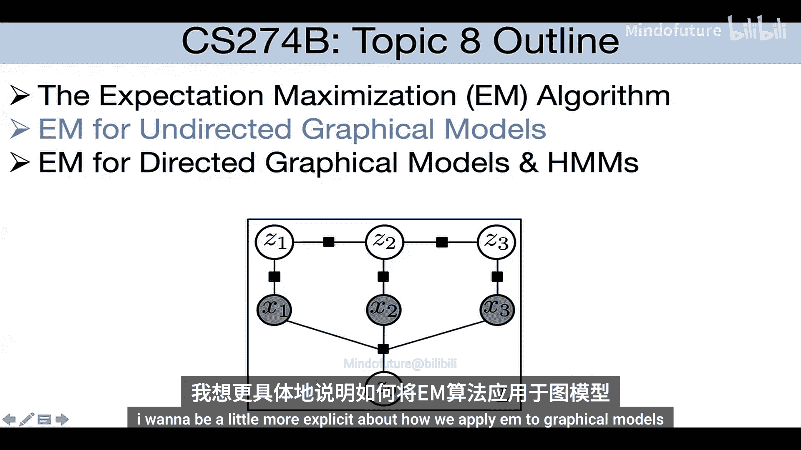

So。嗯。我跟他。Assume that I have a fixed graph structure and a fixed set of exponentialential family features。

 okay？So this is kind of the setup we talked about before right I have a set of factors。

 each factor has a feature vector and my probability is sort of a sum of all those factors of dot products with the features normalized so it sums to one。

And what I don't know are the numeric values of my parameters。

So I want to figure out what these parameters should be set to。

And so we talked about exactly this problem last week in the case where I had complete training data。

 so we assume that if I have L observations then in each of those observations。

All of my variables are observed。Okay。Em is going to be useful when we have incomplete or partial data and there could be multiple types of this incomplete data right it could be the case that there's some variables that are observed in all my training data and some variables that are never observed。

But it also could also be more heterogeneous where for every training example， there's like a。

Different nodes that are observed and not observed okay， and we can handle either case。

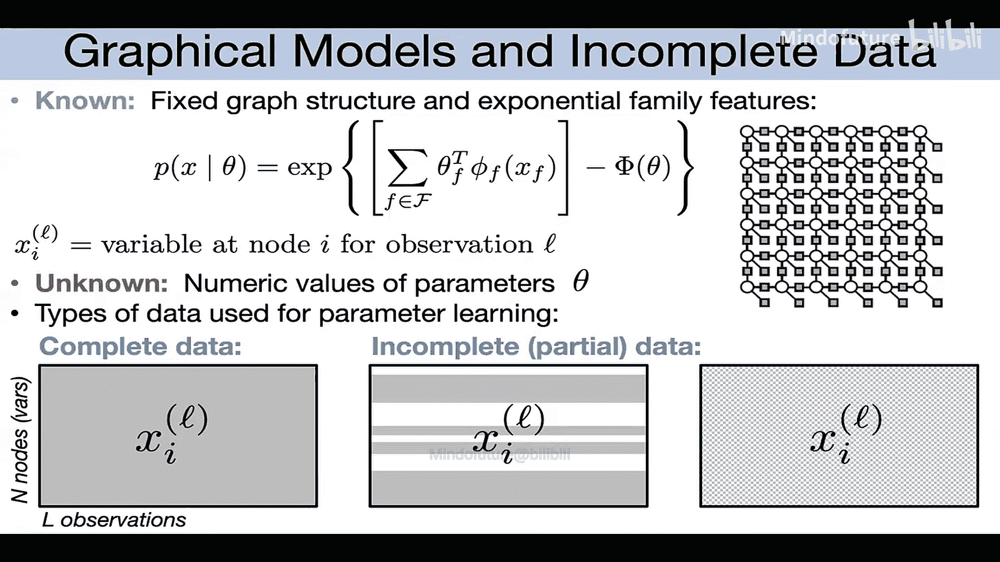

All right。So now the idea is that I'm going to have a set of L。Training examples。Okay。

 so and they are going to have some variables， X that are observed and some variables Z that are not observed they and they are arranged according to some factor graph like we show here。

Okay， and I'm going to let Y basically denote x and z。Together， right， so X are observed。

Z or unobserved， Y is both for training example L。对。Right， and so now。

The log likelihood of a single training example right looks like this right the if I the log probability of y is going to have this exponential family form right because we're going assume I have a feature vector for each of my factors and I take a dot product。

With the corresponding thetas。And then this phi theta， this is this log normalization constant。

 the thing that makes it integrate to one。All right so lots of the things we've talked about earlier in this class would be special cases of this right so for example I could look at mark our random fields for object recognition right where I have you know。

Observe nodes that are sort of features of the image and then some hidden nodes that are you object categories or other properties of the world I'd like to estimate。

m and in a lot of the training data actually that you end up with kind of like。

Partial labels right so this is MS coco it's one of the recent data sets used in computer vision and here you see on these different things basically people have sort of drawn these sort of polygontol outlines so they've sort of like labeled that say these these pixels are I think one person another person they said this is a ball。

You know， they labeled that's a car that's a motorcycle and so on。

 but note that not every pixel is labeled。So you have in each training example。

 some of the pixels are labeled and some of them are unlabeled so you might tree might be a category in your data set。

 but no one is bothered to label these trees。Why not because it's expensive to get people to label things and so it's kind of much easier to get lots of images that are partially labeled than to get like every pixel in every image labeled。

And so this is this gives you a sense for kind of what the partial observations would look like right so we observe。

Labels for some of these pixels， but for some of the pixels。

 the object category is missing when I do my training。All right。Um。

And so this is now this is just now the。Kind of the equation I had before right this is saying the log likelihood of my full data set is going to look like this right I have a sum over all my factors a sum over all my training examples of this dot product of between features and parameters data。

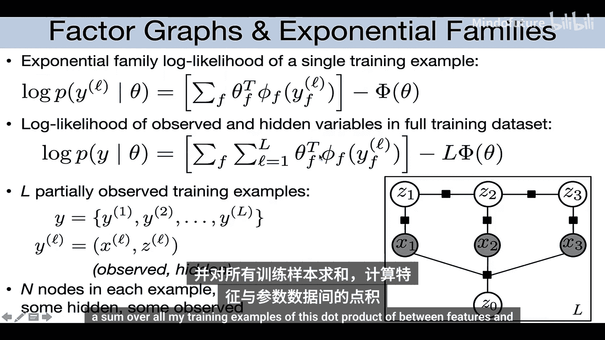

Okay。So what would EM do right well there is first I would the expectation step。

 you would just find the posterior distribution over the very disease you don't observe given the x's that you do observe。

诶。嗯。And。I mean， a way， if I I'm a little more formal about this， what is the。

 you know posterior distribution for like a given？Data example right it sort of it says that well you know the x's are going to be exactly what you observed and then the z's are going to be the posterior of them given x right so you're going you're going to be saying that given my current model parameters and you know the pixels that were labeled by people。

 for example， if I'm doing that object segmentation。

What's the distribution of the other pixels that were not labeled？Okay。

Now a thing to note is that it might be complicated to you know list if you have many unobsserved variables。

 right there's an exponential number of combinations of those variables。

 so I can't just kind of enumerate the probabilities of all combinations right you have this blow up。

However， what's nice is that in order to compute the next Mstep update。

 all you need are the marginals for each factor or cl in the graph。Okay， so given the x's。

 I need the marginals for each of the cliques or factors。

And so I can use the inference algorithm we've already been talking about。

 like belief propagation or the junction tree algorithm to compute those。Okay。All right。

 and what about the M step well， again I'll keep it a little bit at a high level。

Given my distribution from the previous thing， I want to maximize。That with respect to theta。

Okay and because this is an exponential family， I get a kind of nice form right where what I need to do is I need to compute the average features on my across my training examples where this expectation is averaging over the probabilities from the E step right so you sort of say that if for the variable z that are uncertain。

 I kind of like weight them according to how likely different values of Z were。

And then I compute these average statistics and I set my model to match them。ok。

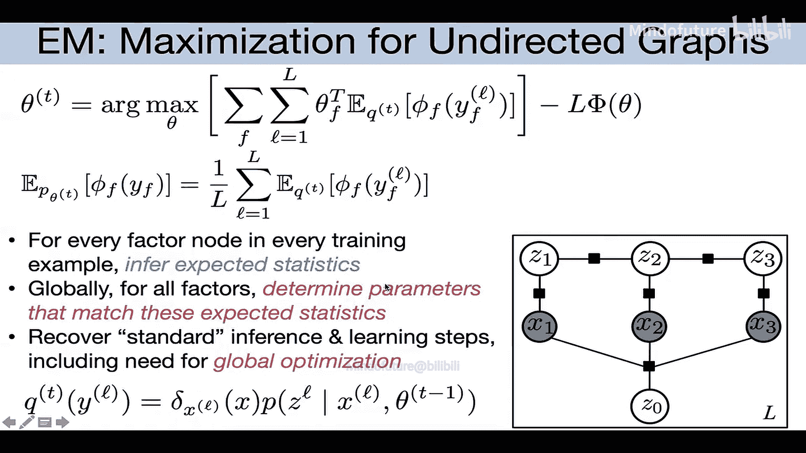

Okay。So the kind of summary is that in the E step， you have to infer the expected values or sufficient statistics of the features。

And you do this for every training example， and so that could be expensive in a big data set。

 but it is parallelzable， you can kind of analyze each one independently。嗯。嗯。

And now if I don't have an exponential family model。

 often kind of you can do the same structure and it still works。

 but your inference and learning steps tend to lack closed forms so the details get more complicated。

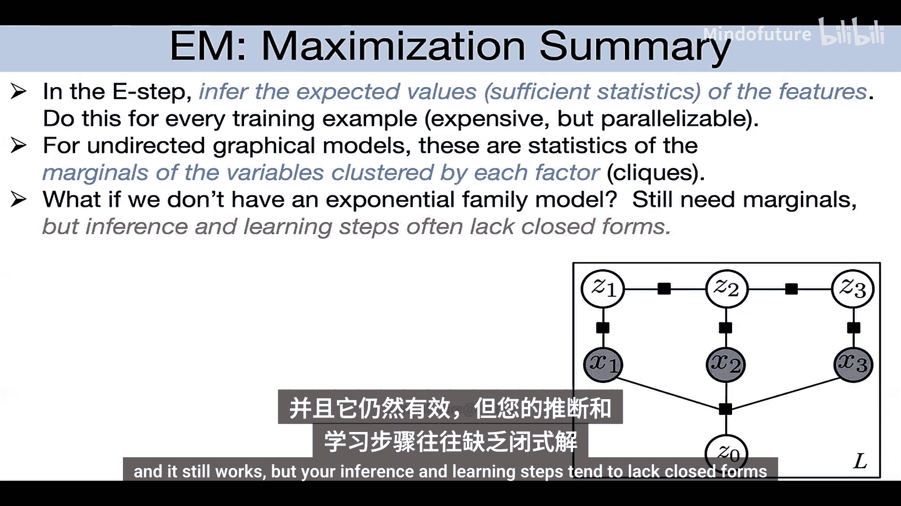

All right。嗯。😊，And。So the last section here is， is a bit that's a bit more review。

 because I know HMs have been covered in the prerequisites for this class。

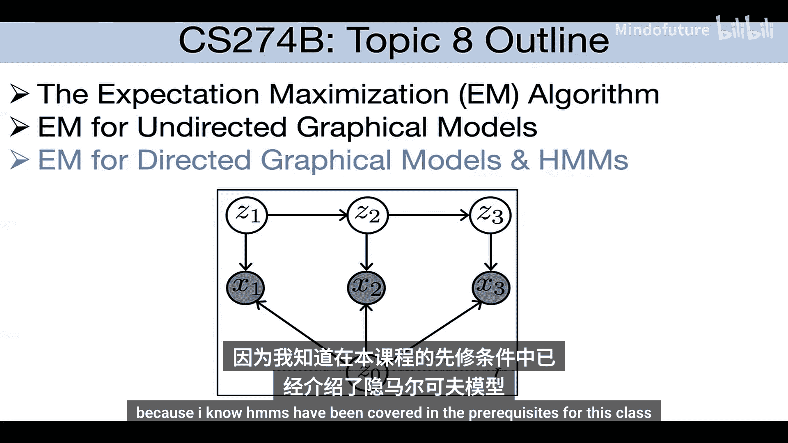

But I just kind of want to give you a high level idea of how EM would work for a directed model。

And it has the same structure in the E step， I would find the posterior distribution of my hidden variable Z。

Given the observations X。And then in the M step， I would。Learn the parameters that fit the data。

And things are easier for a directed model because I can do this independently for every node in the graphical model using the expected statistics from the ETP。

And now I just alternate these E&M steps until convergence。

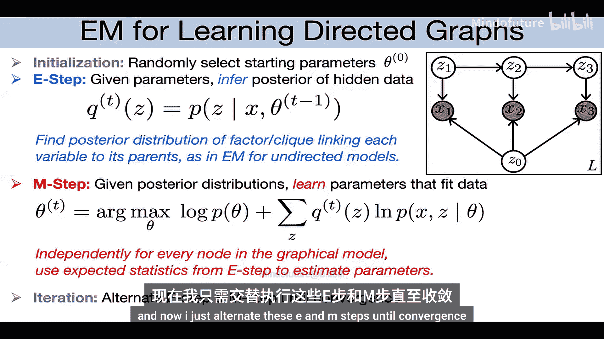

Okay， and so there's kind of a detailed example worked out here for the hidden Markov model。

 which I think although we' our focus in this class is on more complicated graphical models。

 I think it's useful to get a sense for how it works。Okay， and so imagine I have， you know。

 in a hidden Markup model， I would have the initial the probabilities of the initial state for each sequence。

Then I would also have these state transition probabilities。

 these are like the probability of the next state given the current state。

 and then I finally have some probabilities of observations。Given states。对。

And now what do the E&M step look like in the E step。

 I need to infer the posterior of my hidden variable Z。

Given my observations X and parameters by Bays roll。And then in the M step。

 I need to choose the parameters to maximize。The expected long likelihood that my data and I。

Ittererate between those steps。

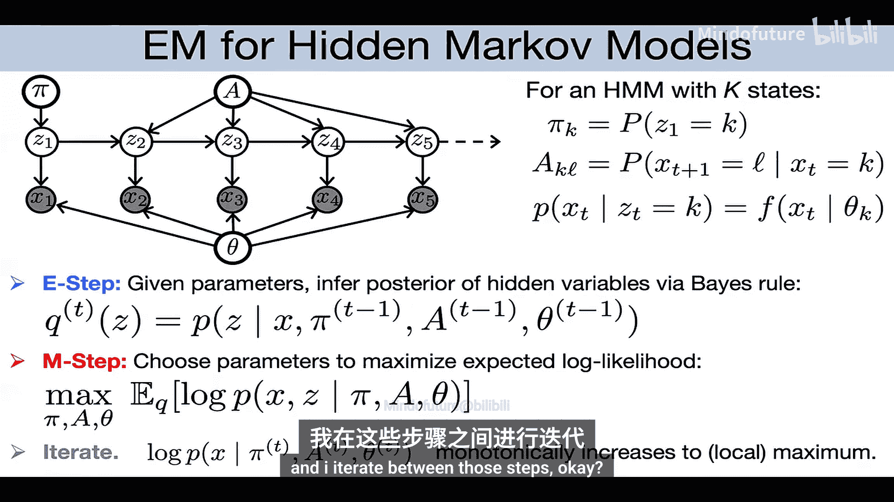

睇。And so you can do this in sort of lots of elaborated cases like for example。

 if I have many different training sequences of different links right if I share parameters between them I can also use that exploit that shared structure when I。

Do my E&M steps。

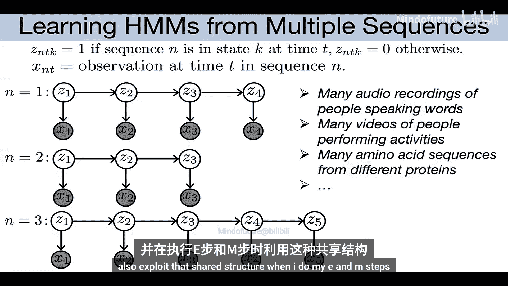

哎。So to start first let's look at what you need to do for the M stepP right so to see that how local structure helps you。

 what do I need to do well to do the M step I need to sort of write out this log joint probability of x and z that I need to take its expectation with respect。

To cute。And from the factor I structure this model， this breaks down into a loss of terms， right。

 I say for each of my sequences。I have the expected。

 basically the log probability of the initial states。

Then I have the state transitions right I basically have the log probabilities of the next state given the current state。

Average overall all possible current here， this is over time points and this is overall summing overall current and next States and then I have my expected probabilities of absorbed data。

So you have all these terms。

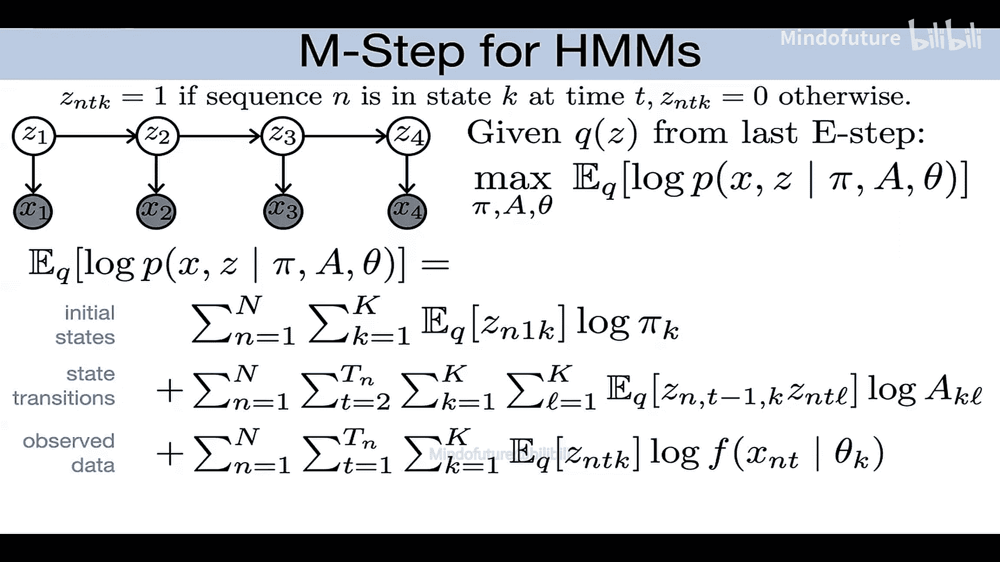

Okay， we talked before about how to do you know， maximum likelihood estimation of discrete parameters and the same things。

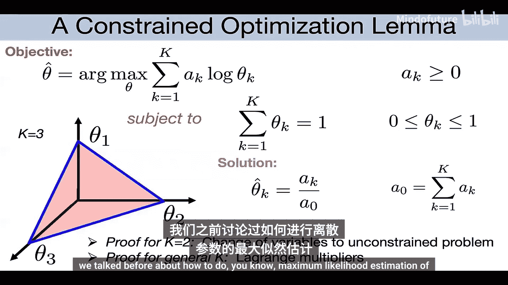

Work here right so for example， if I want to estimate the initial states。

 what should I do I take this equation and if I want to find the parameters pi k that maximize it right from that little on the previous slide this would just be that I take the sum over all the sequences and here I take the probability from the the e step that that sequence was in that state。

At the first time point。Okay so what I need here is the marginal distribution of the state at time one for each of my training sequences。

嗯。Then for the observations right similar kind of story right to get this expected log likelihood what do I need this is I need the probability that in sequence n at time T I was in state K that's what this is telling me。

And so now I just have to solve these sort of maximum likelihood problems where I take the log likelihood of my data weighted by these probabilities and maximize over the parameters data。

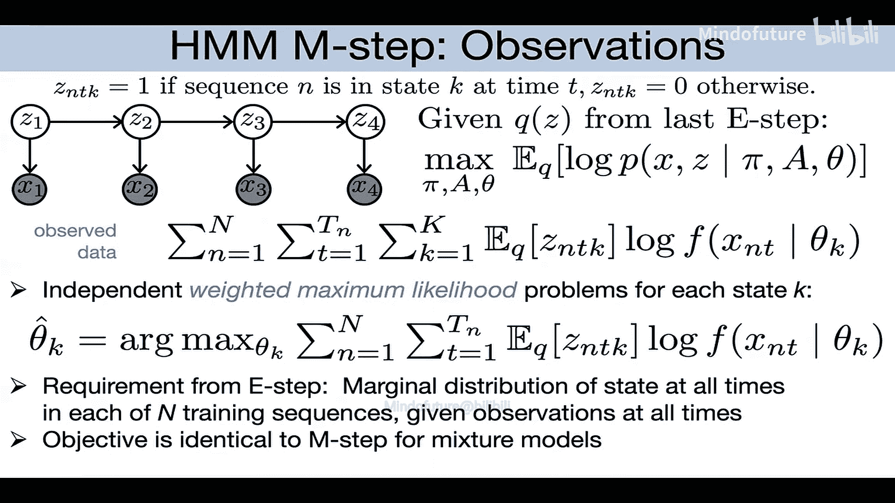

对。And then finally。For the state transitions， then I have a term that I have the expected probability that I started in。

呃。In。In state K and then went to state L at the next time point。

And I can again get the optimal solution using that same Lima and now for this update I need the marginal distribution of pairs and sequential states right so I need the probability of Z1 z2 and I need also the probability of Z2 Z3 and so on。

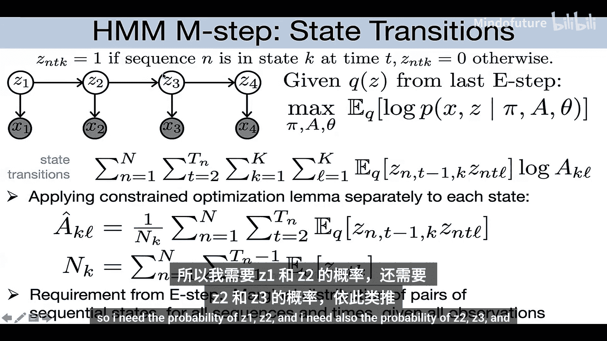

ok。😊，嗯。Now what is the E stepP， so the place that most people see the EM algorithm first is in basic mixture models。

And here， the E step is really simple， right， because in a mixture model， given the observations。

 the cluster assignments are independent of each other。

And so I can kind of use Bays rule independently for each data point to figure the posterior distribution of its cluster assignments given the data。

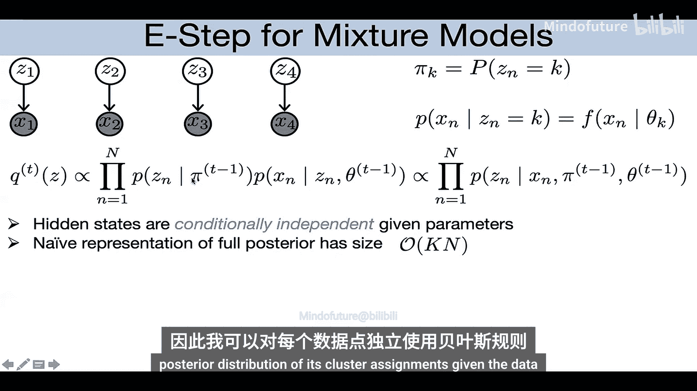

Okay。😊，In an HMM。Now everything is coupled right so given my observations the states their posterior distribution is a Markov chain。

However， if you think about that previous M step， what did I need。

 all I needed was the marginal distribution of the state at each time point as well as the marginal distributions of pairs of states and I can find these efficiently using the forward backward or belief propagation algorithm to find these single state and pair state margins。

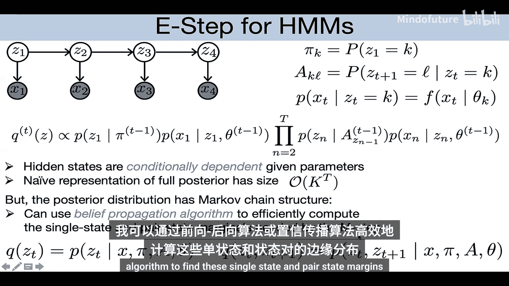

Okay。And this is just giving you a little example I talked at a high level before about HMs for localization of mobile robots。

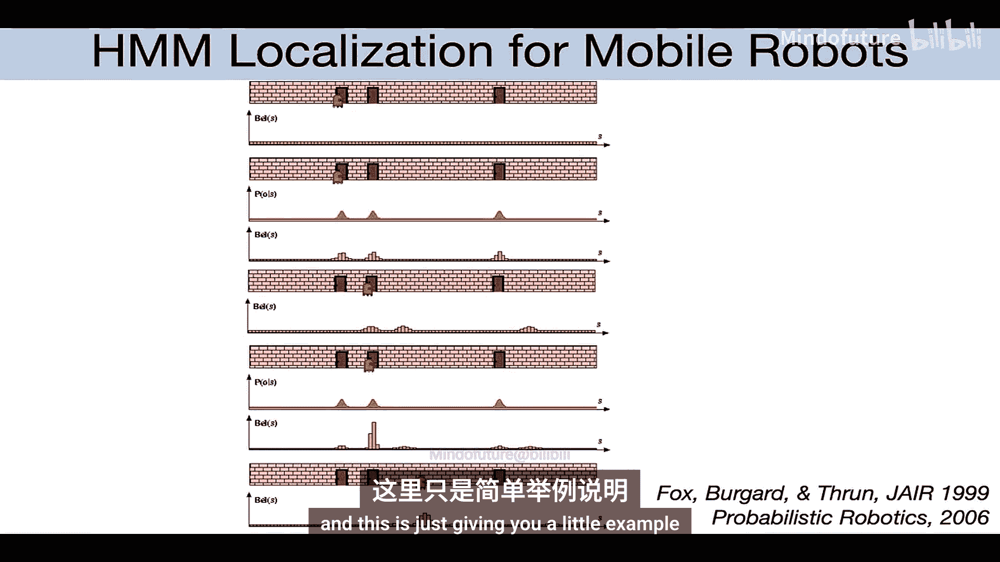

Okay， and so for these types of models， you need state transition distribution。

Now you could sort of specify these from knowledge of the mechanics of the robot。

 but sometimes you don't have that， and you might instead essentially need to treat the state as a hidden variable that is inferred as part of your learning of model parameters。

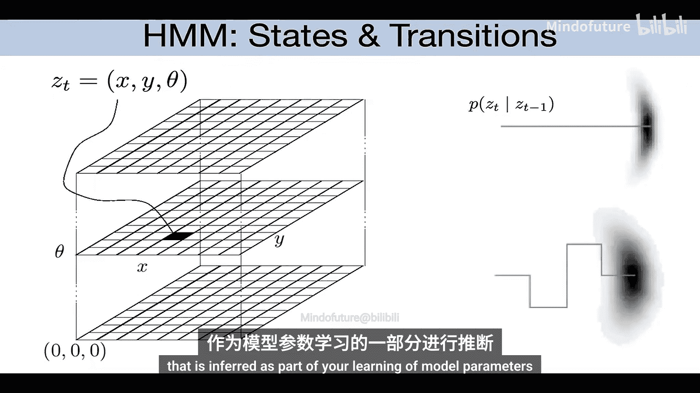

And this gives you an example of that kind of doing that whereas。As the robot is moving around。

 it's getting observations。And then as based on these observations。

 it's slowly improving its estimated at its state until it finally has a good localization。Best。

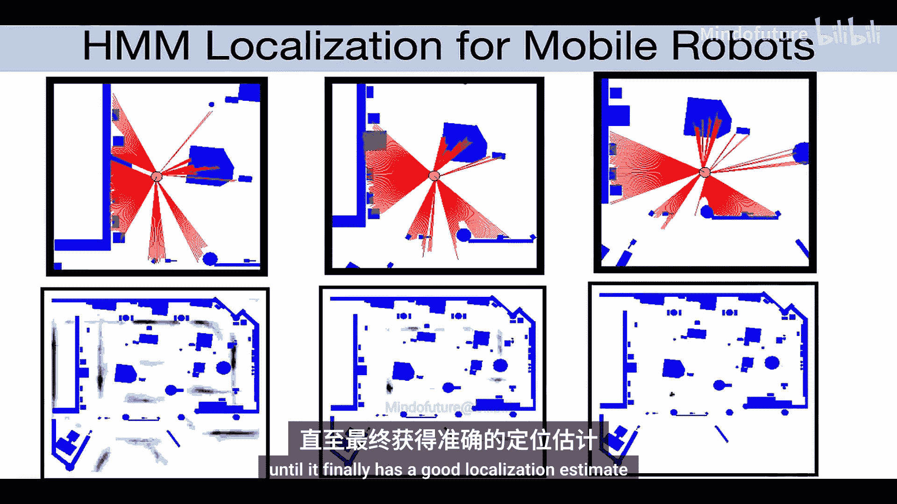

And so again， how would。The EM algorithm showed。Show up in an application like this right well the more basic primary estimation methods would say that you know not only the observations the robot gets but in your train data you know exactly where it was right and so maybe sometimes you can do this if you have some separate fancy localization system or a person who could help annotate where the robot was。

But if you don't know that right， you just have the robot drive around getting observations。

 then you could try to sort of simultaneously estimate the parameters of how the robot moves as well as its distribution over where it was over time and that's sort of how the EM algorithm would apply。

To an application。Like this。All right。And so that's the view of EM for hidden Markov models。

 but the exact same approach would apply to any of the other sorts of directed graphical models that we've talked about。

 and indeed that's a widely used way for estimating parameters from data。

That is not completely observed。