# 【加利福尼亚大学】图形模型中的学习 ｜ Cs274b ｜ Learning In Graphical Models (Spring 2021) p12 P12_讲座_6A-_MCMC_方法__Metropolis-Hastings -BV1Tqx6zrEMj_p12-

So we're going to continue talking about Monte Carlo methods and we kind of had the I guess。

 what I view was the kind of basic setup last time。

But for kind of high dimensional complicated models， often the kind of basic。You know。

 important sampling methods are not really practical and so instead a lot of the times people use Markov chain Monte Carlo and CMC methods and so that's what we're going to talk about this famous and really widely use class methods today。

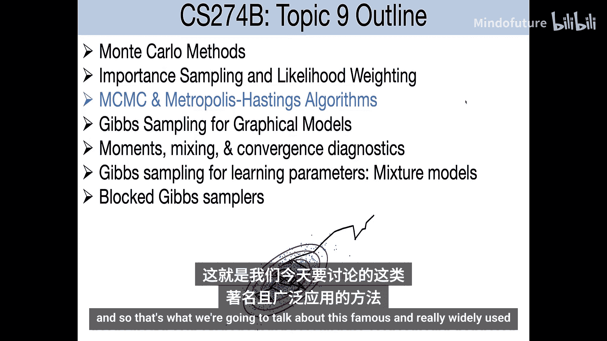

And the goal， so we're going to kind of right now step away from graphical models in particular and just talk about how you can do sampling from a target distribution。

Okay， so there's going to be some distribution P of x。Okay。

 that I would like to sample from right if I could sample from it I could do all the standard Monte Carlo things I could estimate properties of that distribution。

 but the problem and it could be discrete or continuous and so but we're assuming here that that。

For whatever reason， sampling from P is not something I can do。

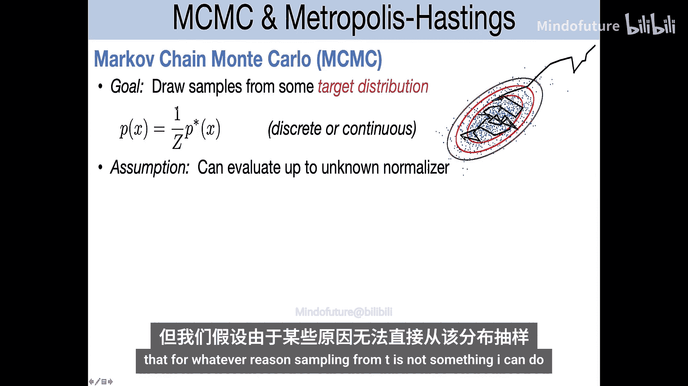

So we're going to assume that we can do something weaker which is this we can evaluate it so if you give me some x I can tell you the probability of x right and in fact I'm only going to assume that maybe I can evaluate the distribution is some p star normalized and maybe I don't know that normalized and that'll be okay for the methods we talk but I least you need to be able to evaluate this P star。

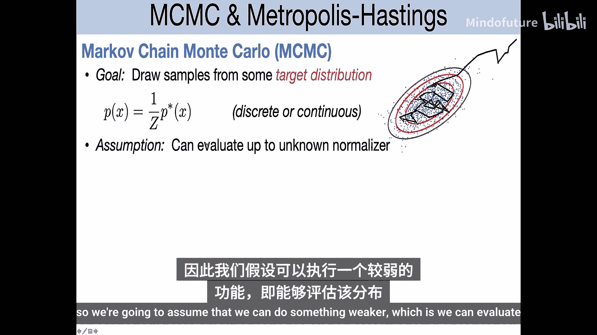

啊。嗯。And so so every model we've talked about in this class fits in this family。

 even if it's intractable to exactly compute marginals。

 we can at least kind of evaluate the probabilities of any excutivus。And the approach。

 so how Markov chain Monte Carlo methods work is you know well they do Monte Carlo sampling using a Markov chain and so particular if you think back to when you've learned about Markov chains and probability class。

 one of the basic properties you learn about is the equilibrium distribution right so under certain conditions。

 a Markov chain will have an equilibrium distribution which you could think of as saying if I initialize somewhere and then simulate that Markov chain for a long time。

 that is the sort of distribution that the state converges to。

And so the idea of an MCMC method is that I'm going to design a Markov chain whose equilibrium distribution is this P of x that I care about。

And then if I can simulate that Markov chain， then if I simulate it for enough time。

 I will get a sample from P of x by just sort of like monitoring the state of the Markov chain。Okay。

And so this is the equation for the equilibrium distribution right so for sum for P to be the equilibrium distribution of a Markov chain。

 it has to be the case that sort of if I am sort of sample from P。

 and then I take one step of my Markov chain，Right so I take a transition from x to x prime then I get a sample from the same distribution。

 the distribution is unchanged okay and so this is if I have discrete variables right this is a set of linear equations。

RightSo for each possible discrete state x， there's one equation that says if I take the probability if I start5 p of x and I multiply by the state transition。

 then I get some new state x prime so the number of linear equations here is equal to the number of values of the discrete state。

And as you can think of this as like a， if you look at the former mus equations。

 it's basically like if you think of these P stars as like a vector over all states。

 this left side is just multiplying that vector by the state transition matrix。

There's also there's a corresponding， if you have continuous state Markov chains。

 some folks may not have seen this in the first probability class but you can have states Markov chains that evolve in discrete time over continuous variables and you would have a a similar equation except now it would be an interval okay so if I take the current the P star and I integrate over transitions from xx prime I should get the same distribution。

Okay。And so there's lots of different ways for designing。MCMC methods。U right， so there's not。

 if you think about it， there's a lot more degrees of freedom in a state transition distribution than there are in like just a distribution over states。

Think about if I have and the discrete case this is if I have k states p star is like a vector of k numbers and the state transitions is like a K by k matrix。

 so it has k squared numbers。So in general， there will be many different。😊。

Markov chains that could have this equilibrium distribution and then our goal is to sort of find find a good one and we'll see more formally what that means but roughly that means that you know you want one that if you initialize somewhere you get to that equilibrium distribution quickly so if you simulate the markup chain for not many steps you'll sample the distribution and you also want a markup chain where。

Each step of that simulation is computationally cheap。

If simulating my markov chain is like really hard to do， well。

 then this may not be a practical method。And so there's lots and lots of different。😊。

Work up to money， Carla， like there's a whole corner of。

Of machineach learning and statistics and probabilities is basically is focused on designing better MCC methods。

 designing better markout change， but a lot of the most popular methods are a special case of what's called the metropolis Hastings method。

And how metropolis Hastings works is that there's a the Ta distribution and the user specifies some transition distribution。

So some Q of that says given the currency state that， there's a lot of flexibility。

 this can be almost there's some restrictions but it can be almost anything you want。

And then what metropoliization is it says I'm going to modify this cu so that the。Distribution。

 you care about P is its equilibrium distribution okay。

 so you sort of modify Q so that it's a mark option chain with the right distribution。

And it's a very general purpose way I'm doing that。

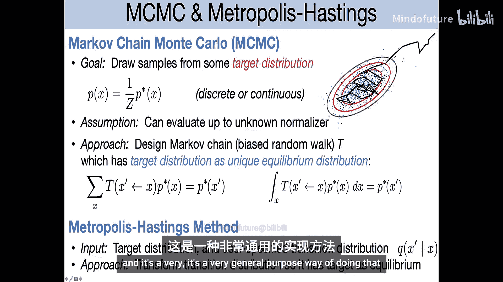

Okay。嗯。😊，So there's a。AA condition that shows up in the analysis of Markov chains called a detailed balance okay and so here's the idea let me let me I'm going look at two quantities here so on the left I say that suppose I you know simulate the chain for a long time and so I eventually I get to x right so I sample x for my distribution P and then I take one step from x to x prime。

Okay， so there's some probability that if I kind of simulate the chamber a long time， I get an x。

 and then I from there go to x prime。And there'd also be a probability of kind of the reverse of that that if after simulating a long time。

 I get to x prime， and then in one step I go from x prime to X。So here I have get to x。

 then go to x prime， here I have get to x prime， then go to x。

And detailed balance says by definition， these two things are equal to each other for all possible pairs of states。

 x and x prime。Okay， so this is just a definition。Now。

 what's interesting is that if this detailed balance condition。

Now first understand what this is doing one thing to note is let's look at a few special cases right so first if。

You satisfy detailed balance then if。X and X prime have the same probability with equally probable states。

Then these transition pro have to be equal to each other。Right。

 so if x x prime is the same probability， then it has to be the case that the frequency with which you jump from x x prime has to be the same as the frequency with which you jump from x prime to x。

Okay。Yeah。So this is。Maybe getting a sense of where the word balance comes from。

And on the other hand， let's suppose that X prime has higher probability。Then X。

And then in that case， this ratio。Basically， if x prime has higher probability than x。

Then it has to be the case that this probability of that this transition here has to be bigger than this one for equality to hold。

Okay， so basically if x prime has bigger probably than x。

 then you have to transition from x to x prime more often than you transition from x prime to x。

So hopefully that's a little intuitive that right somehow if I wanted you know。

 this P star to me my distribution， then basically it ought to be the case that when I simulate my markov chain。

 I go to kind of higher probability all states。More frequently I go to lower probability states。

On average， you're increasing probabilities。And so in fact。😊，If I have a this condition。

 there's a one line proof right so this holds for all possible x and x prime。

Then let me just take this linear equation and sum both sides over x。Okay。

So if I sum this left side over x。I get this and then on the right side。

 if I sum over x well this is a transition to distribution。

 so right if I sum the probability of going to x given I'm at x prime over x， that just sums to one。

No matter what t is， we know it's a distribution so it sums to one。Okay。😊，And so thus， this detailed。

 if I have detailed balance， I always have， it's always the case that P star is the equilibrium distribution of this Markov chain。

Now this is sufficient， not necessary and that means that there exist Markov chains that have P stars or equilibrium distribution。

But don't satisfy detailed balances however， those markup chains are。

Are a lot harder to analyze in general and a lot harder to show that they have the right equilibrium distribution so a lot of the things that are practically used have this property。

Okay。Does makes sense。Okay again chain of ideas is I want if I want to be able to design a markov chain that has this P star I care about as an equilibrium distribution and so what we found is that in general right that involves。

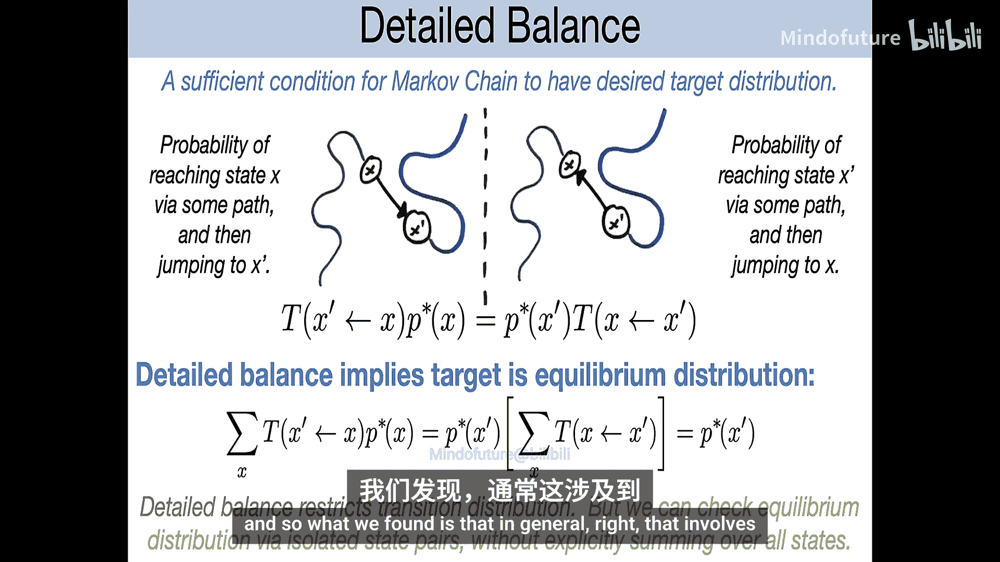

These equations involving sums or integrals。

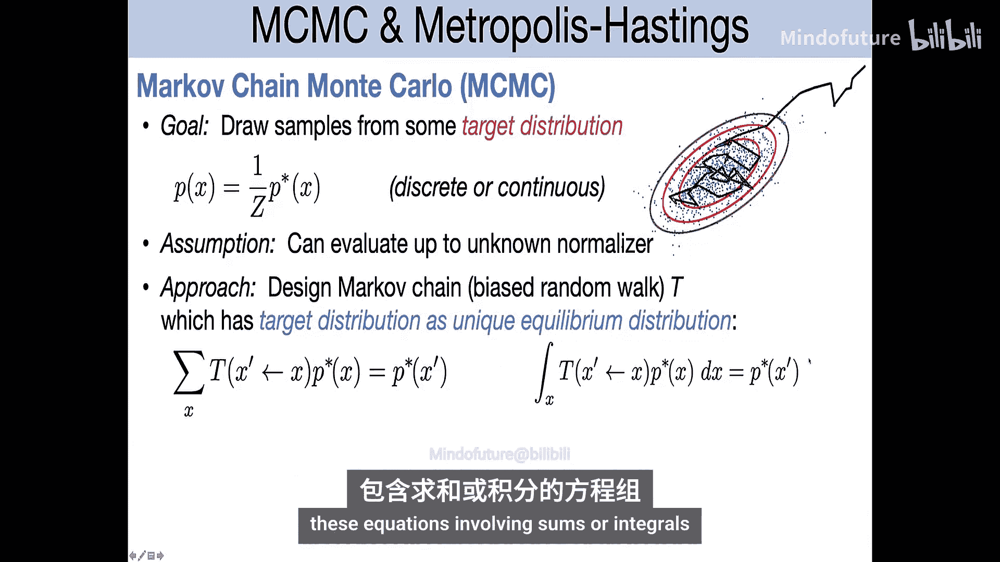

That could be hard to check， but we've sort of verified that if this condition。

 I verify that for any pair of states x and X prime， the single equation holds。

 then I know that I have the right equilibrium distribution。

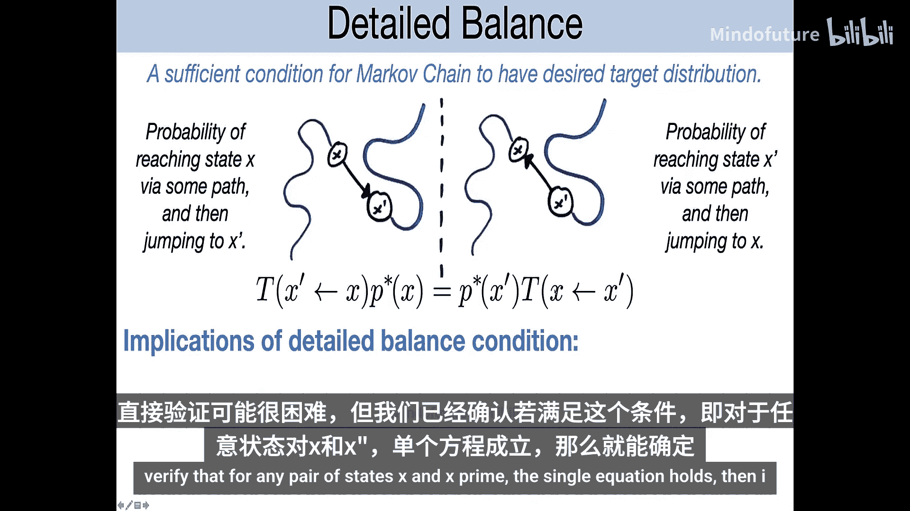

Okay。All right。So。Here here's the Metropolis Hastings algorithm。U。And so this comes from physics。

Right。You may have heard metropolis names， same metropolis who worked on the atomic bomb in the 40s。

Um， and so they were interested in doing various simulations as part of what they were doing。

 has Hastings is someone who worked on this stuff a few decades late after metropolis。

And they came up with this class of methods。And so here is the。

How the metropolis Hastings algorithm works。Okay， so the idea is that you're going to first the user again gives two things。

 there's the P that you care about。And then there's also these。

You knowUse specify transition distribution。Okay， and so。You're going to give some。

 you're going to come up somehow and we'll see examples later with something that kind of。

Given a current x samples a new x tde okay， so there's a probability of sampling some x tta given x and we're going to assume like this distribution is tractable so I can simulate from it。

 I can also evaluate it。All right， so here's how the metropolis Hastes method works。

 you simulate from your this transition。Now the problem is is that if you just make up this Q arbitrarily。

 it may not have the right， there's no reason to believe it would have the equilibrium distribution you want。

 like who knows where it prefers to go。Okay， so what we're going to do is we're going to evaluate what's called an acceptance ratio。

Okay。😊，And what is this？This is going to be era ratio two terms I have you can look at it。

 this is the probability of。X tilde times the probability of jumping from x telta to x。

And then I have sort of the reverse in the denominator。

 I have the probability of x times the probability of jumping from x to x tilde。Okay。😊。

And note that if。Q satisfied the detailed balance condition for P， this would be one。But in general。

 it may not， so it could be either bigger or smaller than one。Okay。All right。

And then what do I do now basically I check this thing and I look at two cases first。

 if this is greater than equal to one。Um， right， which sort of says， what does that say， well。

 that says this numerator is just sort of bigger than the denominator。Which is again。

 if you look as kind of saying that like the new state is higher probably than the old state with some correction for transitions。

If this is bigger than one， then I set x prime equal x T them， so I sort of accept。

This proposal from Q。On the other hand， if this is less than one。Then I may reject this proposal。

 but I don't do it deterministically I do it randomly so what I do is I sample a binary variable so right if this ratio is less than one so this if r is a number between zero and1 is clearly positive because these are all distributions。

Then what I do is I sample a binary variable that has probability r of being1 and probability1 minus r of being zero。

 so I sample a Berulli and then what I do is if I get a one， if I get a heads。

 I set I accept the sample right so I set x prime to Xt on the other hand， if I get a zero。

Which getting a zero will be likely if R is small。Then then I reject this sample and then so the next value of x prime is basically the Markov chain doesn't move。

 so the state X prime equals x。Exactly。Okay。And then if you put all these together。

 the overall probability that you accept your sample is actually the min of this probability N1。

So if it's bigger than one， you always accept if it's less than one you might accept。Okay。All right。

So。All right， let me look at a couple special cases。

So this is kind of the general version of metropolis Hatings so let me look at two special cases so the first one is when my proposal actually doesn't depend on the current state。

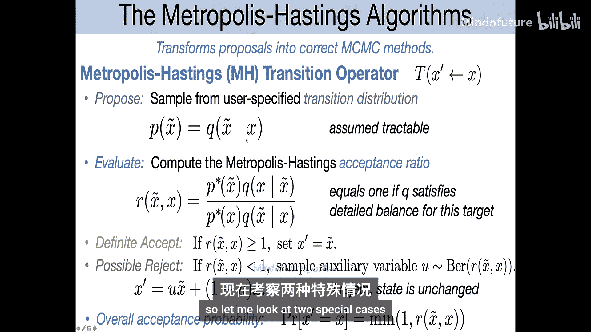

So now my proposal is going to be some fixed distribution I sample from ignoring X so like every time I just sort of sample from a distribution。

 so this is actually this is the same thing that we needed when we did important sampling was we just sampled from a fixed distribution。

Yeah。Now， important sampling， what did that do that that sort of evaluate weights and used them the correct。

An estimate of an expectation。Here instead what we're going to do is we。

Now I plug in this queue into that ratio。And now if I group terms， I can see that what do I have。

 basically I have the weight of my new sample。Divided by the weight of the old value of the thing where this weight。

 this W is exactly the same thing we have in important sampling， it's P over Q。Okay。

 so basically if my I sort of will want to keep samples if they're in regimes where you know P is big and Q is small。

 okay， so they're high in high probability regions of the space， on the other hand。

 I'll want to reject samples， if they're in a regime where P is small and Q is big。はい。Okay。

 and so now I evaluate this ratio that'll be a number between zero and one if it's above one I always accept if it's below one I I。

Possibly reject。Okay。And now note if I actually set Q exactly equal to P。

So my samples were from the true distribution I actually care about。

 then you can see that this ratio would be one you would always accept and you would recover just the vanilla Monte Carlo。

 the first thing I talked about。When I talked about money car methods。

So but this is now a way of kind of correcting a proposal。

 but it doesn't a different way by kind of simulating a Markov chain。U。

🤧Here's another case so that the。嗯。What's called the metropolis algorithm。

 so I mentioned that metropolis worked on this before a few decades before Hastings and the metropolis proposed a special case where basically the transition distributions were symmetric so he assumed that whatever the probability of going from x to x tilde is it's the same as the probability of going from x til to X。

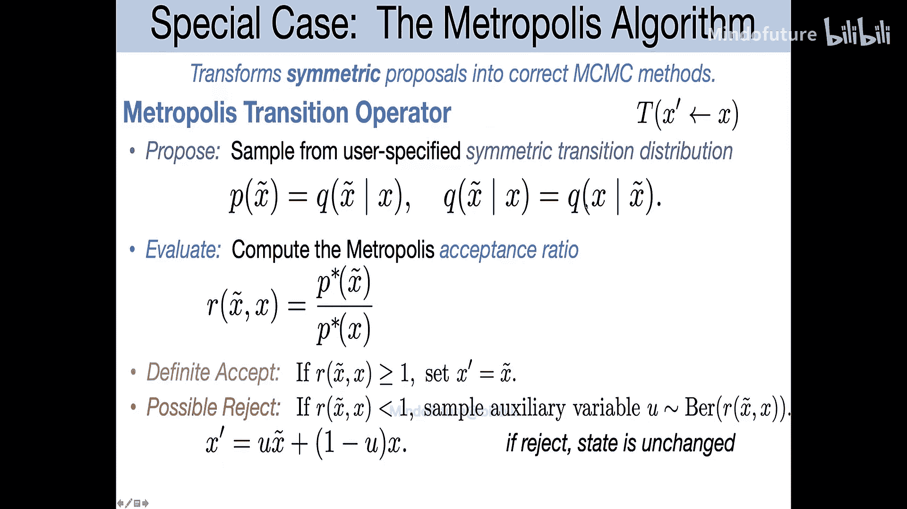

Okay， and so if you have that symmetry， then if you look at。

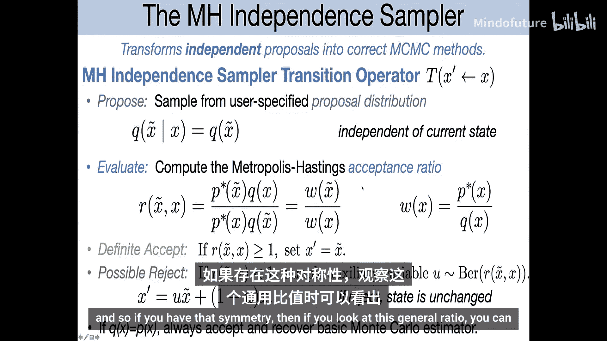

this general ratio， you can see that these Q terms cancel。

 they go away right their ratio is just one。

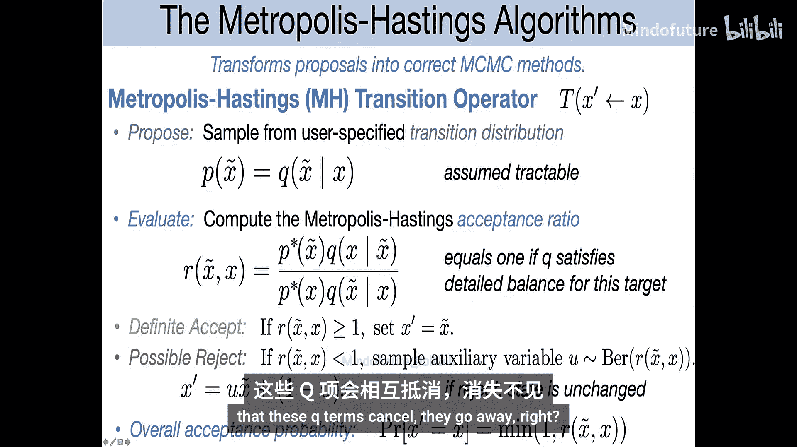

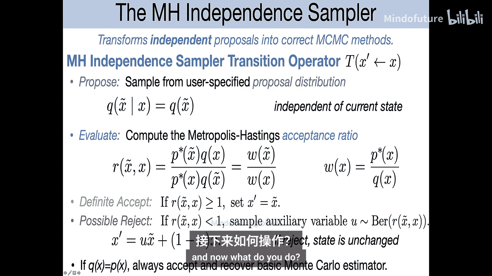

And now what do you do， you basically you say you have the probability。

You propose a new state and now you compare the probability of the old state and the probability of the new state and basically if the new state is higher probability。

 you always accept it。Right so basically if you if you sample a state that has higher probability under your target then you go there always on the other hand。

 if you sample a state that has a lower probability on the go there， you go there。Sometimes。

Right in particular， like if suppose that your x tilde has one tenth0th of the probability of x。

Then basically when you do the simulation， you know， with 10% probability。

 you you take that jump down to a lower probability and with。90% probability you would reject it。

Okay。So this actually has this interesting flavor but it's like a little bit like a cousin of greedy search right so there's a lot of kind of when people want to solve different types of optimization problems or you want to define the thing that like imagine you wanted to maximize the probability and you knew very little about the distribution you didn't how to compute derivatives or anything well then one of the simplest methods is is a greedy search method where what you do is you have a current value you kind of perturb it。

 you add noise to it and then if it's better by your objective。

 you accept that otherwise you reject it。Okay， so this is a little bit like a greedy search。

 except you， you know， if you go to if your proposal goes you to a high probability state。

 you always accept。And on the other hand， if it goes to a lower probability state。

 you sometimes accept， but sometimes reject。And what's magic is that by sometimes accepting these moves。

 the Lord probably states。Rather than just going to a mode， you actually eventually get a sample。

 an exact sample from the equilibrium distribution。That the distribution that you care about。

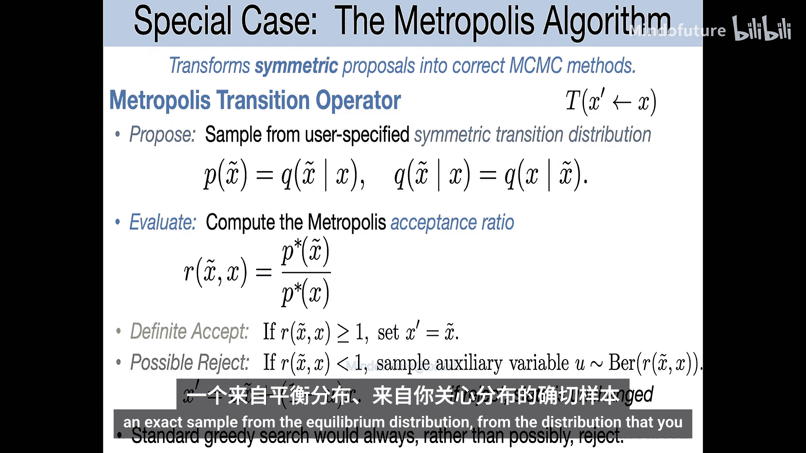

Okay。All right。So let's look at a couple of very simple examples。So。

Here's a case where let's say my target distribution was a uniform over the integers between zero and 20。

All right， so those integers between0 and 20 all have probability 1 over 21。Okay。

 that's what I would。Want a sample from？And so now right。

 this is now showing on the right column here， this is just showing if I if I were to。

Just if I could if I just sample from that right I wanted to sort of use Monte Carlo and I just did a sample and I just sort of sample and I start counting as a function of my number of samples you know my histogram of the values like yeah this is what you get after 100 samples 400 samples 1200 samples right so you get something that has some noise as you get more samples gets more and more。

Approaches this uniform distribution。嗯。Here's。How you could apply the metropolis method to this right so let's suppose here's a simple approach where you what you do is for a current X。

You， your proposal will be that with 50% probability you。Subtract one and with 50% probability。

 you add one。Right， so you have a current。嗯。State， like my current state is eight。

 I either go to seven or nine with equal probability。Okay。If my current state was 20。

 well then I with 50% probably I'd proposed 19 with 50% probably I'd proposed 21。

 and now if I propose 21， I will always reject that because it has zero probability under the target distribution。

Okay。So you get something that basically is kind of going to kind of do a random walk。Back and forth。

 not in any directed way where it it'll never go above 20 or below zero because of you have zero probability there。

And so this is what that looks like， this is after 100 iterations after 400 iterations。

 so you can see here that like after 400 iterations in this particular trial of the Markov chain。

 it happened that it must have kind of happened to end up on smaller values of the state so you can see you'd have sort of higher probability of numbers between about you know0 and 12。

0 and 11 and lower probability of higher numbers。Okay。But then if I run the Markov chain for longer。

 eventually it'll kind of end up over here and then now actually after total iterations。

 you can see that it has you know closer to uniform。

 but kind of higher probably to the right and lower to the left and so on。And so eventually。

 if I run this long enough， right， it has the right equilibrium blue distribution and I will this histogram over how long it spends in each state will become exactly uniform。

But note that it's if you look visually if I compare the left and right columns。The MCMC method is。嗯。

You know， approaching uniform less。Quickly。Than the independent sampling。

 and that's because there's dependence in the markout chain， right， if I have。

 suppose I'm currently at like。State one to get to state 20。

 it's impossible to get there in like one or two or three steps of the Markov chain right it's going to take many steps for it to transition。

Right，And so you can imagine if。If instead of uniform on the integers between zero and 20。

 if I had uniform on the integers between0 and 100 and the same transition distribution。

 it might take longer， a larger number of iterations to get a good sample for my distribution。

And so that's what's called the mixing rate。By the way。

 this kind oft thing here this is kind of if you tilt your head。

 this is showing kind of what the method does right so this is showing it starts off so this is thinking of like the integers and this is versus steps of the markov chain right and you can see that it's just kind of doing this random walk。

诶。But then eventually， after it does this random walk long enough。

 you'll get something that's a sample from this uniform distribution。Does that make sense。

 any questions about the intuition for that？No I mean， of course。

And this was the only distribution you ever cared about you would probably not need to do this。

 you could just sample from this directly we know how to do that。

 but the idea is that there's much more complicated distributions where directly sampling from P might。

Not be possible， but for which simulateulating a markout chain that has the right distribution is。

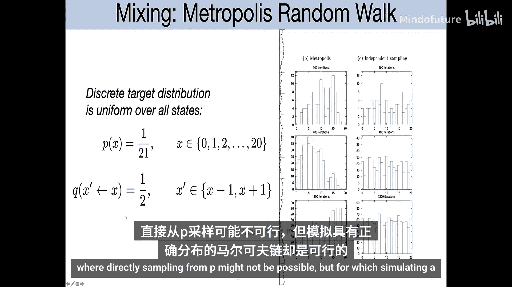

Okay。Now you can also apply the same approach for sampling from continuous distributions。嗯。Now here。

The P of x just to be simple， the P of x here is chosen to be a。嗯。

A normal with mean zero invariance one， so that's by target distribution。

Okay and now my prop what i'm going to do is i'm going to to simulate it i'm going to do this is what's called random walk metropolis and this method is very widely used it's it's kind of your。

A baseline approach you can use if you don't know much about you know the distribution you're working on is you just take your current value of x and you add noise right so you sample from a normal whose mean is the current X and then there's some noise level sigma that's a parameter。

Okay， and then you so you add noise and now note if I just added noise and always accept right so if I'm adding a bunch of independent noise you're think about then the variance of my distribution would just grow forever and it would blow up to infinity。

So the reason that that doesn't happen and I actually get a sample from this Gaussian with variance one is that when I add this noise。

 sometimes I accept it， but sometimes I reject it。Okay。😊，So I think it's easiest to look at。

Maybe look at this middle row first， so this is where if I set the noise。To be one。

Okay and then if I do that， this is the Markov chain that I simulate。

And it looks like about 68% of the time it accepts the sample right。

 so you get a jump that jumps to a new state， about about a third of the time it rejects it。

And it's hard to see here， but that will mean that there's two time points where they have exactly the same。

State。Okay， now to see how the rejections work。Look at this bottom thing。

 so this is now where if I set my standard deviation here to be 100。So very large。So if I do that。

 this is the Markov chain， this is the example of the simulation of that Markov chain。

 so what's happening here？It accept solve thought that it barely changes。Yeah。

 so think about it right if I add。UnderUnder this target distribution basically like you know 99。

7% of the time the x should be between like minus three and three right you're usually within three standard deviations of a Gaussian。

But here， right if I add， you know， here since the standard deviation is 100， right， my samples are。

 you know， this noise I'm adding kind of takes values between， you know， minus 300 and 300。

So most of the time when I add this huge noise， basically I get a thing that would have。

Super low probability under P of x and I reject the sample。Okay。

 and so that's what happens is you stay at zero long time until eventually you accept。

Looks like maybe you accept twice in a row here and then you have a stay at this value for a long time until eventually you accept。

Okay。So this is not a particularly， although this Markov chain has。

The right equilibrium distribution， it would not be a very effective one because you are。

You know reject rejecting more than 99% of your proposals right so it's kind of like staying in the same place lot and only occasionally moving。

Okay， so it would still， if you run out a long time get that， but you might need to do many。

 many iterations to get a good set of samples。Conversely， here's。

 but now another thing to notice though， is it's not the case that， you know。

 you just want this acceptance ratio to be as high as possible。

And to see that look at this talk row so here's the the this is where I set this noise to be small。

 so this sigma is 0。1。In this case， you accept like over 99% of the time。Um。

Kind of the reason is that the new and old P are very similar to each other right and so you have some value looks's like close to one is your acceptance ratio but if you look at it right when I start if I start at zero you know its well I get to a little negative value and I move very slowly right so I have this random walk that moves very slowly and it's kind of attracted towards zero but again you would take if I'm up here with a value around two it said how long would it take me to get to like minus two it would take me a long time。

Okay。Right so this kind of illustrates there's a tension in these methods you want， you know。

Basically， you want each step of the Markov chain to jump as far as possible so that it makes big changes。

To your state and that'll help you kind of explore the space quickly。But at the same time。

 you can't be making such big changes that you end up rejecting them。Okay。Um。是。So in this case， you。

 this row in the middle would be a pretty good。啊。Method for simulating this distribution。

Are there questions about that， does that make sense？Okay。对。🤧ううん。这个。

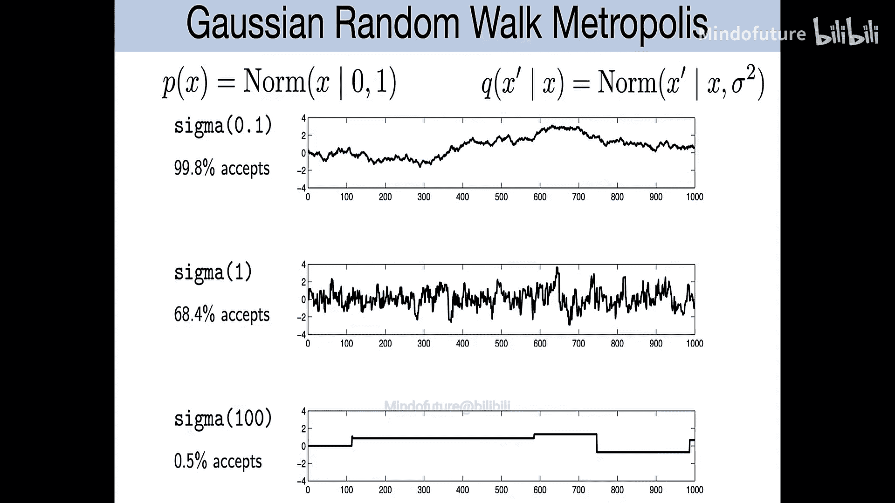

Okay， so。You know it。It's not really。Critical to know how to you know prove that metropolis hasstings satisfy you know detailed balance unless you're going to be a specialist in this area。

 but I just I kind of wanted to show you that this is sort of how the proof works。

Right you can think of the overall transition the transition operator like what is the transition operator for a Markov chain right so what's the probability that I go from x to x prime well there's the probability that I propose going from x to x prime that's this Q and then I also have to accept my proposal。

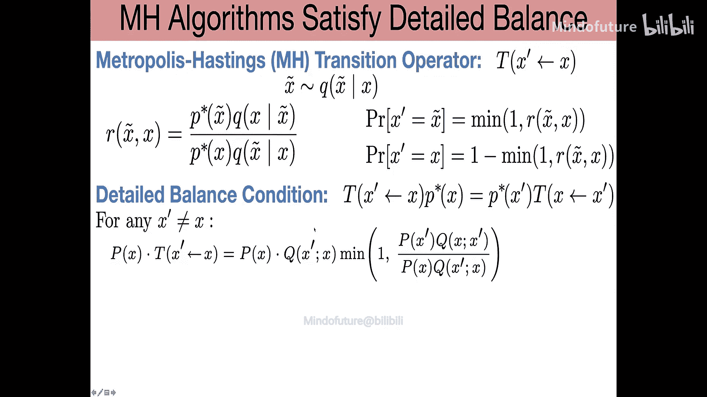

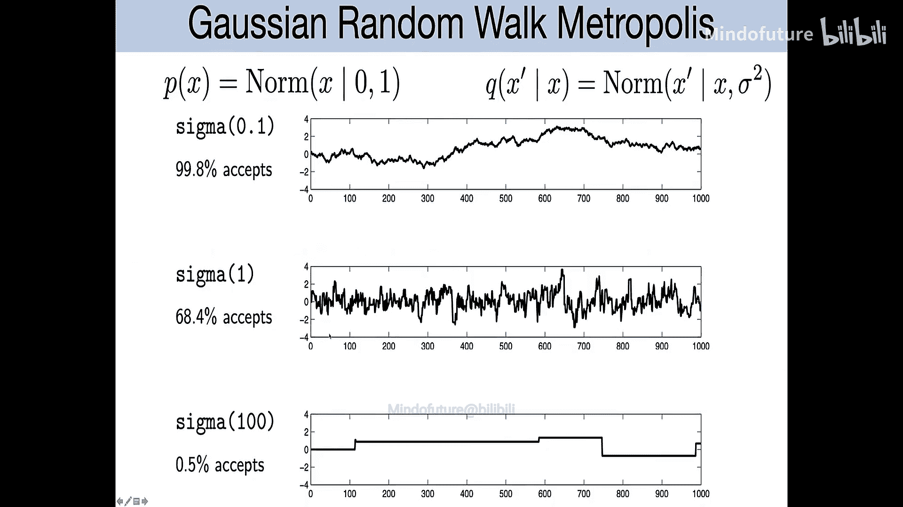

Right， so the probability of going from xt prime is first probably that you propose it。

And then if you propose it the probably you accept it。

 so thats that's why you have this product of two terms。Okay。

And so now if I look at what happens in the cases where this number here is bigger or smaller than one。

Then I can see that actually this product times this is actually turns out to be just the min of these two terms right you have P of x times the probability of going from x to X prime and then you have P of x prime has the probability going from x prime to X。

And then because it's a symmetric， I can rewrite it kind of in a flipped way and I get the reverse version of this okay。

And so I'm intentionally not doing this in detail， but I just want to show you that this is actually the full proof that the metropolis Hastings algorithm for any cu always satisfies that detailed balance condition I give you。

So I just want to show you， it's not like a mysterious thing。

 it's basically kind of cleverly constructed so that things cancel and that detailed balance condition holds。

Okay。So good to know that it's not a mysterious proof。

 but for actually implementing it you don't need to you know know how this works what you need to understand is this idea here that's for any。

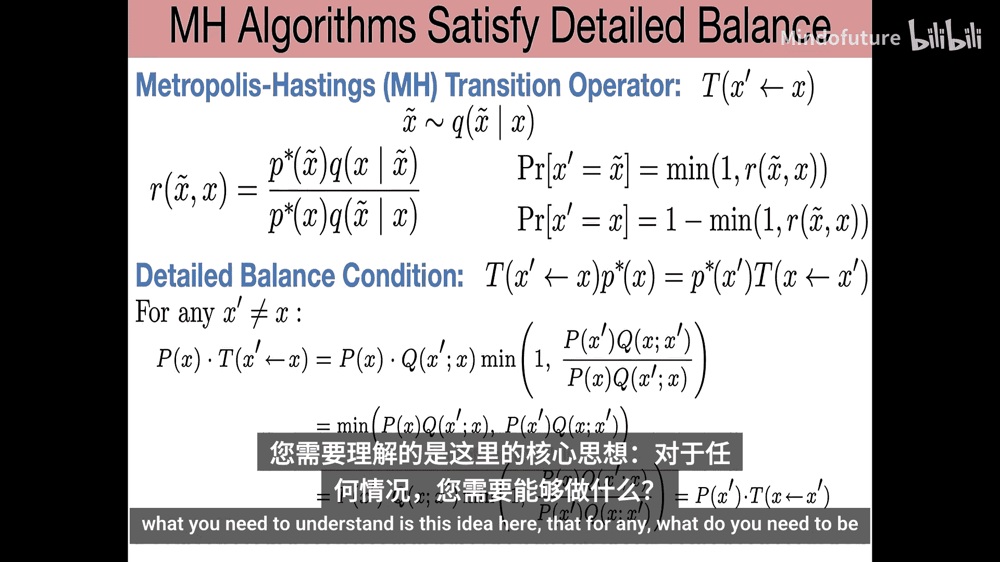

What do you need to be able to do， you need to be able to simulate and evaluate your proposal distribution queue。

And you need to be able to evaluate the true distribution P。

Possibly ignoring a normalization constant。And then you have this very simple approach when you simulate。

 then you evaluate this ratio， and then maybe you flip a binary variable to decide if you accept the reject。

And then you repeat this process。Okay。

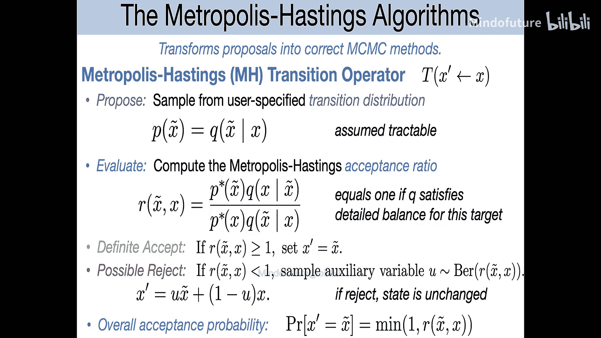

。All right。嗯。😊，So。Now， I think why don't I go on and talk about a particular version of metropolis Hastings？

That's really widely used and especially has a very nice fit for graphical models and that's something called the Gb sampler。

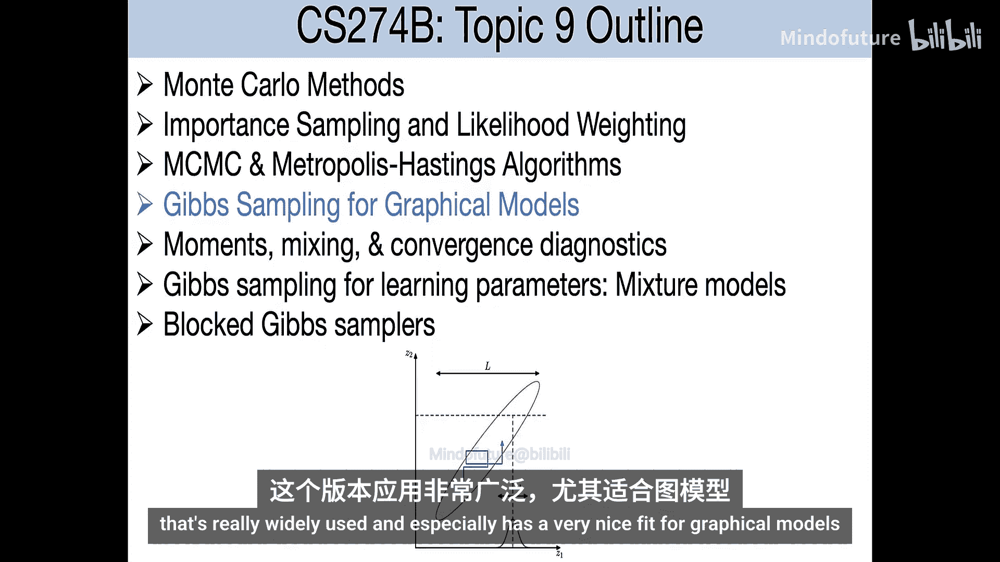

Okay， so now first。I want to mention that。You know。

 when I'm designing Markov chainin Mo Carla methods。嗯。Suppose I have you multiple different。

Marov chains that have the right equilibrium distribution like I have a TA and a TB and a TC。Well。

 you could try to like pick between them， right， say， you know， let me try to pick the one that。

 let's say， you know， converges the fastest。But you don't have to do that， you can also combine them。

So if I have， let's say that if T， TBB and TC all have the P star I care about as the equilibrium。

 I can also have a markup chain that like cycles between them so you simulate one step of T。

 then one step of TB， then one step of TC， and then you go back to A and you do ABC， ABC。

 and that would still have the right equilibrium Mr。

Or you could also have something where you kind of like randomly pick one of the chains so at each step you randomly sample A B or C and then you simulate a step of that chain and then you repeat that if you do any of those things you will still have the right equilibrium distribution。

Why is this a useful idea well it turns out that as you get to like high dimensional distributions。

 sometimes you have one markov chain that kind of like。

I don't know is good at changing in some directions and bad at changing in others and then you have a different distribution that's good at changing in other directions and bad in others and if you combine them you will get something that works better okay and so this is commonly used。

Another way that it's used is that if I have many different variables in my model。

 what I can do is I don't have to sort of change all the variables at once。

You can imagine that's sometimes hard to do instead you can basically have have a proposal that kind of like tries to just change one of the variables to improve its value。

And then you have another proposal that changes a second variable and so on。Okay。😊，And so this is。

 in fact how a lot of the practical Monte Carlo methods for graphical models。And factor graph。

It's work。So let's suppose I have some factor graph again， this could。Be an undirected model。

 it could be a directed model I converted to a factor graph。

For what i'm doing right now it doesn't matter too much。

 so I'm just going to say that my distribution is parameterized as this product of factors for each involving some subset of variables。

Okay。All right， so same factor graphs we've seen a lot of。

Now let's think about a special kind of proposal。We're going to have a proposal。

Which modifies one variable in my model so I now a proposal like a QS that basically says。

Variable s i'm going to change its value and then all the other variables I'm going to keep them unchanged so this is going to be something that's just going to like change one variable at a time。

Okay， so now。If I。Take a proposal like this。😡，Then if I wanted to implement metropolis Hatings。

 what do I have to do？I have to be able to simulate from this queue。

 and then I have to be able to evaluate this acceptance ratio。😊，Okay。

And what is this acceptance ratio to， right， I have my my ratio of Qs times my ratio of P's。However。

 when I take this ratio， note that。Most of the variables are unchanged。Okay。

 and so if I have a factor， like let's suppose when I was doing this proposal。

 I was modifying variable one。If I have this factor that's like linking three and four。

 well then this proposal isn't changing x3 or x4， so when I evaluate you know this P star under the x and then when I evaluate under x total I'm going to get exactly the same numbers and those factors will cancel。

And so in particular， the only factors that don't cancel are the ones that depend on the variable that I'm changing。

So in general， this acceptance ratio has a really simple form。

 I basically take all the neighbors of node S right these are all the factors that are connected to no S。

 I take the ratio of those factors。😊，And then I ignore all the other factors in the model。看。

And so this is useful because think about a model right if I have a model with you know hundreds or even thousands of variables in it right well if I and thus I have like let's say thousands of factors。

 if I had to evaluate you know。This ratio of P， if I had to evaluate every factor that could be。Slow。

RightSo each step of this Markov chain would be computationally expensive because you kind of have to evaluate all the problems in the model。

 whereas here I only have to evaluate a small set， the ones that are the factors that depend on the variable I'm changing。

Okay so I have this ratio of cues and I have this ratio of factors and I can do this very fast in a lot of cases。

Okay。😊，All right。Does that high level idea make sense？Again。

 it's kind of like if I really only had five variables like this little picture。

 maybe it doesn't matter， but if I have a big graph， you can get big savings。By doing this。Okay。

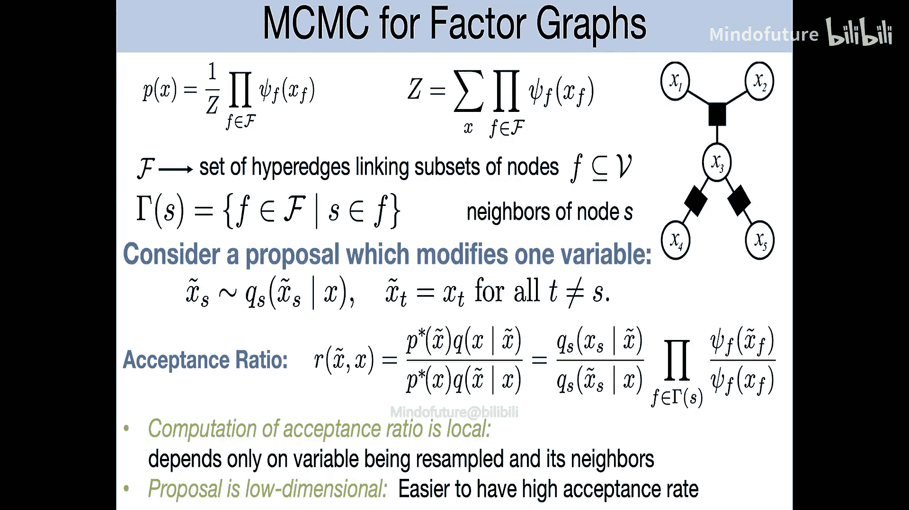

All right。This is the general idea and then the。The Gibbs sampler。

I would say that in machine learning and in statistics。

 the single most widely used Markup Monte Carlo is definitely the gift sampler。very very widely used。

This is the gift sample what you do is you。Visit all the variables in your model。😡，In some order。

 it could be like a fixed order， you could do a random order， either will work。

 but you kind of loop through the variables in some order。And then you for each variable。

 what you do is you find its conditional distribution of that variable。

 given the values of all the other variables。Okay， so what do I want to so this is going to be my proposal I'm going to find。

When I want to when I get to node S。What I'm going to do is I'm going to find like the distribution of the variable at node S。

 given all the other variables in the model。😊，Okay。

And now if I have a graphical model what we know from the markov properties that this simplifies so this conditional distribution I actually only depend on my neighbors and so all I actually have to do is have to take。

😊，All the factors that depend on node S。Multiply them together in normalize。Okay。😊，All right。

And then now here's my proposal， I'm going to for node S， I compute this conditional。

 it's the conditional of node S given everybody else。I sample， I draw one sample from that。

To get a new value for node S so that's this excess tilde that's the new value and then for all the other variables I don't change them I leave their values unchanged。

Yeah。All right， so now in metropolis Hastings， what you would have to do is now you would have to decide。

 okay， now given this proposal， should I accept or reject it？What's。

Kind of cool about the Gi sampler is that you don't have to do that step。

So if you just always accept this proposal， then you have a Markov chain that has the right equilibrium distribution。

So you sample a new value for excess and you keep it and you go to another variable。

 sample its value， keep it， and so on and you just iterate this process。

And if you do this little long enough， you will eventually get to a distribution to a sample from the true joint distribution。

Ope your variables。Okay。😊。

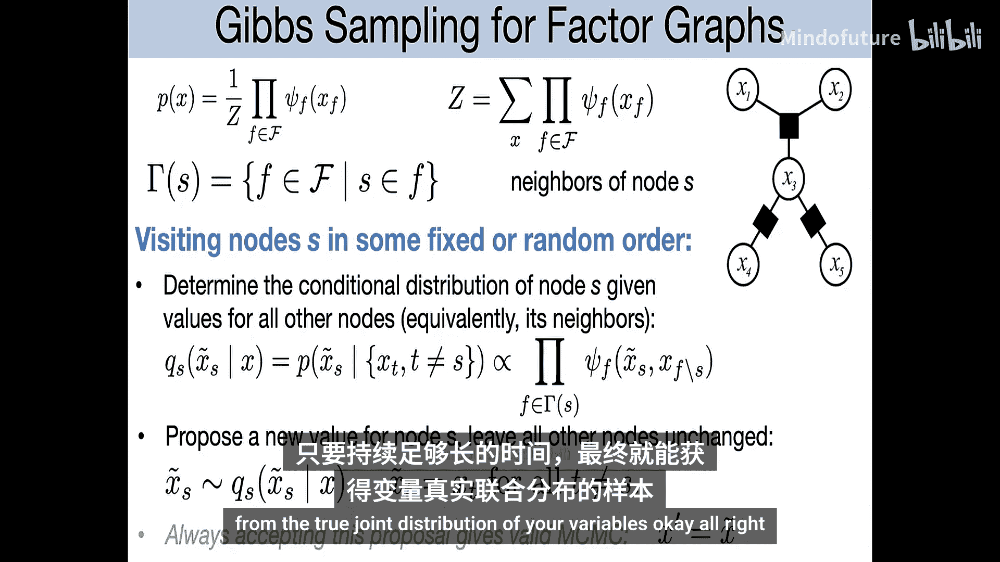

All right， and so the proof。So again， this is the Gibet， this is called。The gives。Sampler。

 why is it called to Gi Samr sort of a weird reason？Um。These。

These distributions these kind of actually the kind of undirected graphical models those distributions are are sometimes called givesbbs distributions and statistical physics and so the folks who developed。

This method， so the gift sampling was developed in the early 1980s。

By a couple of applied mathematicians and they named it the give sampler kind of after that givesbbs distribution that shows up in physics so that's why it's called the Gib sampler。

嗯。嗯。Gibbbs is a physicist， but Gibbs didn't develop this， he just it was just named after him。so。😊。

It's very simple process， you loop through the nodes。

 you compute the distribution of the variable of that node given all its neighbors。

 so this is kind of like locally analyzing the model and then you you sample from that distribution。

And why is this correct， well you could say let me take this is my proposal and then do metropolis Hastings。

And if you write， so this is what metropolis Hasting's ratio would be， but now note that my cues。

You know， the Ps are these products of factors and in the Qs。

 I've set to be products of the same factors。And so the notation is a little messy。

 but basically if I look at it carefully， my Qs and the P's sort of match。

 and so when I evaluate this ratio it basically always equals one。So I've set this。

 I found a proposal where this ratio is one so I can always accept。Okay。So that's the reason。

 so it's sort of a you think of giveb sampling is a special case metropolis Hastings。

 but it's one where the acceptance ratio is always one so you don't have to do that final accept reject phase。

😊，Okay。

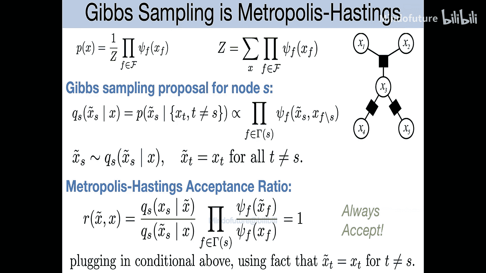

Um。You can also think of G sampling as a message passing algorithm。

 but it's one that has a little bit of a different。Structure than the ones we've seen so far。Um。So。

The factor graph story would be saying over but let's suppose I just had a pair wise markup random field to keep things very simple then。

What do I do right so I can say that there's going to be a message on every edge there's going to be a message Think of these as like kind of like what the。

Um the messages that I had in belief propagation or some product。

 but I'm going to do something different with them。What I'm going to do is I'm。First for a note， I。

 I'm going to take the product of the messages from its neighbors。

And then that gives me normalize those that gives me a distribution。

 and then now I'm going to sample from that， so I'm going to draw one sample。

And then given that sample i'm going to compute new outgoing messages。

 so what I do is that in particular I just set the outgoing message from I to J to be the pairwise potential between I and J evaluated at my sample location。

And then if I just iterate this process， you loop through the nodes in some order， multiply messages。

 draw one sample， compute new outgoing messages that is exactly equivalent to the G sampling I described。

系。U so it's interesting in that it it so it's different from some product in the sense that if I had a tree。

 it's not going to like， you know， it's simulating to draw a sample。

 it's not going to compute the exact marginals。But on the other hand。

 suppose my graph has cycles right remember that the some product gave you an exact answer on the tree and if it had cycles it would only give you an approximate marginals or might not even converge what's nice about the G sample is no matter how many cycles my model has this the true distribution is still the equilibrium distribution of the Markov chain it defines so if I simulate long enough I will get a sample from the true distribution I care about。

Okay。Um and。And so this is one， so you know we've talked about junction tree and loopyble propagation。

 this is another type of method that you can use。And some folks， so especially in statistics。

 this is very popular， they like because it's you has this nice property that you know that。

 you know， basically if I simulate long enough， I will get closer and closer to the true distribution。

咁。UHowever， that is a little bit of a loose guarantee because for a lot of practical models。

 we don't have guarantees over what are called mixing times。

 basically how rapidly your sample approaches the true distribution。Right， right。

 you can imagine that if I have a。Suppose you initialize somewhere randomly and I only run like 10 steps of my markov chain at that point I don't have like an exact sample from the equilibrium distribution because markov chains only kind of approach the equilibrium the limit of a large number of steps。

Okay， so thus I end up with some approximation not a big model I could initialize and I could run 100。

000 steps of my Markov chain， I probably still would not have a sample that's truly from the equilibrium distribution right there's still going to be some gap there from the finite number of steps of the Markov chain I take。

系。

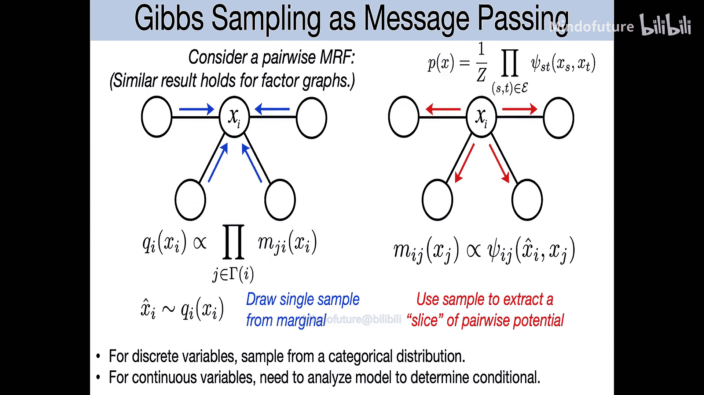

Come。So。Another nice thing about Gib sampling is it makes it very easy to。To kind of automate。

Right because if you look at the Gibbb sampler， I mean one of the problems is that with the basic metropolis hasstings。

was that you had to have this proposal distribution。And I mean， that's good。

 I guess in that if you're very clever and you know something about the models you're working with。

 maybe you can design up。A neat proposal that will work really well， but on the other hand。

 you have to have a proposal and especially if you're someone who is like not an expert with those models who don't know much about it。

You may not may have a hard time coming up with a good proposal and the nice thing about the gift sampler is that if you notice right you don't。

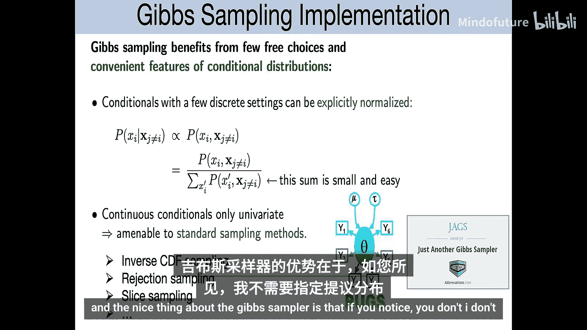

嗯。

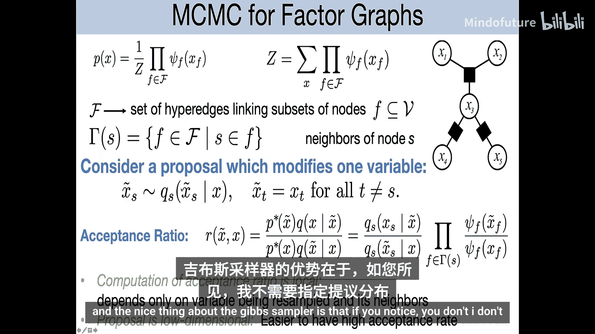

I don't have to specify in the proposal， all I have to do is specify the model and then the proposal is sort of automatically computed as the conditionals of the variables in that model。

Okay， and thus there are a whole bunch of software packages that implement G samplers and the way they work is that you in some high level language you describe the model and then they kind of automatically generate the code that does。

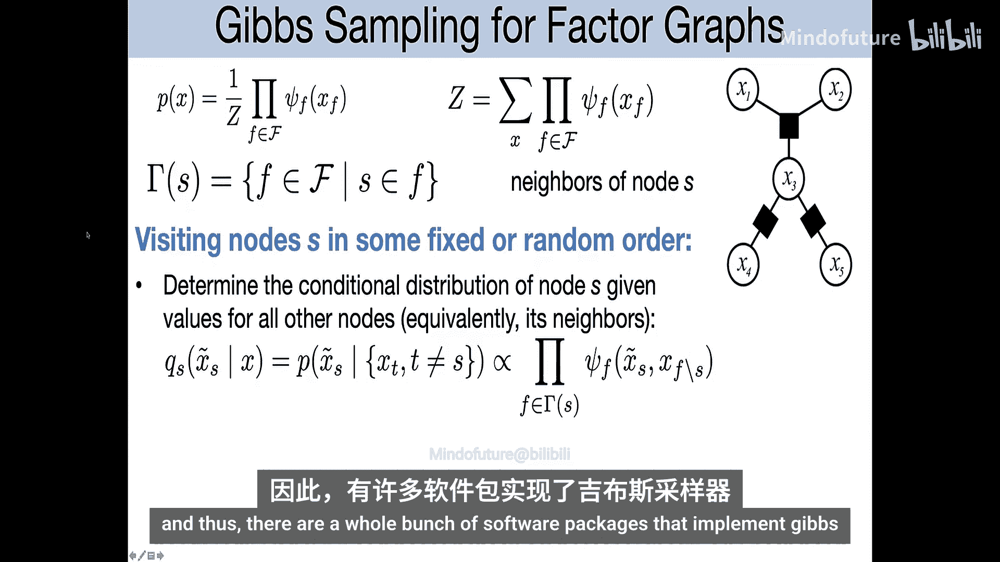

嗯。Give sampling。And so one of the earliest versions of this was something called bugs where bug stands for。

Beesian， something with Gi sampling。There was bugs and there was wind bugs， which was。

Bg somehow with windows to look at it。This was an era of software where that was an innovative thing。

So bugs is hard to use it was written in a。Wass it written in？Objective Pascal or something。

 some programming language that almost doesn't exist anymore。Someone made a new version of that。

 so interested if you're interested in wanting to use this for a model。

 there's a more modern open source product called JaAGs。JAG stands for just another gift sampler。

That implements a lot of these methods also you know it's not really subject to this class。

 but there's kind of been this interesting recent trend in probabilistic machine learning of developing what are called probabilistic programming languages these are high level languages for specifying probabilistic models and a lot of them have Gib samplers built into them and it's because if they have this property that it's kind of easy to automate automated。

Okay。嗯。So。The way to think about these packages， by the way， is that。If you're they work well。

 they actually get used a lot by people doing applied work in like。Social sciences， ecology。

 medicine， some of these fields where you often have data sets that maybe have。

Dozens or hundreds of observations but are not huge。And then， you know。

 so you end up with kind of interesting structure models that have maybe on the order of a few hundred variables and you you can kind of afford to do this Markov Monte Carlo computation and stuff。

If you had a really big scale data set， you know， if I have millions of data points。

 then you know these kind of automatically generated G samplers。

 although in principle they would work， they would literally take years of computing time to give you a result so they wouldn't be practical。

So， so but if you're kind of in this regime of smaller and actually so some of these packages even to try to。

You know some of these in this space， some of these packages are sort of targeted at people who are much less expert in machine learning than all of you are who are taking this class and so they more kind of give like almost like you know graphical interfaces for people to draw out their models and specify them in that way so。

Anyway。Good to know about that， but behind the scenes， a lot of these packages。

If you what inference they're doing they're doing exactly this Gi sample I talked about and so that's important to understand so you know because you know something about what their properties are。

All right， I will wrap up there， we'll talk a bit more about fancier。嗯。

Vararianance of Monte Carlo methods next time， but I would be happy to take any questions you have now。

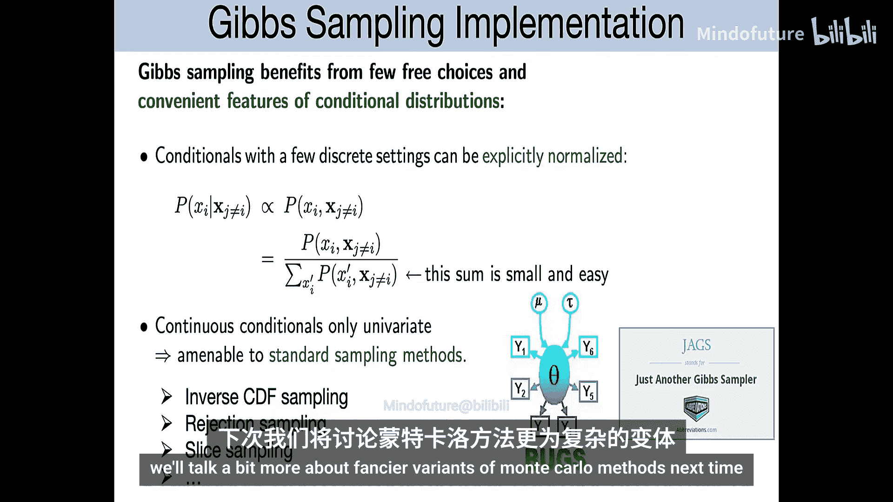