# 【加利福尼亚大学】图形模型中的学习 ｜ Cs274b ｜ Learning In Graphical Models (Spring 2021) p13 P13_讲座_6B-_MCMC_方法__吉布斯采样器 -BV1Tqx6zrEMj_p13-

We are going to continue。With our discussion of Monte Carlo methods and although so I'm going to keep talking about things that apply to。

Kind of very broad classes of methods， but you know I want you to have concretely in mind as like the canonical Monte Carlo method。

For pay a graphical model this give sampling method right and the way the giveb sampler worked was very simple you kind of go through the nodes in some random order。

And then you would for each node， you compute its conditional distribution of that node given all the other nodes in the model and that's the same as that node given only its neighbors from the Markov structure and you know so you have to work out what this distribution is but you know for any you know if it's a discrete variable it's just some categorical distribution that you can usually compute easily and if it's continuous often you can still figure out what this distribution is and and sample from it and then what you do is you just sort of sample that variable you change it you think of like it's moving that single variable sort of on average to parts the space that have higher probability and then you just do this many times and if you do this eventually you get something that samples from。

The right posterior distribution。The way to think about why these as a correct sampler is that imagine that I。

 you I had， I gave you a sample from some joint distribution。Okay。

 then if you took one variable out of that sample and you said let me compute its conditional given all the other variables and kind of sample it again so you change that one variable。

If you you sampled it from a condition given the others， you would not change the distribution。

 you would still be have a sample from what the distribution that you care about okay and' that's kind of the reason that the Gib sampler works。

All right，I'm going to talk up now we have this method。🤧A little bit about。

Some issues that show up when we use it practically， okay？

And so there's lots of kind of you know issues that you see with this right so one thing that you you know you that issue that comes up is that if I have a markov chain the the you know the steps of the markov chain are not independent right obviously if you kind of like get to the next time step by perturbing the current time step there's correlations between them and so the question is is you know well should you。

Now when I go to like compute my expectation， should I do I need to somehow to make things more independent。

 do I need to throw away some of the iterations right so I need to kind of use every just like case sample this is something called thinning the markov chain。

🤧so。Another issue that shows up is that you know if you initialize kind of arbitrarily。Well。

 you know， well clearly like your initialization is not a sample from the distribution you care about and if you only take one or two steps the Markov chain in general it also will not be a sample right so you have to kind of go far enough right take enough steps that you get towards a real sample and that's what's sometimes called a burn period。

U。And。So you know there' there's not hard and fast answers to this。

 but one thing I will this question of you know， should I discard so first you typically do your initial iteration of the Markov chain。

Kin of think of this as like these black points here a bunch of samples and the wider the ones say which time points do I want to use to compute my expectation？

So you often discard an initial set of time points。

 that's kind of what this initial block says that says， you know。

 I start somewhere away from the distribution and I have to wait to wander towards higher probabilities。

And then once I get to the higher probability regions。Right。You could。Sort of like subsample。

 sort of take only every 10 sample or something like that， but you don't have to。

So it turns out that if you take all these samples， even even though there's。They're correlated。

 right there's still versions of the law large numbers that hold for distributions that have appropriate types of correlations。

And in that and even if you take all these samples， you'll still。

 if you compute your Monte Carlo average， it will converge to the。Correct mean。

 assuming your number of samples is big。So you don't have to do this now one reason to do this subampling is that imagine this function that I want to evaluate is computationally expensive。

Well， in that case， then maybe by doing this thin I kind of get almost as good of an answer with。

Fewer function evaluations， so I say computation， but there's no kind of statistical reason you need to do that。

Okay so that's a first practical issue so in general this is how it works right you kind of discard an initial set of samples and then you take a bunch of samples after that and use those to approximate whatever thing you care about。

Okay。Um。Another thing that。Yes。People look at is the。

There's a couple kinds of plots that are used so one first one thing to so it's unfortunate that these that these Monte Carlo methods。

 you know， even though you know， it's maybe easy to know that you have a sample from the right distribution。

It's sort of hard to know if sorry it's easy to know that your Markov chain in principle。

 if you run it long enough we give you a sample in the right distribution and it'd be hard to know for this particular model and this particular number of steps from this initialization have I run long enough to get a good sample。

Okay。And so one of the， so often there's a bit of kind of manually looking at the outputs to try to assess what's going on。

One type of assessment that's done is what's called a trace plot so this is where you plot the value of some interesting statistic of the model something that you think is important like a one of the more important variables or something you think is meaningful and just kind of plot it over time and see if it kind of seems to have converged right so in this case this is a plot from a markup chain run that you know is。

I believe it's like the number of components in a mixture model that allows uncertainty in that。

And so you know， you can see as it's running， you know， for the first iterations。

 there's a lot of changes。But then eventually as I get to two or 3000， 4000 iterations。

 it seems like perhaps this is kind of stabilized。To you know， 20， you know， somewhere between。

 you know。17 and 23 or something like that， okay？So by looking at this， you say that， well。

 perhaps this is enough run。However， you don't really know for sure with just the single run of the Markov chain。

Okay because imagine I have a distribution that looks like this on the lower right。

 so it has like two modes that are separated like like a make mono like just could be some lots of other distributions have this property well I could have a markup chain that you know kind of goes to this first mode and is wandering around well in that mode but has never gone to the second mode at all。

And that happens a lot right because if I make local perturbations。

 somehow you have to go through a region of low probability before you get to here。

Right and you can imagine if I was doing like metropolis Hatings if I。

Did a proposal that maybe jumped to somewhere in between these modes。

 well if that has very little probability that'll usually get rejected and'll come back so it could be hard to move between them。

And so， you know， another way that people sometimes assess。

Mixing is using autocors and autocovariance so this is like you take the variables in your model and you just say for the Markov chain I can say you know what's the correlation between values of this markov chain at different lags at lags of 2 or 10 or 50 or 100。

And you can look at sort of how quickly these decay。To zero so like in this plot。

 some of these variables seem to decay quickly and this blue one seems to decay more slowly。

And this is also， you know， if these are decaying quickly that's。I have that perhaps。

You would be mixing rapidly。And。This quick decay of the covariance would actually be a guarantee of rapid mixing if I hadn' kind of a。

A unimmodal distribution where there's kind of only one mode。

 you can formalize that as saying the longer the distribution is a concave function。

And then there's some nice guarantees， but if you don't have that in general。

 it can still be hard to know that you've kind of that you aren't kind of in one mode and haven't reached the other。

Someone might have had their hand raised a minute ago， is there a question？Yeah。

 sorry to interrupt Eric actually I had a question。

 but I thought maybe you could like explain it so I wouldn't have to ask。

 but so basically like the mixing diagnostics series mixing is like we're having， I guess。

Like we run two separate chains。 We expect them to have like。

That could also be like a diagnostic or not yes I'll get to that in a sec yeah that's actually one of the best methods is running from multiple initializations。

And seeing if there's consistency in where they reach yeah so so but I plot this because this autocovariance in almost。

These are the main two things that most of the software package that MCMC give you。

 they plot autocovariances and they plot。Trace plots。Right so the trace plot is kind of very。

 some of this is very much like even if you were just doing， you know。

Optimization of parameters right this is like plot the value of the of your optimization procedure。

 so this is kind of a very familiar thing to people。

This autocovariance is you know another measure that's used。

 but the way I think of it is as if the autocovariance is large， then you definitely have problems。

 your chain is not mixing correctly， if the autocovariance goes to zero， then you might。

You how to chain the mixes rapidly， but you also might not。

 you might have something where you're in one mode and don't get to the other。So， basically。I mean。

 like both of these plots kind of show us if the chains have converged， right？

That's what you're trying to look at so and let me show you have another example coming next to give you more sense for this。

Okay。Thanks， so。Now。Now Gib sampling and W has this property。That it only changes。

One variable at a time， right， you sample kind of one variable given the others。

So if you think about it， let's look at the simplest case。

 I had a graphical model with like two variables。Then each step of the Gbbb sampler can。

 and this is also be true if I had some other metropolis method that only changed the proposal of one variable at a time。

 it can only move horizontally and vertically， there's no way for it to move diagonally。

It kind of has to make it alternates between horizontal and vertical moves。

So now let's suppose you have something like， imagine I had a distribution。

 this ellipsees mean to indicate like a multivariate Gaussian that was positively correlated。

 that was stretched in this way。So you can imagine， right， if I have。

 if I'm currently like in this corner of the Gaussian。And I want to get to this corner。

 I can't do that quickly with a give sample。Right because I can't like say set this variable to here because that would be very low probabilities that would almost never happen and then here so what's going to happen is you're going to have to take a bunch of like kind of small steps where you kind of zigzag back and forth。

Okay。And then as this distribution gets more and more kind of stretched out。

 it could take longer and longer for you to move back and forth across it。Okay and you know in 2D。

 you know， it's kind of always okay， but then if you have stretched out distributions in high dimensional space。

 like I have a model with regression coefficients and there's  a thousand of these coefficients。

 then things can get very slow。Okay。And you to really see this like let's be really concrete you this could happen even in like the simplest possible model。

 imagine I have two different。嗯。Two binary variables。And imagine this is the joint distribution。

 so basically you have。Almost 60% of zero zero， almost 40% of 11。

And then you have sort of probability epsilon of 0110。

 so this is basically like a distribution that sort of says the two variables are usually the same and that's actually very common there's lots of models that look like that。

But now if you look at this， right， suppose I'm currently in the zero to zero state。Well。

 to get to the  one one state， I basically have to， you know。You know， either。

Move through zero1 or10。And those kind of those when I go to sample in the Gb sample and those happen with only sort of probability epsilon。

And so basically as epsilon gets smaller and smaller。

 the frequency with which you jump between these two states will get slower and slower。我看。All right。

And again， you can have the same thing if I had two variables。And I had。

 let's say a Gaussian mixture， so you had two Gaussian bumps and low probability in between。

 you would have the same behavior happen in kind of a continuous way here where you kind of bounce around in this one and then。

 but it's hard to move over to this one。And if it's got more and more separated。

 it would get harder and harder to move between them。Yeah。So this is just to tell you that， you know。

You don't have to have a crazy nasty distribution for the markup the AMMC method to have what's called slow mixing to sort of like slowly approach your mode or be slow and moving between different modes。

Okay。U。There's different things that me know with this there's various kinds of like。

Fcier MCMC methods that try to get around this problem。

 although most of the fancy things are not as general purpose。

 so I don't really go through them because there's not really like a method that that jumps between modes that works for big classes of distributions they'll be more like for one particular class of models people realize。

That the kind of thing I'm describing was a problem and they have a special in CMC method like a fancy proposals and metropolis hasstings that avoid it for that class of models。

 but often these things are kind of narrow and specialized。不是。Okay。All right。Any questions on that。

 does it make sense？Yeah， so I mean at one level， the MCC methods are very kind of powerful and magical how you can just sort of set up this Markov chain。

When with simple lo sto acidastic translations， eventually you get a sample in the distribution。

 but there is a problem that there's no guarantees that that happens quickly and it could take you a very large amount of computation time。

Okay。嗯。There are results about。People will show for certain classes of models。嗯。You know。

 rapid mixing right so there's there's a there's a sort of part of。

Theoretical sort of probability connected to some theoretical computer science that tries to show you know。

For this MCC method， because it is the time it mixes to the posterior sort of polynomial versus exponential in the problem size。

But unfortunately， for a lot of the practical models and methods。

 you don't have rapid mixing you don't have polynomial time in general。

 it could scale exponentially with the problem size。嗯。

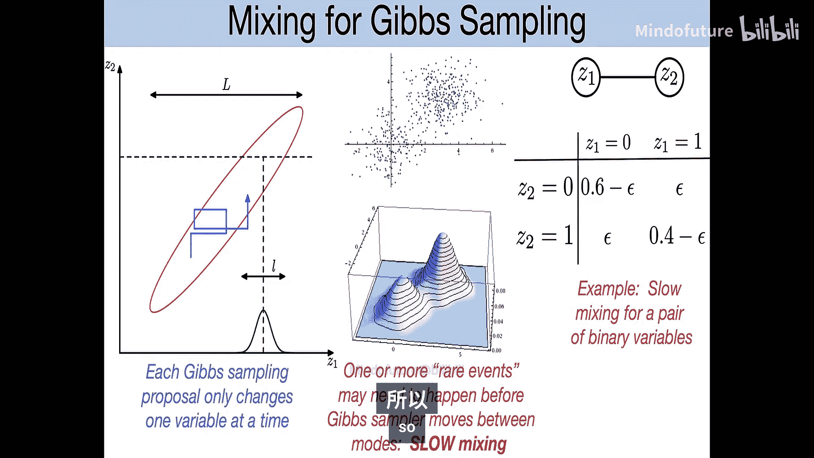

So。Let me give you actually an example， so this is。

A one of the widely used kind of models for spatial data I've kind of mentioned this is these you know spatial Markov random fields and the simple version of these models if you're doing something like you're just predicting object categories or something they have potentials that look like this basically they say that when I look at my。

My potential， I kind of have a bonus if the。Two neighboring pixels have the same label。

Right so I have some like the log potential is some positive number if they're the same label and then the log potential is zero if they're different labels and basically you know what is this capturing this is capturing the fact that you know if I look at you know。

Real segmentations of images into objects objects are not just noise right if I have a pixel that's an object usually the the neighboring pixels are like the same object and the sort of boundaries between objects are more rare。

Okay。So so it's a pretty intuitive model and it's been used so these are and it's been used a lot in various things。

 so actually a version of this model is has been used in some versions of。

Of Photoshop right so you know Photoshop has a tool where you say here's some of my object now automatically kind of here's my magic wand to select the foreground from background versions of that actually do a map inference in a Markco random field with binary variables。

So they do that very quickly where essentially you know the binary variables is like foreground versus background of the object。

 so they build a quick model and do math difference it can work pretty well。

For some of these problems， but now you might say you know you know how does these work as like priors right if I have less supervision I want like a prior repitions of images are these good models。

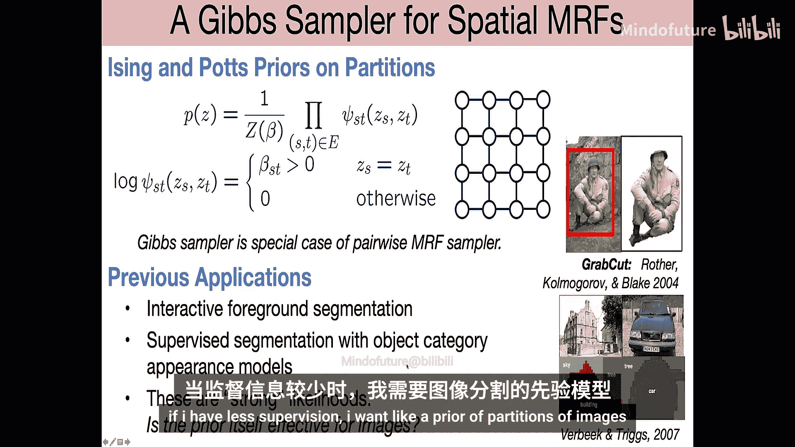

Um。And so these models have a long history so this there's a famous paper that actually introduced the Gibbb sampler this was a paperback in 1984 and so they proposed this。

Model as like a prior for kind of like segmentations or partitions of image or for spatial data more generally。

 right？And so you know so this was this is a scan of this old paper you know at this point you just get these lousy black and white versions but they basically had 128 by 128 grid they had eight nearest neighbors right this means each pixel is connected to kind of the things that are dyingagonally not just adjacent。

And they had a particular， you know， they said there's going to be five segments and a particular set of edge weights。

 okay？And so if you this this they said you know this is a sample of this that they got by running the Gib sampler for 200 iterations and what does that mean so 200 iterations means you initialize like。

Every pixel by just sampling uniformly among the five categories。

And then each iteration resamples every variable once。So in fact， each iteration is kind of you know。

嗯。Sample， you know， drawing like on the order of like。10。

000 or more samples right it's drawing 128 squared samples。Yeah。And so if I do that five times。

So from five different initializations so this is there was a question about multiple initializations that's what this is doing if I run from five different initializations。

For 20 iterations of this sampler， this is what I get。

And you can see that they kind of look like this and you know as you know say if this is my prior for what like spatial regions of like an image look like or spatial regions on a map if I was going to model some kind of geographic data。

 maybe this looks pretty reasonable I mean there's this kind of a little bit of noise。

 there's this speckcle noise that's undesirable but you kind of have these blobs right that are kind of spatially coherent。

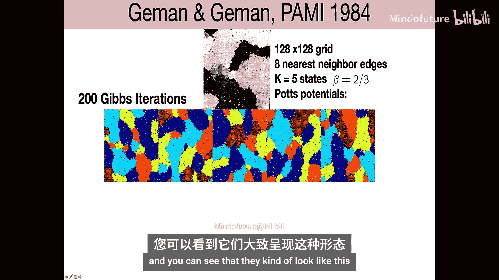

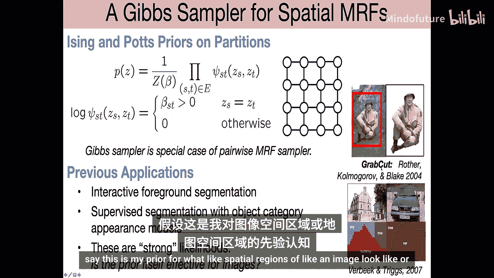

Um。All right。But。😡，So this is20 iterations。What happens if I run the same Markov chain？For。10。

00 iterations。You get this。So basically what's happening is very slowly。

 all of these regions are kind of merging together until in four of these five Markov chains they basically have one giant region with a tiny bit of noise。

And in this fifth one， I have two regions， you can probably guess what'll happen here if I ran for 20 or 30。

000 iterations。Okay。So。And so you could say， oh， well， maybe I don't know。

 maybe this parameter is tuned wrong or something， but in fact， if you give this lots of computation。

U。This is。If I vary this edge strength in this model， so this is。

 you know these extended runs of the G sampler， if I set it to 1。42。

 I get something that looks like noise。嗯。😊，If I set it up to 1。46。

 you're something guess saying that starts to look like that one giant region。

And it doesn't seem to be anywhere in between where you get these nice partitions of the image。Okay。

 what are we trying to achieve here， or trying to understand what samples from this distribution would look like。

Because in the previous slide。Can you go back on that。Yeah here。

 so basically we're trying to kind of recreate the grid that you have up there in the first image。

So the point I was making here is that。They presented this。As a sample。From this distribution。

As far as they knew， this was a good sample from the distribution they defined。

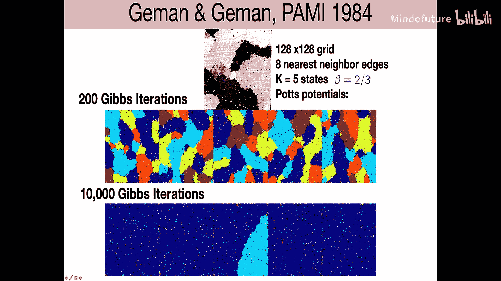

And how did they get their sample right you can't sample and it's probablyably NP hard actually to exactly sample one these distributions。

 so you can't do that。So they define this Markov chain Monteney Carla method， a G sampler。

And said I will run it for some number of iterations to draw an approximate sample and so they thought this was a sample from the distribution。

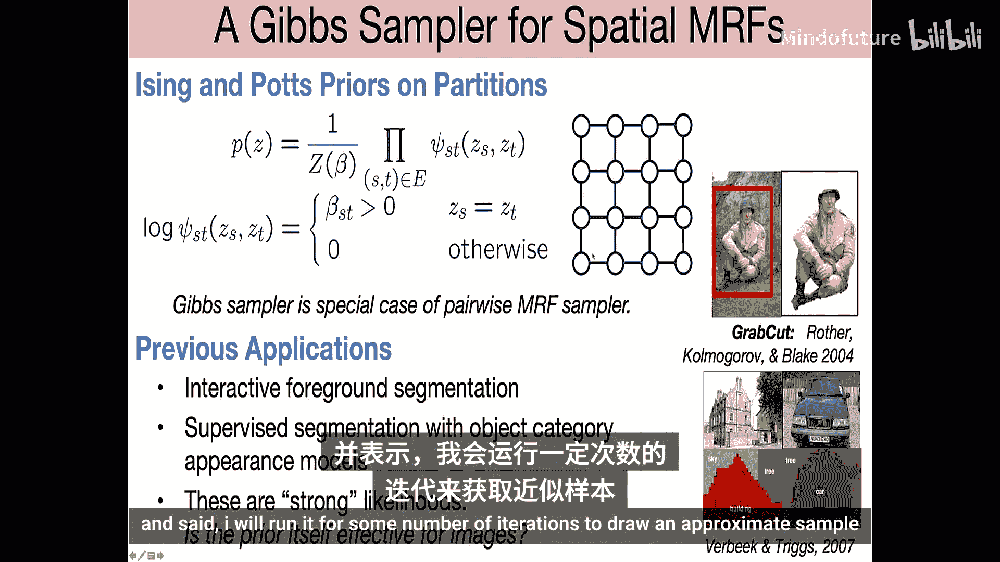

And so what I'm showing is that， yes， if you run for tune0 iterations。

 you get things that look like this。But actually 200 iterations is not long enough to get close to the equilibrium distribution。

Okay。Yeah not it thanks and if you run for in this case， 10，000 iterations。

 you get these very different looking。Samples and so in fact。

 there's no setting of the model parameters for this model under which， you know。

 it prefers things like this。

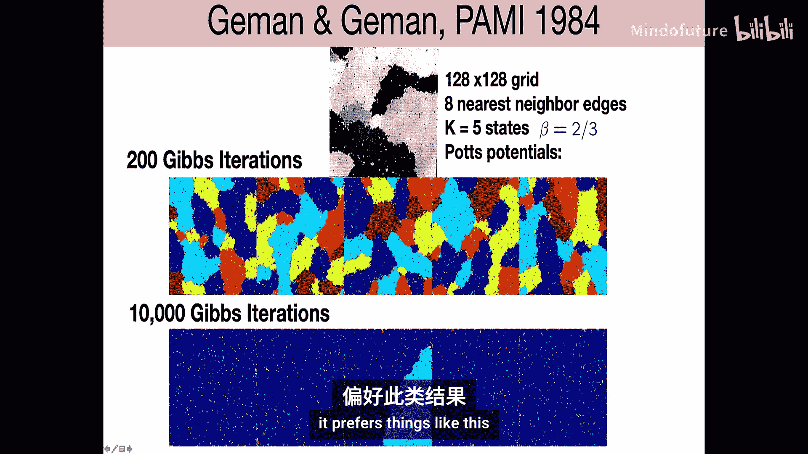

Okay。So there's actually， this is， there's a lot of like image processing and statistics work that uses this model and kind of has some weird artifacts and biases because of this。

U。嗯。😊，I am。So this because these models are really widely used they've gotten intensive study' there's an interesting kind of paper that follow a very。

 I think not widely known paper that sort of points out that this model is not good for these segmentation problems and what they point out is that this is。

This is an exponential family model。All right， and if you look at this model。

 kind of the only statistic that matters is basically for to evaluate the probability all that matters is for is basically how many edges are they the same。

State versus different right that's kind of all it depends on。

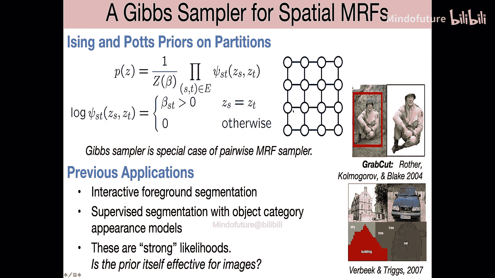

So if you look at the expected value of that as a function of beta。It has this particular thing。

 so that you can think of this as the mapping between the natural parameter and the moment of the exponential family like we've talked about。

And kind of you can see that here you get samples that are very noisy here you have samples of like one giant cluster and in between right you have this sharp。

Transition。But it turns out for real images or real spatial data that's where you'd like to be so you kind of would like to be in this region where there is。

Um。And so there's basically no way to tune this parameter that's good for this so by the way。

 these models。Come from the 1920s and 30s， these were the。In statistical physics。

 the first models that were mathematical idealizations of phase transition。Right。

 so this is the idea I if I take like a liquid。And I。Raise the temperature。

You don't kind of slowly transition to gas， you basically hit a critical point。

 and then suddenly you kind of instantaneously move from the liquid phase to the gas phase。

And so this was actually the first sort of mathematical model that showed how sort of locally interacting。

Variables could have that global。Behavior so that's good for the physicists somebody they want a few nobel prizes for that but not good for modeling the statistics Okay so I tell you this story because I think it's useful to know that if you you'll encounter these icing or possible bottles a lot and you should be wary of their properties for this。

 but also the kind of output of a limited MCMC run if you just kind of run for a small number of iterations。

U。you know， it can be very misleading。Okay， now I go back and you could say， well， you know why。

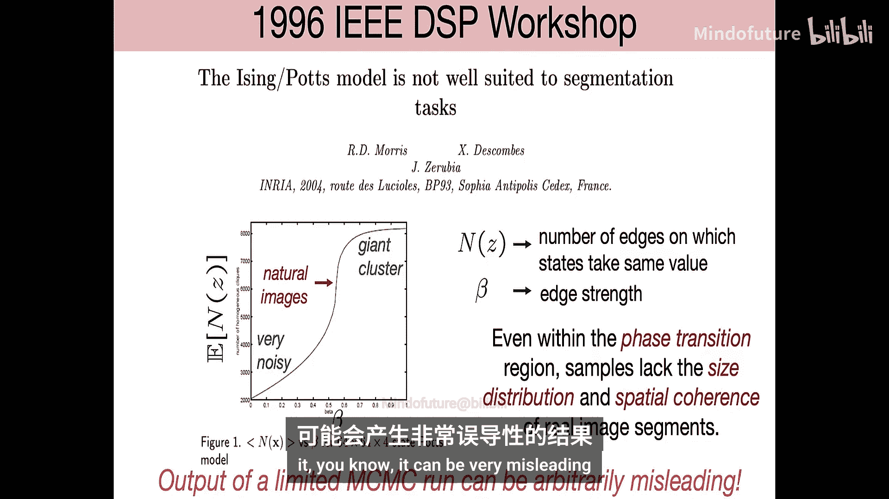

U。Why didn't they realize this right and well the reason they didn't realize this is because so。嗯。

So this is an analysis I did first part of another research project because basically I was trying to use these models and my results were terrible。

 I was trying to understand why the results were terrible。And I to run this， you know。

 run the Gib stamp for 10，000 iterations， you know， about 10 years ago。

 I could do that on my laptop and know it took several hours， but it was feasible。Um。

In the early 1980s， I talked to Stu Geman who was involved in this work。

 he told me that in the early 80s， like to get this run for 200 iterations。

 this was like they got the department's big mainframe computer and it ran for three weeks。

For those Twitter iterations。Right， and so you know， they couldn't。

 it was totally hopeless to run for 10，00eration， so they had kind of no way of knowing。

And although today our computers are faster that you can easily analyze this ball on your laptop。

 of course there's lots of yet bigger yet more complicated models that were in the same situation right when people do MCC they run for kind of short phases and they don't really know you know what the properties of the model after the short runs。

 how those compare to the real one。Okay， so。Youware。Okay。

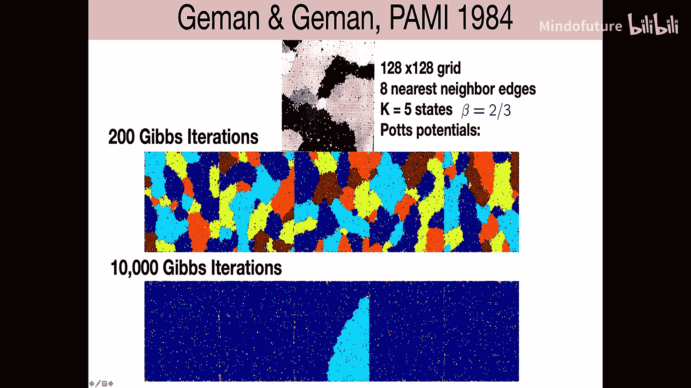

嗯。Given this。If you say， you know， how should I？嗯。嗯。

Distribute my computational resources so I'm doing MCMC。And like so here there's three options。

 right you have a。A single run of a markup chain that's basically you run it for as long as you can。

Or you take lots of random initializations and run each one for a short amount of time。

Or somewhere in between you take a small number of initializations and run each one for a moderate amount of time。

 you know， usually the best practical option is something like number two。

So you want to have more than one initialization， I always recommend doing multiple initializations because it lets you maybe discover if there's multiple modes that you're not moving between。

And then within each initialization， you need to run for， you know。

 typically thousands of iterations if you're only running for 100 iterations。

You probably don't have a good result you can trust。Okay。All right， any questions on that？Okay。

So that's。MCMC and so I've talked about MCMC in terms of learning in terms of like， you know。

 if I have a model where I know all the probabilities of sampling the variables in that model。

But you can also use samplers like a gib sampler for learning the parameters of your model right if you if you take a Bayesian approach to parameter estimation。

 you treat your parameters as random variables then you can sample from the posterior using Montecarlo methods and this is really effective for a lot of problems and so to describe how this works so I'm going to start by just talking about。

To make things concrete， I'm going to talk about how this works for mixture models as a model that you've all kind of seen and seen other ways of estimating parameters。

 but the concepts here apply very broadly to lots of other models。All right。

Here is a mixture model expressed as a graphical model。So I have n data points。

 so the x's are the data points。And then the Z's are going to be these。Discrete variables。

UmThat are say， for each data point， which cluster does it come from？

So when you're doing the EM algorithm， and these are the things that you come in the E stepP or expectation step。

 you compute the probabilities of disease。🤧Okay， and then what do I have， I have some parameters。

I have pi， pi is going to be the probability of each cluster。Right， so these are like。

If I have k clusters， this is k numbers that' sum to one。

And then here I'm being abstract the thetas are going to be， you know。

 whatever parameters define the kind of like shape of each mixture component。

So if I'm doing mixtures of Gaussians， then theta k is going to be like the mean and covariance of cluster K。

But you know， you can think of。Mixtures of other types of distributions for other types of data too。

Right。U。So。If you do maximum like that estimation， you just sort of like say， well。

 let me maximize the likelihood of my data as a function of pi and theta。

But you can also instead think of this as a sort of a Bayesian approach where you say I'm going to put like a prior distribution on pi I'm going to think of these as random variables I put a prior distribution。

 so remember like the Dera sle was our prior distribution for vectors of probabilities that was conjugate we saw that before it's coming going to come back now。

U and then also if you have unknown means and variances。

 you can put some kind of prior distribution on those for the Gaussian and I'll say in a minute more what those might look like。

Now。If you were just doing not going to do the priors you were just going to do the EM algorithm right this here's kind of just a reminder of what em looks like so you have some data you initialize your clusters somehow and then you kind of alternate between these steps the e step says for every data point I compute the。

The probability that it was generated by each cluster okay。

 so this is here i'm deing these by R R sort of for responsibility。

 so this is like R and K this is the probability that data point in was generated by cluster K。

And you get this just this is just Bayes rule right this is the posterior probability of cluster K is the prior probability that data point came from cluster K times the likelihood of that data under cluster K normalized so it sums to one。

Okay， and so in this picture， these colors are just sort of saying like red is high probability of red cluster。

 purple， sorry blue is high probability of blue cluster。

 the purple points are kind of where the probabil are closer to like a half a half。Okay。All right。

That's what the ETP does for every data point。And then there's an M step or maximization step that says given the results of the e step change the clusters and what the Mstep does right so this was in。

I talk about little in one of the previous lectures it was it basically takes kind of weighted averages right so you take like。

嗯。😊，To figure out you know your estimate of the probabilities of each cluster。

 you sort of take these。Soft assignments or responsibilities right you take as a sum of all the data points the sort of probability that they came from cluster K and you normalize those and then similarly to get like your estimate of the mean of cluster K you take a mean of the data but it's a weighted mean right so for data point I you kind of weighted by the probability that it came from cluster K。

Okay。And you do the similar thing you take a weighted covariance and if you do that you will get。嗯。😊。

You know after one iteration， you would say that， oh， well。

 now if I look at the points that are blue versus red。

 these are kind of Gaussians that match their distributions。Okay。

And then now if I go through more iterations， this is after five iterations。

This is after 20 eventually you'll converge to some local optimum。Okay。Yeah。However。

 now everyone has seen this。This is like a classic。First example。Now， what's interesting， though。

 is I say。I know for sure that if I want to maximize the likelihood of this data under a two component Gaussian mixture。

 this is not the global optimum。I the like that function。This is what the global optimum is。Okay。😊。

What I can do is I can take one mixture component， center it exactly on one data point。

And then take the limit as。The variance of that cluster goes to zero。Okay。😊，And then。

My other mixture， I can just kind of spread it out。

 let it capture the mean invariance of the whole rest of the data set。Well。

 then what will happen is that the likelihood of this one data point under this cluster as this variance goes to zero。

 its likelihood goes to infinity。So in fact， this maximum likelihood estimator。

 the likelihood is unbounded above， I can make the likelihood arbitrarily big by doing something like this。

系。嗯。Now of course this is not very useful as a model of my data right it says model the data with one big Gaussian and then have this degenerate Gaussian on one point but。

Interestingly， when you are fitting a mixture of things。

 you're actually sort of you're hoping that EM won't find this。That instead it'll get stuck。

 it'll get trapped in a local optimum of the likelihood where you have this thing。

This kind of behavior。Um。So however， as I get to more flexible models。

 so there's some applications where people think about wanting to use mixtures of large numbers of Gaussians。

And if you're in that kind of regime， you start to have practical problems with this occurring if you just maximize likelihood。

And so to avoid this， you really， you want to think about doing some kind of regularization。

And so in particular， you look at sort of things that sort of say that well。You know。

 I expect the variances or covariances of my clusters to be you know not too small I don't expect to have clusters where the variance is like zero that basically it's like concentrate on a single point any reasonable cluster should be more spread out。

Okay， and so to enforce that we need to think about having。

Prior distributions on the covari orvariance parameters。

 so let me just talk a little bit about how you would do this。In particular。

 what would be the classical way to put priors on the parameters of a Gaussian distribution to keep it simple？

So let's suppose first I have a scalar Gaussian。Right， classic bill curve。

Like I imagine I was just clustering one dimensional data。Okay。And let me assume that the。

I know the variance， so the thing I don't know is the mean。Okay。Well。

 then the classical and conjugate prior distribution on the mean is another Gaussian。

Right so you would say if I don't know what this mean is， I could put a prior on that。

 which is another Gaussian with some different mean and variance， right。

 this variance might be pretty big to capture the fact that you don't know exactly where the mean will be。

 but maybe you have some sense。And so this is I said this was conjugate what does that mean in this case。

 that means that if I if I have。This unknown mean and I put this prior。

 and then I say what is the posterior distribution on the mean。

 given L samples from this distribution， it will still be another Gaussian。

Okay so most people have probably seen this before， right if I have a。Some Gaussian prior。

 and then I get a bunch of observations the posterior is still a Gaussian with some mean invariance。

That I can compute。And actually， the sort of posterior mean is this kind of。

A weighted combination of the mean of the data and then the prior mean right so you take a one number times the prior mean you not and then you have the mean of your data and you take a kind of convex combination of those。

To get your posterior meat。嗯。So this is just illustrating what that does， right， like if I had。

If the red was my prior mean and then this was my likelihood with this Gaussian。

 the posterior would be another Gaussian， that's kind of somewhere in between them。系。

On the other hand， if I had a prior mean that was bigger， so on the right， if I have a big。

 sorry if my prior on the mean had large variances。

Then the posterior is going to be sort of closer to the likelihood。

 so it's biased towards the pyine but it's biased less。

 right because there's kind of bigger variance here。And so where your posteroring ends up。

 it depends both on this the mean of my likelihood as well as the mean of my prior and their sort of relative sizes。

系。Any any questions on this hopefully I think hopefully most people have kind of seen a version of this somewhere so very classical just want to like get the idea across right so now what do I want to do I want to be able to do something like this。

But on the variance parameters， so I want to have a prior on the variances that I don't know。系。Okay。

And。It turns out that the math is simpler if instead of putting a prior on the variance。

 I put a prior on the inverse of the variance。U。By the way。

 the reason for this is that kind of if you look at the exponent。Of this。😊。

Then the inverse of the variance， you know， the exponent has a sort of one over the variance。

 but it just there's just a multiplication by the inverse of the variance。

And this also has to do with the fact that the inverse variance is kind of the exponential family parameterization of a guess。

So。So that being said， just here， this is a Gaussian where basically I've said that this lambda。

 instead of being the variance， it's one over the variance。

 just a different way of parameterizing a Gaussian， both are equally valid。

So this is a Gaussian where lambda is the inverse of the variance。And so now the conjugate prior。

On the lambmbda is something called a gamma distribution， you haven't seen the gamma。

 it's a distribution over positive numbers， has two parameters， A and B。

It's written this way so right so you it has like a e to the negative。B times lambda。

 so it has one term f decays exponentially， and then it has this sort of polynomial growth。Um。

And so if you haven't seen this before， you note that first， if I set this a parameter。

 if I set it to one。Then I get an exponential distribution。So the exponential。

 which is kind of a one parameter distribution of repos numbers a special case of the gamma。

 the gamma is nice because it has two parameters and you think of these two parameters as kind of separately controlling the mean and variance。

You know the mean it turns out the mean is a over b and the variance is a over b squared but so these are examples of different gamma distributions right and they can be exponential they can also have this kind of like skew bump shape okay。

Okay， but。Again。hyW am I going to use the gamut well there's a couple reasons one is it's kind of a flexible distribution where I can give it any mean in variance by setting A and B appropriately and it's a valid distribution over positive numbers。

It also has the nice property that it's conjugate， so if I put a gamma prior on my inverse variance。

And then I get multiple observations from samples from this Gaussian， and then I say。

 what is the posterior？Over my。Inverse variant， it's still gamma。Okay。

 and so it's a gamma with parameters you're think about actually。

 so the parameters end up depending on the empirical variance。Of your data。嗯。

So the sort of the posterior variance is kind of a depends both on the prior variance as well as the variance of your observed data。

All right。Um。Now these equations are not super， I mean one can drive these equations not terribly difficult but I will tell you I usually don't drive equations like these。

 I go find the appropriate book or Wikipedia page and look them up when I need them。

So so don't worry too much about that I'm intentionally not going through the derivations。

 but this concept of of you know， there's an unknown。verseInverse variance， not variance。

 and I have a prior on it and then I get samples from my normal and now I have a posterior variance。

Does that make sense to people， are there any questions about that idea？

So this assumes that the mean is not right， not un fixed。Right。

 so right now I'm looking at the case with a meanus fixed。

And then there's actually there is there's a generalization I'm about to get you where you say if the mean and variants are both on。

Good question。To talk about that generalization， I want to point out that often we're not interested in scalar Gaussians right。

 like often we have data that's higher dimensional and like when you do your EM clustering or whenever you're really doing multivariate Gaussians。

And so remember that the multivariate Gaussian now is parameterized by a mean vector。

And a covariance matrix， so there's some positive definite。Matrix。I'm sorry。嗯。😊。

And so we remember we talked about before a different way of writing this in terms of what are called the kind of。

Canonical parameters， this is what the connection you get from exponential families is that you can write this in terms of a。

Pramatterized in terms of the inverse covariance and the inverse covariance times the mean。O。

All right， so that's the special family。And。There is a。で？

There is a generally an easy to work with conjugate prior for multivariate normals if you don't know the mean or the covariance and it has its name is a mouthful。

 its name is the normal inverse wishar。Okay， so let me unpack this。

There's something called a wishA distribution。The wish distribution is the generalization of the gamma distribution。

 so except here's the generalization， so in a gamma if I sample from a gamma I get a positive number。

like a variance， if I sample from a wishar， I get a positive definite matrix。

So the wish chart is a distribution on the space of positive， definite matrices。Okay。嗯。So now。

The way that the conjugate prior works， the one that makes the math work out easily is that。

It says that the inverse of my covariance is sampled from some wish art distribution。

And then the mean is sampled from a normal whose variance depends on this wish art here。

Now that's a little funny that dependence， but kind of the reason that dependence works out。

 it has to do with the fact that。In the canonical parameters。

 the kind of inverse covariance and mean are coupled to each other here Okay so that's。

Why this happens。This is just showing on two versions of that so this is if I have a onedisional Gaussian。

 so then there's two parameters， a mean and a inverse variance。

 this is a plot of the mean and inverse variance for a 1D Gaussian for a particular wishar distribution okay so it's kind of normal this way along the mean and then more has like this is this direction has if you did a took the module in that direction it would have one of those gamma shapes。

Now。U。If I get to two dimensional data， it's hard for me to plot this distribution。

 right because it's a joint distribution over 2D mean vectors and two by two covariance matrices。

But when I can plot incentive， I can plot samples from it。

So if I sample from this distribution many times here's an example of samples。

 so these are a bunch of basically samples where I plot the mean as a dot and then I plot the covariance ellipse I get from the covariance matrix I sample around it。

Okay。And so this is， you know， so this is for a particular set of sas， it's something about you know。

 what's the scale of the means， how far from zero to the means tend to be。

 as well as the variances do they tend to be， you know， big or small kind of thing。佢。Okay。

And now there's an ugly equation。But all I want to point out is that what is the saying。

 this is saying that if I have some data。Then I can compute the posterior distribution over my mean and covariance parameters。

 given data， and that posterior kind of depends on you know。

 the empirical mean and the empirical covariance of my data， it turns out。

And so the details aren't important， but just there's like simple kind of from the sufficient of my data。

 I can compute the posterior mean invariance。That's confusing right i'm computing the posterior distribution of you know。

The posterior mean of the mean， the posterior variance to the various。

The posterior mean of the variance， the posterior variance of the variance。

So it's easy to confuse yourself right， but this is kind of what happens when you do。

Aassian statistics where if you say you know， I don't know。

I don't know a variance and I want to treat that as a random variable then there's like a distribution of that unknownvari which itself has a mean invariance and so on so that's kind of what's going on here okay so the terminology it's easy to mess yourself up right but this is just the big idea if there's like a Gaussian I don't know then I have to reason about uncertainty and what it's mean in variances。

Okay。Allect。Yeah。Right。So that's a little trickier， a little simpler。

 this is just a reminder is that remember that if I have a categorical distribution that I don't know the probabilities。

That there was a simple way to sort of do priors and posteriors on that right so there was this deishle prior that might look something like this This is a prior on。

Sort of vectors of numbers at sum to one and then if I have some observations I can compute the posterior distribution over those probabilities at sum to one and that would be another deishle。

Okay， so we saw this before when we talked about like parameter estimation for。好。

For directed modelss。All right。So。Now we're ready to talk about how the Gib sampler for a mixture model。

With work。Okay。😊，U。So now what are the variables that need to be sampled well it's kind of all the variables that you don't know in both the E and the M steps of EM ver a mixture model so you have the Zs are not known these are the for each data point which cluster did it come from。

Okay。😊，And then also， I don't know the pi's and the thetas。Okay。

 so I don't know the probabilities of the mixture components and I don't know。

 you know for each mixture component， what's its mean and variance。Okay。All right。

So what I need to do I need to kind of analyze these one at a time the G sampler says fix all but one of these and sample the remainder so first you can say well if I fix pi and theta。

Then well given the mixture parameters， the Z's are all conditionally independent。

 so we know that from the structure of our directed model。And now I can compute， you know。

 what's the probability that data point I came from cluster K？Just by Bay's rule。

 so that posterior is the prior probability cluster K times the likelihood of that data point under cluster K。

Now this is the same， exactly the same distributions that。In the E step of the EM algorithm。

 you would。Compute these distributions right you would compute those probabilities and then those those were like the weights。

That I then in my Mstep I do a weighted average with。

Now for the give sampler we're going to compute these distributions and then we're actually going to sample from them so we're going to simulate a categorical variable using like a pseudo random number in our computer and basically i'm going to。

And。Randomly assign data points to clusters so if I come back。

To this picture that I had when I was explaining EM。What does this mean， this means I would compute。

These probabilities， but then for each one for every one of these data points I go flip a coin to decide which cluster it's in。

And so these ones that are， you know these。You know deep red points these all have probability that's like you know 0。

99999 of the red cluster so basically they would all get assigned to the red cluster same with these deep blue but then for these purplely coin these points in the middle basically you'd you kind of make random choices some would get assigned to the blue some would get assigned to the red and it'd be some kind of mixture of that。

Okay。Based on kind of flipping coins randomly。Okay。All right， so that's what。That would be。

What kindind of within one step of my give sampler right I would that's what I would do I would sample。

第。Okay。U。And。Now， given the Zs， I need to sample。The other parameters。

And so it turns out in this model， if I given Z and X。Pi and theta are conditionally independent。

We can read that from our directed model semantics。

So if I know Z so I always know x x is observed and then I'm conditioning on Z because remember the Gi have that you condition on some variables and sample others。

And now finally， now I need to say， okay， given Z and x， what is the posterior of pi？

And you about like well what disease under this model the are independent samples from pi so that posterior I'm going to is is that deerle distribution we saw so it's a deishle whose parameters depend on counts of how many of。

How many of the data points are assigned to each cluster？Okay。

 so I have these assignments to cluster that I get for my random samples of disease and I count those up and that gives me the posterior probability of that。

And I then sample from my Deishchlelet distribution and it turns out that it's pretty easy to sample from Deishlets。

 there's simple methods for doing that。And then。Finally， then I what I have to do。

 I also have to compute the posterior over。These favors。

And what is that going to do that's basically going to it turns out that what that says is that for each of the clusters you take。

Here this capital X sub K， this is the data that's assigned to cluster K。

So this is given my current Z's， the subset of my data set that I think came from cluster K。And then。

What am I saying I'm saying that， well， that subset of things。

 I think was a sample from a Gaussian with some mean invariance。

And so now I have to sample the corresponding mean andvari of that Gaussian。

 and then you can do to draw that sample， you do this。

This normal im wish art right this kind of this computing， the posterior of the mean andvariance。

 which the mass a little messy， but it's all been kind of worked out and can be done in fast and en closedsed form。

Okay。So it's a lot at a high level， it's kind of like EM， but has a couple interesting differences。

 right？You form exactly the same distribution of the E step。

 but then you draw samples rather than including averages。And then。Where the M step。

If em you you just take a mode right you just basically say you know what's the most likely thing and just set it to that peak of the likelihood here you say no no there's actually a distribution right if I you know。

If I imagine I have a cluster。And I told you， okay。

 these 11 data points are samples from the Gaussian for this cluster well 11 data points isn't enough to know exactly what that clusters mean in variances。

 there's some uncertainty。And so now what you do is you instead you sample from your posterior distribution of what its parameters are。

Okay， so you'll get something with high probability， but it won't be the very peak。

But now if you do this， you have the nice property that you。

 instead of just going to a mode of the likelihood， you actually will sample from your posterior。

Over parameters。So here's one example of doing that。So。This is， let's see。

 I have a particular 2D data set。And we are looking at a model that says it comes from a mixture of four Gaussians。

So the models pick to kind of match the structure of the data because there are kind of four clusters。

And now this is now showing from a。Different from two different initializations。

 each row is a different initialization where we initialize by just drawing the parameters sort of totally randomly from the prior。

This is different numbers of iterations， this is two iterations， 10 iterations。

 50 iterations where here one iteration means resampling every variable one time so like one iteration says。

So you initialize by like。Sort of scattering Gaussians randomly right so you kind of like just drop Gaussians in random locations right you'll the initialization would look just like draw four samples from a distribution like this and throw Gaussians around。

And then what you do is you say at each it you kind of loop through all the data points and resample of Z。

 so you randomly assign it to a cluster given the current Gaussians。

 and then given those cluster assignments， you resample the Gaussian mean and variances。

Plus you resample the ties the sort of probabilities of each cluster so that's like four numbers at sum to one in this case。

And then you just iterate those processes。And eventually that will sample from will give you a sample from the posterior distribution。

Of your model parameters， okay。嗯。Now， if you look at this top row， right。

 it kind of it kind of relatively quickly kind of heads towards a pretty good。You know。

 partition of the data。The bottom row， right， it kind of gets stuck in a little bit of a less good configuration。

Right， so if you look at it when it's having this bottom row， right， it sort of has。I don't know。

 two Gaussians sort of on top of each other down here。

And then this one Gaussian that's kind of stretched out to try to cover this cluster。Okay， now。

This is a this has much lower probability， so the log probability of this configuration is like negative 442。

Versus this one is negative 397。Right， so there's a， you know。Of this。

Configuration of the model as probability like。E to the 45 times bigger than this one。

 so big difference。看。So， but what's happened is that from this initialization it's kind of stuck and then if you run this for longer。

 eventually these kind of Gaussians will kind of randomly wander around and get to a higher probability configuration that looks more like this。

Okay， so， but it hasn't made it there so this is and this run of the markov chain it hasn't mixed yet。

I just say these often these samples do pretty well。

 this is kind of like this bottom row was specially picked to show failure to mix， but it does。Coapp。

嗯。Now。So good and bad right so the bad is that I you know if I just have one run of this markup chain it'd be hard to know。

Um， you know。Do I have a good sample or am I kind of stuck still away from the optimum I mean like if it's just like toy data like this you can look at it。

 but usually you're using these types of models and higher dimensional data that's hard for you to visualize and understand。

Um。On the other hand。If anyone has ever tried you know， using。

The EM algorithm or even just the K means。You know， method for like clustering data。

 one thing you immediately discover is you know it's。

Kind of painful because you know if you run it from many initializations it gets stuck sometimes it gets stuck in really bad configurations right and so you have to sometimes do lots of initializations and take the best or something here it never truly gets stuck。

😊，Right because there's kind of this Markov chain that's wandering around。

 so the kind of the points where EM would just get stuck and never move are kind of often modes of the posterior for the Markov chain where it kind of stays there a little while。

 but then eventually the random perturbation of the sample will let it jump out of that mode to a different better mode。

か。So that's a good property of this compared to the deterministic。

how do you resemble the Gaussian clusters given the di onset？Yeah。嗯。So。你。

This is the thing I kind of glossed over the map because it's a little messy。U。So。The posterior is。A。

This normal inverse。Wish art。Okay， and。The way it works is that so you compute the parameters of the posterior according to certain equation。

 these are the real equations， but I'm not expecting them to be understandable。

But conceptually what it does is essentially you what you do is you compute the。If you want the the。

The covariance of the data points assigned to that cluster。And then given that covariance。

 you can compute the posterior of the covariance matrix for the cluster。

 and it kind of depends on both the covariance of the data as well as what your prior on that covariance was。

And then you have to sample from a wish art distribution。Um。Which I'll just say is doable。

It's actually a little bit like you can think about like one way to sample a positive definite matrix is you can kind of like sample the square root of this matrix then and then take agent transfers and actually that's one way to sample from whichrks so it's a doable thing。

😊，And then once you have that， now it turns out that given that wish art and the data。

 then the posterior distribution of the mean of the cluster is a Gaussian。

And you sample from a particular Gaussian distribution。Okay。Yes， yeah。

 so it's complicated but doable， yeah。It's really actually very。Quick。

The final form is actually simple， but the math to get there is a little involved。

If you want to understand the math， you know， if you look at some of the readings。

 the math for the scalar case。So when you have one dimensional data。

 so there's just like you know like a variance that's a gamma or the inverse of the variance is a gamma and then the meanme is that that one。

 the math is pretty simple。Um， and then， you know， this， you know， the wish， the normal is wish or。

 it's kind of， I don't know。At the high level it's like identical。

 it's just there's the details of having covariance matrices instead set of variances and that kind of thing。

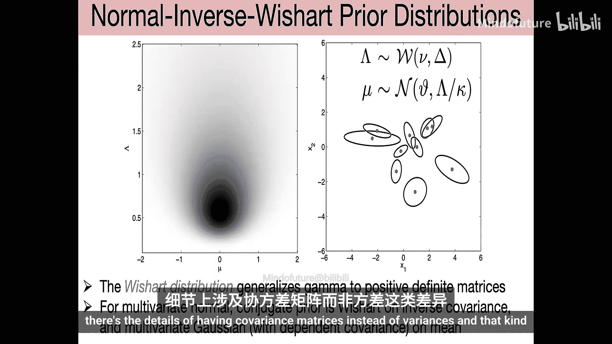

嗯。But it's manage。So。Any other other questions？Okay。咁。

Why don't I will wrap up by talking about at a high level an extension of the G sampler that is designed to try to basically。

Make mixing faster and this is using something called a blocked。Give sample。All right。没。

To motivate this， let's come back and imagine that we had a graphical model。That was a tree。Right。

 so I have some like。Graphal model that's described by in this case this is the equation to make it simple I'm going to assume it's a pairwise markov random field so I just have factors between pairs of nodes。

 although you could do everything also if you had a more general factor graph。

 this is just to make the equations a little simple。And so let's suppose I had。

I knew the parameters of the model like this。And all the variables were discrete。

And let's suppose I wanted to sample from this distribution。

Like I wanted to draw a joint sample from it。So you could do that using like the G sampler right where you initialize all the variables to something and you kind of walk through the tree and sample one variable given its neighbors and do that itatively the problem is is that that doesn't give you an exact sample after like a finite amount of steps right it's only in the limit as you take do lots of。

That sampling。So another approach would be that I can actually。Efficiently sample in closed form。

From the distribution on this tree， using a variant of the belief propagation algorithm。

And here's how it would work。Right， so first for any tree。

 what I can do is I can kind of pick some node as like the root。

Like maybe for this picture I'm going to assume I'm going to pick this top node as the root and then I can write the distribution as the probability of the root then times the probability of all the other nodes of sort of the probability of that node given its parent where the parent is the unique node that's closer to the root。

Okay。And so here's how I can。Sample from this distribution two phases first what I do is I do message passing。

To compute the marginal distribution。Of。The root node right so you sort of like I compute the normal sum product and we know how to compute the marginal of any node in this thing right so that was like what we did in the first few weeks of the class so I compute the marginal of some node。

And then now what I can do is I can say， well， let me sort of recursively sample where I sample the root from its marginal。

Then I sample， so I draw a sample of this， then I sample。

The variables that are kind of one step from the root given the sample。

 then I sample the variables that are two steps from given the sample and so on。

 and it turns out I compute those distributions。In closed form。Right。

 so if I want to say sample this node X， well， basically I have the messages， the BPp messages from。

These kind of these green arrows from things that are farther away。

 and then I have also this potential that sort of like plugs in whatever my sample I got from the root was。

And if I take those product and normalize， then I exactly sample over the distribution of this node given the value of the group。

And then if I do this recursively， then I have sampled exactly from the joint distribution of the variables on the tree。

And so the reason this works is actually because of the markov or conditional independence properties of the tree right so if I like condition on the value of a node。

 then there's a bunch of subtes that are conditionally independent。

Right so what I can do is I compute the marginal of one node。

 sample it now given that the subtre are independent and you kind of recursively sample those subtrees。

Okay。So it's a little bit trickier than the basic sum product， but the same idea。Still applies。嗯。

And so a special case of this that you probably have not seen but could be done for the hidden Markov model right and so when you learn about hidden Markov models the first thing you learn about is the forward backward to get the marginals of all the nodes。

And we talked about how that's a special case of belief propagation。You can also。

 for a hidden Markov model， say given my observations。Let me draw a sample from the state sequence。

close form， so let me sample from the sort of posterior distribution over states given my observations。

And you can do this by sort of a two pass thing where you first pass messages forward。

Right so you do your normal message passing to get the marginal of the last time point and then you sample backwards so you get the marginal of the last time point and you sample that and you sample time。

Time before， then the time before， then the time before， the time before。

So you have like a one of like deter deterministic sub product and then a backward step of kind of sampling things and then if you do that you've sampled from the joint distribution。

看。Yes。嗯。So。嗯。😊，So now we can apply this idea to do kind of。Use MCMC。

 use the G sampler to learn the parameters of something like a hidden Markov model。

Or more generally any directed graphical model， let me talk about HMs because it's simpler。So。

Where now what do I want to do is write I want to。I'm now going to have some priors over like my state transition matrix。

 so the simple prior for that would be to say that every row is like a sample from some de lay。

I have priors of probably of observation given state those are the same things I kind of have to deal with in a mixture model maybe I have other hierarchal variables of regularizers i'm not going to focus on that now but the idea is that。

Now I sort of walk through and I sample the state sequence， then I sample my transition matrix。

 then I sample my probability of observation given state and you just iterate through those things。

Kin of the same idea of what I did for the mixture model。And this， if you do this for long enough。

 you'll get a sample from the posterior distribution of your parameters given your observations。

And so now， but there's two ways I can do this， one is the basic givebb sampler would say， oh， well。

 I have this Markov chain over the states。And what I'm going to do is I'm going to sample one of these state variables given the others。

 so you like you sample Z3。You know， given the previous state and the next state。

 you change that and then you go to a different time point。

 I sample Z4 given Z3 and Z5 and then I go to Z2 sample it given Z1 and Z3 and so on okay。

So that would be like the basic Gb sampler。嗯。😊，And the alternative is this block Gib sampler。

 where right you say that， oh， instead I'm going to compute the distribution over the whole state sequence and sample this whole state sequence and closed form using that thing I just talked about of using the forward forward message passing backward sampling。

Now both of these。Our。Markov chains。That have the same equilibrium distribution。

So these are example of two different markout changes that both。Had the equilibrium distribution。

 the posterior distribution of all my variables given my data。So why do I care。

 like why should I you know？Go to the extra work to derive this。

Message passing you know block sampling well， it has to do with how rapidly the markup chain。

Mixes okay and so here's here's an example with just a you know in this case it's just synthetic data。

 although this is shows up on rail data too I have you know some observation sequence and it turns out that this kind of is well modeled by a markov chain with。

I've forgotten how many states there are here， but you know， there's kind of a few different modes。

And so now as one measure of conversiongence of the chain。

 I can say that you know there's a set of states that you， model this data the best and I can say。

 you know，What's the difference between my current estimate of those states？

And the ones that model it the best， okay？And so zero difference would be one that is a really accurate model。

 as this difference is one， you have a really poor model。And this is， if I do that basic G sampler。

 this is。As a function of the number of iterations。

 this these are showing this is like the median and some quantiles over many runs of this model。

 So if I take like。20 random initializations I run from each one is's sort of like saying。

 how well do I do？And you could see that you know， you're getting the state sequences are getting closer to the ones that model the data best。

 but slowly right this is kind of decaying。Slowly。And right so this is a thousand iterations。

 I have a thousand time points right so for example by a thousand iterations I've actually like sampled these state variables a million times。

So this is like can start to take a while。Okay， even on this like little data set。Here on the right。

 this is the same plot if instead of sampling states one at a time。

 I do this block sampler that samples the state sequence jointly。In that case， if you look at it。

 you can say that actually in you know， only on the order of 10 to 20 iterations。

 you've already essentially converged to something that looks like。The correct posterior。Right。

 so you have something that converges in less than 10 iterations versus in 1 thousand0 iterations it' still far from convergence。

Yes。Okay， so。So there's a lot of this kind of work in practical applied work where people take。嗯。

This idea of blocking variables and using it to converge faster。

And so my last slide is just going to be a picture of suppose I had some like graph with cycles that I wanted to sample from well the basic Gi sampler goes through and samples the variables one at a time。

But you could also sort of develop like a block sampler that says， well， I can't sample。

From the joint distribution because has all these cycles， but I could take like。

A subgraph that's tractable， like I could take a tree embedded in the overall thing and sample from that tree。

So you can have methods that like grab different subtes itatively sample from them。

And then this gives you things that。Our。More rapidly converge to the posterior than an AEV method that kind of samples variable one at a time。

K。All right， so i'm intention keeping this high level because the notation just gets messy when you start trying to write down the equations for this。

 but I wanted to mention the idea because it really is like a very practically important if you want to have methods that。

You know， officially sample from complicated models。

 often thinking about ways that you can at least take blocks of variables in your model and kind of sampled them jointly can be a really important idea。

And lots of kind of fancier methods do that。All right。

 I'm going to wrap up there because I'm a couple minutes over time。

 but I'd be happy to take any more questions。So for this example。

Can you explain why we cannot have cycles for the is it because of thepart algorithm？It's。This。Right。

 so this process。嗯。Assumed I had a tree。Right。This process of being able to sample one variable and then conditionally independent sample the others。

 that only works if I have a tree。And so if I have a graph with cycles， I can't draw。嗯。

And close for now， if I have a graph of cycles， you can sample basically using a junction tree。Okay。

By。Applying an algorithm like this， you can probably imagine a high level how that would work even if you haven't thought of the details。

 right？The problem is though， is that the computational complexity of that is basically the same as junction tree inference。

 so if have if your graph has lots of cycles and thus the you know the cliques and the triangulated graph get big。

 then that junction tree would be expensive。So， but the nice thing is that， you know。In。

For computing marginals， we sort of didn't have things it was sort of you know。Um。RightIf you hear。

 I can kind of。I don't go halfway to a junction tree and it's useful so you can think of like you know I can take。

Some of the structure， but not all。And then if I can sample from that block of variables。

 I get something that might be faster than naive of sampler， but still computationally cheap。

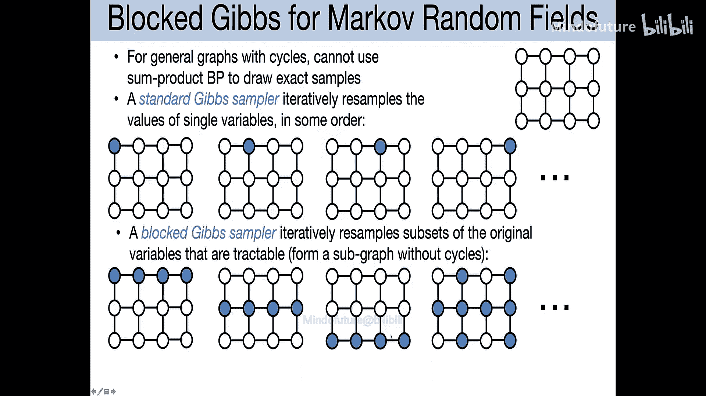