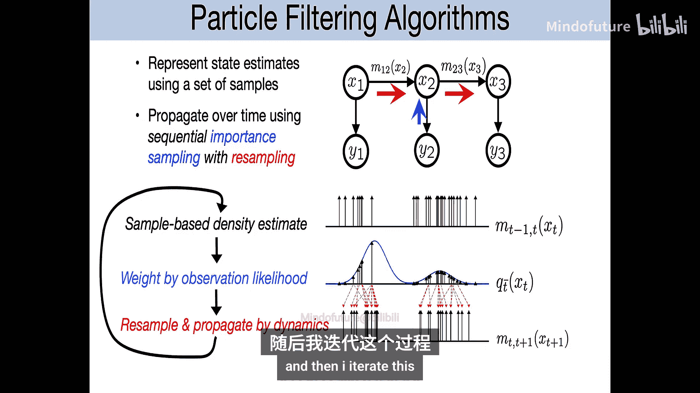
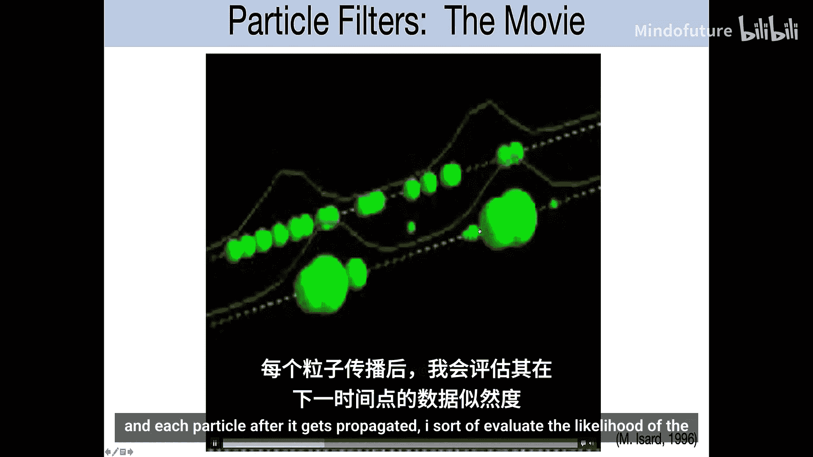
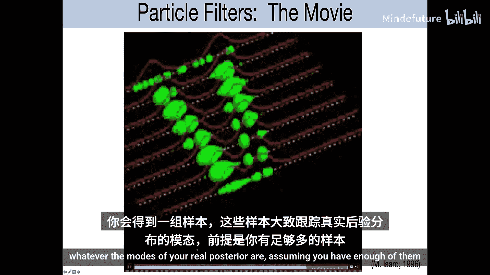
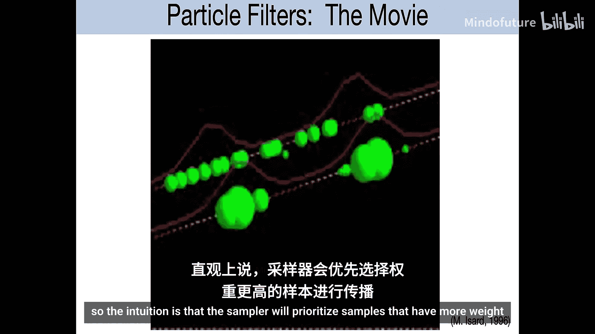
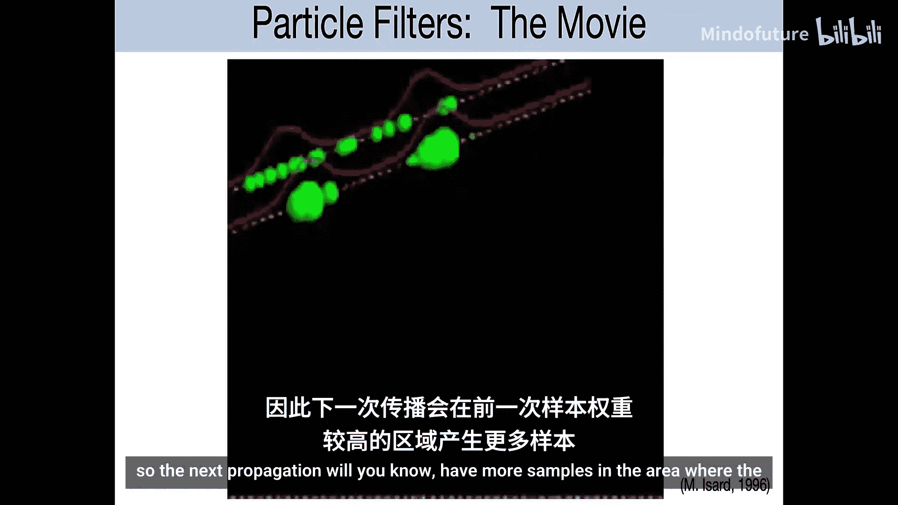
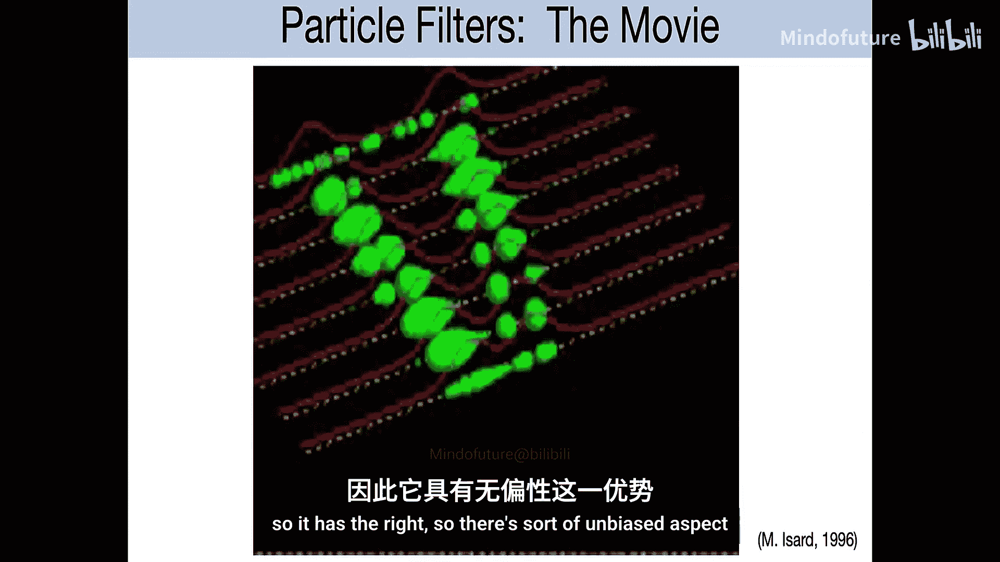

# 【加利福尼亚大学】图形模型中的学习 ｜ Cs274b ｜ Learning In Graphical Models (Spring 2021) p14 P14_讲座_7A-_卡尔曼滤波__粒子滤波 -BV1Tqx6zrEMj_p14-

Today。We're shifting away from Monteie Carlo methods for a little bit。

 or at least talking about a different way of applying them。

And so we're going to come to the issue of how do I deal with models where there are continuous variables？

That I'd like to estimate or do inference about and so we're going to start by talking about the models where the variables are Gaussian where there's some nice things you can do in closed form including the famous column filter and then we'll move on to thinking about more complicated non Gaussian models where there's some approximations you can do that draw on Monte Carlo methods and that's going to lead to what's called the particle filter。

は。So。So just kind of a little bit of reminder of some concepts we'll use here as we start talking about。

Gausian variables and so if I have a x is a D dimensional vector random variable， okay， this is just。

I can think of this as for this variable， there'll be an associated covariance matrix。

And so this is a D by D matrix that is where entry Ij is the covariance。

Between sort of variable I and variable J。And then the diagonals will have the sort of covariance of the variables with themselves。

 which is the same as the variance。You can also think of this as the expected value if you take the difference between x and its mean and take the outer product to that vector and takes its expectation that's also evaluates to this。

And then this matrix is always always positive semideinite。

 which means with there's a couple definitions of this。

 one is that if I take any vector and I take u transpose sigma u sort of evaluate that scalr that'll be a non- negative number that could never be a negative number。

 also being positive semideites equivalent to all the eigenvalues of this matrix。

Being greater than equal to zero， okay？Okay， and。As I'm sure you've seen。

 one use multivariate of covariance makes sure these this is in parameterizing multivariate Gaussians。

 which are a generalization of the Gaussian to vector variables to multiple dimensions。

And so if I have， if I wanted a Gaussian for。Two variables， well。

 of course you each of them it would have， let's say， a mean invariance。

But the multivarior Gaussian has more it says well they might not be independent。

 there might be some dependence okay and so there's the off diagonal entries in the covariance matrix model the covariance between the different dimensions and so like if I in this case here if you took these ellipses this would correspond to a Gaussian that has positive correlation okay。

And you can also do sort of higher dimensions where the contours equal probably are still ellipses。

Or ellipsoids， but these would be in three or higher dimensions。对。

Here's just some examples right of sort of what you look like if you have sort of positive or negative correlation or uncorrelated。

G sees。Okay。So with that being said， so we've talked about you know very simple kind of models for classification problems right we have sort of discrete variables。

You have observations given those variables you can compute their posterior to do classification there's also sort of very simple corresponding models for doing regression that involve。

嗯。Gauussian variables and so the kind of simple classic model really the model that underlies linear regression sort of says that I have some variable Z I don't know and it let's say has some Gaussian prior。

So it's normal with some mean musi and some covariant sigma Z。

 so this could be a vector of say dimension M。And then I have some， I get some observations。

And these observations are going to be have a mean that's a linear function of z。

 so the mean of x is A z plus B and then they'll have some other。

But there's some noise on that observation， they're not perfect observation。

 so that noise will have covariance psi in this case。Okay， and so x is another vector。And so now。

 you know， given this， you know， you might。What don't I know I know P of Z and P of x given Z。

 and so the other things you might want to compute are the marginal distribution of x。

And it turns out that the marginal distribution of x is Gaussian。

 why is that right if I take a linear function of a Gaussian variable I get another Gaussian also if I sort of add two independent Gaussian variables I get another Gaussian that's kind of part of why the central limit theorem is true so so given given that if it's sort of you can compute if I say the marginal of x integrating over z will be a Gaussian with a mean that depends by on that linear function and then the sort of covariance has two parts there's some variability from z so there's a term that's related to the variance of z and then there' also some variability from psi from this additional noise you're adding in the observations。

All right。And。What's nice is that the posterior of Z given x。If you work out。

 you know there's a continuous version of Bay's rule if you work out what that posterior is。

 so all of the it turns out all of these terms are kind of E to the quadratic and so when you compute。

P of x given z times p of z divided by p of x you get another E to the quadratic and so that's a Gaussian Okay and so there's some famous equations here that let you compute the posterior mean and the posterior covariance of z given x Okay and so i'm not going to drive these there's lots of things in the book you know kind of thing。

You know what you want to remember is that you want to remember that in this situation where I have linear functions in Gaussian noise。

 the posterior will be another Gaussian and that you could kind of by linear algebra compute the mean and covariates by appropriate equations okay and that's what this is doing。

All right。If you want intuition for this， what is the saying。

 this is saying that like the inverse covariance of the posterior is the inverse covariance of the prior plus the sort of inverse covariance related to my likelihood psi。

So you can think of this as you know， the inverse covariances are all positive definite matrices。

 so you can sort of roughly is the same when I get an observation。

 the inverse covariance is getting bigger， which means the covariance is getting smaller。

So kind of as I get information from an observation。

 the variance is going down by some amount that depends on the statistics of my observations as well as this linear function A okay and then there's a corresponding equation to compute the posterior mean。

The posterior mean is kind of a weighted combinationmination of the observation X and the prior mean。

Okay。So pretty simple classical stuff， so we're just going to use this though。

 so we want to remember that these these identities because they're going to show up in just a moment。

So now one application of that kind of thing is some is very simple classic application machine learning you've probably seen in more intro classes dimensionality reduction right so if I have some kind of high dimensional data I can think about。

Like let's say an image right so an image is high dimensional in the sense if you think of like each pixel as a number。

 then it's like a point in like a 10，000 dimensional space or something if I had 10，000 pixels。

 I can try to embed that in a lower dimensional space like a 2D space in this case such that somehow you know points that are close to each other in this space are sort of similar in the high dimensional space。

And the most kind of classic methods for doing that dimensionality reduction and they're very widely used because they're simple and often effective are based on exactly that same generative regression model I just showed you okay so there's two related models。

 one is called probabilistic PCA and that's because it's sort of a probabilistic reinterpretation of the classic principal components or analysis or PCA method and the other one is classic one from statistics called factor analysis。

Um， and so both models assume this generative model。

 they say that the way my data is generated is that there's a low dimensional space。

And so each point is going to have a low dimensional coordinate so like in that previous picture this would be like that two dimensional space and I'm going to assume that's a sample and just kind of to fix the scale of my low dimensional space I'll assume that's from a Gaussian with mean zero and variance one。

Okay so that's the identity matrix the covariances on identity。

 so I sample a point in the low dimensional space and then to get my high dimensional data I。First。

 I take a linear function of the low dimensional coordinate。Okay。

And so so that would essentially define like a line or more generally like a hyperplane in the high dimensional space but in general I don't expect I did a lie exactly on that plane so I then add some noise so my high dimensional thing is like linear function plus noise so this you can think of this in。

You know， to try to make a picture of dimensional reduction we can say what's what would happen if I wanted to sort of reduce two dimensional data to 1 d well you would have like a sample your low dimensional coordinate from a 1 d Gaussian。

Then there's a linear function that maps that 1D coordinate to 2D。So here the Z hatt。

 my sample is to the right of the mean and thus I kind of in the high dimensional space I'm to this side of that mue。

 so I sample a point on this line。And then I say my final observation。

 I assume it's not going to lie exactly on this line just close to it， and so I add some noise。Okay。

 and now because this is Gaussian， if I look at the marginal distribution， the high dimension space。

 it will also be Gaussian。OkaySo it'll be Gaussian with this particular covariance。All right， and so。

 you know， if I， if I made sigma like arbitrary， I could kind of like。

Model and arbitrary Gaussian without even using z so the the only reason these molecule are in the interesting is that sigma or sorry not sigma the psi thesi matrix is constrained。

And so in factor analysis， psi is a diagonal matrix。😊，Okay。

Whereas imp probabilistic PCA size is even more constrained， it's a multiple of the identity。

 so at's some constant times identity。So kind of like you're adding sort of spherical noise。

 not correlated noise so all the correlation has to be captured by this line。All right。And。So。

Now there's a classic method that you've probably all seen for dementia。Dimmissionality reduction。

 so principal components analysis or PCA。Right， and so how does how does PCA is a particular way for for finding this line that says。

You know to get this mapping， well， first I set this B to be the mean of my data。😡。

And then I compute the covariance of my you know， my data around that mean and I compute the eigenvectors and eigenvalues that covariance matrix。

 and then I figure out you know the largest，Eigenvalue and I take the eigenvector in that direction。

 so this is kind of like a vector pointing the direction where the data variance is largest。

And you project onto that and if you then you wanted like more dimensions you would take if I wanted like a three dimensional projection。

 I would take the three largest eigen or the three eigenvectors whose eigenvalues are largest。

And so what's sort of magical about PCA is this is simultaneously doing two things。

It is minimizing errors， so if you said out of all possible。嗯。Projection lines。

 find the one that minimize the squared error between the original data and its projection onto this subspace。

PCA does that， so it globally optimizes this objective。

It's also it turns out simultaneously maximizing variance。

 so if I think about doing dimensionality reduction it kind of I would it be a lousy dimensionality reduction if it projected all my data onto like exactly the same point。

So somehow in my low dimensional space I want the data spread out so that they the kind of points are in different areas。

 so also if you sort of say out of all of these projections find the one that maximizes the variance of the points right that maximizes how spread out the RPCA also。

Does that。Okay， so PCA does both of these things。Now。On the previous slide。

 I told you about something called probabilistic PCA。

And so you might ask well why is that called probabilistic PCA。

 it's because if you do maximum likelihood estimation of the parameters in that probabilistic PCA model。

This is the maximum likelihood estimate， so the classic PCA is the maximum likelihood is the same as the maximum likelihood estimate of the parameters in this model I showed you here。

Right， so if you say my deative model is this that that there's a low dimensional coordinate now I。

My data comes from a linear function of that plus noise。

 now find maximum likelihood events of w and mu and the sigma squared parameter。

 that PCA solution optimally does that。Okay。So good thing to know if you haven't seen it。

 i'm not going to prove that here there's kind of details and some of the references I kind of want to get on to more。

咁。Complicated models。嗯。So。And then you can think of like factor analysis something that's a little more flexible right there's a separate variance for each dimension so it kind of can capture different coordinate systems。

So this is just showing that if I have data in 3D， I can project it to 2D or 1D dimension to data sets of different dimensions。

All right。So I figured that was。Probably kind of review for a lot of you， okay？

so but now I want to kind of sort of。Step back from the graphical wall of you and tell you about some of the the kind of structure here so we can think about the the the。

This is like kind of the graphical model if you want for。

PCA right so I have these data points that are you know I have my high dimensional data and I want to find this continuous。

Low dimensional coordinate for each data point。Doing dimensionality reduction and that generative model is actually rather similar to the generative model for like a mixture model writing about the mixture model。

Kind of the graph is the same the difference is that there instead of like saying that my lowdial thing is going to be like a vector and the high dimensional thing is a linear function of it plus noise a mixture model says the low dimensional thing is going to be like an assignment to a cluster so for each data might have a discrete variable say saying which cluster it came from and then if I'm doing a mixture of Gaussians you say well then my observation is sort of that cluster's mean plus noise。

Okay。So you can think of these as kind of being very simple but kind of ways of kind of finding unsupervised structure and data。

 but one using discrete and one using continuous。And now， if I look at this left column。

 we've already seen a generalization of the mixture model to right if I have data with temporal or sequential structure。

Yeah。Right so you could say， you know， if I sort of say that now my assignments to clusters are going to be at like time T is dependent on what the assignments were at the previous time。

Well， then you've essentially defined a Markov chain and you get the hidden Markov model。Okay。

So you might ask， well， let's suppose I want to do something like dimensionality reduction。Um。

But I have like temporal or sequential data right so I have data that has temporal dependence as opposed to just a bag of points。

So could I do something？That is analogous to what something like PCA or factor analysis would do。

 but for data that had sequential or temporal structure。And you're not surprised the answer is yes。

 and the model that does that is something called a state space model。对。

So this is what the state space model looks like， particularly the sort of linear Gaussian state space model。

 which is the most classic very classic one and also tractable so widely used。So the graphical model。

😊，Is the same as the graphical model for it。A hidden markov model so there's like a z's that have this mark out chain structure and then I have these observations where each the observation at time T depends on the state at time T。

But whereas the hidden Markov model， these Z's were discrete variables in the Gaussian state space model。

 these are instead going to be continuous variables。And in particular。

 they're going to follow a continuous markup chain so where the state at time T plus1 is going to be a linear function of the state at time T plus some noise。

So the state at time t plus1 is going to be a times zt plus noise with covariance Q。

Okay and similarly， we're going to assume that for now。

 we're going to assume that the observations the P of x given z is also going to be a Gaussian。

 so my observation at time T is a linear function of the state at time t plus some noise with covariance R。

Okay。So you know， this is written as conditional distributions。

 you can also write it as kind of like this is in the。You know。

 the kind of control world where these are used a lot。

 they sometimes write it this way that you say the state at time T plus1 is AZt plus WT where WT is some zero mean Gaussian noise and then the observation of time T is WZT plus VT where VT is some other zero mean Gaussian noise。

Okay。And so what's interesting what I know immediately from this is that you see that you know how is this data generated。

 well every variable is if I look at like Zt plus1 that's a linear function of ZT right so if Zt was Gaussian then Zt plus1 then that linear functions Gaussian。

 also if I add two independent Gaussius is another Gaussian so from this。If I ask。

 what is the joint distribution of all the Z' and all the x's， they have to be jointly Gaussian。

Everything is right Gaussian， so it's kind of in principle。

 there's kind of you can think of it as being parameterized by a giant mean and a giant covariance matrix。

And thus， I also know that the posterior distribution of the state at any time。

Given some observations of at other times， also has to be Gaussian。

Just from like my basic understanding of how Gaussian jointly Gaussian variables work。

So now it comes down to if I wanted to do inference in this model。

 I need to have efficient ways of computing the means and covariances。Okay I need efficient methods。

 it turns out because if I have like long time stre or long sequences。

 then if I you know the size of like the covariance matrix would be quadratic in the sequence length and the cost of inverting that matrix would be cubic so if I just try to do that naively。

 I can very easily get to cases where you know I can't handle it in terms of the you know you know memory and computational capacity of my computing。

嗯。So let me pause， are there any questions on how this model is defined， does this make sense？Okay。

So I mean， the way to think about it is that instead of if you go to that dimensionality reduction viewpoint。

Right of like again。Here， I mean this wouldn't necessarily make sense for handwritten digits。

 but if you think about it， what does this model say it says that there's some mapping between the low dimensional and high dimensional space。

And then， but kind of neighboring time points are correlated。

 so basically my model is that I kind of go through some sort of like random walk and the low dimensional space。

And then that， so I'm moving kind of locally in my low dimensional space。

 and then that gives me kind of correlated observations in the high dimensional space。嗯。

And so and indeed， you can， you know， there's lots of simple， right？

You know classic dynamics or special taste of this so like so for example。

 if I could just say that the。State of time t plus1 is the state of time T plus noise。

Thats's that kind of random walk as the same as what's called a sort a discrete version of what's called Brownian motion and physics so you can think about this kind of like a just like random walk perturbation of a particle kind of bouncing around over time。

So sometimes a model like that is usually you really don't know much about the dynamics just you know that it can't move too much from time points。

But you can also do other things right so you can say that if I want to model something that has smoother motion。

 you can say that I have a model in which my if I have something moving in 1 D。

 my state is actually going to be 2D it's going to be position and velocity so X is like position delta's velocity。

And then I say that， you know the position at time T plus one is the position at time Tt time T plus the velocity plus some noise。

And then I also have the velocity at time T plus1 is maybe the velocity at the previous time plus noise。

And this you get kind of these much smoother trajectories in which like over time。

 you have something that's kind of like say smoothly moving to negative values for a while until the velocity flips and then it smoothly moves to positive values and so on。

Okay， so you can use things like these to start to describe the motion of real objects or vehicles or whatever in the world。

Okay and。And then to drive home how this connects to that PCA or factor analysis model， again。

 this was the graphical model for factor analysis or PCA。Which says that for every data point。

 I first sample the low dimensional coordinate and then the high dimensional observation is a linear function of that plus noise。

And this is now the state space model in which so the likelihood that the probably of observation given state is has not changed。

 but now the state at time T plus one is the state at time T T。Plus noise。

And so you can think of the。The state space model as。I'm sorry。

 like the PCR factor analysis would be a special case of the state space model where this a matrix is zero。

 so we said a to zero，' you don't get this dynamic dependence and you recover this。Okay。

Just as an aside right so if I don't have the dynamics then it turns out that I don't need to have a covariance matrix here I can kind of assume its identity without loss of generality because if I made this non identity。

 I can kind of absorb that。That change covariance into a change in W。

So that's the reason that this is usually parameterized with an identity covariance。Okay。So。

Any questions on that temporal？Structure。Okay， so this is an old idea。U。

These types of models were actually under very active development already in the 1960s。

In the control theory community， so these are old very classical models those's versions of them that go back hard than that。

Um。And so for a long time， also people have sort of realized that when they started looking at like directed graphical models。

 you could build。You could take these ideas to build。

Directed graphical models with continuous variables and so this is not going to be a big focus for the course。

 but I just wanted to mention it that I can define a directed Gaussian graphical model as one in which I have a bunch of variables and each variable is going to be some linear function of its parents。

So here I have， if I have several parents， I think of like I take the states of all my parents and I stack them in a vector。

And so I take some linear function of all their states。And then add noise。Okay add some。

 if I have a D dimensional node， I have some D by D covariance matrix。Okay。嗯。

And that define the distribution if you wanted to， you could also add a mean to sort of capture the mean of your variables too。

Okay。And so these are these are used a lot here's an actual example of this type of model in which I think I've mentioned this application before but didn't tell you what what model was being used so they were in this case they're building a model of sort of correlations in the。

I。Believe this is sea surface height。Which is of interest in some geophysics sort of applications oceanography applications and so the idea is that they're going to they have actually this a tree structured model like this where each node as sort of for children that's going to use to capture multiscale correlations in the values of this across different positions and scales in the ocean and then they get some noisy observations of this at partial locations so these are sort of the locations of their observations so this comes from satellites which is why you have these kind of parabolic tracks sometimes the observations are missing because the satellites can't see through clouds it turns out in this domain。

And then then my running an inference method， which we'll see is efficient。

 ends up being linear have computation velocity that's only linear in the number of nodes in this tree。

 so they can run it over like the entire Pacific Ocean which at the regulations they use would involve millions of variables they want to estimate。

 they can compute the you estimates of like the mean as well as there and the variance。

 this is the posterior variance for each node， which these shapes here are sort of showing that the variances are smaller and near where they have satellite data and then farther away from those observations。

So this is actually this kind of thing is very common in。

In these scientific areas where they get the sparse data。

 but then for all the modeling they want to do later they really itd be very convenient they don't just want these sparse measurements。

 they really want more like a dense field of what did the whole ocean look like and so they they get。

You know they have they use a probabilistic model like this to preprocess and get estimates。

 but then because they're going to use it for future scientific tasks。

s it's very important that they have some sort of measure of uncertainty of how much they trust these estimates。

And so just not just like training like a method that just produces predictions。

 but having something like a probabilistic model like this that can hopefully give you calibrated uncertainty estimates is very important。

Okay， so this is the model and so。Now I want to talk about how you could actually compute those。

Means。And variances。Okay。All right。嗯。😊，So。I early in one of my first lectures。

 I gave you kind of a derivation of the sub product algorithm。Right， using the distributive law。Okay。

And so imagine I took almost the same model as we saw back then。

But I assumed all the variables were continuous。So I had like let's say some markov random field on these variables and so that's defined on continuous variables you just now have your potentials have our functions of continuous things rather in discrete things。

And now if I wanted to compute。Let's say the marginal of node one。

It's kind of the same idea except now because things are continuous。

 I have integrals instead of sums。Rightect。Now I can though， apply the same。

Distributive laws I did before right so for example。

 if I want to integrate this expression over both x4 and x3 I could。

Take these two terms that depend on x three， integrate them first。

Then take these two terms that depend on x4 integrate them separately and multiply the result now we get the same answer so you get the same kind of distributive law。

Okay。So as you start to see， you get something that looks like。

Just a message passing a belief propagation algorithm right so I compute these integrals。Um and。

Compute this integral that gives me a message of x2， this is another message to x2。

 then I multiply those and take this other integral and so on。So am I done。

 can I just do this to get the marginal of x1？Is there a problem here？Well no。

If you want to compute the margin of x1。You have to normalize of。

Wait sorry'm well you'd have to normalize at the end there is a normalizing constant you're right that's what this kind of proportionality symbols capturing。

But think about it right so if you think about it you when you implemented the sub product algorithm。

Your messages were vectors。Right？You had to store them in the computer somehow。

 and so the messages was like a vector， maybe more concretely。

 it was like a nuy array that had like one number for each possible value the thing could take on。

So here I said that the result of this integral。Is a message。

 but what is that that's if I integrate this， I get some function right basically you know like what's probably some continuous function of x2。

Right so x2 is real valued then I have that continuous function and I can't necessarily。you know。

 represented exactly so I don't necessarily have like a you know a some finitely parameterized closed form for the messaging marginal right even if psi is nice when I take this these integrals and start multiplying together and taking more integrals I don't necessarily have things that are nice。

Okay， and then of course， you know integrals or there's parts of science which people spend their whole careers trying to numerically approximate integrals and do integrals。

 so this could be， I can't necessarily compute this integral easily。Okay， so you know。

 I point this out just to say that， you know， you know。

 this is some level you would say this is the integral product。Alrithically。

 but this idea of doing integrals and products is like not actually an algorithm。

Because the problem is the integrals don't have closed forms and then the output is a continuous function that doesn't necessarily have like a representation by a finite set of numbers you can store on your computer。

Okay， so that's why with continuous variables we can't just do the same things that we did with the street we have to think about how arere going to represent these computations if we want to do something like compute modules。

In a model。Okay。😊，All right。So， but fortunately， if everything is Gaussian。

Then it turns out that all of the results of the integrals like that that I just showed you will have a Gaussian shape。

And then thus， you can represent them。By a mean and covariance。

And so you can get inference methods that operate on Gaussians that all you have to do is sort of compute what the means and covariances are and so to keep things simple in presenting this part of it。

 rather than looking at like a general directed model or something I'm going to look at this very special case of this state space model so it's going to be this temporal model with Gaussian variables right so again my model says that my observations are P the states are undergoing kind of a random walk where the state at time t plus1 is a linear function state at time t plus noise and then my observations are going to be linear functions of states plus noise。

Okay。All， and then I'm going to be interested in computing these quantities。

 this is going to be the posterior distribution of the state at time T。

 given the observations at time T and earlier， so I want to compute like the state at time P of Z3。

 given the observation up to time three P of z4 given the observation up to time four and so on。Okay。

😊，This is kind of a way of building up to getting full posteris I'm going to denote those this mu of t bar t this is like。

The mean of the state at time T， given all the observations up to time T。

 that's what that notation means。嗯。All right， and so there you can think of right the message passing algorithms kind of operate recursively like when we did message passing。

 there'd be a message from two to three that's used to compute the message from three to four that's used to be the message from four to five。

 and so we can do that same message passing with this continuous model。U。

And we'll do that in two phases right so we're going to assume I have this so I've already computed the state at time posterior the state at time T。

 given observations up to time T and now I want to do one step I want to compute this the posterior of the state at time t plus1。

 given also the new observation I have at time T plus1。

And so what we're going to do first is we're going to predict。

 so there's a prediction set we say what is this posterior of the state of time t plus one given the observations up to time。

T。😊，And so formally right that would be an integral right。

 you would say I have my current posterior of the state given observation up to time T and then I have the distribution of Zt plus one given Zt and then I need to integrate over Zt。

If you look at this model， that's formally what you need to do。But because。

Because this is everything as linear and Gaussian， if you start looking at these integrals。

 you don't really need to actually sit down and compute a complicated integral， you say， well。

 you can figure out that I know that this is another Gaussian and it will have this mean and this。

Vious。Okay。Soe if I have some mean and I take the linear function A times z， then I get this。

New mean and when I take the linear function a times z then the new variance becomes sort of a times the old variance times a transpose you have this sort of quadratic form plus however much extra noise you add Q is the amount of extra noise in the dynamics。

So actually， this is just a copy paste if you went back to my very first like my second slide of the lecture where I gave you these identities of how do I work with the generative regression models。

 this is just a copy paste of one of those identities。可。All right。

 so now I know how to do this now basically this what is this doing this is saying that like if I already knew the distribution of the state at。

Time three， given my past observations， I could kind of optimally predict what' will happen in one more time step。

 but how is the system going to evolve？I can predict the mean and covariance of where the system will go in one more time step。

Okay。And now I get a new observation， so now I say I've predicted what happens at time for and now I actually get an observation and I want to account for that observation。

And this is what's called the update step。And now I just here the update step is basically Bay's rule。

 I have， you can think of my prediction as being like a prior for the state at time P plus one given past observations。

And now to get the， sorry， that's like the prior， and now to get the posterior。

 I multiply that prior times the likelihood， the probability of the new observation given the stateta time t plus one。

And from like the generative regression model structure， this is another。Right。I have。

These are both Gaussian。And so thus the posteris are being Gaussian。

Here are the equations for that Gaussian so this is not I think particularly illuminating。

 this is just if you kind of look up your equations for Gaussians and regression models you can figure out what the mean and covariance is and they have this particular form。

So this is the mean。Is the mean before plus a correction that depends on my observation and then this is the covariance。

 the new covariance is the old covariance in this case you can it's written this way the covariance is getting smaller so the covariance is reducing because when I get an observation that reduces uncertainty in a Gaussian model that always happens。

嗯。And so this K is a matrix。That if you look doesn't depend on x。

 it just depends on like the statistics of my model， so this K depends on。You know。

 W and R and so forth， Okay， so it kind of says how you know how much。

How different dimensions of your observation provide information about different dimensions of the state。

Okay， and so。So this algorithm is called the commonman filter。After a guy named Rudy Coleman。

 who developed it。嗯嗯。O gee is a little over 60 years ago at this point。

U and so this actually this k is sometimes called the call and gain matrix in this literature。

 but it's really just kind of the normal matrix that shows up in a regression bubble。Okay。All right。

 and so this is。With this method， you can kind of in constant time as observations come in。

 keep track of what the posterior is of your state。

 given the observations arbitrarily far in the past。Okay， and so。呃。This is really widely used。

 right in fact。You have almost certainly traveled in a vehicle partially controlled by a coman filter。

Because it turns out that in like automatic control systems on aircrafts。

They have models that look like this， sometimes they're slightly fancier nonlinear ones of the dynamics of the aircraft in sort of a much higher dimensional space and then as they get observations from their sensors they need to keep track of you know what the state is of the aircraft is and thus how they should change their control system to keep it on you know a smooth city path to wherever it's going to go and in fact variants of the callman filter are used in the inner loop of those control systems and have been for decades so that's where these things were originally developed and they're still widely used today。

Okay。U。All right， so that gives you so and in this literature filtering in this like kind of literature。

 people thinking about robotics and control， the filtering problem is kind of is keeping track of the the distribution of my state。

 given all the observations that I've had in the past。Okay。

 so abstractly the filtering is you're trying to compute this。This distribution at the very top here。

 P of ZT given observations all the way in the past。

Now they call something there's something else that they call smoothing and this is。by the way。

 the reason that comes up is because if I'm going to like do online decision making or work in a control system。

 well then， you know， you know， I kind of when I need to make a decision about what to do。

I only have the observations I've seen thus far， I don't know what I'm going to observe in the future。

 so that's why this recursion is natural。They have then there's a generalization they called smoothing and smoothing is basically more like the same thing that I've been talking about in this class so the smoothing problem is say compute the posterior distribution of the state of each variable given all the observations past and future。

 so like compute P of Z2 given the whole sequence。系。

And so you think about you know for a discrete model。

 we know how to do that with the sub product algorithm。

 you kind of have messages that you pass forward and messages that you pass backward and you put them together。

And abstractly， you do exactly the same thing。With。This Gaussian state space model。

 you have messages that you pass forward， okay？That I showed you on the previous slide。

 and then there's another corresponding set of backward time messages。

And these are actually they're formerly they're computing the kind of likelihood of future observations given。

Um。The state。And then when you multiply these together。

 and so these both are Gaussians and when you take their product， you get another the Gaussian。

 you can then compute the posterior of the state at time T。

 given all the observation the past and future。Okay， so this is used for offline data analysis。

 it's used if you want to estimate parameters of your dynamics model from data。

 lots of things like that。嗯。I'm not going to give you。

 I didn't write down the backwards equations here on purpose because believe it or not they're even uglier than the forwards equations。

sort of somehow because the model is written in the forward direction。

 the like inference equations when you go backwards are kind of nasty looking。

 but they are they are they end up being linear algebra right there's just particular things involving matrix products or matrix inverses that take the mean and covariance at one time to the mean and covariance at the previous time。

So they still have that。Structure。🤧Okay， and and if you look carefully at this algorithm， by the way。

 its cost is。Linear in the number of time points。So that's really important for like an online method that the cost doesn't blow up worse than linearly。

And cubic in the state dimension， so it kind of grows as the cube of the state dimension that's because you end up having some like kind of matrix n versus in here that have a cubic cost。

Okay。All right。And so here's just a toy example。U。😊。

So here imagine this is a model where there's a target that's moving in 2D。

So this is like these squares are showing like the true location of the target。

Over time so kind of at different time points， so its this is not a plot of like location versus time this is like the 2D location at several different times。

And then let this is saying that let's suppose that you don't get to observe those。

 you observe those plus noise， so these green circles are kind of the squares plus noise。Okay。

Now there wouldn't be much if you only， if there was no temporal dependence。

 if you just had one observation of each time point that's zero mean， you really can't do much。

But if you assume that the target is， you know。Maybe is a physical object so it can't just jump around arbitrarily there's some smoothness to its motion that you can encode that dynamic model。

 then you can get an estimate of and so this is now this shows the results of the Kman filter so these red crosses are the posterior mean of each time point given the data in the past。

Okay。And then the circles are proportional to the size of the posterior。Variance。

And so if you look at it， actually as the time goes on in this case。

 the size of those circles are dropping and that's because at like the first two time points。

 you know， at time point two， you only have two observations。So you don't have much data yet。

 but then as I get farther and farther along， I have a longer history。

 I've seen the target moving longer and I can kind of gather more information and get better and better estimate of where it is。

Okay。And then on the far right， this is now showing the results of the coalleman smoother so computing the posterior mean and variance。

 given all the observations past and future， and so now you can see the means are kind of closer to the truth right they're less jumpy and the uncertainties have also gotten smaller right not zero。

You don't have enough information to perfectly predict， but you have better。Okay。

Any questions on what that's doing？嗯。Why are the circles on the extremes for the smooth pig？

any intuition there yeah well think about it so so this is a this random walk you know these markov chains right you know kind of every time step you you move the amount of。

You're kind of like adding some noise so as you know the as you get farther and farther away。

 you kind of start to get less information。Okay， in particular。

 kind of the actually the amount of correlation will decay kind of exponentially with time with some constants that depend on like the the matrices that are involved。

So if I look in the middle。Right， if I look at a time point in the middle。

 I get information from you know， the observations that are。In the future and in the past。Okay。

 there's a window of observations， I don't know exactly what it is。

 but there's you know several observations in the past several observations in the future that are informative。

On the other hand， let's suppose that I take this let's say the very last time point well at the very last time point I get information from the。

You know， the observations in the past。But only some of them are useful。

 these things really far in the past aren't helpful because essentially I almost independent and then I get no information from the future。

So another way thing about it is like you get the most information here in the middle because you see just before and after that what happened。

 but here I have more uncertainty because I don't know what's going to happen next。

Does that make sense？But also because you are on average further from the other observations。U。No。

 it's well it's just that because the number of observations right so the number of observations is the same right is the same。

But know the but if you you， if you would say。You know。In a Gaussian model all that map。

 you know all dependence is the same as covariance right and so in。If you said。

 you know what if you took this middle time point and said。

 what is the average like covariance of that with all of the other time points？

It would be bigger than for like a point at the end right because the point at the end has sort of some some reasonable covariance with some time points before。

 but almost no covariance with like let's say the first half right of the sequence。And of course。

 you know， it depends on what the parameters of your model is， how quickly the covariance decays。

 but it will， if you go far enough， it will eventually start to decay。So yeah。

 so that's what's going， that's a good question。Thank you。嗯。Any other？Anything else？Okay。嗯。😊。

There's a link here to kind of just a video showing an example of a kind of tracker。

People build these into like visual tracking algorithms a lot。

 I think i'm just going to skip that now because I have a more more interesting example coming later but but you could know check it out offline if you're interested。

Um。So。嗯。I have kind of some details on inference， I thinkm i'm going to skip this over other than I will just say that if you if it comes time to really implement this stuff。

 sometimes there's a lot of details that。Matter and it turns out that kind of for more numerical reasons rather than conceptual reasons。

 and it turns out that sometimes it's actually useful to use what that。

Inverse covariance parameterization right so when I'm computing things instead of computing means and variances I actually compute inverses of covariances。

 there's for some types of models where those tend to be numerically better behaved and more stable。

Um， particularly if you have like if there's some dimensions of your state space that are not easily observed。

 but where you don't have information from an observation， then you know。

 you could have a have an even kind of infinite variance in that direction whereas the inverse covariance is better behaved。

Um。And so if you use this inverse parameterization。

 you can actually then develop a version of that colonman smoother that applies to more general Gaussian graphical models。

 some models that are Gaussian， but have you know that are let's say a general tree structure or even have cycles。

And so now you have the same idea that your messages are going to be represented by a mean invariance。

 or in this case， like a inverse covariance and inverse covariance times mean。

And then there'll be particular ways of computing marginals from these and it turns out these have simple formulas and then some other messages for updating them and I've kind of specifically kind of。

I'm going to skip over the detailed equations here because it's a little bit of a specialized topic。

 but I just want to make you aware that this has all been worked out。And you can do it。Um。

Now here's an example of that。For another one of these kind of spatial prediction。Problems。Um。

And so what are they showing here， they are showing I have a model that's describing the sort of like locations and space of a surface sort of thing like modeling like the height of a surface。

 this is toy and a sec I'll show you a real application in a moment。

Um and so now you think about like like the this finest scale here or like locations of the cells on this。

Mesh and then they're modeling you know connections to the neighbors。

 but they're also modeling correlations at different spatial scales and so if you do that you get this model that has lots and lots of cycles。

But and now they're they're interested in things like if I。Take this bottom middle。

 this is like the locations on this mesh plus noise， so they add noise to all those locations。

By using the spatial correlations， can I recover the original surface？

And in this top is actually the output。😊，Of the loopy belief propagation。

Algorithm on that so it's computing giving these estimates of the surface locations this right is the different things this is saying suppose I only observe sparse locations so I observe the mesh kind of sparse areas and I have lots of missing observations you can also then get an estimate。

Of the location okay， using this kind of method。And in those lots of kind of application of this here's an example of kind of from reconstruction they're doing from sparse data they're doing reconstruction of geological data right so they have kind of tomographic imaging data and they're trying to sort of sort of reconstruct something about the shape of your surface and you can do that using this type of methods。

I don't I don't have a slide here to go into details， but it's interesting that the。

It turns out that the。This loopy belief propagation algorithm actually has some nice properties for Gaussian models and particularly if it converges in a Gaussian model。

 it always computes the correct posterior mean so even if I have a model with a whole bunch of cycles。

 it gets the mean correct。However， it gets the variances wrong， so it kind of like。

Get its uncertainties wrong it's actually it turns out to usually be overconfident because it kind of double counts information to luukesfecent。

 but it gets the variances right。So。嗯。Anyway， so I'm kind of moving through this quickly because I know for a lot of people in this process is not necessarily like the direction that's most relevant to what you're doing。

 but I want to make people aware that you can apply these same types of mess passing inference algorithms to Gaussian variables there's nice closed forms involving means and variances and those let you you know are really kind of widely used。

Any questions about that？Oh。Okay。So。Now I want to talk about how we can if I had a model like I've just been discussing。

 but the。The variables were not。有好事。So I have a state at time t plus one will be just some function of the state at time t and the noise and this function might not be linear and this noise could be have some complicated distribution that's not Gaussian and similarly with my observations。

嗯。And you know， you can probably imagine there's going to be a lot of cases where this shows up from when。

 you know， if I try to learn models of complicated data。You might， if I had a。

 if I was interested in like some dimensionality reduction， there's lots of cases where you know。

 you don't expect the mapping between the low and high dimensional spaces to be linear。

 you want to capture the structure of complicated data。For a lot of control systems right。

 you know the if I have the dynamics of a vehicle， they're often not truly。

 they're not really linear right， they have some nonlinearities to it so you need to account for that。

Now the problem is is that all of that， if you have any nonlinearities or nongaussianities in the noise。

 it's that column filters is in a sense very fragile， anything。

 if you slightly break any of those assumptions，It kind of all falls apart in the sense that you can no longer exactly compute the means and variances。

Okay and there's even some theoretical results that say at some level there a very thin set of models that you can do that for and so thus you end up having to explore other types of approximations。

And and so one of the most。Widely used ones， something I'm going to talk about now called the particle filter uses a Moty Carlow estimation and important sampling ideas to approximate the posterior。

嗯。So first， remember our basic important sampling method we talked about before。

So the important sampling being that I compute some proposal。

 so I have some proposal distribution and then so I sample for my proposal and then I compute weights by taking the ratio between my proposal and the true distribution and then I take a weighted average of whatever function I wanted to estimate。

Okay。😊，And so if I wanted to estimate some function of the state， I could do that for here if I like。

 let's say， you know， I could sample。From some proposal。

 so for example you might you could like say have a proposal that's a markov chain right that kind of evaluates a markov chain on the states。

 but maybe one that doesn't properly account for the observations。

And so I could sample from that and then I could evaluate my whatever my model is and then I could compute a weight right or the ratio between the true probability and the proposal。

And then if I took a weighted average of my function value of my samples。

 then as I make more and more samples， I know that eventually。

 obviously that converges to the right expectation。Okay。😊，And so this is valid in principle。

 but it's not really very practical and the reason is that if I have a long sequence。

 imagine I have not even that long， imagine I have 100 time points。Okay。

 so if I just I have a proposal， you could say， you know。

 what's the probability that it kind of most or all of those100 time points。

 the the state I propose is sort of somehow close to the true posterior。

It's kind of if you have a long enough sequence， you'll almost certainly make mistakes somewhere and so all of your samples will almost certainly be wrong and so that you end up with essentially enormous variance in these weights。

So unless the sequence is very short， you can't really apply this kind of method。

OkayBecause just the variance will be too big to be useful。嗯。

Same idea when I talked about that there was a simple application of important sampling to a directed model and ancestral sampling we saw before that if。

If the network is even medium sized， I might need a really large number of samples before I get accurate results。

 so same idea here。嗯。😊，And。So instead， the approach that's widely used is to say， you know， okay。

 I'm still going to try to estimate those same marginals。That like the Kman filter did。

 but instead of trying to represent them by some like closed form shape like a Gaussian。

 I'm going to represent them using ideas that kind of draw nonparmetric statistics and particularly I'm just going to represent them by a set of samples。

So what this is like imagine that this was my true some true distribution over two variables。Well。

 one way to kind of just。Represent the sample to approximate this distribution is represented by a set of samples。

 say here's a collection of points that are sampled from it。Okay。And so in this context。These。

These samples are points that you're going to use to approximate the distributions。

 these are called particles。嗯。I think it's just a name that one of the early approaches in this space they gave。

 they called them particles and it's sort of stuck。Right。

 so you can see that you know you have all these little points， those are the particles。Okay。

And so the idea is that my。TheMessages that I'm going to pass in my。

 let's say belief propagation method are going to be。Represented by a set of particles。Right。

 just like a set of possibly weighted， maybe you have a weight saying like which ones are more and less important。

but I basically have this set of weighted particles and so you can think of these as being like a saying well。

 I don't know what the true distribution is， but'm here's a set of things that I think look like samples from it。

And then as time goes on， I have like a particle representation of the seta time T。

 I'm going to try to evolve my particles， move them to the higher probability parts of the space to get a particle representation that say time t plus one。

Heep and so on and so forth。And so then the methods that do that are called particle filters because they're using these particles to do the filtering your estimation of the states。

Given observations。Okay。And quick question， yes， about the particles so can you go back。

So the formula that we're using seem to kind of like reconstruct the distribution from that。

So what exactly is the the Delta in that case， is it like Iraq？Yeah， yeah， so this is。Yeah。

 if x is continuous， this is like a Dak delta if x a little bit of sloppy notation here。

 if x is discrete， this would be like kind of just01 depending on whether it is the same or different。

Yeah， so like we could use。Maybe like like a small Gaussian， for example。

 like if were going at that density estimation。Right。

 so if wanted if you wanted an so if I wanted just to estimate the mean of a function。

 I would just evaluate the function at each of these points and like take their average or their weighted average。

If I wanted an explicit density estimate， you could do what's called a kernel density estimate。

 which means you put like a。A Gaussian with like really small variances around each of these points and then you take kind of like the sum of those Gaussians。

Okay， all， explicit。Com。But the idea is that for a lot of， you know。

Things you don't need that explicit density estimate， all you need。

 there'll be like some functions you care about。You know that could just be like the location of the target or like the probability that the target gets too close to this place you don't want it to go or whatever it is。

 and now you can then using your particles you can compute you know the mean and the mean and that function。

 you can compute the standard deviation of that function。

 you can compute quants of that function as you can get kind of estimates of anything that's useful to you。

Yes。嗯。All right， thank you。And so so and why is this going to work well， the idea behind again。

Why the basic important sampling didn't work is in this basic important sampling。

 I was thinking of like sampling like a whole sequence。Right？So if my state was 2 d。

 but I had 100 time points， that lives in like a 200 dimensional space。

And so the idea is that I can't do this money， this simple important sampling thing in a 200 dimensional space without a huge number of particles。

But maybe I can do it at one time point in just two dimensions。

So maybe I can do this sort of idea more locally and then chain those together and that's what the particle filter does。

嗯。And so if I think about， you know， this， how。Abstractly。

 if I could do things exactly how I would you know represent。Do do sort of a。

Non nonlinear filter filtering a nonlinear model。Okay。

 so I'm going to have now these Ms are messages just like we saw before with。

I believe propagation or some product？Okay， and。The idea is that I to kind of compute my modules。

 I will have two steps。So one is that if I have the message from the previous time point。

Then I can get the marginal of that time by taking that message， multiplying it by my likelihood。

 probably my observation given the state and normalizing so it sums to one。嗯。And then now to compute。

These messages。What should I do then what I should have to do is I shouldn in principal have to do an integral right I take the current distribution of the state then I take the state transition distribution and then I marginalize。

Over that。Okay， so this is just a rewriting of what。

The some product algorithm would look like in this model right this is like this blue is like the product part of some product and then this red。

Is the sum part of some product but the problem is is that in a continuous variables the sum becomes an integral so I could be hard to exactly do this integral and then even in the product right this is instead of like the message being a vector。

 the message is like a continuous function right so I can't even necessarily do this product in like closed form or represented it exactly。

So instead， what we're going to do is we're going to say my messages are just going to be represented by a set of samples or particles。

Okay， so I have this set of sample and you can just think of this as like saying。

 you know before given the information I have from previous time points。

 these are my best samples from where I think what I think the state might be okay。

And then I get an observation and so now I multiply so my likelihood is like a continuous function that I can plot in 1 d here it'd be hard to plot in high dimensions。

 but the idea is that even if I don't know this blue function exactly。

 I can just evaluate it at each of my particles so in each particle I can evaluate this function and that gives me a weight for that particle okay。

And those weights are exactly come from the important sample。Right， you're sort of。

So you take these weights。And then now。I propagate things forward。

 but particle filter is going to add an extra step where you do resampling so what you do is I'm going to take。

The particles that have high weight。These are me as like my best guesses and I'm going to kind of propagate multiple copies of the next time point and on the other hand。

 the particles that have some of the particles that have really low weight I'm going to just throw them away。

I'm not going to do any of this deterministically I'm going to do it stochically。

 so on average I take multiple copies of the probable ones。

 throw away the weak ones and if I do this in the right way I maintain an estimate that's unbiased。

That still has the right expectation。Okay and then I。

Iterate this。All right， so let me。To try to illustrate this， let me try showing a movie。

 let's see if it plays。Okay， in Zoom。Right。Do people see little dots？

On the screen yeah good all right so this is my particles。

 so imagine I have a current set of particles that are approximating some like distribution。

Then I have a dynamics model that propagates those to the next time point and each particle after it gets propagated。

 I sort of evaluate the likelihood of the data I have at that next time point that's what that red curve is is the likelihood given that so some get higher weight and some get lower and then you repeat this process right so at each time point right they these samples get propagated forward you evaluate them proportional to the likelihood so you sort of discard some of these low weight ones about you know give higher weight to some of the middle ones so you can see that and as time goes on you end up with this set of samples that kind of tracks。

These the kind of， you know， whatever the modes of your real posterior are， assuming you have。

Enough of them。Okay。

Right right。You put that back does that make are there questions about that does that make sense does that click like the intuition make sense don't worry about the math right now'm wondering about the intuition of what this is doing。

So the intuition is that。The sample will prioritize samples that are， you know， have more weight。

Than for the propagation， I mean， so the next propagation will you know。

 have more samples in the in the area where the。

Previous samples have more weights and like that。Exactly， I mean。

 the ideas that imagine that you had。Now there's a now the there's something simple you could do this so actually it turns out that what's。

That naive version of important sampling that I said wouldn't work it turns out that that actually something that would be equivalent to that would look like this I start with a set of samples。

And then I give them， you know， and then I multiply them by the likelihood at the first time point。

Okay， then each of those for each of those samples， I sort of like simulate。The dynamics of my model。

 I simulate what could happen with one time step。and and there's a lot of cases where you can do that。

 so then you you simulate each one。U but you simulate all of them once。

 so the ones that were good and also the ones that had really small weight。

And then I evaluate my likelihood at the second time point。

To get and then I simulate one once if I like a third time point and so on right so you can imagine that。

Over time， there will be。A bunch of these。Particles that are kind of often some part of the space that has。

I is totally disconnected from the observations right you will have simulated a sequence that's like you know a possible way for your target or vehicle to move but has nothing to do with how it moved in this case given the data you have。

And so you're simulating a set of particles and they have weight。

You know the weight is like true probability divided by proposal so that weight because the true probability is very small that weight will be you know almost zero right it'll be some tiny epsilon so you'll have a whole almost all your particles will have weight almost epsilon。

And so you're kind of， you're basically， you end up if you think about you're sort of like wasting time。

嗯。Simulating things that are impossible that， you know didn't happen。

And so the idea of the particle filter is that。😊，I get every you know I'm tracking things over time at every time point I get some data。

Right and so。If， you know， I have。You know。By the fifth time point。

 if I already have information about what's likely and unlikely， then I should。

 if I am computationally constrained， as we almost always are。

 maybe I should start throwing away the particles that are in parts of the space that are near impossible and focusing on the parts of the space that have some nontrivial probability of really being true。

Does that that make sense and by the way， you can so a particle filter。

 another name for this is sequential Monte Carlum。And actually these things。

 although I talk about it in terms of time series that's the most intuitive。

 things are these methods are actually applied to some data where it's not actually a temporal model。

You just just basically make a sequential order of your data and kind of incorporate things one at a time and it can be a way of approximating doing approximate inference for really complicated models。

AComplic data sets。So you can just think about it as like you're kind of going through your your parts of your model or parts of your data sequentially and kind of like dynamically figuring out given what I've seen thus far。

 which parts of the space should I explore more， which should I explore less。

So that say it's a little bit almost like a search method that starts to search for the high and low probabilities。

 except because of this important sampling correction。

 it's sort of a stochastic search that has some nice properties that like on average will give you。

The expectations you're looking about right so it has the right。

So there's a sort of unbiased aspect that you wouldn't have with some types of searches。

