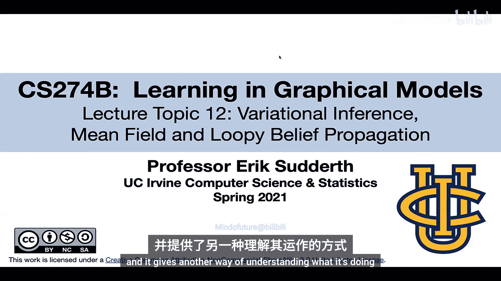
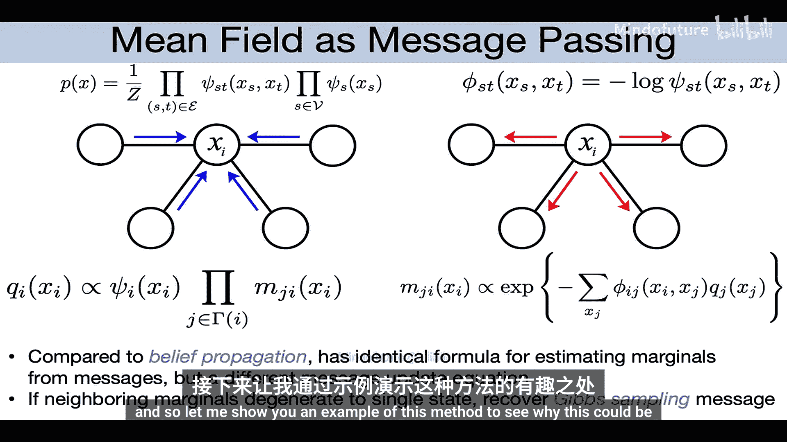
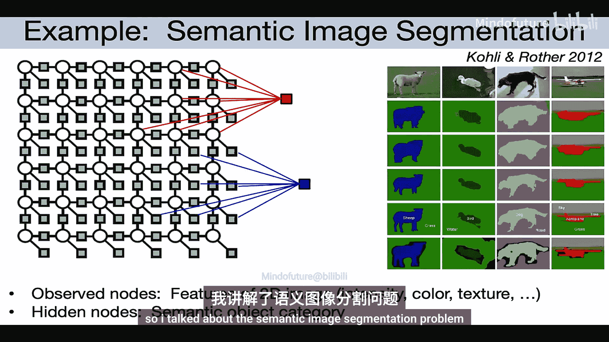
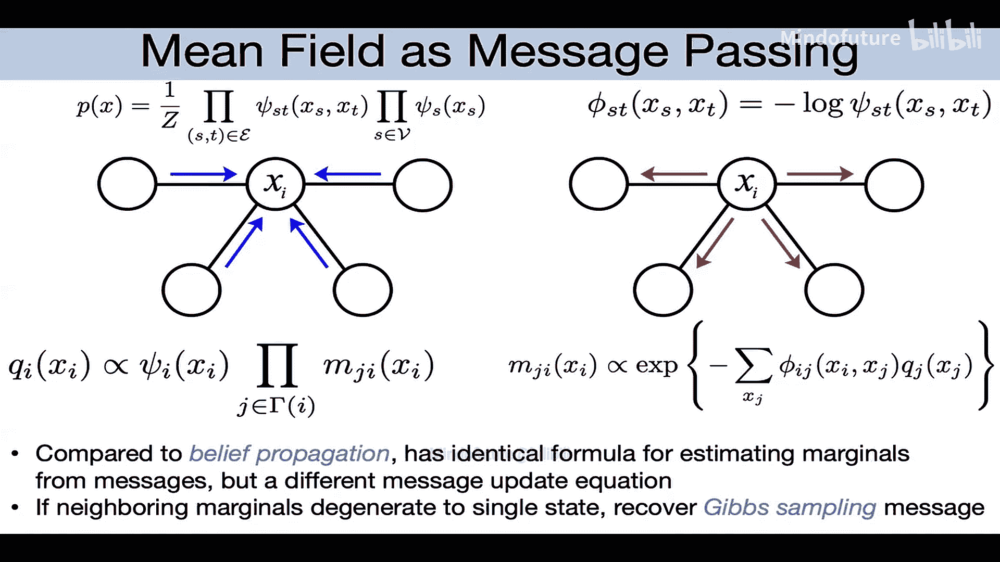
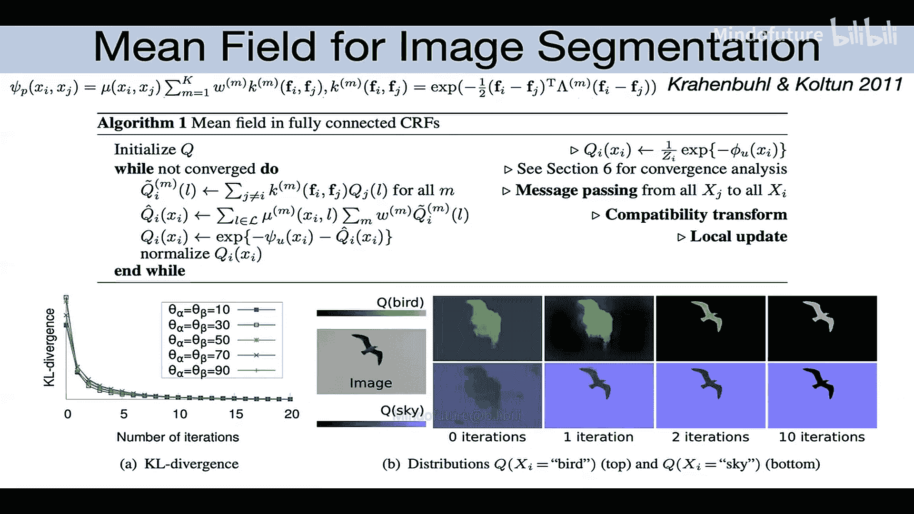
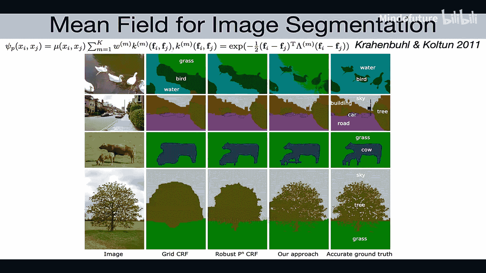
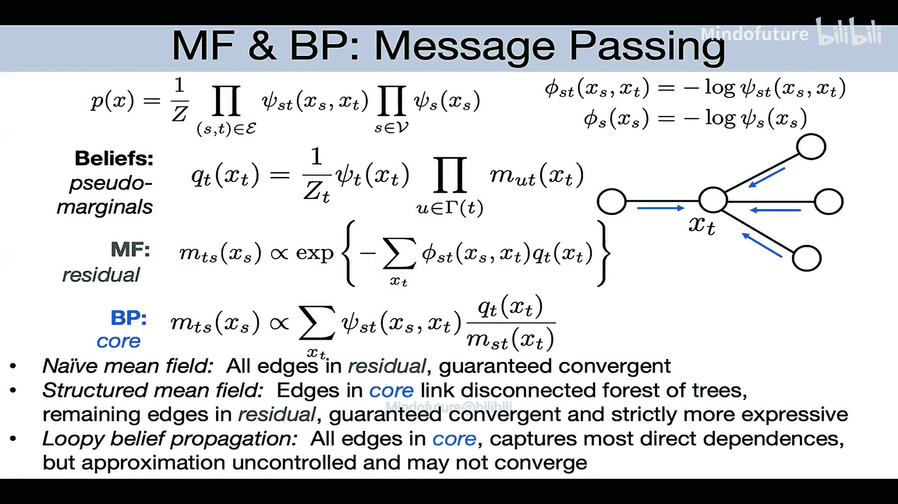

# 【加利福尼亚大学】图形模型中的学习 ｜ Cs274b ｜ Learning In Graphical Models (Spring 2021) p16 P16_讲座_8A-_平均场变分方法 -BV1Tqx6zrEMj_p16-

Okay。So。Today， we're going to shift to talking about kind of away from Monte Carlo methods。

And talk about a different class。Of inference methods。

 approximate inference methods based on optimization。

And these are called variational inference methods。

and there's a's something called the mean field method。

 which is kind of the most widely used one in this family and easiest to understand that we're going to focus on that first。

Although you know we'll see later， I think this is coming on Thursday that the Loy belief propagation method is also kind of connected to this framework and it gives another way of understanding。

What it's doing。

Okay。So。🤧U。Okay so for this part of the lecture I'm going to kind of again kind of step back and simplify things from some of our recent lectures。

 I'm going to assume that all of the variables are discrete okay so no continuous variables right now and also all the dependencies are at most pairwise right so we have a model that is like a special case of one of these pairwise markco random fields so we're going to assume it's written as this product of potentials on the edges and maybe also the sub potentials on the nodes you often have observations model that way。

However， unlike our。You know， our work。In the you know early in the class where we made some strong assumptions about the graph structure。

 maybe that it was a tree here we're going to support arbitrary graph structures so make no assumptions about how far dense the graph is。

Now。Just to give you a sense for you know how important these assumptions are。

 the first if you instead of pairwise factors， you had high order factors of general factor graph。

Everything all'll described can be generalized to that case。

 but it's harder to you know derive and explain what's going on in that case。

 so the para assumption is just kind of to make it simpler to see what's happening。Also。

 you know if you had Gaussian models you can always generalize it for continuous non Gaussian it actually varies a bit there's some of the algorithms that you can sometimes generalize sometimes it's harder right to implement them exactly okay。

So。Okay。Now a little reminder we're going to some of the concepts from information theory are going to show up again in this lecture。

 so remember first that the entropy， so if I have some distribution on X piece of X。

The entropy is the negative of the expected value of the log density right so it's negative the sum over x of the log of P of x。

I guess x is a discrete variable here， so really this is a probably mass function。

 not a density function。So that's the entropy it's a measure of the uncertainty so if you have a deterministic random variable something that doesn't have randomist the entropy is zero and general things that are closer to a uniform distribution will have higher entropy。

And then the relative entropy or Colbec liver or KL divergence。

This is a sort of a like a distance or discrepancy between distributions's not。Ssymmetric。

 but it does have the property that it's greater than equal to zero and it's zero if and only if p equals q okay。

 so it is a positive number that kind of measures how far apart distributions are。

And then finally there's a special case of that， the mutual information that was the kale divergence between。

 if I have two variables， the kL divergence between the joint and the product of their marginals。

 and this is something that zero， if and only if the variables are independent。

So it kind of they have no information between the variables if they're independent。

 if there's some dependence， then this will be a positive number。Okay。🤧，Now。U。Now。

 here's the way that variational， you can think of the variational。

 just like when we talked about like Markov chain， Monte Carlo methods。

There were many different MCMC methods kind of depending on how you you know defined your Markov chain。

 different ways of building proposals and things and variation is the same way there's many different variation in a big family of algorithms。

But here's kind of the general flavor for where they come from。

 so I have some distribution and I choose a family of approximating distributions。

And the assumption is going to be that my family cue is going to be tractable。

 right that if the real distribution was in this family。

 I could compute anything I wanted to exactly。Okay。

 so like the simplest kind of example would be that you know this approximation Q is just going to assume all the variables are independent right so it's you know even though my real model has a bunch of edges I'm going to kind of in this queue I'm going to you know ignore。

Those edges， so I have a model where sort of a factorized model， okay？You know。

 it doesn't have to be that simple， but we'll also see things that are a little fancier than that。

And then we're going to define a distance。Yeah。To measure the quality of distance different approximations。

 so the idea is we're going to define measure some sort of like amount that P and Q differ。

With the within the goal that I'm going to try to like optimize Q so it's as close to P as possible。

 but I need a concrete metric。嗯。And so two possibilities that show up a lot in this is actually is the kale divergence evaluated one of two directions remember the kale divergence is not symmetric right so I can all either take the divergence of。

P from Q or Q from P， whichever direction I pick I know I have the property that you know if I can push this divergence to zero。

 then Q exactly equals P。嗯。And then finally you find the approximation that minimizes the distance right so you can think about it now if I have Q is like parameterized and if this distance is a function that I can given any cu I could compute it。

Then could you have an optimization problem of adjust the parameters so that that distance is as small as possible。

哎。And so this is the general idea behind variational inferencefrement。Right。And。

The reason now you might say you know why are we using so I think the idea you have an approximation and you you define a distance and then you find the approximation as distance as close to truth hopefully that's just pretty intuitive。

 you might say well why am I using this。KL divergence。

And kind of the reason for that is I mean I this might sort of say trust me it's because things work out nicely and if you want to know kind of the reason that this works out nicely and it's in part asked to do with the exponential family distributions we talked about before in that this log ratio here in the kale divergence for a lot of exponential families that kind of things cancel and that becomes a nice quantity and so compared to some other distances between distributions you might have learned about in a statistics class。

This kind of leads to nicer algorithms， okay， so that's kind of the reason that we use CalL diet。

Can I ask you a question you， sure。Is there ever a case when using a symmetric measure of distance would be a good thing because the KL is asymmetric？

嗯。The lack of symmetry here is not really necessarily a problem in its own right， there are some。嗯。😊。

Cymmetric notions of distance。And there are some kind of fancier methods that。You know。

 try to optimize them， but they're the。嗯。There is nothing that involves a symmetric distance and。

Is as Leed algorithms as simple as the ones I'm going to talk about in our lectures here。

So okay thank you I don't have a good reason for that。

 but i'll tell you though that there's a there is there is a notion of there's actually there's a there's a reason why the asymmetry。

嗯。Could be。Actually a good thing and that's that right I think about P andq right these aren't just like two things right p is somehow the true distribution and Q is my approximation。

So there's a kind of already asymmetry in what I'm doing and then we'll see a little later that different perspectives actually motivate both of these divergences。

Okay。All right。So。嗯。So if I suppose to have any distribution。On in variabless。Okay。

 so actually for this little bit， what I'm going to show you right now it doesn't assume it's like Mark our random feeler I anything it be just any distribution and then let's say Q is this fully factorized approximation。

Okay， so and then I'm going to let P of S， this is going to be the marginal distribution of variable S in this joint。

Okay， and in principle， I could compute by you know summing over of the variables okay and so the reason that we're interested in kind of approach inference is because we're we're assuming we have a model where this sum wouldn't be tractable right it has an exponential number of terms。

All right。So now if you。If anyone has kind of you taken an information theory class。

 kind of the first thing that you learn about in information theory is usually the connection to compression。

And information theory。Tells you about if I have a source that generates data functional distribution。

 how can I optimally compress it to use as few bits as possible when I store？

And so I don't have time to talk about that connect it's a great connection but it's just sort of a little too far field for me to go into in this class but I will tell you that it turns out that this DPq so this originally arose in information theory in the world people working on compression before it then got translated over to statistical problems and it comes up from this so let's suppose that。

I have a source that generates data from distribution P it turns out that if I build a there's theory that tells us how to build the optimal code。

 the optimal mapping of source symbols to bits。And the number of bits mean on average。

 it turns out is basically the entropy， that's where the entropy comes from。

But now you might say let's suppose that I don't know the true distribution of the source P I have some approximate approximation Q and this shows up a lot in practice right there's some true distribution that generates your data and maybe you don't know exactly you have an approximation。

Okay， well it turns out that if I build my code assuming Q is true I will kind of waste bits right I won't I won't compress my data ultimately i'll use some extra bits。

I hope we got some。And then you might ask， well how many do I use and it turns out the amount of extra bits I use is。

This DPQ is divergence。Right now if I wanted to measure it in bits I would need to use the log base two for for our purposes we're going to assume this is like a natural log but but that's just a sort of scaling by a constant okay so this is exactly kind of the amount of extra bits I would use if I use assume the wrong distribution and so from this perspective right。

This， if you know a little this theory， then it kind of says， well。

 maybe the right divergence would be to use this one right。

 kind of you know where P is the true distribution and Q is my approximation。

To try to like reduce this。Waste as much as possible， okay？All right。

 and now I'll show you where this comes from in a sec， but if you take。This equation here。

And you plug in this fully factorized queue and you just do a little algebra。

Then you can rewrite this as this， okay， so this。Tale divergence is equal to this cr at the bottom。

Now there's three terms here。Now this the first is the sum of the entroies of each each marginal distribution right so in the true P。

 this is the sum of like how random is each variable in its own。

And then this here is the entropy of the joint distribution。

So you think of this is this is like you know， how much more randomness is there in each variable by itself versus how much is that reduced by the dependencies？

Now note these first two terms， they depend only on P so if I'm trying to like。

Opt to pick the queue to minimize this divergence， these are just constants， I can ignore them。

And then I have one other term， and this is the sum over all my variables of the k divergence between the true marginal of that variable and then my approximate marginal of that variable。

All right， now if I want， remember， I want to make this as small as possible。So， then。Remember。

 I told you that this cdiverence is always greater than equal to zero and at zero if q equals p。Okay。

 so from this analysis， we immediately know that if I wanted to minimize this。Cale divergence。

 then the best thing I could do would be to set。In my distribution queue。

 set my approximate marginal to exactly match the true marginal。

And that would be the best thing I could do。Okay。Okay。Okay， so this is all this is all true， okay。

 but unfortunately it kind of is not。Useful in the sense of leading to algorithms right so this sort of says that you know if I wanted to approximate a distribution by a factorized distribution。

 then setting the marginals to match the true marginal would be。A good idea， optimal in this sense。

But it doesn't tell me how to like compute them。to actually find those marginals so for the perspective if I want an algorithm that actually computes marginals efficiently。

 you know I haven't gone anywhere。Okay。Okay。but。So I just wanted to sort of like so some level this is a dead end for building algorithms but I wanted to kind of tell you you know where this path would lead now if you want to know where this equation comes from you know this is the kind of derivation and I think I think because it's a pain of writing things in zoom I'm not going to kind of write it out for you I just sort of want to show you that it's nothing too mysterious right so all we're saying is I write out the Cal diveivergence I recognize the first term is the negative entropy。

And then for the second term， I plug in， I say x is。Q of x is fully factorized。

 so I say Q of x is the product over the nodes of their marginals。And then I say， well。

 a log of a product is a sum of logs。Okay， so that's what this term is。

And then I basically do a little manipulation， I kind of add and subtract a term and regroup and then I can write this。

So ofSpread this apart into some of the marginals plus sum of these kale divergences。Okay。So。

 you know， look at it offline if you wanted to where comes from。

 but I just kind of want to emphasize there's nothing magic。

 that just some simple manipulation to get to that what we showed before， okay。Okay。

 so we're going to have to look at that other。Direction of the divergence。

And now I want to remind you of Jensen's inequality right so Jensen's inequality said that if I have a convex function。

 so a function that curves upward， then if I say for any distribution。

 if the function evaluated at the mean of the distribution is always less than or equal to the mean of the function values。

系。And then we have the opposite because the logarithm is a concave function it curves down kind of the reverse direction of the inequality holds for the log so if I say what is the log of the expected value of x that always has to be bigger。

And the expected value of the log x。Okay。Okay。So。The mean field method。

I which many of you have probably heard of is a variational method that works by minimizing the opposite divergence that I from the first one I described so minimizing the k divergence from Q to P。

Okay， and so to motivate this， let's assume as is usually the case when I do inference that I have in my true distribution that there's like some。

 you know some observations y and hidden variables x。

And I'm interested in approximating the posterior of x given y。

Okay right so this is what we usually do right we get some observations there's a posterior and I want to find like let's say the mar approximate the marginals of my posterior right and so like again if my distribution was tree structure then like the some product algorithm could give those marginals exactly but we're assuming here that I might have a graph with lots of cycles so that's not possible。

Okay。Okay。So。Meanfield tries to minimize this okay to one way to motivate where why you would do this is to look at a quantity that's often interesting its own right。

 this is the marginal likelihood of my observed data。So let's suppose I wanted to compute。

A the likelihood of my observed data。Okay well， you know that's by definition the。Some。

 I take the joint distribution of the hidden and observed variables and some over x。Okay。

And then I can sort of multiply here， I'm going to do a little trick。

 I'll multiply by one where one equalsq of x divided by q of x。And then I say， oh， well。

 this is the log of an expected value with respect to Q of x。And so if I look at my previous slide。

 the log of an expected value is lower bounded by the expected value of the log。

 so log of expected value is lower bounded by expected value of log。Okay。

And now if I look at this term， I can， if I just now say that。

The joint of p of x and y is P of x given y times p of y and regroup terms， right？

You can think of this basically as， you know if I take Q。Um。

TheYou can think of if I minimize the kale divergence between QmpP， that's the same as maximizing。

A lower bound on the likelihood of my data。Okay， and so if Q was flexible enough to exactly match the posterior。

 then you know， I could drive that divergence to zero。If I can't drive it to zero。

 whatever Q I get still gives me a computable bound that says， well。

 I don't know the true likelihood of your data under this model， but here's a rigorous molar bound。😡。

OkayBecause I can take whatever Q I get and plug it in to this bound up here and evaluate this okay。

All right。So this is kind of a motivation and so now to talk about。嗯。呃。

How these infrastructure work I also want to make connection to some terminology you'll see a lot in this space。

 which is sort of energies and free energies and so i'm going to do like a thousand foot view of some terminology that kind of comes from statistical physics from statistical mechanics okay。

And so in particular， so the kind of basic Bolzman's law sort of ignoring some constants that don't matter for us here。

 basically says that if I have some system，and I could say。

 you know what's the probability of a particular configuration of that system。

 well that will be proportional to E to the negative energy of that system。哎。

So the idea is if you look at this right， this is going to say that the。

E to the minus energy is something that when energy gets big this probably gets small so basically this says that the sort of lower energy states have higher probability you know high energy states have lower probability okay so this is kind of like how they model a model of how the fact that you know systems tend to sort of head towards lower energy configurations。

对。Okay。So。Now and you can also just think of this as like a different you know way of parameterizing a distribution so I could write the probability distribution。

 I could also you think about what is the energy energy is basically the negative log probability plus a constant right there's this kind of normalization constant so you could also think of like the energy is just like a parameterizing as the negative log probability。

哎。All right。Now let's look at this kL divergence。So I want to think about if I was minimizing this。

What would that do？Um。And。If I know。So just evaluating the kverence。

 this was the definition of it and now I'm going to plug in。This definition of P。

 so if I take the log of P right the log and the exponent are going to cancel。

and what am I going to get i'm going to get something that looks like this so this k divergence is going to have three terms so this is called so this first term here this is the negative of the entropy right that's the negative of the entropy。

Then I have this term here when I take the log of this， I'm going to get。That energy here。

And notice that the minus sign here and the minus sign here canceled so I get this sum of。

Under my distribution Q， the probability of each state times the energy of that state。

 so this is what's called the average energy right so it's the expected value of the energy under distribution Q。

Okay， and then finally， from this log P， I also have this one over Z term。

And then you know that doesn't depend on x so when I take this kind of I get this for any Q the sum over x a q is1。

 so I get this one other term which is this normalization or partition function so this is this log of Z。

ok。对。And so。And。These for reasons I don't really want to go into。

This first two terms are in the physics world sometimes called the free energy or more specifically that gives free energy okay and so in fact。

 you sometimes hear people talking well you know energy minimization basically variational inference is energy minimization。

😊，Okay these are kind of two ways of looking at the same thing。And now note write this log of Z。

Is in general， you know， I don't know that， but no I don't。

 this is a property of the true P and if I'm trying to minimize this over Q。

 I could ignore this term it doesn't matter it's just a constant。Okay。

 so minimizing the kale divergence is going to be the same as taking this free energy。Okay， and。

Minimizing it with respect to Q。So now。The question is going to be is this a tractable thing to do right so it's going to have to be the case that for my choice of P and Q。

ThatWell， first I need a queue where I can compute this entropy and then I also need a queue。My。

 you know。A sort of Q and E， an approximate distribution in energy that work together。

 so this average energy is tractable。Right because again as I've written it here right this what is X here this is like all joint configurations of my variables so so naively speaking computing both this entropy and this average energy would involve like an exponential number of terms。

Okay， but the way we get to practice algorithms is kind of picking the right things。

 so these are easy to work with。Okay， any questions on that does the like big picture？Makes sense。

Okay。And again， so historically like these， I mean。This mean field terminology。

 right this this actually this this terminology， which you see all over the machine learning。

 it comes from physics。Right so the earliest mean field methods were developed by physicists as you know if they had like a field of interacting particles as a way of for them of kind of approximating what would happen in certain limits as the number of particles get large limits of temperature things like that so thats that's kind of where all this terminology about energies and mean field and stuff has sort of kind of from that history has kind of crept into machine learning usage today and so that's why I try to you know。

I use it if I don't I want you to understand you know。

 sort of what these terms mean because they really are kind of the standard ways that people refer to these things okay？

All right。So。No， no no， there's two things right here there's this thing I call the average energy。

And then there's this free energy， which has the average energy minus。The entropy。

 so let me explain what the difference is between these things。Yeah。Okay， so first。

 let let's suppose that I。Ignore the entropy part。And I just said， take this average energy。

And minimize it。With respect to Q。So out of all distributions to you。

 find the one that makes this as small as possible。All right， then if you think about this。

 think go the hio， can anyone think about what that solution is going to look like？Well， clearly。

 if I want to minimize this， I should put higher probability on low energy states。

 low probability in high energy states。And so if I say I''ll just we can see which one makes this as small as possible。

 what should I do？嗯。Do you differentiate set to0 and find you。I mean， all right。

 so that that is an optimizations perspective right you could differentiate set to zero you have to account for the fact that Q is a distribution so it's non negative and sums to one。

And turns out you can kind of see the solution to this without。Doing that。

 which is that in this case， you think about it。Let's let X hat be out of all possible X。

Whichever one has the smallest energy。Which is the same as saying out of all possible x。

 the one that has the highest probability。This is what's possibly called like the map estimate。Right。

Well， then basically if my distribution puts。Proability one on that state。And probably zero。

On everything else。That would minimize this average energy。

So you wouldn't actually get like a random distribution。

 you something that just said the lowest energy thing is probability one and everything else has probability zero。

Because that you think about if you start spreading your probability on higher energy states。

 then that expectation can only increase。Okay。So this is the best。

This is the thing that minimizes right so the thing that minimizes the energy by itself。

 even if I let Q be a distribution， the output won't really be a random thing。

 it'll be something that says probably one on one point and probably zero everywhere else。系。Now。

 on the other hand， something when we first sort of introduced these the entropy what something I pointed out was that the if I want to maximize。

The entropy。Right， which is the same as。Note in the free energy。

 the thing I have is the negative of the entropy。So minimizing negative entropy is the same as maximizing entropy。

That will be a uniform distribution。 So the thing that maximize the entropy is just something that's sort of。

This uniform over all the states。Okay。😊，So think about this is like， you know。

 something that's totally spread out versus something that's like concentrated on one point。

And now what's。A little interesting。And magical is that if I take this free energy。

 which is the sum of this average energy and the negative entropy and I minimize the two together。

 then that is equivalent to minimize the Cal diveivergence and I will get exactly this distribution p。

So somehow， if you think of like。taaking this average energy and kind of adding the entropy almost as like a regularizer that then the minimizing this free energy minimization problem recovers the distribution that you actually care about。

嗯。Now this is abstract， this just says that you know。Seec Q equal P， but the thing is is if if I can。

Do actually do this minimization and Q is kind of an easy to work with distribution then from the queue that comes out of this I'll be able to read off the marginals that I care about。

Okay。And that's what the practical algorithms are going to work with。All right。

 so that's the big picture I want next we're going to dive into the a particular。嗯。

And for its algorithm called the mean field method。

 but are there any other questions about this setup before I do that？Add to clarify our goal here。

 we want to。Get the full joint distribution and marginals， and we want to setq equals B to do that。

Well。Okay， so。I'll confess that right now it looks like I've just rewritten things in an overly accomplished way and not accomplished anything so but what i'm trying to tell you i'm trying to explain why if。

Why this quantity here， this free energy quantity， why。

 you what that is and why you minimizing it would have good properties。And then now to get actual。

Algorithms， what i'm going to have to do is I'm going to have to say let me find a particular cue that's。

Easy to work with and an algorithm that lets me then find the cu that's as close as possible to pe and then that will then let me read off kind of。

You know。Either at an approximation to the true marginals。

UThat could be either a good or a bad approximation it will depend on how close the Q family I picked and then my target P are to each other。

嗯。Okay。All right， you so let me I think it'll now we're going to go into like a with this setup we're going to go into a concrete algorithm。

 I think it will become a little clearer what's going on。Okay， all right。All right。

 so now to get a concrete algorithm， I have to be less abstract about P So now I'm going to come back to assuming that P was that。

嗯。嗯。A parawise mark on random field。Okay， and but now note that in remember we had that energy that was like a negative log probability。

 so it's going to turn out that instead of。Writing P in terms of products of potentials。

It's going to be sort of easier to write it in terms of like sums of log potentials。

Okay so what I'm going to say is that so here this phi ST is going to be the negative log of psiist so this is just here I have a potential and I just take the negative log so it's just a different way of parameterizing。

Okay， so basically for this model， the energy says for every edge。

 you add this phi term and then also for every node you add this phi term and that's how you compute the energy。

Okay。So。And then。So。No， no let me unpack the terminology mean field。Means。

I am when people say you're doing mean field， they mean you're doing this。

 they mean you're minimizing the。They're meaning to Q。

 you're going to minimize the k divergence and you're doing this direction。

 the kale divergence of from Q to P。That's called meanfield。Now。

There's something else called naive meanfield。Nive as in。Not very smart。Which is。

Does that and also takes Q to be be a fully factorized distribution。So at first glance。

 this seems like a terrible idea because， you know。There's all these dependencies in P。

And Q you know doesn't capture， so we're sort of saying I you have a graph with cycles like this grid and I want approximate it by a fully factorized distribution on the same variables。

But it's going to turn out that when I fit this approximation。

 I'm actually going to account for some of these dependencies。So in fact， the。

My estimate of the marginal here and the marginal here and the marginal here。

 they all become coupled and the coupling accounts for the original model。

So it turns out that actually it leads to useful things， even though at first glance。

 it seems like a bad idea， okay？And indeed， you know if if you've kind of worked the in the machine learning area。

 you'll see lots and lots of papers doing。Var inference inference or papers which say they are doing variational days。

 when people say they're doing variational days， almost always they are doing naive mean field it's another word for the same thing okay so it is very widely used。

嗯。All right， and so。Now。So now what do I have to do， I have to figure out ay， how。

Remember how to compute the kale divergence between Q and P or equivalently compute that free energy and then I have to figure out once I can compute it now how to optimize so sort of say of all possible Q we'll do that so to do that optimization I have to parameterize Q with numbers and so in this case because it's because I assume Q is fully factorized and the so the variables are independent and Q。

And。They and the variables all' also assuming things are discrete so in this case it's pretty easy to parameterize so basically my i'm going to let my parameters I'm going to denote them here by mu so mu is in mean right so remember so I can say that this。

So I'm going to let muk is going to be the probability that xs equals k in my distribution Q。

And so these are just going to be a bunch of non negative numbers and then you know for each node we know they have to sum to one to be a valid distribution。

Okay。Right right。And you， note， if I could solve the optimization problem， then you know。

 I immediately， you know these mus are interpretable as marginals。Okay。

 so then I kind of have the marginals I want just by reading off the muse I get from my optimization。

All right。So now remember that there were。Two terms in that free energy， there was an entropy。

And there was in。Average。Energy。Okay。So。First， the entropy。So。Entropy turns out it's easy。

 so I have a bunch of variables that are independent。

Then the entropy of all them together is just the sum of the individual entroies so their entropy is just the sum of the entroies of the variables and then that is the sum over all the nodes the sum or the state speech nodes of。

Q log Q with a minus sign up right。Okay， so that would be that's a very easy thing if you give me。

 you know， any choices for your parameters， you could plug them in here， no problem。Okay。😊，All right。

嗯。So now the average energy， what do I need to do， basically I need to be able to compute。

I take the negative log of P， I get this sum of these phis。

 and now I need to compute that with respect。To queue。So I need the sum over x ofq of x of e of x。喂。

That also kind of because this breaks down into local terms that involve single variables and pairs of variables。

 this is where the like the fact that I have a pairwise markco random field known arbitrary distribution is going to be key。

Yeah。I can write this as right I have the sum over all my variables of the expected value of this。

 so that's the sum over all the variables， the sum over all the states that variable of the probability that variable times the corresponding energy value。

Okay。And then here I from this first term I'm going to have I have a sum over all the edges。

 I have a sum over all the edges， I have a sum over all the states of that pair of variables of。

The energy times the probability and here note because Q assumes that the variables are independent if I say you know what's the probability that。

No D equals xs， no t equals xt， it's just going to be the product of their marginals because they're independent under Q。

Makes sense。So I know these equations， you know， I put them here to be precise。

 I know they get a little messy。To look at， but it really， it's pretty mechanical， right。

 you just sort of said。Q is factorized。Here's my energy evaluate its expected value。Okay。😊，All right。

So。Now I'm kind of set up。I have my free energy， this thing that we argued would if I minimized it would。

Minimize this distance or divergence between Q andP。

And I'm going to write everything in terms of these parameters mute， okay。

 this musk is like the call value that xs equals k。

And then the free energy is the negative entropy plus the average energy。The entropy is this。

Right so again a kind of simple function of the muse， I could evaluate it。

And then here is the average energy， which， you know。

 what does this say you take the sum over all the edges。

These are the edges where there are relationships in your true model。

 and you take you're kind of saying， you know， okay。

 what's the average of the average log potential on that edge？

And then I take also the sum over all the nodes of what's the average of the potential at that node。

Okay。😊，And now。I want to minimize this。Okay， over mu now I need to remember that mu can't be an arbitrary。

Is not just an unconstrained parameter if I want things to like give me the right solution。

 I have to make sure that these mus are real distributions。So that it turns out that。嗯。嗯。

see you have two constraints， one is that these mus are greater than equal to zero and the others is that they sum to one so it turns out I don't have to explicitly enforce the constraint that they're greater than equal to zero the reason is that is as they head towards zero this kind of entropy term gets bad so that's kind of automatically satisfied as my solution。

 so I do have to enforce the constraint that they sum to one。Okay。😊，Does anyone remember？From your。

Kind of calculus class if I want to sort of minimize a function subject to a linear constraint。

A method that would let you do that。LaGrange multipliers， LaGrange multipliers。Okay。

So that's exactly how these methods。Are derived。嗯。and。

So what's the setup right so you say what's called the Lagrangian says you take。嗯。The negative。

Entropy plus the average energy plus the sun over all these nodes but in this case， I actually have。

Not just one linear constraint， I have in linear constraints， one for each of my variables。

 so I have lambmbda s is like the multiplier for the linear constraint on variable S。

 which says that the probabilitybabil is have to sum to one。Okay。Okay。

Or equivalently this term one minus sum of probability the past equals zero。U。So now。嗯。嗯。

If it's been a while since you've seen LaGrange multipliers。

 I kind of don't really want to go into a long detour about that。The way to think about this is that。

Suppose you fix lambmbda。You fix these lambdas to particularly numeric values， okay？

And then minimize with respect to mute。Okay， so by say find the minimum of this function over mu。

Pixing Lambda， then what I will have is I will get you know kos some probabilities that some numbers mue that depend on Lada。

Okay。And then you say， well， what should I set lambda to。

 well then you say these probos will be a function of lambda and then you set the lambdas such that your linear constraint is satisfy。

Okay， and under certain regularity conditions， which I'm not going to go into。

 but which whole true here？Then this。Solution of basically this this is like a penalized problem right you this is like saying like you know there's kind of like a pin。

If。You know， if lambda is a number that doesn't equal zero and you know， like imagine that this was。

 let's say a。It's a little more company than this， but you know， if this was another over here。

 it's kind of like you're adding an extra penalty term to this original objective so this。

Penalized minimization is equivalent to solving the original。嗯。Constrained optimization problem Okay。

 right， so just kind of of an easy way of doing this。Now you have different ways to optimize it。

 but the most classic mean field methods work by coordinate descent what they do is they say all right I initialize my muse somehow and then you basically walk around to the variables in your model and you say yeah I take one variable and I minimize。

The objective with respect to that， the mu for that variable， fixing all the others。

 and then go to another variable and minimize that and so on。

So youre kind of push this free energy down， down， down at each step。Okay。All right， so。楚。

So now if I actually wanted to do this minimization， what would I have to do？You would。Say all right。

 well if I want to。Minimize this function with respect to the muse at a particular note。

 I need to take the partial derivatives。Of this objective with respect to that and set them to zero and then solve for the right。

Ms， okay？Okay。U。This is what that looks like。Okay。😊，All right。

 so what is this this is the objective from the previous slide and we say all right。

 so I say what's the partial derivative with respect to a particular mu parameters right so the me you know the musk this is like the probability that node S equals k。

Okay， and I can compute the derivative of the negative entropy。

I can compute the derivative of the energy。And now note here。The energy has。A term for。

All the edges in the model right there's a sum over all the edges。When I take my derivative。

I'm a MuK。Well， the only kind of edge terms that depend on USK are kind of the edges linking node S to one of its neighbors。

Right。Another way of putting it in is if I if I take like the average energy term between two nodes and a totally different part of the model。

 that doesn't depend on。There probably isn't no desk at all。Okay， and so thus。

 when you take this derivative， I'm actually going to get terms that only depend on the neighbors of notice。

So I'm going to get one term for each of its neighbors because those are the only edges whose energies depend on the state of notice。

Okay。😊，U。And so you can compute。The derivative energy of the entropy derivative of the energy。

Divative of the Larangian to put them together， then you do some manipulation blah， blah。

 blah and what you find is you finally come down to a final expression。

That says the meme looks like this okay so i'm not againm in for various reasons time not liking writing over zoom I'm not going to kind of write this outline my line。

Again， the details are here it's kind of a tedious， but not。

Super complicated right you're just kind of。Carefully walking through what all the derivatives are and then doing a little algebra。

But when you get through all that， so this is just recoping。

The last equation I had on that previous slide， not in my messy writing， right。

 but in nice type setting。It looks like this and what does this say so this says。

If I want to sort of minimize the kale divergence。You know sort of do this coordinate descent so sort of optimize the marginals at one node fixing the others what do I do I take。

I set the marginal to be proportional to the potential。

 so here E about this is like part of the original model I'm exactly accounting for。

And then what do I I have a product。Over all of my neighboring those of this particular turn right so I take the energy。

Between this node and that node。And then I sum over these energies weighted by the probability that the neighboring node takes each state。

So you take like kind of a weighted combination of these energies？

And then I kind of take a E to the minus energy that kind of converts this average energy back into a probability and I multiply those all together。

Okay。And then finally， I have to there's a proportionality symbol here， I have to。

 once I take this product， bunch of that's like a bunch of non negative numbers。

 and then I have to normalize so they sum to one。Okay。

 and that's kind of the this final normal sort of accounts for the lagrrange multiplier and the derivation。

Now， what's interesting is that you can think of this algorithm as exactly。

Write it as a message passing algorithm and that looks a lot like the。You know。

 the other ones we've seen like loopy belief propagation。So how do I compute？

The marginal of some node I。I take the。Local potential timess the product of messages from neighboring node。

And where these messages are computed in a slightly different way。

Now these messages are computed by taking again， this kind of average energy。

You sort of average the energies using your estimate of the marginal at the neighboring node。

And then sort of take e to the minus average energy。系。So it's like compared to belief propagation。

 it has an identical formula for computing module for messages。

 but there's a different message up the equation。嗯。And I'll also observe that if。

I sort we talked about how gi sampling could also have a message passing connection。

At my neighboring node， if this queue at my neighboring node had like probably one at one state and probably zero of all the others。

 then actually this would be the same as what the Gib sampling message update was too。

So all of these algorithms are kind of very tightly connected， but they have you know。

 some interesting different properties， which we'll talk more about。そ。Any questions？About this。Okay。

嗯。And so let me show you an example of this method to see why why you know this could be interesting Okay。

 so I've talked about a。

The semantic image segmentation problem。So。Here are example results from a kind of really state of the art。

Image segmentation method。Right。And so。Here， let's see。Again， so。This unitary class suppliers。

 this is like if you just kind of take a window of features around each node and try to predict its class。

The kind of results you get。This middle column is if you take a model that looks like one of these grid structured models I saw you。

 we've talked about and tried to predict the class。But now look at this kind of。Very detailed result。

 so this is a model that is using a graph。That is。Fly connected。

So it is a pairwise random field model， but one in which there's an edge between every pair of pixels in the image。

So you know that very Dgram， like basically from the graph perspective。

 the model is one giant clique。Okay。U and。So applying， you know。

 like junction tree or something like that is basically hopeless。

 like there's not really any chance of doing that。U。

So what can you do one thing you could do is you could do。Gift sampling。

 right like a Markov MCMC method。To try to estimate the marginal in each node given kind of evidence you have。

This is this fourth column this is the results of Gib sampling with this bluey model。

 and you can see it's very nice looking results。They get these very kind of like pixel level estimates of。

The categories of the different things。These results took 36 hours。For the sample later run。

 so not super practical。This right column。Is。The they say our approach。

 their approach is a particular implementation of。The mean field variation inference method and the mean field method here gets a very similar result and it takes like 0。

2 seconds per image。T 36 hours， so huge savings。Okay， so so somehow right if you look at it。

 right if I go back to my mean field update equations。Even though the model is。

I'm approximating by a factorized distribution， which is to say my approximation I'm not trying to explicitly account for edges。

 I'm trying to just get the margin of each node right。Still， when I do that。

 I do account for relationships between all the variables。Okay。From this a， and by doing that。

 I get a good estimate。Now， and by the way， if you think about it。

 if you think about this message update。So the node I。

The update for node I depends on the marginal for node J。And vice versa。

 the marginal for node J depends on the marginal for node I。

And so that says that the operation of the mean field method。Is going to be a little bit like。

 you know。Loopy belief propagation was where you， you know。

 you're going to have to kind of iterate these message updates many times and then only after sort of lots of iterations will they eventually converge。

Okay。What's interesting though， is that remember that L VP had this。

Kind of nasty property that sometimes it wouldn't converge， it wouldn't give you an answer。

Because mean field is doing coordinate descent， every step is reducing that kale divergence。

 that allows you to show that for mean field， that convergence will be guaranteed。

So this method can't oscillate or diverge， it will always converge。

To some local optima at least we'll see that there could be multiple local optima。

 but it will converge to one of them。Okay。

嗯。In slightly more detail， they had to do for this model。Where you still。

 if you had just sort of like naively said， well， I have an edge connecting this node to every other pixel and naively summed over all those edges。

 that would have been faster than CMC， but it would still be pretty slow。Um。

 the way that they they actually made their method practical was that they they sort of like parameterized their potentials as sort of like like kind of like filters with a regular shape。

A little bit like people do in certain like convolutional neural networks and things。

 and then if they they were able to basically take the meanfield updates and write them in a way that exploited kind of image filtering operations。

So they basically like kind of。In implementing right here， you can see they say how do I set QI to。

To be the meanfield update and this is， you know， this is in their notation exactly how you compute like the average energy under their model。

 they had to basically they basically express that using image processing operations that were very efficient。

Okay so they kind of compute this average energy here then you can see then they're coning that kind of into a probability and normalizing okay and this is just kind of showing right if they have an image where this is a toy example for this image and there's two categories bird or sky right they have some initialization and then as you get more and more iterations right they converge to this。

Sort of accurate segmentation。Okay。

All right。嗯。And again， just kind of emphasizing so so this is a case where you can think of it as like。

Here， compared to these， somehow they've done inference for this model right it a very dense model it's hard to do exact inference。

 but nevertheless approximate inference in this very rich model is very accurate and much better than kind of like simpler。

Graphical models， so these are kind of two simpler models with more local connectivity compared to this very connected。

可。嗯。嗯。And so this is approach that really。Actually predates some of the。You know。

 the kind of the neural network approaches to semantic segmentation。

 but actually the state of the art in that space actually incorporates exactly this method。

And the reason this is just sort of an aside for those who've seen kind of the convolutional neural network approaches to trying to predict。

 you know， what is the label of every pixel。Those methods。

 because the even convolution operations is doing a little bit of blurring。

 those methods tend to have once they get the output。

 they might kind of get the rough categories like， but everything looks like kind of slightly blurry blobs。

Right so I don't actually get the boundaries really aligned with the image evidence you get kind of like blurt out almost like a low resolution version of what the segmentation is。

And so the state methods take that as the outputs of those methods as sort of like the local evidence for an approach like this and then use this kind of graphical model inference to refine it and improve it。

Okay。And the nice thing is that if this this mean field message passing has a structure that kind of is a little more like the deterministic operations that usually happen in deep learning so that it integrates nicely whereas something like an MCMC sampling would be。

I don't know， it just would mesh as well， it be harder to work with besides the speed issue。可。

All right。Yeah， so again， you know， even though this independence assumption seems very naive。

 it's sufficient to kind of go from essentially this urary classifier over to this result on the right。

 so it can still be very common。Questions on that。Okay。对。Time， all right so。嗯。See。

 I'm going to talk about one more thing a little bit of a higher level。Which is basically。

 how can we go？Beyond。This naive mean field approximation Okay。

 and so the first step beyond is what's called。Structured mean field。

And this is something that is I don't know it's super simple for the high level picture and then the equations get to be a mess so i'm going to give you the high level picture and hand wave over the equations I just want to make you aware that this is an approach that that's out there is definitely powerful is definitely useful and you could incorporate someday。

😊，And the idea is that， you know， well， here's my original graph。

 like maybe this grid is has so many cycles that I can't compute exact marginss。

So we've talked about how if I。Assum things are fully factorized， like in the middle here。

 how I could。Use naive mean field to sort of minimize the divergence between this fully factorized and this one。

 okay？But you might say， well， do I have to do that， what if I had a graph？😡，That looks like this。

Anying about if I had a grid， let's suppose I like had the kept the vertical edges and threw away the horizontal edges。

if I did that， this is sort of a forest of trees or like a forest of Markov chains， so inference。

 exact inference is still possible here。So you might ask， could I？

Fit this model on the right to the original。😡，And the answer is yeah， yes， so basically。

As long as if you pick any subgraph of the original model for which inference is tractable。

That will give you a mean field method that kind of has tractable update equations。

Is kind of the rough statement that's true。看。Now。To see what this would look like。

 let me remind you about how we can factorize。嗯。Variable right。

 the distribution of a graph on a tree。So we looked at this before and we talked about learning tree structured graphs from data。

 okay？Right， but we sort of said that， well， I can always， you know。

 pick a node as the root and write out at a directed factorization as I have a product over all the other nodes of that node given its par。

 kind of like the spreading outward from the root。Okay， and then now if I manipulate things。

I can give this sort of canonical undirected factorization that any distribution on a tree I can write as the product over all the nodes。

Of the marginals of that node times the product over all the edges of this term。

This sort of joint divided by product of marginss and this is always a correct way of writing the distribution on any。

Tree。可。😊，Okay。So。Well， we're going to。We can exploit this。

 we can say that let's suppose my cu that I want to approximate my model with was some tree。

Who knows which tree， just any truth？So that I can write Q。

 I'm going to parameterize it as I have you know， a marginal of every node。

And then I also am'm going to have for every pair of nodes connected by an edge。

 the joint divided by the product of margins。Okay。And now I can think of the parameters of my model as being you know。

 these for every node， the marginal distribution， as well as for every pair of nodes that are connected by an edge in my tree。

They're kind of like joint probability。Okay， so it's like whereas naive meanfield。

Its parameters were like a vector at every node that what are the pro of that node。

 the structured mean field is going to have to say I also am'm going to have for every edge in my model a matrix that's kind of modeling the joint probabilities of the two variables that edge connects okay。

And now note， now I have an extra constraint， it has to be the case that if I take the joint probability of Xs and Xt and I sum that over Xt that I get the marginal of excessS。

Pay for any。XS and XP。All right。And。Then look， one other thing we'll need。

 think about when I do my mean field we had and。Average energy and we had an entropy。Okay。So。

I need to know what the entropy of a distribution of a tree is and we talked about this before the entropy of a tree structure distribution was the sum of the entroies of each node by itself。

 so this would be exactly the right entropy if the variables were independent。

But the thing about that is because the tree produces dependence between variables。

 its entropy is smaller。So in particular its entropy is less than this。

 it's going to be reduced by the sum over all the edges in the tree of the mutual information。

So basically the amount of dependence between the variables。看。Okay。So。It again。

 this is think of this as like my little like。Cheee sheet of this is how I can write the distribution。

Of， of a。You know， write the distribution of any distribution that's on a tree。

a fairly simple way to parameterize it and also a way to exactly compute its entropy。

So I have the nice property that from these parameters。

 it's a really simple function to compute the intropy。You just compute a number for each node。

 a number for each edge and kind of。Adaimate。Right right。嗯。So now。嗯。Here's the idea。 we're going to。

To make our structure mean field method， we're going to partition。

In the edges of my original graph into two sets。I'm going to have one set I'll called e subid these will be my core edges。

And these will be like the ones I think when I model their dependence。Directly。

 I keep their dependence。系。Whereas I also am going to have these residual edges。

And I'm going to kind of assume that for the pairs of nodes connected by residual edges。

 and that's like these kind of horizontal edges I've dropped here that they factorize。

Right that they're independent。So I'm kind of like。Meanfield。

 the naive mean field assume everything factorized here I'm kind of doing a hybrid。

 some things I model dependent， some things factorize。ok。嗯。嗯。So now we get。

To the scariest equation in the whole class。Maybe well， no， it's almost， as I say。

 there's another equation coming on Thursday， but it's almost the same as this one。All right。

So now I need to evaluate this。Entropy。Im sorry， I need to evaluate the entropy and the average。

Energy。Okay。And so what do I have well， it turns out that if I take。

This tree structure distribution and then go to evaluate those terms this is what you're going to come up with you're going to say first well for all the nodes I'm going to kind of have if you look here what do I have I've got the a Q log queue that comes from the entropy of that node。

And then I have Q time Qs times bias that comes from the kind of like。You know， the average entropy。

Of the sorry， the average energy， okay？And then I have for all these edges that were in the residual。

I have this average energy。And then I have a lage multiplier that says that these probabilities of single nodes must sum to one。

So this right here， these three terms， this is exactly the same thing as we had for9 field。😊。

I've just rewritten that， okay， so this is what we had for9 field。Okay。咁。

Now for structureuring mean field， though， remember that for these edges。

 I had extra parameters to capture how they were dependent。So thus， when I evaluate things。

 I'm going to get this。 So for these edges that are in my core， I now have。

When I compute their average energy。Here I take the joint probability of those two variables or I don't assume they're factorized。

And here， then I also have this log QST over QS times QT， this thing here。

 this term comes from the mutual information terms and the entropy。

So this term here says if I have a tree， then I have these mutual information terms on all the edges that I have to account for。

Okay。😊，And then， oh， last thing， remember， I had to be sure that。

If it's a real distribution that if I say QST is like the marginal is like the probability that of Xs of xt。

 if I sum that over Xt， I should get the marginals of node S。Okay。

 so thus I need to enforce those constraints， I need a whole bunch more。Laarrange multipliers。

I get for every edge here so for every value of excess there's a orange multiplier that says the marginal that node times sum over that those are equal and for every value of x t there's that you about basically you have to like make sure think of it as like there's a。

呃。A matrix。On every one of those edges。And it's like if you sum over the rows of the columns of that matrix。

 you need to get the marginal of one variable by itself。

 and if you sum over the rows of that matrix you have to get the marginal of the other。

Right so this would be true in any real distribution。

 but if I'm thinking of these cues as free parameters to optimize I have to。

Incorporate these as constraints。Okay。All right。So now you have this glorious equation。

And you can take eight or10 sheets of paper。And start taking derivatives。

And setting them to zero and simplifying and trying to work out。and it' it's one a it's a。

It's a fun exercise。If you're so inclined really gives you some understanding， so its a little messy。

 but what's nice is that so it one of the kind of I'm not of course expecting you all to do this。

 I wanted to just give you a sense for how these methods are derived。

But then the final method kind of works out to be something very simple。Here is the idea。

 so for any of these structured mean field methods。The final algorithm looks like this。

 it's a message passing algorithm just like both loopy VP and naive mean fieldwork。I get my。Beliefs。

 my marginal estimates， these are like again， the pseudo marginals because they may not。

 they are approximations。U。I get them by taking the product of the local potential cancom messages。

And then。But I have kind of this。Interesting structure where。When I compute my messages。

There's like two different message update rules， depending on whether that edge was one of my core edges where I model the dependence。

Or one of these residual edges。And basically， what I do is if it's a residual edge。

 I use the mean field message update equation。And if it's a core edge。

 I use the belief propagation or some product message update equation。Here I've written them。

 you remember， so when we talked about some product。

 we usually said that the outgoing message is the product of all the other incoming messages。

But that's the same as the marginal dividing out one of the messages。Right。

Like the product of because the marginal is the product of all messages。

If I take the marginal divided by one message， I get the product of all but one messages。Okay。

 and so I've rewritten this update this way because it kind of highlights the similarities to the mean field update。

So you can see that there's。You know。A lot of similarities。

 but kind of two key differences one is that you know。

The BPp just does this average of the potentials。Whereas mean field does this。you know。

Go to an energy， go to a log potential average in that log domain， and then convert back。

So it kind of takes a law， then does the sum， and then exponentiates the result。

As opposed to just directly， sorry。Didn't mean to show the scary slide again。嗯。And。

And then the other thing it does is you see that there's this。And the denominator here of BPP。

 right when I'm computing the message from like T to S。I divide by the incoming message from S to T。

And how that somehow like reduces overcounting of information。And somehow this is key。

 so these two differences are enough such that， for example， on a tree。

 belief propagation gives me exact marginals， mean field would not。

E in a tree meanfield gives me approximate modules。嗯。On the other hand， on a graph with many。

 many cycles， meanfield is always still guaranteed to converge whereas we've seen that BPp can oscillate and have bad properties sometimes sometimes it's really accurate like in those air correcting codes and things。

 it's good， but not always。And finally， so now you think about these all the algorithms we talked about。

 you can kind of fit it in as special case as what's on this slide。

 so Naive mean field says all the edges are in the residual so basically you use this residual update for every edge。

And then you have this algorithm that's guaranteed to convertverge。And for structured meanfield。

 the edges in the core have to link a disconnected forest of trees， so basically。嗯。Yeah。

 so they have to be have to be the case that， you know。

 if you add any single edge back to your structured mean field， you still have a tree。

And in that case， it's still guaranteed to converge because it's doing coordinate descent。But it is。

Strictly more expressive。Right so in particular。嗯。Well， I'm not going to page back to the slide。

 remember at the very start I talked about。Meanfield giving you bounds on the log probability of your data with structure mean field those bounds always get better than that mean field because basically giving yourself more parameters you can always push those bounds tight。

And so that usually also leads to more accurate margins。And then finally， we have loopy VP。

Where basically it says。Runs this algorithm where all of the edges use the core update。

Now the problem is is that my derivation that I gave you in the previous slides breaks in particular if I。

If。We'll get to this more next lecture， really about if I put all my edges in the core。

 even though my graph has cycles。That's equivalent to sort of assuming that that's equivalent to assuming that this is the right way to compute the entropy for my model。

Even though the graph is not a tree。And so that's just not true。And so all of these arguments about。

Ly arguments about giving you bounds and so on and convergence they break。

And that's why LuVP is no longer guaranteed to convert。

But what's interesting is somehow by putting all the edges of the core in capturing more dependencies。

 sometimes you get better approximations。So sometimes if you say， you know， how far。Are your。

Estimate marginals from truth， and a lot of cases loopyBP is the best。

But then it's a little dangerous， I guess， because we don't know for sure that it's going to work well and not diverge。

O。All right。So this is I'm going to wrap up there again this is intended as a little more of like a view advanced topics。

 things to make you aware of that that if you're working on problems where the simple methods are not giving accurate enough inference。

 these are like directions you can go to do better。I'm out of time。

 but I would happy to take any other questions。

