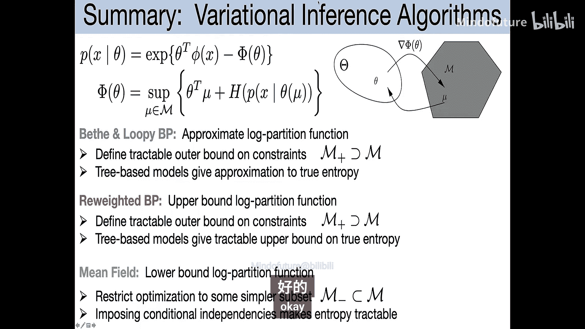
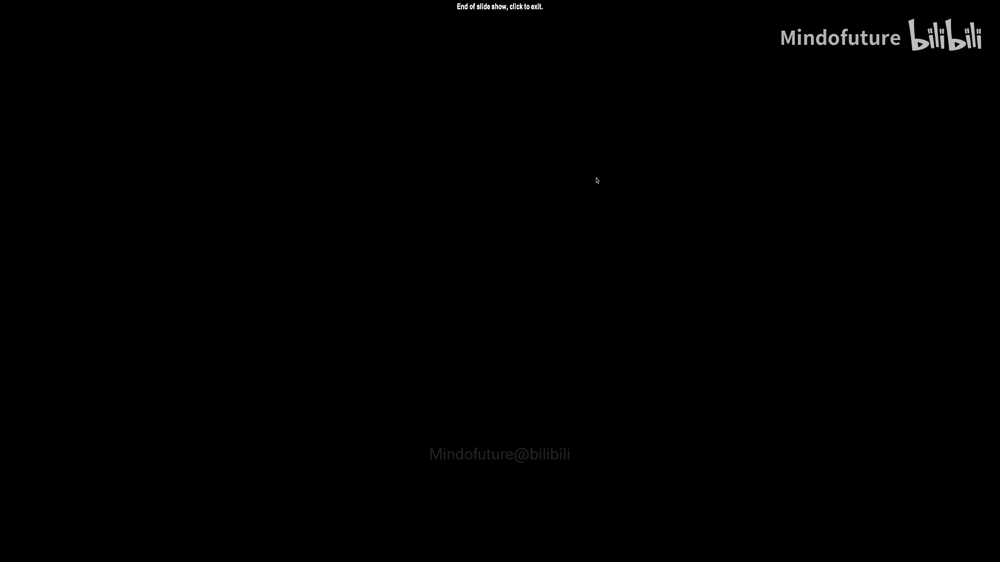
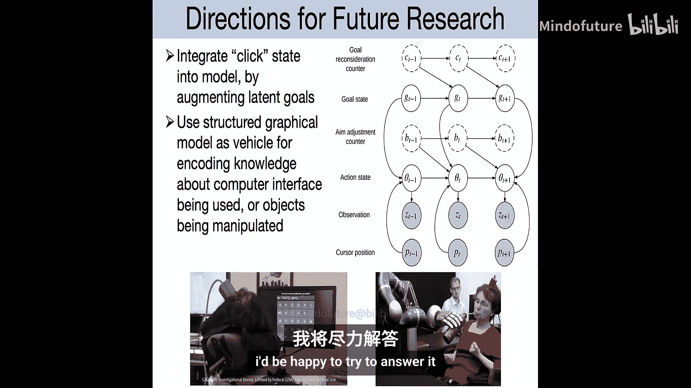

# 【加利福尼亚大学】图形模型中的学习 ｜ Cs274b ｜ Learning In Graphical Models (Spring 2021) p17 P17_讲座_8B-_贝特变分方法__循环信念传播 -BV1Tqx6zrEMj_p17-

All right， welcome。So we're going to kind of have two parts to today's lecture。

 the first is going to be sort of on the theoretical side and I'm going to talk about basically the results that connect。

Loopy belief propagation to variational inference and sort of give a more rigorous understanding of why that kind of seemingly heuristic method could be expected to actually give。

You know good inference results and also lead to some extensions and i'm going to kind of talk at a pretty high level because this is a pretty technical area but I just want to make you kind of aware。

Of what some of the results are。And then in the sort of second half， well shift gears。

 I'll talk about a particular application of LPVP to sort of modeling temporal data that arises in brain computer interfaces。

So。🤧U。So to kind of explain some of what you know the theory is behind this。

 if we come back to you know a very simple model right so let's say we have just a pair of binary variables。

Ryan we talked before about how you could represent a distribution on two bits with a sort of exponentialial family model that looked like this right so I have some if x1 and x2 are both binary I have some theta1 times x1 plus theta2 times x2 and then I also have some theta 12 times x1 x2 okay so I have these three parameters that together let me specify any distribution on these two bits right so that kind of gives me。

Model the probabilities of the four outcomes once you account for the sum to one constraint。

And you can think of you know these thetas as being related these to certain moments right so in particular if I look at the expected values of these features。

Right so mu1 and the expected value of x1， mu to expected value of x2 mu1 to expected value of x1 and x2。

 that would be another way to think about defining the distribution。

Now now while I can set these three thetas to be arbitrary real numbers right if you plug in any theta 1 theta 2 and theta 12 I can compute the probabilities of any x right and there'll be valid probabilities because of this normalization that's not true for these mues right and so in particular these mues are can't be independently specified。

Right so although mu1 and mu2 can each be any number between zero and1。

 this mu 12 is sort of connected to them in various ways。

 and it has to in fact live within this sort of pyramid shaped region here， okay。

And that's because of the fact that if I say， well。

 what's the probability that x1 and x2 both equal1 well that has to be， for example。

 less than equal to the probability that either one of them equals one。

 so that's what some of these faces here come from。

and so you can think of these as as a couple ways of seeing where the space comes one is that right if I think of distributions that take。

You know， one state with probability one and the other state with probability zero。

Then there are four configurations of two bits and these four vertices of this。

Tangular region are of this pyramid are correspond to the values of these features when the bits are 00。

011011 okay and then it turns out for any other distribution。

 the expected values of the features and that distribution will be a convex combination of these points。

so that's where this shaded region comes from。I can also think of this shaded reason as being defined by its faces which are constraints right and this is what I was alluding to that there are constraints that like this mu 12 has to be positive that mu 1 minus mu 12 s be gradient equal to zero and so on and so forth okay so there's four constraints that correspond。

嗯。For this， all right？Okay， and so this。You know we show this little tiny model because if there's only three features。

 we can actually kind of make a plot here， but more generally this same structure holds for any exponential family model。

If I have any member any exponential family is defined by some vector of features right and then the probability says you take a dot product of some weights with those features。

Exponentiateiate and normalize。And so。If I plug in any theta。

 right there will be some expected values of these statistics and we talked about before how those expected values you could also get by taking the gradient of the log partition。

So that was an identity we used when we' worked on parameter estimation for undirected models。

And so then there's a space called the marginal polytope we'll call it script himm。

 and this is basically the set of all possible vectors mu such that you could you know achieve those set of expected statistics with some distribution p right so this is the set of mu such that there exists some P such that with respect if I take the expected feature vector with respect to that P equals mue okay。

And if I have， my variables are discrete， right， then if the Phis are all indicators。

 then these are all going to be numbers between zero and1 because they're basically probabilities of events。

Okay。Correct。Um and。So it turns out that this。It's easy to see that this polytope is always going to be convex。

 it's a convex region why is that that's because if I take if I have you know a mu1 distributions that achieve any mu1 and mu2。

 I can sort of achieve any point on the line between them by taking a mixture of those distributions okay so because the expectation is linear thus this space will end up being convex。

And I can represent it in two ways， one is the vertex representation。

so this is going you can think of this as the convex whole of the feature vectors for the number of joint states。

Now but what's what you can see is that the number of vertices in this region is always going to be exponential in the number of variables right so if I like D binary variables there's always going to be。

😊，Oh sorry D is the number of features not the number of variables so have n binary variables there's always going to be two to the n vertices on this polycn right so so although it sort of extrapolate exists it it's hard to like represent it by that。

You can also though represent it in terms of the faces right and so you can think of you know for each boundary of the polygen a hyperplane constraint right and it's going to be this intersection of hyperplanes that defines this convictx。

Region。Okay。All right。So this is just kind of a property right if I say you know， what do these。

You know expected feature vectors look like， what's the space of possible ones it's always going to be this convex region that's defined kind of by extreme configurations of my distribution。

All right。All right， so now this is true okay and so now let's think about this in the context of the mean field method we talked about before right so remember we said mean field methods said I have some graph。

And I'm going to approximate it by maybe a distribution where everything's independent or maybe another distribution where I have some edges。

 but not all of the edges okay。And so there's different ways that are all equivalent to view this one is that you know there's。

There's some conditional inencies in the mean field thing that are not true in the true models。

 you're adding extra inencies。U， whichch is equivalent to kind of like saying my distribution lives on a subgraph of the original model you've erased some of the edges to make the distribution simpler。

But that is also the same as constraining some parameters in the exponential family to zero。

Remember right if I thought of an exponential family kind of for every edge。

 I have some parameters and if I set those to zero I remove that edge。

 so that's another way of thinking about what's going on。Okay。So。And thus。

 right if I set some parameters to zero， what does that mean。

 that means that there's some distributions that were in the original family that I can't represent in my mean field approximation because I'm giving myself fewer degrees of freedom。

So the mean field kind of set of distribution you represent is a strict subset。Of。Overall。You know。

Polytope。But the extreme distributions， so distributions that put probability one on one configuration。

 probably zero everywhere else。You can represent those with mean field， right saying that this。

 you know you equal this with every variable is kind of deterly equal to something。

 you don't need dependence to capture that。Um， so that says mean field can sort of always is the set of distributions human by mean field is not the whole set。

M of G， but's that it's a subset of that that includes all of these vertices。

But if includes those vertices is not the whole set， then it can't be convex。Okay， so thus。

 when we're doing our meanfield methods， we're always approximating over a non convex set。

 and thus there's always the possibility that there will be local optimum。Okay。

 so kind of we lose that nice convexity that said when we did sort of parameter estimation of the original exponential family that said that you could start anywhere and get to the global optimum by gradient descent these people compute the gradients。

Okay。And this non convexity can show up。呃。Even in very simple models。

 so let me show you a really simple。Model right this is a model that is again two binary variables。

 but to write down this model we're basically going to instead of writing them as0 one。

 these variables are minus one plus one。And so here。

 this is probability of x is proportional to this theta times x1 times x2。

And so this is basically if theta is positive， I have a distribution that it prefers x1x2 to have the same sign。

 both plus1 or both minus1， and if theta is negative I prefer x1 and x2 to have opposite signs。

 I like plus1 minus1 or minus1 plus one configurations。So very simple distribution。Right。

 and in particular， right if you said， you know， what if Q was your desired probability that x1 equals x2。

 then if you set theta to be a quarter log of  Q over1 minus  Q， you will achieve that probability。

All right。So now if I wanted， now let's suppose I have this model and I want to do inference of x1 and x2。

Okay。😊，Well， there's a true variational bound。Right and what would that look like that would be I would have in this this first term that was this average it was the average energy versus the expected value。

 the log probability so this is just going to be theta 12 times the expected value of x1 times x2 so that's mu 12 is whatever the expected value is。

And then I have plus a term that's the entropy of the distribution。

Or mean field then is going to say， well no， I'm not going to model correlations。

 mean field assumes the variables are independent。😊，Okay， so then mean field says， well， my bound。

 my approximation is going to be that I'm going to take mu one is the probability that the first bit equals one。

 mu two is the probability the second bit equals sorry mu one is the mean of the first bit mu two is the mean of the second。

A bit， and then I take evaluate this term， this is the entropy， this is the average。Energy， okay？

All right， and so。Um。Let me。So I'm just going to show you a picture， so here I have two variables。

And so what I'm going to do is I remember before I showed you this plot that had kind of mu1 and mu2 and mu12。

So to make it easier to see what's going on here we're going to make a plot that we're going to take a 2D slice of that 3D space。

 we're going to say let's suppose that mu1 equals mu2。Okay， and now I'll plot mu1 versus mu12。Okay。

 so this triangle is the kind of space in which the the true distribution lives。

 this is the set of moments that are possible， however， this parabola。Right。

 this problembola within it is the set of。Distributions that satisfy the meanfield independence assumption。

And why is that right， well that says that you know， if the two variables are independent。

Right then the expected value of x1 times x2 is you know the mean of x1 times the mean of x2 right so then you get the curve that mu 12 equals mu1 times mu2 or if they're equal it's mu 1 two equals mu1 squared so you have this。

Perffect。So。Now， but think think about I don't have now if I have。嗯。

Suppose I had like a convex function。Over this triangular region。😡，Well。

 that would be convex if I thought about optimizing over。The whole region。

 but what if I think about optimizing over just this problemla。

 I could actually get something that was not convex。I could have something that， for example。

 was large over here。Large over here and then smaller。

 smaller down here so that as I moved along this problemla。

 I would get something that was a not not conx。 and indeed， that happens。

 So this is showing if I take。呃。This value of Q right so under any setting of this Q the true marginals。

The true expected value of both bits。Is。Zero。Okay。😊。

There's symmetry and so for some values this Q the mean field approximation you can see is nice and it looks like that。

 but then if this gets to an extreme value this is actually becomes the objective that mean field optimizes and it actually has like a local minimum at the right what should be the mean and it has these maximum that are over here at either side okay so you get this kind of。

Strange behavior with multiple local optima okay so that you can think about these are kind of capturing splitting into multiple modes。

All right。Okay， so a little abstract， but I kind of wanted to illustrate for you how even in very simple cases。

You can lose convexity。Now here's an empirical demonstration of that so this is a model so this is actually this is a graphical model that's just a Markov chain now it's a particular Markov chain that actually comes from some old work of people modeling kind of human perception of what's called figure ground right and so the idea is that I'm going to have a model that's going to try to be able to basically along a contour say which is sort of which direction is pointed you know inside the figure versus outside。

And you can kind of do this by saying that well in regions of high curvature。

 sort of most objects are kind of。Often kind of convex So when you have high curvature that means that the kind of usually the sort of direction that's inside the curveb is inside the object and that's and then your other cue is that you know at most points in the object the direction of this arrow shouldn't change now there can be violations like right here inside the fingertips of this kind all right。

 so it's a markov chain so I can kind of compute the。

True marginal so this is kind of the if you want the real estimates of all these variables that belief propplication could give you because it's a chain。

 but if I just initialize randomly and run mean field these are two fixed points of mean field right and you can see that they've estimated many of these binary variables to be。

Rrong。😡，Now this F here， this FMF， this is the free energy。

 remember I said the free energy is the thing that meanfield wants to minimize。

And so these are a local optima in the sense that their free energies are 175 or 160。

 whereas here on the left， this solution actually meanfield prefers it that has a free energy of 131。

So these are less good， but they're kind of places where it got stuck so they're kind of there blocks of variables that flipped okay and this happens due to this。

Non conveity。Right so even though meanfield is at some level very simple and has this nice property that it always converges even if a complicated graph of cycles。

 it does have this。kindind of nasty local optimum problem and so it's something to be aware of if you although there's a lot of applications of meanfield this occurs and I'll mention if' if you look at kind of some of the very recent literature on when people say I'm doing you know different types of black box or stochastic variational inferences are things I'll mention a little later。

 but we're kind of not going to get to in this course， all of those methods are using meanfield。

And so if you've seen some of those methods， you should be aware that they're going to have these bad local optimal properties。

Okay。Let me pause there， are there any questions about this？Okay， so。So good thing to be aware that。

 you know， I think it's the reason I like to show this picture is because really that it kind of sort of tells you that generically you should expect that when I go。

 when I do this meanfield add extra independence things that somehow I actually can make things worse and sort of having multiple local optimum okay？

So now for this， now how do you deal with this practically for this model， right， will you， you know。

 if you knew it was a Markov chain or a tree， well you wouldn't use meanfield。

 you would probably use believe propagation because you know about better methods。

If it was some graph with loss of cycles where you couldn't run BPP will then potentially you could and you wanted to use mean field but what you might need to do then is try many different initializations right so often in papers using these kinds of methods so remember when we talked about the Gib sampler we said that you know your Markov chain could get trapped so you might want to run it from a few initializations same idea here right so you would take you might initialize your distributions several different ways run from each and then take the one that kind of gives you the best mean field objective。

So that's one practical workaround。To this？But there's not strong guarantees you might initialize 20 different ways and still not find。

The global optimum。Okay。Yeah。So。That was the geometry of mean field now the geometry。U。

Of belief propagation is a little。Different。All right， so for some graph。

I'm going to let this M of G。Be the true。Marginal polytope。Okay。This is again。

 the space of like it'd be some distribution that lives that's Markov on this graph that would have you know satisfy certain constraints and then。

We're going now to。Suppose you tell me the marginals for the noses and edges。

Well I'm going to let LFGB is set of what we'll call local consistency constraints。

And this just basically says that， you know these are constraints that say， you know well。

 my marginals are real distributions， right， they're things that sum to one。

 and also if I think about the what I tell you is a distribution on any pair of nodes。

 if you marginalize if I take the distribution of excess and XT， there if my sum of XT。

 I get the thing that you said was the marginal of excess。Okay， so this is kind of a constraintss。

I'm sort of like saying if you tell me what you say is the distribution of every variable。

 as well as every pair of variables connected by an edge。

 these are at least self consistent with each other。All right， so this。Is a。

Now clearly for any real distribution these constraints have to be satisfied these are part of the basic rules of probability okay so that tells me that this M of G is inside the set of local consistency constraints L of G。

Also， this set is convex。So this is in general a convex outer bound。

And so I'm not going to prove it here， but there's a simple argument that says if the graph is a tree。

That。These are the same， so this is exactly what you need on a graph with a tree that if you satisfy these constraints。

 then that's the same as you know what you need to show that you are a distribution on the tree。

 but more generally it's not the case these constraints are loose。U。Okay， so。Here is a。

A simple example of that we can already， if I have three nodes in a cycle。I can already break this。

 okay， all right， so here is a locally consistent distribution on three binary variables。So first。

 in this distribution， every variable has probability of half a being zero or half a being one。

And then these matrices here are showing the kind of。

TheThe distribution of pairs of variables right if there's a two by two table that says for all combinations of 0001。

1011， what the probably is。And so basically， if I look at variable one and two。

They are the same 80% of the time and different 20% of the time。

And variables two and three are the same 80% of the time and different 20% of the time。

But variables one and three are the same only 20% of the time and different 80% of the time。

so if you think about it， like this is sort of， you might start to get suspicious。That。

You couldn't have a distribution that had these marginals。

Over three bits because what am I saying I'm saying that。

One usually equals two and two usually equals three， but one and three are usually different。

RightAnd so if things were like deterministic this would violate transitivity right if one equals2 if a equals B and b equals C then a has to equals C and so this is kind of a soft violation of that and indeed you would find that there's there is although if I just look at any of these pairs of variables in isolation if I say does there exist any distribution over the three variables that has all of these marginals the answer is no。

Okay so it violates those constraints。Okay， so this is just an example of saying。Um。

That these constraints are not enough to ensure I have。Valid distributions。

 they're just sort of local consistency。Okay。U。However。

 there's the good property that if I have you know in nodes E edges and k to streetss。

 if I say abstractly you know how complicated is this local consistency right it has sort of low dimension right it has sort of size that's linear in the number of nodes and number of edges whereas for a general distribution the number of faces on that polytope would be exponential so somehow this。

This is an approximation， but it's one that leads us to tractable algorithms。Okay。U。Let me pause。

I know it was a little abstract， so but I'd be happy to take any questions。

 does this kind of make sense what's going on here？Okay。So why am I telling you about this。

 it's because it turns out that this local consistency is exactly kind of what the loopy belief propagation algorithm is assuming or respected。

So let me be a little more。Precise about that。Okay。😊，So。Again， so the。

True kind of the original variational problem that would give me the recover。

 the true distribution said， well， I have to respect。These marginal polytope constraints。

And I have to optimize this thing that has an average energy and an entropy。

And the idea loopyBP makes two approximations to this。

 one is that instead of using the true marginal polytop it only enforces these local consistency constraints。

Okay。😊，That's what these local consistency are。😊，And the second is that it assumes that the entropy of the distribution on the graph can be written this way。

 so you have the sum of the entroies of all the nodes minus the sum of the mutual information。

On all the edges。And so by the way， this approximation， this is called the beta approximation。

 it actually goes back almost 100 years to a fellow in named Hans Beta who was a statistical physicist。

But then it was kind of only more recently was discovered that this loopPBP approximation with very well was connected to this older。

Theory， okay。Now。This where does this formula come from well it comes from this was this formula is exactly the correct entropy if the graph was a tree。

Right but LuvVP essentially what it does it says I'm assuming that the entropy takes this form even if the graph。

Is has cycles。Okay。你看。And so this in general is a bad approximation right。

 this is just showing you that if I have a fully connected graph。On。嗯。For binary variables that。

 in fact， that this approximation could tell me that the entropy is negative。And you know。

 clearly that can never happen right， because if I have discrete variables。

 the entropy is always greater than equal to zero。So it could be a terrible approximation。

 but note that this。Kind of。Lows the approximation happens for a very dense graph。

RightAnd so the idea is if my graph is sparse， as we've seen earlier in the class。

 if I have you know， fewer edges， only a few cycles， it can be very accurate as we saw。嗯。

And this is just another example， right so this is。Again。

 kind of a toy test here we have a 9 minus9 grid of binary variables。

It's atyroidtial grade which just means that's kind of the top aspect of the bottom left reflected to the right so like it lives on a sort of wrap to live on a donut or torus。

And so， you know， this is showing the true marginals。Lopy BPP gives me。

Almost perfect marginals on this model。OkayWhereas if I initialize mean field randomly。

 these are kind of showing from different fixed points of what marginal gives me they have no connection to the truth。

 so very poor。Performance。Due to local optimum right if I initialize meanfield around right around the truth it'll stay there。

 but it can't find it okay this is again this kind of the power of loopy VP so even though you know it's a less kind of controlled approximation it can work a lot better。

And certain regimes。Okay。Any questions on that？Yeah。Okay。🤧But now。That。If I come back though。

 if this is my interpretation of what loopyVP is doing right at saying let me。You know。

 have these local consistency constraints， which is maybe the best I can do because it's hard to get all。

嗯。Kind of all the constraints and and but then another thing it does is that it approximates the entropy like this。

And you might say， well， what if I could plug in a better entropy approximation？

Maybe that would give me。I have algorithm with some better。Properties。

And so I just want to mention what I think is a really kind of elegant extension of LPBP that has some better properties。

All right。Here's the idea， so Im going to have some。Model that lives on a graph with cycle。

 some distribution。Okay。All right and。Now， let's suppose I pick any tree by taking a subset of the edges in the original graph。

 so I delete some of the edges so that the remaining are a tree。Okay。

 and then I'm going to say now if I take the marginals of， you know， on the edges。In the tree。

Okay let me let me compute the entropy of the distribution on the tree this is going to be the distribution on the tree that has the same marginals as the original graph。

 so the marginal of every node as well as the sort of joint distribution of the pairs of nodes in the thing are the same。

So it's kind of the same on all these edges that are in the tree， but then of course。

 because I've dropped some edges， I'm going to have some differences in what other parts of the distribution are。

It turns out that if I do this， then the entropy of the original distribution is always smaller。

 it's always less random than the entropy than the distribution on the tree。Com。

Why is this well I haven't actually really emphasized this this year but。

Exential family distributions have what's called a maximum entropy property that if I say。

Suppose I impose certain moment constraints。Right I tell you that you want a distribution that the expected values of the features match these numbers。

And then subject to doing that， you want to be as random as possible。

 have as the highest attribute as possible， it turns out the exponential family distribution always does that。

 it maximizes entry。Okay。So then if you know that， then basically if I say that I'm。Only。

UThe distribution that's kind of lives on this tree is maximizing entropy subject to fewer constraints and thus it's going to have less entropy。

So Im more intropy or be more random。As an extreme limit of this right if I erase all the edges I end up with a distribution that all the variables are independent right they have no connections and that's going to be something that always has you know is more random than if I start adding any dependences right that was one that's kind of one of the most basic properties we saw of information there is that when I add dependence it reduces the attributetropy。

Okay。不是。So。So now I know。How using a tree。To place an upper bound。Okay。

 and so I could do this for any tree。But it turns out sometimes it's kind of convenient to think about。

um。呃。Kind of creating a bound based on a combination of trees right so if I have an upper bound for any tree also if I take a convex combination of those。

I will get a bound。Okay and so right so what does this say right if I have some if row of T is like a distribution over trees。

 so I have several trees some probability on each one let me。Jump， I think I have a picture， right？

Let's suppose that I had an original graphless cycles and I had， you know。

 like might have like three different trees that and I can think about like having one third probability on each of those trees。

Well， if I did that。Then if I took that convex combination of their entroies。

 that would also be an upper bound。And now if you look at it for。

If I look at this formula at the top， right， this first term is the same for any tree and then the second term depends on the edges that are present in that tree。

So thus， if I evaluate this bound， I get something that's going to depend on this number I call Rs T。

 this is essentially the fraction of trees that include。That edge。Okay。

Let me again show you here right so if I had this distribution that had probably one third on each of those trees。

 then like this edge B would have weight one。This edge E would have weight two/3s because it's in two of the three trees。

 this edge F would have weight one/ third because that's only in one of the three trees。Okay。Okay。So。

If I get weights like that from any distribution over trees。Then that will always be。

Give me an upper bound on the entropy。Okay。😊，So thus。

 if I take an optimization problem and I relax the constraints。

And I upper bound the original objective， then and I solve it。

 I get an upper bound over on the original optimization problem。系。And。So。

Now I'm going to be optimizing and it turns out that the entropy of a tree is a concave function and a conx combination of things is also concave and so thus。

Now I have an upper bound that's represented by a。Comcave maximization problem over a convex set。

 so it has a unique。Local optimum。Okay。😊，Com。And so。

I guess this seems nice compared to loopyBP right because instead of now just an approximation I don't know much about I have a bound and I have convexity。

 so on principle I could solve it， but you might ask well how。Can I actually？

Solve this optimization problem right i've written it here very abstractly I have this kind of entropy on the tree and I have this this expected value of statistics and now I need to kind of like figure out what are the actual distributions okay。

All right。And。Don't worry I'm coming back to something that connects to things we've seen and I want need to tell you one more thing before I make that connection。

 which is。Something that's sometimes called a generalized generalization。Of the meme， okay？

So there's something that's sometimes called like the weighted power mean and it looks like this。

So if I have some weights on in data points， this is like in positive numbers that sum to one。嗯。

So like if I set these weights to be one over n， that would be like taking a normal average at the end points。

But sometimes you when you compute other types of moments， right。

 you might you know take the sum of the data points squared and then raise that to the one half right or the sum of the data points to the fourth and raise it to the one fourth right those are kind of other sorts of moments of data。

So。So you might say what are the properties of a function like this right。

 so well first they are monotthly increasing in this exponent。So it was like as P gets bigger。

If P is less than Q， then the sort of P power mean is less than the Q's power mean。

As the exponent gets really big it approaches infinity。

 then this operation here just picks out the max right you can kind of see that if I。

Raise if P's a really big power then basically like kind of the largest number to the P is going to dominate all the others。

U。Now， what happens though in the you might ask what happens as P gets really small？嗯。

And what's interesting is that as P approaches zero。You recover what's called the geometric mean。

Which looks like this。The geometric mean says that you take the log of the data points。

Take the weighted sum of logs。And exponentiate the result。Okay。All right。That's a little interesting。

So。Now。I'm going to tell you， we've talked before， talked last lecture about。

This connection between meanfield and Loy VP， how meanfield and Loy VP were。

These message passing algorithms。That。诶。Have a similar structure。

 but have different rules for updating the messages。Right？So mean loopy BPP takes this kind of。

I guess sort of。Equally weighted average。Where weights are high。Meanfield note took a log。

Then average and then expansiond the result。Starts to look a little bit like this geometric mean。

And now。Rweighted BPp， it turns out that if I take this。U。

Objective that use this that use this mixture of trees and。To upper bound the entropy。

 I can optimize that with a tiny variation。Of the belief propagation algorithm。

And what I have now is basically when I you have something that looks pretty much like my normal message update。

There's there's kind of just a。Two changes right one is that I raise my messages to this RST power。

So you think of this as like what why would that make sense well if I have a graph with cycles。

 I kind of had this information that's being passed around in circles and is。You know。

 kind of reinforcing itself。So if I raise my message to like a power less than one。

 like I take like if row is a half， I'm taking like the square root of the message values。

 I'm kind of making things less extreme， I'm compressing them and I'm kind of if you want you're kind of damping down the overcounting of information that happens from a graphal cycles。

And note because these rows come from a distribution over trees。

If I have a graph that's almost a tree， these rows can be like really close to one and I have a graph that has lots of extra edges has lots of cycles and the rows have to be smaller numbers on average。

 be closer to zero and I do more of this damping。Her correction。Okay it's not。Obvious now。

 but there's also a kind of another row that shows up over here。

But if you do this reweighted BPP method， then。You are optimizing that。Comves。

Bound on the true interview。Okay。Okay。嗯。And note， if I look at this reweighted BPp update。Well。

 first， with these rows equal one， if all the rows equal one， it's the same as loopy VP。

And also as these rows。😊，Go to infinity。Right， so if。嗯。呃。This row。Gets really large。

If I kind of take both sides and raise it to the one over row power。

 then I'm kind of have something that's going to a power near zero and it turns out that that。

In that limit， I'm going to get。Meanfield。Okay， and I agree it' it's not obvious。

Why this approaches that and that limit， but it is kind of。嗯。Connected to。

In this generalized mean case， why if I take this equation and take the limit as P goes to zero。

 I get this geometric mean down here。which you could derive that back from。

If you kind of went back to your calculus class about limits。And。What other way to see why that？

Happens。Um。Is that？Suppose I was trying to maximize this objective。And this row got really big。

 this row got to be a really big number。😡，Well， then in that case。

 if I want to maximize and this row is a really big number。

 then I'm going to want to set this mutual information。

To be zero or very close to zero right because if this is like positive。

And then it's going to really hurt my ability to maximize。Okay。

 and so thus as this row goes to infinity， the mutual information is zero and the variables become factorized and so that's another way of seeing how。

You approach that mean field method。咳。Um so， but now this kind of weight gives you a u this kind of interesting way to see how all of these methods。

Um connectnect to each other am I thinking about this kind of reweighted a fractional BPp method。

 if you set the weight to be one for all the edges。Well， I get a non convex approximation。

And it could be a bad approximation， but as we've seen， it's often a very good one。

But message passing has problems， right there could be。Multiple local opt may not converge。

Sometimes it's very effective， but it's not guaranteed。On the other hand， if I do。

This reweighted objective， why take my weights from。This distribution over spanning trees。

 so there are numbers between zero and1。Then my objective upper bounds the true phi， so it's convex。

And my message passing has a single unique optimum so there's not multiple fixed points and under some mild conditions you can show it converges。

And then mean field is a different approach it says， you know for。

If you're doing you set some of the edges， the weights on some edges to be one and for the others you set the weights to be very large。

 and this then gives me lower bounds on the partition。But it is a non convex。嗯。Method。

And it's guaranteed to converge， but there's local optimum。嗯。And you know。

 these differences this is not just academic， they really matter。

 so this is sort of for one of these grid structured models。This is now。

Here coupling strength this is on a kind of a normalized scale。

 but this is just a number that says I have a bunch of variables in the model and this is sort of saying how strong are the dependence on the edges Okay so when this coupling strength is close to zero they're almost independent。

And then so this dashed line at the top is this says beta so this is standard loopyB belief propagation and this is the error in the marginals and you can see up to some point it gives you these almost perfect estimates of the marginals。

 but then eventually you kind of hit this point where they start to really decay。

So somehow this impact of the cycles is too much and your estimates become bad。

Whereas this lower line is the。These lower two lines are using this reweighted or fractional。嗯。嗯。

At Wton you can see that even if the edges become much stronger。

 the errors are much more stable okay so you can。Using these kinds of methods do better than the loopyVP thing you explored。

In the homework。By the way， this difference between upper and optimized upper these two lines is just whether you kind of。

Those edge appearance probabilities， whether you're kind of naive or smart about how you set them。

 that makes a little difference。All right。So here's my last slide in this area。

 I apologize then a little bit of a dive into some technical things。

 but I kind of want you to be aware of the big picture of what's known。And so again。

 the high level idea is that。You know。Beta and loopopy BPP are kind of based on approximations that may be good or bad。

And so often they're excellent， but they're relatively uncontrolled and then you have these kind of。

Reweighted Vp and mean field that have some different properties。

 so one gives upper bounds on the normalizer， the other gives lower bounds on the normalizer。嗯。

The reweighted。Gives things that。Has a single optimum。

 the mean field is very simple but may have multiple optimum so depending on the type of problem you're working with and what you need one or the other of these。

Could be the best approach。Right。I'm going to pause there any any questions before I move on to kind of a more applied。

Second half of the lecture。是。Okay。

So。嗯。Let me know。

嗯。All right。Hopefully everyone can see a video played， let me know if you can't。U。

And so now I'm going to talk about a particular application of。LopyBP。To brain computer interfaces。

 I think I mentioned this application briefly before but to kind of remind everybody what's going on。

 so what's happening here is that there is a person in the foreground who's paralyzed quadriplegics so can't move their arms or legs。

And they have an implant。Of electrodes in their motor cortex that's reading off the activity of various neurons and these are neurons that are known to be associated with kind of。

嗯。The movement of different parts of the body。And what's happening is this person is the the white is a cursor that is under their control and they're trying to move it to hit the target and so what they're doing is they are actually thinking about moving their arm or hand in kind of particular directions。

And then an inference algorithm that is actually equivalent to running。

A version of loopy belief propagation in a particular graphical model is。

Using the activity of the neurons。To infer what the they think the direction of intended motion is and thus move the cursor in that direction。

In real time。Thanks， I'm going to explain a little bit more about。How this works。Okay。嗯。

So this is actually a research project that I was was personally involved with， you know。

 I did a little part connected to。Infer algorithms。

 there's a whole other big multi university consortium that's involved with。With actual patients。

Enrolling them in these clinical trials for this has neuroscientists and so on and so forth who are involved。

And the kind of goal of this big project is allow individuals with  ttrapleia to control external devices。

you know， could be a cursor on a stream could be a vehicle or robot could be their own own limbs with kind of electrical simulators via a this array。

 this microelectoid array that's placed in the motor cortex okay so there is an array that looks here's its size compared to a dime it has a I think。

On the order of a couple hundred of these electrons。

 each of which will be sort of reading the electroactivity of not a single neuron。

 but kind of a small number of neurons that are in the region。And you know。

 sort of in order to be able to get。Kind of really accurate high temporal and spatial resolution readings in this trial the electrode is actually surgically implanted in the patient's cortex and then there's kind of a connector at this point in time you know the connector was a wired thing。

 although recently they've developed wireless versions of this。

 but kind of when they're going to use say a device to help communicate or something like that。

 they will attach。嗯。对的。And so I mean， the ultimate goal of this is to be able to like。

 you know be able to you， use an interface to write an email or communicate with people。

 things like that。When people study this problem， sometimes they look at particular idealized tasks that are easy to sort of quantify what's going on。

And so in this particular case there's what this kind of cud target task and so basically there's a target that appears on the screen。

And the participant is instructed to move the computer cursor to the goal。And then kind of。

Stop on top of it。And then after they manage to stop on top of it for some fraction of a second。

 then the target kind of appears to a new location and they repeat that process。

So this is kind of a simulation from， you know， if you。

 you want to be able to like you know use your cursor as an interface。

 a basic thing you probably need to be able to do is kind of move to any point on the screen you want to quickly and efficiently。

And so in this space， the algorithm that you know takes neuroactivity and predicts cursor motion is what's called a decoder。

 the idea is that you're decoding the kind of movement tensions behind。The neural activity。And。The。

Of course， there's a computer that's like putting the cursor on the screen。

 but the idea is that when the decoder， the inference algorithm that's doing the decoding doesn't know where that cursor is。

So it's even though there's the person sees the target as trying to move to it。

 the decoding algorithm that's taking the neural activity doesn't know that it' saying given only the neural readouts。

 can I figure out where they want to move？And although it's not。

Is a little bit an approximation here to like kind of estimate the parameters of these model an approximation is is。

Um what's typically made is that if there's this cursor and then you know， the person。

 let's say in trying to move here move on some curved trajectory。

 you make the assumption that at each point in time they really wanted to kind of move on the straight line。

From their current position to the goal， right because if you're kind of moving a concept velocity。

 that would get you there the fastest。Okay。And the state of the art， this was actually this really。

 this was state of the art， at least as a。Three or four years ago， you know。

 things have gotten better today， but the state of the art actually was that same columnman filter that I talked about earlier in this class。

And so what's the model， the model is that I'm going to think of the direction that the person wants to move as like a two dimensional vector。

I can represent direction as like a 2D vector， like a point on the unit circle。

 and that's a nicer representation than an angle because you don't have the like kind of discontinuity when you come around to pi。

So I have like this 2D vector where they want to move。And so that's why。😊。

State is just this 2D vector。 So although， you know， it should be like a unit vector。

 the column filter is not going to respect that。 It's just going to be like a real number。

 And then you know， they'll kind of like normalize it when they need to to get it back to the unit circle。

And then they have a that evolves what are some dynamics and they kind of basically say that the the the state at the next time point you know here time is like。

Oh， I don't know maybe 20 milliseconds right so you're doing many of these updates。Per second。

 so as kind of a little fraction of a second。You are saying that the direction that the person want to move is like where they were before like plus a little noise。

 so basically you imagine that their direction of motion is kind of a random walk on the circle so that's what this dynamics is。

And then I have my observations。Okay。😊，Which is like a vector of about 60 numbers。Now why 60 well。嗯。

I told you that in that electrode there were maybe like 200 electrodes。

 but then you know sometimes there's mechanical problems with some of them or some of them end up implanted in regions that are not as informative so there's kind of like some feature selection method that they'll run ahead of time to try to figure out like the 60 most informative electrodes about the type of motion they're doing okay so they've identified those somehow and then they have a。

They observe a real number that's it's basically there's some kind of signal crossing that goes on。

 but this is kind of what they call spike power， it's just kind of a measure of how much electrical activity there is near that electrode。

嗯。So now you say that the observed elect activity， if you normalize in the right way。

 you can approximate it as Gaussian with a mean that depends as a linear function of the state。Okay。

RightAnd then once you have all these assumptions right you can then just run the calmman filter and this involves you know kind of linear algebra that's pretty fast and so even on a not fancy computer you can implement this to run in real time so these are just the equations for the calmman filter before to be concrete about it。

 but they run this to keep track and then you use your posterior mean so you get an observation electroactivity get your posterior mean over you know which direction you think they want to move and then you move the cursor you give that to your controller that moves the cursor slightly in that direction and then you repeat this process loop。

Any questions about that， does the general approach make sense？Okay。Now you might ask， okay。

 so where does this， well， so first this dynamic seem that like their， you know。

 the direction they want to move is previous direction plus noise is you know。

 just kind of reasonable because if you say that， you know， at tiny fractions of a second。

 the person's usually not going to drastically change the direction that they want the cursor to move。

But now you might say， okay， well， what about this observation model， is this is this any good。

 does this make sense？This is actually， so this type of model does build on some older work。In。

Sort of but neuroscientists have have studied the behavior of neurons in the motor cortex and other animals and so what there's this interesting property that。

Neurons， many neurons have what are called directional。

Tunning okay so this is for recordings of a neurons right you've probably heard that you know neurons sort of roughly have this sort of spiking behavior and so you can think of like these rows here as being like you know when do they see spikes。

Okay， and now this is like this is for a particular neuron， this is saying that you know。

 now if I move。The let's say the arm in different directions right you might move to the left or to the right or up or down or diagonally。

 you can say for these different directions of movement， how much activity is does this neuron have？

And if you look at this particular neuro and it has a lot of activity and movements to the left。😊。

And a little activity and movements to the right， and kind of for intermediate amounts of activity。

 of movement， it kind of has intermediate amounts of activity。😊，And so this is kind of this。

Circle here is kind of showing the mean amount of activity and you can kind of see it's varying smoothly。

Did you go around。😔，Okay， so I mean， there's various theories for why this happens。

 but this is just a somewhat robust。Empirical property of the way that neurons behave。

And the motor cortex， not just in people， but。And you know， most mammals， for example。

 and other animals。嗯。😊，And so a baseline model for this。

That's been proposed is to approximate this mean activity as a cosine function of the angle of intended movement。

So this is these crosses are the mean of the data， and this is now showing a cosine fit to that。Okay。

 so why is it a cosine as opposed to any other some other particular like function that has an oscillary behavior。

 there's no like deep theory for that it's just a cosine is a simple function that happens to fit this pretty well okay。

So it's an appropriately scaled and the phase shifted cosine。

You can see fits that pretty well and so then what's nice is that if you represent。嗯诶。

The direction of movement。As a unit vector。Then I can actually compute this cosine right by taking an appropriate dot product with another unit vector。

 and that's exactly what this likelihood they use in the column filter ends up encoding。

So their kind of motivation for that the way they do the likelihood is that they can exactly sort of represent this cosine model using some kind of simple trigonometry。

对。All right。So the idea is that you can think of that likelihood seen I have one now。

Now here I showed you a this is like for a single neuron。

 but then other neurons will have different direction selectivities like they'll like to fire for different directions at moment and then you know they may have different amounts that they like to fire so you'll basically one of these fits for each of your like say 60 electrodes you're using and that's the information you combine to predict where the person wants to move。

Okay。Now。Marning though。I have air bars here， okay？These air bars are only one standard deviation。

So if you look at this。Somehow the noise in how much does a neuron actually fire is much bigger than this kind of direction cell activity there's a lot of variability。

So if you just like sort of like said， took a tiny bit of information from one neuron and then tried to predict where they wanted to move。

 you'd be。There's so much noise you couldn't really do anything useful。

So the only way you're going to have hope is that you're going to have to a combine information from many different neurons。

So that， you know， like although each is noisy， maybe you can kind of aggregate and reduce your overall error in your estimate and B。

 you're going to have to integrate information over time。

so I can't just look at like a 20 millisecond snapshot and get a robust estimate。

 I'm going to have to say that by watching over hundreds of milliseconds。

 I can kind of say that well I know the direction of motion doesn't change too fast and I can kind of integrate information and that's exactly why something like the column and filter。

 which has a dynamical model built into it is useful。Okay。Any questions on that？Okay， so now。

But you might。嗯。Now I'm going to talk about like fancier things that one can do because at some extent。

 you know these are there is this co s tuing thing， but a lot of this。

Stucture of this particular model here is kind of more saying， well。

 let me build a model that fits the common filter assumption so I can use this simple common filter as opposed to trying to build the best model of the data。

So we can think about trying to。Improve that。嗯。And。

So one way we can improve is to use the fact that so this cosine2 model turns out is not always accurate。

 you have so here the the here's data that doesn't really has like a narrow response so it doesn't really fit。

This black current very well here's data that if you look at these red points is kind of like bimodal。

Right it has sort of response in two directions， not just one and so again the cosine fit in black line is bad sometimes it's good but often not but what you can do is you can instead of assuming this cosine function you can build a more complicated likelihood so just like in a lot of nonlinear regression applications you take some combination of basis functions so in this case there was defined a set of basis functions that lived on the circle using what's something called the von meesis related to something called the vonnias distribution either just kind of look like this there're bumps that live on the circle and if you take that combination of bumps you can get these sort of light blue curves that sort of better capture the response to the data。

But now this relationship between the direction of motion and the observations is no longer linear in Gaussian。

 it's nonlinear so I'm going to need a different。Type the inference algorithm。Okay。Let's see。

 I kind of showed you some of the decoder at the beginning I'm going to skip that we'll come back to that。

Some more results at the end Okay so another way we can be fancier is。

So let's suppose the person starts here and wants to move to this goal。So， you know。

 their goal is to move in just like a straight line because that's the fastest way to get there。

But you know， these decoders， as I said， the neural activity is very noisy so it's going to make mistakes right instead of it's moving straight line and all kind of。

Ver off and now if you think about this I veer off now suddenly the direction of motion that I have to go to my goal is changing right so if I veer off this way I have to go back this way if I veer down here I have to go back up。

Okay so even though my goal is staying the same and you know， over the timeframe of a few seconds。

 your goal of where do you want to move on the screen is staying the same。

 your the angle you need to move is going to change continually。Okay， just because of noise。

And thus the kind of memory or the amount of temporal correlation the call filter can't be too big。

 it can't be aggregategg information over really long time scales because you're you're kind of constantly getting。

Brush aside so the analogy you like to think of is that you know imagine you know you were driving a boat you wanted to go to an island but you were in rough seas right well even though your goal is just to drive straight to the island you constantly have to be sort of turning the wheel back and forth to adjust your course as you get tossed side to side by the waves and a little bit of the same thing that goes on that as the due to the noise and the decoding that the trajectory is not moving the lion is getting tossed side to side and then the。

person who's using it has to constantly think about how to correct that。Okay。So。So。

As in a way to potentially improve on this， we said， well， what if we had a model？

That captured both the angle of motion。As well as the intended goal。

And so the idea now is I'm going to have a model that's going to represent not only the。Direction。

 but also the point， the goal that they want to go to。And in order to kind of develop。

Efficient inference methods we going to represent sort of discretize， so we'll divide up。嗯。

The screen into several hundred possible goal locations and then try to infer which of those ones the person wants。

To go to。Okay。😊，And。This。Model it's a multiscale model in the sense that there's a couple temporal scales in it so there's first there's the angle that the person needs to move to ahead to the goal that changes relatively quickly and then there's the goal itself。

 the position which changes more slowly maybe you know the angle probably changes on the order of about every this  point。

1 to 0。2 seconds comes in part because that's kind of the reaction speed people can have when they can consciously react and then the time over which the goal changes is and it probably takes a few seconds to reach a goal and then want to move to a new one。

Okay。And so we're going to be trying to recursively estimate the posterior probability of what the person's goal is。

 given their he activity of kind of neural data。嗯。嗯。And。So。

Here is the graphical model that corresponds to that previous picture， it is a。嗯。

A dynamic Bay network I've mentioned dynamic Bay network。

 so this is just the directed graphical model or Bays network that is evolving kind of dynamic structure and the idea is so here I have the Z is the observed。

Neurural spiking activity。The theta is the you know the angle of motion so this kind of theta and z is what the commonman filter was capturing and now we're going to add a couple extra things we're saying that the G is going to be the goal。

That the person wants to reach so there's going to be this explicit representation of the goal and then their P is like the current location of the cursor and that's always known to the decoder like it knows you know where on this where the cursor is currently because it's controlling it。

And now you can say that， well， we're going to assume that the person is basically there's some true angle between the goal and the cursor。

And then the angle that they pick is going to be basically that plus a little noise。Okay。

so it's going to be one of these this is this is a vonmiesis distribution you think that the vonmiesis is like a bump shaped like a Gaussian but one that's defined on a circle okay it's an exponentialential family distribution actually it's a nice exponentialial family on the circle and so might I have a mixture between that and the uniform to allow some robustness。

Okay。So this is a。Multi scale in the sense of modeling both this corear temporal scale goals and finer temporal scales angles。

嗯。And by the way， you might ask， well， why do I have these angles at all？

Is direction emotion and don just capture goals it's kind of because if you said what is is there direct correlation between the goal and the neural activity the answer seems to be no or not very strong so the direct relationship between G and Z is not very big it seems like this neural activity is is really more。

Related to direction of motion， so that's kind of the reason for this structure。嗯。

I'm almost out of time， so I will just I will say there's a semi Markov part。

 which is just to say that。These are in a Markov chain。

 one of the things you might learn in a Markov chain is that the amount of time you spend in the state before you leave always has a geometric distribution that's a property of the memoryless property of Markov chains。

And sometimes that's not good， sometimes you'd like to have a different duration distribution for a state and there's something called a semi Markov model that does that so you could have like a Poisson distribution or a uniform distribution some other distribution for how long you stay in a state before you live。

😊，And I'm going to skip the details but you can represent that as a graphical model with some extra sort of counter variables okay so there's this extra variable C that's modeling sort of how long does my goal stay the same before I change it and some extra variable B that's modeling how long does my direction of motion stay the same before I do them it this gives you these non mark off these sort of a nongeometric duration distributions that better capture。

不对了。But。😊，All right， and so you put this together， you know。

 it's a real graphical model right it it's exactly I've talked about in this class in the sense that you know have you define a bunch of conditional distributions and there's some certain parameters that you can fit in various ways。

😊，And then the last thing I want to mention is。嗯。Inference。Okay， so what do we do。First。

 we discretize。So we say that there's 72。Possible angles。

 so basically you have like five degree resolution on the circle。1600 goal locations a 40 by 40 grid。

And then you you kind of we're going to try to estimate posteriors on these so like means of these and then you know you will actually be able to sort of get sort of fractional locations and goals by taking the mean right the mean will be some point that's off that grid。

看。And so。How are we？Now going to estimate these things online。Well。

We are going to use something that's called the boy and Col approximation and this is basically an application。

Of loopy belief propagation。To。This type of dynamical model。嗯。So I don't have time。

 I'm running out of time to go into the details， but the idea is that what we're going to do is we're going to take。

We're going to assume that at the previous time point the kind of goal and theta are independent I have information about goals from the previous time point information about theta at the previous time point and then if I take。

At all the variables at my current time slice， I'm going to build a junction tree for those variables。

And we're going to use the junction tree algorithm to estimate their marginals and it turns out if you're clever about implementing this。

 it can be done pretty quickly。And then I pass those forward。

 and so it turns out that you can interpret this as like message Pat as a particular case of loopy belief propagation。

In where you sort of pass messages forward in time。

 then you pass messages within that time step then you pass messages forward then within that time step and so on。

 so it's a special case。Of loopy BPP。What's interesting actually is for this case， Lu at VP， you can。

Prove bounds on the air between your marginal estimates and the true marginals and they come those bounds come from the fact that kind of as。

Because I have a dynamical system as time evolves there's kind of decay in the amount of dependence of past observations on the current marginal and because of that sort of decay in the Markov models you can sort of prove how bad you can put bounds on how bad your approximations are from doing this loopy message passing and so that's kind of a nice thing in an application like this where you'd like to have some guarantees that。

Your method is not just going to go crazy。And what's nice too is that so these need to run on a not fancy computer。

 as it turns out。So they can deploy it and this is a simple algorithm。To do that。嗯。

I will this is just， you know， for lots of things， I will just say that the error from。

The squared error in your estimates from here。The basic algorithm to that model incorporates everything and these are kind of different intermediate points in between is quite substantial。

Here's a sort of。Another video of view of this， so here you're seeing the at the top is that common filter。

 that simpler baseline。And the bottom is this alternative model that's kind of explicitly capturing goals and then using these kind of junction tree ideas to do inference。

Probably the video is unfortunately getting a little jerky。Coming through Zoom is my guess， but。

If you're able to see it clearly， what you'll see is that there's a lot more kind of wiggling and variability in the cursor at the top and more smooth direct motions。

At the bottom。嗯。😊，One way to see that。Sort of the advantages of。Building a richer。

 more structured model here is。So as the person is using the system。

 they move in lots of different directions。And so one way to visualize to take all those and rotate and align them。

 so see if we say that you know for every time they move。

 we say that the green was the start and we assumed they were moving to the right somewhere just by kind of rotating and translating。

And then if I do that。The black is the kind of trajectories you get from start to goal for the colon filter。

And then。This light blue are the trajectories you get from this。Multi scale semi Markov model。

That is kind of capturing longer range temporal dependencies。

And you can see they're kind of much straighter and smoother。

 and that's if you're a person trying to use this system， that's a nice property。

 it makes it easier to use。看。U。And。So a nice thing about this is you know。

 once you have this framework because the graphical model is modular interpretable。

 you can think about lots of extensions like integrating you know states explicitly related。

 when are they trying to click on things or you you could think about models that if you knew they were trying to type sentences。

 maybe you could integrate language models and knowledge of the keyboard into it。

 though there's lots of possible extensions。U。So good， well I'm over time I will wrap up there。

 but I'd be happy to take。If anyone has questions about this application。

 I'd be happy to try to answer it。

