# 【加利福尼亚大学】图形模型中的学习 ｜ Cs274b ｜ Learning In Graphical Models (Spring 2021) p18 P18_讲座_9A-_贝叶斯非参数 -BV1Tqx6zrEMj_p18-

I'm going to talk today kind of today and Thursday give a kind of a bit of a high level introduction to kind of a。

Theres sort of an advanced topic that intersects with graphical models this is something called Bayesian non parametrics and the idea here is going to be to these methods try to。

Basically address the issue that in a lot of these models where we think about there being late variables。

So if I would have Markov models with latent states or mixture models with latent clusters or relational models latent communities。

 there's this question of well， how should I pick this number of communities？

🤧And so I mean you could you know just try several options and then try to you know pick based on heldout data。

 but that's expensive and not always effective and so these non-parmetric methods instead try to say well。

 let me have a model that kind of automatically determines sort of a good complexity for a data and also has the property as I get more data right you imagine I collect more documents or I observe more of a network kind of the model complexity can also gradually grow in a nice way okay so theyre family of methods that tries to do that。

嗯。I'm prettyty successful at doing that。And so I'm going to kind of do a little review just to kind of set notation of some of the。

Parametric models， this is going to be kind of like reminding you of things we've already talked about at various parts earlier in the class。

And then I'm going to talk about the kind of basically these families of Bayesian nonparmetric models and I'm going to focus on a couple that have a。

 you know both some good theoretical properties and also are tractable enough to be used in a lot of applications and these are two called one called the Deishle process another called the pitmanure process。

U。😊，And then I'll talk about， I'm not there's a lot of kind of like mathematics behind this。

 but so I'm not going to prove things， but I'm going to sort of tell you about the different representations and how they relate to each other and then how we can use these things。

And so today I'm going to talk a little bit about some simple inference and learning methods based on MCMC。

 and then I'll talk about Thursday about some fancier methods as well as applications of these to fancier models。

Okay。All right。So sort to keep things like start off very simple and concrete， you know。

 imagine that I want。A。Fit my data with a Gaussian mixture model right I'm going to have a bunch of data X and I'm going to assume each data comes from one of K clusters okay and so you know in the classic mixture model this K is a known and constant and so that's kind of the thing we're going to be interested in changing。

Okay， but but in the mixture models you've no out seen before there's k clusters each has let's say some mean and covariance if I'm doing a Gaussian so there's a mean for cluster K a covariance matrix for cluster K and then I have the frequencies of the clusters as well okay and then you know the standard model says well that'll given all these parameters I can write the。

Marginal likelihood or probability of my data as a mixture of Gaussians right and so this kind of if I have like say Gaussians three Gaussians that look like this right it can give me some interesting non-gaussian distribution so there's a lot of kind of work on these mixtures if the number of components k is big you can show that you can kind of approximate you know any distribution arbitrarily well in the limb as this number of components gets big。

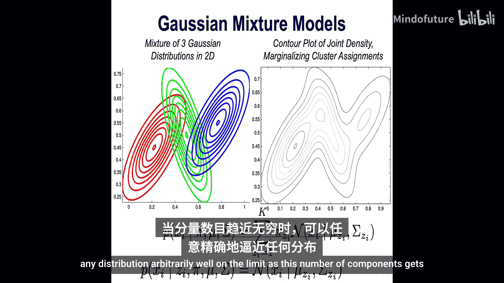

Here's another kind of plot of that same idea， sort of surface plot of what the distribution you would get。

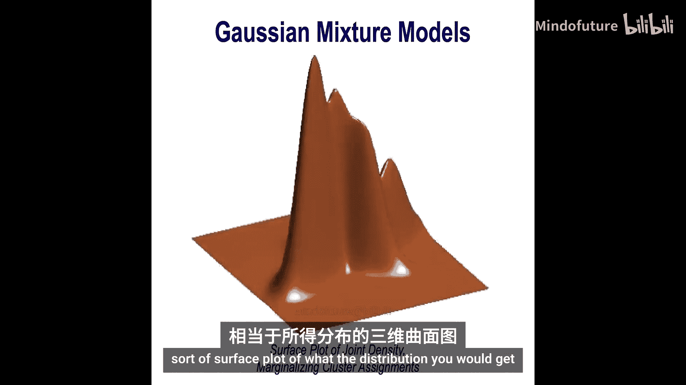

Okay。And now so sometimes with mixture size， we're interested in just estimating densities。

 sometimes we're interested in actually。Doing clustering right so under the generative model again there is you know an assignment of data points right each data point comes from one of the three Gaussians and that's what this color is red green blue are denoting here。

But if I you know， if I don't know that right in general。

 you just have a data set to fit your model to， so then if you have a data set like that you need to kind of infer what the cluster assignments are okay。

Thiss just kind of a reminder that right if I if I knew the model parameters。

 I could get these probabilities of。Cluster assignments just by Bays rule right so the posterior probability of cluster K is the prior probability times the likelihood normalized that's just Bays rule。

And so these colors are denoting these probabilities right where the the red is like high almost probability one of the red cluster and then these like red kind of areas where it's mixed red and green。

 this is where there's。If you have a point here， you can't really tell if it came from the red or green Gaussian。

 they both are kind of similar probability of generating that point。Okay。So again。

 just a little review of how finite mixtures work。Now。It's going to turn out that。

The as we head towards larger and larger like thinking of the number of clusters becoming potentially very large or even infinite so I have a flexible model。

 you won't be surprised to learn that you it's a very important thing about how you do regularization okay and there's different ways of think about doing that regularization but in the world of Bayesian on parametrics that regularization happens by putting prior distributions that say that even though there's a lot of clusters in the world I'm going to kind of control their properties so I don't overfit and I can generalize to new data well。

And so the deishle process is a sort of generalization of the finite deishle distribution which you've already seen so just to remind you what the deishle distribution right this is a distribution on the simplex。

or on non negative vectors that sumg to one， so it's commonly used in Bay statistics as it like a。

You can leave it as a prior and a discrete probability distribution。It has this property that。

 you know， it's the the way you write the probability is you take the probability of each kind of like outcome。

and raise it to some power okay where these powers are the parameters of the distribution and you can think of the distribution as being parameterized as a mean vector as well as the sum of these alphas controls the variance so in particular the variance is sort of inversely proportional to the sum of these probabilities。

Okay， and depending on how you set these， you can either get things that are bumps that look almost like Gaussian distribution。

 so if these alphas are big。But then if the alphas are very small。

 right if the alphas are less than one， you get distributions that look like this。😊，Okay。

 and so this is this is the thing that's going to become important as we start thinking about the large data limit and nonparmetrics because look at this distribution right it's one that sort of says that most of the mass is on the edges and the corners。

And you think about what are the edges in the corners right well that like an edge is like a distribution that kind of has one outcome near zero and the positive probability is only on the others and then a corner would be like a distribution that says。

 well， one outcome has high probability than the others have low probability right so this is what sometimes called a distribution that favors sparsity。

And this is kind of if you think about if I have a large number of potential clusters and I don't want to overfit。

 this would be might be actually a good prior for that because it's going to kind of encourage you that says。

 well， you know unless your data tells you otherwise。

 it's more likely that some of these clusters are low probability and there's a few big ones as opposed to them all having high probability。

so this type of prior is going to turn out to have good regularization properties。

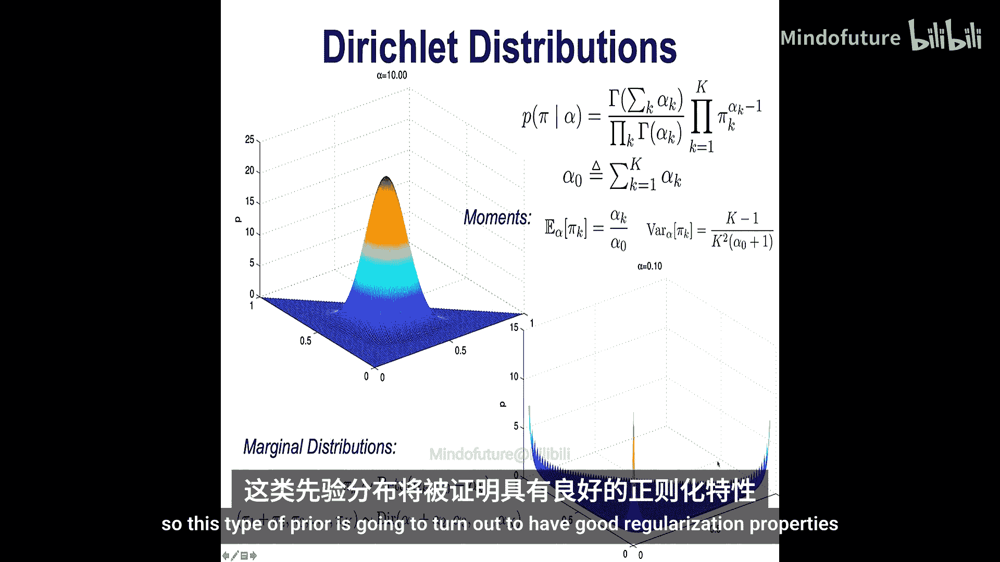

嗯。This is just to illustrate that right if I just sample so if you set the parameters all equal to one in a deite distribution you get a uniform on the simplex so all vectors that sum to one of equal probability so this is showing samples from that right this is like just a bunch of you can see that you know in these samples usually kind of most are all of the categories have pretty high probability。

Sometimes one or two of them might have very low probability these properties are never exactly zero by the way。

 they're just small okay。Um。But then if I set the parameters be less than one。

 so if I have five outcomes and I have probabilities all equal to 0。1， right。

 well then you get this property that when you draw samples。

 well there might be sometimes basically almost probability one of a single outcome。

Or you might have a sort of non negligible probability of only two or three outcomes。Okay， so again。

 this is what we're going to kind of be looking at as prior as that look。Like this。So。

How do we apply these again， so the way we can apply these to if I have a finite mixture model。

 this is again the directed graphical model describing a mixture。Where I have my probabilities。Pie。

And then， you know for each cluster， it's for each data point the cluster it comes from is an independent sample from pi。

 that's the generative model。Um， so we're going to put a symmetric deishle okay。

 and I'm going to parameter symmetric because kind of， you know。

 before we learn anything we don't have any bias that some cluster should be more or less likely。

And we're going to parameterize it in a particular way for this lecture。

 I'm going to usually write I have some constant alpha and I get divide it by k so if there's k outcomes。

 each is going to probably alpha over k。Okay， and so this is you thing about it is like what I'm doing is I'm alpha is like the total mass across all those things and then I'm splitting it Ks evenly。

Okay。So as k gets big， this deerchle， these alpha of a ks will get small and you'll get a distribution that looks like this that kind of favors sparsity。

And then you have some prior on the cluster shapes right so remember we talked about like there was a like the Gaussian prior on the means of clusters and then there was a thing called a wish art distribution you could use the prior on covariances so that's what this H is right so it could be like one of those normal inverse wish art things I talked about before it could be something more exotic right all we care about right now is it's a distribution on the parameters of the Gaussian mixtures。

And then finally， right， our generative model says for each data point， you sample an assignment。

 red， green or blue， and then you sample from the corresponding Gaussian to get the data point。嗯。

All right。This is with a thick set of hyperpara， if you run that a few times you examples of mixture models and the data sets they would produce。

Okay。All right， so that's all been review。Now， I want to now point you to a different way of thinking about。

嗯。A mixture model that's going to seem a little strange at first。

 but it's going to head bring us to some interesting directions， okay？So。

Here's a mixture model just as we've talked about。Where here f is like F is you know basically the density of the points in a given cluster so this f is like again could be a Gaussian but it doesn't have to be so in general it's just some distribution with parameter stata K for cluster K。

Okay。So another way I can think about encoding this is as a discrete probability measure。嗯。

Here I have a measure that I'm going to have a sum over K points。

 I have a little unit probability mass， this is what's sometimes called a point mass。

 sometimes called a directak delta depending on your background。

 sometimes called an atom and probability theory you can think of this delta theta K as like one way to think about it operationally is like you took a Gaussian whose mean was theta K。

And then took a limit as the variance of that Gaussian headed towards zero what。

That would approach this theta K。Okay， so any that is like a distribution。

 it's like a distribution that has sort of all its mass concentrated on that theta k。

And so these are often drawn as arrows， right？If I think of like if I had like， let's say k was four。

 I could represent。My parameters， my thetas as kind of four of these delta functions。

Where their locations say what the parameters are right so like say what the mean and variance that cluster is and their heights say how likely it is right so this says this is like a likely cluster this is a less likely Okay so it's just a different way I can represent。

嗯。嗯。The sort of pi and theta together as this discrete probability distribution or discrete measure。

So my graphical model iss what this G is right and so it depends on both my H H is my prior on the thetas and it depends on alpha alphas this。

Parameter that goes into the derachle distribution。

This is sometimes called concentration parameter because it sort of acts as a little bit like the inverse of a variance okay so as it gets big。

 you kind of get more variance gets small you get more concentrated okay。And now with this measure。

 I can write the same generative model I saw before like this for each data point。

 what I do is I draw a sample from G。Now when I if you sample from this a distribution that's discrete like this。

 then when I draw a sample I just get a copy of one of these points right so you'll pick one of these four points so like my first sample I might get。

This spike， and in the second sample I might get this spike。Okay。

 so these theta so thinking about the thetas are like the unique values。

So theta K is like for mixture component K， what it's。Like mean is。

And then theta bar is going to be for a particular data point。

 what is the mean of the Gaussian that generate the data point and it's a copy of one of the mixtures by sample from this discrete so that's the theta bar。

Right so this theta you know if we think of these Z's that say you know which cluster I came from this theta bar I is going to be the theta for the ZI associated with that and then finally I can then sample my x's from a distribution that's parameterized by these theta bars right so that would be like if I was using Gaussians where these are the means then you would put a little Gaussian around that point and sample from it to get your data points。

X1 here， x2 here， and so on。All right。Okay， are there any questions？On this。not why I'm doing this。

 it seems pointless right now， I will tell you that it's going you'll see why in a minute。

 but what I'm doing， any questions about what I'm doing。

Just to clarify so the third graph there where you have the red and blue arrow。

 you just sample from one of those four arrows right and the higher the arrow the where it gets selected the way what you think theta bar is how would you sample from a discrete measure。

 what you do is you you draw a categorical random variable where the probability of getting outcome K is pK and then you just like then copy。

 make a copy of the corresponding theta？Okay， just copy the black arrow exactly。

 so it's like you pick。One of these locations。With you know probability proportional to the height。

 and then you just set it to be sort of exactly in that same location。Okay。Right， so again。

 it's a little bit like this was what would happen if I sampled from a mixture of Gaussians where each Gaussian had like zero variances that had different means。

 but you thought of the limit as their variances went to zero。

so then you would just pick one of the Gaussians and take a copy of its mean and there's no variability about the mean。

Right。So that's kind of what from the second to the third panel， what's happening。Okay。嗯。All right。

This view is going to， we'll see in a minute how this shows up， okay。

 but this is just a different way of thinking about mixture models。Now。

 another thing I want to point out about mixture models。

 another view of mixture models is that they induce。Partitions。Okay。

 and so this is something that shows up if I'm looking at clustering， okay now。嗯。

If I sample assignments of data to clusters。Okay。Then。Well， first， I can say。

 you know how many ways if I have end data points could I assign it to assign it to K clusters， well。

 that's kind of sort of easy to see that that would be K to the n。

because basically you know there's for each data point you sample。

 you pick one of the K clusters and then that these are independent choices。

 then there's k to the n combinations okay。But note that this。Is what is the here are like saying。

 am I from cluster one two or three？And when I fit a mixture model， right。

 these sort of cluster labels are arbitrary because I don't know。

You know I don't ever have a label saying this is what cluster one means's what cluster two means。

Right so I could， you know， I could call red green blue clusters 1，2，3。

 or I could call them clusters 132 or 312， any of the sort of like factorial ways of commuting things would be a different way of labeling the clusters that would be not a different way of partitioning the data。

Okay and so in general， as the number of clusters get big。

 the number of ways of excitinging data to clusters is much much bigger the number of ways of partitioning right so let's be imagine I have three data points。

😊，Then they are exactly。Um。Five ways to partition three data points。

You could say that each data point is in its own cluster。

You could say that there's sort of two data points and one cluster and then one data point on its own and there's three ways to do that。

 or you could say there's kind of like one big cluster that has all the data。

So if it's fundamentally if I think about clustering。

 really I have to reason about these five partitions， but if I wanted to represent。

All these clusters with a mixture model， I would somehow need， you know。

 if you want to allow the possibility that every data points its own cluster I would need at least k equals three。

 and then that would be kind of like three cubed or 27 assignments。Okay。

So I just point out these are different things and then as you get bigger here's a lovely little picture from Wikipedia right if I have five data points。

There are 52 ways to partition5 data points， there's the picture of all 52。Whereas if I had like。

 you know， five clusters and say how many ways were they to assign five things to five clusters。

 that would be a little over 3000。Okay。So and why is this right is basically that there's a mini to one mapping right for any。

Cluing， there's a unique partition， but there's many ways to like label that partition's blocks as kind of one。

 two， three， four， five。Okay， and so I'm pointing this out because， you know， both in the limit as。

There's a kind of computational issue which is at in the limit as I want to very model I can think about kind of lots of different ways of clustering data。

 thinking about partitions turns out to be more efficient than thinking about these assignments。

And there's also the issue that you know， I should be。If my cluster labels are kind of。

 my clusters are like latent variables。And。I don't have information about them。

 then you whatever priors I use， whatever reason I use。

 whatever models I use should be invariant to the relabelings。

So if I take a particular partition and I say， this is like cluster 1，2，3 versus cluster 13，2。

Those shouldn't change the probabilities。Okay， so a that's important we're going to have to make models that respect that。

 okay？And the simplest model that kind of has kind of respects all these properties and is and is tractable to work with and has lots of kind of。

behavior is something called。The dearish they process this mixture。

And so the steerly process mixture is this kind of strange object that you can kind of look at from different directions。

And see it in different ways and so you can think there's something called the delate process。😊。

And this is a distribution on countably infinite discrete probability measures。

 so before I talked about a probability measure where you had like a finite set of points to add probability sum to one。

So the Delate process something where I sample from it。

 I'm going to get a infinite set of points each with some probability and those probabilities sum to one。

Okay。Um。You can think of also these things as what's called an infinite。

Mixture bottle right so you can think about， you know you can say I have that finite mixture where you set k you could ask instead what would happen if I let take the limit as K goes to infinity as K gets really big。

Okay， and well you have to be careful because you know that limit could be degenerate or not defined depending on how you define the distributions。

 but if you're careful about how you define the distributions。

 that limit is a nice object that's connected to the st layer process。So in particular。

 if you take the finite mixture model with these deerishle priors on its weights then。

An appropriate limit of that is this dilate process mixture。

There's something called a stick breaking construction。

And that sort of gives you an easy way that even though there's this infinite set of weights to sort of explicitly sample from them。

 to draw a sample of what the probabilities of different clusters are。嗯。And finally。

 there's this sort of funny thing called the Chinese restaurant process you may or may not have heard of。

 and this is actually a distribution on partitions。Induced by the darestate process prior。

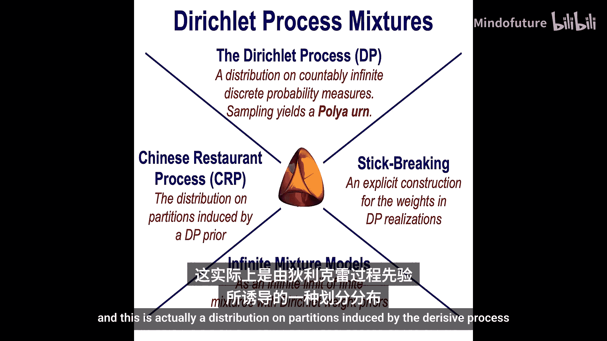

Right。So let me start there explaining what this Chinese restaurant process。All right， so。Again。

 so we're interested in kind of like these this case where you know I might I don't you know I don't have like a little data set I want to find three clusters in。

 I have a potentially very big data sets right I have millions billions of data points I have a very large data set where there's potentially a very large number of clusters。

OkayAnd I don't maybe I don't priori know how a good guess for how many clusters there should be right I want to infer that from the data。

So that you can think of this as like， you know， at some level， right， I have my observations。

That are ordered arbitrarily right I just have like a set the typical assumption with a mixture models you have a bag of data that's on order this is this is this sort of connected to what's formally called exchangeability and statistics so the order doesn't probably don't depend on the order and then I have my assignments to clusters right so you can think of。

A clustering at some level is saying that like the， you know。

 I have my observations and I'm going to put a single like one think of these。

Black dots as being like a one and the white is zeros。

 so in every row I'm going to put a one that says you know this is where the cluster I'm assigning to。

Okay。And so what is a non parametric， right？Me more of you may have seen sort of nonparmetrics and other contexts right so like there's like nonparmetric density estimation or nonparmetric regression and what does this say this is like these are methods that basically say that if I'm doing regression that you know let's say that you know if my true data is kind of sampled from like an arbitrary smooth function then in the limit as I get you know more and more observations my estimate of the function will approach that right so I don't assume the function lives in some like family like a polynomial boundaryed degree or something I say as long as it's smooth I'll be able to estimate it okay so what is nonparmetric clustering it basically says that you want to make few assumptions about what the right clustering is in the same way。

And so basically a non parametric support， aparmetric approach to clustering should have large support in the sense that all partitions of the data。

From the hypothesis that the data is one giant cluster to the hypothesis hypothesis that like every data points its own cluster to everything these all have positive probability under the prior。

Of course， some of them are going to be very unlikely and you're going to infer that they're bad。

You know， representation of your data， but none of them are impossible are rolled out。Okay。

 so that's what we want in non parametrics。And then exchangeability here right this just says that。

 you know。The order of my observations doesn't matter right so thus my you know the clustering9 fur shouldn't depend on you know the way you store it your store your data and matrix。

 say。And we of course then we want you know， good asymptotic properties。

 computational tractability and so on， okay。Okay， so。

So the Chinese restaurant process is this kind of colorful analogy。

We think of clustering as a sequential process。Of where okay， so the analogy is that the the。

You have customers coming into a restaurant with many tables。

The customers are the data to be clustered。Okay， so there's a the customers or the data and then the tables are the you know the different clusters right or like more formally the blocks of my partition so basically this says that if like if two customers sit at the same table they're clustered together。

 if they set at different tables then they're in different clusters。啊。

And the Chinese restaurant process is a。Sequential process that kind of happens where the idea is that the customers the way the way yourre clustering happens is kind of sequentially one at a time。

 so one data point at a time， so imagine like almost like a model of how clustering could work on streaming data。

So your first customer comes in and sits at some arbitrary table。And then。Subsequent customers。

If there's sort of like， let's say end customers who have already sat somewhere。

Cster N plus1 randomly picks a table according to this distribution。And so watch this distribution。

 basically it says if k is the number of tables that the first in customers already sat at。

Then I choose one of those tables with probability proportional to the number of people there right so basically the tables that are popular that have lots of people have a higher probability being picked and the tables that are almost empty have a lower probability。

Okay。😊，And then。And here in is the total number of previous customers N K is the number that previously sat in table K or were part of cluster K。

And then， but I have one other term， I have this alpha。

 and so with probability proportional to alpha， I sit down， I say this customer says。

 I don't want to sit with anybody else， I'm going to start a new table so they pick a new previously unoccupied table and sit there。

Okay， makingking the total number of。You know， occupycc tables one bigger okay and then you know。

 this one over alpha plus n this makes sure that these probabilities sum to one。So again。

 there's kind of you think of this as like。When this customer comes in。

 they have basically K plus one choices， they could sit at one of the K already occupied tables。

 they could join a cluster with one of the previous data points or they could start a new cluster that's different from all the previous data。

All right， so let me make it here's a picture to make it kind of。More clear how this would work。

 right， So let's say that I had I currently had seven data points or seven customers that SAT at where they were。

 you know。Two customers at the first table， four at the second table， one at the third table。

 then when customer eight comes in， they have you know probability two over seven plus alpha of going here。

 four over seven plus alpha of coming here， one over seven plus alpha of coming here。

 and then some probability alpha over seven plus alpha of starting a new table。And by the way。

 so the alpha is a free parameter of this process and it's not an accident I call it alpha it's going to turn out that it's connected to that alpha in the deishlate distribution okay but right now you can think of this as just saying that like it's a free parameter where alpha is big。

 you have a higher probability of starting new tables and when alpha is small。

 you're more likely to sit at an existing table。Okay。

And let's suppose that this customer like picked。From this probability so they sat down at this table then for when customer nine comes in the probabilities change right so now they have probably proportional to five because there's five people here right so you have this what's sometimes called a rich get richer property and let's suppose that customer eight decided to sit start or start customer nine to start to start their own table then now for customer 10 they now have sort of five choices instead of four they now have four existing tables or existing clusters they could join or they could start a new cluster and so on。

So you can see that this process。嗯。It has this interesting property that as time goes on。

 the number of clusters will kind of gradually increase。But you might ask okay。

 so why this particular formula you could think of lots of rules right there's a whole literature on。

There are sort of like formulas like this。Of how you decide to start something new or doing something before。

So what's very nice about。This。Chinese restaurant process is that it gives you an exchangeable distribution of partitions。

So if you ignore， if you ignore the fact of like there's no labels on the tables。

 you don't worry about the whether you were the first， second， third or fourth。Table。

 you just worry about you know， basically what is the partition right， what is the sort of， you know。

 which customers sit together and which sit apart。Then that。

That distribution is independent of the order that the customers enter the restaurant right and it has this。

Probability。So let me unpack this right so this is first this ratio of gamma functions。

 this is just these normalization as each customer comes in there's a normalizer one over alpha plus n。

 so if I take this product one over alpha plus1 plus one over two plus alpha and so on that turns out to be equal to this ratio of gamma functions。

Okay。I have alpha raiseds to the K power that's because each time somebody starts a new。

Table that happens with probability proportional alpha。

And then you also have these gammas right we remember gamma of n is just n minus one factorial of ins an integer。

 and that's because you kind of have this every time someone joins a table to do with probably proportion of the number of people who sat there before。

Okay，And if you look at this， right this。😊，Kind of things cancel so this has no dependence on the order。

Right so you could so what do I mean by that， that means that like you know。

 the probability that customers one and two sit together is the same as the probability that customers one and one million sit together。

And also the probability that customer one is in a big cluster or small cluster is the same as the probability that customer 1 million is in a bigger or small cluster。

Okay， so that's a。A little magical， a nice kind of property。U。So okay so。So okay。

 so this whole restaurant this is like a little bit of a thing in this part of statistics they have these restaurant processities and you might ask why is it called the Chinese restaurant process and so the history of that name is this was developed by some probabilists。

At UC Berkeley。And the story is that they name this。

So one special property of this restaurant is it has an unbounded number of tables right there's no limit on how many tables people can sit at there's always a no matter how many people have come in there's always a new table to sit at so supposedly they name this in honor of restaurants they like to go to in San Francisco's Chinatown where there always seem to be an unbounded number of tables an extra pace for somebody to sit so。

Anyway， that's the Chinese restaurant process name if you're curious。

But just a way of trying to make this mathematical object a little more intuitive。All right。嗯。

All right， any questions， does that make sense what that's doing？' not really sure。

Why the probability of customer one and to the same。

Probperly of customer one and 1 million at the same table because there are different data points right in the example。

So if they have different locations in the。The data graph them。They should have different probably。

So this probably the partition doesn't ends up not depending on the order。

And then you have to do a more detailed analysis to check what I just said。

But it turns out that if you， you know， it's。It's easy to see that once probability that customers one and two sit together。

 it's one over one plus alpha。Okay， because that's basically the probability that customer two joins customer one。

U。Now。Where a customer 1 million sits depends on all the customers that come in between one and one million。

But it turns out if you analyze things carefully， if you marginalize over all possible ways that those customers could sit。

 you will find that the probability is still one over one plus alpha。嗯O， so marginal。Okay。

And this is a bit it's actually so there's a。There's not like dozens of these。

Kind of sequential prediction rules that that have that property there's actually a fairly narrow there's it's proven that there's a fairly narrow set that do this。

And so this is to some extent by this dual site process and Chinese industrial process。

 I won't get a lot of study because there aren't that many methods that would have this exchangeability property。

かです。But it's a property we want if we're analyzing data。看。Okay。U。Oh。Yes。All right so。U。So。

I'm going to kind of go in and start going a little high level versesome theory and there's a famous theorem that you'd encounter in a kind of more theoretically oriented Bayesian statistics class called D Phetti' theorem。

So first， you know， if I have random variables that are exchangeable。

So you think about like exchangeability is like a is like a generalization of the concept of sort of like independent sampling。

So if I have variables that exchangeable， what that means is that if I took a permutation。

 if I reordered my variables。Then the probability of the variables in the original order and the probability of the variables after I reorder them is the same。

So you' think this is just saying that like if I have like a data matrix。

 but I know that like you know the order I put things in that matrix is arbitrary。

 it doesn't matter and I want to model with this property that if you like reordered。

Permuted your rows before doing your analysis， it shouldn't change the results。

Okay so that's what exchangeability means。And it turns out that。😊，Every exchangeable distribution。U。

With some fairly mild technical conditions has a representation like this。

That basically it says I can write the joint probability as saying that there's some latent variable theta that I sample one theta。

 and then given theta， I sample all of my variables independently。Given data。哎。So。

And what this representation theorem says that for any exchangeable distribution， there exists。You。

 a theta and a Pf theta such that this equality holds。It's actually。

 this is sometimes taken as like a justification for。Certain Bayesian statistical models， right。

 because what this theorem says is that if I have any exchangeable distribution。

I can always represent that as sort of like saying that there's some prior and then my data that from which a random variable comes and then my data is independently sampled given the parameters from that prior。

Okay。Um。Here is。What Dainite theorem says as a graphical model is that if I have。Some。

If my data is exchangeable， it's always the case that I can represent in saying that there's some parameter of data。

That sampled from some distributions so here like lambda would be like the hyper parametersameter of that prior and then condition on theta the data is independent so I have the end data points that are。

Conditionally independent given this data。Okay。All right， so this。Chinese restaurant process。Is。

Gives you an exchangeable distribution over x。 so then that says okay， well there must be。

Some you know， distribution over this theta that corresponds to the Chinese restaurant process。

 you might ask， could you ask what that is？

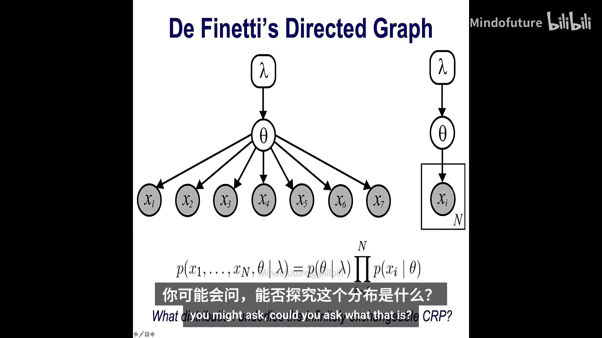

That is。The dearish slave process。Okay。Um。So the distep process。Is。A stochastic process。

 it's a distribution over random probability measures。 Okay， so when I sample from a deite process。

 I get a。You can think of a random probability measure what is that that's just basically a random function that's non negative and integrates to one。

Okay。So more of you might have seen something called a Gaussian process。

So do I get what does you think about a Gaussian process is like a prior over functions right so when I get a sample from a Gaussian process I get some like let's say function that's sort of like let's say guaranteed to be continuous。

Okay so I get some continuous function， so hearing the about is I guess something that's not just any old function takes positive or negative values it's a probability measure。

 something that's non negative and integrates to one。U。So and。Again。

 the analogy is that if you've seen a Gaussian process， what does that say？

The property that defines a Gaussian process is that if I have take any finite set of points and say what is the distribution of the function I of those points。

 it's a Gaussian， it's some multivariate Gaussian。The corresponding view of the deite process is that if I take a space and I take so I have a probability measure in this space I think of this is something that like integrates to one so like this is like a picture just like could be like a imagine a Gaussian okay。

Then a darerele process says， what does it say， it says if I take any partition。Of the space。

 so this is basically I divide the space up into regions。

That don't intersect and cover the space so like I could divide the square up into these three regions。

 T1， T2 T3。Then the dearlate process says that if I say， you know。

 okay there's when I sample my random probability measure。

 there's some probability assigns to this region， some that it assigns to this region and some that assigns to this region and and so you say。

 well what is the distribution of those three numbers right these are three numbers at sum to one what is their distribution？

So you may not be surprised that in a deerlay process。

 the distribution of those three numbers is a finite deerlay。Okay。😊。

And so the deite process says that no matter which partition I pick。

No matter how I divide it up and it could be a partition into a small number of components or it could be a partition to a larger number of components。

It's still like here if I say， you know， what is the distribution of these five things。

 it'll also be a finite bearishlet。Okay。And。This is this equation。

 if I say you know what is this G of t， this is the pro when I this is my random of probability measure how much probability is assigned to region T1。

 region T2 and so on， that vector will come from a finite deishle distribution。

With parameters alpha times H and。What are alpha H， so H is this。

Positive number H I'm sorry alpha is just a positive scalar。

 it's going to turn out to be the same as that alpha that was in the Chinese restaurant process。

OkaySo it's a highparameter and H is just any probability measure on my space。😊，Okay。

 so like it could be a Gaussian or anything else that you want could be a deer sleigh。嗯。

some distribution over whatever space I living on。Okay。嗯。

And so sort of the the reason this is all consistent it has to do with。

Fite deishle distributions have this like kind of nice marginalization property。

 so if I take a deishle and I say well what happens if I you know。Like。

Suppose I have like k numbers that sum to one I could take。

The first two numbers and add them together。And then I would have a vector of k minus1 numbers at sum to one。

Right， so I have kind of a。I still have a probability distribution just on one fewer outcome right so you can think about it as like saying what instead of I'm going to like view outcomes one and two as equivalent。

Now， if I do this sum， you might ask， okay， well， if the original vector had a deer slate distribution。

If I do this sum， what is the distribution of that new vector where it has some distribution。

 and if you work out what it is， it turns out it's still a de sled where you add the parameters。Okay。

 and so this property of the Deers Sle sort of says that this definition of being Deish s any finite partition is it's like self consistent。

Okay。And if you've seen a little more of probability in stochastic processes。

 this self consistency lets you kind of。Apply what's called Komogora's extension theorem just prove that this de clay process exists。

If you haven't seen that， you can take my word for it。Are we one of the lovely references we have？

All right。Yeah。

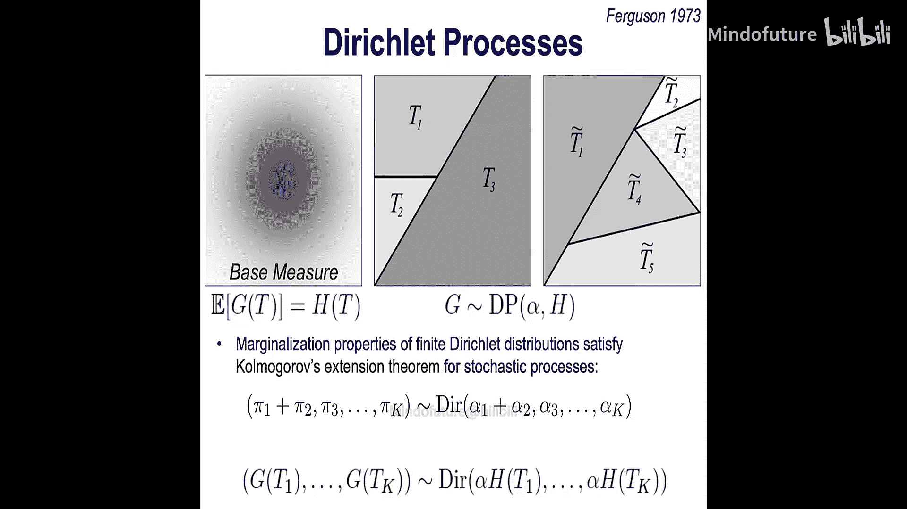

And。嗯。I think I'm going to skip over。嗯。诶。This。A little bit， but。嗯。I think I'm going to skip this one。

So what this slide is saying is that if I。Have a G that has a sample from a de they process prior and now let's say I observe data sampled from G right so have a random distribution I observe data。

 a common thing to do with me and say， well， given this data I observe what is the posterior of G。

And it turns out that the posterior of G is another deish slave process。嗯。Okay。

Rather than explaining what this posterior looks like。

 I want to instead talk about how I could actually simulate。And samplesles from G。

So the problem is if I naively， if I wanted to simulate。

Like sample from a di site process and then you know。Then sample data from it。

This is not necessarily easy to do the reason it's not easy to do is you think about G is like a。

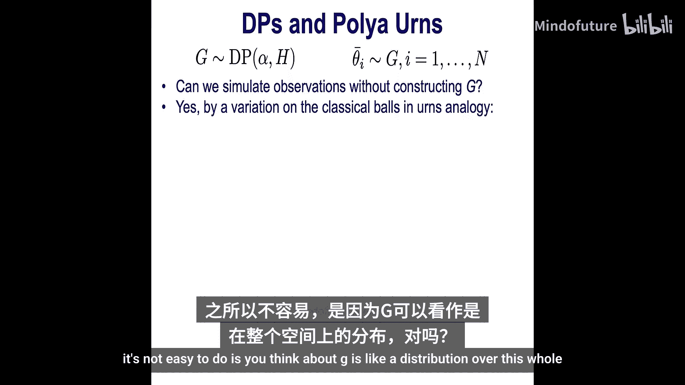

嗯。G is like a distribution over this whole space。So it's sort of formally an infinite dimensional thing and so I can't maybe may not be easy to explicitly represent G。

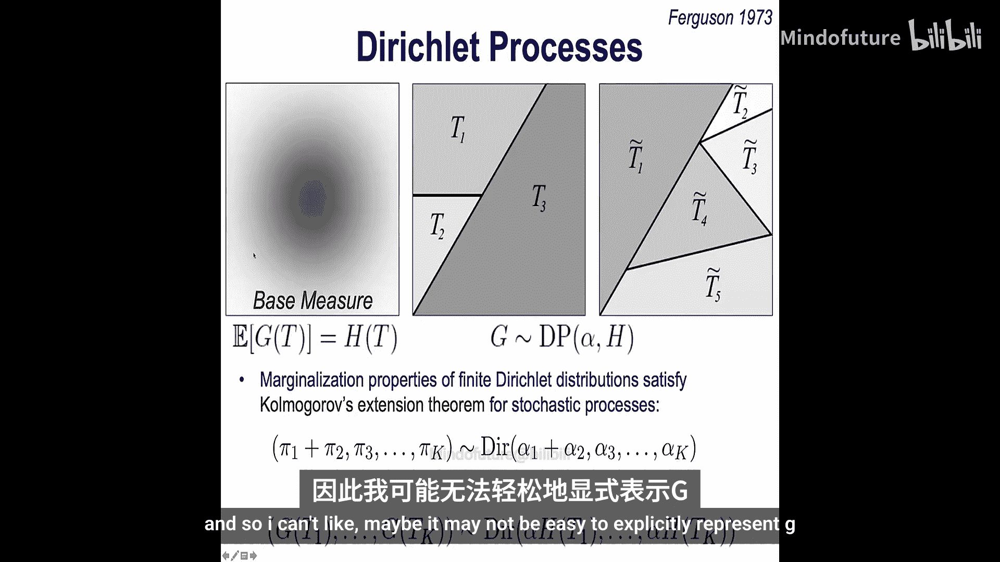

But I can simulate it and using on so if you in your first probability class often there's a lot of these kind of like things that are described in terms of balls and urns and pulling balls out of urns and so on and so forth okay so here is the dearestly processed version that you think of it as like it's a limit of an urn it's an urn that has I'm interested it's kind of this like limit as the number of possible clusters goes to infinity so it's going to be an urn that has a really large number of balls so instead of thinking of there being like a set of balls imagine that I have an urn that has alpha pounds of very tiny colored sand。

Okay。😊，Right so I have a bunch of sand in this urn and this is like the think of this as like every you know grain of sand has one of these colors okay and so this the space of colors is you know whatever like parameter space my thing is defined over。

And here's how I can simulate。😊， so what I do is to get my first sample。

 I take out one grain of sand and I look at its color。And that's my first observation。

And then I put that grain back and I add one extra pound of whatever color I just saw right so if I saw blue。

 I add a bunch more blue and so now you have this urn that's a mix of this sort of continuous range of color and then a whole bunch of a specific color of blue and you repeat this process。

And you can see as you repeat this process， what you're going to have is you are。Going to， you know。

 basically see repeats。In these colors。Okay and in fact， if I say， you know。

 this is mathematical language， which this is just saying that suppose I have something sampled from a deite process prior and then I get in。

Observations， so I've seen in observations from G and I want to say， you know， what is my。

What is the distribution of observation in plus one and I want to predict what's going to happen next。

Well， I'm going to have probability proportional to NK。That I。

If I've seen theta K N K times in the past， then I probably a proportional NK have seen it again。

And then I have probably proportional to alpha of kind of getting a seeing a new color that I haven't seen before。

Okay， and so this is kind of the same。Chinese restaurant process and a slightly different。表。

All right， so I wanted to kind of tell you where this dearersly process name comes from。

 but that's kind of I guess the most abstract and least。

Useful for computational methods and data botling view of it。

And now I want to tell you a more explicit way of how I can say if I have a sample from this delet process。

 how I could simulate it。Okay。And so it turns out that this， if I sample。A distribution。

From the deite process， so I told you the sample would be a discrete probability measure。

So I told you the sample will be a probably measure something that's positive it integrates to one。

 it turns out the samples from the di site process to have that properties that we've talked about are always discrete measures。

So this says that there's an accountably infinite set of points。So there's a set of points theta k。

 and they have probably pi K or these pi ks。S to one。系。

And so remember the deishlay process had this kind of like。Mean measure as it's prior。

 the theta ks are just independent samples from whatever that is。

But then so you might there's another question is， where do these PiKs come from？All right。

 and so they come from what's called a stick breaking process。

And so you could think about the stick breaking process as this kind of like。Simple way of saying。

 suppose I want to have you a bunch of numbers。A sequence of numbers that are positive and then i'm guaranteed that in the limit as this sequence gets big they always sum to one here's a simple way of doing that。

 So what I do is I think of there being like a unit length stick of probability mass。

And then to get my probability of my first cluster。

What I do is I break off a random proportion of the stick。Okay。That'll be costster what。

And then that gives me a shorter stick。That's left and to get my second cluster。

 what I do is I break off a random proportion of the amount of stick that's left that'll be pi2。

And then I break off a random proportion of the amount6 that's left that's pi3 and so on。

 and so you can see if I keep breaking off random proportions， then I get this sequence of numbers。

That by construction is positive and then in the limit as I break。

 lots and lots of pieces will sum to one。And this these proportions that I break off are sampled from。

Beta distributions。Particular from beta one alpha right so this is basically saying that like。

You know what is pi three I take one minus pi one that's the part of the stick that wasn't。

And cluster one。Times1 minus。U。Beta 2 that's the part of the stick that wasn't in cluster two。

 and then I take a random fraction of that split。And I sample it。For the DRC process。

 you sample it from this beta。Okay。😊，So again， what does a beta1 alpha look like where if alpha equals 1。

 that's a uniform distribution？If alpha is let's say 10。

 this is more what you would often use for data it looks like this right so something that says that usually you take a kind of small proportion of the stick。

 some small fraction of the stick。Okay。All right。So here's like another view right。

 you take a random fraction that's pi one， random fraction that's pi two。

 another random fraction that's pi3 and so on and so forth。对。And here's showing。

 if I said alphalf equals one， these are two different samples。From the stick breaking process。

And if I said al equal equal plus five， here are two other。Samples。Okay。

So it's something that you get this kind of like， you know。

 random distribution now when I get up to like。Seven or so here。

 these probabil that these ones are not exactly zero。

 they're just so small you can't really see them when I plot them here。Okay， so you can see you get。

 you know， although there's kind of like this unbounded set of clusters， you have， you know。

 some that are moderate probability and then you get a bunch that are very small probability。看。不。Yes。

And this is。If you say it， you know。rry I'm not going to formally show it here， but if you。Simulated。

The that Chinese restaurant process and then kept track of， you know， for the different tables。

 you know， what were their sort of normalized frequencies。

Then the limit as you had lots of customers。That would approach a。Sample from this distribution。

Up to reordering so what this stick breaking does is it kind of says rather than kind of like doing an arbitrary order it's an ordering where it's what's called size biased it puts tends to put the larger clusters first and the smaller clusters later。

Okay， so the cluster sizes are not monotontically decreasing。

 but they're decreasing on average as I move up into this。Which makes it useful for？Okay。All right。

Um。嗯。Now。I'll confess it's not obvious right now how all these why all these things connect。

 so these are different views of the same object。If。嗯。

If you want to say where does the beta come from， well， if I have a deerle distribution and I ask。

 you know， what is the marginal distribution of like one entry in that vector， it's a beta。Okay。

 and so this this， if you think about kind of simulating from a deishle distribution kind of one entry at a time。

 you can do that with a sequence of betas。And that's kind of at some level where the stick breaking comes from。

Okay。Yeah。All right。

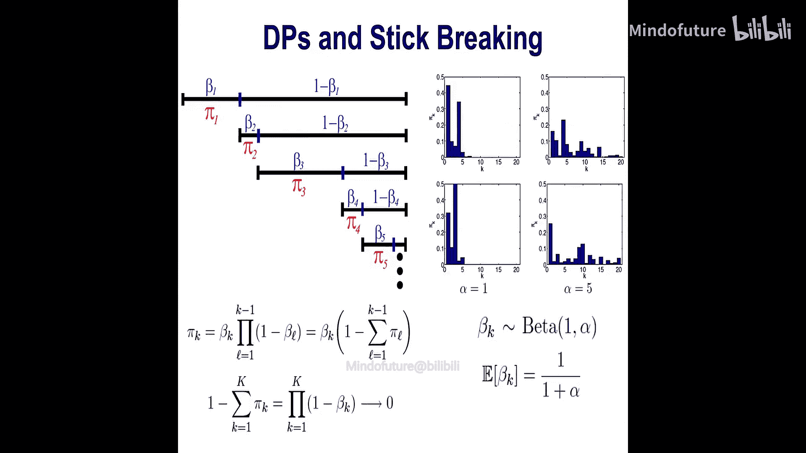

嗯。😊，All right， so we have these three viewpoints， the the derale process thats take breaking the Chinese restaurant process。

Um。And。So。Now I want to talk about finally how we apply this to mixture models and data modeling。So。

Here is what's called a deishle process mixture bottle。What is the delate process mixture model。

 well you sample a random measure from a delate process？

so what does that do that sort of says that like I have this set of mixture components that there's an infinite set of them right and they have kind of random locations。

And random frequencies。Okay， and then now once I define that infinite measure。

 then for each data point， I pick one of those and sample from its corresponding Gaussian to get the data。

Okay， so this is kind of just collecting the different equations we've had in the last little bit。

And so now this gives me right， this gives me a mixture model that is。嗯。You know。

 just like a finite mixture except right， you know， look this upper limit is now infinity。

 so instead of having some finite number of clusters I have an infinite set。Um。

 and then the trick is that right， if I was doing once I take this limit where it goes to infinity。

 I definitely couldn't just do like maximum like estimation of my parameters。

Right because I would have way more parameters than data points and then so I would just overfit so thus we need to have some prior。

On these pies， and that's what this does。And another way of thinking about this。

 here's another graphical model that represents the same distribution， this is one that says。

What do I do， I sample these pies from this stick breaking process。

 this thing where you break off random proportions of the stick。

And then given those pis sampled in that way， then it's just a standard model。

 then I sample for each data point I choose which component it's in and then sample the corresponding observation。

Okay。通常。And how do all these terms connect？Stick breaking is the way that I can sample these pies right it's the distribution of these pies and it's a way of sampling that kind of puts the higher probability clusters earlier in the list and the lower probability later and that's important for computational methods。

The Chinese restaurant process is this sequence of Z， right if I ignore。The latent pie and just say。

 you know， when I simulate this generative model， what is the sequence of z' I get。

 the Chinese restaurant process the distribution of those right or really the corresponding distribution of partitions。

And then that polio urn， when people are talking about a polio urn。

 this is the sequence of these parameters， these datata bars。可。Now。

To see why this has some interesting properties。Now。Here I'm showing samples。Before earlier。

 I showed you examples from a finite mixture model here。

 I'm going to show you samples from a two samples from a DA process mixture。Okay。

So what have we done here we've you know conceptually we've sampled。You know， we have this。

Infinite mixture model， and then I'm going to sample data points independently from this infinite mixture model。

Okay， so then here are two 50 point samples。Okay。Um。Now。

In the infinite mixture model right there's an infinite number of mixture components。

 you might ask why did I only draw like five Gaussians here And so the reason is that what I've done here is that although there's an infinite number of。

You know， make sure components， I've only drawn the ones that。

Appeared at least once in my first 50 data points。Okay。

So here's the ideas right so there's actually sometimes some of these models actually are what are sometimes called species sampling models and that's actually some of the work on this came from people who worked in ecology and evolution and so here is their setup right so imagine I'm out you know surveying an environment right and I start sort of looking at organisms。

and you're interested in estimating the diversity like like let's say how many different species of a certain type of animal there are in an area。

Okay。😊，Um， well， you know， if I go out and like。Look at 10 animals。

 I don't necessarily expect to see every species you could possibly see in the environment。

Right'll see i'll see some random subset right so I could see maybe maybe I might see 10 different things or I might see three different things right there'll be some repeats in what i've seen。

And so but then if I go out instead of just observing 10， I go observe 50 or 500 or 1000。

Then I will the number of kind of like unique species I've seen will start to grow。Okay。Um。

And it's the same idea with these clusters， so now if I observe 50 data points。

 then there's some set of clusters I've seen at least once。But then as I get more。

 so here if I have 200 data points。And here is a thousand0， this is showing for the。

 the left or right are sort of two different mixture modelss， this the same for these mixture models。

 I'll go back and forth。As I observe more。Or fewer。How things change。Right？

And so you can see there's some common clusters that you keep seeing data more and more。

 but then there are some rarer clusters。That I might only see。Right， like on the left here， right。

 there's this cluster right here that I haven't seen at all in my first 200 observations。

But then by the time I get to  a thousand0 observations， I actually see， you know。

 eight or 10 points of it。看。And so this lets you have models that say。

What's attractive about these models is they say that， you know， well。

 the number of clusters is doesn't have to be something thick。

 it can be something that kind of slowly grows as I get more data。so as I get more data。

 I get kind of a richer richer representation of what the clustering is。Hit it。Okay。And then the。

For a fixed number of observations， the number of。Cuss that I've seen at least once。

Is a random variable。Right， this is just the same way as like in the。

Chinese restaurant process right the number of tables that are occupied after in people coming in it' random because people are making random choices。

Right so like on the right here， it looks like there are six clusters that have been observed at least once for this mixture model。

Whereas the one on the left， it's larger， it looks like it's a。9。😡，Okay。

So the number of clusters is will be different and then you can infer that from data。

 which is a nice property。可以。嗯。And。One last thing I want to mention is that you might say， okay。

 so then how does this。Infinite mixture model， connect。To the finite mixture model。

 finite number of clusters with the de slay that I talked about the sort of lecture。All right。

 so you think of this the same that like the。They're kind of like I have these two models that are almost the same but they're have different ways they parameterize than mixture frequencies right so the Dite process says these come from the stick breaking。

And there's an infinite number of them are positive。And then the finite mixture model says that the。

The first。K components of pi are sampled from a finite Jewish lay and then K plus1 up to infinity all have。

Probably zero。Okay。So， but it turns out that there's a correspond between these。 So in particular。

 if I take。This is sort of a formal statement of how these things converge to each other in distribution。

 but roughly what you could say is as k gets very big， if I say， you know。

 well what is the expected value of a function under this finite mixture prior with very large k versus what is the expected value of function under the dely process model with the stick breaking。

 those two things approach each other。看。So this is another sense in which the。

The deite process mixture is a sort of。The D is an infinite limit of this finite mixture。系。U。

But it turns out that actually sometimes when you take the limit。

This infinite limit things get easier not harder and so in fact there's a lot of in terms of algorithms there's a lot of methods that exploit。

This representation here and actually are easier to work with than this one here。Okay。😊，Um。

One way to think about how that works is that the。Here。

 the computational cost of each step of either an MCMC or variation method needs to be proportional to your like upper bound on the number of clusters。

Whi is kind of a fixed thing， whereas here it turns out that the costs can be proportional to essentially your current estimate of the number of clusters in the data。

So as your inference out on the runs， it can dynamically estimate how many cluster you thinks it has and only kind of use those ones。

Not use extra ones。Okay。Okay。嗯。😊，And。嗯。😊，This is really a more technical sign I'm not going to go into detail this is just showing this is。

You know。The probability of assignments of data。To clusters under these the Chinese restaurant process in the finite deersle and you can see that there's you know definitely some similarities I have this alpha raised to a k。

 I have the same normalizer。Here I have a factorial here I have a product of integers。

 although there's this alpha plus k， and it turns out in the large K limit these things do approach each other。

As well with the caveat that。The probability of these indicators under that you normally talk about。

You know which specific cluster I come from that approach is zero。

 but the probability of a partition。If you account for the many ways of labeling indicated microorganian。

 these do end up matching。系。All right。Okay， so。It was a little bit whirlwind。

 but I wanted to give you this high level view。Of this object。And these four methods？🤧U。

So I'm going to talk， I think I'll wait and talk on。嗯。嗯。Thursday。

About inference methods right now I just want to very briefly mention sort of like a tweak。

On the Dite process that's easy to understand once you've seen what you've had but is very nice for a lot of applied data modeling this is something called the pitmanure process okay and。

U。So Pimanure is like。The de slave process， it defines a distribution on these infinite。

Street measures， it just has a。You can think of it as like you take that stick breaking construction。

And I changed the distributions I sample from。So before there was a betas with parameters1 and some alpha here now I have two parameters A and B。

 and now the first parameters1 minus a and the second parameters is b plus k times a。

So the diracite process was a special case in this where that a。Equals 0。Okay。And so。

If these were the distributions I was sampling from for the De slate process。Then the Pimanure。

Is something that's different as I sort of sample from the stick breaking。

 the distribution is changing as I move up down the stick。I'm going from the blue to the red。

To the green right so particularly as I go on the stick that kind of like。

Taale probability is getting smaller and smaller。OkayOkay。All right。Um。

So this seems arbitrary for right now， but hold on。U。It。When I make this change。

 it turns out that you can you still have a Chinese restaurant process。

 but it's a slightly different one Okay， so now the Chinese restaurant process is。

I have this parameter A that's a number between zero and1。

 this sometimes called a discount parameter。And I sit at a remember in the all Chinese restaurant process。

 I sat at a table with probably proportional to the number of people who already sat there。

Now I'm going to set a table with probably proportional to the number of people who's out there minus a。

 so I'm going to like take a little probability away from each。Old table or old cluster。

And then I'm going to sit at a new table with probably proportional B plus。K times a。Okay。

And now what's a little not obvious， but its true is that this still has that exchangeability property if I change things in this way。

 so it still just mean this it nice exchangeable model for data， but it has some interesting。

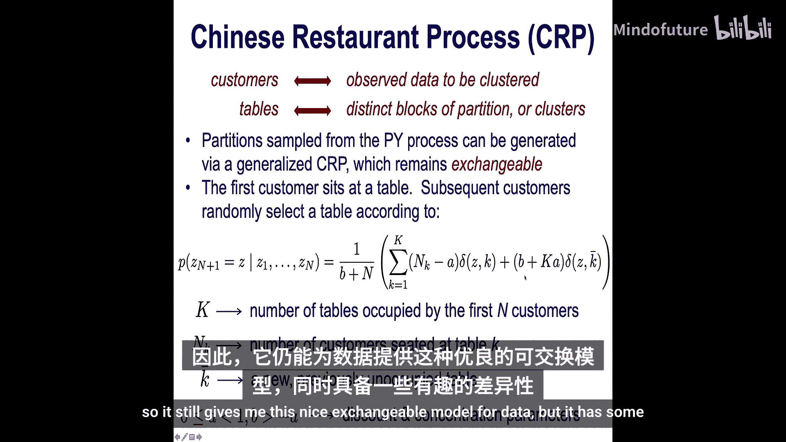

Different properties。Okay。😊，嗯。😊，And。So to illustrate that quickly。

 let me just show you a little bit of like some statistics of a particular type of data that I personally work with on my research on natural images。

 so we have a this is a data from a collection of images that people have labeled so I have a bunch of images where people have。

Gone through， they sort of drew bounding boxes around parts of the image。

 and then they could give them labels like sort of labeled， you know。

 like the category of object that is。Okay and so the history I'm going to show you here before。

 you know， I've got you know， several thousand images。

 tens of thousands of these kind of segments labeled where again they have like a region as well as a semantic label。

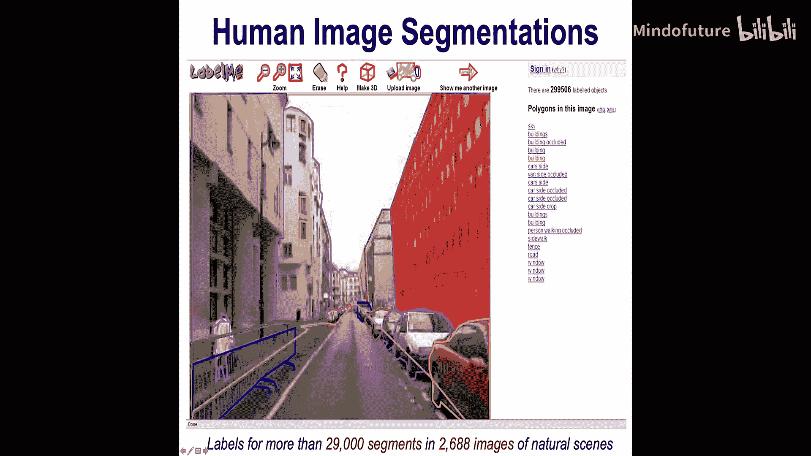

Okay。And so now we can look at。You know， as an example， how many？

Objects there are in images Okay and there's some variability in that So here like the black is the histogram of how many objects there are in images and you can see there's actually。

Many simple images that have not too many objects and then some images that have more。

And this is kind of a fit to this distribution。😊，Using the green as the de they process。

 the red is the pit manure。You can see the green really doesn't match very well。

 the red gets a lot closer。Another way of thinking about these objects is the sizes。

And so this is a plot of basically a histogram of how big the objects are right so this is like proportion of the image area so here it's like。

Almost occupying filling the whole image versus these are like small objects。

And so that's on a log scale。Here I have account of how many times you see that。😡，And so on this log。

 log scale， this empirical histogram of these size of objects follows almost a straight line。

 right this black line is almost straight。And that's actually related to what's called a power law distribution。

Okay，W which this pitmanure process captures well， another way of thinking about this type of distribution。

 if I say how frequent。

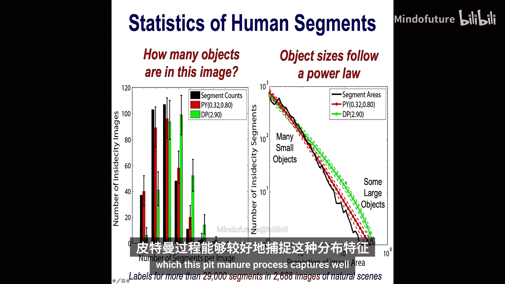

Are different labels， I can say， you know， take the labels of things that people give。

Like the labels of the categories and sort them from high to low frequency and I can count how many they are again if I plot that I'm going to plot that on a log scale。

B， and what does it say， you what you have you know？

Some things like trees and sky that show up in lots of images and then you have rare things like waterfall in person and then maybe things like li in or W arrowarrow that even in a data set with thousands of images might only show up a couple times。

 okay？So。Now you can see that that again this curve this shows up a lot in text data。

 whether or not it's about images， right this again is sort of roughly following kind of a straight line。

 this is again a characteristic of what's called。A power law distribution and we have a nice fit to that with this pit manure process and not so much with the de slave process。

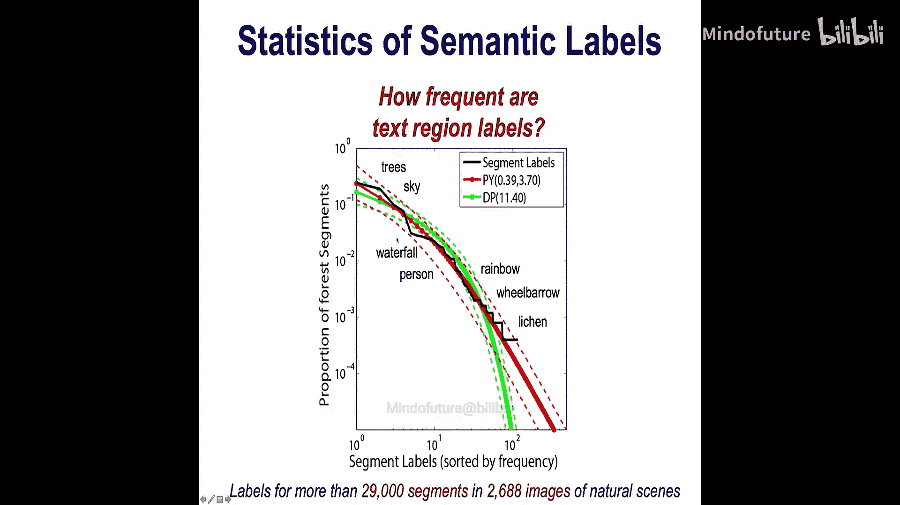

Okay， so why so where does this pigure come from right so by the way， it's named after。

Jim Pitman and Mark you are， who were probabilists who invented it。

When they were kind of interested in just generalization of the Chinese restaurant process。

 like generalizing that predictive role， saying when you could generalize that。

 but for data modeling purposes， it's interesting because it gives you this model that has uncertainty in the number of clusters and also can capture what are these power law distributions。

And so。Here are two high level ways of thinking about。But。嗯。嗯。These distributions are right。

 so you could say under。Either the dearest across equipmentmanure you could say I if I simulate a data set from this。

 you could ask after I have an observations， how many unique clusters have I seen？

And that will be a random variable， but you could ask， well what is the mean of that random variable？

And under the de they process the number of clusters kind of so this is in both cases it's going to be like less than linear which you need for any useful clustering method right somehow you know you need like the number of clusters to not be like。

The similar to the number of data points where you're not really clustering。

But for the delate process， the number of clusters expects to grow as the log of the amount of data。

Okay， so that's very， very slow growth， not too many clusters。

And whereas the Pimanure instead expects polynomial growth so here a is a number between zero and1 so like if a is a half。

 this says like the number of clusters will grow is the square root of the amount of data。

And in fact， this is something that's empirically observed in text data。

 right text if you just take English text are actually text in other languages as well。

 and you just start reading through books and you sort of count as I look through how frequently do I find new words？

Okay， that actually grows at sort of a polynomial rate like this。

 and that's as a name it's called heap's law， this polynomial growth rate。

Another way of thinking about this is you could say if I take my clusters and I sort them from biggest to smallest。

 you could say that how quickly do they decay？And for the deraclate process。

 they decay at an exponential rate， whereas for the pit manure they decay at a polynomial rate。

And this is related to something called ziplaw， which you may have encountered with text data right so there's a nice fit of these things to data that you get in and language is also into other domains like like vision so that makes this Pimanure a pretty attractive thing。

That if you're using it to try to like learn about。Categories related to images or language。

 it has the right inductive biases in terms of how many common versus rare and as what rate they should grow okay。

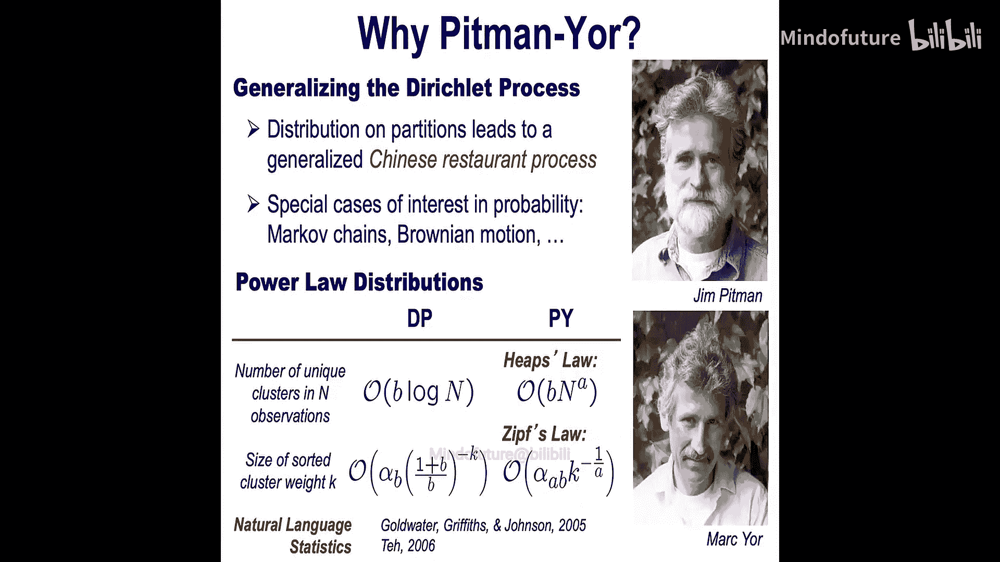

U。嗯。

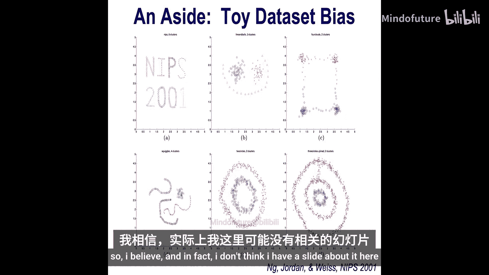

So。I believe and in fact， I't have I don't think I have a slide about it here but。嗯。The in fact。

 the for those who have more of an NLP background， there are these。In language models。

 there are these methods for what are called smoothing for when I'meststuating like ingram models for regularizing them。

And it turns out that the best sort of probabilistic interpretation of some of the best smoothing methods。

 what are called interpolateulated ks or nice smoothing。

 are based on probabilistic models that use the PImanure process。

So these actually provide very nice regularizers for those type of methods。

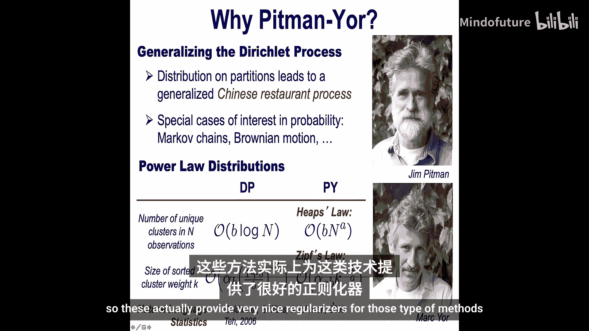

嗯。All right。So。I will wrap up there on Thursday and I'll take a。

Complimentary view of these type of models， you know less on the abstract math side。

 more on how do we develop variational Monte Carlo methods and how do we fit them to data。

 but before I get to that I would be happy to take any other questions you have today。嗯。

I have a question， how is the exchangeability process relevant in the Pimanure？

Like in the natural language or the natural image setting。you said it retains their property。Right。

It does well so first in models of this， so there's different notions of exchangeability。

 so what is that so。

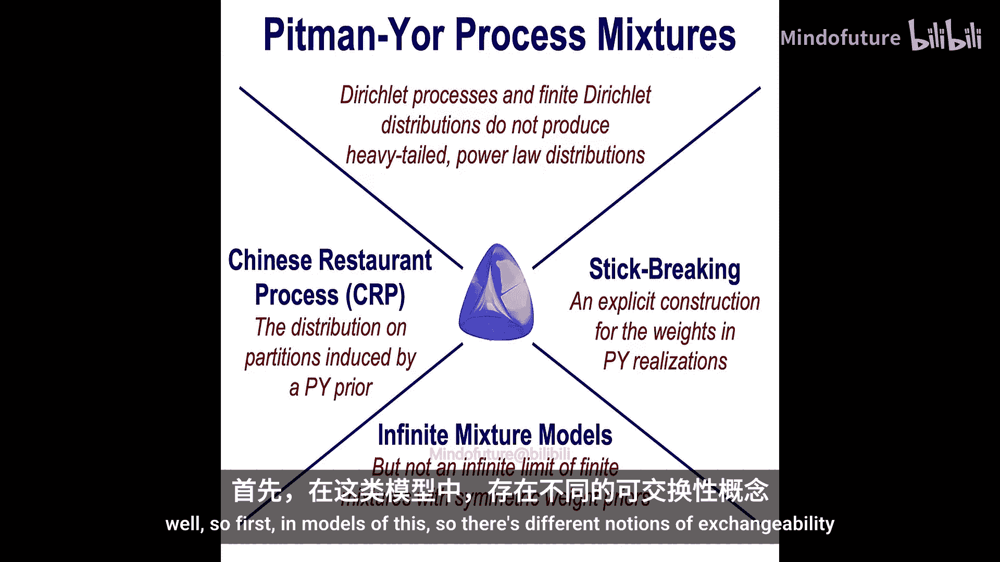

You're right that like if I was like segmenting like the pixels。

 then the pixels are not exchangeable， I want to model spatial dependence。系はい。

And so that's definitely true and in fact， I'll mention Thursday。

 there's some work that kind of like takes the pit manure and then builds facial dependence into it and gives you something that kind of captures。

The size distributions in that for doing image segmentation。However。

 here's how exchangeability would。Show up， okay。Is think about these labels。😊。

Okay so you know so there's there's labels you know like sky you know maybe you do some some like text preproceing to ignore the plural and so on。

 but you have you know sky building car so on so these these categories you can think of them as being end up being encoded as you know just integers you know the category one。

 two， three four five， six seven eight。And so on， right in my data set。

And I don't want it to be the case， usually that order of like。

 how do I map those things to integers is arbitrary？

So you want the invariance there and I know I want the invariance there right also the in a data set like this。

 the images， the order of the images themselves。Are arbitrary。

Right so it's not like a video sequence， it's just like a collection of images that were downloaded off the web and so I don't want it to be the case that like you know when I say okay。

 you know， go find go segment the images and then cluster the regions together to try to discover like categories in the world。

 I don't want it to be the case that it's biased by the order of images I give it I want it to be invariant to that order。

Okay， so there's still exchangeability， great， great。

But but you're right that you do want to capture like the spatial part would would break that。Okay。

 thank you。Um。Good question。I have a question so about the intuition of the whole thing right so would you say that the tick breakinging process determines the size of the clusters and the Chinese restaurant process determines how to how to assign a data point to one of these clusters。

そま的。Yeah， well， you can think of it as two ways。Of doing that。Yeah。

I think the graphical model let me find the graphical model because that I think is will help。嗯。

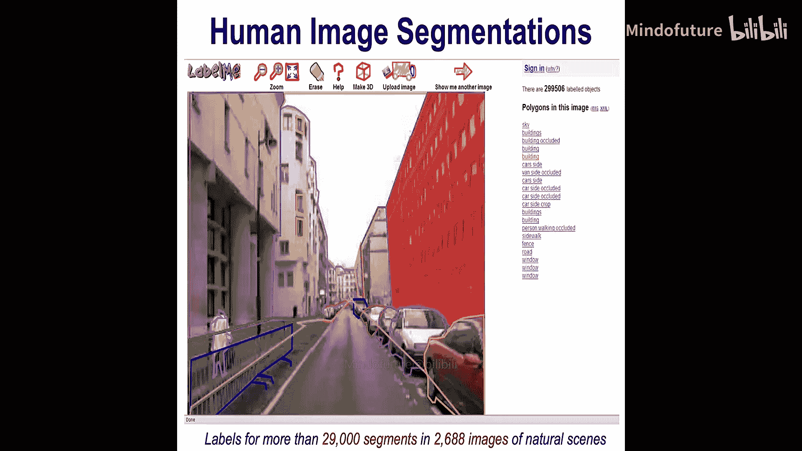

O。So。This model， what does this model say， this model says that if you think of the generative model of just the like。

Pi and Z。That part of it。This says， what do you do， will you sample pie？

And then given pi for each data point， you sample the Z independently。Okay。

 so that says one way to simulate。From this model。Is you first？Sample pie。

And then for each data point， you sort of sample from the corresponding。

You draw an independent sample from a categorical distribution。Pramatized by pi okay。

 now the problem with that。What I just said is not incorrect。

And this is no problem if I had a finite mixture， however。

 you have to start to be a little careful because right。😊，Remember。

 this is this model where there's this countably infinite set of clusters。So formally， this pie is。A。

Infinite sequence of numbers that sums to one。So if I want to simulate in my computer， I can't。

Explicitly compute and store that infinite set of numbers or I'll never finish。Okay。Now。

There are tricks。To get around that， right？You can see here are like samples from pi and what one thing you could do is you could say。

 well， you know， once the residual， the amount of the stick that's left is like you know。

 some small number， like I've simulated all the 1010 to the minus eight of the stick。

 I'll just ignore that tail and get an approximation。嗯啊。There's actually a fancier thing you can do。

 it's called retrospective sampling where you say that if you think about the inverse CDF way of sampling。

 you can say that you know when I sample my Zs I sample numbers between 0 and1 and so I can kind of like say okay。

 this is the one I sample from the cluster that falls at 0 you know 0。

97 on the CDF then I simulate only enough a pi to like get that far。And basically。

 you like dynamically simulate only as much a pie as you need。Okay。

 so there are few things you can do， but you can see that there's a problem there that， you know。

s this pi is infinite dimensional， like explicitly working with it could be hard。So instead。

 what you could think about doing is you could say that， well， if I just care about clustering。

Maybe then really I only care about the Z， the pi are just a vehicle to get to Z。And so you can say。

 well， what if I？Integrate over pi and just sample Z directly。Okay， now the Z。

 if you think back to like Markov properties of the class。

 the Z are conditionally independent and given pi， but when I integrate over pi。

 they become dependent。But now if you say， well， they're dependent， what is their distribution。

 it's the Chinese restaurant process。So if you want to simulate Z integrating over pi。

 the Chinese restaurant process will do that。Okay， and that's why。

 you know the Chinese restaurant process depends on the alpha。

But it doesn't depend on the specific pi numbers。And then when people develop inference algorithms for these models。

 there are both varieties， there are some varieties that like integrate over the pi and just work directly with disease。

And some varieties that sample sort of。Reason about both pi and Z。

And they basically have complementary properties， it sort of depends on what you're doing in other parts of your bottle。

 sometimes one better， sometimes the other's better。

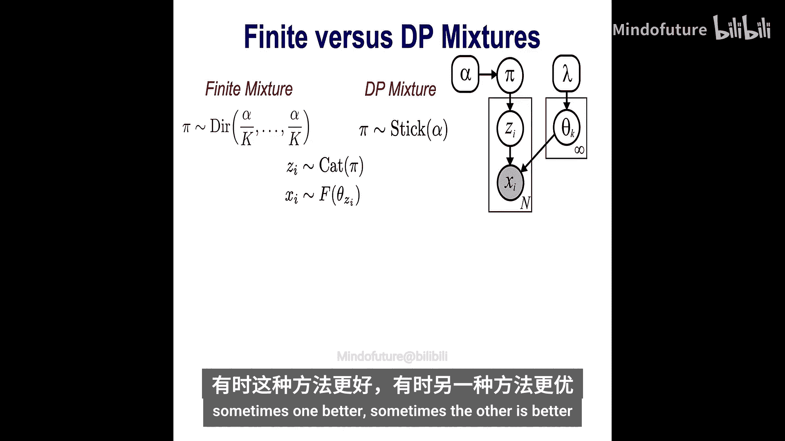