# 【加利福尼亚大学】图形模型中的学习 ｜ Cs274b ｜ Learning In Graphical Models (Spring 2021) p19 P19_讲座_9B_(期末)-_随机和记忆变分推理 -BV1Tqx6zrEMj_p19-

。We're going to continue talking about these the sort of。

Basian nonparmetric modeling ideas and so the last lecture was a little more on the theory side describing so how these distributions work and now I'm going today going rather than kind of doing like a really detailed view of sort of one application of these。

 I'm going to do a little bit of a higher level view of basically lots of different ways that these can integrate with graphical models。

Okay and I'm going to focus sort of in the interest of time， I think I'm going to。

You can apply either Monte Carlo or variational methods to do inference in these type of models and I'm going to focus just just kind of to keep things coherent on variational inference。

This will also let me touch on some interesting more advanced topics in that area， okay？

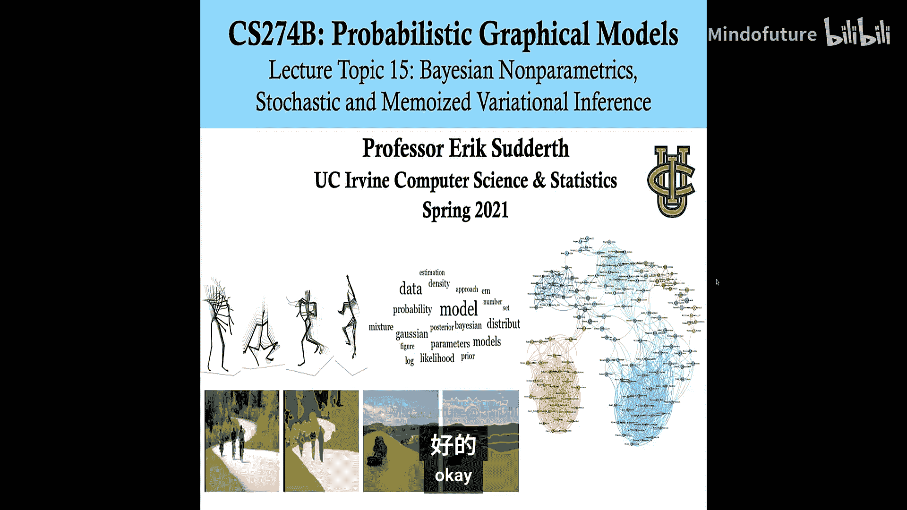

All right。Right so at a high level， you know these。These nonasion nonparmetric methods。

 a lot of them are used for sort of you versions of clustering methods right so the idea is I have some data。

 I have some learning algorithm and I want to sort of find clusters。

 but a lot of the applications it's you know things are a little richer than just the you know the kind of like simple data sets that you first see clustering given as an example on like a set of 2D points。

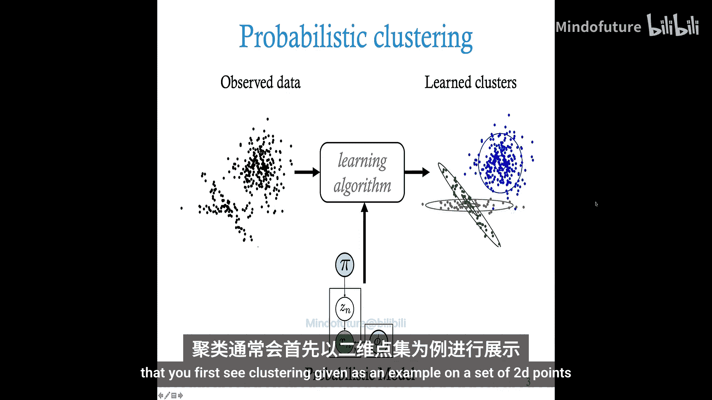

So I'll just show you some a couple examples that are kind of application the techniques have done。

 so it turns out that there's that actually mixture models。

 if you sort of parameterize each mixture component richly enough in turns ofs covariance are very good models for the statistics of small patches of natural images。

🤧Okay so if you take large numbers in this case， you know you might have millions of these small patches across many natural images。

 images you could take with a camera and then you sort of use a mixture model to cluster them you'll come up with sort of all sorts of different clusters that have things like smooth regions that have textured regions that have different types of edges and so on and so forth。

 these are kind of like patches that are clustered together right so the sort of like things that are the common color would be grouped together。

And then one thing you can do with this is apply them to do image restoration of various sorts so that if you have an image that's noisy or blurred。

But you know something about the statistics of uncorrupted images。

 you can use that you can use inference or a model like this to remove and so this is actually using a mixture model to remove noise from this image and you can see that it really is sort of reduced substantially。

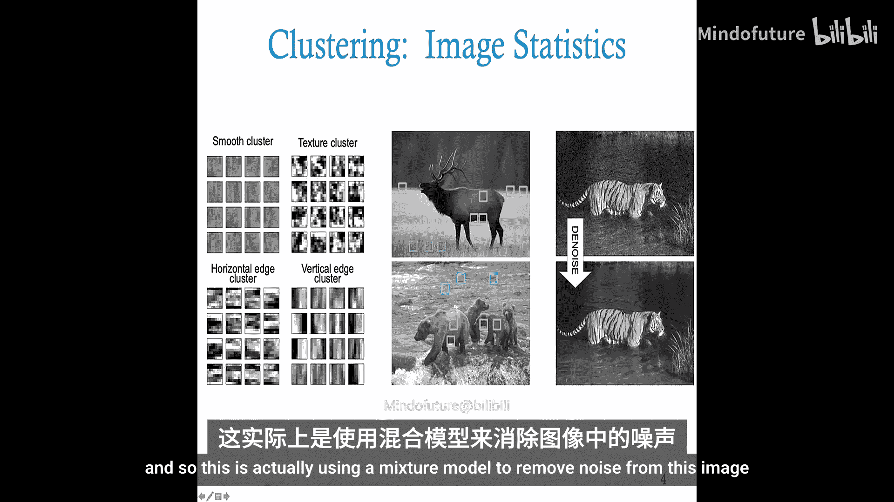

Another type of clustering this is a model family I've mentioned kind of at a high level but not in great depth is topic models and so imagine if I had text data well one thing I could do would just try to cluster the documents and people certainly do that but an issue is that often documents talk about many things okay so here's you know a little bit of a high example but you know I might have you know topics related to let's say you know words that are related to dinosaurs words demeteorites。

Words that are related to science outreach and so on and so forth。

 right you have lots and lots of these topics。And then a given document in general will be often a combination of things right you might have a document that talks about different parts of science or sort of one part of science and outreach concerns and so on and so forth okay our many news articles will talk about different things。

 not just one topic。So the idea of these models they're going to try to like sort of group the words together so within each document find clusters of words that are talking about the same theme and then also sort of match those up across different documents okay so models that do this kind of like hierarchical cluster in these are called topic models。

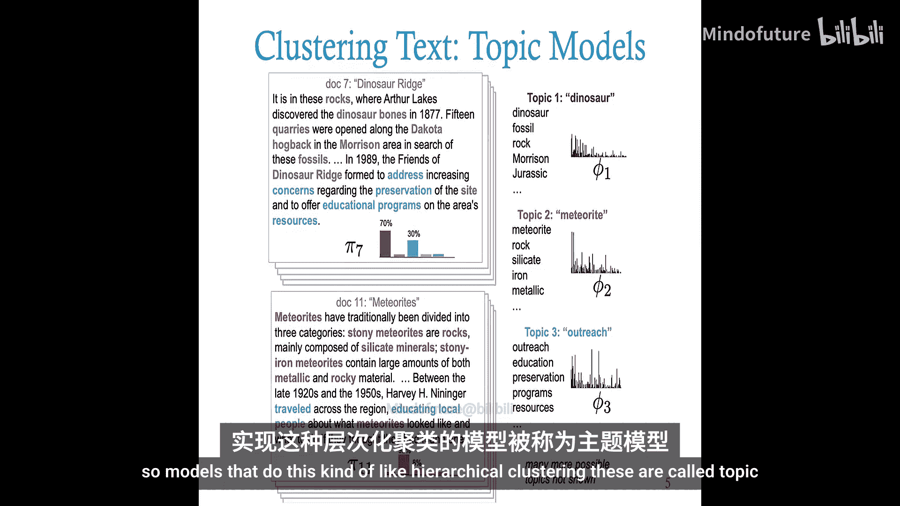

U。😊，You can also think of models of temporal data like the hidden Markov model as doing a form of clustering right so if I learn a hidden Markov model then you can think of like I'm sort of clustering all the time points that are assigned to the same state or sort of being clustered together so this is a form of clustering where you have some temporal dynamics。

This is just an example of I'll kind of show this more later。

 but an example of applying this to sort of human motion data where you have some data about how people are moving and sort of wanting to discover something about the activities they're doing。

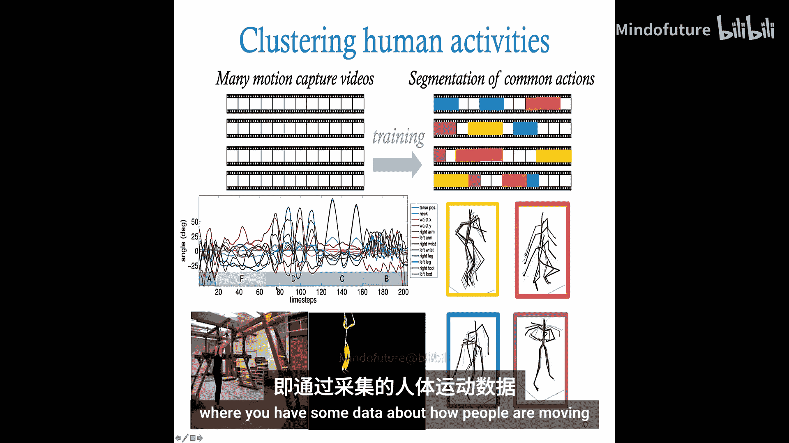

And then another one that you've seen in the homework is the idea that if I have relational data like I have sort of observations of a social network or some other interactions between people I could if you do clustering of those people to explain those interactions right you find what are called communities right so you can find these latent groups that explain and so this is actually this is exactly the same model you looked at at the homework and so with nonparmetrics we're going look at how to make kind of。

You know， more flexible versions of this kind of model。

And then another form of clustering is is that I mentioned briefly is image segmentation。

 so if you think of like the locations。In spatial data or an image and you sort of say。

 well I want to group or cluster together the ones that sort of come from the same object in the world right so that is also essentially a form of clustering but now where there's spatial dependence。

Okay。Um。And so I'm going to talk about sort of like a family of methods that the idea is is to be。

ha some flexibility and this is what graphical models will give us that we'll be able to。

 you know by adjusting other parts of the graph to take some of these sort of non invasion non parametric ideas and apply them to many different forms of clustering。

I'm also going to talk about an issue I haven't really described a lot。

 but is a big one in practice right and this is that you know。

Anytime I start sort of having models where there are hidden variables。

 models I don't observe during training data。Then typically， unless except for。

 you know excluding maybe a few pretty special cases。

 then the learning inference algorithms tend to have local optima。Okay。😊。

Right so you've all probably all seen this for like the EM algorithm right if you have a clustering method like EM right so I want to fit a mixture of Gaussians to this data right if I initialize sort of by randomly throwing locations down and run something like EM right well then you know you'll get。

Various solutions and you know sometimes maybe you'll really kind of identify these clusters。

 but sometimes you might find suboptimal solutions where you sort of like emerge some together， okay？

U。And this is really this is not a contrived thing this is kind of really happens quite regularly and it's something people have to do a lot of work and so you would be you know if you're a practitioner using these methods you'd like to have something that was we'll use the wordre here right I'm going to call this reliable because。

The word robust means a different thing in statistics like so robust is kind of like a property of a method to your model being wrong here i'm talking about a property of like an algorithm of an inference algorithm that kind of you know it it you know even though I have like a nonconve objective。

 maybe I can trust that it gets a good solution all the time or with high probability。嗯。

And one of the things that we're going to get by thinking about the。

The sort of non the variational methods is is scalability。

 so how we can think about maybe some parallel parallelization in our inference how we can scale up to millions of examples right so to contrast here right so the the。

A lot of the simplest MCmC methods like the Gb sampler right remember that。U。In the G sampler。

 you change one variable condition on all the others。Okay， and so if you kind of。

Do that sampling update in parallel like like compute conditionals of variables and sample them all in parallel rather than doing one at a time。

 you actually unless your model has special structures so you have like certain dependencies。

 you actually will end up。Can end up you know breaking things right you will no longer have the right equilibrium distribution。

 you won't converge to the right thing。Okay and so this is no big deal if you're just you know running an experiment on the single CPU on your laptop。

 but if you have a really big data set and want to use a grid of computers somewhere to run a larger scale analysis it's an obstacle and so there are ways to think about parallellyzing MCC but I'm going to talk a little bit today about variants of variational methods that would kind of support parallelization。

Okay。Okay。And then we're going to bring in these non parametric ideas to allow adaptation of model complexity。

 okay？All right， so。U。😊，Let's see the notation I think is in this set of slides is sorry you know lots of different sources for things there's some slight differences so just to fix it we're going to still be looking at if I have like a mixture model you know x is going to be the data z is going to be the discrete variable that says which cluster I come from pi will be this probabilities of the clusters right so this vector of numbers at sums to1 and then we're going to use in this lecture phi is going to be like the parameters of each cluster so like I'm doing Gaussians then phi k is like the mean and covariance at Gaussian K right and then we've seen this model that for every data point know you pick a cluster sample of correspondingbin observation pick a cluster sample and observation if you do this lots of times you'll get some data set。

All right， and so a nice thing is that you know that。

Part of the reason I've emphasized exponential families is that for all the methods that。You know。

 that I'll talk about today， although sometimes we might tell you there's a Gaussian to be concrete。

 you can basically， you can take this likelihood and plug in any exponential family you want。

And every single thing we'll talk about works with no problem。

Okay so kind of like you can swap in any exp family you like。

 so it could be like a Gaussian if you have more continuous things。

 but it could also be you know Bnoullies for relational data or I could have histograms。

 sort of multinoial categorical distributions or word occurrence I can swap in those things and everything will still work okay。

All right。But you know where the kind of non parametric issue。Comes in。

 is this question of if I give you a data set？can in contrived examples。

 you can say you know the right number of clusters， but in real examples， you often don't know。Okay。

 and so you'll you might have， you know， different sort of like fit clusterings。

 maybe fits of different mixture models with different numbers。Of。

Mixture components are clusters k so this is an example of what would be not perhaps not global。

 but at least local optima of fitting a mixture model to this data with one cluster， three clusters。

 four clusters， eight clusters。Okay。So lots of things and you know somehow right。

 you know I mean if we look at this， you know， if it's just 2D data， we can all look at this and say。

 well， you know， clearly this is too simple to capture the structure and this seems maybe a little too complicated and probably something in between is right right but so we really want for kind of things that might be more rigorous ways of doing that and allow us to do it and higher dimensional。

 more complicated data sets where we can't just manually inspect it and pick the right number。嗯。

And so then there's different perspectives on this， but the the Bayesian on parametric models， again。

 their idea is that we're going to assume that there's like a。Unbounded set of clusters。In the world。

Okay。😊，You why is this realistic it just sort of what it says is that you know if I go out and kind of like keep sampling more data I'm never going to you know like see every cluster that could possibly exist right so if I'm like you know learning about topics that are discussed in text documents what is this model says is that what if hypothetically you know people kept writing text documents forever they would never run out of new topics to write about right the number of topics would always kind of。

You know， slowly， but always kind of increase over time。

So that's kind of the perspective that these models have。And so then。

But how do they do this model selection， will they say that even though the number of topics in the world or the number of clusters in the world is infinite？

If I have a data set of end points。😡，Then well I can have seen all the clusters in the world right I've seen certainly no more than n of them if every data point I saw came from a different cluster and probably I've seen fewer than it Ive seen some subset so now you can reason about how many clusters you've seen at least once in the finite data you've collected。

嗯。And that's what inferencefer in these models will do and it'll give you something that kind of for a small data set will give you estimate a modest number of clusters and then as you get more and more data the number of clusters that you infer will grow so it has this nice property that the models can kind of get richer as your data sets get bigger。

Okay。All right。And so again， so this is kind of just a a reminder that for these non parametric models。

 we're going to be looking at this。Stick breaking。Priorors。

 you can think of one way of thinking of them is that the cluster frequencies come from the stick breaking prior where you break off random proportions of this unit length stick。

They' probably mass。So。So in general， pi k is this random fraction Vk of the amount of probably that wasn't used by the first k minus1。

Like let's say， mixture components。and。So and then for very sort of for technical reasons。

 these VKs are sampled from beta distribution with particular parameters and you know there's a couple different options here right so the dilate process is kind of a simple classictic choice and it basically says that under the dilate process you expect there to be sort of order login。

Clus5 in data points， I expect the the number of clusters I've seen at least once to be。Order login。

whereas if I have the pit manure process， then I get this what are something that's related to what are called parallel law distributions。

 right the number of clusters grows as a polynomial where this sigma is sort of some number between zero and one。

So less than linear like that。All right， and so here's actually。嗯。诶。😊。

And here's actually sort of for different examples of how you know how these would work for language data right so you could withfits these models you would have for different versions of this model。

 different predictions on I get as I observe more words， how many unique。

As I sort of start reading through documents， how quickly do I find new words？

Right as well as you know how many unique words I would have and it turns out that in this case these pit manure models give you much better sort of inductive biases than the delay process。

 but there's other applications where the delay process is a nice prior。All right。

 so for whichever one of these things you think is a good model now I really want to talk about the the。

Inference question。Okay。😊，All right。Okay。I have。嗯。This model right again if my if I go back to my graphical model right I observe the x's the you know the data and so what I don't know the z's I don't know the pi's。

 I don't know the phi's okay so I don't know the cluster frequencies I don't know the cluster shapes I don't know you know which cluster reach came from okay and so if if you you know。

Didn't know about some of the fancier things I talked about earlier in this class then you know one of the sort of simple things you might say is well what if I just sort of think of all these things as unknown right there's a bunch of things I don't know and just try to find you know a model where that maximizes the probability of my data so just maximize over everything the probability of my data。

Okay， just point estimates。Great。All right so。How can you do this right and actually you can do this get if you try to do this。

 then you can you can do it by an algorithm that's actually kind of a generalization of the can meanss algorithm the first clustering method everybody worries about and so how would this work right well basically you would initialize your model parameters somehow。

Then you then you would。For each data point， basically。

You would maximize over the disease and it turns out this is equivalent to doing this maximization is going to be equivalent to like finding the posterior distribution of which cluster generates data point and then just kind of picking the max。

 by picking the most likely cluster。Okay， so you say。

 you know which cluster was most likely generate data point， pick the most likely。

And now if I know the Z's， then now with X and z observed。

 then kind of I have a simple maximum likelihood problem to estimate you know the pi and phi and maximize that data。

 and I could sort of do that in closed form， reestimate and iterate that， okay？And so。Indeed。

 there's a lot of cases， you know， where this does。Kind of reasonable things。Okay。Right。

 so here's an example for a particular initialization where if you do many iterations。

 one iteration is kind of updating all the variables once， if you do many iterations of this。

 it converges to this kind of very good。Clluing of this data， so it works fine。Okay。

But here is one problem with this idea。All right。Is that？For maximum。

 if I just do this maximum likelihood objective。And just sort of maximize with respect to everything。

Well， if I increase K。The number every time I increase the number of clusters。

 my number of degrees of freedom always goes up。Right， why is this well。

 you can think of like a model with three clusters is a special case of a model with four clusters where one of the clusters is not used。

 no data is assigned to it。So you can kind of， if you give yourself the freedom to assign data to an extra cluster。

 you can always increase the likelihood。Okay， and so you have this problem that basically as k increases。

 this maximum likelihood will monotonically increase。And I'm not going to kind of prove it here。

 but in fact， this will happen even if I kind of include priors on pi and P。

So if I include priors on this pi in P。And then trying to do like a map estimate。

That's in a lot of cases， not good enough。To avoid this problem。Okay， and so what this says is like。

 so so then you can say， well， this is for a finite K， what happens to the non parametric model？Well。

 if you try to do just this point estimation with the Bayesian onparmetric model。

 then basically the likelihood that's unbounded above。

 you can just shoot it up to positiveed infinity。By doing things like kind of putting every data point in its own cluster。

Okay so that's not going to work， we're going to need other ways of controlling for。Complexity。Right。

 and now in this case， one thing that when people see this plot， they sometimes wonder is saying。

 well here， you know。There was like big increases of likelihood for when I got up to three and then it started to increase small。

 so maybe I should like pick this point。Right and that's like reasonable intuition this is sometimes what people say they look for the knee or the bend and the likelihood curve。

 but you know although there's a nice clear one in this contrived example。

 it turns out as you get to more complicated cases often it's a much sort of smoother increase and it's hard to actually kind of do that so you need something a little more rigorous to think about how to do this okay。

😊，All right。And。😊，So。嗯。The way we're going to do this is using， you know。

Asient inference you won't be surprised you know computing the posterior distribution so in this case for this model that means like given the data I want the posterior distribution over the model the mixture frequencies。

 the mixture shapes as well as the assignments Okay so I want distributions over all those things。

Okay， and I'm going to have to do some approximations。So。Let's see。对了。U。Now。

Well let's suppose I wanted to。Apply variational inference like let's just the mean field method to this model So remember the simplest type of mean field methods they would they assume things are independent right so assume your variables are independent。

So what would that look like right that would look like here where I say that。The， you know。

 I have a distribution for every。Data point， so the ZN is like which data point sorry which cluster generate data point in。

 so I have a distribution on that。And then I have， you know， think about it I have for each cluster。

 I have its distribution over， you know， what was it like the size and shape of that cluster。

And then I also have in my stick breaking， remember the stick breaking representation of probabilities。

 I have you know the stick proportions， and so I couldfer put infer those okay。

 and it turns out you can do inference of those you can say that they come from a beta prior and there's condacy so you can say they have a beta posterior。

But now there's there's a couple problems right so one is is like you can say what is the end well if I have an infinite number of clusters。

Then somehow， I mean Zine is a categorical distribution。

 but it's one with kind of like infinite supporting right because you know。

 this data point could have come from cluster  one， two， three， four。

 five all the way up to infinity。So I can't just like explicitly represent that。And so。

Another thing you can another issue is that， you know formally speaking right， you know， again。

 I hear I have posteriors for all of these。嗯。Components and look。

 I have this infinity up here so I can't represent all these explicitly。

So what can you do well there's a couple things you can do there's basically there's a versions of truncation and here's here's kind of the idea so one thing I can do is is I remember the stick breaking is kind of you know you're breaking off the like kind of larger。

These pieces of probability and they kind of keep getting smaller and smaller as you go。

 so an intuitive idea is just to stop at some point。Right and so like I I take you know。

100 chunks of this probability and then I stop and I say you know I'm going to like kind of take that remainder to be a last cluster and then not keep breaking it and so the way you can think about this is you're not。

When you truncate， the truncation is not。Choosing the number of clusters。

 it's choosing an upper bound on the number of clusters。

So you're saying that although I don't know the right number of clusters。

 I'm going to assume it's no bigger than sum number。Okay。

 and and there is actually there's some papers that have some nice theory that you know I'm not going to dive into it。

 but there's some nice theory about how you could you know。

 pick this upper bound so you're and the rate at which your truncated posterior or approximate that posterior and stuff so there's some good things you can say about that。

And so now I kind of have a finite model， all right。

 I just have probabilities of assignment to these K clusters and so on and so forth。Okay。嗯。

There's a slightly fancier way of doing this that I'm not going to go into now。Um but same idea。

 okay， so this is the idea is that we're going to do some kind of truncation like this。嗯。And。So now。

Right now I want to sort of approximate my real posterior with this factorized family。

And so what's that going to look like like I'm going to have some posterior over the stin breaking proportions and those will be beta distributions with parameters I estimate。

I'll have a posterior over the cluster shapes and these will be。

Kind of in a nice family if those are expial families this the expial family assumption is what to make this tractable。

And then now I'm going to have these。Trunk these responsibilities what are called responsibilities。

 these are the probability that at each cluster generate data point and i'm going to we're going to look at ones that are truncated right where the sort of there's positive mass on the first k like here like say three clusters and then the other ones are going to have。

Zero probability。Okay， so for each you can about as like the rows here are different data points and I have so the probability that each cluster generated each data point。

But one of the things we're going to look at in a sec is algorithms that let you kind of dynamically vary this truncation level as they run。

Okay。Alright。So。And so and then。Now， given this approximation。

 we want to minimize the Kobec Library of Calale divergence。Between our Q and the P。

Right and that had interpretation that was what meanfield did and remember that had an interpretation of maximizing a lower bound on the likelihood of my data X under my model okay so that's a nice interpretation right so in particular right if I minimize this minimize this tail I maximize a lower bound on the marginal likelihood which is sort of like helping me figure out how good does my data fit my model。

Okay。So。We're going to apply that same approach。But Bnie is not convex。Now this。What's good？

Is that if you compute。This likelihood bound， it actually has a sort of model selection ability in that so these are real fits to this data set。

 this is showing these likelihood bounds they increase up to three clusters and then actually they start increasing。

So if I look at this marginal likelihood。Here， for this one， it's actually worse。Than this。

Then the three cluster bottle。Okay。So why is that， why is that worse。

 well the intuition and I mean so this is good because with this property right I could start to actually figure out what the right number of cluster is I won't always prefer more。

Now you might ask why does this likelihood bound have this property？

HereHere's the intuition for why that happens。嗯。Let's suppose if。Um。啊。

That if you just fix the Gaussians here， that you know the probability of the data。

 so probably of the data given these parameters。Is。

Higher for this eight component mixture than the three component mixture。And it is so it's higher。

 but it's not much higher it's like just like epsilon higher right so it's like like it fits the data better but just the tiny bit。

Okay， but remember this marginal likelihood you think about as two parts how could you compute the marginal likelihood you one way if you think about what we when we learned about Monte Carlo。

 how can I compute this。This margin I go to LlfP of x。

 well one way to do it would be to like you sample from your prior over parameters。

Then you compute the likelihood given that sample and you kind of average over that。Okay。😊，So here。

What's going on， right？If。I where's that？In this case。

 I've got all these Gaussians that are kind of like happen to be kind of right in the same part of the space right on top of each other Anything about if I was sampling。

From my。啊。Prior， that would be an unlikely event。I have a prior that's pretty spread out。

 says the Gaussians could be in lots of different places， have lots of different shapes。

 and suddenly by chance there's like six of them that all happen to like fall on almost the same point。

So that's not likely to happen。It's more likely if I had eight clusters that they would kind of be spread out more and for that reason。

 the marginal likelihood integrating over parameters of this is actually lower than this。Okay。😊。

Sort of it's more likely to get so this is what Si Sun says there's a suspicious coincidence right it would be under your prior it's possible that when you sampled a bunch of independent Gaussians they would all happen to fall almost exactly the same place。

 but that's not very likely。Right？Um right， so it's possible that two clusters happened exactly overlap。

 but it's more likely that there was just one cluster。😊，Okay。

 and that's the reason that you get this model selection property。Okay， and now。

Now with this variational bound that has this nice model selection property。

I can do my inference by sort of like I initialize these variation distributions。And I compute。

That's Q of Z。Then I compute cues for these other things and kind of iterate that process。And these。

You know， these updates， this Q of Z update looks exactly like the E step to algorithm。

These are a little different than the M step because I computing distributions。

 but they're very similar to it Okay so I'm kind of not going to give you the detailed equations。

 but this this is kind of just a little bit of a generalization of EM。嗯。And so although this works。

It does not work great。Here are， you know what really happens if you just。

You know pick three random initializations and run from each one。

 and these are three different fixed points of this method。Okay。

 so these are we talked before about how for some like markco random fields it could be local optima for these variational inference and here you see too you get these inference or kind of cluster with models that are implicitly doing clustering the way local optma often work。

Is that you have this property that maybe there's。Sort of some cluster。

 some places where you clusters arerop split apart right where here I have maybe a multiple Gaussians where there's really kind of only one cluster and I have other places where they're merged together。

Okay。And so。So this is a problem right， and this is something that you could。

rute take many initializations， run from each and kind of pick the one that gets the best likelihood bound。

 but that's expensive computationally and as you get bigger and bigger data sets。

 bigger and bigger models also as the model gets bigger the kind of number of local opt get bigger and bigger and so things kind of break down it can be pretty tricky。

Okay。So。So。Thus。You know。What do we have right， we have a good objective that can kind of pick。

The right model order to fit the data， we have these algorithms that kind of do the optimization。

 but what we want is better。Methods。That can sort of adapt the model complexity to the data。

And so one family of methods that there's different ways of doing this。

 one family of methods I doing are ones that kind of have this property that they essentially sort of dynamically。

Create and delete。Clus as the algorithm runs。So they initialize。

 maybe they initialize by just saying the whole data set is one big cluster。

 and then they create some new clusters。Okay like they might go out to four。

 but then and they fit those， but then also sometimes they will merge or delete clusters。

 they will say that well these two clusters kind of seem to capture the same thing。

 let me put them back together to get to a smaller number okay。So this high level idea is。啊。You know。

 I think pretty intuitive about how you might avoid local optima right。

 you can imagine that you know if I took some of these bad fixed points here。

 if I did some merging in one part of the space and creation of new clusters in another。

 I could improve them。So but then the question is， is how are we going to actually decide？

The you know， when or births emerge is a good idea。Okay。

 and that's where our variational objective is going to come in。

And the variation objective that doesn't always prefer just more and more clusters。

 it has some model selection capacity can help guide this birth and merge。Process。Okay。Um。So。嗯。

Let me see so let me give I'll give kind of a high level。View of this so the ideas that I have。嗯。

I want to tell you a little bit more about how the updates work for variational inference。

So let's suppose I've。Have these Rs， these are these responsibilities is are just the probability that each data point。

Came from each cluster。Okay， so R& K is my current estimate of the probability that data point n came from cluster K。

Okay。And so so now it turns out that if I want to then optimize my。

Cluster probabilities and shapes right there's kind of these are simple functions of a couple statistics so first I have n this is just the sum basically of the probabilities of all data points assigned the cluster K。

This is like kind of the total probability mass for cluster K if I know those NKs。

 that's enough to con my posterior over how big each cluster is。Okay。And also I have my。

Data data statistic so if my likelihood is an exponential family。

 it turns out that if I compute the expected value of the statistics of that family。

For each cluster by taking the sum。That's enough to get this posterior enclosed form。When you update。

Okay。😊，So kind of the way the algorithm works is you use Bays rule to get responsibilities。

Then you compute these counts。Then you get new estimates for the cluster sizes and shapes。

 and then you iterate that。That's the way the normal algorithm will。对。All right。

 so let me talk about。First， how we can scale this up and then how we can avoid local optima。So。

If anyone has encountered any of the kind of recent work on applying things like deep learning methods to big data sets。

 you know that the kind of like universal way near universal way this is done is using what's called stochastic optimization or stochastic gradient descent。

And the idea here is that if I have a really big data set。😊。

I've got like millions of images and I want to classify them say。

Well you have the problem that if you wanted to compute the exact gradient of you like your classification loss。

 sort of for every step and gradient descent， you would have to kind of take a sum over the whole data set。

Right。And， you know， I mean， in principle， that's easy， but it's expensive if I have a big data set。

So what does stochastic methods do， they basically randomly substample your data。

So if I have millions of images， I grab a random subset。

 the effective methods usually don't just take one image， they might say you know。

 take 500 or 100 images out of my millions of total。Then I compute the gradients on those。

And if when I take that subset， it's kind of chosen kind of uniformly at random。

 that gives me an unbiased estimate of the gradient on the full data set。

 so basically I compute what I get is the gradient on the full data set plus noise and then I can take a step。

Now what's interesting is that you can apply exactly the same ideas。To variational inference。

 and this gives you a method that's called stochastic variational inference。

So the idea here is I have like a huge set of like points I want to cluster with a mixture model。

Normally， when I do my variational inference， I would have to kind of go to every single data point。

And compute。Do this kind of like this thing that looks like the E step of EM。Instead。

 what I can do is I can randomly subs sampleample my data。

So it's like you pick a random subset of your data points。

 you figure out the cluster probabilities just for that subset。And then that gives you。

A noisy estimate of what the。You know the cluster sizes of shape should be on the whole data set。

And now， so that's a noisy estimate， so I can't just like， you know。Change the the。

Cluster size and shapes to match it， but it's enough to do gradient descent。

So I can kind of like push my global cluster sizes and shapes to be closer to that。

And then you do this many times。And then you if you。You can show that if you do this with some。

You know， there's always a learning rate gradient descent。For stochastic methods。

 you kind of have you typically need to kind of like have this learning rate kind of slowly decrease。

 it can't go too fast or too slow it， but kind of slowly decreases and the idea is it slowly decreases the amount of like noise is gradually doing。

 you can show that you will converge and eventually to a local optimum of you know the inference problem on the whole data set。

So this is actually a really important technique， it's applied you can apply it to any model weve talked about in this class for the most part。

 not just to these nonparmetric models。Are there any questions on like the big idea of this stochastic variationial inference？

So it's a good thing to be aware of that if you encounter big data sets， you could try。Yes。Again。

 what is the idea， the idea is that just like you can do stochastic gradient to estimate like parameters of a classifier。

 you can also do stochastic gradient to estimate the parameters of your variational distribution if you're doing variational inference。

Yeah。And it gives you computational gains for all the same reasons。Um。I'm going to kind of， I think。

U。Skip some details。Here， but I just want I want to mention。A cousin of this idea that's also useful。

嗯。😊，And so there's an old word。Called。Meorization， so this is not a typo， it's memorization。

 not memorization。And what memorization means in computer science is to store or cache the results of a previous computation。

So the old idea is that。Imagine I have like a function。That is like expensive。To call， but I am。

I'mGo to call it many， many times and sometimes I'm going to like call it with the same arguments。

if I call with the same arguments， I get the same result。

 so what I can do is I can kind of remember some of my past calls to the function。

And then when you tell it to call again， I can check。

 did you already call it with this arguments if so I just tell you the same answer I did before。

Not recompute it。Okay， and so there's this idea， there's lots of kind of like classic algorithms that use this idea to get。

😊，Gaing efficiency。Here。Here's the idea that imagine that I've broken my data set。

In this stochastic gradient way， I've broken my data set。Andto a bunch of pieces。

 these are usually called batches in this context right you have like little batches。

 so I've got the whole data set broken into B of these chunks。And。So what I'm going to remember。

 I'm going to store for each of these chunks， it's sufficient statistics。Right？

The kind of like the last time from the last time I analyzed that chunk of data I'm going to store you know what was the expected you know frequency of each cluster what was the expected size and shape of each cluster so I'm going to store that information so like I just think about like this count right I can say you know I have these estimates of the size of cluster K and there was like some fraction of the data in batch one that came from cluster K some and batch two some and batch three and so on。

And。Instead of just store if I wanted to compute kind of for the whole data set。

 I would take the sum of these， the idea is I'm going to use a little more storage。

 I'm going to remember what these numbers were for every batch。

Now let's suppose I go and I reanalyze batch one。So I recompute my variational distribution。Okay。And。

So now I get a new statistic here， well now I can say。

If I say now what is the sum of these ends over the whole dataset。

 well naively you could you know add them up again。

 which would kind of take cost that's linear in the size of the data。

 but instead what I could do is I could say， well it's whatever the sum was before。

Minus the old value for this batch plus the new value。So with this trick， you can kind of。

 if I go reanalyze a piece of my data， I can move very quickly。In constant time。Reupdate the global。

Parameterters。Okay， optimally。So the idea now is that I'm going to have something that is going to grab a chunk of data。

 compute the statistics for that， then update the global parameters。And iterate。Okay， so that's。

What we call memized inference as it does this memorization。Cashching of previous results。Okay。

All right。A nice thing with the minimalized inference is now I can do this。Adaptation of。

Models and I'll just tell you how we would merge。Cluters， suppose I wanted to like say。

 is it a good idea to merge the purple and red clusters？But what I can do is I can say， well。

 I'll do that， but I take you know the current probabilities that each data point is assigned to purple and red。

 and I'll just add them up。So I would like that gives me a new variational parameters right so I could say you know what's the probability of purple or red it's the sum of their individual probabilities so I add them up。

Okay。😊，I can do that very fast。And then once I've done that， added them up。

 I can then compute my variational bound and say， did it get better or worse？

And then I can kind of accept this merger or rejected it。Does it increase my objective or not？

And then there's a。U， a corresponding way you can think about， I'll go skip the details。

 but like kind of creating new clusters。And then accepting or rejecting them。Okay。

So if you do these things， you have。A very nice property that of methods that。You initialize。And。

In this case， rather than having to like try to pick a good starting patient for clusters。

 we can say our initialization is just going to be that the whole data set is one giant cluster。

And then the algorithm goes and it does births， it creates new clusters。

And then at some point it does emerges to reduce clusters and if it iterates this right it's going to actually reliably get to recovering the exact set of clusters so this is kind of how it runs。

 this is multiple runs。Of it kind of starting with too few clusters at creating some then deleting down and eventually getting。

To the right number of clusters。Okay。And。If you try different starting points。

 you can initialize with 10， 20， 40， you kind of no matter what you pick。

 you get back to the right point。Okay。Now， for very certain， very special cases of this。

 there's actually some theoretical guarantees。This is really。

 if anyone has seen there's something called ks plus plus。

 but there's basically some guarantees that they' kind of randomized algorithm style guarantees that with high probability you will get close to the optimal clustering。

There's。Some hypotheses out there that actually you could have those guarantees for a big broader set of algorithms like this。

 although。It hasn't been proven yet。Okay， but empirically， it behaves very nicely。嗯。And。So let's see。

I think I'm going to skip the details， this is just showing this thing working at scale。

So what are we doing here， we're clustering， we're modeling these patches of natural images。U。

And so we have a data set that has 3。5 million data points。

And now we're modeling eight by eight patches。 So the way to think about this is every data point lives in。

It is like a point in a 64 dimensional space right because you have 64 pixels in your eight by eight patch。

And within we're using a mixture model where every cluster has its own mean and also its own covariance matrix。

And it turns out to model the statistics of this， you actually accurately you actually need a full covariance。

 so there's a full 64 by 64 matrix where all the entries are non zero。😊。

Moodeling for different pixels， you know， whether they're positively or negatively correlated with each other。

So it's a pretty rich model that you can learn that。😊，At。Scale。And。

Right so this is just kind of showing the kind of in terms of likelihoods the behavior you would get if you just picked like 50 clusters or 100 clusters and just kind of ran a conventional。

Coordinate asscent algorithm， so this is like getting about like a regularized version of the EM algorithm that you all learned about。

Um。But you can get to much higher likelihoods by having methods that。嗯。Start。

With fewerer clusters and then allow that kind of。Aptation as the inference runs on okay。

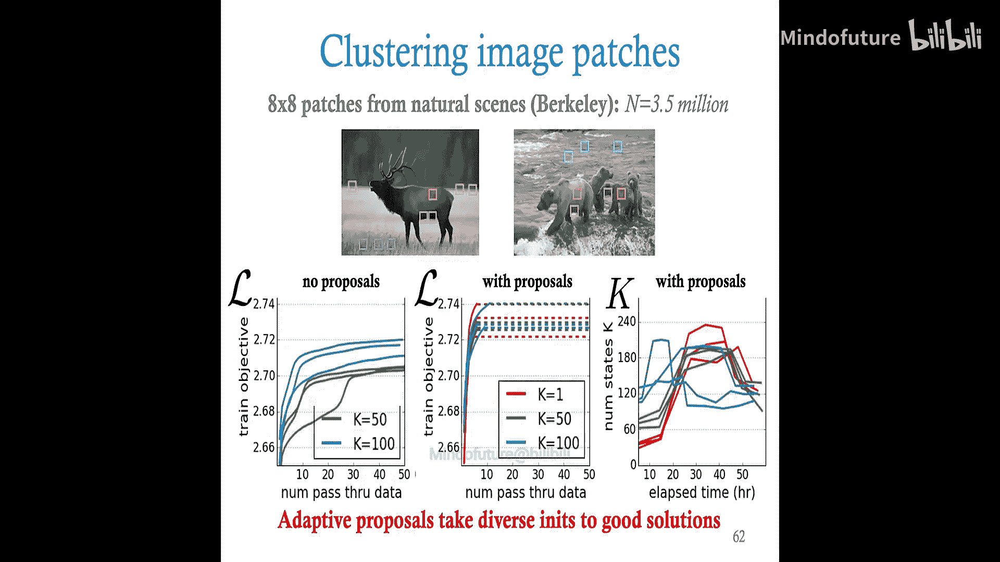

And。And fit and just to show you one application of these， right， you can get。

Here's an example where I take an image。I add noise to it。

So people working on these image denoising problems because there's a lot of cases if you're a low light or have poor quality sensors。

 you get the noise。And now you can say， let me， you know。

Denoyise this how am I going to dennoyise essentially a Bayes rule right where your your likelihood comes from the fact that I know I added Gaussian noise and then your prior comes from the fact that you know for every eight by eight patch of the pixel you。

you know that have this mixture model what it should look like and this is the kind of result。

You get。😮，And in fact， many of the state of the image and noise algorithms are based exactly on these type of patch based representations。

咁。So you get get some quite。

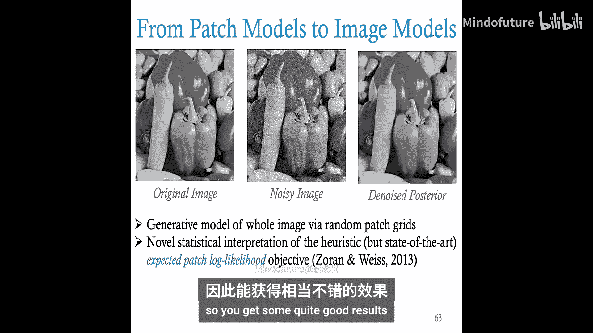

Qu good results。嗯。Allrrect。All right， I'm going to next move into some other applications。诶。

But I will pause here to see if anybody has any questions first。I have question。

 is there a version of that that works for the denoing we were just talking about that works for with non like generic noise inputs？

Like something kind of。Well。Um。

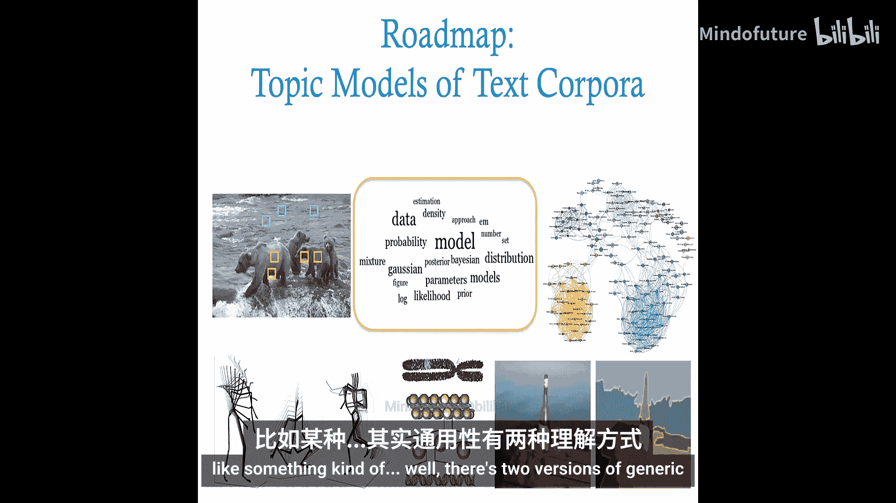

Well， there's two versions of generic。

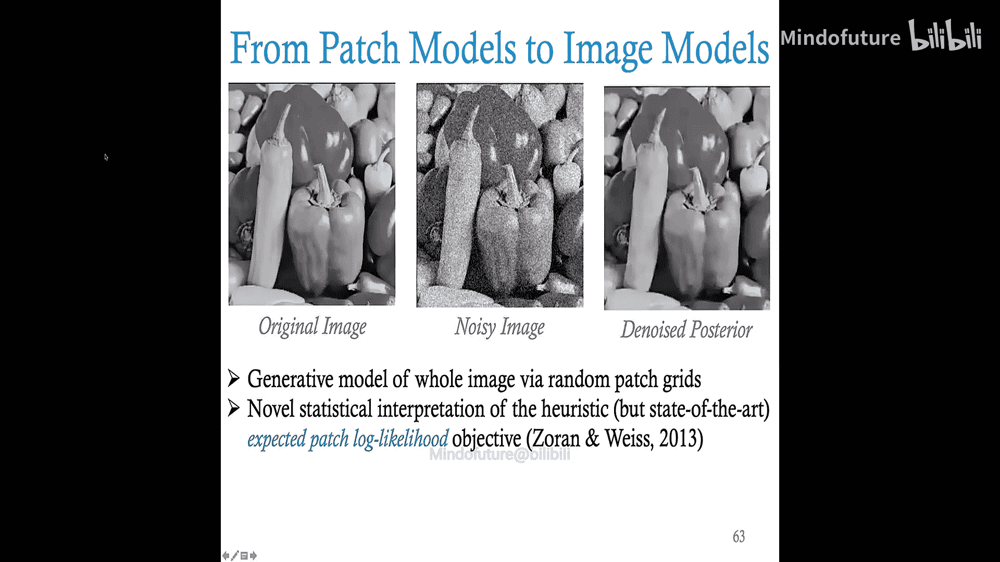

So first there's。I guess there's two versions of what you mean by generic。

 I guess so one is that the。You know。In this case it was Gaussian noise。

 the algorithm knows that you added noise， if you had a different distribution of noise。

 you could change that and then still do thenoising。

The other thing is that it's exploiting the fact that it knows this is not an arbitrary collection。

An image right to a computer what's an image right it's a black and white image is just like an array of numbers you about like for every pixel there's a number between zero and one that says you know whereas zero is black and one is white and others are shades in between。

And so。But it knows that that's not an arbitrary array， that was an arbitrary array。

 there's nothing you could really do， it knows that that's an image and if I got my image by taking a picture of something in the world。

 then you know it has certain statistical regularities， certain properties。

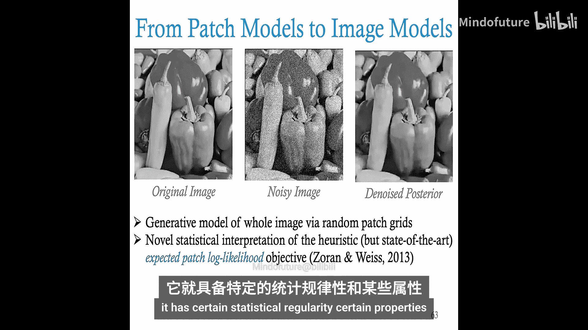

Right and so essentially。This why are we using patches。

 it's because although it's hard to represent the distribution of whole images accurately。Um。You can。

Represent。The image of。littlettle patch as well and so if you wanted to apply this to a different type of data。

 well then you know you know you would need。A training set to be able to learn your little model what patches look like。

But。嗯。If you had you could， if you had other type of data with other sorts of spatial or temporal structures。

 still， I think apply a generalization of this and then could probably be effective。Okay， yeah。

 I guess I just meant sorry if we just have a generalized if we have like an idea of like maybe what the noise profile looks like。

 but not necessarily Gaussian。All this would still apply right yeah okay， thanks。I mean。

 if you had some。

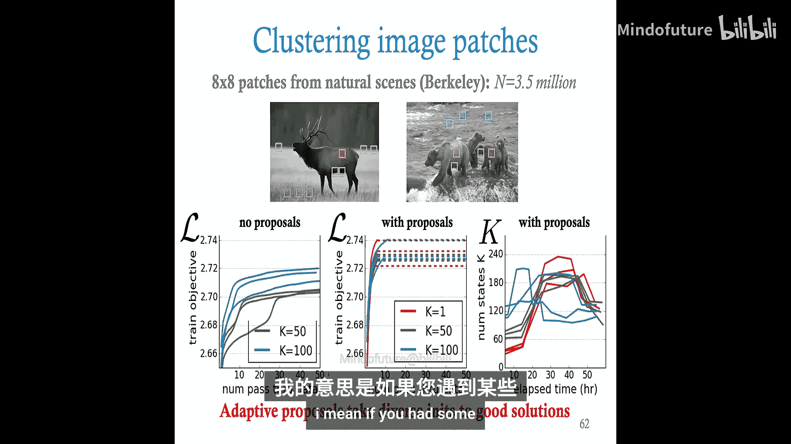

Strange noise distribution that wasn't Gaussian， we do in one of the updates of the algorithm。

Like Gaussians have some nice conjugacy properties， so it makes it more efficient。

 but I'm you know you could still do something with maybe a little more work or some other noise distribution。

ok好。

是。Yeah。Okay。All right， so let me talk about let me see I'm not going to get to all the applications here so I will talk about。

We'll talk a little bit about these topic models。Up text data。Um。And。Again。

 so the idea of a topic model is that。We are going to rather than just a mixture model could be used to just cluster documents。

 but we want to do something more we want to be able to say。There is。A。一。

Document is not about one topic it's about a set of topics so right so there's a fraction so I have some topics maybe a couple that have high probability maybe many have low。

Okay and then we're going to want to split up sort of which words in that document are about which topics and then what are topics like mathematically topics are just represented as distributions over words right so there's some words that are common in each topic and some that are rare。

So this list here， list these lists are just saying， you know。

 sorted from highest to lowest probability， the highest probability and so on words in the topic。

 but really a topic is just like a distribution over a set of possible words。And so。

The idea now is that it's kind of one step more complicated than the mixture model because now it's like I have。

Here D is the number of documents and D is the number of words。

 so XdN is what is you know word in and document D。Okay， and so the ZbN。

 there'll be a topic associated with each word。PidD says what are the topics in this document？

What they talk about and then I have this global variable U， this is basically like saying。

 you know across my whole corpus across all the documents， how popular are the topics。

 so which ones are more popular and which are less popular。

And that's kind of turned out to be an important thing to include in your model as sort of plays a regularization role。

So you'll learn about which topics are useful overall and which ones are important in each document。

And then。This connection between you and Pi is so the HDP stands here for hierarchical Dulate process。

 kind of adding an extra level of hierarchy of the Du s process to model the fact that I have not just one distribution over the topics。

 but many distributions， one for each document that I'm linking together。嗯。And I'm going to skip。

Be kind of the details of how this works。But you can apply some of the same variational methods right so now it it's inferring the local step goes to a document and says what's the probability that each word came from each topic and then I have global steps that are essentially reestimating you know what is the distribution over words for each topic。

And we can apply some of those same。You know moves to create new topics delete topics just to give you intuition here's an example right so this is。

During when the model was being trained in a large collection of Wikipedia articles。

 give have a bunch of Wikipedia articles and trying to figure out what are the topics that are discussed。

Here are kind of at an intermediate point in the algorithm， here are two topics。

 these are the popular words and two topics like so there was one that had words you know series song release star television York Award。

 another that was the words film magazine direct production actor careerer Hollywood and then when it looked at the way these topics were being used across。

But many articles， it figured out kind of said that， well。

 actually these are kind of being used in similar ways。

 and I get a better mall of data if I just compress them together。Okay。

RightHere's another one right you can see language Latin letter dialect speech versus linguistic linguist language speech grammatical okay so kind of two versions of the same word and so the nice thing about doing the merge like this is not only does it make things sort of efficient and faster it also increases your model interpretability so with kind of let's say more naive methods for fittingad topic models usually sometimes have this problem of redundant topics or strange topics and doing this kind of thing helps avoid that。

Um。And。I'm going to skip this one。Those are moderate so you can apply this this things at a fairly large scale。

 so this is now showing。There's a data set， so this data set is something like every article。

Published in the New York Times over about four decades。If I remember correctly， so it's about 1。

8 million articles。And now it's learning， I forget on the order of like 500 to 1000 topics。

So a fairly like kind of。You know， not a lot maybe next to2 million but you know a lot of kind of topics and and this is now showing that kind of on。

Held out like likelihood kind of how good。Do methods do？At predicting that。

 I'm not going to go through the details of all the methods。

 but kind of just this is just to show that these top methods。

Our this purple that stochastic variational inference。

 this blue is something that in addition to that is trying to do this split and merge and those work a lot better than certain sort of baselines。

Okay， so you can scale this up。There's also a version of this HP idea that improves the model of image patches。

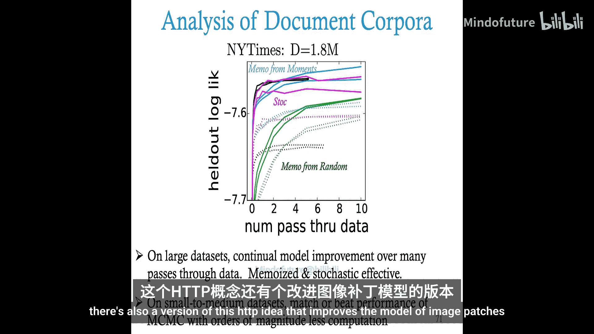

And this is one of these things that probably actually it gets kind of so distorted over Zoom you can't see。

 but these models really do a nice job if I have a noisy image of recovering fine details and removing the distortion。

U。

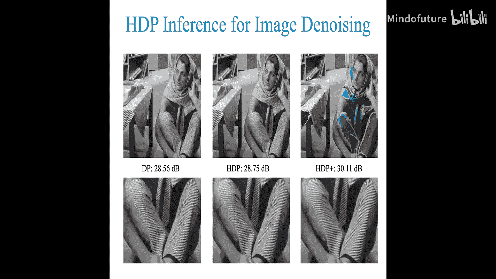

So。Let's see。Yeah。Let's。Yeah let me talk about this this is I think a good one。嗯。

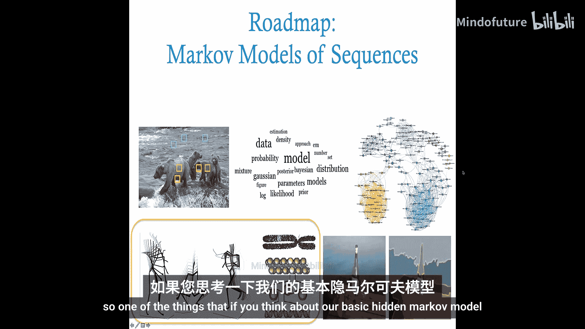

嗯。So one of the things that if you think about our basic。

Hidden Markov model or generalizations like hidden Markov trees right when you have a hidden Markov model。

You。You end up having to sort of specify， well， how many states are there in my Markov chain？

have 10 is that 20 is a 50， so thinking about when you do your EM algorithm to fit the hidden Markup model。

 you the inputpoint of the inputs is the number of states。And so just like we can have。These。

 kind of。These nonpar models give you methods that when I'm doing clustering can adapt the number of clusters to my data。

They can give me a hidden Markov model where if I have time series on modeling。

 I can adapt the number of states in the HM so learn how many states I should have to fit my data。

Okay。😊，So the idea is that， you know， I have。Still， it's an HMM， I have these Z's。

 these are the states that are generating observations， these follow a Markov chain。But the。

If you want， you my state transition matrix。Is。Infinite by infinite。

 right there's an infinite number of states。And from every current state， you know。

 it can go to any of the other states。Right？😊，Conceptually， that's what it is。😊，And then every。

 so that's why。You can get these pie ks， these are like the rows of the state transition matrix so for every one of the current states。

 there's a probability over all possible next states。

And then also for every one of my infinite set of states， that's why there's an infinity here。

 there's a distribution over what observations look like in that state。系。

Now a problem you will immediately see is that you know。

You could have bad overfitting in a model like this， like just in the same way， you know。

 when i'm doing clustering if I'm not if I have a very flexible clustering model。

 I don't want to put every data point in its own cluster here you can imagine that you know you have a。

A Markov chain that basically at every time point goes to a new state and never returns。Okay。

 so that would be a bad model of data and but it turns out we can avoid that using these doly process ideas where essentially we。

诶。There's some math that I'm going to skip， but the idea is that what the math is doing is that it's saying that every row of my state transition matrix is biased to be similar to some average。

 so there's basically there's some popular states that I'm going to go back to more frequently and that kind of regularizes this estimation of these state transitions。

Good。

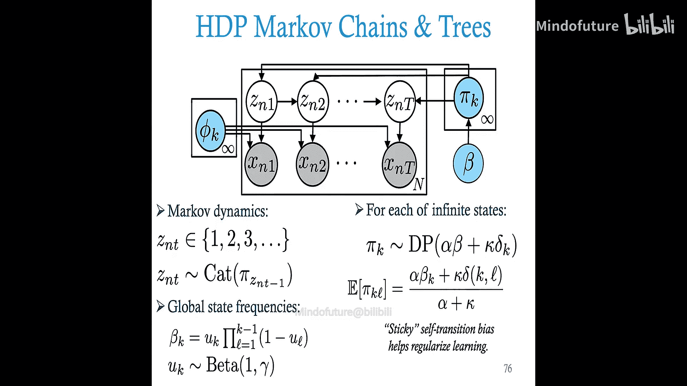

Okay。I will。Now here is one application of this， so one benchmark for this that this is a problem that's been studied a bit in the signal processinging world。

 it's a problem called speaker diarization and so the setup is that I have a microphone that's recording a bunch of people talking in a meeting。

I don't know anything about the people， they're not people I've like encountered before。

 so I don't have a model of individual people。And now what do I want to do。

 I want to figure out how many people were in the meeting。And also when each person was speaking。

Okay， so you want to take your input， which is just this kind of like audio waveform and kind of figure out that there were let's say three speakers and this is when each person was speaking and then maybe there's some background noise or something like that。

Okay。And it turns out that。ThereThere was kind of some various engineered systems that did this。

 and at least at the time that the HPHM this。So I'm sorry the what is HPHMM。

 HDP is a hidden markup model that uses this hierarchical duallate process idea。To adapt。

To to allow the number of states to be learned from the data and so this has this property if you give it one time series。

 it'll learn some number of states that could be different from another time series。And so actually。

 this kind of gave state of the art performance。At this task， it worked really well at estimating。

These audio sort of assigning speakers from these audio waveforms。

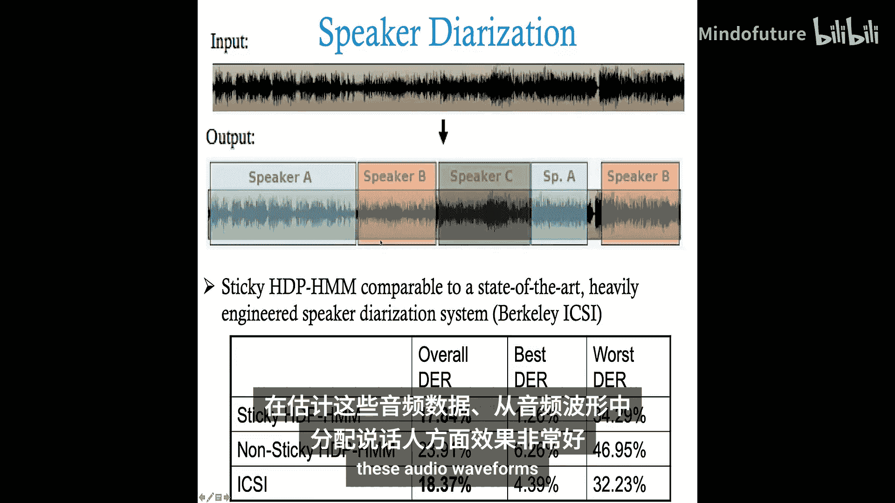

嗯。However。There was a problem， so the original。嗯。呃。Inference method for this HtPMM was a G sampler。

 it was actually a block G sampler that did the forward backward algorithm I talked about to resample state sequences。

And there's some fancy things you have to do to deal with the fact that you don't know how many states。

 but you can extend your sampler to cover that。嗯。So a problem is， is that for kind of。

Peak performance。It took。咁。You might have to run the sampler for like more than 10，000 iterations。

And that translated to if you gave it minutes of audio。That would be like days of computing time。

And so that's a good result， but probably not a practical solution to this application。啊。

And so this is a this is really， and I bring this up because this really is。

Something to be aware of with the G samplers the MCC methods。

 I mean the theory is very powerful that you know that you have the right equilibrium distribution。

 if you run the sampler long enough you will in some sense have optimal inference。

But that if you say what is long enough， it could really be。Dramatically long。Okay。

 and then so sometimes if they say， well， I can't wait days。

 so you run your sampler for hours instead of days then and then you get something that is like samples that are not really from the posterior and are not going to have the same accuracy and good properties。

So there's definitely a trade off thing。U。So。U。But。

Now you can instead think about applying variational inference to that。

 and it turns out that it's orders of magnitude。Faster。There's lots of app plot here。

 but I'll just say that these lower plots， this hamming distance。

 this is basically you can think about like if I'm predicting when different people spoke。

 this is basically the fraction of time points that I'm wrong， so I'd like this to be close to zero。

And we have methods here where you know， green is a sampler。Multtiiple runs of the sampler。

Red and purple are multiple runs of variational with two different versions of the algorithm。

 and you can see that it's getting to lower distances much faster as the log scale。Right。

 so on the order of like 10 seconds instead of。Thousands of seconds。And so in fact。

 with his variational inference， the diarization is sort of like。Faster than real time， right。

 the amount of time it takes to do the inference for。

Ex secondsd of audio is actually less than that many secondsds。

So it starts to really become a more practical method for this kind of application。

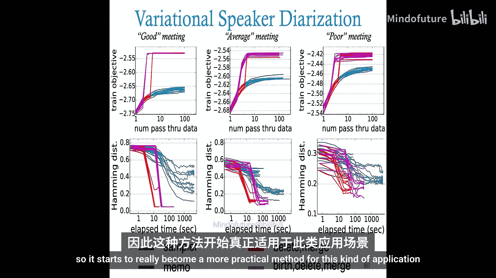

Yeah。嗯。Here's a more fun， so I mentioned at the start that those kind of。嗯。Oh I guess。

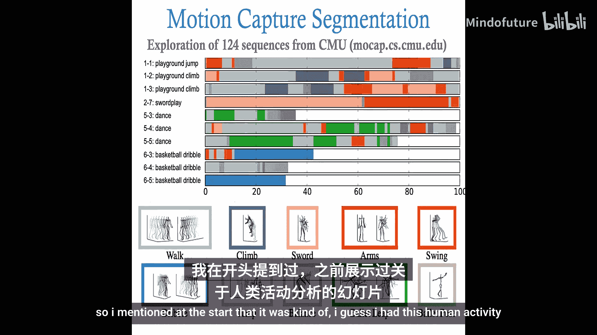

I had that。This。Human activity slide earlier。So what the data is actually here is this is data from a motion capture system。

Right so there's basically a system that's for this person determining all of their the locations of their different joints over time。

 and so that's kind of what these things are is over time the locations of different parts of their arm and leg and waist and so on and so forth。

Okay。😊，And so this the data set we looked at is something that was it's been it's called the CMU mocap data set this has been around a little while that。

In this case， it's it's sort of。The data is a I don't know grad students doing weird things in the lab so they came in and did lots of activities。

 but if you just give it the stream in this activities。

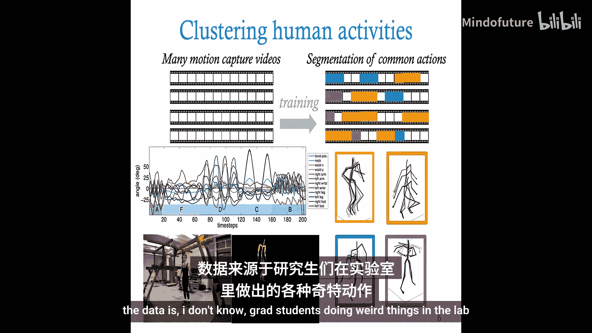

The HMM will kind of automatically break it up these are sort of showing things so there's no labels of arms or ballet leap or walking or dribbling this is kind of clusters that automatically discover of activities right so it kind of automatically finds places where the types of motions are different from other places and breaks them apart in an unsupervised way。

You know though this is not super interesting as an application。

 there is actually a lot of interest in methods like this right now because， for example。

 there's a lot of data that comes from sort of the accelererometers from sensors that people have in phones and other mobile devices。

And there's interest in assistive technologies for these things。

 even things like people understanding， if I have you know。

 these sort of sensors for someone who is elderly and living alone。

 can I use it to help figure out when something normal is happening when something unusual isn't happening they might help so maybe as a way of letting them sort of live independently for longer。

Okay， so there's a lot of kind of。Maybe interest in these where you can't manually go through and label all the data。

 but you can apply this kind of probabilistic model to try to discover structure in it。嗯。

And I will mention， so one other application of this these kind of hidden markov models is actually to biological sequences。

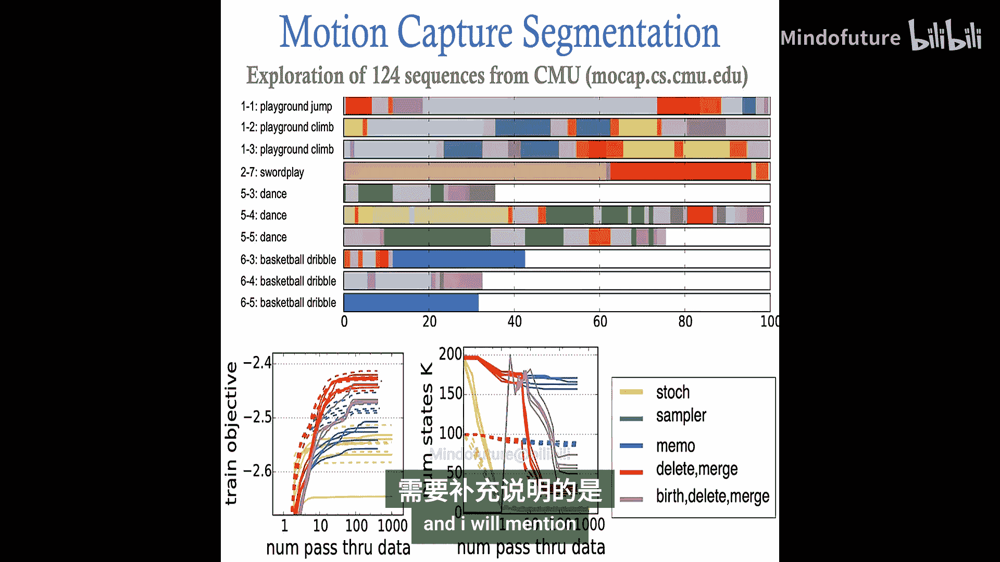

And so there's a task， there's a lot of versions of this。

 one version is called chromatin segmentation， so you're looking for these sort of sections of of the genome that are involved。

And certain types of transcription activities。嗯。😊，And there was some sort of high profile work at this of using HMs to try to discover these and maybe then interpret them with relevant interpretations。

But an issue with this work is that they you know they basically just said。

 you know we arbitrarily fixed the number of labels at 25 here the number of labels is the number of states in the HMM so they didn't have a way they just sort of said well let me pick a number。

 of course if you're trying to discover something about biology you'd like to be able to actually learn that。

Um。And what's nice is you can kind of run the sort of methods I'm talking about at genome scale right so for the。

The representation of the genome that's used in this chromain problem。

 it looks like a time series with 15 million observations。That's the length of it。

It's not quite the only of the genome because there's some kind of like local blocking that goes on。

But at that scale， you can you can actually do methods that。You know， learn over that scale。

 adapt the number of states。And and get fairly good models so I'm not going to talk about the implications of this。

 but it is something you can do。嗯。And one of the things that enables that is that you can do some parallelization。

Okay and so how would this work well remember I talked about these methods。

 they might take a batch of data， analyze that batch of data and then update and then go to another but when you take a batch of data。

You know let's say your batch of data is 500 little short sequences when now you can split your analysis of those 500 sequences across multiple CPUs or when this was done it with CPUs today it'd probably be multiple cores in a GPU and you can see that as the number of apparels get up I don't quite get linearing your speed up。

 but you get pretty close to that。So there's a lot of potential for paralyzing these methods to scale up。

To these big data sets。是。嗯。Alright。Okay。Okay。So I am at the end of time。

 I wasn't expecting to get through all the applications i'll mention that there's。

Two more applications。In these slides， one is essentially。

Applying these ideas to the community based models of social networks。

So you can apply the same idea to learn， you you can probably like already start to imagine how it would work。

 I'd be learning instead of having to pre specify how many communities I'd learn how many there are。

And the nice thing is with variational inference， you can scale this up。To very big data sets。

 I'll just show a result， so there's。

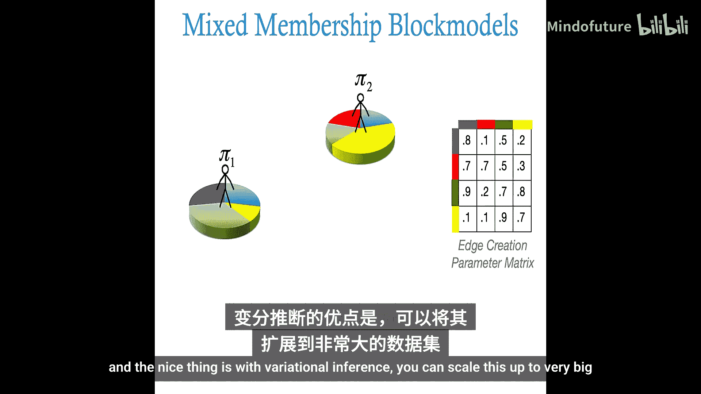

嗯。😊，So， you know。Some of you may have been lamenting how slow the G sampler was on a data set with only 50 or 100 people on your homework。

Here， this is a network that has 18，800 people。Its this network is it's called from this open source repository called Little cis。

 so little cis is why do they call little cis， it's like littles is the opposite of big brother。

And what they did is they found a bunch of people， the people on this data set are all things like。

Politicians and CEOs and people， sort of high profile people in business and government。

 and they have they kind of uncovered a bunch of connections between them。

 maybe ones they'd rather not be public。So you have this graph of connections now if I take the。😊。

200 most connected people and just plot sort of like lay them out and plot their edges。

 you get this and it's just kind of a mess。But instead。

 if I take this data set and learn communities。

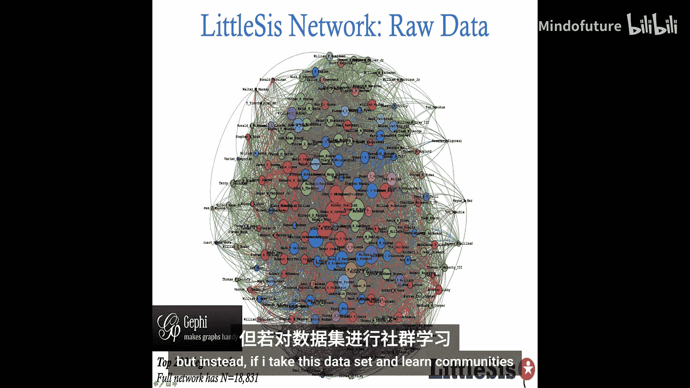

And then kind of lay out people according to their community memberships then you start to uncover lots of sort of like groups of people in interpretpreable as well as the folks who who。

Link between communities。有。U。And so you get these interpretable also I won't mention。

 so this is a version member， the last thing we do on the homework is predict help links。

 whether links are present are absent。

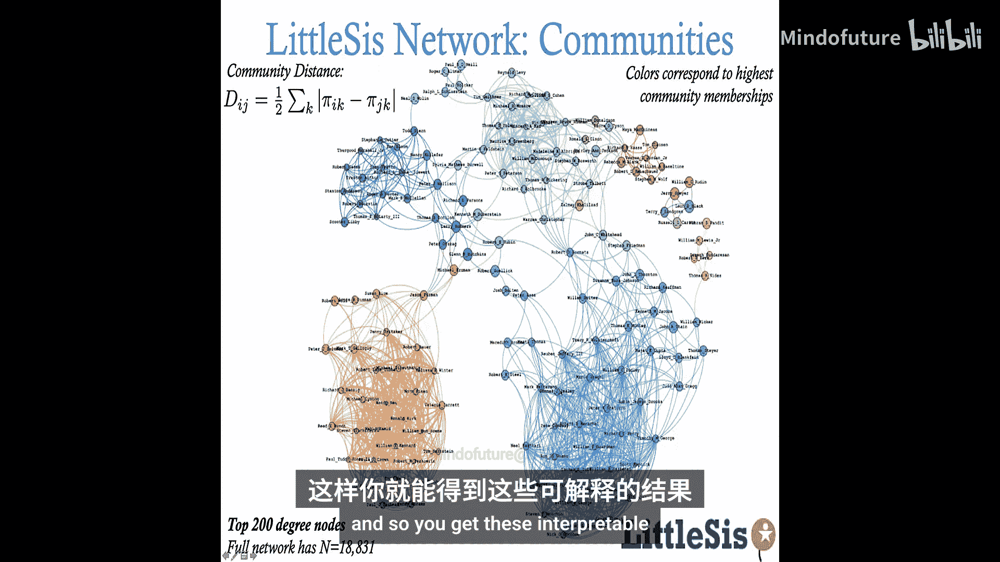

If you have these flexible models with many more communities。

 it turns out that they get become much more accurate at those kind of link prediction tasks。

And so in this case， we can actually get you know the AUs， you know。

mTo to quite high levels with fancy versions of these models on those tests。嗯。

So I don't have time to talk about in detail， but just to connect back to what you've been doing all the homework。

UAnd I think I will wrap up there because I'm out of time， but I would be happy to take。

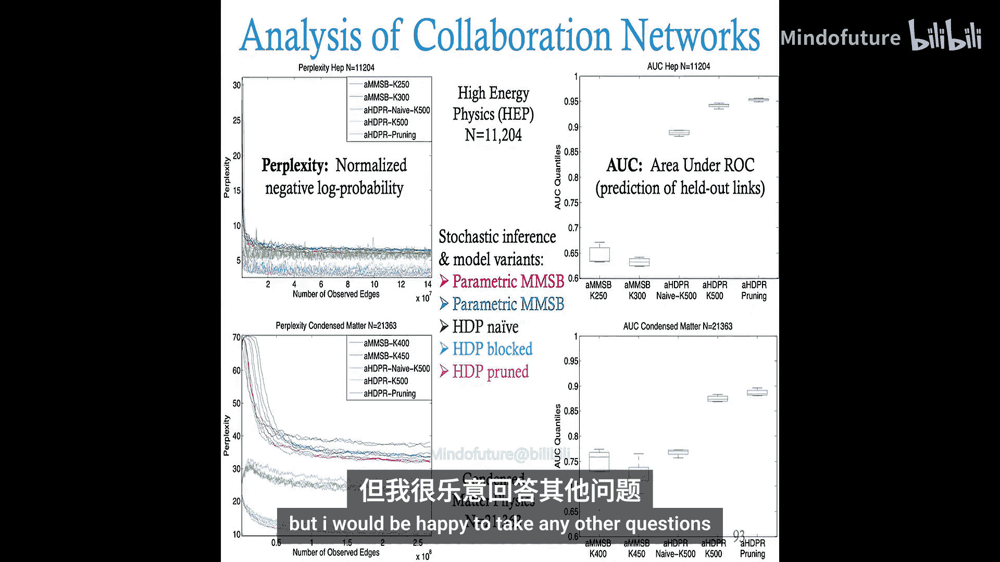

Any other questions？