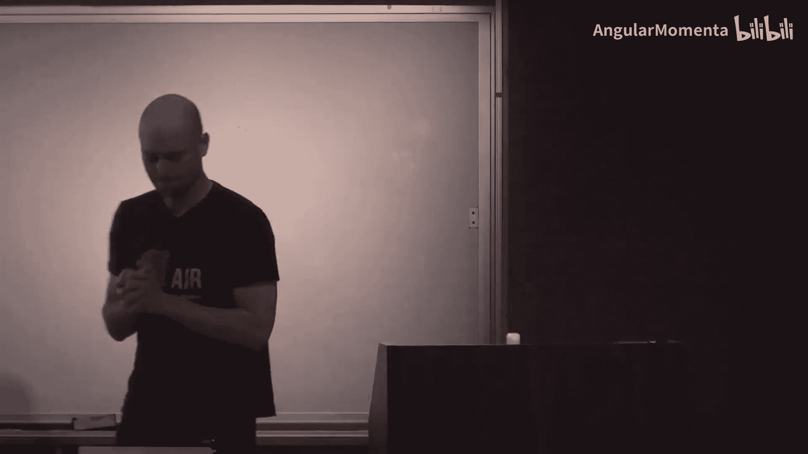
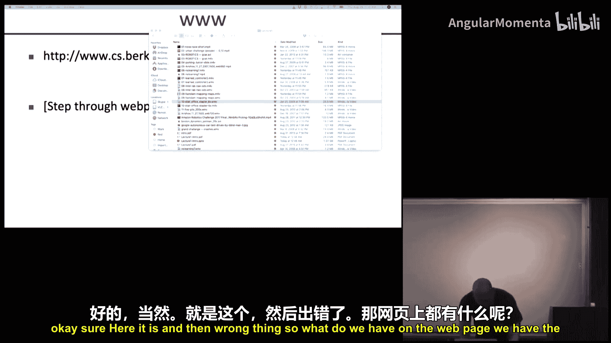
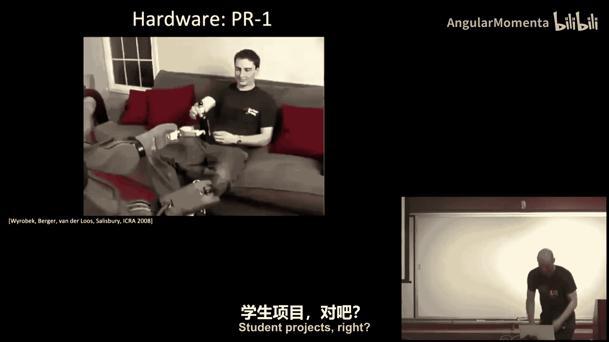
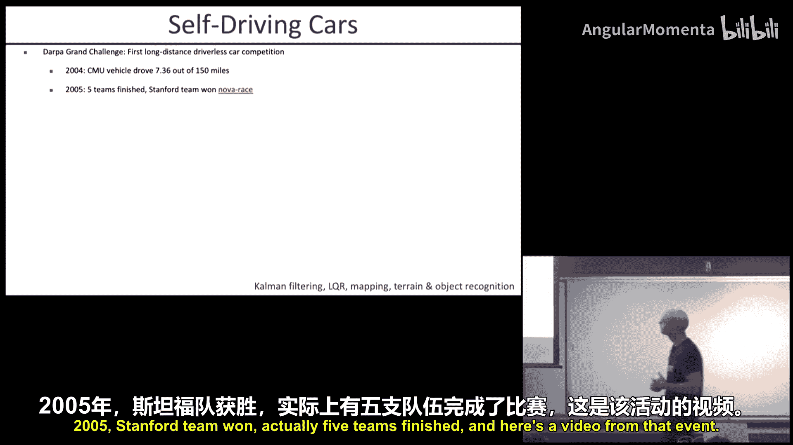
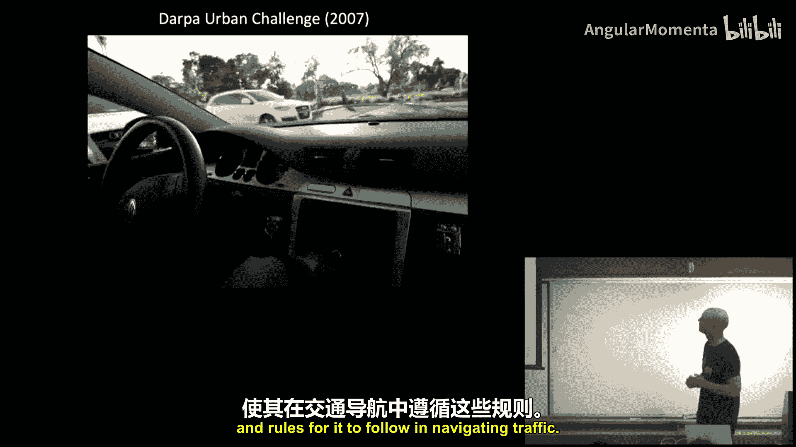
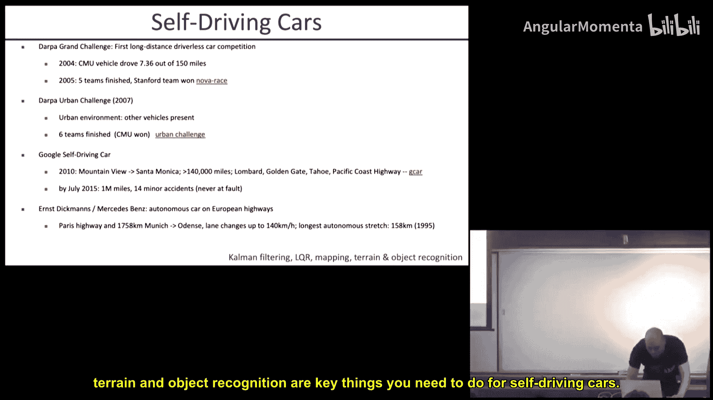
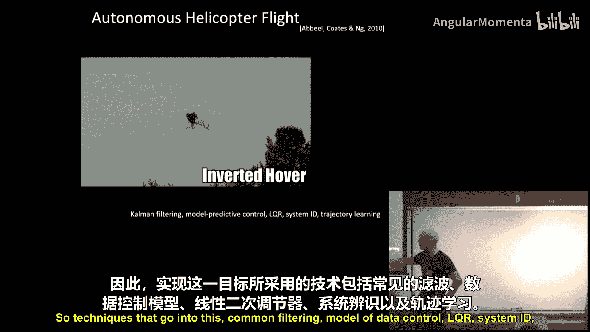
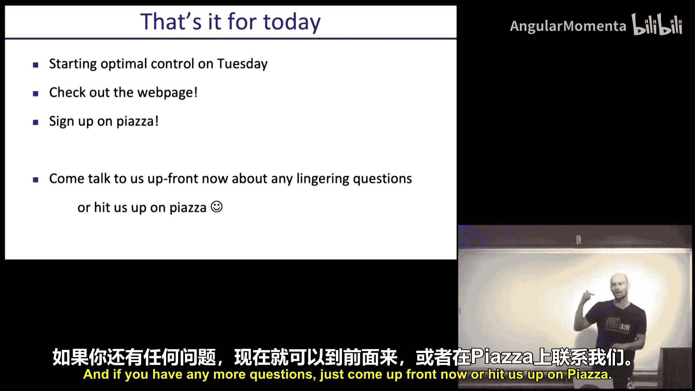

# 【加州大学伯克利分校】高级机器人学-｜-CS287-Advanced-Robotics-at-UC-Berkeley-Fall-2019-p01-1-引言--BV1KXqCB4Eua_p1-

All right， welcome everyone。First lecture of CS 287， advanced robotics。

 Let me start by introducing the。

Of course， staff， at least whoever is here， and professor of the class， Peter Rabi， I saw Ignasi。

 Ignasi， where are you over here we want to stand up for a moment， people can see you。

So now is one of the GSIs， then Laura Smith in the back。

 I'm going to stand up for a moment so we look can see you。That's Laura。

Harry is over there in the back， so those are the three GSIs。

 and we look forward to an exciting semester with you。😊。

First important thing is there's a web page for the class and that's the URL and let's step through that right now so you can see what's on there and get a little bit of an idea for the structure of the course。

😊，leave the link up for。Oh， okay， sure。

Here it is。Andね。Wrong thing。So what do we have on the webage We have the information I already told you who is teaching the class when it's held。

 then actually also links to past offerings。 If you want to get an idea of what we're going to cover now。

 there's going to be a good amount of overlap so you can know ahead of time a little bit what this is going to be about。

Office hours will start next week。 We'll post them on here。 We'll also post them on Piazza。嗯。

You should sign up for piazza because essentially all our communication that's not happening in lecture will be through Piazza。

 As you can see our announcements。 We have two announcements here。

 but the second one is already saying there will be no more announcements on this webage。

 All future announcements will be on Piazza。Then let's see。 Here is the schedule in terms of。

I guess everything that's not lecture。So there'll be five assignments and you can see on what topics they're going to be。

 and you can see when they'll go out， when they'll be due。There'll be a final project。

 The proposal will be due early in November。 There's a stretch here where there's three weeks between assignments rather than two。

 and so that's when your final project proposal will be due。There will be a midterm， this is new。

 we've never had a midterm in this class and very excited about it， I hope you're equally excited。

I'll say a little more about it in a moment。😊，Then there will be final project presentations during。

 well， this week in December we'll figure out the exact timing as the semester progresses and then final project reports。

 oh， I think it's just Monday but it's actually a Sunday。

 so it should say Sunday 1215 final project reports are due。

Let me double click on the midterm thing because that's maybe the most surprising thing。

 so here's the thinking。U。What we cover in the class is going to be a lot of very fundamental intuitions and derivations。

 and they're the kind of things that if you really know them。

We believe you'll be better off in the future， for example， if somebody ask you。

 can you write out for me what the LQR derivation is and that that is something you're capable of doing。

 that will actually help you or if somebody says， can you explain to me a policy gradient you can just go on the whiteboard and write it out this is how you derive policy gradient。

And so the midterm is not really something to stress out about。

 we're actually going to give you the questions ahead of time。

 we're going to give you the answers ahead of time。And this is going to show you。

Exactly what we care about。 Now we're gonna give you probably 20 questions。

 and we're only gonna randomly sample a few of them because you know it's a lot to write out know20 pages of answers。

 But the idea is that every midterm question will be roughly a halfp of page of derivation。

 it's actually given to you that we think is so fundamental that you should just know it and not something you have to say。

 oh， somebody ask me a policy gradient， I need to go look up some notes to remember what it is。

 And right now， maybe for somebody of you that sounds to me like， oh I can always go look things up。

 but think about it。 if somebody ask you what is a derivative。

 you wouldn't have to go back to your high school textbook and say oh。

 it's like plus delta minus delta divide and then actually there's this other way to do it and a gradient is a vector of those things you just know that。

 And it's a building block you can reuse。 And so we're gonna pick a bunch of building blocks that we feel important enough if you be able to just do on the spot and you'll do on the spot on the midterm。

 but you'll know exactly what's coming if you're good at memorization is easy。

 but the derivations are set up in a way that。It should be very logical。 So ideally。

 you actually reason through them as you study them rather than just photocopy them into your head and then photocopy them back out。

Since the questions are given ahead of time， we'll figure out the schedule of the midterm later in the semester。

 we'll see how many people are here， how big a room we need to have and so forth。

 because it's not like if we have two sessions that we need to worry about anybody leaking the questions because we already leak the questions ahead of time to you。

So we'll figure that out and so well， if you are traveling that entire week。

 let us know early so we're aware， but as long as you're not traveling that entire week。

 things should be fine， it should be a way to make it work。

 hopefully in two or three sessions get all of you in。Any questions about that。

 because that's definitely the newest part in the course。Yes。

 that would be a close because absolutely close notes， I like that question。

With a 20 page cheat sheet would be， yeah， you could just hand in three of your cheat sheet pages。

Absolutely， but it's good you asked the question。Completely close notes。Any other questions？Okay so。

The homeworks will typically be a mix of。You deriving maybe an extension of something we covered in class and then might be like 10% to 20% of the homework and then 80% or so will be implementing things that we covered in class in some simulated robotics environments。

 though for your final project you're of course encouraged to also work with real robots。

 but for the homework it'll all be in simulation whenever we have things that need to be run。

Those is approximately the topics we might change this a little bit as we go through the semester。

Then the assignment policy is you can collaborate with other students in the sense that you are allowed to discuss what you're doing。

 what you're working on， what works， what doesn't work。

 but you must write your own code completely and you must write up your own solutions completely。

 So all code and all write up has to be your own and you have to be able to do it independently you can't sit next to somebody and type it up。

 seeing what they wrote up。 you have to be able to go sit on your own and write up your report。

Late assignments， so you have a total of seven。Late taste for the semester。 So if anything comes up。

 you need extra time。 I don't know。 I can imagine maybe you have a conference deadline or something。

 and you need all your time for finishing your paper， and then you need a few late taste。

 That's fine。 You have to 7。 You can use however you want， you don't need to let us know。

 but we'll keep track of it。 if you have to go over。 you lose 20 points per day。

 You go beyond 20 points on that homework per day。 you go beyond the  seven days total。

 So if you go five days over。Not useful。 And also you we will drop the lowest。

 So if I know that many of you have research deadlines and so forth。

 then there will be a time in a semester where you just need to get your research paper out。

 or maybe you just have bad luck with the homework you thought you saw it。

 but you actually completely didn't solve it。 So we'll only score you on the four highest scoring homeworks。

Then final project。 The idea here is that you。Let me make thiss a little bigger， maybe。

I here is that could be either the following。A theoretical or algorithmic contribution that extends the current state of the art。

 or you could do an implementation of something we covered in class。

And rent it on real world data are ideally real robots and investigate if it can actually work on a real robot beyond what maybe you did in a homework in simulation。

We can help you with brainstorming project topics you come up with your own。 either way iss fine。

 One or two students for project。 The proposal deadline is November 6。

 then project presentations the week of 9 to 13， and then final paper due on December 15。

 There's no late days allowed for project proposal or for final project report or for presentations。

 They'll all need to be in in those timelines。Preres， generally。

 familiarity with mathematical proofs， probability， linear algebra。

 ability to implement algorithmic ideas in code。 One thing that we're changing is the previous edition of the class is four years ago。

 at the time， Matlab was very popular。 today， nu is very popular。 So the code that you'll write。

 will be a nu。 at least the starter code would give you will be a nupy。

 If you want to later convert it into something else that that's fine。

 But if you just want to fill in the starter code would give you， that's gonna be all Python nu。😊。

Then。In terms of enrollment parity goes to PD students。 if you're undergraduate masters student。

 there are codes we can give out on a one on one basis based on your record。

 which is not just your absolute record， but also compare with other people who try to take the class and see whoever seem like the most fit given the space that we have。

Class goals we want you to understand the math algorithms underneath state of your robotic systems。

 A lot of them are built on optimization and probabilistic reasoning。 And these。

 these actually have many applications beyond robotics。

 So you'll see tools used in the icons of robotics。

 but you'll be able to reuse them also in other settings。

You'll implement and experiment with these algorithms。😊，In terms of other goal。

 we want to be able to understand any research papers written in this space of robotics。

 So these are the at least those ones are not on mechanical side。 So all are algorithmic。

 These are the main venues。 and we want to give you some time to try extensions of your own in the final project。

Grading， five assignments， dropped the lowest， open ended final project is 30%， assignments are 60%。

 and then midterm is 10%。And then here's a syllabus， not going to go through all of that right now。

 but you can see what we plan to cover。 We'll also have some industry guest lecture。

 So one of the things I think that's really starting to happen in robotics is that it used to be more of a pure research field。

 but now it's actually becoming very practical there are many companies being built that are robotics companies and so we're bringing in a few industry guest lectures to give you some notion of what's happening there directly from the people doing it。

 So I think our first industry guest lecture here is two former Berkeley postdocs here Vanenberg and Sachin Patil。

 who。Used to be a。Wmo cell driving car， auto cell driving car， Uber cell driving car。

 but then start their own company， Ike for cell driving trucks。 So they're gonna to be in October。

 then Adam Bry got his PhD， I believe in Nick Roy's lab at MIT， CEO and founder of Skyio。

 which is a drone company， so we'll have him。 and then Drgo Anngelo。

 who is the research director of Waymo， the Google cell driving car effort。

 will have him in November， and there might be one more。

For some topics we'll also have dedicated guest lecturers who are the world leading experts on this particular topic。

 so for particle filters， we'll have Wolfra Bard， one of the three authors of the main book on probabilistic reasonaing for Robotics。

 so he'll come for that lecture and for S toreel， we'll have Josh Tobin from OpenAI who's kind of pioneered Daftfield in the last few years and really pushed it to the next level。

And then some related materials at the bottom of the website。

 just if you want to read more on a topic or feel like， oh， I don't have enough background on this。

 and it seems to be assumed that we have a little more familiarity with this topic。

 here's a bunch of references that you go check out to learn more。

Any questions about the website and the plan here？Yes， for the final quarter。

 is it allowed to be overlap with。So course。Final projects are okay to overlap with other courses will just have higher expectations because you're essentially using it twice so you should do something twice as impressive。

 hopefully but I would encourage that actually， because usually， I mean。

 ideally your final project turns into a paper you can publish。

 And that's a lot of work and need to move very fast or you'll get scooped and what you're trying to do。

 And so it's better to put all your eggs in one basket when you're trying to write a paper。

 even though usually people don't sit out it， put on in one basket， try to get the paper out。

 see what happens and move on to the next one。 And so I would encourage it if it's a lot in the other class。

 I don't know if it's a allowed out there。Any other questions？Then。We've done。This slide。

So now maybe let's talk a little bit about why you might want to study this class。

 and then we'll go through some yes。are the final projects individual？

Final projects either alone or in a group of two。Either way， it's fine。Harry。

Is there oh are the lectures recorded， Yes， they are。

 So there's somebody in the back recording lecture。 and I don't know exactly when they go up。

 but yeah should also alleviate some of the space need in this room。

Probably lecture goes up later today or tomorrow， not sure。Yes， what's the size of the project？2。

I was sure my mic is working。One or two people。Any other questions？Okay， so why take this class？😡。

Well， maybe we can take it one level up why study robotics。

 I would say there's two main reasons you might want to study robotics。One。

 it's a fantastic testbed for AI research。 And what do I mean with that？ Well。

 the real world is a lot less forgiving than simulation and games。

 And so things that work really well in Atio or some other simulated environment might just not work all that well on a real robot。

 And so it can give you a lot of inspiration for what's missing from existing algorithms such that they can actually be good enough to work in the real world environments。

😊，Another reason you might want to study is also research perspective is that biology actually provides evidence that intelligence can emerge in。

Physical environments， namely animals and so forth。

 They were physically interacting with the world and then became intelligence somehow in the process。

 And so it's a good proof of concept， whereas if you have， let's say， a suite of games。

 it's less clear。How much of intelligence is needed to solve that suite of games and unless less clear how far you can get by solving those games。

It might have some guesses on that， but with real world。

 you're actually sure that to be fully functioning in the real world。

 you need very advanced intelligence。Then the other thing that's pretty exciting about robotics。

 if you make progress， it can have a direct impact in the real world。 And this could be。

 I don't know。Household robots， running robots， driving， flying and so forth。 And in fact。

 a lot of the methods are generally applicable。W is the great time to study this specific class。

 I would say robotic hardware is getting in great shape， so a bit more about that soon。

 but the real bottlene at this point is in algorithms math and programming， not in the hardware。

And so this class is exactly focused on that and you can unlock a lot of robotic capabilities by just programming them better。

There are many， many different robotic systems， yet a few。

 a few core techniques are near sufficient to rule them all。 And so the things you learn。

 we won't have to study something very specific to two leg locommotion and something about in hand manipulation and something about flying。

 It'll be the same paradigms that apply across all of them。What are they optimization。

 probabilistic reasoning and learning。And here are some of the kind of environments we'll look at a lot as representative environments。

 but really if you had another type of robot， it would probably apply to。

And then results the applicability of those three thrusts beyond robotics， pretty much any AI field。

 optimization， pro， reasoning and learning will play a big role。

Let me circle back to the hardware thing for a moment。

 so here we have a video that's now 11 years old， PR1 robot doing a lot of the chore many of us wish robots could be doing for us。

There's a catch， this robot is teleopated， Eric Berger。

 one of the students who built a robot is actually pipeuppeering this robot around in teleop。

 but it shows that hardware wise this robot is actually capable， if just we had good enough software。

 we could have robots in our homes doing all these kinds of things。对对。Yeah。た。

Student projects， right？Now， you might wonder about the cost。😡，PR 2 successor of the PR 1，$400000。

 a little expensive。 So not everybody's gonna buy that right away， even if it is very capable。

 But then Baxter came out from rethink robotics $30000， four years later。

 So I used to give talks around the time。 I said， we just need to extrapolate this。 And by 2017。

 we should have another factor 13。 So a 3000 robot available to us。 wasn't happening。

 What happened in 2016 was 100000 robot。 The price went back up。 I mean。

 there is reasons for that it's a great robot to fetch robot。

 But the trend was definitely not exactly going to a $3000 robot。 especially。

Three years ago with a few students alone。Three years ago with a few students here at Berkeley。

 postd， we decided to take it in our own hands and we build a robot that has a bill of materials of only。

3 to $4000 depending on the scale of production and that's what you're seeing here so right now we are hitting I wouldn't say the $3。

000 mark problem more the $5000 mark once we can produce this outscale and producing that scale is not trivial a lot to be figured out。

 but in principle。We're getting there。So。We need the algorithms now。

And so what I want to do in the rest of this lecture is share a few robotic success stories。

 things that have already worked。 Of course，'s a lot more to be done。

 but things that have already worked and highlight。😊，Which core ideas are underneath them。

That are in the syllabus of our class， and then as we progress with a class。

 we'll understand more and more of those systems。First pieces， and then the entire thing。

Id say probably， the kind of biggest thing happening in robotics right now is cell driving cars。

 I mean， the number of people employed in robotics that the fraction of them in cell driving cars is very。

 very high。Where this new kind of increased interest in cell driving cars started was in 2004。

 DAA organized a challenge。 You had to raise your car， a time trial race in the desert and。

The winning vehicle， but didn't really win because you didn't finish the race was a CMU vehicle that drove 7。

36 miles out of the 150 miles that the course consisted of。But in 2005， they did it again， 2005。

 Stanford team won， actually five teams finished。 and here's a video from that event。

The first time it's ever been done。As dawn breaks over the desert。

 robots prepare to boldly go where no robot has ever gone。不要。And we have movement from Stanley。

 ladies and gentlemen， the start of the Dart of a Grand challengeenge。Berkeley had an MP too。

 was a motorcycle， a lot of st。definitelyite screwed out didn't make it through a finish line。

are we there。Each one leaves the shoot with confidence。

🎼A far cry from the first grand challenge when many faltered within sight of a start and no robot went beyond seven miles。

During the first eight miles of the race， Highlander gains two minutes on Stanley。

So when you see two vehicles pretty close together。The one in front is the autonomous one。

 the one behind is the follow vehicle and they have a stop button， but once you stop， you're done。

Behind Stanley Sandstorm is closing to hear something really about happy you can stop the road。

They didn't stop it anytime soon， they'll let it go a little longer， just in case'm from the roof。

Behind it， Stanley is rapidly approaching。A Highlander recovers on the flats。

 and for many miles they continue neck and neck。Five hours after leaving the starting line。

 Stanley now leads the pack and just five robots remain on the course。To finish。

 they must windine through a treacherous mountain pass and。🎼う。A blue dot appears in the distance。

After driving six hours and 53 minutes at an average speed of 19 miles an hour。

Stanley is about to become the first vehicle in history to drive 132 miles by itself。

🎼So this was pretty amazing progress from the best vehicle doing seven miles to five of them finishing。

 It's of course， better if you finish a few minutes before the other one because you get a lot more fame。

 But then the next year， CMU came in with two vehicles second and third。

 I believe and then next year there was a new version of the race。

 which is an urban challenge two years later， urban challenge where now there were other vehicles。

 So DARPA had their own drivers in a citylike environment。

 mixed with the autonomous cars and it had to navigate traffic。

 do some parking maneuvers and so forth。 and that one was one by CMU here's some footage from at the time I was PC in that Stanford and footage I got them from Sebastian Thrs lab who led the Sebastian led the Stanford team。

 But theres kind of what at the time things looked like for these robots。

 essentially they had something called a Valadine which is a Liar system that can look in all directions to map out a point cloud of what's surround them and also it semantically interpret what's around them So I was having a geometry directly from the Lar。

And based on that， there'd be some classical control to control it and rules for it to following navigating traffic。

Now， from there。What happened is， and most people didn't know this。 I didn't notice it。 I mean。

 essentially only people who were on the in knew this， Google actually。Employed Sebastian throne。

To start a cell driving car project at Google， in fact， Sebastian started Google X。

 and I think the first project within Google X was the cell driving car project。He also recruited。

People from the CMU team， many people from the other teams。 And they all worked together。

 And it was kind of big surprise in 2010 when Google revealed that they'd been working on this for several years and had done over 1 hundred。

40000 miles autonomously on regular streets。 No less。 So that was a pretty big surprise。

 Then a year later。Was the kind of first public talk and footage about this at Is 2011。

 This was Sebastian Thron， who had LED the Stanford team and Chris Imsson。

 who had LED the CMU Urban Challge team and。This really surprised people because this is all autonomous navigating traffic in San Francisco。

 No less dealing with pedestrians stop signs， other cars， Toll Plaza。Oncoming big trucks。

 keeping it an autonomous mode。 that's a lot of trust。

So these things actually were working pretty well at the time 2011。

 it's very impressive and huge surprise that this was happening。Then。By July 2015。

 they had a million miles with 14 minor accidents reported。 none of them default fault of the car。

 So， I mean， you can imagine if you see a cell driving car。

 maybe you're distracted and you kind bump into it。 or just people do accidents all the time。

 And so a million miles，14 minor accidents。It's worth remembering though。

 that actually there was a result long before that in Europe， Er Dicks， Mercedes had。

Highway driving from Paris。To Munich， to adenzi，758 km with lane changes and going up to 140 km an hour。

A longongest autonomous stretch， 150158 k in 95。But somewhere at the time。

 nobody really built on it the way it started to build on after the DARPA challenge。

People also start doing pretty crazy things， so parking， parking can be annoying at times。

 but maybe there's not enough space， so then here this team。

 Zco Culture led this back when he was still at Stanford， he's now a professor at CMU。

 This is all autonomous。So。These are the kind of things that actually a robot can do better than a than most humans at least。

You can do much more precise control， but it's also very hierarch because I mean。

 the friction forces here are not easily predictable。

 So you need pretty advanced control to make this happen。 but they made this happen back in 2010。

Around 201112， actually， a lot of activities started to emerge in the cell driving car space。

 This is a map that common labs made with all the activity in self driving。

 like this full self driving efforts is like， I just want to build a lighter。

 I just want to build a better camera。 I just want to build entertainment for people who are in an autonomous car and so forth。

 So a lot of effort happening， massive market。 People have started to kind of delineate what it means to be at a certain level。

 though the definitions are maybe not always super clear when you're two versus 3 and so forth。

 But there's an attempt at least understand what the progress is。 So no automation is level 0。

 Drive assistance is maybe it'll， you know。😊，Break or something。Partial automation。

 conditional automation， higher automation。 It essentially goes from a notion of you have to always be there as a driver to。

 you can go asleep in the car。 Most companies right now that are working on this or。2， slash 3。

 That's where they're， they're operating and trying to push it out to further levels。 might wonder。

How is progress being measured well it depends， one way to measure it is by the number of miles driven。

On average， before you need a disengagement because all these cars tend to have a safety pilot in them and that pilot will take over。

 The human person takes over and for Wemo， miles per dis engagement is over 11000 GM M crews，5000 zs。

 almost 2000 neuro 1000 and so forth。 Now， these numbers are for。California。

 if you test your cell driving car in California， you have to report those numbers。

Some companies don't test in California so there wouldn't be any such number。

 so they might do the majority of your testing in California。

 then the numbers might not be representative。You can also game these numbers obviously there are certain types of driving that are easier。

 you could say I'm going to just always drive on the highway that's probably going to be easier than if you are in cityed traffic and so you can necessarily directly say this one is that much better than that one but at least it's representative of progress being made and who might be in the lead。

Over the years， this is plotted out here。 The number of disengs per thousand miles。

 So this is the loggarmic scale here。 That's the same plot in non logrimic scale。

 logrimic scale plot。 Human are here， so humans have 10 to the minus-5 fatal accidents per thousand00 miles。

 Human have。Roughly 10 to the negative 3。Injuries per thousand miles， and。

Somewhere between 10 negative 2， 10 negative 3。Cashes per thousand miles。

 And then here is the Wemo car。 black is cruise。 Then the other green is zuks。

 Then up there in purple is Nissan and so forth。 So it's a downward trend。 People are getting closer。

 but still quite a gap between human and autonomous cars。 Some people are very bullish。

 Like some people say， I mean， you probably seen Elon Musk， for example。

 say we'll have a whole fleet in 2020。 something along those lines。

 It's a very bullish kind stands probably the most bullish。 Other people more conservative recently。

 there was an article in New York Time saying that they're still very far in the future before we're really there because kind of the long tale of things that happen in the real world。

 It's very hard to deal with。 You don't encounter very often。

 And so it takes a long time to get it all covered。It's hard to predict the future， right。 I mean。

 who knows who's going to be right， But there's definitely a wide range of opinions right now。

We'll have some industry guest lectures， so we have Dr Ga of Research Director Weimmo。

 Yo and Or Sachin， co-founders of IK， come talk to us about their thoughts on this。

 but their lectures won't just be like predicting when it's going to happen。

They're going to mostly talk about some of the ideas we already covered in class but how they had to take them to the next level to make it work specifically for cell driving cars or cell driving trucks。

Any questions about cell driving cars？Yeah， Oh， I don't know how to predict that very well。Yeah。

 very hard to predict。 So I think。It， it depends a lot on how you frame it， so。

Deal with everything is very， very hard。 If you say， I just want to do highways。

 And whenever there is something unexpected on the highway， I'm gonna have。

 let's say camera cameras monitoring the situations on the highway。 If theres construction。

 It's not a place the car gets to go autonomously if there is an accident。

 anything kind of unexpected is only when there is regular traffic。 Will the cars go there。

 I can imagine some of these companies have that already solved。 I don't know。 I try not to know。

 because the way you get to know is by signing N。 And then I can guess here。 what might be happening。

 But。If you do it fully， is， it's gonna be hard because it's just a lot of unexpected things that can come up。

 But Audi has declared they have， I think， level 4， which means the car is responsible。

That they have that coming out now。For highway driving up to， is it 30 miles an hour。

 some speed limit。 So whenever you're kind of stuck in commute traffic。Heavy traffic jam。

 They're willing to commit that the car is actually the one that's responsible。

 That's what you're say at level 4。 and driver can just let go。

So that might be the closest of kind of something that's explicitly coming out where they're willing to put the car fully as the responsible entity。

Yeah。Yeah， huge debate around the need for LiDar or not LiDar So there's a few nice things about LiIDAR。

 I mean， LiDarR gives you you send the laser beam， see how long it takes to come back it tells you exactly how far away it is because you have a clock you're measuring speed of light time time spent and you know how far away something is。

It works at night， which cameras have more trouble with， but it also has issues。

 it doesn't seem very far out， but it's hard to see。

 let's say 200 meters out when you're driving a truck。Heavily loaded。 you need to see far out。

 So technology might need to be improved。 They're starting to get up to an intermediate lidar。

 but is it fully there not clear how much light do you really get to reflect back。

 if the surface is very dark or spec or a mirror。 you say a mirror reflects things back really well。

 but actually reflects things back anyway a doesn't come back to you typically if it's at a slight angle from you。

 your laser beam goes to the mirror and then doesn't come back to you whereas more mat surfaces have the tendency that at least some of the laser beam comes back to you And so highly spec is an issue。

 very dark is an issue。 And so some people say， well。

 given that you can do those anyway with Liar maybe you should just use cameras And I guess Tesla is fully betting on the camera while camera and radar solution。

 whereas it seems pretty much everybody else is betting it's better to have redundancy。

 even if we can do it with camera only it's nice to have the redundancy of Liar， it's more expensive。

 of course， to also have it， but some companies in that map that I showed are trying to build cheap Liar so that it's not。

a big extra expense。 I'd say jury is out on what's going to happen。 in principle。

 humans do it from just eyesight。 So in principle， I mean。

 there is a reasoning behind the notion that you only need cameras。But the other。

 the counterpart to that is why not be more redundant if you can。 Like。

 you have two independent factors of failure， both them failing at the same time is much lower probability than any one of them failing at a given time。

Yes。This one， it seems like recent years， it's trying to like flatten out what's the bottom of it？So。

I don't know。 Maybe we can ask Drago because he's I mean somewhat in charge of this curve when he is here。

If I have to guess， I can see two reasons。 One is that it's just getting harder to improve because the difficult things don't occur as often。

 And so it takes more time to encounter them。The other thing I can imagine is that if you think about progress。

 if you really think about not about showing off， but you think about I want to make as much progress as possible。

You kind of want to encounter the need for disengage as often as possible because whenever you encounter a need for disengagement。

That means your system was not capable yet， and you're able to teach it something new。😡。

And so there could be something at play there where people just try to make sure， I mean， to not。

 you know， do highway driving at some level over here all the time because you learn very little rather do city driving where you are up there。

 but you learn a lot more。 I'm not sure。But we should ask our visitors when they're here。Yeah。

I drivingiv at night driving。Yeah， so the， the suggestion is that the weathertter conditions can affect the ability to drive absolutely。

 I mean， there is， I mean， if it's snowing， it's much harder to see things also for humans。

 but ideally， a car could see。 I there some really cool work at Carnegie Mellon about seeing through the raindrops where they have a special kind of camera where it's like the raindrops just disappear from what you're watching。

😊，Maybe I don't know if that's possible with everything。 I mean， thick fog。

 maybe you can't see through it。 maybe other sensory modalities can get through it to at different wavelengths。

 Not sure。 Good question。I'm going to move to the next topic。

 and I'm happy to answer more questions after lecture。So another one， actually， will win。

Forgot to emphasize here is the things that play common filtering， optimal control， L QR， mapping。

 terrain and object recognition are key things you need to do for cell driving cars。

Take a look at autonomous helicopters， so we'll dive a lot deeper into this in a future lecture。嗯。

But what we see here is invertted takeoff。Harpper。嗯。And then is's going to do。A half roll。

Followed by a half loop， which is called a split us， it's a way to change direction。A snap roll。

Stall turns is another way to change direction。Loops。

 these are all kind of tricks that only extremely advanced helicopter pilots can do。And。

Love with the hairwe at the top。Sall turn。Coming out backwards。Then hurricane， which means fast。

 backward flying circle。I think it went up to maybe maximum speed the helicopter achieves maybe 15 miles an hour。

Inverted hover， and actually some of the hardest things are happening now。

 they might look less dynamic。But because the helicopter is maneuvering and the airflow it just generated。

 that airflow is much more turbul and much more difficult to deal with and so harder to control the helicopter。

Clips。Tiktok， like。O'clock。Not a very efficient way to stay in the air。And then inverted hover。

 which is。A very efficient way to stay in the air。 So techniques that go into this common filtering。

 model data control， L QR， system I D and trajectory learning。

And we'll look at all of those throughout the course of the semester。

 We'll also have this result was actually from my PhD work at Stanford 11 years ago so 2008。

 since then there's been a lot of drone startups and we'll have Adam Bry。

 founder and CEO from Skyo present to us later this semester。Leggged locomotion。

It's actually also a DARPA project。 They wanted to see if robots can traverse complicated terrains。

 Some ideas that went into it shown at the bottom。 their value， receivinged horizon control。

 motion planning， andverse reinforcement learning。 Let's take a look at what happens when you have no learning in the loop here。

So what does that mean the learning here was about learning a good reward function that describes was a good behavior。

 And so here is's just gonna to plan against a very simple reward function。

 which is trying to get to the other side with no cost associated any pose is fine。

 but it doesn't have a good dynamics model。 And if you have a bad dynamics model and your reward function doesn't keep you away from treacherous positions。

 Well， you see what happens。 And this is something you'll often see in real world robotics is where you actually have even though。

In theory， I think of reward and dynamics as completely independent things， in practice。

 your dynamics will not be very precise and you use your reward function to avoid going to places where a dynamics model is not very good。

I tried its best now here。🤧咳。Here's what happens when。It has。Been trained from human demonstrations。

 What a good reward function could be。It's usings that。 And you see。

 even though it's still slipping and sliding at times， it's never getting stuck。

 and it's nicely getting across。Another thing we'll look at。 And Wolfram Berger。

 one of our guest lecture， is one of the world experts on this， is mapping。

 And this is some of his work just a moment。Here is what you get， if you do。Nive mapping。

 what I mean with naive， this kind of a baseline。 You have a wheel robot。 You have a dormtry data。

 You know how much each of your two wheels moved。 It's a big， two big wheels。

 You know how you've moved。 you have a lidar， and you just keep track of the points that come back from your lidar scan and you map out based on that what the building looks like。

 You can see that that doesn't really work。 And the reason it doesn't work is because the autoometry from the wheels is not precise。

 The wheels slip。 you might have the exact measurements for how big the wheels are。

 The tires might give a bit more little less。 So you don't know the diameter and so forth。

Here's what happens when you use something called FastL， which knows。

How to incorporate the LiDar directly into the positioning and the mapping rather than just mapping。

 And you see a few different hypotheses at play here， different particles in the particle filter。

 But we actually this from the same data。 And this would actually comes out if you do it， right。

We got a question up front here。第三。The learning robot。Ha like。You。

Well what we did there for the legged robot we essentially。Gave it foot placements。

 We gave it a bunch of terrains。 And we said the， you wanna now move this foot to that location。

 and then it would run motion planning under the hood to actually place it there。 and then we repeat。

And so we'd learn about high quality foot placements through that process and use that reward function related to high quality foot placements to then plan on its own in a new terrain it hadn't been on before。

So did not get into any demonstrations in the terrain that we saw it walk over。

 That was a test terrain kept out。Yes， it seems like a good place that would lead you away from。

Correct， that's exactly what happened。Here is a project。 I' would say this was maybe the。

 the first project in recent times that revisited the notion that maybe we can start building。

 or at least in a research lab， start building towards home robots that do a bunch of chores for us or office robots。

 This is the stair project Morgan Kgleley， who is now who is since founder and。😊，Well。

 still always at Open source Robbootics Foundation， you also built Ross。

 which actually came out of this project， Ross's robot operating system。

 Let's take a look at this video。嗯。Here。😔，See， we want more sound for this one， I think。

I will go get this table or for you oh we missed the beginning。um。St。

 please to stay there from my office。I will go get this table order for you。So what you see。

The bottom left here is。The map the robot was making as it's navigating。Well。

 actually it's localized against the map that was made ahead of time using SM。

 navigating to Morgan's office， it's acquired a strategy for opening doors。

Now it's scanning to find a stapler。This is pre successive deep neuralness， this is around 2008。

 2009， but still possible to， if you were looking for specific objects you want to find。

 you could build a dedicated system that could find them。Sppeickking it up。Coming back。I was staling。

Uses and why。So。What went into this， Slam， which is simultaneous localization and mapping to build a map of the building ahead of time。

 then localization against that map， motion planning for navigation and motion planning for grasping。

 grasp point selection， visual category recognition， speech recognition and speech synthesis。

 We won't cover the last two in this class。嗯。Then。Let's see。Here's a project with Berkeley。

 a little later。 There is a robot that's supposed to organize laundry。嗯。Let's see。

Video is a little bit sped up。 I think this video is sped up。50 times or something。

 So it takes 50 W w it fill， actually， I think。Two full lectures watching this in real time。

But we're going to watch it not in real time， obviously。But actually super reliable。

 This was in 2010。 Jeremy Maideten Shepard was a PhD student leading this， and。😊，It reliably folded。

In a very distinct and perfectionist way。50 towels in a row。

Can you imagine how long Jeremy was sitting there， Each towel takes about 20 to 25 minutes times 50。

Extremely extremely dedicated。 The robot also very dedicated。Trying to find a corner。

Trying to find another corner that neighbors the first corner。

 And the one at the bottom is not the one you want。 You want a neighboring corner。And checks like。

 is there some kind of？Twist at the top or not。 Let's make sure it's nice and straight。

 And then you can go to the other table do your folding session。嗯。

It actually has a separate stack for the small towels。What's underneath localization。

 motion planning for navigation and for grasping， grasp point selection and visual recognition of where the corners are。

 whether there is a twist line and the shape when it's folding。Then。A little later。

 we started looking at if robots can learn skills on their own rather than directly programming them。

 So this is actually the。Gidded Paul's search results that now Professor Sergey 11 here at Berkeley pioneered。

 he pioneered him as a PhD student at Stanford in simulateimd environments and then came to Berkeley。

 started getting it to work on real robots as a postdoc here and of course got many more things working since。

But this was the first， I would say， learning to manipulate result in the modern area of deep learning and show that it's really possible in a reasonable amount of time to learn basic manipulation skills。

And here's a range of skills。 Oh， that didn't play。 A range of skills I was learned。

 here we're watching from the robot's point of view。 It had been trained to hang code hangers。

 And theres a test scene。 The previous one was a training scene。

 It's learned to put the block into the matching opening， a demo was still run today pretty often。

 get the claw of the hammer underneath the nail。 actually， the learning was very， very fast。

 So for if it was just motor skill learning， It could learn in 20 minutes。 And if it was。😊。

Or sometimes even 10 minutes， and if it was vision motor skill learning， it could learn it。

 so a vision system and control system in a little over an hour， which is very， very fast。嗯。

We'll see more details about what's underneath of that。

 Here is another thing that is starting to become possible is to have kind of very general approaches So what we'll see here is a policy gradient approach in action that was the first kind of big。

 deep reinforcement learning success was achieved here at Berkeley the first big deep success was the Atari results from Deep Min in 2013 at the same time here at Berkeley。

 we're having similar results in robotics environments， and this was the first kind of big one there。

 John Schulman， Sergei 11 Philip Moritz worked on this you can actually see that this thing learn to run but of course the beauty is not just that it learns to run the beauty is that this is a general approach。

 you can run the same algorithm on a new robot it'll learn to control a new robot And so it's a very general way of solving problems。

 This takes about two weeks if you were to do it in real time。 So it's not unreasonable。

 like if Mujoko runs fast and in real time。 But if you think through okay a word。

To run this in real time， What would it take Now， you might have some hyperparameter tuning And after a few weeks。

 you go again， again， again。 But once you have the right hyperparameter。

If the real world is not too much harder than a simulated world for this scenario。

 then it would take about two weeks。And then here's a different robot， four legged。

 exact same algorithm running， no change， and learns to control this robot。

This one is based on reinforced mining， specifically policy gradients and value function approximation。

And the beauty is that you can also do other things with the same robot。

 So here' is ant running fast。 Actually faster than is realistic probably。 So it find。

 in sometimess a bug in the simulator。 And here， the reward is for whether do you get the head close to standing head high。

 The closer to standing head height， The more reward you get。

 And so sitting is much better than lying on the ground， But standing would be even better。😊。

And it also figures that out。Very dynamic way of getting up。At the time。

NASA was doing a project with this robot。 kind of a crazy robot。 Look at it。

 is just a bunch of bars and cables。 actually， Berkeley has a project designing some of these robots。

 also， theyre， they're called Ten Zgrity robots and。😊。

Professor Agriino in mechanicalchanical engineering is designing similar robots here at Berkeley。Now。

To control this robot， the way you do it is by lengthening or shortening the cables。

It'll change the shape of the robot， the center of mass will shift， it'll tumble。

 and then you go again。😡，But it was very hard to get it to do that reliably。

 And so we started working together with NAA on this project。 Marvin Zhang， Yang Genang。

 were the ones leading it here at Berkeley。And we showed it as possible to actually fully train in simulation。

Learn a policy and simulation that can then in real world， control this robot。

So this is a real time video。 There's after training and simulation， testing in the real world。

 and it works。 So we'll look at that quite a bit towards the end of the semester。

 See to real aspects。 How do you get something that you can get to work in simulation to work in the real world。

😊，Actually， one side about this robot， this robot is actually meant for planetary exploration。

 and so you might wonder why not just a mar rover that's a car rather than a Super Bowl。

 The thinking here is that if you have a car， the size of the wheels might determine what kind of obstacles you can get over。

 And so if your wheels are certain size well， the obstacle is going be so big。If you have a sphere。

 then the whole robot is the size of your wheel because you can roll in any direction in principle。

 and this is an approximation of a sphere。The other thing that's nice about this robot is that even though it's big now。

 you can lengthen the cables to relax it， put it in a very small package。 It's bit like a tent。

 A tent is big when you set it up。 And when you package it to put it in your backpack or your car。

 it's small。 Sam things' happening here。 And the volume you take up in a rocket comes at a high price。

 So it's nice to be able to have something that's small volume when you transport it。😊。

Usually when theres。Well， robots land on a different planet。

 They have airbags to dampen the shock on landing。 And so with something like this。

 it has some built in springiness also， so it might need less airbag damping when it lands。

Here's another example I want to share with you。This one illustrates imitation learning also function approximation and trajectory optimization。

 trajectory optimization will'll see pretty soon。 And in function approximation。 Also。

 imitation learning will come a little later。 And we're going watch here is a robot learning to tie knots from demonstrations。

So what we're going to have here is a single demonstration。And tu has not learned anything before。

 Like it， it starts just with the imitation learning algorithm。 It'll get one demo。

Of what it's supposed to do。And so， it's。It's a phased demo。 There is snapshot of the scene。

 Then there is some robot motion， another snapshot of the scene， some robot motion。

 And now is' gonna have to do it on its own for a different initial shape of the rope。

 It takes a snapshot。Then execute the first phase， which is not exactly the same motion that was there before。

 would not succeed， but it actually has an adaptation mechanism to adapt it to the current scene。

 which is inside a type of function approximation used here， took another snapshot。

 now it takes another snapshot。And again， adapts that motion。 And so essentially， it has a way of。

Wping old situations on the new situations。 So you can imagine that the rope is in some shape。

The old shape is the new shape。 and you can just 3D warp， the old shape onto the new shape。

 Then maybe if you extrapolate that 3D warp to 3D space， not just the rope itself。

 that extrapolated warp can be used to define a new motion of the robot。

 And that's exactly what's happening here requires a bit of machinery to do that。

 But that's the intuition。More complicated not。Double overhand knot。

 we actually bought a book I' not tying for this one。To see if we could do a wide range of of knots。

With。Object in the scene。This work was LED by John Schulman。

 who actually also LED the work on the policy Grance learninging to run that you saw two slides ago。

All right。嗯。Another thing that that is definitely starting to happen in many places is that， well。

 when you have robots learning， unlike children， like you have a child， you teaches something。

 you have the next child。 You' got to start from scratch。 like， you can't like just。

Say your brother or sister already learned this。 Now， you do it， too。 But with a robot。

 you can actually do that。 You say， hey， your brothers and sisters already know how to do this。

 Just use their brain and。I'L together and that's what's happening here。

 So actually when now Professor Sergey1vin here at Berkeley， after he finished his postdoc here。

 he spent a year at Google and spent that time there doing many things， of course。

Including setting up a large scale robot learning set up with many。

 many robots sharing the same brain。Collecting data for each other。

 becoming better and better much more quickly than you can with one robot。

Somebody is paying every now and then。Now。A lot of what we talked about in the robotic setting here kind of alludes to the home space when I'm looking at manipulation。

 let's say folding towels， maybe playing with toys。

 but it's pretty likely that in the robotic manipulation space。

 the near termm commercializations will not be in the home because the home is really。

 really difficult， always different for everyone。 and there's people in the mix and people can like make things much harder than when it's just objects。

The more likely space we're going to see a lot of k。

Deployment of robots that are doing manipulation is manufacturing and logistics。 And so one example。

Many of you might have already heard of is Amazon has this challenge or had this challenge where essentially they want to automate some of the picking in their warehouses and so they wrote out a challenge and I have a video here from one of the teams I think this is the team that came in second but they had kind of a clean video。

🎼Yeah。🎼。And so the challenge task here is can you reliably pick up one object at a time and maybe depending on which object it is moving to the left bin or to the right bin？

🎼And that's a really hard problem。 And I think what's kind of it's deceiving， of course。

 because I mean， in the videos you see things are successful and just like， you know。

 somebody demos a selfdriv car to you and you look at the website， the car is successful。

 but nobody actually has a fully selfdriving car even though the videos look good。

 Sam thing happens here。 It's all about the long tail of real worldd scenarios that makes it hard。

 I like， yeah， you might do 100 picks successfully。 can you do。😊，10 million picks successfully。

 it's a whole different challenge。And so that's a space where there is a lot of activity。

 not just Amazon， but other places that say， okay， this has become more and more important to push this forward and。

Simpler than， you know。Organizing a home is just from bin to bin， but it's still super。

 super hard to do this in a commercially viable way。🎼Yeah。Okay， any questions about。Lectures so far。

Yes，So。Yeah， I mean。It just turns out that the objects in that challenge can be picked with a section cup。

 It seems。 And if that's possible， all you need to find is a target point。

 you don't need to find two contact points。 It's， it's a simpler motion。

 And I think that's also why if you， if you look at manufacturing and and warehousing type environments。

 you can put more structure onto what you do。 you might say。I don't know。

 The robot only gets presented with objects where suction works。 If it doesn't work。

 we'll send it to somewhere else。 or maybe have one robot that has suchuction another robot has gripper。

 And depending on the object， they might be routed one way or the other way。

 And so you have a lot more control in those environments。

 And that's why you can kind of cut off some of that long tail a little bit compared to being in a completely unstructured environment。

Yes， by long tail， do you mean things that have or infrequent So what I mean with long tail wheel what matters is long and heavy tail。

 So the notion that if you look at the。Kind of distribution over things you encounter that even though you know the most frequent thing is much more frequent than the least frequent things。

 there's so many infrequent things that together， they add up to a lot of probability mass still。

 And so the fact that they together add up to a lot of probability mass means that you really need to deal with them reliably。

 but it's always something different， but it adds up to a lot of probability mass。

 And so as a fraction of the number of things you see， it still happens a lot。

 can't ignore just because it's far out。So really should say long， heavy tail。

And so the graph I have in mind to make it more clear is essentially on the horizontal axis is。

Something。Scennas。That you lay out and where you， where you put them out on the horizontal axis depends on how frequently that scenario occurs。

 And so you can kind of see like things going further from how much's probability mass。

 if something occurs， I don't know once every thousand days is all the way out there once every 10 days is out here。

 But that the things together that are only occur every thousand days to or add up to a lot of probability mass。

 So you need to be able to deal with it。 And that's I would say that's the big challenge in cell driving cars。

 like something unexpected happens， yet something else， yet something else。

 because if you had seen it before， you can find a solution to it。 either you hard code a solution。

 if that's amenable to it or you。Get more data of that type and train a network to figure that out。

 but it's the things you've never seen before where you might not generalize to。Yes。

I like to see if the robot in your previous light。But is able to， you know。

And that's different types of things that is grabbing， like if you're grabbing a glass。

 you have to be really careful， right？use that other screens but when you are bragging like stick around。

Whatever is you can describe it。I don't。 I don't know the answer for that robot。

 I suspect that that challenge should not have anything that breaks when you drop it。

 I suspect everything is strong enough to be just dropped。So。Well， I， I think， I mean， you。

 you can try to do。You can try to solve any type of problem。 I mean。

 whether it's solvable today is the big question， I would say， but you're asking the right questions。

 it's not just about geometry。 It's also about material and it could come up as you go to something if you push into it。

 turns out if it's a soft material。 you can push into it。 No problem actually makes it easier。

 So grasping something soft might actually be easier you just want to go right into it。

 and grab it as a wad or ask something rigid。 you push into it。

 It'll jump away from underneath your suction cup or gripper。

 And so there's different considerations there if it makes things hard or easy Ands at this point。

 I would say not a solved problem because theres just so many axes of variation to deal with。

Because I just saw that you demonstrated a task grabbing a bunch of flour。Oh， oh， with a blue robot。

 So that that was done in teleoperation。 So the blue robot video was done in teleop。Yeah。

 thanks for asking that clarification question。嗯，Eas it to that。I agree。Yeah。是你个。

So what's the status of the blue robot， So the status of the blue robot is that。

We are able to build them in house， but it's a lot of work。 so we can' build them at scale in house。

 So we know we have a build of materials that's low enough in terms of cost that we can should be able to sell them for $5000 per robot。

 but we can build 1000 them in house， so。The current months and next probably half year。

 we're trying to figure out manufacturing manufacturing processes is not necessarily automated， but。

Outsourced manufacturing such that it can be scaled up。

And we can actually start selling them for 500。 Now， there's a lot of challenges there。

 Manufacturing is not a， I。I mean， I'm sure a lot of you follow Elon Musk because he does a lot of cool stuff。

 And I mean， he has mentioned many times， you know。

 setting up manufacturing for a deslate car is not that easy。 I mean。

 we don't have to manufacture a whole car， but anything manufacturing is actually pretty nontrivial。

 if you want to do it well。 like make sure people build exactly right two spec takes time figuring that out。

 And so hopeful in the next three to six months， we can figure that out。 more realistic。

 maybe six to nine months。We have some robots at Brook， I mean， if you want to come and check it out。

 we can demo them to you， absolutely。So today was a first lecture into lecture to kind of give you an idea of kind what's the space of robotics what the kind of things we'll understand。

Throughout the course of the semester， but most lectures will not be structured as a sequence of exciting videos。

 They'll be very different。 So usually we'll have some kind of problem setting that's somewhat mathematical that underlies a lot of problems that we've seen today。

 But now it's a more abstract setting。😊，We'll have some key idea or intuition of how we might want to solve that。

 go through that。 and then we'll have some kind of。

Clean derivation of the algorithmm for a simple setting。And this will form。

Much of the core of the kind of things that will be on those pages that you'll study for your midterm。

 It'll be like， okay， what's kind of the simplest derivation of policy grade。

 simplest derivation of LQR， value and so forth And so。It won't be exactly true every lecture。

 but the idea is that pretty much every lecture will have one core idea。

That we really want to understand in detail and for that idea。

 we'll work through it on the whiteboard or I'll use an iPad depending on what's easier to kind of read maybe this room working on an iPad and projecting it there will be easier than a whiteboard to see。

 we'll see。And actually strongly encourage you to work through those with me。

 so I strongly encourage you to bring a pen and a sheet or two of paper to kind of write through those derivations with me because that's going to internalize it a lot more than if you're just watching because in any derivation going from one line to the next line it's always simple I mean that's by definition the derivation should be such that every step is simple。

 but as you write through it work through the whole thing。You're forced to see the whole devation。

 the full picture and think through， well， do I write this correctly， what did I miss。

 You learn a lot already by just doing that compared to when you're watching。

And this will be the main source of those midterm exam questions。

 but again we'll make it a very specific catalog， you don't have to ask for every lecture like。

 is this one going to be one of the questions， we'll make a catalog at least a few weeks before the midterm with things that say these are the questions and these are the answers and you'll know exactly what they are。

Then typically what we'll do is we'll take our time to really get these details right。

Then we'll look at extensions， which will go pretty fast。 So it'll be all kinds of things like， okay。

 in fact， we did it for the linear case。 if you want to do for nonlinear。

 heres like the tweak you do。 and now it works forline。

 And for those will go pretty fast such that throughout the course of one lecture we cover a lot of material。

 but there will be kind of a deliberate imbalance between kind of going slow and very detailed on the core of the material。

 and then much faster on the other things。 the other things will be in your homework project and so forth。

 but usually it's not worth it to go through everything in the same level of detail usually there will be one or sometimes we willll repeat this one or two key takeaways from each lecture。

 a new formalism that we hope you really understand and are able to drive on your own going forward。

Any questions about this， yes？Yeah， so slides will go up online the night before on Piazza。

 so they were up last night now。You did not get an announcement that there was a piazza。 So I mean。

 it was kind of maybe not that useful last night。 I think there was 30 people on piazza last night。

 not like 150 or something that theres in the class， but they'll always go up the night before。Yes。

 so will the assignments be like application based or will they？Write down the derivation for this。

So there will be two types of questions in the assignments。A bunch of them will be application bit。

 So it might be maybe we see valid in class， and then we might give you an environment。An MDP。

 which is the environment type that you use for value。 And say， okay。

 now implement value atration and run it on this environment report on the results。

 And then we might ask about variation。 You might say， well， what if you run it this way or that way。

 How is the result different， So that's one type， Another type would be extensions。When we say， okay。

I mean， I don't know if this is gonna be the case， but might be something where we say we derived。

 Maybe， I don't know。 we drive value for the canonical case。 the normal case。

 But now in your assignment， maybe you have to drive on your own the maximum entropy version of value。

 And we'll give you some search to say， okay， But this is the channel framework。

 This will optimize in max n version of value。 Can you come up with the equations yourself that are the updated equations for it。

That's it for today， your main to dos are checking out the webpage and signing up on Piazza and if you have any more questions just come up front now or hit us up on Piazza。

 thank you and see you on Tuesday。

Allrry。最後。