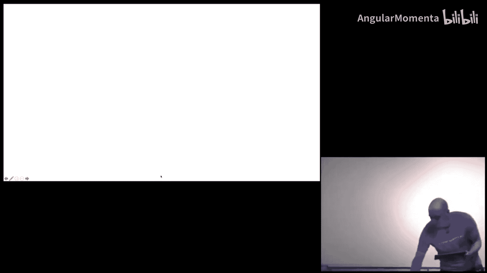
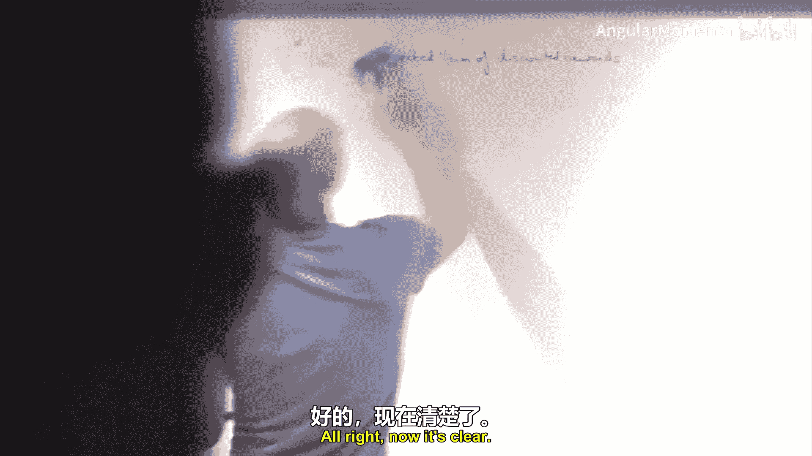
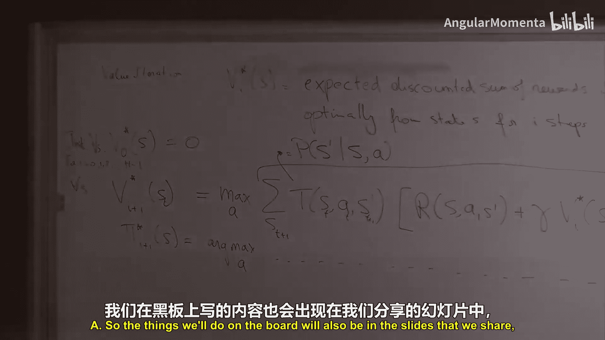
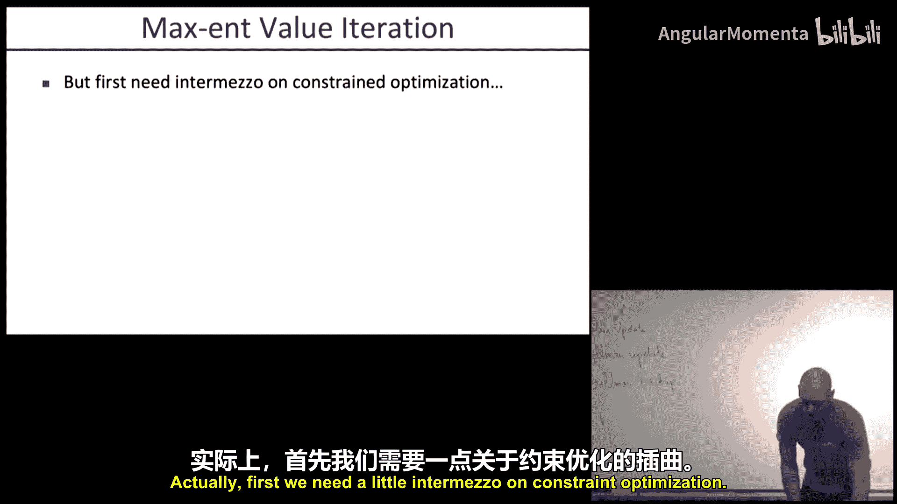
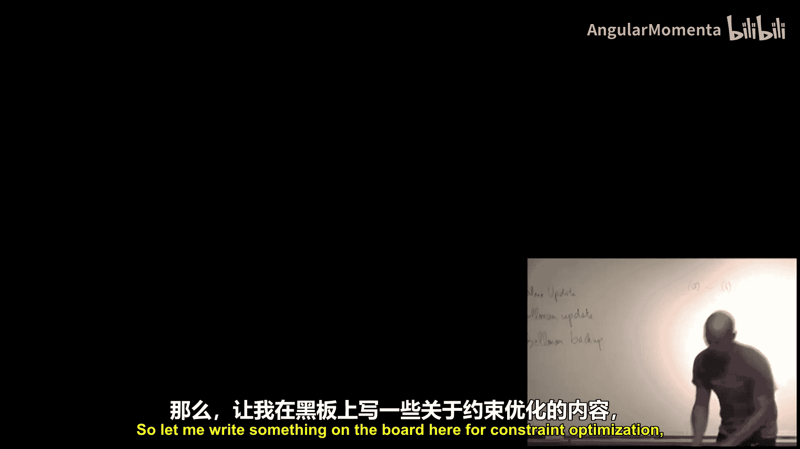
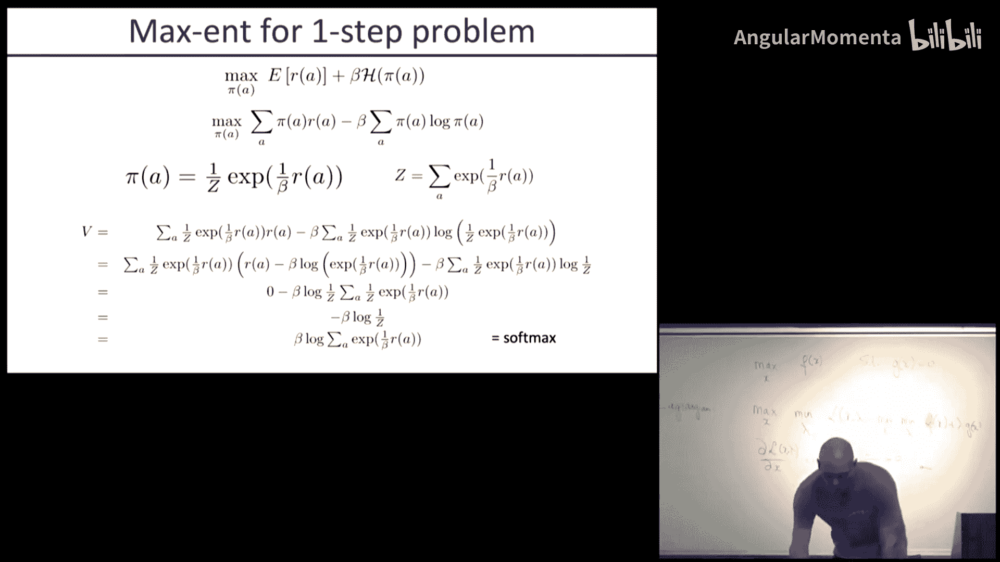
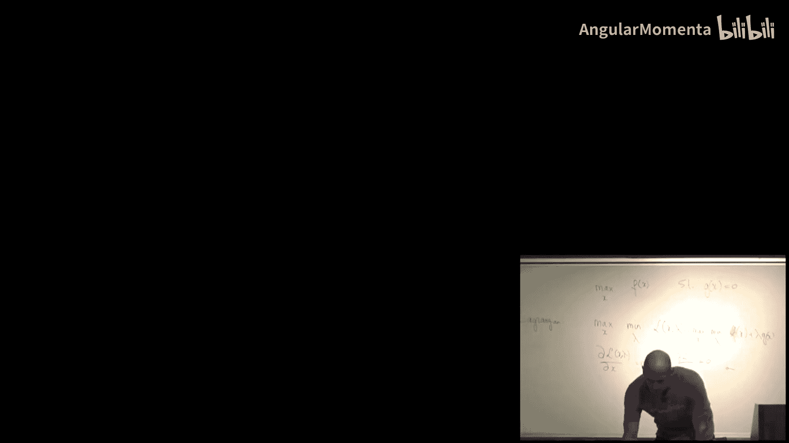
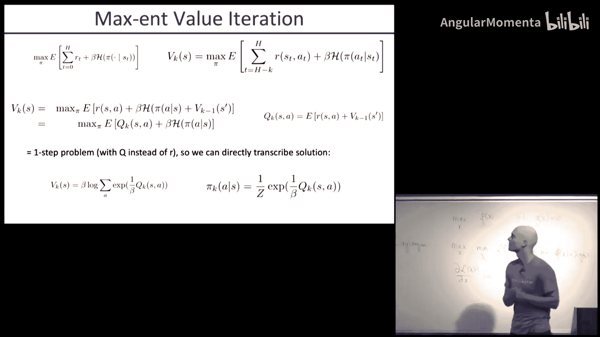

# 【加州大学伯克利分校】高级机器人学-｜-CS287-Advanced-Robotics-at-UC-Berkeley-Fall-2019-p02-2-马尔可夫决策过程--BV1KXqCB4Eua_p2-

All right， let's get started for today， Welcome to the second lecture of CS287， Advanced Robotics。啊。

One announcement today， which is that some of you are still hoping to get into the class。

 but not in the class yet。 will'll process all of that。Later tonight。

 so by tonight you should hear from us whether you're in or out and then hopefully you're in。

 but if you're out at least you can move on and find another class to take。Any logistical questions？

Great， actually， can people in the back close the door， I'll keep a little quieter in here。

Any chance somebody there could close the door？Thank you。All right。

 today's topic is Mark of decision processes， we'll see the framework。😊。

Then we'll look at exact solution methods。And then we'll look at a variation of the regular NP formulation。

 the maximum entropy formulation。 And that will be what we do today。 So let's start with MDPs。

What is an MP， in an MP， there's an agent。 and the agent interacts with the world。

 And through interaction with the world， the agent is supposed to achieve some goals。

 often encoded in what is called a reward function。 So， for example。

You might have an agent that is a cooking robot。That robot gets contract with the environment。

 and it might get a high reward if it makes a good meal。

 a negative reward if it messes up your kitchen badly and maybe really negative if it sets your kitchen on fire。

 And so the reward is the way you specify what you want in an MDP and then the agent supposed to somehow act uply against that in its environment。

The agent here in an MDP gets to observe the state。 So in this scenario。

 the robot would get to see where every object is in the room。

 get to know that that would be the state， its own pose， its own velocity and so forth。So formally。😊。

What this looks like is an MP consists of a set of states， S。嗯。Let's take a very simple example。

 a grid world with maybe nine squares。 Then the set of states would be just nine states。

Set of actions in a grid world it would be， let's say， move northeast， southwest for actions。

And then there's a transition model that tells you given current state in action。

And current time was the distribution over next states。 Now。

 often it will not depend on time because often the world is stationary。

 but not necessarily and we'll actually often see methods that take advantage of nons stationary aspects in the world to find a solution that's somewhat simpler to find that way。

Reward function is dependent， can depend on state， action， next state， and also on time。

And practice often will only depend on state and maybe current action。

 but there's no reason it couldn't depend on all four。Discount factor gamma。

 this is a number between0 and1， and essentially it encodes how much you care about now versus the further future。

 So what you're optimizing as an agent is some of discounted rewards shown here。

And so the further in the future， the higher the power with gamma and gammas between0 and1。

 so the further in the future， the less you care， but how much less you care depends on gamma。

 if gamma is close to one， you still care a lot about things far in the future。

 if gamma is close to zero， you pretty much only care about what's happening immediately。

The goal is for the agent to。Find a policy pi star that maximizes this quantity over here。

 And so the remainder of lecture will essentially be about how do we find this kind of policy。

But before we dive into that， let's look at a few examples， make this more concrete。 For example。

 a cleaning robot。 How could that be an MP， Well， imagine you have a room。

 There's a robot in the room that's supposed to clean。 The state would be describing。

The position of the robot， maybe how full the vacuum bag is that the robot has。

 maybe where the dirt is in the room。 And then the transition model would be defined as well。

 something along the lines of。If the robot moves， tries to move in a certain direction。

 it'll have a high chance of moving in that direction。

 but maybe some chance of not exactly moving there when it tries to suck up dirt that it's above。

 Maybe it'll usually succeed， but not always succeed。 And the reward could be something like。

How clean the room is。 So negative reward for any dirt that's still in the room。

You' gotta be little careful， by the way， when you choose your rewards。

 because an naive choice of reward could be something like whenever you suck up dirt， you get reward。

But the bad thing about that is that you could just dump dirt first， suck up dirt。

 dump it again and go in a cycle where you just keep dumping and sucking up dirt。

 and actually you don't achieve the task that people wanted the robot to do。

 you're just achieving high reward， but on the wrong reward it really。

So that's a cleaning robot example。 Walk robot。 Maybe you want a robot that walks。

 What could be the reward， maybe a distance covered， maybe distance covered in a certain direction。

 if you care about， let's say， how far did robot get north。

 And maybe you want to penalize for energy consumption。

 So maybe there's some negative reward related to how much energy you're consuming。Then。

Pall balancing。 is is an example you'll work on in your homework 1。

 you have a poll and it's supposed to stay up。 But if it's a little bit off。

 it'll start falling unless you apply a force， a torque in the motor that is at the bottom of the pole to get it back up。

 And so the reward there could be。How far you deviate from being perfectly upright and the more negative。

 the more you deviate。 And maybe there's also a negative reward for applying torque because the less torque you apply。

 the better because the less energy you consume。A lot of games can be formulated this way。

 Game of Te， you have to put blocks into a rectangle and if you have a full row at the bottom it clears。

 it's a decision problem at any given time there's some probability of which new block is going to show up。

 then it shows up， then you get to choose from actions where to place it and how much you want to rotate it before you place it。

 and then the process repeats the reward is how many blocks you can place before you fill up to the top at which point the game is over。

Backgamon is a game where you roll diece and you play against an opponent to try to get your pieces to move across the board。

 and again similar thing here， the rules of the game are the transition model。

 and then the reward is one for winning the game， negative one for losing the game。

 zero for a type that exists。Itn't have to be in games or robotics。 NDPs are really everywhere。

 And that's a kind of common thread I want to get across in this class that the methods we're looking at。

 we're going to heavily study them for robotics， but they're actually much more widely applicable。

For example， server management， you run a server that's supposed to maybe do some processing。

 maybe it gets， I don't know， it runs a few processes。 it has to query some classification on images。

 maybe some speech recognition and maybe has to do some video classification。

 you get requests coming in， you have a bunch of servers onto which server do you schedule each of the income in your requests and reward might be associated with while maybe some requests are more urgent if you don't reply quickly with a response。

 that's a problem， others are lesser urgent the reward will still be high even if there's a little bit of delay before you reply and so forth。

Shortest path problems are MDPs。 It's a graph。 let's say， and the transition model is deterministic。

 you can go to any neighboring state in the graph。 That's your action space。

 then to make it a shortest path bomb， you'd say， well。

 maybe I get a reward of one once I'm at the destination and zero otherwise。

 And then if you have discounting， then you have an extra encouragement to get to the destination as quickly as possible。

Models for animals animals and people are often done with MP。 If you say， okay， how do I model。

 I don't know a honeybee that's like living its life。 Well， maybe you say， well。

 it has some dynamics。 It is constrained by。 And then it likes to go to flowers， get get the nectar。

 make honey and the reward is probably related to something there。 And if you have a model like that。

 you can more easily explain the behaviors that you're observing。

So the canonical example for us will be this grid worldld over here。

 but I hope the previous example showed that this is' not really about grid worlds。

 but gridwlds fit really nicely on slides and allow us to get concepts across very cleanly。

 but again， we're going to apply this in many， many other places。So in this grid world。

 we have an agent， and there are it's a 4 by 3 grid。 So in principle， there are 12 locations。

 but the gray one is a place you cannot go。 So there's 11 locations agent can be。

For any location the agent can choose to go northeast， south or west。And as an 80% chance。

 the action succeeds。Then there is a 10% chance youveer off to the left compared to what you wanted to do。

10% chance you ve off to the right。If your action leads you into the boundary of this space。

 supposed to be a wall surrounding this thing， then you stay in place。

The reward is plus one if you're in the top square and take the exit action。

And the reward is negative one if you're in this square here and you take the exit action。

Everywhere else， the reward is zero。So what you'd hope for is that this agent。

 if it finds the optimalno policy， optimalno policy would bring it to the top right square and then exit from there and assuming the discount factor gamma is not one so it's below one。

 So you want to be there sooner rather than later， you'd hope it follow the shortest path while also avoiding falling into this trap over here because once you're here。

 the only action available is the exit action same over there。 So once you're there。

 you're stuck and so going along this path is actually slightly risky because。Let's say you move up。

 you 10% chance of moving off to the right。 You land here， you'll have a negative1 reward。All right。

So what's also quite typical for MDPs and is the case here is that rewards often come at the end。

 Usually most of the reward is related achieving goals， not always， but very often it is。

 And that's the case here。What does a policy look like。

 A policy is something that says for every time step And see your first time step。

 second time step tells you what is the action you're supposed to take and the optimal policy is the one that optimizes expected reward。

 Why expect it， because the dynamics of the environment is stochastic。

 And so you can't count on a very specific reward to come out。 It will be on average。

 how much do you get。In contrast， let's say this environment was actually deterministic。

 Then you could just choose a sequence of actions。 So you don't need a policy if the world is deterministic。

 You just say I'm here。 I'm gonna choose a sequence of actions that gets me where I want to be and I'm done。

 But typically， the world will be stochastic。 and we need a policy。

 And that's what we're gonna focus on。Any questions so far about the formulation？对。Okay。

 so we've covered the formulation。 let's now start looking at some solution methods。

First one we're going to look at is value attu。 and this is one of those things that I'm going to do on the board and the kind of thing that we expect you to be able to do on your own。

 So I encourage you to follow along in the in the derivation。 let's see。

There we go。Alright。So our first algorithm is value tu。

This is also the one we're going to see the most of throughout this lecture。

So let's think about first some concept we want to solve this problem。First concept we want is。V。

 I star of S， which is。The expected。Some。Of discounted rewards。Is this big enough for to back？No。

 not big enough for the back。All right， that was clear。

嗯。First concept is going to be V star I of S， which is the。Expected。Is this big enough？Thanks。

Expected。Discounted。Some。Of rewards。If。Acting。Optimly。From。St。S for。I steps。

 So we only have I steps left。 and how much of work can we get if we act openly for I steps when we get to start in state S。

Okay， now。Once we have this concept， let's start thinking about how we can compute this。

The easy one is。V0 star of S。 We have zero steps left。 There's no time left for us to act。

There's nothing left to happen。 So this is just going to be0 because that's all there is。

 There's nothing。And this is going to be true for all states us。 So now the question is。

 can we find a recursion where we find V1 from V0， V2 from V1 and so forth。

So let's see what would be。I plus1 star。F us。Well， by definition。

 the expected discounted sum rewards if acting optimally from state S for i plus1 steps。So。Well。

 what happens？We're going to take our first step。And after that， there will be I steps left。

 And so we're going to try to break it down into what happens in our first step。

 What happens afterwards。 What happens in our first step is， well， we choose an action。

 We want to choose the best action。 So， but for now， just say we choose an action。

And after we choose that action， a transition happens， we have a transition。😊。

From state S taking action A into state S prime with some probability TSA S prime。Then。

What happens at that moment， we get a reward。For what just happened from that one time step。

What happens after that is we have I steps left。😡，And we're in state S prime。

So when there's I steps left， instead is prime。We're going to get another。VI star。

 assuming we do optimal behavior then onwards。PI star S prime。But remember， we're doing discounting。

Something that happens later is worth gamma less than something happened earlier。

This is just a reward， but then here what happens later。😡，Get discounted by a factor gamma。

And so what we have here is now actually an update equation， assuming we pick the optimal action A。

So let's parse this again。We're trying to compute the。

Optimmal expected sum of rewards from state S with i plus1 steps left。

 We're breaking it down into what happens first， which is we get a reward for the immediate transition。

There actually could be many transitions， many possible next states as prime。

 so we're summing over all the possible next states as prime， averaging the reward that we get。

And then after that， we have I steps left， and so that's the recursion kicking in here and we have a discount factor in front of it because one step later is worth gamma S。

 we have gamma times V star S prime S prime， the same as prime we have here。

 averaged overall the possible states as prime we might visit。So how do we run value。

 We just put a loop around this。 We just say in it。For all s， v0 star s equals 0。Then。😊，Four。

I equals 0，1，2 up to h minus-1。For all us。And that will give us all the optimal values v star from zero steps left all the way to capital H time steps left to act。

Now， the question you might have， this gives us values。 and we've been talking about。

 we want to find the optimal policy， the optimalmost strategy to behave in an environment。

 How do we get that。So if you look at this equation， it's already computing the best action。

 it'll compute。This thing for all actions， right， So you'll do this multiple times。

 Once for each action， you compute this quantity， you'll have a table of values。

 and then you'll check which one is the highest。 That's the one you pick。 Well。

 the action that achieves that is the optimal action。 And so to find the policy。

 we just need to change the。Max here into a arg max。

 and we'll have pi star i plus 1 of S equals arg max over a of the exact same quantity here。

And then this。This update here。It's called。A。Value updates， sometimes。Or right， Belllman update。

Or a bellman。Back up。After Richard Bellman， who originated this set of equations。

This is probably the most important equation for today's lecture and next lecture。

 So let me pause here and make sure。All questions are resolved around this。Yes。Good question。

 What is S prime， So we're currently in state S。 So S is the current state。

When we take an action in the current state， the dynamics of the world will transition us into a next state。

 and S prime is the variable name we use to index into the state at the next time。

 So another way I could have written this is I could write this one as S at time T， let's say。

 and I could write this one as S T plus1， S T， action on time T， S T plus 1， and so forth。But often。

 just S prime is used because we don't want to pin it to particular times。Any other questions？Yes。

To the probability of taking that。So good question。 So T here。

Is equal to the probability of landing in state S prime， given you were in state S and took action A。

And so actually interchange willll use that notation at times。

 sometimes we'll use T S S prime where T refers to transition model。

 and sometimes we'll use the explicit conditional notation P of S prime given S comma a。

So the things we'll do on the board will also be in the slides that we share。

 but I think it's good to work through them more explicitly step by step than just flashing them in front of you and I think it's good to take notes as we go along。

Let's look at the example grid world， what happens if we run value iteration？😊，Well。Here。

 we have run one update of value。 Remember this world。 When you exit。

 when you're in one of these states， the only action available is exit。

 So one step available left to you in the life of your agent， that agent will exit from there。

 get the reward of negative one or plus one， depending on which state it was in。

 And that's the value。 That's all it'll get for the rest of its life。 for the other states。

 the agent actually has options， can choose how of four actions。😊。

But no matter what action the agent chooses with only one time step left。

 there will never be any reward encountered。 so the value is 0。

 the optimal value is 0 for all other states。When there is one step to go。In this case。

 the discount factor gamma is 0。9， which will allow you to follow along with the math。 Now。

 let's think about what happens when we have two time steps left。Well， let's think about it。

 What will happen down here with two steps， you still can't get any nonzero reward。 It'll stay zero。

 but up here close to where the rewards are where the nonze values are for V1 star。

 there'll be opportunity for V2 star to be nonzero because I'll propagate from V1 to V2。

 V3 and so forth。So here's what happens。Let's parse this， Why is there a 0。72 up there。

 Why is the expected value of 0。72？😡，When it moves to the right， it has an 80% chance of success。

So that's 08 times at the next time， it'll be able to exit and get a plus one reward。

 but the next time is's discounted by 0。9。So， it's。0。

8 probability of success of getting there at then times 0。9 is 0。72。

How come this one is 0 and nothing negative， even though it's next for this one。

 because it's finally the optimal values and the optimal values will not put you into the negative state。

 Actually， what actually is happening here is。It takes the optimal action， which is going this way。

 which 80% of the time keeps it in place，10% of the time will go down，10% of the time it'll go up。

And that avoids it from ever landing here。 And so it has a zero probability of landing here。

 And so at the next time， if it had landed here， it would get a negative one。

 which would be negative。9 with discounting， but that never happens。 It actually ends up over there。

 but I only one step left， not enough time left to get that reward。Now， this is P2 star。

How how about V3 star we expect again is gonna to propagate out because V3 star is computed from V2 star just at one extra step。

 And we see now that actually you have positive reward here。 why。

 because you can now actually make it up there to the plus one。

 And so what happens here is you want to go up。 Yes。

 there is some chance that you get a negative here by landing here。

 But that's a small probability is's a much higher chance you end up here。

 And from there you can actually very likely make it there and get a good reward。

 And so the math works out that going up is the right thing to do to maximize your expected value。😊。

After four iterations， these the values， one thing you might wonder is， well。

I have a value here now of。66。 is this the final value， This is V star with four time steps left。

 Is V star with four time steps left the same as V star with。Let's say 100 times steps left。

 you're nodding no， why not？Because you would。You can go farther which。Yeah。

 so with under deviations， you can go farther and how can this help you in this world？

Let's think about this carefully。 if it's a deterministic world and you run value tu。

 this will just spread out cleanly and you'll immediately have the final value for something like this。

 But because it's a stochastic world。😊，When you're here。

 you only have some probability of getting here for now。

 you still have probabilities of getting stuck along the way， and the more time you have。

 the more time you have to make up for that and still make it to the exit。

And so as we keep it trading， you'll see that those values will actually keep going up over time。

So here it's now 0。72 and also it's spreading out further away。

 and after 100 iterations we're at this now discount factor gamma is 0。9。

 What that means is that if faculty is only looking 10 times steps into the future。

 maybe just a little more than 10 time steps。 So at 100。

 you kind of saturated what's still going to happen and it's pretty much converged to this level of accuracy。

 it's converged at 1000， it's exactly the same。Any questions about this example？Yes。😊。

Super cell next to the plus1 reward cell。I didn't get the value is increasing。 Okay， so yeah。

 good question。 So look at the plus one reward cell。 initially， it's0， of course。

 because we don't have enough time steps。 Then here we have an 80% chance by taking the right action to land into the plus 1 and then exit。

 which gives us 072。 we have a 10% chance to move up against the wall， which means stay in place。

10% chance of move down， which moves us down。That probability mass。If we have more time steps left。

 we can still guide that back into the target。 And so when we have three time steps。

 when we had moved up and stayed in place， we actually still have enough time to try again to go off to the right。

 And that's what happens here。And that's why it goes up。Yes。😊。

I think maybe you explained this and I just missed it。

The square immediately to the left of the negative。Previous slide， why was that zero？よしや。Absolutely。

 that's a very good question。 Why is this zero， It's zero because。Well。

 let's first think about why it might not be zero。 Let's just say， well。

 why why wouldn't we think this thing tries to move up。

 but sometimes it's unlucky lands here and with 10% chance。

 and then with discounting would be 09 times 01 negative of that。 So it would have negative0。

09 there。 and that would be the case if your policy is to move up here。But actually。

 y have no policy here。Moves this way， bumps into the wall to never end up over there with the negative。

009。why is the arrow pointing up。 So， yeah， that's a good question。

 The way this visualization is done is actually， it's visualizing a one step look ahead policy。

 So if it's essentially looking at the policy， if you had one more step than the value function that's shown。

 we haven't really covered that yet。 but what will'll cover it in the future。Okay。

 so it turns out there's a theorem that says value is guaranteed to converge。

 and at convergence we will have found the optimal value function v star for the discounted infinite horizon problem。

 which satisfies the Belllman equations shown here。

Let's look at some intuition behind why this is converging。 I mean， in some sense。

 it makes sense for us that we are getting optimal values for I steps left。 I plus1 steps left。

 But why will this reach some steady state value and not kind of keep changing forever。Well。First。

 let's， let's see what we can conclude from this。 We're good to go。

 That means if we have infinite horizon， we can just run this to convergence and we'll have a V star for infinite horizon。

 and we can use the optimal policy against that pi star。

 And we only to store a table for every time step。 We can just have a single policy for all time steps。

 Of course， this assumes that dynamics and the reward don't change over time。😊。

So this is what we can do。 And this is the one step look ahead I was talking about。

 Once you have an optimal value function or any value function you prefer to act against this is the one step look ahead operation you can do to find the optimal action。

So we're all set in that regard。嗯。And we all need to store either V star and do this look ahead at every time step。

 or we can just do it this as we compute v star， we're computing already the Mac。

 we can store the Arc max and just store our optimal policy in doing so。

Let's look at some intuition behind the convergence。 Actually let's see。

 is there any questions about the。Theorem statement。

Essentially it's just saying that if you're inval long enough at some point。

 the values stop changing， they're converged and they satisfy that equation at that point。Okay。

 so what's intuition， This star is the expected sum of wordss accumulated starting from state S。

 acting optimally for infinitely many steps。V star H of us is the expected some of your accumulated Tyam state S acting optimally for H steps。

So when we say it converges， what it really means is that if we make this h big enough at some point H and h plus1 are the same。

 V star H and V star h plus1 are essentially the same， and that's V star of S。

So we can think about it。We computed V star H of S。 What additional reward if we could act longer。

 what additional reward could we be collecting by getting to act longer。

Because that's really going to make the difference between the optimal value function and the one that we have for only horizon H。

So。Well。We're going to get discount factor gamma to the power H plus1 times reward for time H plus1。

 then similar for time H plus2 and so forth。This quantity here is smaller than if we replace the rewards that we actually get with。

The max reward that's available in the MDP。 So let's assume there's some max。

 you can never get more than a certain max， for example， plus one in the MDP we saw。

Now this summation in the back here。Has a geometric series in it and can be bounded by gamma to the H4 swan over 1 minus gamma。

So。What this shows is that if we had more time， the best X reward we could get is this much。Now。

 if you look at this quantity。And how it depends on H as H。Goes to infinity。 This quantity goes to 0。

So if my H is already very large， the extract could have gotten from getting back act longer is near 0。

If what I could have gotten an extra from acting longer goes to 0。

 then that means that the difference between v star H and v star S go to 0 because v star H is the best I can get with H time steps。

 And v star is what I can get with infinitely many time steps。

 which have is essentially nothing left by having more time steps。 then they're gonna be the same。

And so this is a kind of fairly intuitive proof as to why value will converge to infinite horizon value function。

What I put up here is assuming the rewards are always positive。

But you can go through the same reasoning when there are negative rewards and then or negative impos in the R max here。

 what it would really mean is the max absolute value of reward that you can get anywhere。

 and then the same reasoning will go through。All right。

 this is kind of a very intuitive proof sketch。 Let's look at another angle that people often look at the prove value converges。

So we'll define something called a max norm。 And the reason we see two versions of， I mean。

 two proofs for the same thing is that just in different contexts。

 a different intuition might be more useful。So max norm is the max absolute value of any entry in your vector。

😡，So if you had a value function or an attempted value function that you hope was the real value function U。

 then it would be a vector with entries for every state and the maximum norm of that vector would be the maximum absolute value of all entries in that vector。

Then there's a notion called contractions and specifically gamma contraction in max norm。

 So what are we thinking about here is we have a operation， the value update operation。

 we do one iteration in value iteration。 we have a vector of values。 now we have a new vector values。

 That's the update operation。Question is for any update operation you can ask。

 is it a contraction or not？ And so we're going to define what a contraction， a contraction is。

 this notion that if no matter what two vectors you have， let's say you run value tu。

 but you take two different initializations you don't initialize with zero。

 just take two completely different initializations， U I and V then you do one update。

 you might wonder do these things move closer together and a contraction is exactly defined that way if you have two things。

2 things。 You do an update to them。 Do they move closer together。

 Are factor gamma closer together after the update。

 This is just the definition of a gamma contraction。 This is not any property evaluation yet。

 but it's just a definition。Now the property， though， that's important in this theorem is that。

Contraction converges to a unique fixed point。 no matter to initialization。

 We're not going to prove that here。 The proof is probably one page of work that you can try on your own。

But。It's generally true， once you show something as a contraction。

 you know if you keep applying that operation， it'll get to a fixed point， a unique fixed point。Fact。

 and again， we're not going prove this， but it's not too hard to prove。

 Val updates form a gamma contraction in the max norm。

And the intuition here is fairly simple in that imagine you have two vectors， UI and VI。

And they undergo a valuation update。Where are UI and VI used。

 they're only used with a gamma in front of them， so the effect of the original UI and VI gets downkilld by a factor gamma。

😡，And then the reward in front is shared anyway across all。

 So the effect of the U I and VI is downscalelld by a factor gamma。

 And that's how you essentially prove that a Val update is a gamma contraction in Maxn。

Crollary vtration converges to a unique fixed point。Additional fact。Is that once。Your updates。

Are changing the value function very little。 You can do a bit of math to show that then also you're close to the optimal value function V star。

 And this is actually very related。 showinging that is very similar to showing that contractions converged to a unique fixed point。

 You essentially look at。Two vectors that come after each other in the update。

 and then you put this on this side。 and then on here we'll have the plus two and the plus one。

 And that that's kind of the way you show conversions of a contraction。

 And it allows us to have a stopping criteria。 And when we run value creation。

 you say I want to values up to a certain level of accuracy？ Well， you just check。

 what's the biggest change in any of my values among my states。 And then I call that epsilon。

 I plug it into this。 And I know that I'm within that much of the optimal value function。All right。

 yes。So in this case， the top row U is just any。Vectctor。

Because it's just defining the norm of a vector。Then。Here。

UI and VI are again vectors of the same size， and then an update operation gets applied to them。

 and that gives us UI plus1 and V plus1。 So UI gets updated to UI plus1， VI gets updated to V plus1。

And we're talking about that update operation being a contraction。Even only if this thing holds true。

Yes， shouldmma be。For this to be true， yes， to be a contraction， gamma has to be a small and M1。

Correct， otherwise， things will not shrink together。 They can。

 then if gamma equals one is called a non expansion。 and then I guess bigger than1， it can expand。

 So then there's not much we can do。Yes。The additional effect imply anything about the rate of convergence of value iteration？

LikeYeah。E cetera。This， essentially， the rate of conversions is the contraction rate gamma。

 so you will。You're able to define the speed at which you go to V star。

 essentially as you power up gamma， that's what will get you the rate at which you converge。Sorry。

 can you Cru explain like on the additional facts， how do you get from the left side to the right side？

On the additional fact， this thing here， we didn't improve。 That's left for you to try out。

 if you want to try it out。 It's， it's not， you're absolutely the right。 It's not。

 You can't just stare at it and just be like， this is obvious。 It's， it's pretty complicated。

 It turns out， but it's。K as you imagine， the starting point is gonna be something along the lines。

 if you look at。You。Do something with adding a subtracting V star here and then use some trianglingality and play around with a few things and at some point you can get this out。

But yeah， you're not expected to necessarily be able to do this。

 otherwise we would cover it in class。handside use。How is this R。

 This is useful in the sense that you now know if you。

If your update changes your value function only a little bit， let's say epsilon。

 then you know that you are two epsilon gamma over1 minus gamma close to v star。😡。

So it's giving you a guarantee that once your value function doesn't change much anymore。

 you are close to the optimal value function V star。Okay。

 let's look at a couple of examples of problems and how the parameters affect the optimal solution。

 So we're going to look at here is。A grid world of this structure， where you get negative 10。

When you land over here， once you exit and only option you have here is to exit plus 10 over here and then one over there。

 So there's a nearby small reward， a faraway higher reward。

 and then there's also this danger zone at the bottom。And so question is。

 how can we get different policies out？ So how can we define this problem by choosing different discount factors and different noise levels on the action？

 So noise equals 0。5 means that 50% chance you succeed with your action。

And then 25% chance you veer off to the left， 25% chance you ve off to the right。嗯。

Gamma is still the discount factor， noise equals0 means you always succeed with your action。

 exactly the action you chooses what you get， you choose north， it goes north。And so the question is。

Here are8 sorry，8 bullet points。 where here are four scenarios。Prefer the closest exit。

 risking the cliff。 So this path， prefer the closest exit。

 but avoiding the cliffs along the top go to closest exit。 prefer the distant exit。

 risking the cliff this way， or prefer the distant exit， avoiding the cliff。

 go along the top to distant exit。And。Question for you is which of these choices of NP parameters will map onto those optimal solutions。

 So I'll give you kind of two minutes to talk with your neighbor and make up your mind on how left column might match up with which entry in the right column。

光都。なんで。And that。ない。系。just here。覚いて。Yeah think。呢时时候。个。可。即时。先そ。Yeahや。おすです。いま。But there's also the pre。

いやですねそ。で、すね。Bice。5。覚会。はやと啊。特别。Yeah。All right， let's see what you came up with。So。For a。

 prefer to close exit， meaning the plus one risking the cliff。 So the bottom path up there。

 Who thinks one。Nobody thinks one， Who thinks two。Somebody who thinks three。Nobody what things for。

Oh wow， that's overwhelming for。U。Everybody raised their hand on four， so why four？Well。

 you have a pretty harsh discount and no noise， so you're going to want to find a solution pretty quickly。

And you have absolute control？So the answer was you have a very harsh discount。

 so you want to get your rewards sooner rather than later， and you have no noise。

 So it's not that risky to go along the cliff。 So you just follow the shortest path。 Great。

 How about B， prefer to close exit， but avoiding the cliff。 Who thinks one。Who thinks too？3。4our。

Shouldn't pick four anymore at this point。Most people said one， Olivia， they said going to say why？

The previous one。你家好唔好噶。Itll faster than you want next thing quickly。系嗯。仲我嗰嗰食。So like I said。

Hart discount factor here， which makes us prefer the close one。

 but we can't risk the cliff because there's a lot of noise。

 much higher chance to falling into it if we go that way。 Great， How about the third one。

 prefer decentcent exit risking the cliff 1。2。One of people two， three。F， okay。So。😊。

Risking the cliff same story here we picked two why because noise is zero。

 so risking is not really that risky。 in fact， you know you're not going to fall into it and then you might as well take the shortest path。

Gmma is0。99。 So you're willing to spend the extra time to get to the later reward because it's 10 times bigger and you get discounted only by 。

99 to the power2 or 3 or something。Then that leaves us with for D， the only option left。

 which is three， and same story here， we willing to go further because the discount is close to one and there's only a couple of extra steps needed and it's a factor 10 more reward and there is noise so we want to take the longer path。

Great。😊，So we covered valid， which is the main method we wanted to cover。 Let's take a。

2 or three minute break here。 And then in the second half of lecture。

 we'll go through the remainder of what's on that slide。我是你。Thanks so。I'm trying to follow you。

 but I kind of have to stop where the screen comes down because when I point the camera at the screen。

 it's like it's on auto exposure， that kind of gets blown out。For people following the video。I mean。

 it' up to you，Rather than maybe pointing at the actual screen using your track head or pointing something on the screen。

 the video will pick that up I see if that makes sense yeah you're saying essentially up to here is fine。

Okay。Got it because you're getting blown up by the light in got it project a couple slides the one we're looking at Max on。

All right， let's restart。Any questions about the first half of lecture？Alright。

 we've seen the foundation， most of the foundation for today's lecture。

 so we can actually go a little faster in some of the next pieces。

First thing we look at this policy evaluation。 So we're still trying to solve for the optimal way to act in a MDP。

 but we're gonna find a new algorithm to do it。 and why do we need more than one algorithm well sometimes in the future when we're solving problems that we cannot solve exactly and we need to do approximate solutions in some case we ease to build on one method and other case we easy to build on another method So policy evaluation is the notion that' given a policy。

 you want to know how much reward do I expect to get when using that policy And so remember valuation has this update equation here。

 It's against the optimal policy。 So what if we fix the policy Well， that's actually very easy。

 All we need to do is to not give access to the max over there we get rid of the max over there and we can evaluate the current policy so we just replace the max with a well the policy pi prescribes an action a and state s pi of s and we fill that in there and there's no max anymore。

Other than that， this is the exact same equation and so actually the exact same ideas apply will policy evaluation converge Yes。

 because it's like value just in an MDP where in each state only one action is available and so right away we have proof of convergence right there。

😊，At convergence， policy evaluation will satisfy this equation。

 which is the Belman equation just without the max because while the policy prescribes the action in each state。

 we have no choice。😊，Now this is just evaluation and with just evaluation。

 we can't necessarily find an optimal policy yet， but let's pause on this for a moment and see what happens if we generalize this to a stochastic policy so this was all deterministic。

 How about stochastic， We now have a policy。Mu。Which is a new A given S is a probability of taking action A and state S。

 And we have three proposed policy evaluation update equations here。

 So which policy evaluation update equation do you think is the correct 1，1，2 or 3。

 I'll give you a moment to stare at this。We're doing policy evaluation， policy is mu A given S。

 probably of action A。Being in state S is mu A given S。Okay， let's see who thinks one？Who thinks too？

Wch people think two， who thinks three？A bunchch of people think three。 Most people thought two。

 Let's think through this。 Let's look at two， which was the majority。 And two， what do we see。

We have。sum over next states， which we expect to see， because that's what's in the update equations。

 Then we have a sum over actions。 So why is there sum over actions here。

 Because theres no fixed action。 We don't use a specific。Action。

 we use the distribution over actions。 And so mu a。

 given as the probability of that action in state S。 And then after that。

 essentially the transition of landing a status prime， given state as an action A。 So indeed。

 equation 2 is a generalization from a fixed action to a distribution over actions for the update equation。

Alright， that was the lowest aside to make sure you're familiar with the notation。 By the way。

 why why is number 3 incorrect， It also has a summation over actions， but it has a max over states。

 and you don't get to choose the next state S prime。

 The next state prime is a consequence of the transition model。 And so you don't get that axis。

 If you were in MP where you got to choose the next state S prime， then equation 3。

Could be your update equation potentially， but you don't get to choose the next status prime。

 So you don't get to max over it。What is policy iteration in policy iteration。

 we alternate between policy evaluation and policy updates。 Policy improvements。

 Policy evaluation is what we saw in the previous slide me。So this pardon over here。Then。

Policy improvement。Is the equation we see at the bottom， what is that doing？

That's something with a max again。 It's saying if I get to act K plus1 steps from state S。

I'm going to do a one step look ahead。 I instead， as initially。

 I get some reward for the transition that happens。

 And after I get discount factor gamma times value。

 I will get then onwards for using the policy that I had pi K。

So I have a current policy pi K for which I computed the values。 and I'm going to say。

 I'm assuming I'm going to use that policy pi K for the last case steps that I get to act。

 But for the very first step， my very first step， I get to override an action and choose the best one。

For that very first one and then continue with Pi K。 That's the policy update。

It's kind of interesting because it's somewhat non intuitivetu that this maybe is guaranteed to be the right thing to do。

 But here， here's the intuition why this is going to be a better policy。

 The reason is gonna to be a better policy is because， well。

 let's first think about the following notion。 Let's say we use pi K for K steps。

 The last case steps and just use pi K plus1 for the very first step。

Then definitely pi k plus1 first followed by pi k is better because well。嗯。

It's the max of our expected value that we choose the action based on rather than just sticking to pi k。

 so it's definitely better that way。Now you can actually repeat this reasoning。You can say。If。Sorry。

 phrase is slightly wrong， we'll use pi K for infinitely many steps afterwards， not just K steps。

 infinitely many steps afterwards we'll use pi K。Okay。

 so it's better to first use pi K plus1 followed by infinitely often pi k than just pi k at all times。

After I do that。And at the next time。I had committed to using piK， but what if I just again say。

 well， what about from the next step onwards， I'm committed to Pi K。

 but right now I still give myself the choice to take the best action possible。

 assuming I'll use pi K infinitely often then onwards。That again， will be strictly better。

 and I can repeat this thought process at every time step。

 and ultimately what that means is I'm using this pi K plus one， this new policy at every time step。

 and I've shown that strictly better than using pi k at every time step。

So this is indeed a policy improvement step。Keep in mind V the K index here， just just to be clear。

 And I had a small lab there。 So I want to make sure they cl K here indexes into iteration of the algorithm。

 We have the algorithm it iterates over current policy pi K。

 find the value for that policy that will take infinite many value updates or till convergence。

 after we've done that， we do a policy update and the index K goes up。😊，And then we repeat。Okay。

 so here's what happens this repeat， we repeat this until the policy converges and app converges we have the optimal policy。

And actually conges faster into some conditions than value iteration。Now。

 one quick thing that I want to note here is that。For now。

 we just looked at modified Belman updates to evaluate a policy。But actually， if you look at this。

At the end， when it's converged， this is an equation that's satisfied。

 and that equation is linear in V I pi。So it can actually just solve linear system of equations instead。

 So when you run policy tu， when you do policy evaluation。

 you can either solve linear system of equations to find your V pi for your current policy pi。

Or you can just run policy evaluation iteratively like for value and find your VP that way。Now。

 theorem says that policy situation is guaranteed to conversion。

 at conversions the current policy and its value function are the optimal policy and optimal value function。

 Why is that。Let's start with the second bullet point in the proof sketch here。

 it's optimal ad convergence。Why。😡，By definition of convergence， pi k plus 1 equals pi k。

What that means is that when you look at the。Belmont update here， the Valration update。F。P이 k。

And we take the max there that the max action is the action already prescribed by pi k。

So what we have is that the policy pie key is already prescribing the best action， nothing changes。

 that's what happens at convergence。By just looking at the equation。

 we know when the action doesn't change anymore that the policy prescribes。

It's actually satisfying the Bel equation， so we're optimal and we're done。

Now the question you might ask is well are we guaranteed to ever have this equation be satisfied and that nothing changes anymore。

 and intuition behind that is actually very simple。

We discussed on the previous previous slide that pi K plus one will be better than pi K。

 or at least as's good。Well， if every time we have a new policy， it's better than the previous one。

And there's only a finite number of policies to choose from。 At some point。

 we're out of options because we can't cycle around when things have to always improve。

So at some point we're out of options that's guaranteed， so we must converge at some point。

And then we know when we converge that we're actually at the optimal point from the second bullet point。

All right， this might be a lot to wrap your head around， but if you haven't seen any of this before。

 but I encourage you to kind of slowly read this again at your own pace and see what you think。Next。

 we're going to actually skip over linear programming， we'll do that at the end。

 and we're going to look at the maximum entropy formulation。So let's look at a bigger grid world。😡。

And we're going to watch value happening here。We'll see cometours。 well， values on the left。

 red is high value。 the exit state is the bottom right， the black squares are obstacles。

And then on the right we you see a bunch of rolls from various initial states of the agent kind of see what the policy is。

And so as we run this， actually。H on， let me pause this for a moment。As we run value at tution。

 what'll happen is。At some point we will find a optimal strategy for every starting point of with optimal strategy。

 very specific strategy we follow to get to the goal。If now somebody changes the world。😡。

And puts a new obstacle in。The strategy we found might not work anymore。

 and we only found one strategy， the optimal one。And that might be okay if you know that that's fine。

 you only need to find that one strategy， you know the world's never going to change。

 It's always exactly what you expect it to be。 whatever if the world's not exactly what you expect it to be。

That can be the case if your MDP is not a perfectly matched up thing with the real world。 Well。

 now what can happen is optimal policy will fail and you have nothing at that point。

And so a question could be well is any way to solve for a distribution over solution。

 so a distribution over things you might want to do rather than a single solution。

 naturally if there's only a single optimal one， these other ones will be near optimal。

 they will not be the optimal one， but can we find that because if we find that then if something small changes in the world。

 we are already ready to deal with that。Okay， so。Let's think about this for a moment。

How we're gonna encourage somehow that we don't just find the optimal。

 We're gonna to use notion of entropy。 So what is entropy。 Entropy is this quantity shown over here。

 mathematicalthe quantity。 What it measures is the uncertainty of a random variable X。

 randomand variable x distribution P of x， How much uncertainty do you have over X。

 when I just tell you， you're gonna get a sample from X。 But I don't tell you， yet。

 what I have sampled。 How much uncertainty do you have， That's what's measured in the entropy。

 So we gonna have a high entropy for our。Alpmo policy。

 which then would be a positive that is nondeterministic at this point。

 It will be a distribution over actions and outputs。 We have a high entropy for our policy。

 Then we'll have a distribution of our actions distribution over paths we might follow。 And。

 of course， we don't We'll not just want high entropy。 We'll also want high rewards。

 We'll do a trade off between the two。Now， NrRP is kind of a very information theoretically justified way of measuring。

The kind of uncertainty over random variable X， for example， if you need to encode。

Samples from a distribution。 You would information fairly speaking。

 want to do it with a specific sample X I。 You would use a number of bits log two log of one over P of X I。

 And that's the optimal way to encode The info theory aspects don't really matter too much to us。

 but we want to have an intuition over the notion of what entropy is。So。

For a distribution where x could be1 or 0。 and there's a probability associated with being one。

 we can plot the entropy as a function of that probability。 horizontal X probability x equal1。

 When the probability of x equal 1 is 0， you're always。0。

 then there's0 entropy there is no uncertainty。 when you're always one。There is no uncertainty。

 but when your probability is 0。5， but the most uncertainty entropy is the highest。

 Here's another example， two distributions where x can take on five values。

 Which one has higher entropy。 Well， which one gives you more uncertainty about what x is going to be。

 The one on the right。 you actually know usually it's going to be that first value。

 So that's lower entropy whereas the one on the left。

 It's really spread out fairly evenly So it's going to be higher entropy。

 and you can actually compute to you can work through the math for those specific values and take the sum P log1 over P and get the values and indeed the one on the left has higher entropy than the one on the right。

So now that we have this notion of entropy which qualifies uncertainty， we can see a。

 new formulation of how to solve MDDPs， namely the maximum entropy formulation。

We used to solve for a policy that maximizes expected sum of rewards。

Now we're going to try to solve for a policy that not just maximize expected sum of rewards。

 but also maximizes entropy of the policy。😡，And beta here is a。Coeicient。

 if you make beta very high and you care a lot about entropy。 If you make beta equals 0。

 you get back to duration case。 And if you make beta equal to infinity。

 then all you care is about entropy， and you'll just ignore the reward。

And in between is where an interesting regime is where you'll have a tradeoff between entropy and reward。

 and you'll get a range of strategies emerging of how to solve the problem rather than a single strategy。

So can we do something like value for the max entropy version？ Well， let's see。 actually， first。

 we did a little intermedal and constrained optimization。 So let me。😊。

Write something on the board here for constraint optimization and we'll need that to be able to solve the problem we're going to solve。

So。We'll see a lot more constrained optimization in the future lectures。 Today。

 we'll just see something very simple but a concept that we already need today。

 So constrained optimization is where you have。A problem。

We we try to find a variable x or maybe a vector valued variable x that maximizes some function f of x。

Subject  two。Some constrained geo x equals0。 very specific case we're looking at here。

 but this is the one we care about。How are we going to solve this？嗯。Well。

The concept people use a lot is called a Lagrangian。

And we'll solve this problem by solving this problem instead， max over X still。

Then min over a new variable， lambda。😡，Of the laggrian of x and Lada， which is equal2。

Let'll rewrite the max over x， rewrite the min。Over lambmbda， G， no F。F。Of x plus lambda。Times G。

Of x。So why is this solving the original problem， Let's think about it。Let's say。

For this maximum min problem， we choose a x where G of x is not equal to 0。Well， after I choose my x。

 where G of x is not equal to 0。😡，The minimize'll get to choose lambda。 and if x is not equal to0。

 minimize we'll just choose lambda。 if x is positive and wants to minimize。

 we'll choose lambda negative， very， very negative and drive this really， really negative。 Actually。

 this one will probably choose， essentially， if geo of x is positive， we'll choose negative infinity。

 if G of x is negative， we'll choose positive infinity to drive this to as negative a value as possible。

😊，So we're forced in this problem to pick an x that has geo of x equal to0。

 which we're also forced to do here。 so you don't know yet why this is useful。

 but I'm just trying to clarify why this is equivalent at this point。

 this is equivalent because we can still not pick an x where geo of x is not equal to0。

 and once we pick an x where geo of x is equal to0 well and this disappears and we're just maximizing f of x。

So we have an equivalent problem here to the original problem。😡。

He might say it doesn't look more complicated， maybe it does， but actually it doesn't。😡。

The way we can now find a solution is by saying at the solution。

It's going to be the case that the derivative of the laggrian。With respect to x will be equal to0。

 because if it's not， I should move x in the direction that makes this thing higher because I'm maximizing respect to x。

And。The derivative。Of the lagangian with respect to lambda should also be equal to 0。

 because if it's not equal to 0， then I should move it in a direction that makes this thing lower because we're minimizing respect to lambda。

So we know that these are properties satisfied by the solution。

 and so often it'll be easier to write out those two equations when we try to solve something and see if we can read off the solution to the problem from those two equations and we'll see that in a moment we can do that for maximum entropy formulations。

 and then from there we have a solution。Okay， so that was a very brief thing on。嗯。

Constrained optimization will now use that to solve the maxN problem。And this will be the。Second。

 most important derivation for this class。Alright， so instead of deriving the actual max end value tu。

 I'm going to derive a simpler version where we can see all the insights necessary to find a solution。

 and we can just reuse that template to do the actual max end value tu。😊。

So we're going to look at max。Over pi of a。It distribution of actions。Expected value。

The reward we get from taking action A。Plus， beta times the entropy of our distribution over actions pi of a。

So this is a one step problem rather than a many step problem。

 but we'll see just like with the some aration， it's just like a one step thing that you repeat many times。

 same thing will be true here。Okay， so this is the same as max。Over pi。

Ex value is sum over pi sum over a。派。Of A， then plus。But entropy has this negative thing in it。

 so it's going to be a negative， negative。Beta sum over a pi of a log。Pi of a。

 And I know entropy is a two log instead of a regular log。

 but I'm just gonna to ignore that because any kind of base for the log is just a multiplulative factor。

 And so we'll just assume that lives inside beta。 We don't worry about it。Well。

And there is a constraint。 The constraint is such that。S over a pi。A equals1。

And it's also another constraint that the pi A should be positive。

 We will see that when we solve it without those constraints。

 it' will still come out with them being positive。 So we don't have to worry about it。

So let's write out the Lagrangian。 What's our Lagrangian。We're going to do max over a pi。Of men。

Over Lambda。Of the lagroian， which has some。Over a pi。A。Minus。Beta sum over a pi a。Log pi a。Plus。

 lambda for the constraint。What is our G of x here。

 It's essentially this thing equal 1 and simply as this thing -1 equals 0， So plus lambda。

S over a pi of a minus-1 shows up here。Now we take our derivatives。

 let's do derivative of the lagroian with respect spec to pi of a。

And we're going to want to set this equal to 0。What do we end up with？First thing here。

 look at the derivative。 this gives us R of A。This thing gives us minus beta times。

If we have this thing， we have log。Pi of a， if I the other one， derivative of log1 over the thing。

 So that's a plus one。And then here plus lambda。this equal to 0。Or if we rewrite this。We want。

Beta log。Pi of a。Equal to。R of a。Minus beta plus lambda。Or。Pi of a。

Equal to e to the power1 over beta。R of a minus beta plus lambda。So that's what we find for our。

Pi of a。So we see that we have。Essentially， the reward gets exponentiated， the more reward。

 the more likely we take a certain action。 And then what's really happening here。

 the minus beta plus lambda。 that's just a scale factor and doesn't depend on a。

 So we can actually rewrite this， just as well as equal to one over Z。

 which is the scaling E to the one over beta R of a。

That's what we find where Z is something that makes sure things sum to one。 and actually。

 if we take the derivative spec to Lambda here。Of the Laangian。Ass some。Over a pi a minus1 equals 0。

 we see that we exactly get back out the notion that things should sum to1。

What we see here is the solution is in a really nice form factor。😊，Its if beta were equal to 1。

 let's simplify as beta equal to1。 we just have e to the reward as our probability and then some normalization。

So that's really nice。Then。What we can do is。We can actually。Take that solution。For pi of A。

And put it。Into here and see what is the actual optimal value that we achieve in the max end environment。

😡，So this is a derivation that was on the board， we're going to plug the expression for pi of a into the maximization up there。

 the objective。It's a bit of math。 You have to work through。

 but it's really straightforward kind of simplification type math。 There's no new concepts there。

 If you work through all the simplifications， all you get is that the。

Objective value at optimum equals beta times log sum X1 over beta R。 Let's again。

 imagine beta equals1。 Then what we have here is essentially a soft way of computing a maximum。

Surround tick。Just put all the probability mass on the one action that achieves the highest reward。

 We take a soft max in the policy， and we get this log X of the values as the actual value。

 It is a very simple update to do。 Like we did a bunch of math。 but Al is very simple。

 If you want to know the optimal value for this thing， is just log some X reward。😊。

If beta is closer to0， when you don't care about entropy， then the exponent will grow。😡。

And so the exp will become more extreme。 and whichever had the highest reward will have grown the most。

 will be even bigger than the others， more bigger than the others。

 and willll dominate and we'll have more and more probability associated with it and well dominate this value。

 When beta goes to 0， you don't care about。 Well， that's the beta to0。 when beta goes to infinity。

 the opposite way you don't care。😊，About reward anymore。

 you'll get the uniform distribution and all you get is the entropy of the uniform distribution as your value of the problem。

Let's see。

Actually， this is a pretty important concept， so I'm going to stop here and next time we'll see how to generalize this to full value tuition。

 see on Thursday。

