# 【加州大学伯克利分校】高级机器人学-｜-CS287-Advanced-Robotics-at-UC-Berkeley-Fall-2019-p03-3-通过离散化求解连续马尔可夫决策过程--BV1KXqCB4Eua_p3-

10 seconds。你点翻。この。TheWhere you guys working the your？And。Hi everyone， welcome to lecture 3 of CS287。

 but we still have a little bit of material to cover from lecture2。

 so we're first going to go through a few slides from lecture two that we didn't cover yet。

 and then we'll start the lecture three slides。Tms of logistics。

Everybody who contacted us about getting into the class。If you did not hear back from us。

 that means we lost your email so contact us again， but if we got your email。

 we replied to you on Tuesday night and you should have gotten a response that finalizes whether you' in or out。

Other logistics homework one is supposed to go out today。

 might be pushed back to tomorrow depending on how ready it is today。

 we'll see we want to only get it to you when it's actually ready and you'll have a little less than two weeks to complete that I recommend you start early because it'll be representative of the future homeworks and so if homework one doesn't go well you might still have time to kind of drop out of the class and take another class and if it goes well now you know you're all set and the other homework should go similarly well。

Any questions about logistics？Okay， so one thing I did is I wrote on the board the main equations we're going to see again in the first half of lecture。

 just as a reminder I'll always be up here for this lecture。

 the value Tra equation and the max endt solution， and so that way you can keep looking at it and internalize it if you're not that familiar with it yet。

All right， quick recap of where we're at。 we looked at the notion of an agent acting in environment supposed to maximize the reward it collects in that environment。

嗯。The way we formalize this is through a market decision process， which has a set of states。

 a set of actions， a transition model that describes the probability of landing a status prime when you start state S and took action A。

A reward function which describes what we care about， high reward is good， low reward is bad。

 and a discount factor which determines how much we care about future rewards because what we optimize is discounted sum of rewards。

 and so gamma to the t since gamma is between 0 and 1 if gamma is closer to0 then far out。

 you don't really care if gamma is closer to one， you keep caring about things further out。

Then the main algorithm we covered to solve an MDP is value tu。

 and the key thing here is this update equation。V I star V star I+1。

 which is the optimal expected discounted sum of rewards you can collect when starting from state S and getting i+1 time steps to act in the environment。

😡，Can be computed recursively as a function of V star。

 which is the optimal value for only I steps to go。 And so we see is the max of rural actions。

 then average over next states because we don't control that。

 the environment determines where we end up and we average over that。

 the immediate reward would get plus discount factor gamma times expected discounted rewards we'll get with only I steps left。

And the way we initialize it， we can just set v0 star for all states s equal to 0 because when there's zero time steps left。

 there's zero reward left to be collected。And that's also the equation I have up here so you can reference it throughout lecture。

We saw value in action on this grid world and we kind of saw that you on the if there's only one step left well only the two states from which you get to exit。

 you get anything non-zero for value， everything else is still zero and then it kind of radiates out from there as you get more and more steps to act in the world and then at some point it actually converges these after 100 iterations。

 these are the values， these are the optimal values for 100 time steps left in the world and actually with 100 time steps left in the world up to two digit precision。

 exactly the same amount as it was before。Then we saw an alternative way of solving MDPs。

 you might wonder why would you see more that one way， well。

 right now value might seem the most natural one between the two。

 but in the future we might see algorithms that actually build upon policy tu and when we solve large problems where we need approximations。

So in policy iteration， one iteration of policy it says I already have a policy and you start with just some policy。

 you can choose whatever it is， you pick some policy， prescribing action for each state。

 you then evaluate that policy using policy evaluation。Which is like value tu just without the max。

 because the action is prescribed， you don't get to choose it anymore。

You can run the still convergence。 Once you've done that。

 you have the value for that policy for each state。

 and then you could do one step Look ahead against that value， say， well， if I were to use。

Policy pi K， which is the case policy in my iteration count from the next time step on wordss。

 but I get to choose my first action still freely。 What action would I choose？

And that's a way to improve upon the policy pi K and gives us policy pi K plus one。

And then we go back to policy evaluation of policy pi K plus1， do in principle。

 infinitely many iterations of policy evaluation do we have the values。

 and then we go to the policy update again。

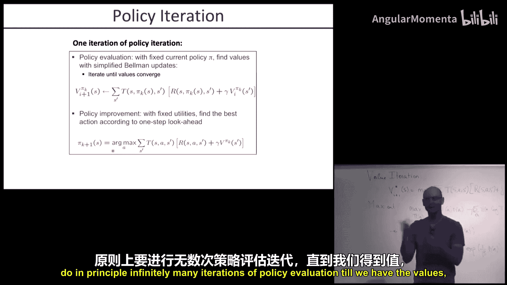

And this will also converge and in some conditions， it' will converge faster。

Then we looked at this grid world here where there are some obstacles and there wass also some question about this on Piazza。

 which was Alex and answer actually really well by a couple of students。

 but just to quickly recap in this world that we're looking at a grid world。

And when we solve an MDP by default， we get a solution for that specific MDP。But in the real world。

 it's possible that the MDP you're solving is actually not a perfect model of the world。

 And so in this scenario here， maybe a new obstacle gets put in place， but you don't know about it。

 And you're just executing your policy and if somebody chooses that adversararily。

 it'll probably block you from getting to the goal and you won't succeed anymore with your current policy。

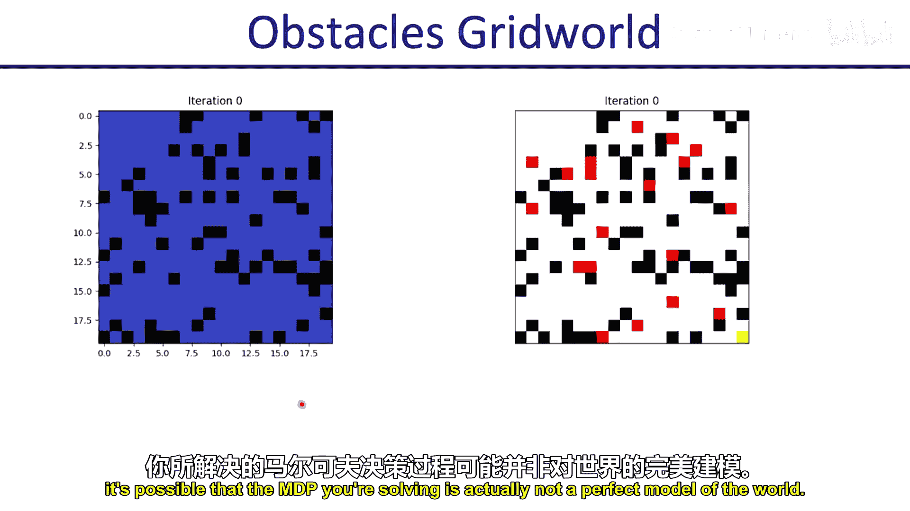

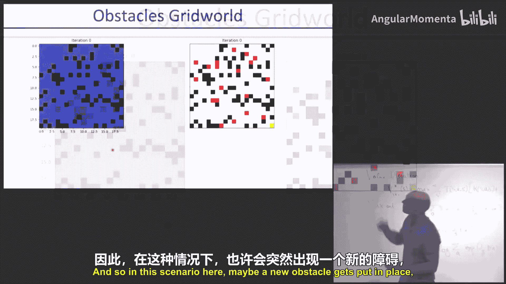

That's when we said， well， can we maybe find a way to be more robust？

If maybe we find instead of a policy as deterministic， a stochastic policy。

 So it essentially has a range of things that could happen。 And so if it gets blocked somewhere。

 well， there's other things that he might do the next time step because it doesn't get stuck in this deadlock。

 doing the same thing over and over， bumping into that same wall。

The concept we had there was the concept of maximum entropy。

Entropy is this notion that you can measure for a random variable with distribution P。

How uncertain you are about that random variable。 It's a measure that's specifically kind of motivated from information theory。

 It also is very convenient because it's a measure where we do the math。

 It always almost always kind of works out really nicely As we saw in the derivation for max end for one time step。

 We saw the math worked out nicely。 So it kind of has two good reasons to use it。 One。

 the math will work out nicely to it's very well motivated information theoretically。😊。

So entropy measures how much uncertainty about the random variable can canonical entropy plot is this one variable can be either one or cannot be one。

 let's say zero horizontal axis here is probability of being1 if it's 100% probability of being1 is here。

 entropy is0， no uncertainty， 100% probability of being  zero。

 entropy 0 in between entropy is higher。And the more spread there is higher the entropy。

 so on the left you'll have higher entropy than on the right here。And you can also compute this。

Then we said， okay， let's reformulate MDPs with Maxent。 This is the original formulation。

 Let's now do Maxent。 We add an extra term。 We want the policy to have high entropy in every state。

 And there' is a tradeoff factor there beta， which the higher beta is the more you care about having high entropy。

And the lower beta is the less you care bio entropy and more you care just about collecting rewards。

Then we had a little sidestep we had to do into constraint optimization。

 namely that if we want to solve a constrained optimization problem， we can instead actually solve。

This min Max problem where the objective is now called the Lagrangian， and it's dising over here。

 and we saw that。At solution。Deerative with respect to x will be0。

 derivative respect to lamb that will be0。And then we solve the maxN problem for one time step。

 so we work through this。Did a bunch of math using that constrained optimization math from the previous slide。

 did some simplifications and found out the optimal policy。Pi for a one step MDP。

 So it doesn't depend on state。 You're just always in the。Same situation initially。

 pi of a is this thing over here， which key here is that we exponentiate the reward。

And then there's a normalizing factor here， Z to make it all sum to one because it's a probability distribution。

And so the higher the reward， the more likely and in fact。

 exponentiating makes things go up very quickly， so if one action has much higher reward than the others。

 it will have much higher probability than the others。

Then you can actually fill this back into the objective。 Our objective was this thing over here。

 and so we can see well what is the value we actually achieve on this objective when we fill in this formula for the policy。

And then this is just a bunch of simplification math， no conceptual steps there。

 just kind of gr through the math， what comes out is this thing over here。It's。Let's ignore the beta。

 let's assume beta equals1 then we have log some XRA。

 so we're exponentiating everything and then we're taking the log。

 roughly what that comes down to is if you're the biggest number。

 after exponiating and looking at that some the biggest number will dominate and soll be pretty much X of the biggest number。

 you take the log of that， you get back out the biggest number， it's not exactly that。

 it's a soft version of that， every RA contributes， but so it's a soft version of that。

The more the coefficient in front of RA makes everything go to zero， so you divide by a big number。

The less the biggest one can be bigger than the others， and the more they'll all contribute。

 then you'll get a softer， something close to an actual average of the numbers。

And the more beta allows the largest one to be bigger， that is， the more beta is close to0。

 which will scale everything up， the more the largest one will stand out。

 and the more it'll just be a hard max。Al right， so that's a quick recap of what we covered last lecture。

 Now what we need to do is we need to see if we can derive。😊，Max end for。Valtri。So。

Let's do that one on the board。So our maxent for value tu， what does it mean。

 We now have this objective max。Over pi policies。 And now this will be stochastic policies。

 We know that because the solution to max and problem is not going to be deterministic。

 So policy pi will not just be from state to a action。

 It' will be from state to distribution over actions。Expected value， because we don't。

 We will not have not just。Stokeacity in the environment， maybe but also stock hasity in our policy。

 So definitely an expectation here， some。Over time。Zero through infinity， reward at time T。Plus。

 beta。Entropy。Of the policy。In the state we're in at time T。

I'm ignoring discounting here if you want to add discounting， you can add it in。

 but just you you know where the discounting would go go here gamma to the T。

 but just to keep the symbols a little lower， we allright， doing no discounting on this one。Then。

We define VK。Of us。As。Max。Over policies of the expected value。Of。Some from t equal H minus k。

Through H。RT。80。Plus， beta。H。Pai。AT given an ST。 Well， really pi。 There's no A0 here。嗯。Okay， so。

What we have here is we're defining the optimal value for the max n problem with case steps to go as well。

 the reward we get in the last case steps and also the entropy we collect in the last case steps。Yes。

 does H mean entropy in both cases or does it mean？Oh， yeah， we have two hs here。

 So how about I make。One of them something else。 How about I make this one， The horizon， I'll make T。

Because entropy is can of always H， and horizons sometimes capital T， sometimes H。Yeah， there we go。

Thank you。Now we can do a similar recursion as we had over there。

 Let's see if we can compute Vk from VK -1。Vk of S equals。Max。Over pi， expected value。Of。

The reward will get immediately from being in state as in taking action A。Plus。

 beta times the entropy。We get in state S。And well， sometimes I put a dot here。

 sometimes I'll just put a， it kind of means the same thing， essentially。

 but keep in mind of the A here， it's still a distribution over which we compute entropy。Plus。

V k minus1。Of S prime， which would be the next state we visit。

Now I'm going to make a small definition。 and the definition I'm going to make is I'm going to say this here。

Plus this here， I'm going to call Q， so I'm going to say I'm going to re just as Q KSA。Plus， beta H。

Pi a given S。And everything else stays the same， so max over pi。Expected value。There we go。

Now when we look at this problem here。There's actually the same problem。We solved over here。

 There is no difference。 The only difference is that。Over here。

We have an appearance of R instead of  Q， but as the only difference。

 nothing else is different in those equations。So that means if we know the solution to this optimization problem。

 we know the solution to that one， we just can take the solution of this optimization problem。

 and wherever there's an R in the solution， we put in a queue and we're good to go。

That that makes sense？So we don't need to redo all this math。 We don't need to resolve this。

 We know we already solve this problem。 And what's the solution Well， the solution is pi。K。

 A given S。Equals 1 over z。Exp。1 over beta。Q， instead of R， there was R。 But again， R became Q Q。

KS comma A。That's how。Sttochastic policy， so we favor taking actions where we have high Q value。

 What is Q value intuitively， A Q value in state S and action A means that you are in state S。

 you're 100% committed to action A。 how much reward you expect to get。From then onward。

 you committed A， you haven't taken it yet。 You're instead state S。 you commit to action A。

 You're about to take it。 How much reward you expect to get Well you expect to get that RA。

And then you expect to get。Future Vs。But once you commit it to a， of course。

 there's no entropy anymore。 So that's not really there。 So the the Q。

 once you're committed to a at the current time， doesn't have the entropy anymore。 It just has this。

And。This。The queue still includes entropy from the future because once you've take in your action。

 in the next state， you'll have a distribution over actions again， that comes in。Through this。

 of course， because this V has ened from the future that you get rewarded for。So this is our。

Action distribution。And our value will be same equation over here。 Again。

 the only difference between this objective in the one over there is that there's a R here instead of and a Q over there。

 So we have value is this kind of。Log some X thing where we essentially look at the max。😡。

If we have a very kind of beta very close to 0 and we look as at just an average， really。

 when beta gets close to infinity， So the。Oh， this starting to run out。V。K。S。Equals beta log。Some。

Over actions， X。1 over beta Q。K。S comma A。Any questions about this？Yes。Sorry， this is a question。

 Could you give a little。Where。That that's just applying Somatics over。Vals that。

We you talk about the exponent here。So what is it doing is doing the same thing it was doing over there it's saying。

 I mean， first of all it falls out of the math like I'm not putting it there because I necessarily want it there。

 it just falls out of the derivation， we did the de last lecture and we just copy the result over intuitively what's happening is when you exponentiate something big things become really big。

 medium things become like a little bit big and small things become really small。

 especially if they were negative they become really small and so the effect you have here is that it kind of amplifies the difference between all these numbers between all the QKSA。

 amplifies that difference。嗯。And so what that means is that when you then。

Look at what happens here if something is the biggest。Q value。

 it'll get amplified and it'll get very high probability。

 whereas rest something that's medium will get somewhat small probability， something that's tiny。

 We'll get essentially0 probability in this calculation here。 And then here。

 the same thing is happening， but it's happening in terms of。By taking the log at the end here。

 you actually pull back out the original values so the log here counters the X if there's only one action。

 it would directly counter it， there would be no summation in between because there's a summation in between you can't swapwa that so it's not like the XN log just cancel out。

 but effectively what happens is。The big ones will dominate the summation。

 The small ones will be kind of disappearing in that summation because expon grows very quickly with bigger numbers。

 And so Al， you'll be left with roughly the biggest one。 Take the log of that， and you'll get a max。

 It's not entirely true。 The others contribute a little bit。

 So you get actually a little more than just a max of the biggest one。

 a slightly higher number than just a max of the biggest one。

 effectively like using the transformation that change。は。嗯。These values here。

 Q KSA are coming from this identity over here。 correctect， And that has。

 that's reward and future value。 So this is really values that are living in here。

 Reward plus value lives in here and is together value for an extra time step。Yes。😊，我。

This formulation。Considering how it's rewarded。えで。It's only R of essay， rather than。

So the question I think is why is there an expectation here with this inside the expectation。

 the reason this is inside the expectation is because the policy can be stochastic。

 so there's still an expectation happening over actions。Like whyhy is it no longer？球啊。Oh。

 just I mean， it's just a lot to write and you can I mean you can do as a homework exercise to just practice a bit a S prime in there and you'll get somewhat similar results so just probably a little more hairy when you drive it。

 but ultimately the same intuition will go through， yes。

Just so just to think clear it's going to be RSK。OfVK as crime sumd overall。We're here。

 this expectation， if you want to be explicit， this expectation is over over a and over S。

T plus s1 or S prime， whatever you want to call it。 Yeah， let's call it S prime。

 it's over both of those。Yes， where exactly are you using the irrigation from last time？

So we look at。This thing over here。This maximization problem。

 we tried to maximize expected value plus entropy。If you look at this。

 that's exactly the same as what we have over here， it's written slightly differently here。

 but it's expected value plus entropy， Ex same thing just over here。

 expected value has a Q and over there as R， but otherwise is's the exact same thing so we can just take the solution from this problem and swap in Q for R and we're good to go。

Now let's look at some of these in action。 So we're going to watch some videos here where we have on the left。

We're going to see the values evolve over time as we have iterations。So。嗯。And on the right。

We will see rollouts so the red dots or red little squares are where the agent starts and you'll see the policy in action from there。

 and then on the left you'll see value function plots。When I sit at the top t co1， beta co1。

 essentially what I'm saying is when we call some people call it beta。

 some people call it T for temperature， but we already have a lot of T's in kind of what we're doing with MDPs。

 but I just want you to be aware how some people will call it temperature。

 which is another capital T that would appear。So。Let's see what happens， be equal 1。😡，Which。

I guess we don't really know what that means at this point。 I mean。

 we don't know if that's high or low because we need to kind of compare like what happens when it's one and then later。

 we can see what happens when we make it lower or higher， do we get a different behavior。

So's take a look at this in action。Initially with very few iterations， it can look far ahead。

 so for most states it can never read if the reward is given at the bottom right here。

 it'll never reach there， so the optimal thing is to be just uniform action distribution for those states。

 if you're never going get to the goal， what's the point in doing anything that uniform action distribution。

And in fact， we see that with beta equal1， which puts a pretty high weight on the entropy。

 most of it throughout stays just maximize， essentially entropy and pretty much ignores reward because it's so hard to get。

 there's some discounting also so it's kind of far away and it doesn't really affect much what you're doing anywhere else。

 there's much more to be achieved in terms of objective by just maximizing entropy and that's what's happening。

Then let's make beta a little smaller。 Sorry， T should be 1 e -2 and just T and beta are the same。

 Oh， I realize now what it is。 But the way I wrote is T is 1 over beta is 1 e -2。

Let's see what happens now so we care。Less。About entropenino。

 the values will propagate a bit more out from the bottom right。😡，If the agent starts somewhat close。

 it'll in a jittery way， try to get to the reward state at the bottom。 And if it starts far away。

 it still has very low incentive to actually make it closer。

And then here we have 1 e minus-3 and things will propagate even further out in terms of value propagation。

 but still even at a temperature a beta value of 1 e minus3。

 mostly it likes to jitter around and so you see that you actually need to bring your beta pretty low for this to do anything that resembles optimal behavior。

 which is what we get here if we run it for beta equals 0， we don't care about entropy at all。

We see the fronts coming out。From here。嗯。It's getting a slightly less red color further out because it's discounted。

 so from further away， it takes longer to get to the reward， you get a little less on the top here。

 it still doesn't care at all about where it goes。 but soon when the front reaches there。

 it'll start caring and it'll start also moving towards the bottom right And at the end they all kind of make their way into that bottom right spot because it propate it all the way。

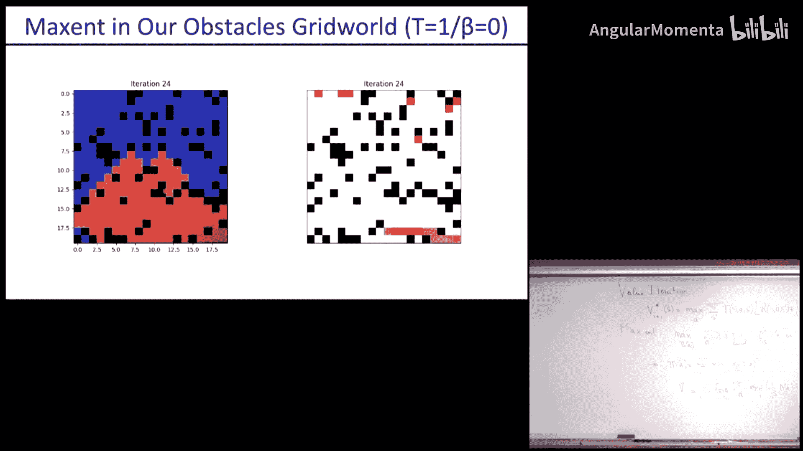

All right， so what we covered。In today's。Last Tuesday's lecture so far。嗯。

Is everything but linear programming。 So's take a look at this last way of solving MDP。

This is a way of solving MDP that actually has been very popular。

I would say what was very popular maybe。

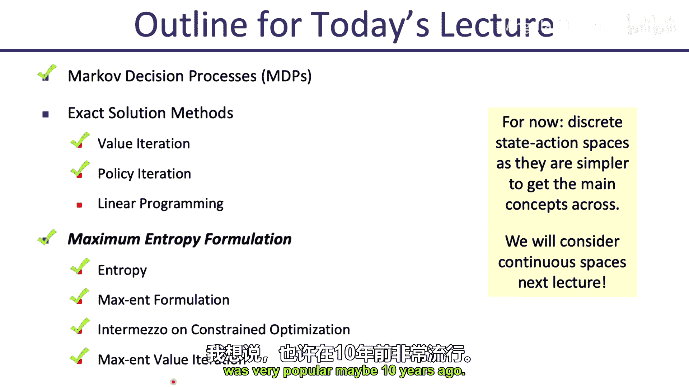

10 years ago， it was the only way people were able to get really nice guarantees when solving things approximately。

 these days， it's a little less popular， but I still want to make sure you're aware of the ideas behind it because with all those things。

 I mean， in 188。

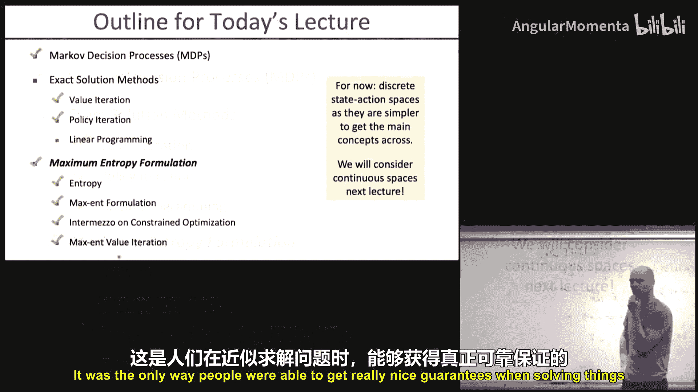

20 years ago， nobody is working with neural nets pretty much。 And we still taught neural nets。

 And then all of a sudden came back。 So it's good。 We kept teaching it。

 And maybe the same thing will happen here。 Maybe even no now。

 almost nobody's doing linear programming for solving MP。 Maybe a couple years from now。

 somebody has a new breakthrough builds on it。 And then at least you， You know。

 you might be the one building on it。 in the near future making it popular again。So。

I'm not going to work this one out on the board because I don't want to spend as much time it as the other ones。

 But here's linear program that we can solve to do essentially to solve for V star。

 Let's start with the original thing。 So we want a solution to this equation。

 And way we found it is to value or policy tu。And we found that it converge us to V star。

 which satisfies this equation。Can we actually solve this equation directly。 You say， well。

 this is just a nonlinear equation。 Can we just say nonlinear equation solver， I have， you know。

 as many variables as there are states， I have as many equations as there are states。

 So as many equations as variables， is nonlinear because of the max。

 but just give me a solution see what comes out。 That hasn't been too successful。

 but we can do is formulated as a linear program that will do something somewhat similar。😊。

So here's the idea。We're going to minimize。V。Which is or over V， this quantity over here。

 and these weights are supposed to be positive。 So is a positive weighting。

 you can say all maybe equal to one or something of the values in the state。

 such that for all states and actions， the value is bigger and or equal to this thing。

So think about this here we wanted equality。And then here we're saying。

 actually we're going to make it an inequality。😡，We're going to get rid of the max。

 which you're going to say if it has to be bigger than the max。

 it just is maybe bigger than all of them， so I can just expand the number of equations say I need to be bigger than all right hand sides。

 no matter what the action is。😡，And then I don't want to be too much bigger。

 I want to kind of lean into this and have to satisfied with equality for the action that achieves the max。

 but the other ones we can， because we have to be bigger than the one that achieves the max。

 And that's exactly how this is setup up over here。 So we minimize the V values。

While making sure that they're bigger than the thing on the right hand side， which in turn， oh。

 this should be a regular V or there should all be V stars。So that's the intuition。Now。

Theorem says that V star is the solution to the above linear program。Now， the way I explained it。

 it might sound very intuitive about like cook it， this all makes sense。 It's very natural。 you know。

 you have this equation。 you need to be equal to the max。 that means bigger than all of them。

 I make it bigger than all of them。 and I make it lean in as closely as possible。

 It's gonna be equal to the max。But it's actually a catch V also appears on this side。

 so the intuition that kind of portrayed you isn't exactly tight from a mathematical point of view because as you're trying to minimize here to lean against this。

 you're also bringing this thing down and it's more complex than I just said。😊，Yes， question。

 There's a star hand and no。 Yeah， so， yeah， so what I said a couple minutes ago was that star should be no star or all of them should have a star。

 Sorry about that。So。Even though what I just told you isn't。😡。

Wattight justification for why this will give the solution we're looking for。

 There's actually a proof which we're not going to look in a lot of detail at。

 but it's kind of an interesting notion， or can somebody close the door in the back？

So notion that if you applied the value operation called F， you have VI， you apply F value update。

 a Bel update， you get VI plus1。That that's actually a monotonic operation。

 meaning that if you have two choices for VI， you have two VI and a UI， you apply the Belman update。

 if VI was bigger than UI， then the updated version of VI will bigger than the updated version of UI why because you sum it in and you sum in something bigger turns out you can use that property to show that this linear program as a solution has the unique value function。

This is more for your own kind of sake， not expected to understand this in this like very quick explanation。

 but at least you have the full story in the slides。Now I'm going to ask you interesting question。

 How about this program if we。Turn it around。Instead of minimizing we maximize。

 and instead of making V bigger than F of V， we say it has to be smaller than F of V。

Now you're not super familiar with this notation， so let's go back to this thing over here。

 essentially what we're saying is instead that the min were going to max and instead of having a bigger down here。

 we're going to put the smaller than there and see what happens。😊。

So turns out that there's a way to make that work also。

It's just it's not a linear program and so you cannot solve it efficiently。

 but it actually ends up the proof that is worked through here。

 you can work through the same proof for the opposite direction。

 and it'll still show you that the only solution to this is V star is just not a linear program is so it's not that useful because linear programs we can solve efficiently and general optimization problems is harder to solve。

Okay， again， that's mostly for your interest。 Now， what I do want to do is there's a dual version。

 So every optimization problem has a dual optimization and the dual。😊。

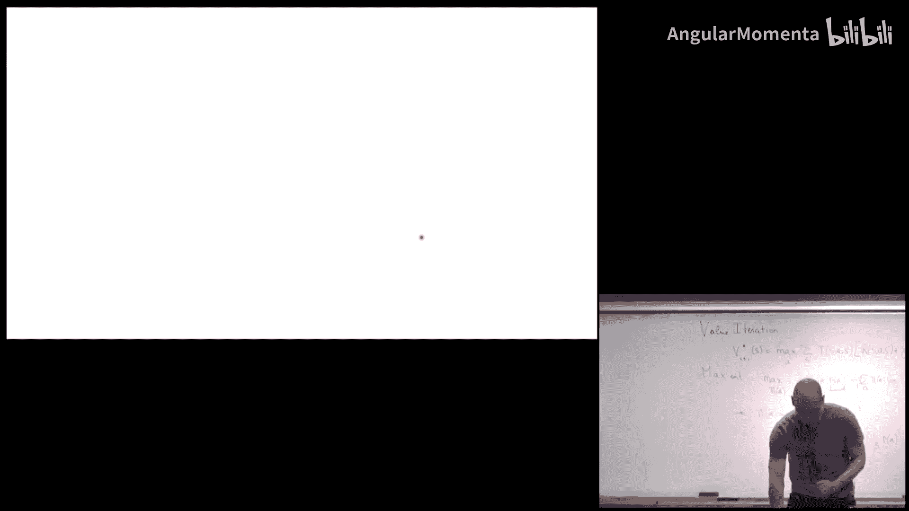

For the linearar program is very intuitive and we'll see it come back in the coming weeks when we do nonlinear optimization for control in different formats。

 so rather than deriving the dual by taking a lagangion of this program and then going through all the steps you do to get a dual。

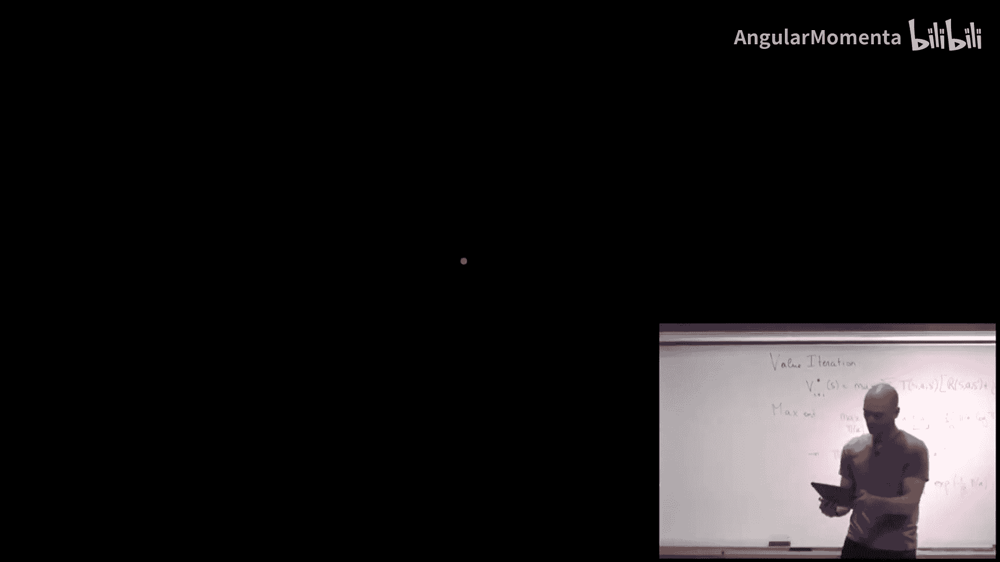

We're going to just write it out and interpret it and realize that it makes a lot of sense。😡，Okay。

 so I'm just going to write it out and then we're going to interpret it。😡，Max。Over Lambda， often。

 the dual variables are Lambda。 So we'll use Lambda sum over S。S over a。S over S prime。Lambda S。

Transition model， S， A， S prime。Reward。For this transition， R SAS prime。So we'm going to maximize。

This quantity。Which if you look at it carefully， you might already think about as an expectation。

 Imagine Lambda is a distribution over states and actions。 It's not going to be exactly that。

 It's gonna to be very close to that。 Imagine Lambda is a distribution over states and actions。

 Then what is this， This is the expected value when you sum over all states and actions of reward you would get from that state taking that action。

Now this is kind of a weird sum， of course， because this would kind of assume that we're in each state。

With uniform probability， but the dynamics is not under our control。 Also。

 the initial state might not be under our control。 So now we need to account for the fact that。

Somebody will give us an initial state distribution， and we will be later。

 The dynamics will control some of that。 We don't have full control over that。

 So we add a constraint subject to。For all。S prime。S over a prime。Lambda S prime。A prime is equal to。

 so think of this as。If Lada is the probability of being in state S prime and taking action a prime。

 then this is summing out over a prime and saying what' the probability of being in state S prime？

I'm going to say the probability of being a status prime has to be equal to。Mu。Zero。Oh。

 I think I got a type on the slides here。This should be a S prime， mu 0 s prime。So probability。

 so on the slide it has a S， this has to be S prime。

Probability of being in status prime when you start。

 because that definitely gives you probability of being there。😡，Plus。Discount factor gamma。

 because future things we care less about， it will be reflected in this probability distribution。

Some。Over S， sum over a。Lambda。S A。TS A S prime。So this is saying。

 what was probably if we start in S prime？And this is saying， well， imagine we were somewhere else。

 what's not probability of landing in S prime， because there's two ways to achieve S prime。

 we could have started there， we could have landed there。

So it's a self consistent set of equations because that has to be true for every s prime I say here。

 that's this equation for every S prime。All states are going to be S prime in this set of equations。

 And so it's a selfcon set of equations， essentially saying the way the probability mass kind of。

Is allocated， is based on the initial distribution。

 plus where you go from there and the way this is defined recursively。

 this will actually account for infinitely many steps into the future where the probability mass has gone。

In fact， if you say。Lambda S。Equal。Sum T equals0 to infinity。Gamma to the T。

Probability S T equals S A equal a。If that's how you define Lambda SA。

Which is kind of the intuition we've been talking about。

 How much time do we spend in state as taking action A， but。If we do it in the future。

 it count for less。 So it's really the discounted version of that。

 If we look at the discounted version of that。And call that Lambda assay， we'll see that this thing。

We'll satisfy this equation over here and it's a self consistent set of equations that actually allows you to solve。

For this thing over here， because this gives you equation longer to solve for what these are because you don't know what these are。

Because you don't know what your policy is and only when your policy is set， you know what these are。

And you actually have a lot of choices that satisfy this。

 and then the one that you want to pick is the one that maximizes reward。

And so the key intuition here is this quantity here。That。

The meaning of the dual variable is the expected， discounted。

Amount of time spent in state as taking action A。And then it all makes sense。

 expect this kind of time spending state taking action A。

 times how much reward you collect every time you're there。

 that's the value under your current policy。We'll see a lot more equations like these in the future。

 this is may be the one of the more complicated ones of its type because it's all in a stationary distribution as opposed to rolled out over time。

Opmo policy， pi star。Of S is equal to。Arrg Max。Over a， lambmbda S。

So whichever action you take the most in state S is the one that's the optimalpoli in practice。

 unless there are some weird ties， there will only be one that has non0ro。

 all the other ones will have zero probability， you can just read out the one Lada S for state S that has non-zero entry。

Any questions about this？Essentially we'll see this come back。

 so it's good if this notation is clear because we'll see similar things in the future， yes。Okay。

 so when you think about。This thing over here。😡，It's the expected discounted。

Amount of time spent in state as taking action A。And you think about the dynamics of the world for every policy。

 so think about any policy you could choose theres so many policies out there。

 for every policy you could pick， there'll be a resulting Lambda SA， so pick a policy。

 a Lada SA will result right。Now， you could pick stochastic policy。

 you could pick theministic policy and so forth。 but we can pick any policy we want。

 and we're still trying to find the best one， right， And we know that the best policy。In a MDP。

 when there's no max end， it's going to change I mean， if we actually put a max end in the objective。

 it'd be different。 But since there's no max end here。

 we know that the optimal policy is gonna be deterministic because one action will be better than the other actions。

 You should just take it。 or maybe there's a couple that are tied for best。

 You should stick one of those。And so that will show up when you run this optimization。

 essentially you're cycling implicitly over all possible policies out there。

Each policy implies a Lada SA rather than asking for the policy。

 you just say I'm going to cycle over Lada SAs because there is a one to one correspond between Lada essays and policies。

 I'm going to directly find the Lada SA that maximizes expected value。

 and since we know the optimal policy we know from our past work andval so forth that the optimal policy is going to be a deterministic。

Or if there exist optimal policies that are at， the same thing will be true here。Allright。

 let's take a couple minutes break here， and then after the break， we'll start with continuous MDP。そ。

Okay。All right， let's restart。い说。らで。あそうそ。定接。So one question that came up during the break is。Well。

 I'll just give the answer you give it the two intuitions。

 One is essentially if you think about Lambda S， it's a probability distribution。

 but it's not normalized。 the sum over a Lada SA for a specific S will not sum to1。

 but whatever its sum to that you're normalizing constant and essentially it tells you the conditional probability of a given S once you're normalized by that。

With that in mind， you can then also actually start thinking about entropy maximization。

 So you can actually， instead of having just the objective be expected rewards， you can add a term。

 that's entropy。 And now you have an optimization problem that is trying to find the Lambda essays that not just result in optimal reward。

 but also maximize entropy with some trade off factor there。Yes。

 is there a quantitative relationship between lambmbda essay and Q value for essay？嗯。

There is no direct relationship between Lambda and Q in the sense that you can read one of the other。

 even though they both have SN A as arguments， Lambda say is really a policy。 And now。

 if you did the max N version， then。You could probably take the log of the Laeses and get back out the Q values。

 but for the regular version。Essentially it's going to be a theistic solution and the Q values will have kind of disappeared。

 So it's not clear how to get it back out。 That said if you solve linearar program。

 you do get the dual variables。 the dual variables here will， I believe。

 be the Q values or the V values。 I forget depending on how many constraints there are exactly in this one I mostly asked because it is the max A over this versus max A over Q values will still optimal So yeah。

 not since theres a relationship， but it's not you can read one off from the other。Okay， so。

Now we're going to look at solving continuous MDDPs with using disktization。

So we're going to build on what we're already covered to solve more difficult problems。

So we're still trying to solve MDP， so agent acting in the world trying to collect as much reward as possible。

 still same framework we reapped at the beginning of lectures so let's go through this fast。

 we saw value already again， we know how this works。

 but what if now we have a continuous state space as is a continuous set。

Val becomes impractical because if you need to do for all states this update。

 when it's continuous or maybe discrete and very large。 But today， we'll look at continuous。

 that's infinitely many updates you need to do。 And so even one iteration of valueeration will never finish。

And so the question is， how do we deal with that？What if we turn the original MDP。

 which is continuous into a discrete MDP？Disquiitized version。

 so we have an original model states and model over there。

 and then we put some bars above it to annotate that this is not the real thing we want to solve anymore。

 but hopefully it's related and it's discretere。Well。

One way we could do this is we could grid the state space， we could say OK， it's continuous。

 but we just take some points on a grid and we only look at those and define our MDP over those points instead of the original continuous space。

We also need to reduce the action set probably if there's continuous actions。

 we also grid out the actions。Sometimes that's not needed by the way。

 we'll see examples where you don't need to discretize the actions even though you have to discretize the states Why is that well there's a max there right and so sometimes this max is an optimization problem that is an easy optimization where you just say oh max over a but it's a continuous variable oh I can put the grain respect to a equal to0 maybe it's a closed form solution and then I don't need to worry about discretizing actions but in general that will not have a closed form solution and so then。

To make it solable， what we can do is disretize the action space， limiting our options， by the way。

 So some actions will not be available while we're trying to solve this。嗯。Sometimes。

Something funny happens。 Sometimes even though you have a continuous action space available。

 you can prove ahead of time that only the extreme actions are gonna matter。

 It's called bang bang control。 It's usually not that desirable necessarily to do bang bang control because it's like very extreme always maximal amplitude action one way or the other way。

 but for a lot of deterministic problems， bang bang control is probablyably the optimal thing according to if the dynamics is really satisfied the way it's defined in your optimization problem And so then you can just say。

 hey， I can choose between negative one and plus one。

 but I just only ever need negative one or plus one never anything else。

 So I don't lose anything from distizing the action space。The transition function is a tricky part。

 of course， right， because。Think about disizing states and actions well， trivial。 you're done。

 right You just say I only consider those states and actions and you're good to go。

 How about the transition model。So we're going to look at here is how it distize the transition model because that's the hard part。

And we'll look at look ahead policies， some examples， some guarantees。

 and we'll connect with function approximation will be the topic of next lecture。

So let me highlight the challenge here。So， I think。We've seen this equation for long enough now。

 that。Think we。We know it。So let's use this side of。The board now。To think through。

What happens when we disittize？So。Let's say we disstize。We used to have。

 actually I should it raise better because we's going to draw some dots on the board。

Let's disretize our original rectangle。If that's our。State space， we can say， well。

 that's too much is continuous。 We can't deal with it。 Well， how about we just say。This is possible。

 this is possible。Maybe。This is possible， this one's possible， this one and this one。

That's all we're going to iterate over， so just six statess， should be very fast on value tu now。

Okay， let's think about running valuealtrition， we're thinking about this state。

You look at the sum of all future states as prime， with call our transition function。

And once it says， well， sometimes you end up over here。Sometimes you end up over here。

 sometimes you end up over here。Well， how am I going to do backups now？

Because we land a status prime， but actually， we're not running valuation over these states。

 We're only running a valuation over。These states。But now we landed as other spots for which we don't have values because our values are only available for those six statess。

 What do we do now。Doesn't work。Al， can to the backup。

 What we can do if we really want to make a discrete MP， we can say， well， you know what。

 this one is really closest to this one。 So even though the model says I'm gonna be here。

 I'm actually gonna make this go here。 So I'm going effectively change my dynamics。

 I have a continuous dynamical system。 It would put me in one place。 We're gonna actually say。

 actually， you'll end up over here。 This one， maybe also here。 This one here。😊。

And so that way we now can define a dynamic model。 We now have our transition model， P of S prime。

 given S comma A。Where this one here is S。Well， we now know what it is。

 you have some good amount of probability ending up over here。

 some remaining probability ending up over there。This is for one action， then for a new action。

 we can do the same thing and repeat。Now， the way I drew it here， it's more or less like a。

Nearest neighbor type snapping to。Two ones that we're willing to consider。That's one way to do it。

 There are other ways to do it。So nearest neighbor is very convenient because it's simple。

If you look at continuous state， you just need to look at a certain level of accuracy。

 and then you just round effectively。 and that's your discrete state。嗯。But。

The tricky thing with this nearest neighbor kind of snapping is that it doesn't。

Reflect the dynamics all that well。 For example， things can happen like this。

 Imagine you're here and you go all the way here， you get snapped back here or you go here。

 you get snapped back there。 So essentially whenever you stay relatively close to where you were。

 you get snapped back to where you started from， there's like there's no effect from your action。

 even though continually speaking， you are definitely moving。But you didn't move。

 you got just snap back。 Similarlyly， if you say， well， if I want to move somewhere。

 let's say I want to get over here in continuous space。

 I might have to apply a bunch of actions to get there。 but in discrete。

 I can just say apply minimal actions to just cross this boundary and I'll be snapped automatically here。

 then next time I apply this action just barely cross the boundary and I'll be snapped over here。

 And so just all these things that you can exploit on the one hand by only going this far and getting snapped to where you want to be and also things that hold you back where you just get snapped back to where you started from。

 But in principle， it's a valid approach。 I mean， the things I talked about if you make your grid finer and finer and finer。

 the effects will become less and less and less。 So with a fine enough grid， it should work。

 but intuitively。It's's kind of not the behavior you hope for when you turn something continues into something discrete。

What can we do instead， what's a more natural thing to do？Well， more natural could be。Something。

Where。Let's say we still have the same set of states that we're willing to consider。

Maybey we started here and let's say we landed。Actually， let's say we landed it over here。This point。

What would be a more natural thing to do maybe is to say， well， let's look at all the neighbors。

I could this point could really go here or here or here or back here because we didn't make it all the way to any of those other points。

😡，And we could say there's going to be a distribution over where we go。 It has to sum to one。

 So we'll say some probability for each of those four。How much probability？Well。😮，嗯。

You probably want something that's easy to compute。

 so you don't have to worry about much when you set up your disctization code and you want it to probably be as evenly distributed as possible since there are four destinations here and there's only one point。

In 2D， you only need three actually you only need three neighbors to be able to define that point as a weighted combination。

But we have four。 We actually have some flexibility。

 So you might say maybe maximumim entropy is the way to do it。

 Maxim entry distributed over all the neighboring points。 I think that is proud of the way to do it。

 I'm 900% sure what the solution is to the maximum entropy problem here。 If somebody can work it out。

 let me know。 But I think maximum end would make a lot of sense。

What is very convenient and might well be the maximum entropy solution， but I haven't proven it。

 but it looks like it could be is to say， imagine。I'm。At a point， S prime。Equals x comma y。

 This is the x axis。 This is the y axis。And I'm going to normalize things。

 so I'm going to assume this here is one。This here is zero。This is one。

So you'd have to do some normalization work in your code to set this up。 but intuitively。

 this should be clear。And the grid points surrounding it will call them。This one， I'll call Psi。

Rrong。Greek symbol。Ksi00， I'll call this one。si01。I'll call this one。Cai。1， one， and this one。Sai。

1 zero。Okay， hopefully those are intuitive names。Then。

If I want to say S prime should be a convex combination of the one surrounding it， I'm going to say。

 well， how about。How about S prime？Equal2。1 minus x times 1 minus y。si，0，0。Plus。X times 1 minus x。

Sai。0ero1。Plus。Oh， this would be1 minus y here。Then 1 minus x times y Psi。1，0。Plus， x times y Psi11。

So first let's check things work out， so the sum of all these four coefficients is1， right？

1 minus x times1 minus y plus all the other ones sums up to one。

 So we have a weighted combination of them。It's actually pretty high entropy， by the way。

 because the X and the Y are treated independently and distributions with independent variables tend to have higher entropy。

嗯。Then if to look at it。Si 00， we want this one to get a lot of weight when the point is close to here。

 close to here means be close to 00。Well， when you're close to 0，0。

 this is close to one and you get a lot of weight。 How about the next one，si 0，1。

 You want this to get a lot of weight。When we're close to the 01 coordinate well。Is that correct。

 zero1， I right it correctly？When we're close， want this to be good when we're close to01 coordinate。

So actually， we need to flip this。嗯。That means you need to flip the next one also。

So want this one to be high when we're close to 01，0 for x， so 1 minus x，1 for y， so y here。

This one we want to be high when x is close to 1， so we have x and when y is close to 0 so1 minus y and same here。

 x and y when close to 1 will be high。So now we get it nice。

Sttochastic transition model that distributes。This next state mass onto states that are actually available in our value tu。

Any questions about this？Yes， you're not the state one of those you're just distributing probability so we're not snapping it to any single one where we are still kind of snapping it。

 but sarcastically。It could be any one of the four。The transition model。

The normal transition model is of the type。P S prime given S comma A is given by your model。

 but this S prime will actually not be available。 And actually， what you'll end up with is。

Another model is in some sense， P as double prime given S prime。

 which is gonna be the real state you're gonna be the state you're gonna be using because S prime is not available in your indexing of states。

 And so this extra transition is what's encoded in this model。 So you go to your next state。

 But then there's an extra thing that happens to go to neighboring states that are actually available in your value duration。

So。We also have some slides doing the same kind of drawings。So we already saw this。

We already saw this。嗯。We saw this， though， I have to go。Thanks。Pypo there。嗯。

You can actually also do something else。 So in what its described here。

 I said we're going to take essentially the four states around this。 Priple three is enough。

In high dimensions， let's say， K dimensional space， K plus one is enough。To surround your point。嗯。

And something called coon triangulation exists that is a fairly efficient way to find a triangulation。

 or it will be not triangles buttetrahis and so forth in higher dimensional space that tell you how to interpolate this way and I have some slides here explaining how that works and there's some detailed math in practice what it does。

 it introduces some asymmetries because once you do this kind of thing。Well， why？Why should we。

In this case。Why should S prime kind of。Be considered being this triangle versus there the other diagonal we can draw in there。

 Why not use the other diagonal to generate the triangles and what happens then？

 And so it introduces an asymmetry that is not clear that's actually not it might not be that great sometimes to have that asymmetry that gets introduced into your problem。

 whereas if you use the rectangle， Yes， you need to go to more points。

And so your transition model will have more non zero entries。

But it's more symmetric and more reflective what actually is happening in the real world。

 and so your solution might actually be better。There's some tradeoffs here because then essentially when you use this in high dimensions。

 K dimensional， here you just have K plus one nonze entries with the thing we're looking at。

 if you generalize this， you'll have two to the K。Noze entries because a hypercb and K dimensionia is2 to the K vergies。

But ultimately， since you're cycling through number of disctization levels to the power K discrete states。

2 to the K should be a manageable number because otherwise you couldn't manage the value creation anyway。

And so in practice， it should be fine to have2 to the K that you go on。

And I'll keep it more symmetric。 In my experience is also， it just works better。 But that's， I mean。

 I don't have。The world's most experience in this per se。 But in everything I've done。

 keeping it symmetric tends to give better solutions。But I included the coon triangulation。

 So you know about it。 not because I think you should use it。

 but because other people use it and you can be aware of it that it exists。

And there's a lot more about it here， how you can compute it。So what's our status？

We've seen two ways to turn a continuous state space MP into a discrete state space MDP。

When we solve it， we find policy and value function for the discrete states。

They are optimal for the discrete MDP， but typically not for the original MDP because we solve the new problem。

 we essentially changed the dynamics。To be different from what they used to be。

So remaining questions are how to act when in a state that is not in the discrete state set。

 what's it going to be your policy because you have no policy available？And the other question is。

 how close to optimal are the obtained policies going to be and value functions？So。

Simpleles way to act is to not use any look ahead at all。

 So what you can do is you use the same kind of idea that we used for snapping or taking a stochastic mixture to look at what should happen in a specific state。

We could say， well， just look at the neighboring states。

 see which one is the closest and use the action that that state prescribes。

 or if we do stochastic interpolation， we can say let's look at my neighboring states。

 let's see what kind of average I am of those neighboring states。 if the action is continuous。

 I can just average the actions of my neighboring states and that's my new action。

 The action is not continuous。 Averaging might not make sense。

 but I can take stochastic sample based on the weight size assigned to each of the neighboring states。

You can do more actually than that。 What can you do more。 You can actually do look ahead。

 You can say I'm not going to just take the discrete policy and use it。

 I'm going to use the value function。 I'm going to do one step look ahead。 So the equation shown。

Top left here says one step， look ahead。I look at my action space， look at reward available plus。

 and you might want to discount depending on your problem。

 then the transition model here from the next state onto its discrete counterparts。

So this is just a one step look ahead。And。It can actually give much better performance because now you can more carefully consider your action。

 see what the consequences are and take an action based on that。

So's actually no reason you need to be restrict it to looking one step ahead， you can look。

As many steps ahead as you want， you can say I'm going to look K steps ahead。

 So I'm going to see if I take this sequence of actions。

What is the sequence of rewards I get at the end I land in some state S prime。

 which might not be part of my discrete set， but I can still see it as a mixture of neighboring states that are in my discrete set and take the value from that mixture and say。

 okay how good was this action sequence both in terms of reward and future value？Now。

 how do you enumerate the action sequences， Sometimes's a lot of options。

 So what are you going to do。Option one， you actually just enumerate them straight up if there's a small number of actions at each time step。

 you might be able to do it for a short horizon， so you only have two actions available Horon of 10 that's2 to the 10。

 so 1000 options you explore and you see which one's the best is feasible。Then part of the beauty。

 by the way， when you do this is for this entire sequence here。

You're not discretizing anymore right no disretization have you're using the exact model that's available to you。

😡，To forward， simulate。 And it's only at the very end that you make an approximation。

 The value you use after it， let's say 10 times steps is the value if you were to be in the distized version。

 But everything before that is precise。Now， to be fair， if your dynamics is stochastic。

 you won't have to have a single rollout for an action sequence。

 you have to do multiple rollouts for a single action sequence to see what the range of possible futures is and average it。

 so it might start adding up。The thing you can do is something called random shooting。 You say， well。

 there's too many options。 I'm just gonna randomly sample a few sequence of actions。

 evaluate this objective。 see which one does the best and take that sequence of actions。 to be fair。

 by the way， you don't really take that sequence of actions。

 What you do is you have the sequence of actions。 You take the first action in that sequence。

 and then you repeat this process because you'll be continually for every decision doing the look ahead to see what right now looks the best If you were to look。

 let's say， 10 steps ahead topped off by an approximate value function at the end。😊。

You can also do something else。 You can run an optimization。 you say that's an optimization problem。

 I can just run straight up optimization。 We'll see some of that。

Local grade descend with CM future lecture， what I want to highlight in this lecture。

 one of the main concepts we want to get across is cross entropy method。😊。

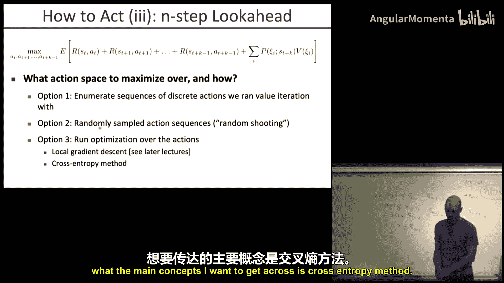

So。Cross entropy method。😊。

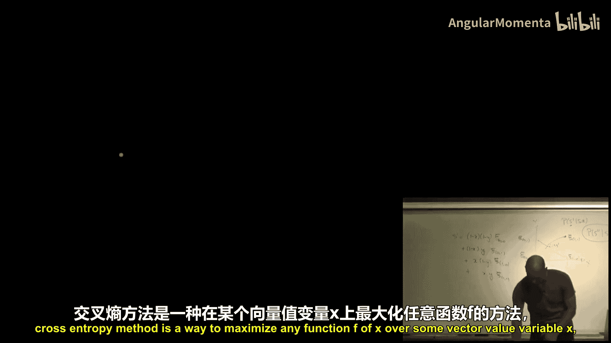

Is a way to maximize any function F of x over some vector value variable x and F goes from RN to R。

 and the function F does not need to be differentiable， by the way。

What's the idea in cross entropy method， very， very simple？You start with a Gaussian distribution。

 centered around  zero。You sample from that distribution， a vector。New， that's gonna be。Youre。New。

Your new mean， so that's your starting point。You have a mean as a starting point。Then you iterate。

You're going to improve that mean because it's going to be shifting that Gaussian distribution to a new mean。

 new mean， new mean iteration aftertu after tu。But where you're going to shift it。

 you want to shift it so that the mean is in the spot where the best exists。

 and then you can use that mean later as your solution。😡，So once we have a mean， weerate。

We sample x from a Gaussian with the current mean。Oh， indexing is off by by one here。 Sorry。

 So you sample your x a bunch first x X E from the Gausian with the current mean。

 you compute the function value there and you repeat。 So this is a loop。

 you get a bunch of xs sample from your Gaussian and you evaluate what the function value is。

Then you say， well where should I move my mean towards， well， you just say， well。

 which were the x's that achieve the top 10% of function value？Whichever x is receive top 10%。

 let's take just those x's， date the average of that， call that to new mean and repeat。

So pretty much simples thing to code up Also。 you have to code up something extremely simple。

 only you just have to sample from a Gausian， a bunch of x's。See each one of the best ones。 Top 10%。

 take the mean， repeatat。 It turns out that this will。Typically， move the mean towards the。

Position where you maximize F of X。 It's a little more subtle than that。 Itll try。

 It'll move the mean towards where， you know， under this kind of variance around the mean。

 you have the maximum expected value on F of x。 But if your variance relatively small。

 then essentially you find where F of x is the highest。There are a few generalizations of this。So。

The sigma and the 10% are hyperparameter。You can play with those。And principal。

 you can fit sigma to the top 10%， or if you can fit a full conveyvariance matrix to the top 10% and use that in the next round。

How about discrete action space as well of discrete， You can look at the top 10%。

And let's x is a vector for the first entry in X， you can say， while it's discrete。

 Maybe it's either heads or tails。 You can see the fraction of times in the top 10%。

 you have heads versus tails。 And that fraction， you take that as your probability for having to be heads or tails。

 And do that for each entry。 So you fit just a distribution to each entry of X。

And then you can sample from that for your next round。No， there are many variations。

 There's also max end versions of this when instead of taking top 10%。

 you exponentiate all the F values， and then you have a， you know。

 weighted sum based on the expond F values。 It's a lot of variations on this。

 But this is the main idea。 And it's super， super simple。 and pretty much any optimization you do。

 You should maybe first try this because's so easy to implement so easy to run。

 And it might just work。What are some guarantees we can get？Oh， examples first。

 What's some examples of this here we have。Double integrator。

This means essentially it's point mass in one dimension， so you can only move along the x axis。

It's using nearest neighbor。30 dimensions per state。

 so one horizontal axis is x coordinate vertical axis is the velocity。

And we see actually it takes a lot of iterations to get to a reasonable value function。

 but even so the policy is not that great here， it's a one step look ahead policy。

So you see it actually with this kind of nearest neighbor。

Kind of its reasonable behavior goes towards the center， but not perfect， far from with theus 30。

 Here is what happens with。The bilinear interpolation the want to put on the board where we take stochastic combination after about 24 iterations。

 it fairly consistently starts moving towards a target。

 and after about 50 or so it actually reaches the target consistently。 Sam discretization level。

 just a different way of making the dynamic discrete。

 The first one we watched was snapping onto the one nearest neighbor。

 the second one is stochastic distribution over all the neighbors。Mountain car。

 So let's take a look at this。 Mountain car rollouts on the right of the current policy。

 And on the left， we see the current value function after two iterations again nearest neighbor。

 and we have。Actually， it might be 15， I said 20， but the plot looks like it's 15。

 15 discretization levels， nearest neighbor， it actually doesn't really do all that well。

Even if we get to。Very far in。The value function actually pretty bad。

 It just doesn't manage to propagate the values。 just like I said。

 you have weird effects when you snap to nearest neighbor。At 150。

Mountain car finally starts to work for nearest neighbor， actually a little sooner。

 but it's close to 150 when it finally starts to work and still needs a lot of。Ittererations， so。

And again， it doesn't propagate very naturally。 And' supposed to go to the top right there to the flag。

 And it's just not going there because just the way things propagate this 2D problem with position and velocity。

 even all the way out here is's just not doing that great。 But at the very end， it does。

 It's just good enough to sometimes make it up to the top right。嗯。Here is actually here is 150。

If we look at the end here for 150。And over here， it actually starts getting there again。

 somewhat consistently， but not that great。How about bilinear。

 we do biline just as good as enough 20。It actually learns super fast。So。

Just a few iterations in you'll see things start to propagate very well。

 much better propagation of values。Now it's not far enough yet to actually have propagated to the bottom of this thing。

 which is in the bottom left corner， but actually it's already some things that have propagated。

 even though it can it still looks very blue and it's already making it after 30erations。

 So massive difference in terms of how well signal propagates we only have a couple minutes left I'm going to take questions after lecture。

We compare。If we compare。What we get with nearest neighbor， 20， nearest neighbor。

150 nearest neighbor linear， bilinear 20， we see much better results。We look called at the end。

 the bilinear just drastically outperforms the other ones in terms of getting a good value function out for this problem。

This is what it's supposed to look like， and it actually gets it。Okay， let's see。

 we have one minute left。Let's do the guarantees next time in your homework you're actually going to get to implement a lot of the things we just showed here on a variety of environments and study the effects of different discretization levels。

 look aheads and so forth， See you on Tuesday。

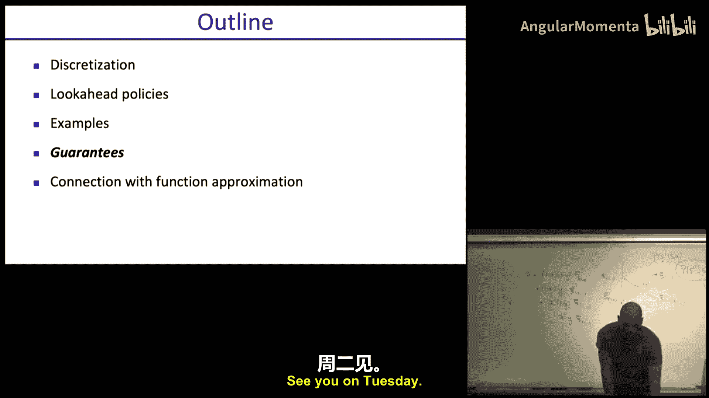