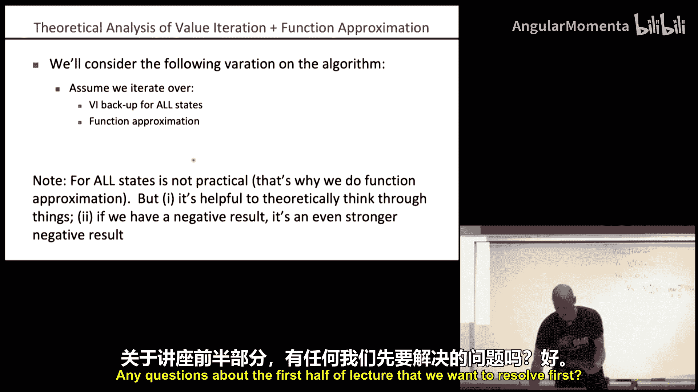
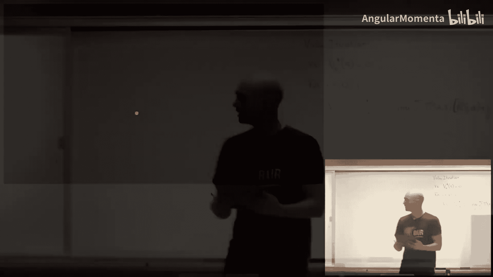
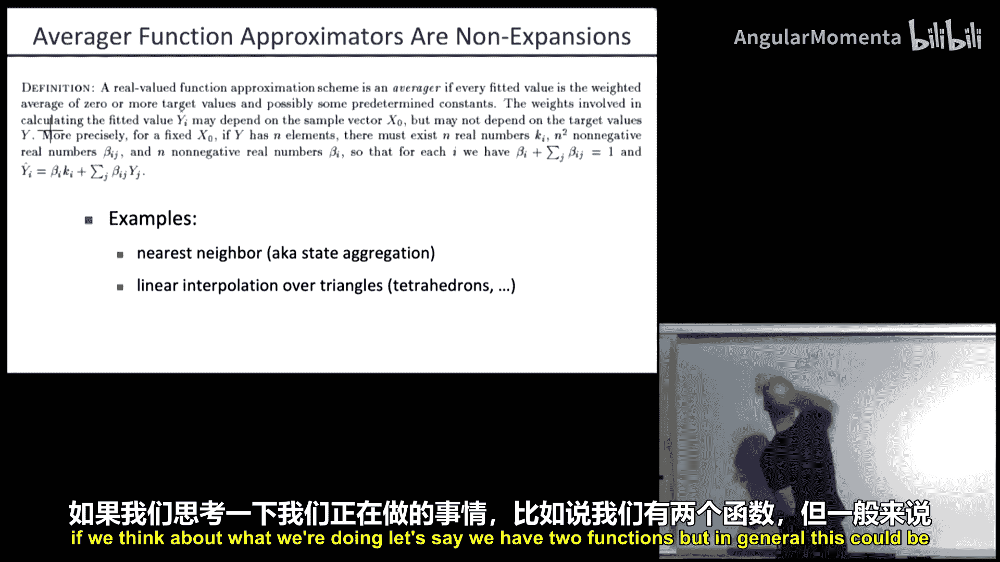
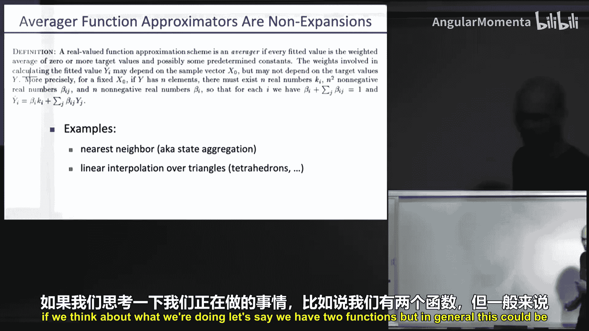
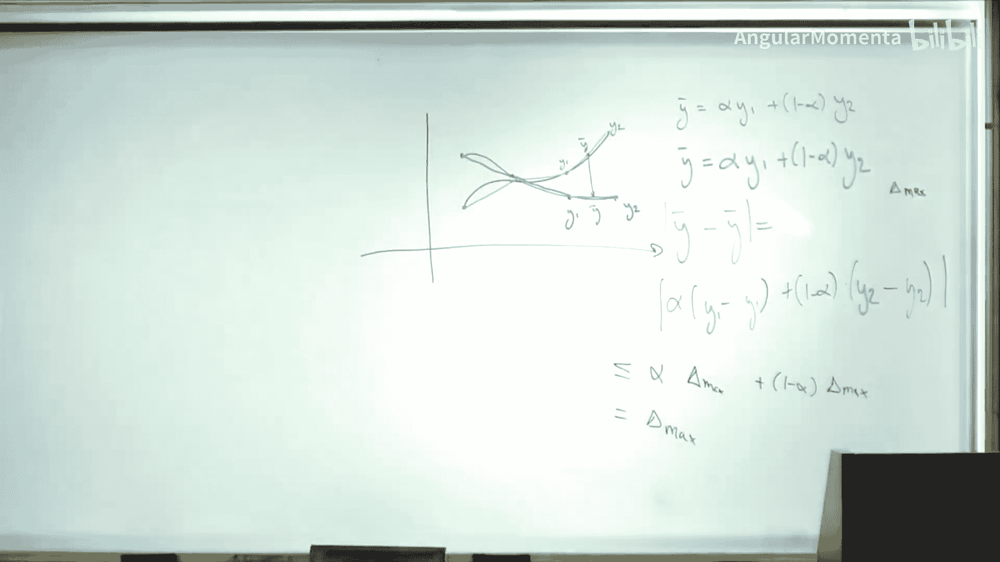
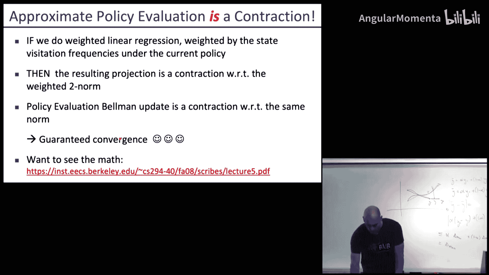
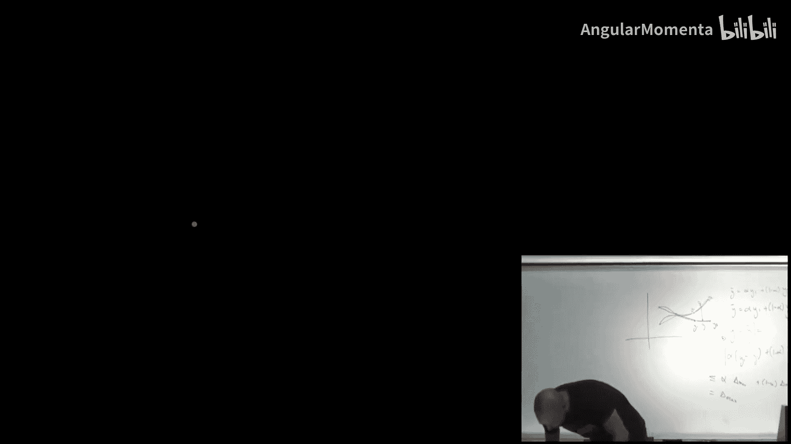
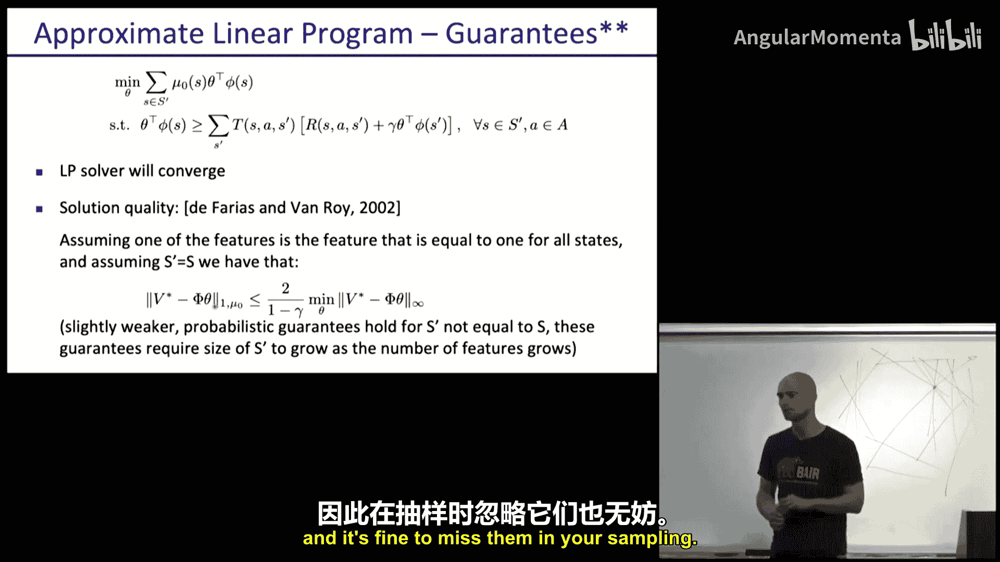

# 【加州大学伯克利分校】高级机器人学-｜-CS287-Advanced-Robotics-at-UC-Berkeley-Fall-2019-p04-4-MDP与函数逼近--BV1KXqCB4Eua_p4-

。Hi everyone， welcome to the fourth lecture of CS287， Advanced Robotics。

A couple of logistical things first， one， your homework one has been released。 it was released on。

Saturday morning， I think it'll be due next week。Wednesday。

 so you have about eight more days to finish homework one。

O somebody close the door in the back there？And I think that's it for logistics for me。

 Any questions about logistics of the class， Yes， we havent gotten your own end up。C again。Oh yeah。

 we'll set up Grcope in the next couple of days， so yeah for now you cannot submit yet。

 but you should be able to complete your homework， just not upload your solutions yet into Grcope。

 other than that you should be good to go。Also， one thing we try to do with the homework is to ensure for every question that there is。

Already a figure that shows what our solution is for some scenario。

 So you should be able to sanitity check that you're actually on the right track and that things are working correctly。

 and then we'll leave a lot of other figures for you to fill in。

 But if you have the first one correct， unless you。

Literally just copied and pasted that figure in your code， if you actually did it the normal way。

 then the other figure should be correct too and you shouldn't have much to worry about。Alright。

 so I again put on the board value tu here just for your reference throughout the lecture。

 because it's going to continue to be at the core of a lot of things we do。

 And in case you weren't familiar with value before this class。

 it's nice to just be reminded all the time for now that that's what it looks like。😊。

So also put it on the slides here。Inval， we start with initializing v0 star for all states as equal to 0。

Then。4。Let me get a pointer。Then we iterate。And for every state。

 we find the value for one extra time step。 So we have i plus one time steps left to act optimal value。

From state S is the max of all actions of if we were to take that action。

The expected reward you get instantaneously plus discounted value from that onwards for the remaining I steps。

 And the Argm gives us the policy。 And this is called the Belllman update， value update。

 the bellman back up and so forth。And it gives us the。

Optimmal expected some of rewards that we can attain from a given state with i plus1 steps left and optimal policy。

Now the tricky thing is if we have large state spaces。

 for all S that we have in there in various places just becomes impractical we saw in last lecture。

 for example for continuous state spaces we cannot loop over all states and we looked at discretization based approaches。

Today， we'll look at a different way of resolving this through something called function approximation。

And we'll first study function approximation in the context of valuetu。

And that will be the main topic for today's lecture。

 but then we'll also see how it can be done in the context of policy tu in the context of linear programming。

Here's an example that a lot of people studied for a long time in reinforcement learning。

 which is Tetriris。 It's a simple game， game of Tetriris。 And in given time。

 you are given a block in this case， it's a two by two block and that block has to be placed so you can scoot this block to left or to the right and choose which columns is coming down and you can also rotated by 90 degrees in either direction for this block that doesn't matter。

 but for other blocks， it could matter because you might prefer it to be oriented differently when they come down。

The block keeps going down。 once it hits some obstacle， it gets placed， it might leave someempties。

 for example， if it were to come down where it's coming down now。

 this square here would end up being empty。And if you happen to have a full row at the bottom。

 which right now is not the case， there is a little gap here or full row anywhere if you have a full row anywhere。

😡，Tyros fool， that row clears and that way you can make more space for the next blocks to come in。

 so if you play this game really well， you'll keep clearing rows and never reach the top because game is over when your block gets placed all the way at the top and exceeds the box。

Alright， so the state here is the exact board configuration plus the shape of the falling piece。

 If you count it out， it's about 2 to the 200 states。

 which is way too many to be able to enumerate them in a v organ。So。

The actions are rotation and translation applied to the following piece。

 And what we can then do is we can say， well， since we cannot represent。Every state explicitly。

 a value for every state explicitly， may we can define a function and we can call upon that function to return the value and how to ensure that function actually has a good value is a different question we'll get to soon。

 but for now we'll just say， hey， there will be a function that will return the value to us and that function might depend on some features and so the canonical features people have used for a long time in this game are these 22 features also often called basis functions。

10 basis functions， 0 through9， mapping the state to the height of each column。

Because the height of each column is clearly an important aspect of what you think about the quality of the current state。

 And that's the thing you think about when you design features for a value function you say what affects the quality of a state。

 Def height affects it。Then another nine basis functions for the delta between two adjacent rows because if you have a high delta。

 probably the value of that state is not as good as states with limited delta。

Then one basis function that maps to the maximum column height。

 because you can imagine that's a pretty dominant thing in terms of assessing the quality of your current situation。

Then a base function that map state to the number of holes in the board because holes in the board are a bad thing。

 It's places you can not reach directly。 You'd have to fill a row above it somehow and start clearing things that takes time。

 could be difficult to do。 And so holes， if you count them。

 are clearly something that you can attribute bad value to。

And then one basis function that is equal to one in every state。 you typically need this because。

Well， it's essentially an offset， the average value overall stays that you tend to visit。

 you don't want to somehow try to store that inside the features。

 just like when you fit a line to a set of points， you don't want to be forced to go through the origin。

 same thing here， you don't want to be forced to go through zero when all features are0。

And so then the value function， v hat， which would be an approximation to the real value function。

 would be represented as awaited sum of those features and if we have different choices for the parameters theta。

 we'll have a different value function， and then for any given sta state return the value please。

 and then you'll pass in the state， then your code will compute the features of that state。

 22 features， multiply and sum using the vector theta and then return the approximate value of that state。

 hopefully。Here's another example， PAman in this game， PAman is who you are， the yellow guy here。

 and the ghosts are trying to catch you and you get points for eating food pellets and you can actually catch the ghosts if you eat one of the power pellets you would get a brief window of time in which are more powerful than the ghost and go eat them and get points for that。

So what could the value function be， Let's think about it。

 What are things that will affect the quality of the situation， Any thoughts？

 We've done one example for this one， Let's， actually， theres this awesome thing we got。 Now。

 this is a microphone that can be tossed around。 So we're gonna have a lot of interaction today。

 I hope。😊，So let's just see any thoughts if you。If you had to design some features for a value function for this game。

 raise your hand so I can， oh， very far in the back。Let's see， let me start shorter， do it。

 all right， let's see everybody careful， and this might hit your head。Yeah。哦别。

DoI think you talk into it， right？Distance to the nearest ghost。And I don't even have to repeat it。

 everybody could hear that， great。Yeah， that seems a great feature because if that distance is small。

 you're in a bad situation， if it's large in a good situation， anybody else's suggestion。

 raise your hand， and what's your name， Brian can throw it to you。は。😀Yeah。こ。やそやぱ。

Distance to the nearest food pellet。This is nearest food pals。

 power pe even more powerful if you're close to that， that would be very high value。

 think Olivia you can have one。How many pellets are left like fewerers better？

How many pals are left here is better。 That's an interesting question。

 That really depends on how you define the game， actually， because。

If you get a high score for finishing the game， then fewer is better。

 And so it it depends on the end score in the game。

 Or if you only get points by actually eating pellets and eating ghosts， then in some sense。

 the less。Plls left， even though you're in a good situation。

 the expected sum of future rewards is actually low。

 which is kind of a very counterintuitive thing to think about。 This often happens in other games。

 too where there's a timer or something you only get a finite time to play。

 You often have to include that time into the features of your value function。

 of little time left there's not as much reward left to be collected。 This game， typically。

 though there's a big bonus at the end of the game。

 And so then it is good when there's very few pals left because you'll be about to collect that big bonus。

😊，All right， can you throw it back to me？Oh， thank you。All right， that was fun。

 let's do more of that。嗯。Oh， here's an next year on that we didn't mention it if you're in a dead end。

 that's a bad situation to be in this map doesn't have any dead ends。

 but I guess you're surrounded by two ghosts would be kind of the equivalent like you're seeing here。

 that's really bad right， much worse than two goess coming from the same side being very close。

 it's not that bad， but from opposite sides to you and being close， you're probably going get caught。

And then the value function would be。We weighted sum of those features So say， okay， well。

 how much value for this state， Well， you turn that state into features phi of S。

 and then you multiply and sum to get。A value Now the value will only be as precise as your vector theta helps you predict that value and as good as your features are。

 if your features ignore something important， your value function will not be able to be very precise。

Here's another one。I said this one we covered last time。In a continuous state space。

 we could do function approximation by nearest neighbor。

 we would say the value of a state is the value of the nearest neighbor of that state among the states that we keep in our vocabulary。

So more precisely， we'll store values for the marked states， but then we're asked about state s。

 we will not have a value stored， we can look at the nearest neighbor which is x4 and we can get that one。

 Its actually the same representation。 It's again a weighted sum of features or the feature value。

 the feature vector is all zeros and one hot， the one hot is for the nearest neighbor。

 So here the fourth entry is non-ze is the one because s is closest to x4。

 and then the theta values here are effectively just the values of each of those discrete states that we keep track of but ultimately it gives you the same thing。

 theta transpose phi as the value。And we saw you can do something that actually works。

Quite a bit better by not doing snapping to the one nearest neighbor but doing stochastic interpolation between a set of nearest neighbors can do the same thing here。

 you'll still keep track of values at discrete set of points。

 but now our point S will be mapped stochically to x1 x2 x5 x6 in our transition model last time now we don't do it in a transition model。

 we just say， oh when we're in state as the value will be determined by its neighbors and we'll take away that sum and you can use the same weighting that I put on the board last lecture。

 a convex combination of the neighbors is living in phi S so the feature vector phi is mostly zeros。

 but the non-zero for the contributing states in our vocabulary and theta contains the values at the states in our vocabulary。

If you have something like S on the real line， you can imagine that the value function is theta 1 plus theta 2 times s。

 or maybe a parabola being fit as your value function or a higher order of polynomial。

 actually also a neural net。 And I want to double click on this one in a little bit because that's one that's becoming particularly popular these days。

 but I mean， ultimately what we cover today is not very specific to neural nets。s you know。

 you need some v hat data that is some function you can call that given a state will turn it into some approximation。

 hopefully close approximation to the value。So the high level idea is that we will use an approximation v hat theta of the true value function v star Theta is a free parameter chosen from some domain that typically is smaller than the domain of that enummererate the states。

 which could make it easier to find theta than to find a value for each state less parameters to estimate is the upside downside。

 less expressiveness， because typically there will be many possible v stars。I mean。

 there will only be one v star for your problem。 many possible values that you don't know which one is actually gonna be v star that cannot be represented by V hat theta because your function approximation cannot represent everything。

 If it could represent everything， it'd be just as expensive。

To use that function approximation as it is to just enumerate every single state。Now。

 when we have function approximation， can of a simple scenario supervised learning？

You have a set of examples， a status1， a value for status 1， status 2。

 value for status 2 and so forth。 You're asked for the best。V hat theta。 It would be maybe。

Finding V hatt data， so a setting of data minimizes the squared deviation from the values that were prescribed。

And you do this on a finite set and you'd hope that on other states。

 it would still be relatively good。For example， if you had points that maybe could be fitted by a line。

 you could say I'm going to find theta is the least square fit of a line to this set of points。

If you had a high dimensional feature space that you designed。

 you effectively be fitting a line just a high dimensional line。

 which would be a hyperplane and doing something very similar。That's just one way to do it。

 Another way to do is to fit neural nets。 So let's do a little aside。

 I don't want to teach a lot about neural net in this class per se。

 We'll just think of them as something we can use。 but let's at least。

Cover the intuition or refresh it。 So neural are inspired by how the brain works。

 brain has a lot of neurons。 A neuron has something called dendrites which are the inputs。

 then has a nucleus， where some computation happens in some sense。

 And then depending on what comes on the dendrites。

 then nucleus might decide to fire a signal along the axon。

 which will then branch out to next set of neurons that does the next set of amount of processing that needs to happen。

😊，Okay， mathematically， this can be represented as follows。 I mean。

 I'm not saying exactly represented， but in a reasonable way。

 represented for our purposes as the cell body is something you doing a weighted sum of the inputs。

 So the inputs are X。0， x1， x2， and so forth。 The weights correspond sometimes to the strength of that connection between the neuron that outputted x 0 and this new neuron。

The weight W0 represents a strength of connection and then after that calculation weighted sum of inputs。

 then it'll output something on the axon， but before it does that it does a quick kind of nonlinear transformation on it。

 why if you keep everything linear in your neural net。

 it turns out all you can represent is linear things because linear after linear after linear is still linear and so the best you get is linear。

But if you put a little bit of nonlinearity in there， then you can get something much more general。

What are popular nonlinearities， The nonlinearities are shown in blue and their derivatives are shown in yellow on this plot So in blue there。

 first one is a sigmoid it goes from zero to1， so it squashes。Then the weighted sum of inputs。

Will be a number that is then put on this horizontal axis。

 and then you look at what' the sigmoid value for that point in horizontal axis， for example。

 if you waited some of inputs was roughly four， you'd land up here about one。

And functional as shown below its T of Z is one over one plus E to the negative Z。

 Hyperbolic tangent is essentially the same function。

 but scaled up a factor 2 and then shifted down by one and goes some negative one to plus one and then rectified linear units are。

Making the activation zero if you're negative and keep whatever it was if you're positive。Okay。

 these are just examples of popular ones that， you know。

 at some point you'll already have used or we'll use in the future。

Neo network itself is now just one neuron。 There will be many neurons。 And so there will be inputs。

 X。 And then typically layer by layer processing， though in principle。

 there could be skip connections from early layers to later layers。

 but the most typical setup is just layer by layer processing。 And then there's an output layer。

 which is the value Y， And so y the opposite function of x， which is the input and W or theta。

 depending what you call it the weights in the neural net。So you can ask yourself the question。

 imagine this is our value function， it's a function of x， this is our value function。

 can we represent it with the neural that's shown on the right。

 Who thinks we can represent it with the neural nets shown on the right， raiseise your hand。

Who thinks we cannot？You're torn， okay。😡，So let's see。

Eachn so the neuron net on the right has five neurons in the middle and the hidden layer。

As we know what a hidden layer does it takes in an input。

 then it can apply non nonlinearity and generate something on the output。

 Let's think about it in a very simple way， imagine we have rectified linear units。

What's going to happen is that each of those neurons， depending on the x value for a while。

 will output 0 and then we'll output。A weighted version of the x value could be positive way negative weighted。

 It could also be the other way around。 It could be linear for a while and then becomes 0。

 And when x is higher。 So those are the only two options。 Every one of those outputs。

 a piecewise linear function that has a slope for a while and then horizontal or horizontal for a while。

 then a slope。 If use some five of those functions together， you can not at the function on the left。

We can similar reason about the sigmoid， sigmoid goes between 0 and1。

 what that means that each of those units for a while will be 0 and then become one or if the weight sign is flipped。

 it'll be one for a while and then become zero and it has some weight going to the output so it'll be a weighted version value it will be some number for a while and then0 or0 for a while and then that number。

If all you have is effectively a bunch of bumps to your function up or down five times。

 you can again not represent the function on the left， neural that is too small。

But you might think if we have a very large number of things in the middle there。

 then we can track along with the function。 We need an extra bump would go up。

 extra bump to go down and so forth， and every bump could be another neuron that we use to generate that bump。

 It might require a lot of neurons in the middle if we were enough of them。

 we should be able to track the function。And so this universal function approximation theorem came out in the late 80s。

 early 90s， a few different variations。 The exact phrasing is shown here， Hornex theorem 1。

 Hornex Theorem2， in words， it says given any continuous function F of x。

 if a two layer network has enough hidden units， then there is a choice of weights that allow it to closely approximate F of x。

Or closing means at any given time anywhere along the function， you'll be within some Epsilon。

 Once you specify an Epsilon， there will be a resulting number of units you can pick。

 You want epsilon smaller。 Sure， you'll need a larger number of units but for every epsilon。

 there will be a number of units that will do it for you。

There's many versions of this theorem and the detail don't matter so much。

 but I hope the intuition makes sense that every neuron can give you a variation in the output。

 and so the more neurons you add， the more variations on the function that you want to fit that you're able to track。

Now， the more variations you're able to track Also things can become tricky。 You might fit。

 let's say， in this case， a degree，15 polynomo， but it could be something else。

 you have a very expressive function approximator。 and then it turns out it does some weird。

 quirky things because it's so expressive and has these weird bumps in the beginning and the end here。

 That's called overfitting。 It's where you put all your effort in fitting the training data。

 but then on heldout data， you might not do so well。So to avoid overfitting。

 there's a few things we need to keep in mind。You could reduce the number of features or the size of the network。

 so don't make your network infinitely large necessarily。 regularize the。

 that is every weight to bring it closer to0。 So it has less opportunity to make this weird bumps and early stopping。

 early stopping means that you stop training updates， once the loss increases on the holdout data。

 So your training training training you don't get to train on the holdout data。

 but get to check as I'm doing better on my training data， am I also improving on the holdout data。

 If at some point， it gets worse on the holdout data。

 It means you're starting to memorize the training data rather than discover the pattern that's in your training data that will generalize。

I will say often this is not really mentioned when people do value tu and so forth。

 people often just write algorithms in the form of， okay， and you'll see it here too， you know。

 fit your value function to some data and repeat， but you want to be careful that you don't overfit。

Okay， so we know how to do function approximation through supervised learning。 we' just。

 you know these days can call a black box， say here's some data， some of his training data。

 some of his holdout data， input output pairs， and just find a parameter vector theta that fits this input output pattern pretty well。

 But where do the supervised examples come from in our case。So let's work through this together。

 This will be the main algorithm we're going to cover。Today。

 which is value with function approximation。嗯。So we already have value here。

 that's going to be our starting point。But the difference is that we're not going to be able to deal with looping over every state。

So。Now。Let's see， is this big enough for the back？Good。Valttration。With。Function。Approxiation。

So instead of setting v stars0 equal to0 for all states， which we have to do there。

 we don't really have v stars0 available for all states。 it's too many states。So。

But we actually also know that。Val will converge no matter the starting point。 It's a contraction。

 It brings everything to the solution， no matter where you start。

 So we actually don't have to worry about it as much。

 We don't necessarily have to initialize things to 0。

 The meaning will be lost if we don't initialize0。 The meaning of this being the optimal value for I steps to go will oh there should be i plus 1 here。

 i plus 1 steps to go will be lost if we don't initialize with 0。

 the meaning then will be the optimal value with i plus1 steps to go if when things are over we'll get whatever we initialize v0 start with some kind of n value。

 but we know that that n value will disappear through the contraction。

 So we just have to run it long enough and it'll disappear。 So we'll just initialize。

We don't have V now， we don't have V table， but any thinner0。Just somehow， it doesn't really matter。

 pick some。If you。Have。A linear function appxim you could just set it equal to0 if you want。

 and then it'll be0 again and it'll work as before if you have a neural net。

 you're not gonna to be able to find a setting that always makes it output0 or if it does that's typically not a good setting for a neural net if it always outputs 0。

 so you just randomly initialize it a reasonable setting。Then we it it just like with it there。

ForI equals zero，1，2。And so forth， up to some large enough horizon。Then step 0 in our iteration is。

Pick some。S prime， which is a subset of the full set of states， S， and typically。

The size of S prime will be a lot smaller than the size of S。

 otherwise there's no point in doing this if you could hit every state S Y even bothering with this。

Then。We can do our Belllmont backup。On those states， so step one， Bellllman backups。

What does that mean？For all S in S prime。We compute， I'll call it v bar， but I mean， just to show it。

 it's not the same V as over there V bar。Ile1。Of state S。It'SQL to max over actions。S over S prime。

 T S A S prime。And then。RSA。Plus， gamma V I。V Tna I。Because we don't have VI。

 we' had theta I S prime。Over here， so it's the same as the equation we have over there。

 the only difference is that instead of having the actual V star available at status prime。

 we need to rely on our current estimate V hat theta I。Once we have that。

 we actually have a bunch of pairs。 This results in pairs of states and estimates of V plus one for that state。

 and then step 2。Well just be supervised learning。So。We will。Find theta i plus1。Is the Arg。Min。

Over theta of。Some。S and S prime。Of。V theta。Of s minus v bar i plus 1。

 which is our target values of s squared。Now， I'm writing it this way。

 And this is how a lot of people write it。 That's kind of a simple way to write it。 But keep in mind。

 actually， you want to be more careful。 You don't necessarily want to find the argument of this。

 You actually want to gradually optimize this， right， Do you want to。

Do gradient updates on this objective？And have a holdout set。On which you track。

Whether you are still doing better and you hold out data every update you make or you're already starting to do worse。

 But very often it's just written this。 I'm going to write it this way。 give you the extra warning。

 though， be careful that you don't overfit to that latest set。Any questions about this？Okay。

 let's take a look at this in action for the。Tetris case。So remember。

 we get a reward of one every time we place a block。

I made a small Tetriris world here so we can step through this exactly you can see every detail of how this operates。

Sink state s game overstate is reached when block is placed that part of it extends above the red rectangle。

 If you have a complete row， it gets cleared。So。Our set S prime could be this set of states。

 a state consists of the current situation on the board。

 as well as the next block you're supposed to place。

We'll have slightly less than 22 features here because there's not 10 columns。 It's a narrower board。

 but we'll have the same types of features that I mentioned before just on a smaller board。

 which ends up being 10 features。 So height of each of the columns， Dlta between neighboring columns。

 maximum height of overall columns， number of holes and one entry that's always one。

We initialize the zero this way， why this way， I mean that clearly doesn't look like random numbers。

 I picked it this way because I can easily step through the next set of slides this way and showing you how it works out。

 the map kind of works out not too complicated。So。Let's see。

 whats the value we pick our first state in our set of states prime on which we're doing backups。

 So this is the equation， this is the bellman backup we do for that state is the max over the four actions available to us。

Because there's four placements we can choose， also I'm assuming here you cannot rotate the block。

 otherwise it just like doesn't really fit on the slides anymore。

 so you have to place the block in the current orientation。So there's four actions available。

 and then for each action。There is what happens on the board。

 and then there is what happens in terms of what's the next block that shows up。

 and so for each action it's actually two possible next states。😡，One block showing up。

 the other block showing up， but the board is theistic， you know what's going to happen there。

What I showed here is what happens initially on the board， but actually over here。

 this will clear two rows， same over here， so actually what we end up with is this situation over here。

So you might imagine that that's probably the move you want to make。

 but that doesn't mean the value already reflect this because we have just randomly initialized the weights on the features。

 So who knows what it's going to say。So。After we've done this。

What we can now do is we can go back to our features。

Compute the feature values for the state we just looked at and use the initialization theta0 to find the values that we estimate currently。

So。There's a special state in row 3 there。 The sync state game is over。

 So we don't really use the features。 and the and the theta vector there。

 we just say when it's a sync state game is over， value is 0， Everything else。

 we use theta times phi to find the value of that next state。 Look。

 the reward is one everywhere because placing a block is we get reward for here。

 So there's nothing in your action that directly affects how much reward you're gonna to get right now。

 It's always gonna be one。😊，Okay， then we can compute it， we get some values for those next states。

 It turns out the initialization I chose does make this better move。Look better。

 so picked some reasonable initialization， putting negative weights on features that we want to be low and positive weight on features we like to be high。

And we' get the value of 6。4 calculated here。Yes， hold on。 hold on。

Is it important to make features independent of each other？Oh。Oh， thank you。

So is it important to make features independent of each other？

It's fine to have features that relate to each other in principle， but。😊。

What will naturally happen is if you have correlated features， you'll。

Essentially they'll get more weight in some way， and so you'll more heavily fit to those features early on。

 but over time， hopefully it'll just work out。But the learning path with a lot of correlated features might not be as good as with independent features。

So if we do this。😊，We can do this for the second stage。 Go through the same kind of procedure。

 Look at all the next states。 Comp the values of the next state。 No sync states here。

 it seems oh a couple sink states。 actually， get a bunch of third stayed。For its state。

So for all states in S prime， which is a small subset of all the states that could exist in this world。

 we have computed values shown over here。Now， the next step in this process is that we do a minimization。

 We have target values， and we have our function approximation format。

 and we tried to get the function approximator to be close to those target values。

 We can run least squares on this gives us a new set of values。 a new set of theta values。

 which in turn gives us new predictions for those states and other states what their values would be。

Okay， now again， I'm showing it here in a simple scenario。When you run this， you want to be careful。

 you want to have a holdout set and you don't want to just overfit to the training set。

 you want to make sure you're actually learning something that generalizes rather than overfits。

 so be careful about that。嗯。If you have a neural net function appximator。

 the main difference is gonna to be that you need to worry more about overfitting than with a linear function appximator。

 And so often you do only a small number of gradient updates on the objective or early stopping based on a whole asset。

 and you could actually have this set as prime， be relatively small。 decide that to be the case。

 Just do a small number of updates and loop through this。

More frequently or you could have a bigger batch size S prime。

 and then you need to loop through it less frequently。

 it's kind of just a hyper parametermeter setting how big you want to make S prime As you make S prime smaller and smaller。

 though， keep in mind you start losing more and more the interpretation of the values that you're calculating along the way being the optimal values for I plus one steps to go。

 but that's fine。 we're often not looking for that interpretation。 but if you were。

 let's say you had a problem you really cared about， let's say horizon。

20 that's the problem you want to solve。 you want to act optimally with exactly 20 times steps to go。

 you're gonna want to take a very large batch size S prime and store the values of each iteration so that when you act。

 you can do a one step look ahead against the correct value for the number of steps of look ahead that are still available to you or the number of steps execution still available to you。

 but often you just care about infinite horizon and then the batch size doesn't really matter。

 you just can take small batches， large batches， whatever is essentially faster to run on your machine is what you typically choose。

Now one question you might have， do we have any potential guarantees here？

Can we guarantee something that we still get something close to the real value function？

To study this， we're going to consider the following variation on the algorithm。

 We'll assume we iterate over。All the states。 So I've been telling you all this time you can never have s prime equal to s。

 it's not practically we can't run it， but for the theory we're going to do。

 we're going to actually assume S prime is equal to S。

Why it essentially eliminates one type of failure mode。

 which is a failure mode where the reason you don't too well is because you have a too small set prime and so you don't capture enough signal。

What we're going to focus on is。Assume you do it on all states。

 but then after you found the exact VI star。😡，You approximate that VI star with something else that your function appximator is able to do。

So the way what people often call is a projection， you initially found the exact thing。

Did the exact update overall states and you project it onto a smaller space of functions。

 you pick the best function in the smaller space of functions to fit the exact thing。

 and then you go again。嗯。Again， this is not trying to say that going forward。

 you would ever run this。 It's to be able to think about a theory in a more precise way。

 And also what happens is if in this case， we have a negative result。 It actually shows that well。

 definitely in the sampled case， it's not gonna to be great either because even if we did backups on all states。

 it already fails。 well， what now， if we only sample a few states。Let's see。

Next thing you want to do is。So we're going to cover in the second half of lecture is going to be some of the most theoretical work we're going to do in this class。

 So let's take a short break so you're mentally ready for what comes after this。

 And I'll leave this up。ととするす。啊，这个。Yeah。な。てる。は。我。は。Yeah。は重在なで。要不要。这就是。可か。Yeah。す。I。Iaging when。なんじねかな。

呃应。All right， let's restart。Any questions about the first half of lecture that I want to resolve first？

Okay。

What we're going to do now。Is。We're going to look at an extremely simple example。

As simple and MDPS you might ever encounter， in fact。

 you'll probably never encounter it except for this lecture， MU。

Teaches to somebody else in the future。This example comes from Ben Vineroy was a PhD student at Stanford back when he was a PhD student at MIT。

 working with John Siicks， Ben is now professor at Stanford。And he taught me this example there。NDP。

Has two states， x1。NX2。Sure， let me give myself a little more space。X1。And next 2。The reward。

Is zero for going from x1 to X2， and that's also the only action available to you in x1。

And the reward is 0 for going from x2 to x2， and it's also the only action available to you in x2。

So no matter what you do， if you start in X1， you'll move to x2 and stay there forever and you'll have zero reward。

 if you start in X2， you'll stay in x2 forever and get zero reward， it's a very， very simple MDVP。

optimal value function，0 in both x1 and x2。We can read this off。

Now we're going to introduce function approximation and see if with function approximation。

 we can find the optimal value。So our function appxiator will be。Our our feature value， phi。

Of x1 is going to be 1。Feature value of x2。5 x2 is going to be 2。Okay。

That means if we look at the value， our estimated value v hat at x1。Is going to be theta。

The number that were。Trying to find theta times phi of x1。Which is theta times 1。

 and the value we estimate in x2 with our。Pimate appxiator theta is theta times phi of x2。

 which is theta times 2。Let me just rewrite this as theta and2 theta， it's a little easier to read。

 so theta and2 theta。So whenever we're running， we will run Val updates。

 and then we'll have to find a theta that's hopefully as close possible fit to the values we found and then evaluate theta in theta。

Great，Bing it again here。V theta will be。1，2。Times theta is the full value function for this space。

Okay。Okay， now let's take a look。We look at。One update。After one update。For x1。What should it be。

 Well， Belman backup that is going to be our target。

 so it's going to be zero reward plus discount factor gamma times。The value we had。

Our v theta for x2 because we land in x2 and our V after one step for x2。

 or we have one step to go 0 because instantaneous reward is 0 plus gamma times while we land an x2 v theta。

Of X2。So this， if we write it out is going to be2 gamma times theta 0。

 let's call this our theta 0 we initialize with theta 0。

And then here we also have two gamma times theta 0。Now we need to do a least  squares fit。

 we want to find a theta1， such that1，2， which your our。Feature values。Times。

Theta 1 should be as close as possible too。2， gamma。Theta  zero。And two， gamma， theta 0。

If you do the least squares fit， which I'm not going to crunch you the numbers。

 But if you just do least squares on this， what you get is。Data 1。Equal。Six over five。Gamma。

 theta  zero。Okay。All right。Now let's think about this。This。

 instead I want to just something multiply with theta 0。 and it was nothing special about theta 0。

 we can actually know what theta 2 is going to be 3 and so forth。 We can just read it off。 And so。

We'll know that。Theta I。Is equal to。Six over five times gamma to the power I。Times theta 0。All right。

 so what do we see happen here， run This is the case we're we run exact Bel updates。

 Then we do least squares fit for the value function， repeat。And we see that the。Prameter theta well。

It depends what theta 0 is， but assuming theta 0 is not equal to 0。Then if。If。

6 over five times gamma bigger than one。Then， diverges。2。Infinity times theta 0。

So if theta 0 was positive at first， I'll go to positive infinity。 If theta 0 was negative at first。

 I'll go to。😊，Negative infinity。This is kind of。Kind of crazy because we know the value function is just 0。

And we know that there is a choice of theta， it's not like our function appximator doesn't have the power。

 it has the power。😡，It totally has the power。 It should just set theta equal to 0。

 and it's done and have found the optimal value function for this MDP， but if。Essentialially。

 if gamma is relatively large。So doing calculation over a long horizon， more things can add up。

Arrors happen here， and the errors is happening here。😡，Make this go wrong。

 That least squares approximation just doesn't bring it in the right direction to make sure this converges。

So that's it。This is the simplest example I'm aware of where the following properties are satisfied。

Our function appximator can represent the optimal value function。But。

Unless you initialize theta 0 equals 0， so any association of theta 0 will result in divergence。

essentially guaranteed diversion， assume you assume this。Is satisfied here。

 So gamut that's bigger than 5，6 and usually pick bigger than 5，6。 Often we pick 099 and so forth。Oh。

 exciting。Question。Let's see， you're in a difficult position。Let's see。

Oh wow nice catch so the second value equation where it says zero gamma。This one。Wouldn't that be x2？

Because you can't go to x1。So let me remember read it a lot。

 This is the value of x2 in our update is 0 plus gamma times v theta and this is x2。

 It's just poor handwriting。's it's definitely x2。Let me。Make it a clearer two Yeah。

 thanks for the clarification question。Yeah， it's hard when I'm sitting though， let's see。Oh。

 not for you， wow。All right， any questions about this example？So this is a negative result。

 just to be clear， right， This is a very negative result。 This shows that even a simple。

 simple MP where you can represent the value function exactly with your function proximator can still have divergence。

Very negative result。So。There's the math done in the slides。Hopefully we can do better， though。

 Hopefully this is not the end of the story， right。Let's revisit operators。

So we talked about this two lectures ago。嗯。An operator G。Is a non expansion with respect to a norm。

 if you apply G。To two different inputs。You bring those inputs closer together。Think of， for example。

 the Belman update as an operator。 It takes in。A vector or infinitely long vector。

 potentially for infinite state space， a vector and turns it into a new vector。 That's an operator。

 You go from a certain space。 There's vectors of some dimension to same space。

 But you have updated that vector。 G is an example of an update。

 I'm a generic notation for an operator。😊，It's a non- expansionpansion if things don't move apart and why might you care about this。

 Well， we saw that if things are a contraction， which is a little stronger than this if then after the update。

 you're within gamma of what you were before， you're guaranteed to converge。😡。

Because you always get broad closer， which actually means if you have a fixed point。

 a J star in this case and you apply the operator to that it stays the same and you apply it to the other thing。

 let's say J2 is J is the optimal and J1 is just something you start from。

 then this means you don't move away from the optimal thing with this operation if gamma contraction means you will actually closer to the optimal thing。

Ave the operator F， another operator。😡，I's a gamma contraction with respect to a norm？😡。

And the operator G is a non expansionpansion respect to the same norm。

 then the sequential application of the operator's G and F is a gamma contraction。

 and if we then sequentially apply them we might have convergence。 In fact。

 we will have convergence because we know contractions converge。So to make this concrete。Think of。

F as the Belman update， we know the Belman update is a gamma contraction in the infinity norm。

 the max norm， same thing。Then our function appromator。Well。

 least squareries we clearly saw it doesn't satisfy this property because we would have had convergence。

 but if we had a better function appmator， one that actually satisfies the non-expansion property respect to the same norm。

 then we would have a combined contraction and things would converge。

 so this gives us a recipe for what kind of function approximators we might want to look for。嗯。

I a pause。Pause here， see if there's any questions about this。Okay。

 so what might be some function approximators that are non expansions？Any thoughts？Yes。Times0 by 0。

Sa again times by 0， What by 0 just like multiply by 0， multiply by 0。 always that is a。

Great example of a。Non expansions and a gamma equals zero contraction。

 it's like the best congence properties you could possibly have except probably to the wrong thing。

 though and probably not useful yeah， but it's a good one， I like it。Yeah。😊，You're almost。Thanks。

Well， let's think about some approximations we've already covered。We saw a nearest neighbor。

And lean interpolation with comevex weights from your neighbors。

Who thinks those might be contractions， not contractions， non expansions？

People are very torn on this one， it seems， who thinks they are expansions， possibly expansions？Okay。

 so everybody's still making up their mind， which makes sense because it's not that easy to wrap your head around。

 it turns out they are non expansions。What's the intuition behind this？Where's my pen？

Why are they non expansions？Well。If we think about。What we're doing。

Let's say we have two functions。

But in general， this could be vectors。 It doesn't have to be functions。

 but let's say we have two functions， special type of vector。And I have a function。Function 1。

And I have a。Let's say。Function 2。I can think about how far are these functions apart right now。

 And then after I replaced those functions with the function approximation to the functions。

 how far are they then apart So let's。Replace with the function approximation we're going do for this one。

 let's say we do。嗯。The convex combination of the neighbors。 So we're going to。We have。

 we keep this point。 then we have this point。This point， this point。

 So our function approximation will result in replacing that one by。This。This。This。

And the functional approximation on the other one。It's the same function approximation operator。

So we're going to have the same。Points in our grid。And we're going to replace。

That one by the blue function， think of these as straight lines connecting。These blue dots。

And I'm claiming that。The distance between the blue and the red function is smaller than the distance between the two black functions shown。

And I'm going to claim this is not coincidence。 This is always going to be true when do this kind of。

Interpolation。Intuitively， why is this happening， Well， to think about。

How far apart are two points on the。Iit。Let's see。No green available。 Let's take this point。Here。

How far are these two points apart between the blue and the red？Well。

 the red one is a convex combination of these two points here。So if I called this one here， maybe。嗯。

Y1， Y 2 in red， and we have。Y1， y2 in blue。 and then we have a。Why bar in the middle？And a。

A red white bar in the middle there。😡，It'll be the case that。

Red y bar equals some alpha times y1 plus 1 minus alpha times y2。The blue one。

Y bar is same alpha times y1， the blue y1，1 minus alpha times blue y2。

If I look at the difference between those， so I subtract。I do。Why blue。Minus。

Y bar blue minus1 bar red， and now I'm going to look at the absolute value of that thing。Well。

 let's look at what happens。 I'm gonna have。Absolute value of alpha。Times。Difference between the。

Two y1 plus1 minus alpha times difference。Between the two。Y2s。I put it the wrong way。

What happens next is。Well。Let's say the largest difference between any two points of the black curves。

 we call it something。Delta max。Then。This thing。A small equal2 alpha times。Delta max。Plus。

1 minus alpha at times delta max。Which is equal to Delta max。Let me step through this for a moment。

 I define Dlta max as a max difference between。The corresponding points on the black curves。

 so y1 minus y1 has to be smaller than delta max， same for y2 minus y2 is' smaller than delta max。

 can fill delta max in here， make it a smaller then can do a bit of math and show that the whole thing has to be smaller than delta max。

So because everybody becomes。Every point becomes a weighted combination of its neighbors。

 the fertacy can be part is as far as your neighbors were apart from each other。

And typically going to be even lesspar as interpolation is happening。

And so that's the key idea is when you're a convex interplayator like that。

You'll be some weighted combination of how far your neighbors were apart。

And so less apart that your neighbors were part in the original two curves。

You can do the same derivation for nearest neighbor because nearest neighbor would just mean that one of these alphas is 0 and the other one is。

 well， either alpha is 0 or alpha is1 and only one of them will be contributing。

 but other than that is the exact same thing going on。

And this is not specific to being a one dimensional thing with just two neighbors with any number of neighbors。

 you can do the same kind of mathath as long as it's a convex combination of your neighbors。

 meaning that you're an averager。The same math will hold true。

 The distance here' apart after averaging will be less than。Whatever your neighbors had as distances。

Okay， so what we did just now is kind of a informal version of this derivation here。

 where it's written in terms of we have J is the Belman update。Sorry， J is the value function here。

 pi is the projection operation， and so we look at two possible value functions， J1 and J2。

 we apply a projection operation， then we have an average operation which is spelled out over here what it actually is。

And then after you do some math， you find out that it's a non expansion。Now。

 going back to what we saw before， if we have a non expansion， combined with a contraction。

 we have a contraction together。And so we have guarantees for a fixed point here。So favor。Now。

 J star be the optimal value function for finite MP with discount factor gamma。

 Let the projection operator pi be a non expansion with respect to the infinity norm。

And let Jde tillil it be any fixed point of pi。So we project and it doesn't change anymore。Suppose。

Jade Tilde minus G star small on Epsilon。Then we will converge by doing Belman updates and projections。

 So Belman update T projection pi the value function as close to the real value function。

 So then fully proved， this was actually some interesting negative information here saying that if。😊。

If there exists a fixed point of your projection operator， project。Onto your set of functions。

 there is something in your set of functions you project onto。

That is close to the real value function。Then。You will actually find something close to the real value function。

Which is very different from the negative result we saw because the negative result we saw with the two states。

 we had something extremely close to the real value function， in fact。

 we had exactly equal to the real value function in our projection set。

 but it still didn't conmerge because of expansion happening。😊。

Here we're saying if two conditions hold， one， there is something close to the real value function in your set of functions in your function approximation set。

 and your projection is a non expansionpansion， then you'll end up close。Okay，' that's good news。Now。

I want to give you。A little bit of intuition as to why linear regression is not satisfying this property that we had so beautifully here。

 So let's take a look at what goes wrong with linear regression。

Imagine we have two functions again。Which however。Current value function estimates。

 two possible value function estimates。First one。It's like this。And then second one。

It's going to look。Like。This。Now， imagine we。Do a least square fit to each of those functions。

 account for every single point in each function。Okay。

 so we can account for every single point in each function。Not subsampling anything like that would。

Well， let's account for every point on here， at least squares fit for a line we probably be。

More or less this。Maybe a little lower running there。And then。For the other one。

It'll probably be something that looks。Like。This。Okay。

Those are our least course fits to those functions。 but if we see what happens is that。

How far were they apart before， probably the furthest point。Before。I didn't draw it exactly right。

 You to draw this a little more carefully to make this all work out beautifully。 So this one goes。😊。

This way。This one。Because。This one。So the first point of part before was。

This over here now the furthest part is。This。Over here， which is actually a little more。

 And if you draw the plots carefully and do carefully design the example。

 you can actually expand this。More and more。And keep this smaller and smaller if you want to。

One way to do it would be to just trot this wiggle here almost。Like a line like that。

 and then you'd have even bigger effect on。How much it expands。This iss an example from Jeff Gordon。

But it kind of explains the notion what's happening is that unlike with the averager type function appximators。

 which。Use existing values in a Comvex way here in least squares as you know。

 least squares looks ultimately something like this， x transpose x inverse。

 x transpose original values y， and then another x here， something like that。

 and so this thing over here is just not an averaging operation it could be really anything and so because it's not averaging the initial values you don't get the non-expansion property。

Now， with neural net is a little more complicated。 And people haven't done a fully careful analysis show。

 I'd say it's， it's future work for somebody to do to figure out with neural net。

 exactly what's going on。 It's a bit of a。Couple couple of things happening there with neural nets One is that while you just do a stochastic gradient update so you don't change your function very much。

 So maybe that has an effect on maybe making it a little easier。

 It's a very rich function approximation。 So if you think about can I represent the real value function。

 you can probably be close， and that again gives you a little bit of leverage。

 but I'm not aware of any kind of。Results showing that you know with the right kind of update on a neural network function appmator you are guaranteed to have a non-expansion and hence guaranteed to converge。

 but intuitively probably something like that could be true or maybe not maybe there are some nice counter examplesamples because linear regression is kind of a neural net just a very simple neural net with least ques loss so it's not super clear to me kind of what the final say will be there。

 but it's something that I mean if you want to do something more theoretical for your final project that could be something to think about kind of。

What would this analysis do on neural net function approximators？No。We've seen the main ideas。

And now we can rapid fire， repeat them for the other settings。 I see your hands up。

 but since we have about 10 minutes left today， I want to make sure we get through this in a contained way and then we'll take question after lecture。

Policy iteration， remember？Kind of another way of solving for the optimal value function and optimal policy。

You would have a policy evaluation step。 current policy fixed。

 like value but with a fixed policy and then。Take the policy as the best one step look ahead policy against the value function that you found。

 and we knew we showed that the one step look ahead against the value function we found for the previous policy is actually better than just using the previous policy。

 You get a policy improvement and repeat。Well， we'll need function approximation in the policy evaluation step now。

Now， there's something very subtle going on here。 And the subtle thing going on here is that in this function approximation step here。

 there is no max anymore。Which simplifies it。It's a simpler operation， which we liked about it。

 actually also allows you to prove some additional properties about this update that we cannot prove about the valid update。

 So we're going to actually get stronger properties of convergence with policy duration with function approximation than valid。

Here。It's the bottom one， approximatepoliion is a contraction。

If let me spell this out more precisely， if we do weighted linear regression。

 weighted linear regression， weighted by the state visitation frequencies under the current policy of a current policy。

And you're going to weight your regression by the visitation frequencies。 actually very easy to do。

 You just run your current policy。And you do your regression based on the states that you visit your sampled states because those come from the distribution of your state visitation frequencies。

 so you can just Monte Carlo sample on your current policy and then use the states you get that way。

Then the resulting projection from doing that regression is a contraction in respect to the weighted2 norm。

Okay， that's interesting。Now， in addition， the policy evaluation Belman update is a contraction with respect to the same norm。

If we have。Sorry， this might I might have， this might have to say a non expansion。 let me。

Don't take that literally for now， but is' a contraction or non expansion。

 but it doesn't matter because we have a contraction here。Together。

 they're going to be a contraction， and we have guaranteed convergence。

 The math is a lot more hairy than the math we saw today。😊。

We covered it in fall 2008 and some notes of that， so if you want to look at that， you can go there。

 we're not going to go through that here today， but we can actually work through the math and see that this actually works out。

So this is kind of interesting， this means that。Remember in the beginning I said we're going to see not just validation。

 but also other methods because sometimes when we have to make approximations， it could be helpful。

 even though in the exact tabler case， it's kind of crazy to also consider policy maybe well here's an example where that's the case where policy will behave better。

With linear regression， I mean， thevaleration with function approximation will be fine when you have a non expansion against the max norm。

But least squares is not a non expansions against the max norm。

 but least squares is a non expansions against this weighted2 norm， so that's nice。

Now。Let's see how many slides we have left。

Let me do this one on this slide。Okay， let's step through this carefully， what do we have here？

I'm trying to show here that if you're a non expansion or a contraction against different norms。

It doesn't mean that that will work together in a way that you converge。

 It really matters that things are against the same norm。So。We start。Over here。

Our initial value I found this on the web。Our initial value is over here。😊。

We contract with a valid of against the infinity norm， the max norm。

 maximum norm means the maximum value becomes smaller。 So it's boxes to be a。Contraction is max norm。

 We need to move into a smaller box， and we did。 We moved into a smaller box。But lo and behold。

 we actually moved into a point that has a higher two norm。

The next step is a contraction against two norm， we're always projecting onto this line。

If you're project to that line。😡，The two norm discipline points will become smaller because essentially。

 if you re reorient your coordinate system， where you're saying I only pay attention anymore to one of the coordinates。

 the other one gets ignored。 And the the norm of things。

 when you only look one coordinate versus both is gonna be smaller with just one coordinate。

 So we project to the line。So we have a contraction against the two norm。But we actually moved。

To a box that's bigger， So we expanded in the max norm。 and in this process piece。

 we contract in the max norm， where we actually expanded a two norm。

 and then we contract in two norm， but expanded the max norm。

And so this is a very simple drawing showing that if your norms are not the same。

Even if you have contractions against both of these norms， if you alternate。

 you can actually get something that doesn't converge at all and diveers to infinity。

If you curiouss about more of those things， recently I actually wrote a paper going a little bit in the direction of trying to look at why there can be divergence in Q learning。

 which is a sample based version of a value， which usually the Q values rather than the V values just for some practical reasons。

 but that's another starting point if you want to think about this more。Now。

We also saw a linear programming approach。Linear programming formulation looked like this。

 minimize a positively weighted sum of values such that the value is bigger than the Belman update value。

 So we're pushing this down against the Belman update value。

 And the lowest one satisfying this will' satisfy with equality。

 And so we have the optimalmost solution to the problem we're trying to solve optimal value function for this MP。

😊，Now。嗯。What if we do function approximation， What does that mean， We're going to sample states。

 and we're going to use not V， but some function appximator。

 We want to continue to be a linear program。 That means our function approximator has to be a linear。

 otherwise not going to be a linear program。 So we're gonna have a linear function appxiator。

We to swap in。This thing over here， data transpose phi of s， comes here， comes here， comes here。

 and then we'll have a subset of states that's being sampled rather than。All states。

It turns out for this， there is also a guarantee。嗯。Well， first of all。

 we know LP solvers will converge， so we'll have no divergence issues。 It's an LP。

 We don't have to solve that。 Then in terms of solution quality。

Assuming one of the features is a feature that's equal to one for all states。

So to make sure we have an offset。 Otherwise， we might be too constrained and assuming S prime equal S。

 which is kind of an extreme scenario because the typically can sample all states from S。

 but assuming that。This guarantee holds through which is saying that the optimalmo value v star is close to what we find phi theta。

In。One norm。Wighted by mu 0。And how close is it？We can here's a separate data。

 We can find the optimal data in our function approximation space。 Here it is really。

 as if you did supervised learning。 If it could do supervised learning and find the best approximation of your v star。

 How close will you be。 And this， this will be some number。

 if your real value function is easy to approximate with the features you have。

 then this will be a small number。 if you have a really bound feature space This will be a large number。

 But naturally， you can't expect to do much。 you can do better than this。

 This is saying what is the best function available that function approximation space in of closest possible to v star。

 So this is the best you could possibly do And actually。😊。

Turns out you can get quite close to the best you can do with this linear program solution。

There are also weaker probabilistic guarantees that hold if you use an S prime that is a subset of S。

 essentially what you have here is a constraint optimization problem where you sample constraints。

 not all constraints are in your optimizer。You ignore some constraints。 But intuitively。

 what happens is。For this specific。Program。There are a lot of constraints。

Because there is a constraint for every state action pair。And we know the state space。

 especially state action space， is much smaller than the number of variables we can have in data。

 So the number of constraints is much， much higher than the missionality of the space we're solving over。

 And so if you're solving a problem where the number of constraints is a lot higher than the。😊。

Thing you're solving。 It will look something like this。

 You might be trying to find an optimal value in this direction， which might be this point over here。

But most constraints at the solution， only a small number of constraints can be intersecting and active。

 and most constraints will actually not contribute much and be all in various places and not have influence on the solution point you find。

 of course。These exact ones will have influence， but there will be other ones that are sufficiently nearby that your solution will not be affected much if you subsample。

 And so there's a guarantee for that also， the work by the Fars and Vanon Roye shows this that and it's a general property。

 if you have a highly constrained problem with many， many， many。

Constraints compared to the dimensionality of the space。

 well then a lot of these constraints will not actually contribute to your solution。

 and it's fine to miss them in your sampling。

All right， that's it for today， thank you。