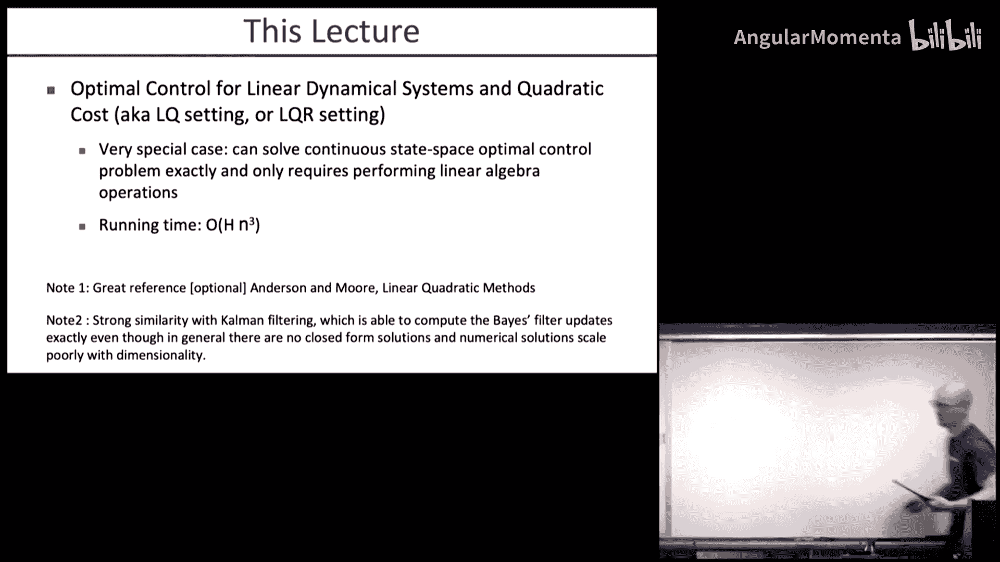
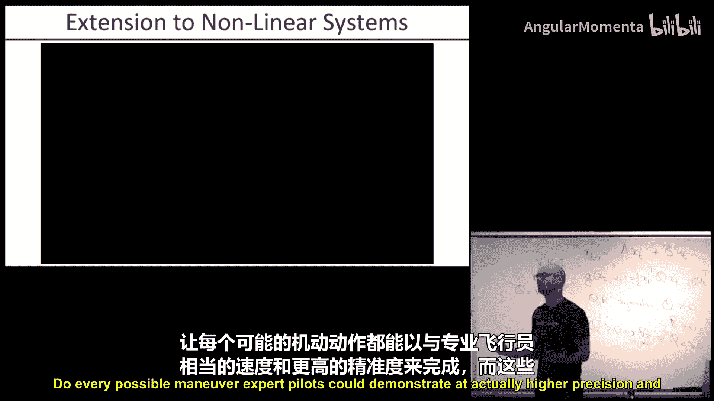
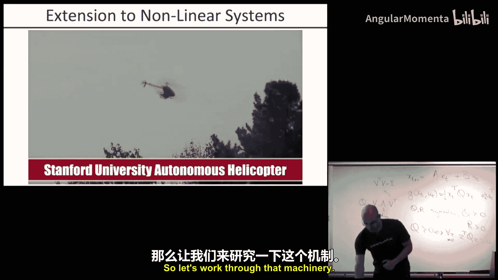
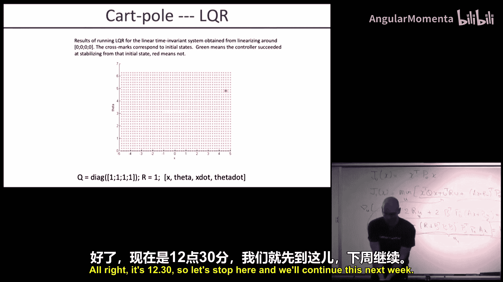

# 【加州大学伯克利分校】高级机器人学-｜-CS287-Advanced-Robotics-at-UC-Berkeley-Fall-2019-p05-5-LQR--BV1KXqCB4Eua_p5-

Hi everyone， welcome to lecture 5 of CS 287 Advanced Robotics。

 Today we'll cover optimal control for linear dynamical systems and quadratic cost。

 which at first might sound a little narrow， but you'll see it's actually quite general。

Before do that， quick reminder， slash announcement your。Homework1 is due on。Wednesday， okay。

 so you have a little less than a week left to complete your homework one。Any logistical questions？

No， okay。Let's move ahead。 So there's this thing called Belman's Cursive dimensionality。

 which you might have encountered in your homework  one。 if you're already working on it。

 if you have an n dimensional state space。The number of states in your。

State space will grow exponentially in the dimension N。

 Let's assume a fixed number of discretization levels per dimension。 Let's say 10 discization levels。

 then you have 10 to the n total states。 And so as n gets even medium large， not even medium large。

 just like a medium，10 to the n can already be pretty big and hard to cycle overall states。

So in practice， disization is considered only computationally feasible up to five or six dimensional state spaces。

Even when using variable resolution dissization and highly optimized implementations。

 maybe you can push it a little beyond that if you have a little more patience to get your results out。

 but that's kind of roughly the ballpark you can get to So system is six dimension or less。

 You do a really good implementation。 You can probably get this to work in optimal solutions out。

 No problem。 But beyond that， it gets harder and harder。For example approximation。

 might or might not work， you don't have to enumerate all states there， you can sample them。

 but because you're sampling them， you're actually not populating the entire state ph it makes it more efficient computationally。

 but you might actually not anymore find the optimal solution because you're not populating the space to properly run that dynamic program that value is to in a guaranteed way the optimal solution。

So with function approximation， often solutions end up being a little more local in practice。

In this lecture， we're going to look at optimalmo control for linear dynamical systems and quadratic costs。

 also known as the linear quadratic setting or LQ setting or LQR linear quadratic regulator setting。

It's a very special case。And we can solve continuous state space， optimal control， exactly。

And it will only require some linear algebra operations。

 which are very tractable to do with matrices， dimensions of the state space。

 So that's very feasible。So runtime will be order H。

The horizon and then N cube where n is the dimension out of the state space。Still。

 million dimensionsal sta space might be hard， but most practical sta piecess are not super large and N cube will work out fine。

Qu note。 There's a great reference on this。 It's totally optional。 But if you want to learn more。

 there's a book by Anderson and more linear quadratic methods。 And that's probably the most kind of。

😊，Deutorial style introduction， 100200 pages on this topic that we'll do in one lecture today。

 so there is more information in there if you want to learn more。

It's also very strong similarity with what we'll do today。

 and what we'll do when we cover common filtering when we do estimation。

 we don't have perfect access to the state directly。 We just get sensory observations。

We'll have a similar thing going on to do it exactly and full generality will be very hard。

 but there will be a special case where we can do it exactly。

 and that will be called common filtering and will be very similar to what we do today for optimal control。

Okay， let's write out the assumptions under which will'll work today。

So the LQR setting。Assumes a linear dynamical system。 What does that mean， It assumes。X。

T plus 1 equals a matrix a。Times xt plus a matrix B。

Times U T state here is denoted by x and then controls or actions by U。So Xt is a state at time T。

 UT is the input at time T， and it'll assume a quadratic cost function we've been working with rewards so far and the optimal control literature is more customary to work with cost ultimately it's all the same if you want to work with rewards you can just say。

 oh the negative cost is my reward and you'll have the same problem you're solving。

 but we'll follow the notation that's common in this space and we'll also use cost。

 it'll be minimizing now rather than maximizing expected values。And so cost。

 let's call it G G for being in state X T and taking action UT is equal to。Cdratic。

 that's the assumption， so it's going to be X T transposeq Xt。Plus， UT transpose。A。UT。

And there'll be some assumptions。 The assumption will be。Q and R symmetric。And Q and R both。

Positive definite。What does it mean to be positive definite， It means this thing here， Q。Q， positive。

 definite， if and only if。For all Z。That are the right form factor， z transpose Q z bigger than0。

S for R。Okay， so those are our assumptions。Yes， question。That's if Z is not equal。Correct。

 that's a good point for all Z， not equal to 0。It has to be strictly bigger than zero， thanks。Now。

What that means is that the cost is non zero everywhere， except when you're at the zero point。

 if you have zero state， zero controls， cost is zero， that's the best place to be。

 everything else is worse。And we can also see that the system is set up that this is actually possible to achieve if this if the state is0 and control is 0。

 you'll be at  zero again。 So this is a kind of problem where the optimalmost solution will drive you to zero and stay there for all times。

嗯。Now。One thing I want to mention here a bit of an aside。 but if you think about。

 let's say this form here， x transpose Q X T matrices are a little harder to think of than scalar entities。

 So it can be good to first thing go ahead， what does this mean when it's scalar。

 when it's scalar just means like it's a parabola。 If x is a scaleal it just x squared times some scale factor and。

For it to be positive， definite， that scale factor has to be positive。

 So it's a prabola that's shaped with a minimum。 That's what it looks like in the scalealar case。Now。

 in higher dimensional cases。Well， one thing you know， if a matrix is symmetric。

 or hopefully you know， otherwise， you'll find out now， if a matrix is symmetric。

For every symmetric matrix， Q， Q is equal to some。Agonal transformation。We tried the eigenvectors。

 let's call them V。Lambda， which is diagonal， V transpose， so this one is diagonal。And。

V transpose V is the identity matrix。 So V is an autoagonal matrix。

 meaning that all it's doing is rotating things。So what happens is when you multiply something with a symmetric matrix effectively。

 you just rotate it。Then rescale it， rotate it back。If you multiply it from both sides。

From the front with x transpose in the back with X， you are on both sides。

 just rotating the X and then in the rotated space， rescaling the coordinates。

And so if that's all you're doing is rotating things and then rescaling。

 all that is doing is a change of coordinate system。 That's just a rotation。 So。

When you try to build some intuition about this， you can say， well。

 if I look at this cost function in the。If I pick。The simplest possible coordinate system。

 I picked the one where everything's already rotated ahead of time。

And then this V matrix will not have to do any rotation anymore。

 It'll just kind of disappear be an identity。 And then really。

 Q is just a diagonal matrix doing rescal。And so in the correct or the easiest coordinate system。

 really what this costs is just squaring each of the coordinates of x and rescaling those squares with a positive number。

 that's all it's doing， it's just that sometimes your coordinate system is over you need to first rotate and then you do the squaring and scaling。

So that can give us some intuition about what this is。

 iss really just penalizing every coordinate for being away from 0。

 but it's not doing in an axis aligned way necessarily。 And hence。

 it can be a general symmetric matrix。 doesn't have to be a diagonal matrix。 In practice。

 almost everybody picks a diagonal matrix。 It's much easier to pick a diagonal matrix as your cost function than to fill in a whole non diagonal cost matrix。

😊，Then the other thing that you might be curious about Q and I have to be symmetric I'm saying。

What happens if you pick a non symmetric Q or R？Okay， let's see what happens。

 We'll do it as a lower aside， O K。Non symmetric。Q， let's say。

So what do we have only way this queue appears， I shouldn't usually there's a one half foot in front。

 which is just some kind of scaling， doesn't really matter too much but。When you take derivatives。

 you get a two and then a one half and a two cancel， which makes it nice。So。

Imagine we're looking at x transpose。Q X。But now let's actually not call a Q because we don't want to make the same assumptions we made before。

 Maybe it's not a symmetric matrix。 Imagine it's just some matrix， a。Well， A， we already have there。

 Let's pick some letter we don't have yet。 Let's say it's。

We don't have and will not have any time soon metrics。F， I think。X transpose Fx， F not symmetric。

 What happens？Okay， let's take a look at what happens。X transpose Fx is equal to。Not symmetric。

 So for a non symmetric matrix， we can actually write in。As。F。Plus。

 F transpose over 2 plus F minus F transpose over 2。 We're just adding in subtract。F transpose。Okay。

So let's rewrite it that way。 So what we really have is。X， transpose。F。Plus F。

OverF transpose over2 times x plus x transpose F minus F transpose。Over two。X。

Now look at this one here。This one is。X transpose。F。X。Over 2 minus。X transpose。F transpose x。

Over two。Okay， now。When you have matrices and you have， let's say， A， B，C transpose。

 that's the same as。C。Transpose B， transpose。A transpose。That's how it works。

If you have a scalar value， these are scalar values。It transpose a scalar value。 It stays the same。

 So we might as well replace this one。 It's just a scalar with its transpose。

 Then we apply this thing over here， and we see this one is equal to。X transpose。

 People see it up from the back at the bottom row。 Okay， X transpose F X over 2。

 which cancels with this one。So this form here is equal to 0。

 So all we're left with from x transpose fx is x transpose x transpose de symmetric part of f times x。

 So by using nonsymmetric matrices， you actually don't gain anything you just。In some sense。

 obscuring the fact that in reality， all you're using is the symmetric part of that non-symmetric matrix。

 And so we might as well not obscure those things。 We might as well say， well。

 it's clear we only ever use the symmetric part of the matrix。 So let's just from the beginning。

 say we only use symmetric matrices。 because what's the point in introducing an F。

 And then really be working with F plus F transpose over 2。

 Let's just directly work with a symmetric matrix， which I knows the essence of what's happening anyway。

 not just the essence。 everything that's happening is the symmetric part。

So the fact that I said Q&R have to be symmetric is not really a restriction on the formalism。

 it's just a way to be more transparent about what's really happening。

Only the symmetric part used anyway might as well do it upfront。The fact they have to be positive。

 definite。Should be clear why you want that。 We're gonna to be minimizing costs。

 And if there's any way to achieve a negative value。

 If there is something that achieves a negative value here。Whatever that is。

 then you're gonna want to go to infinity in that direction， Z。

To minimize costs would is some very negative value。 And that's not really an interesting problem。

 Like， try to send off your system to infinity is typically not an interesting problem to solve。

 And so to make the problem interesting has to be positive definite。

 So there is a clear goal to be achieved。 And the asymmetric thing is just。

 as you saw there is just a way of being transparent about what's going to happen anyway。

Any questions about this？Now， one thing。You might say， well， hmm。Linear。Cdratic。Systems。That's。

Maybe you love matrix algebra and like that sounds fun。Maybe it sounds very limiting to you。

 And you're saying， am I really going to stick around in this lecture today because all we' going to see maybe is' just these linear systems。

 So I'm going to give you a quick heads up that we can do a lot with these systems。By the way。

 we have a slide with the description here。What we're going to cover in the first part of the lecture is to solve this specific problem that I wrote on the board。

 What we'll do in the remainder of lecture is see how we can use it as the core。

To solve more difficult problems。How difficult， essentially arbitrary nonlinear systems。

 So one good example of very nonlinear system is a helicopter。

 helicopter flight is the helicopter itself is nonlinear dynamics due to just how rotations interact。

 how rotations are represented。 They're kind of a complex thing to deal with。

 but then also the airflow around the helicopter makes it highly nonlinear。

 And so there's a lot of complicated dynamics happening。

 It's definitely not x d plus1 equal A X d plus B U T， not even close。

But what we'll see first is the core of how to solve this， then how to extend this。

 So we can start doing things like this。 So we're going to watch here is。Autonomous helicopter。

That will go through essentially the entire flight envelope of the helicopter。

 do every possible maneuver expert pilots could demonstrate and at actually higher precision and similar speed as the expert pilots do。

So this was some of my PhD work several years ago。This is all， powered by。LQR under the hood。

 invertted takeoff。Then it hovers。That's actually a hard problem in itself to stay in place with the helicopter。

 very difficult problem。Checkbox， Mark then split us its way to change direction。Very nonlinear。

 the dynamic is not even close to linear anywhere here is tall turn。

Nothing close to linear dynamics is continually changing also due to the airflow around the helicopter。

It can do spins at the top。Come out tail first， go up to 55 miles an hour at maximum speed。

It can go inverted。And so。这 is。A highly unstable regime to fly in because when you're inverted。

 just like holding up a broom， when you're holding up a broom in the palm of your hand。

 it's easy to tip over。嗯。And you're holding up the body of the helicopter here then。Plips， rolls。

None of it anywhere close to linear。But。We'll actually be able to solve this problem。

At least the controlled part of this problem with the machinery we're going to build up today。So。

Let's work through that machinery。So remember value tuition。

In control people often use J rather than V and J for cost。 So if we had ballot。

 it would be J for I plus1 steps to go for being in state S equals。Men。

 I guess they are minimizing now over controls you， the cost encountered。

In that first step plus then the sum over future states probability of being in that future state。

 given state in action times the optimal cost to go。 So often sometimes we'll call it value。

 sometimes we'll call it cost to go， it's very common to call it cost to go。

 which is all cost you expect to encounter when actively then onwards for I times steps starting in state S prime。

Okay， so now we have those assumption over there， LQR。What does it say？Well。

 let's fill it in J I plus 1。 and we're going to have x now for state。 K plus1 for x is the min。

Over you。What are we doing， Well， the cost G is written over there。

 It's gonna be x transpose Q X plus U transpose R， U， maybe with a one half。 We can kind of choose。

The1 have is good to let things cancel out later then plus。Some。Over all next states x prime。

 but actually with sum of all next states x prime， we have a deterministic system here。

 X t plus s gra x equal plus B U T。 So you don't really need to sum over it。

 It's just gonna me one next state x prime。 We even know what it is。 That state x prime。😊。

So Ji steps to go for x prime， which is equal to Ax plus B U。So trying to minimize this。

Remember how it did valid tu。 We said with zero steps to go， it's easy。 So， okay， let's do that。

 So we'll start with zero steps to go。When there are zero steps left。In this case。

 we're not going to set it to zero。We could set it to0， we're actually going to set it to J。Zero x。

Equals。X transpose p0 x。All right。Looks like in the slides， I did it without the one half，'s。

Not two to12。On the board either。How me。So if we set p 0 equal to all zeros。

 this means there is no end cost。 But if P0 is different from。All zeros。

 then essentially we're saying if you don't end up at the all zero state。

 we have a preference between different states you might end up in along some axes。

 maybe there's a higher cost they end up somewhere far out there compared to other axes。No。J1。Of x。

Equs， well， we wrote it over there， so let's rewrite down。M。Over you。

Of x transpose Q x plus u transpose R U plus。J I of this thing。 Well， that's J 0 here。

 J 0 is x transpose P0 x， so。We need to fill that in。 we have then AX plus B U transpose p0。

 Ax plus B U。Okay， and now we want to find the U that minimizes this to find a U that minimizes this。

 What do we do， We compute the gradient with respect to U。Of that quantity。Well， let's see。

 what do we end up with， gradient respect to you of this quantity over here。

This doesn't have U in it。 So no nothing。 U transpose R U that becomes to R U。😡。

Then this thing over here。Becomes。Plus two times。B， transpose。P 0。A X plus B U。

 And I want this to be equal to 0。 If we can find the solution for that equal to 0。

 we found the optimal control U。Well， if we do this， we find。U is equal to。Negative。

 so the U appears here and appears here， We just need to do some grouping of terms that move to the other side。

 end up with negative。R plus B transpose P0， B。Inverse， B transpose。P 0， A X。

 So you have a nice closed form。For you。Just nice。 That means we don't have to disretize you。

 We don't have to search over the best view。 We actually have a closed form U as a function of X。😊。

And。This。We'll also call。K times x。So we'll call this what's sitting in front here。K。

Then what we can do。We can fill。U equals k times x。Into。This thing。

Over here to see what actually our value is at x。 Once we fill in the optimal U。

 we can find out the value for that state x。Once we do that。What we end up with is。Let me。

Write it over here， talk over the board。Fillling in， that's just a bit of simplification。

 You don't have to do anything special。 We find。J1 of x equals。X transpose P1 X。For p1 equal。Q plus。

Q plus。This actually， let's call this thing K1， because it's specific to the first iteration。

Itll be Q plus K1。Transpose are。K1。Plus。A plus。B K1 transpose P0。A plus B K1。

And K1 equals minus r plus b transpose p0 B。Inverse。B transpose P0。A。

So this shows is if we want to find a value function for one time step to go。

We just need to compute K1。 This will give us P1。 And then we have the value function for one time step to go。

Now， the amazing thing that's happening here。 And this is very unique to the linear gra setting。

 And that's why it's so popular in a building block for other things。

 The amazing thing that's happening here is that this thing here。😊。

Is of the same form factor as we started with。We again have a quadratic。J 0 was a quadratic。

 and then J1 is a quadratic in x。Which means that we can repeat this process again。

If we want to find J2， we just need to uphold the indices here by one。

 and we'll have the same thing we can do and repeat， repeat， repeat。For most systems。

Let's say you had a polynomial system for most systems。

 So all happen is the degree of the polynomial will keep increasing as you do this and things will become more and more complex。

 but we kind of get lucky here because， well， when we take the gradient， the degree drops by one。

 And so the solution has is just linear in X and we fill it in， we stay quadratic。

 and this never changes。Computationally， this is very feasible。 I mean。

 this is just some matrix vector multiplies。 Some matrix inverse。

 a matrix matrix multiplies same thing here。 So computationally。

 this is very practical order n cubed where n is the dimensionality of your space。😊。

Any questions about this， this is the core idea for today。Yes， actually， we， we have。

 we still have the thing yet today。 Let's see。😊，Oh。Obstacle， sorry。

So can P 0 be any arbitrary matrix。So can P0 be an arbitrary matrix， P0 has to be positive definite。

For this to be meaningful， because if p0 is not positive definite， you could still go。

 essentially what would happen is setting the grand equal to 0。For that to be the right point。

 your function is be shaped to have a unique minimum。 Otherwise， have to go inspect。

Whether a gradient is0 is it a minimum or a maximum or a saddle point。

 and so because p0 is positive definite unique minimum for the quadratic form。

 when we said gradient equal to0， we know we have the unique minimum， and that's the right thing。

P0 or the other way shaped like that。😡，And you went through the same math。 Well。

 then what you would find here is actually。The way to achieve the maximum。

And what you'd be doing is maximizing the out of objective。 So theres kind of some。

 something kind of weird， weird going on。 that's not very natural。 So。

 so what does p 0 mean like intuitively， intuitively P0 means how much you care about being close to 0 along different axes。

 so。Cdratic forms， you can draw them from above， as let's say。

Maybe you draw perioddtic form like this。What this means is that maybe the quadratic form is a value of1 here。

 two here，4 over here， and so what that means is that if you deviate in this direction from zero。

 things increase very rapidly and curve very high cost very quickly。

So that's a bad place to end up if you can avoid it。 whereasas in this direction。

 it increases much more slowly。 So let's say you don't have enough time steps left to drive yourself all the way to the  zero point。

 Obviously， you want to be at 0。 Let's say don't have enough time steps left。

 you'd rather end up somewhere here away from0 than here。 And in fact， this is just p0。 But if  Q。

 let's say we're shaped the same way。 if Q and p0 we the same。 right then at all times。

 youd prefer to be along this axis， if you're not there yet。 So if you start out。

 let's say I don't know， over here， you'd prefer to quickly as possible get this way and then come in this way。

 Now， if it's possible， of course， you might even prefer to go even faster directly to the goal。

 but the dynamics will limit you in what you can do。

 And so within what the dynamics allows you to do， you prefer paths that。

Along axisxes where you're not penalized as much， you're willing to have more deviation still if you have to make trade offs。

So PC and Q are really trade offs is what they define。 So one example would be for a helicopter。

 maybe you say you know what， I care a lot about position and orientation and some entries in Q and PC will be related to positions。

 some will be related to orientation。I think you might give it some thought。 You might say， well。

 actually， I probably care more about。Orientation， why， because if orientation is off。

 things get very complicated。 And if I worked， let's say。

 approximate my helicopter with a linear system， Well the nonlineararies will start kicking in much more quickly if my orientation is off。

 But if I'm off by position。The non nonlinear artist will not kick in actually at all。

 because where where you are as a helicopter， the dynamics is not affected by your position。

Similar thing would be， let's say we're controlling a cart pole。 You're doing cart pole balancing。

Well， currentpo balancing。If the angle here changes。😡，The dynamics will be very different。

 The linearization of the dynamics will be very different。 But if your location has changed。

 the linearization of the dynamics will be the same。 And so what happens is。

If you thinking about how should I design my cost function。

 if I know I'm going to use a linear approximation to the system。

 then I should design my cost function the way that the linear approximation is as good as possible I'm going to think about my dynamics and say oh。

 position is less critical than orientation。 let me put a lot of penalty on orientation so it always keeps it nicely up and then it can worry about position later because not because I care about it later because I think it's going to fail otherwise because my linear system that approximates the real system will become imprecise and my whole calculation based on linear system will not be sufficiently precise to give me the correct solution And so in practice there's a lot of that going on as you design your P0 and your Q your R。

And if you approximate your system with a linear system， which is what we're gonna do。

 because most systems are not linear。 We're gonna approximate them that way。 you have to think about。

How can I ensure my linearization is good And your cost matrices can help you ensure that you're more likely to be in the regime where your linearization is good。

 So there's a lot of intricacies going on there。 It's probably a longer answer than you were looking for。

 But that's kind of the， the design aspects of it。Want to throw the box back？Oh， niceice。

Were there other questions？Okay， so we now understand how to solve a linear quadratic system。

 Let's show the slides that have。Ltic math on this。So this is what we did on the board。

 we derived that openly， you get back to hydrdratic form。

 and this is all the calculus you have to do， just linear algebra。So since we have that。

We end up where we started， J1 is just like J0， so we can go from J1 to J2。

 just like went from J0 to J1。And for all times， we have a closed form update。This is pretty crazy。

 by the way， you。You could try to give it a lot of thought say， can I come with any other。

Dynaal systems and cost functions where if I do a value backup I can get an analytical solution。

And then after an analytical solution， I get the same form factor back so I can just do this repeatedly and nothing blows up in terms of what I need to represent。

 I don't know of any others。 I mean， there's a discrete case we just enumerate。

 but in terms of continuous spaces， is is the only one I'm aware of where it just stays in nicely enclosed form。

So that's how we get J2。And then the full solution will be just iterating this。 We just compute K。KI。

 P， and keep repeating。The optimal policy for I step horizonon will be just pi of x is K times x。

 so you just store your Ks and just then use them at the appropriate time step。

 and if you want to know how much cost do I expect to get from this particular state x。

 it's x transpoposedse P X。It's a little factor that is guaranteed to converge the infinite horizon optimal policy。

 if and only if the dynamics AB is such that to exists a policy that can drive the state to zero。

In some this is intuitive if there exists a way to drive the state to zero。

 then definitely in the infinite horizon case， you should drive it to0。

 so at some point you stop encountering costs， so these PIs will start converging because you're bounded in how much cost you' ever going to encounter this a path that drives it to zero。

 whatever the cost of that path。😡，That's an upper bound on what the optimal control will do in the infinite horizon case。

 And if you're upper bounded。And your series is always going up。

 it's guaranteed to converge and so you have convergence。Often people do that。

 they just keep writing until conversions as you just use a steady state。

Feedback matrix for all times， even for finite horizon problems。

 because while it's convenient to storeor only one matrix rather than having to keep track of time and many。

 many matrices。Let's revisit our assumptions now。 So we made a bunch of assumptions here。

What this really is about right now is about keeping a linear system at the all zero state while preferring to keep the control input small。

How can we extend this， We can actually extend this to aine systems。Systems systemtoity。

Regulation around nonzero fixed point for a nonlinear system。Palization for changing control inputs。

 linear time vary systems。Trejecture following forlinear systems。

 so we have a lot of extensions to cover。 let's take a small break here start again in two three minutes。

 and in the meantime I'll just project what we have as our main result so far。 lets a question。

Absolutely， only say like these are must people。現じておしれま。Oh if we don't have anything。

 then we can set it to zero。Or if you want to find the infinite horizon version if we sit it to zero。

 wouldn't use storage。At the very end， it would be， for the last time step it would be。

 but from then onward， it would not be anymore。So if P， so if p0 is 0。That means K1 is also here。

K1 will be zero。 Yeah K1 for one time set to go。But P1 will be non zero and essentially will start accumulating from there。

P1 will be correct。So if you start with that therapy0 equals0， your faculty starting。Where。

P0 equal  Q。Aaiting one it later。So these can be positive semi。Yes， as long as Q is positive。

 definitely， Q& R are really the ones that matter here。没。So on。

I want to show that this successive application of a one student。

Strate is optimal believe you have to apply some order。

Like let's say we have a finiteac horizon and then we work like thator showing that this is large it's optimal the reason's optimal more globally is just because it's vitr we doing exact vric and we know valrness。

This has a direct customer。ば这よ。All right， let's restart。こは？So one question that came up。

During break is how do we know this is optimal and the reason we know this is optimal。Is that。

This is value。 And we know value is optimal。 It's just that we just find out that we can actually do value exactly。

In a continuous state space under this set of specific assumptions on dynamics and cost。

But now let's start revisiting those assumptions。 How about aine systems。

 What does that mean there's an offset there。This means you can actually not keep the system at 0。

 Think about it。 because if x is X T is 0， U T is 0。Then X T plusson will be C。

 So youll continually keep accumulating cost。 There's no way around it here。 because I mean， the the。

Because whenever you're not at 0， you get a cost and you cannot stay at 0。

You can still go through the same math。嗯。One way you can do it is you can say， well。

 I'm gonna go through the， you know， same math I did before。Reerve the update。

 And that could be a good exercise。 You know， you just。Do all the math of in previous slides。

 Itll just be some extra offset terms coming around。So， then， the control。

U optimal control will not just be matrix K times X。

 It will be matrix K times x plus some offset because you apply offset control。

Another thing you can do， and which we're going to do a lot in what we're going to see in these extensions。

 you can redefine。Your state space。 So we can say what if our state space is actually we call it Z now。

 and there is x d plus sum which I had before， but an X entry of one。 If we set it up that way。

 a slightly bigger state。😊，Then we can actually write it again as a linear system in Z space。

 And we can then say， okay， now we can reapply all the equations we've seen before。

 We just saw Im getting in Z space。 and then we need to apply control。

 We just need to make sure that， okay， we turn our x into a Z， which is x and a1 at the bottom。

 and then we multiply with the K matrix that we found to get the controls。

 So it's a little trick to not have to reimplement anything when you go from linear to f fine。

How about stochastic systems， imagine。You have a W T here。 That's not an offset term。 It's mean is 0。

 but it has variance， nonze variance。 So's some noise in the system。

I encourage you to do this as an exercise to see if you can fully understand everything we drive。

 you can work through the same derivation that I did on the board。So nowtochastics。

 you'll have an expectation。 Exp value。 and the expected value where you'll see here well the expected value of w multiplies with anything that's not W will be 0 thatll simplify out。

 But the value of double multiply with W is a covariance matrix for W。

 and that will be carried throughout and it will show that actually you have a higher expected cost。

 why while it's natural， You have noise in the system。

 you can't control that precisely when you have this noise。

 But the funny thing is that the optimal control policy。

 the K matrices you'll find are exactly the same。 they don't change。

 You'll just see that you'll have an expected higher cost。 but use the exact same control strategy。

 kind of a interesting result。Some people call it certainty equivalent control。

 like in this particular setting， even though there is uncertainty in the system。

 you can design your optimal control ignoring。The uncertainty。And I'll give the same result。

In terms of your strategy。How about nonlinear systems， X T plus1 is F of X T comm by U T。

We can keep the state。 We can keep the system at state X star。

 even only if there is this some u star such that X star equals f of x star U star。

 That's what it means to be a fixed point。Let's assume theres a fixed point in the system。

Now we can see can we stabilize it around that fixed point。

 that's like keeping a helicopter in hover， keeping a cardpole balanced at the top。

 it's not nonlinear， but there's a stable point and the question is how can you stabilize around it because usually there's a stable point sure you might say I just stayed everything in practice perturbations and need to be able to steer back onto it。

So it's not enough to know you start to stay there。

 you need to know a feedback strategy to stay there。😡，Lierize the dynamics around x star。

 What would it give you， Well， x t plus 1 equals。This is the first order Taylor expansion of the dynamics at X star U star。

Well， that's really A and B or equivalently。We can write it as X T plus1 minus x star equals A X T minus x star plus B。

 U T minus u star。 If we now redefine our coordinate system。Send it around x star and U star。😡。

We'll call that Z。And for you， we call it V， then we have exactly what we had before。

 Z T plus1 equals Az T plus B， VT， and then our cost will be， well。

 some cost for staying close to them。So we don't have to write any new code to find the。

Linear gra optimal control around a stable point， not a stable point。

 and a stationary point of a non nonlinear system。Okay。So just on a standard L Q R。

 once you've done that， you need to find your controls。 first， you'll turn your x into Z。

 You'll find V from that。 Then you can turn。Your V into your U。

 and here it is the equation defined find u。All right。Here's another one。

 What if instead of penalizing for。The controls you want to penize for the changing controls。嗯。

Why might you care about this？Often， what happens when you have a system。

 let's say it is your system and you run it。In the real world， you optimal controller。

 what you'll find is that there will be a lot of high frequencies。Very high frequency control。

Even even the simulator， when you run this， it might not be the case。 But in reality。

 there's always a little bit of noise。 There's a little bit of mismatch between reality and your simulated system。

 So your optimal controller。Since the things everything is deterministic。

 is going to actually use pretty large controls， typically and constantly adjusted controls to whatever at that moment looks best。

 And you typically don't want that because typically what happens is when you have high frequency controls for a physical system。

 those high frequencies are hard to model。 and actually the model that you're using your linear system all that you have。

Is often not very precise for the high frequencies。 For example， for a helicopter， at high frequency。

 you just shake it apart， it rips itself apart， a high enough frequency。

 And so that's not great because you have all these kind of modes really have the physical system that are not modeled in your control model that you have for your system。

 So you want to avoid those high frequencies。Okay。So what you can do， one thing you can do。

 Anderson Moore looks at this is you can frequency shape the cost function。 What does that mean。

 You would say well， I'm going to add extra variables to my state so I don't just have Xt but also have xt minus-1。

 xt minus-2 xt minus-3， x3 minus-4， I keep them all around in the state。That's easily done。

 You can expand your a matrix to have some effectively identities to memorize things from the past for a while。

And then you can essentially set up something that penalizes for rapid changes in those。

 or you can even set up a very specific filter on your past states。

 if you have a certain frequency that you specifically want to suppress。

 like maybe there's some kind of you've done an analysis of your physical system and there's a certain frequency at which the system has a resonancency and the physical system will start accumulating energy and shaking itself apart。

 that you might want to minimize anything that happens at that frequency and you put something in your cost function to just avoid that frequency。

Sim special case， which works very well in practice is just penalize for change control inputs。

How do we do that， This is that original problem。 But now we want to semi penalize for changing controls。

 Well， solution A is to augment a state with the pass control input vector。 So we have X T。But also。

 U T is stored in the state， and then we can pinize for how the new input is different from the one we've already stored in the state。

 solution method B， the one we'll cover is you actually change the dynamical system to be expressed in terms of the changing control input rather than the actual control input。

So。For some maybe originally， you were controlling， I don't know， velocity。

 And now you're effectively controlling acceleration。

 And you want to keep your acceleration small rather than keeping yourveloc small。Okay。

 maybe we want to keep both small。 That's fine， too。 So what does it look like Oh this。

What we have is。Oh really animated。 but okay， X T plus one， U T is our new state variable。

 We can get that from X T and U T -1， which at the previous time are in our state。

 and then a delta in in controls comes into B。😊，This U T -1 also gets multiplied with B。

 So in the top row， we get the original dynamics。 X T plus1 equals A X T plus B， U T -1 plus B。

 Delta U T。 So that's the same as plus B， U T。And the bottom row is just keeping track of the controls from the previous time。

So this is what we have， just a redefinition of our state and input space。

 Our cost can be the same we had before wherere now。There is an R prime introduced。

 our original Q is here， original R is here， and there's an additional R prime to penalize for the changing controls。

😡，And this then matches the standard LQR format shown above。

Let's say if for pretty much any physical system， you're going to want to do this。

 it pretty much never works without doing something like this。De。

What else might we want to generalize to linear time varying systems？ So we had stationary system。

Before now， there's an index there。 The dynamics depends on time， A T， BT。Well。

 in all the math we did， there was nothing that assumed A and B would be staying the same over time。

 We can work through the exact same math， exact same update equation。

 We just need to keep track of the time indiceice。 It will not converge then if A and B vary over time。

 you're not going to get the same conversions properties。

 but you can do the exact same math and find a time varying linear control that's appropriate for your time varying linear system。

So updated equations will look exactly the same， just need to keep track of the time indices。

You might wonder how often you really run into a time varying linear system like that would be quite coincide instance。

 it's not linear， but it's time varying linear， that would be kind of really special in practice it's rare to have a time varying linear system that's actually what you run into。

 but it's very common to run into a nonlinear system。

And if you know the path you're going to follow in state space that you're trying to follow。

 then you can approximate。😡，In a time varying way with sequence of matrices。

 your dynamical system as a linear time varying system。

 So a different linear approximation at each time step to what is actually a nonlinear system。

And so you'll get linear time vary and control and you'll get， again， quadratic costs。

So let's look at what I just described， which is the most direct application of this kind of linear time varying setting。

 we want to do trajectory following for nonlinear systems， for example。

 on our helicopter to follow specific path。Helicopter is now linear， so we can't do the linear thing。

 but what can we do， Well， let's assume there's a feasible target trajectory。

It's something that the helicopter can actually do or our system can actually do。

How would we know what that is， that's not necessarily easy to know， but let's assume we know it。

 maybe from somebody already executing it， a human pilot maybe。

 or maybe from having a precise analytical model and you can somehow derive what is a feasible sequence of states。

Well， feasible means that there exists controls such that this trajectory gets followed。

You might say， well then wouldn't it be enough to just apply the sequence of controls and we're done。

 Why do we still need to do any work， The reason we still need to do some work is typically。

 even though you know your sequence that would follow the trajectory in principle。

 there will be perturbations。 It will be thrown off your trajectory。Why。

 well there could be explicit perturbations like noise when pushing your helicopter around。

 or there could be things that your f that you have there is not perfect， it's imprecise。

 And so even though you think it's feasible， it's actually not feasible and you can think of the mismatch between the real F and the F you work with。

 also as noise， it's not necessarily a noise per se。

 it's not a noisy process is just that there's a mismatch between your f that you use and the real one and so real update plus some noise is really what you're working with。

So our problem statement then becomes， let's minimize the quadratic deviation from our target states at all times and quadratic deviation from our target inputs。

嗯。And then， well， you might say， why do we penalize this。

 Why we need to stay close to our target inputs。 So we can think of in some sense this as zero centering。

 We know the controls that we need if there's no perturbations。 And so that's a strong prior。

 And we're gonna penalize for deviating from that because we know that's the right place to be。

 And then if we need to deviate sure we do it to stay on track by default。

 we're gonna try to stay close to use start。Then we transform this into a linear time varying case。

Again， Taylor expansion X T plus sn is a function of x star T， U star T plus then。

What will be our A and B for those respective times times Xt minus Xt star， UT minus UT star。

 and so here's our linear time bearing system in a new coordinate system。

The x minus x star and U minus u star coordinate system。And at this point， we're actually good to go。

 we can do the standard thing。Where we transformed it， were going standard LQR backup operations。

 and the resulting policy at I times it from the end will be this thing over here。

Which we knew is going to be that format because just a linear time vary system at this point。

And the target tree。Need actually not be feasible to apply this technique。

 so if you actually don't have a feasible directory， you can still go through the same math。

 but you'll have to keep track of an extra term here。嗯。And what you do。

 So I should have a Aline system。Rather than a linear system， and so have to keep track of that。

If your trajectory。Is feasible， it'll。Work out fine。Yes。Only access to states。

Target trajectory and not the action。Oh good question， what if we only have access to the states。

 not the actions？😊，Then we wouldn't know the U stars。 We couldn't center it around them。

 And so we would have。We ended up with not necessarily。Knowing where we want you to be centered。

 we might just。We might essentially have。No U star here。's just set it to0。

 That's maybe the best we know。 and you can actually。Worked did the same math， but again。

 you'll end up with an offset here。So whenever the trajectory is not feasible。

 because I fact we're doing is were replacing the U stars with zeros。 It's an infeasible trajectory。

 We'll end up with offset term over here。 And so we have an I find system to deal with rather than a linear system。

 But other than that， we can still run through the same math。😊，Question here。

 you want to take the mic for momentmen？Does the error tend to like accumulate in the system because you have your defined trajectory and then you're off by a little bit and you keep going off and knock and off so absolutely。

When you're trying to follow a trajectory typically。An error will happen。

E meaning you thought youre steering right back onto it。 You were off， but you thought， you know。

 openly controlling back onto it。But then there's a perturbation， either mismatching dynamics。

 So you actually not steer onto it because you had a wrong model。

 You're using order is maybe a natural perturbation， a forest supply to your system。

 that is an external perturbation。 And itll still be off。 And so then really。

 what matters is what you're good at steering on relatively quickly compared to the perturbation force。

 The perturbation force is very， very strong。😊，Pushes you very hard。

 And the level at which you're able to steer back on is smaller than that you'll。

End up not getting back on。 and it might go unstable。

 If your ability to control back on is very good。 then， yes， you'll。

 you'll never actually be on the target track。 You'll always be around it， but you'll stay around it。

 And so it really depends on your control bandwidth there。

 Do you have the ability to keep it on or you have not enough control to keep it on。Like。

 for example， a helicopter， if you're flying it in wind gust up to like 1020 miles an hour can keep it on。

 But wind gust， like， I don't know，100 miles an hour， there's no way we keep it on the trajectory。

 It just doesn't have the ability to， to counter that。Over there。Behind you first。Oh， this。

Try to way too much arch。So the what's going to keep us on track is the feedback matrix here。

 So the controls we choose。Are going to be such that if we deviate from where we were supposed to be。

Let's say if we already wear exactly what we're supposed to be at that time。

 then we'll just apply U star for that time。This is saying how much we're going to deviate from U star and say if we're off from that trajectory。

 this k matrix will describe what controls me to use to steer back on。

Why does this happen Well the original optimization problem says that we need to stay close to the X stars。

 that's in the objective。 So the optimum is to be on。

 And then that feedback matrix is just a consequence of our objective。Try it。こさ表の。

You also had a question， right？So。It seems like the problem at the top of the page is equivalent to a convex optimization problem。

 I don't know if you know whether or not that's true or not。But if it is true。

 why not just use a solver？😔，到票我家佢。Yeah， so。It's a good question。

 Next week well see we'll look at ways to use solvers to solve for this。 if you just solve it here。

Thanks， Eric。if you。Solved this as a convex problem， just finding the use。 you'll just find the use。

 You will not find a feedback controller， but we'll see exact things we can put around it to get there。

 But in practice， the nice thing about solving it this way is in some sense that you're exploiting all the structure in the problem。

Because it's actually a dynamic programming problem。

 so we're actually using all the structure available to us。To find a solution。

 including a feedback matrix， including a cost to go matrix。 And that will be really helpful。

 as we'll see as even we see other methods to solve this。

 we'll still be very interested in a feedback matrix and a cost to go matrix。😊，Here go over there。

Thank you， Eric。So is it possible to like enterlink to different L QR problems， For example。

 like use a easier model that kind of captures what's going on。

 But devs from reality to solve for the U star and then have another model on the top and in includes the nonlinear part and put and the nonlinear following。

 Yeah， I mean， I think that， that's a very good。Idea in that often solving for the Xstars U stars is difficult。

 And if you can have ideas of how to simplify solving for it and building up to it。

 I don't have of any kind of extremely principle way to get this done。

 But definitely people will try all kinds of things to find the X star Ustar。

 and we'll see more of that next week。 So let's defer questions about how to find Xstar and Ustar to next week。

 because we'll we'll see ways to do it done。All right。You， you got to far throw ahead of yourself。

Careful， everyone。Nice。How about the most general case， we just want to solve this thing？

How can we do this？Well， one thing you could say， well。

 why not use a black box optimization solve maybe we can find the use。

 but again we'll just find the use we'll not find a feedback matrix we'll not find a cost to go function and in fact we'll not necessarily be exploiting the structure of the problem。

We're going actually itly apply LQR， and this is a very powerful way of doing this。😊。

So let's step through this step by step， we initialize the algorithm by picking either a control policy or a sequence of states and control inputs。

 let's do the control policy thing， we just assume we have some control policy， whatever it is。

 we have something。Maybe it's just all zeros always。Then。Start step one。

 we execute the current policy and record the resulting state input trajectory。Showone here。

Now we have a feasible trajectory。 we have something that actually just happened that we can do。

If this was our target trajectory， we kind of could do just like L Q R to stay on that trajectory。

 But actually， this was kind of an arbitrary trajectory。

 We picked some arbitrary sequence of controls。 We found the trajectory， but it is feasible。

 which is nice。😊，They will compute the linear quatic approximation of the optimal control problem around the obtained state input trajectory by doing first order tailor expansion of dynamics and second order tailor expansion of the cost function。

It we had a very general cost function， right， could be anything。

 but we can do first and second order approximations for dynamics and cost function respectively。

Once they have that， we have a linear time vary quadratic control problem。

 so we can use LQR backups to solve the optimal control policy for each time。

 which should call pi I plus 1 where I plus 1 here is the iteration in the outer loop of the algorithm。

Then we can go back。Here， execute that policy and repeat。😡。

So this is kind of a it process where you have a policy， find a better policy。

 Find a yet better policy over and over and over。 Now。

 haven't yet proven that this is always going to improve the policy。 But that's the intuition。

 That's what we're hoping for that。Now。What would it actually look like in equations？

This is what it looks like， right we have。A linear approximation to dynamics。

And we'll have a quadratic approximation。To the cost function。

 And here is our new state Z T VT for new controls centered around the previous trajectory we found。

 Then our a matrix， our B matrix， our Q and R Here。

 we're assuming that our cost function depends on X and U separately。 Otherwise。

 you have some quadratic terms that cross between X and U。

 Usually people don't have much crossing between an X and U penalized for state。

 they would like about state penalized for controls care about for controls。 And so most of the time。

 it'll look like this。 But in principle， you could have a cross term between X and U。

 So this is all we need to compute the A， B Q R。 And then we can do our linear time varying。

System backups， and we find our new sequence of feedback matrices。

 We're allowed based on that and go again。Okay， so as we look at it here。

 thiss actually pretty simple。 Yeah， you might have to do some， get some derivatives。 But actually。

 you know， you can just do find a difference if you don't have a automatic differentiation through your system just to find a difference。

 If you do a automatic differentiation available， you can just automatically get the derivatives out。

 Either way， it's fine。😊，So。Does this converge， it need not converge as I formulated it， actually。

The reason that the optimal policy in this really important the optimal policy for the approximation we're making。

Might end up not staying close to the sequence of points around which the LQ approximation was computed by Taylor expansion。

So if this linear time vary system with gra cost， we find the optimalmost solution to it。

But if that optimal solution is far away from the previous trajectory。Then yeah。

 it's optimal for the linear time bearing system， but it's in such a different part of the space where that linear approximation is just not precise。

 And so it's actually not optimal for the original system at all。 It might not even be improvement。

 It might be worse。So you have to be careful about。

Using your linear approximation and your quadratic approximation in the region where they're valid。

How can you do this， You might say， well， let's just solve and then do some step sizing。

 You could try to do that， but actually， that might not be the best thing to do。

 You can do something much better here。We want to stay close to where our approximation is valid。

 where is it valid， it's valid close to the XTIs and UTIs that we had from our previous trajectory because that's where we linearized in gridraticized。

So I'm going to add a cost term to stay close to that。

And we know that if this cost term is big enough， if this dominates。

 we're going to try to stay very close to where we were before。

 and then we're a little bit of the actual cost we care about。

 which will pull us off a little bit of that trajectory we had before to do a little better on the original cost function。

And so if we set it up this way with large enough alpha， but still enough。

 a little bit of weight on the original cost will gradually improve we're guaranteed to improve。

Why is this so much better than just a regular line search， Imagine you， you know。

 just did a regular thing and it was worse。 You did it roll with a policy。

 but it was like going elsewhere and really bad。 Well， it's not clear what that line search would do。

 You're kind of trying to。Decrease your controls。 What are you trying to do in that line search。

 It's not clear， right。What we have here is a way to ensure in a dynamic programming way everywhere along that trajectory that we ensure we stay close is part of our objective when we're early on executing。

 we're already thinking ahead and saying， don't just care about the cause G。

 make sure we also stay close to where we were before because otherwise I cannot trust my linear approximation。

 and hence not the result of this calculation attitude to find controls。

And so you'll have to do a bit of a line search on this alpha。

 You have to know play around with alpha if you make alpha close to0， then you can make big updates。

 you can see maybe it's a lot of improvement。 You're good to go。

 So what you would do is effectively you would do this with some setting of alpha。

 And if things improved， you say， okay， good to go。 if things got worse， you might say okay。

 I need to make alpha larger because it got worse， which means the linear approximation was not good enough where I ended up。

 So I need to put more emphasis on that being valid。

So often it is described as a trust region approach where you have a notion of you trust the function you're opt you have an approximation to the thing you're optimizing and you have a reason in which you trust that approximation。

 and you're only willing to optimize within that region。 It's not exactly a constrained region here。

 it's more penalizing for going too far away than having a hard constraint。

 but it's the same idea because we know when you have a hard constraint。 effectively。

 you just put a laggrange multiplier in front of it。 And it becomes a penalty again， it's equivalent。

 It's just that here we might not know the exact setting， we need to use for that alpha。

 But if we knew magically the right setting It'd be good。

 And we we don't have to do anything more complicated in just checking is a solution making progress in the previous one we had or not。

 And if that's the case we're good。 if it's not the case， make sure we penalize more for deviation。

Some practicalities， every nonlinear has this non comicx optimization problem so you can get stuck in local optima。

So good initialization matters for this Now in the original linear system。

 linear time bearing system initialization didnt matter。We're going to find a global opt。

 But now with a long nonlinear problem， we have an initial policy we roll out。

 and it's along that trajectory， we're going to start building improvements。And so wherever we start。

 it will affect what kind of trajectory we find in the end of this optimization。

The cost function G could be noncoms， and actually。

 then we can have issues where the Q that we've been working with。

 the second order approximation is not positive definite。

That's a problem because as we talked about and can get very weird behaviors， it's not positive。

 and it's not even clear what you're doing。😡，With that setting gradient equal to0 for a non positive definite quadratic function。

 you're kind of going to that fixed point， but it could be a maximum or a saddle point。

 It's not clear that's where you should be going。So we should avoid that， so you should check。

 you should check that the Q and R that you find from your second order approximation are positive definite。

And if they're not， should add terms to it， and in fact， if you make your alpha big enough。

 that alpha is essentially putting it adding an identity。😡，Skilled by alpha to your Q&R。

 and so if you make your alpha big enough at some point， they will become positive definite again。

And that would be the way to get there。 And that's a check you might want to do ahead of time。

 Now just see does it work does not work。 You just say， okay， is everything positive definite or not。

 If not， keep adding till you're finally positive definite。

Then there's something else called differential dynamic programming。 What I described so far。

 a lot of people would call it L Q R or IL Q R。 Then a lot of people talk about this thing differential dynamic programming。

 And people don't always really distinguish between the two。 They are two different things。But often。

 people use the names interchangeably。 They'll say， I'm running DP。 I'm running ILQR， whatever。

 And it's actually they don't even know which one they're running of the two。But that's kind of fine。

 They're very similar。 I mean， ultimately that's just a vocabulary thing。

The difference is in what we saw so far， we do a linear approximation of dynamics。

 quadratic approximation of cost in differential dynamic programming， the differential thing。

 the approximations are happening in the Belmant equation itself。So you will actually。

 let's do a comparison DP， and this is when you would just look at U。

You'll actually look at the Belelman equation shown on the left there。

You'll do a secondoid approximation of the Belman equation itself。

 there'll be terms with x also if we care about that， but in this case， we're just doing U。

 whereas an itbel QR。We have a Belman equation。Where we？Ahead of time。

 make the Belman equation have quadratic cost and linear dynamics。

And what we see actually on the left， when we do it on the Belelman equation itself。

 there will be an extra term here。 that appears。 The details doesn't matter too much。

 but extra term will appear。 And actually， the extra term could make it again， non positive。

 definite。 And you might have to deal with that。 And so， well， you might argue。

 well the extra term is great to have。 Maybe it makes it more。Precise and so forth， we can do that。

 And I don't think people have particularly strong opinions which one of the two might be working better。

 in practice， it's a lot easier often to just do it the LQR than to also worry about this extra term that pops up in the Belman equation。

 which might make things non convex again and harder to deal with。Okay。

 so we've covered a lot from this one core idea。Can we do even better？Yes。

At convergence of IOQR and DP， we up with linearizations around the state input trajectory。

 the algorithm converged to。In practice， as we talked about。

 the system could not be on the trajectory or not even that close due to perturbations or the initial state being off。

 the dynamics model being off and so forth。What then might happen is that。

We're kind of out of the regime？😡，Where the linear approximation is as good as we would want it to be。

So what now， well， if you're already working on your homework one。

 you have actually done something very similar already， we can do a look ahead。In homework one。

 you have a grid based approximation to your state space。

And so you get a crude value function with a crude discretization。

 but then you can do a couple steps， Look ahead to optimize for the actions you take in the first few steps and then cap it off with the value function after those steps。

So if we do that here， effectively the result of doing the ILQR。😡，Is a value function for all times。

 a quadratic value function that shows how you want to approach the trajectory。

 What's a bad deviation versus a good deviation from the trajectory。

And then you run an optimization to find the optimal controls for， let's say， five step look ahead。

 10 step look ahead in the moment。How we're going to run that optimization in your homework one。

 you do it with enumeration or cross entropy method and so forth。 Here， we actually have a method。

 We can run iterative L QR。Inside this process， so we can say， okay。At time T。

And actually generate control input， we could re the control problem using I O core DDP over。

Time steps T through H all the way till the end， that would be a lot of work or over a shorter horizon and cap it off with a value function there。

And so this gives you a much better performance because now in the moment。

 you're looking at the nonlinear model that you have， reopimizing against it。But in practice。

 you can't look as far ahead as you should to make the best decisions。

 But you've done that ahead of time。 And from that， you have a value function。

 a cost to go function that you can use。 So only have to look ahead 5 to 10 steps。

 How far should you look ahead。 We can actually look at this， right， for example。

 for the helicopter problem， What do we do， We would look at， okay。If we run it with five steps。

 look ahead，10 steps， Look ahead，20 steps Look ahead。 what happens， We would notice that。

At the time with。I believe it was。40 steps look ahead。

 maybe I should look at it but it was some number， so going step a look ahead， 40 steps look ahead。

 I think we saw it was essentially always back on the trajectory。If after 40 steps of look ahead。

 your optimization predicts you to be back on the trajectory。

 Looking further ahead is not gonna help you because looking further ahead。

 it's just gonna get you into a trajectory after 40 steps。 and then after that。

 keep you on a trajectory。 But the value functions already really good around the trajectory。

 So once you're pretty close to your trajectory， the notion that you can keep it on。

 you already know that there's nothing interesting happening there。

 So you would actually look at okay， how long does it typically take to get pretty close again to get back into the regime where my value functions is precise where my linear and quaratic approximation are good。

 And that's the amount of look ahead that you need。And you do that amount of look ahead。

 You're essentially doing the optimal thing。 Everything after that was a waste of cycles。

 the value function already tells you what you would have gotten from that。So。

Now you need a pretty optimized implementation typically。

 because if you're running this kind of look ahead inside your control loop and let's say you do 20 Htz control。

 then you have 1，208 of a second to run this itval QR， which might require multiple outer loops。

To finally get your controls， execute the first one and repeat。

No one of the nice things that you have a good initialization because you already had your K matrices。

 which tells you attempted feedback control， you can use that as your initialization trajectory。

 And then from there， run itl QR to resolve。😊，Okay， now here's another thing to think about。

Multipulative noise。It's a very interesting kind of noise model。Here， the noise is not added in。

 but theres this matrix B， W。 and the WT lives here。 And if you apply  zero control。

 there will be  zero noise。 But the more control you apply， the more noise introduce into the system。

 that's actually very common。 In reality。 there are some models of human control that。

Kind of seem if you model human control this way， It matches up pretty well。

 If we do very high force output， we'll have more noise in our execution than if we do something that's low force。

 It's natural。You can actually rederive。 It turns out that with this setting， you。

 you can end up with a similar set of updates。Find K matrices and P matrices。

And what you'll see happen in interesting ways， effectively it'll。In some sense。

 it becomes equivalent if you work through it， it's as if you're having a new Q and a new R。

 but it might make it easier to design your Q and R， because if this is really how your system works。

 that might be easy to think about the right Q and R with this in mind。

 And then as you go to the obviously say， well， it's the same as before。

 But it's as if I had to use different Q And R。 But it essentially gave you a transformation to tell you know what the right。

Additive noise situation Q&R would be if you care really about this。😡，All right。

 let's look at a couple of examples here。Cartpo， here is the nonlinear system。Definitely nonlinear。

 lot and nonlinearity。Let's balance this card ball。 We design an L QR controller for balancing。

Then what we can do is we can say， OK for all starting points or a range of starting points。

Does this linear feedback controller bring us back？😡。

Let's take a look for horizontal axis here is x vertical axis is is theta。

We're not plotting x dot and theta dot， but we start with， I believe， zero for both。

These are initial conditions， green means that the linear feedback controller has succeeded。

 So we have pretty wide range of starting points from where the linear feedback controller has succeeded。

 Def nonlinear system， but is able to pull it in。This is for a diagonal cost matrix on state and no penalty on controls。

Now， what will happen in practice is when you do this， you'll look at this and say。

 what about change the cost matrices， How well will a Duke， we talked about this earlier。

 your cost matrices will affect your linear controller and your linear controller will affect whether your system is precisely modeled by a linear system or not where you are。

Okay， let's change this。 We'll penalize for controls。

 You might say small controls linear model will be better。 turns out that actually does worse。

 What might be going on here。Well， in the linear model。Even with even with small controls。

 you bring yourself back to the equilibrium state。And so it get penalized controls and say， well。

 I'm gonna be patient。 I'm gonna to apply too much control。 I can gradually bring it back。

 The linear system to bring it gradually back。 but the nonlinear system will be like I'm already falling and that carpool is down and you're never bringing it back。

 And so it's an interesting effect here where it's not always super intuitive ahead of time。

 I would have thought somebody told me if I'm gonna to penize more for controls is going to do even better because well。

 the smaller the inputs are the better the linear approximation is。

 but actually something else happens the look ahead tends to be that it doesn't care enough about control anymore because it doesn't need to for the linear system。

 but actually needs higher control for the nonlinear system。All right， it's 1230。

 so let's stop here and we'll continue this next week。

