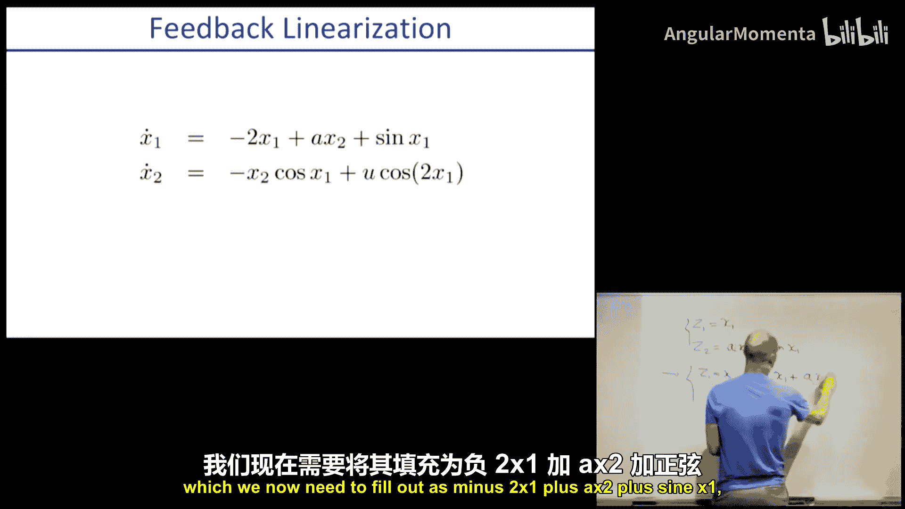
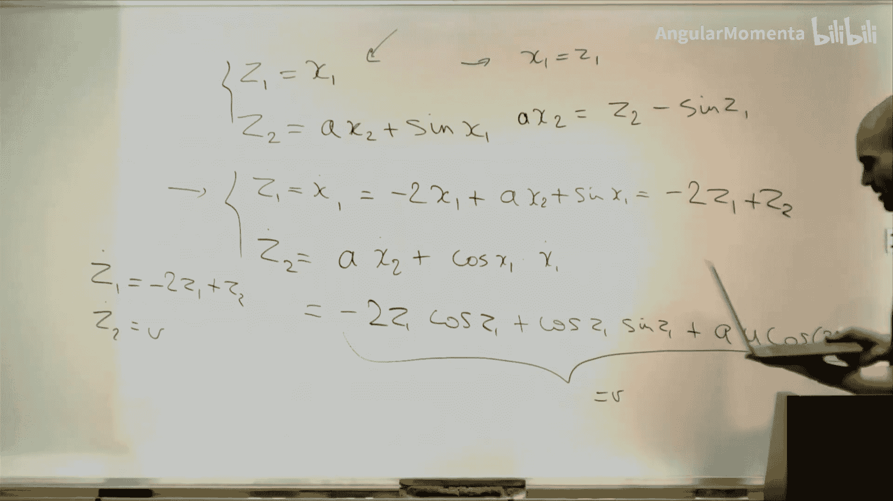
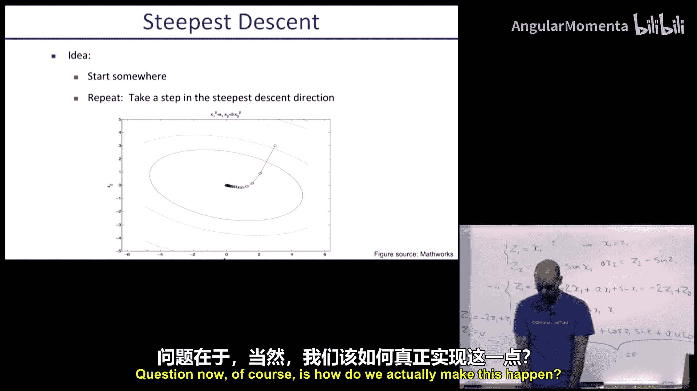
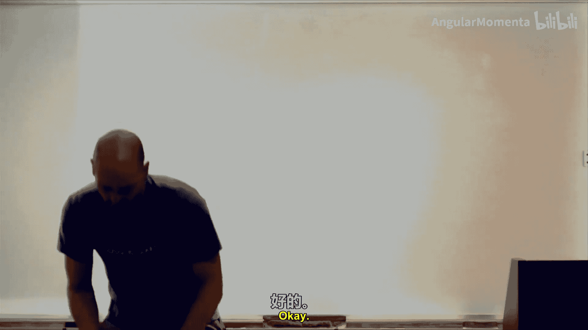
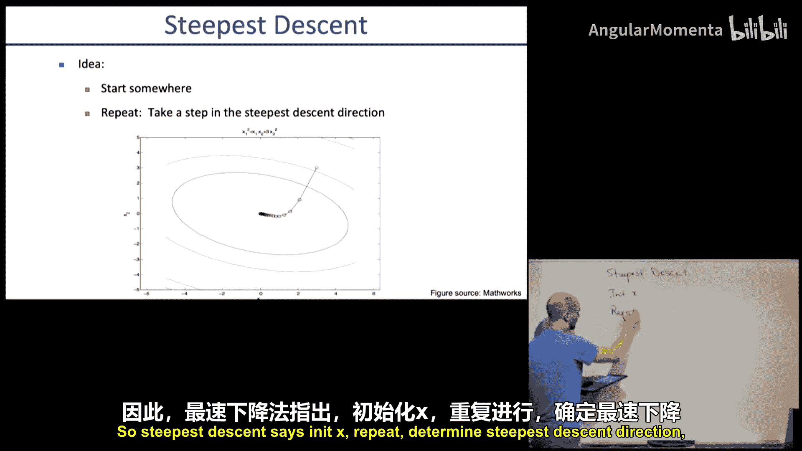
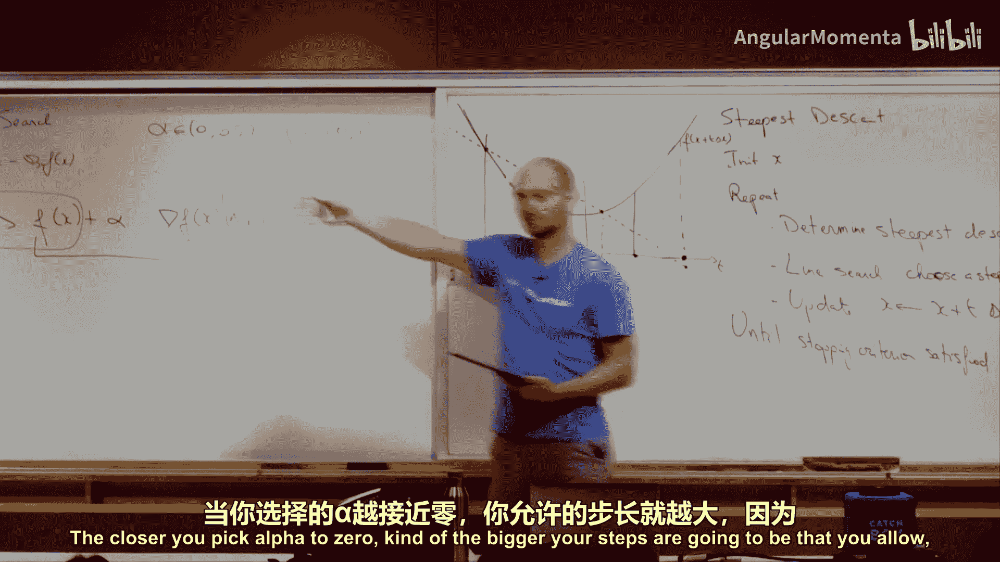
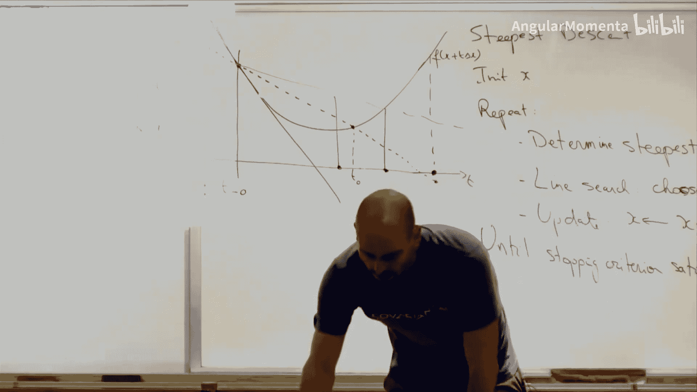
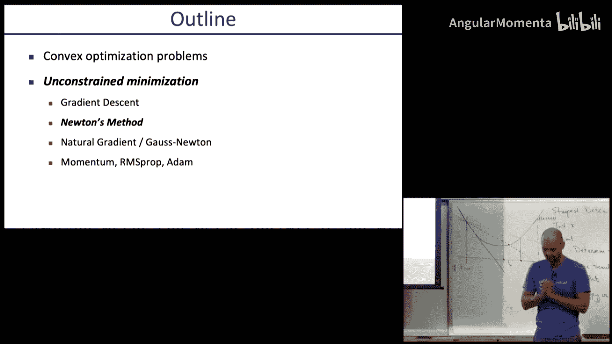

# 【加州大学伯克利分校】高级机器人学-｜-CS287-Advanced-Robotics-at-UC-Berkeley-Fall-2019-p06-6-无约束（凸）优化--BV1KXqCB4Eua_p6-

All right， let's get started for today。Welcome to the sixth lecture of CS287 Advanced Robotics。

One logistical thing， your homework one is due tomorrow， so keep that in mind。

 if you haven't started yet， start really soon。嗯。There's a late day budget and all that。

 but you might not want to use it on your first homework， any logistical questions？Okay。

 then let's get started with lecture6， there are actually a few things in。How can I swap forward。

A few things in lecture5 that we didn't cover yet that I want to cover first and actually a few pretty important things so let's do a quick recap of the high level of what we covered in lecture 5。

 we looked at the linear quadratic regulator which had some very specific assumptions namely a dynamical system。

Of a very specific form。Xt plus 1 equals AXt plus B Ut， so linear system。

 and a very specific cost function， a quadratic， a very specific quadratic that's ball shape with a clear minimum。

And we saw that。Wen。Sorry， I'm going to try a few different settings here for a moment， it would go。

We saw that you can actually find a solution to this problem。

 even though it's a continuous state based problem， infinitely many states。

 you can solve this by going to a set of iterations。😊，Shown here。

 and so essentially have a bunch of matrix updates。

And it gives you a feedback matrix and it costs a go function。

The quadratic cost to go function and the kind of surprising thing here was that the cost to go function stayed in the same format。

 you target the quadratic， it continues to be a quadratic for all horizons。

 and so you could represent it exactly without any issues。Now。

 there were a lot of assumptions here in terms of。What we assume linear system， could drive it cost。

 but then we saw that actually we can relax these assumptions quite a bit by using this as the building block to solve more complicated problems that are aine。

 havetoacasticity might be nonlinearar， we might want to pize for change of control inputs could be time varying。

 and then could be trajectory following and even full optimization for nonlinear systems。

And then we saw the very end one example， cartp。And I want to resist that example now。

 so CAt pole is a problem where you have two degrees of freedom。

 x coordinate and the angle of the pole theta， and then the state space is four dimensional because there's x and the velocity x dot and theta and angle of velocity theta dot。

This is the equations describing how the dynamics of cardt pole works。Clearly， this is nonlinear。

But what we can do if we want to balance CA pole is we can say， okay。

 let's find the linear approximation around the equilibrium point。

 which is the one with a pole up and x had0 and then run LQR on the linear proxy for the system。

 find a sequence of linear feedback controllers or for infinite horizon。

 find the infinite feedback controller and use that to control the system Now if we start perfectly upright。

 nothing's going to happen in a simulator， but if we start from a state away from the equilibrium state。

 we'll be able to check if our feedback controller indeed brings this back to the equilibrium state or might fail。

 I say why would it fail， it's supposed to control us to zero。

 but that's only true for the linear system but the nonlinearar system there's no such direct guarantee that is going to go back to the equilibrium state。

So we investigated that。😊，And what we sized that。For this。Setting here。

So we penalize for deviation from0 for x， x dot， theta and theta dot。

 but we don't penalize for controls， we have a reasonable subset of start states shown in green。

For which we get back onto the equilibrium state， the ones shown in red are combinations of start state specific x and theta combination for which running the linear controller does not succeed in bringing you back。

Now one question you could ask yourself is well， since we approximate it with a linear system and it's not that precise。

 is there any way if we play with the cost function that we might get a larger base of attraction or a shorter a smaller base of attraction ideally larger though because by playing with the cost function we affect a trajectory that's being followed to the oldzero state in the linear system that it thinks is going be acting in。

 and if that trajectory keeps it in a part of the space where linearity is a good assumption then that control will be applicable。

 but if that trajectory in the linear system space takes you in a part of the space where the linear approximation is bad。

 then the linear control might not work and so by tweaking the cost function。

 you can affect where in the space you spend time and how good your linear approximation is and actually we saw it at the very。

 very end， the last slide last lecture that here's a choice of cost function that doesn't seem that different you now also penalize for controls。

That's the only change right here， used to be zero。

 now it's one and the basin of attraction has become a lot smaller。And at first。

 this is probably counterintuitive because you say well small controls means I'm in the linear regime。

 like a small control will still be captured well by the linear approximation。

 so it might say it's a good idea to keep control small so I don't get the nonlinear effects。

Actually， what's happening here is that it doesn't care enough now about applying control in the linear system。

 a little bit of control was enough to ultimately drive it back。

And that was the minimum cost weight to bring it back to zero， whereas in the nonlinear system。

 if you're not willing to apply enough control， the pole will always start falling and you need even more and more and more control once it starts falling and you just can never bring it back up。

And so often it requires a bit of playing around with these cost function parameters to get it to work on a nonlinear system as well as possible。

Any questions about this？Okay then here's another idea。 imagine you have bounded controls。

So your control input has to be between negative one and plus one， let's say。

Well here's what you can do， you can change your dynamics。

 The original dynamics was xt plus1 equals f of xt comma U T。You do a change of variables。😡。

So you say UT is going to be 10 h。A VT and this is the 10H function shown over here。

 which brings anything from negativefininity to positive fifininity between negative 1 and plus 1。

And by inserting that 10 h there。Your V can be any value from negative infininity to positive infffinity again。

 but the dynamical system will only encounter the 10 inch of V。

 and so will'll only encounter things between negative 1 and plus 1。嗯。So then at control time。

 what will you do well， after you found your LQR based controller， it would generate V。😡。

Because I mean， LQR controls don't really pay attention to balance and control。

 So it would generate V， if you set it up this way。

 and then youd do a 10 in operation on V generating U and you'd feed U into your actual nonlinear system that is being controlled by your policy。

Now。Often it's still in addition helpful to penalize for V being too far away from0 y。

 essentially if your V ends up being somewhere here or somewhere here。Out there or out there。

 there's not much gradient signal to bring it back in。

And so your optimization problem will not be very well conditioned。So。

What you might want is you might some constant V， quadratic constant V that looks， maybe。

 I don't know， like this。Such that there's a natural force， everything else being equal。

 V will become smaller and be brought into the part of the 10Hch space where you do get gradient signal。

And then that means that you would very unlikely be spending time out here with V because it's not really useful to be out there because your effect on the dynamics is very minimal out there and。

It'd probably be at most， I mean， it all depends on details of the cost must be somewhere out here where you pay at least a smaller quadratic cost on V and you also start seeing that gradient and so you would get the gradient to bring it back to the other side if you need to whereas if you are all the way out here you don't have any penalty on V and you're out here。

 you see no gradient and you think you have no control over the system。

 And now the optimization problem will not find a good solution。Okay。

 so that's a way to deal with bounded controls， which is actually very often the case。Then。

Now I want to do a little bit of theory and we're going to do this relatively fast because it's more kind of theory to kind of support the things we already know work。

 but to kind of give it even more justification than that I want us to do a whole lot of theory here Here is an important result。

So you might ask yourself the question， if I design an LQR controller for a nonlinear system to stabilize around the equilibrium。

 are there any guarantees at all that I can get for this controller？

Maybe at least locally gets some guarantees， and it turns out， yes。

 there is a guarantee you can get locally。What is that it's put on this slide here let's say we have an autonomous system。

 so the controls are ignored here， so imagine the feedback controls already wrapped into your system。

 so U has been replaced by k times x already and now it's called an autonomous system。

X star is an asymptically stable equilibrium point for a system F。

 if there exists an epsilon bigger than0 set for all initial states x x minus x star smaller than epsilon。

 the consequences that would go to x star。 so saying if you start close enough to x star the equilibrium state。

 you will be brought to equilibrium state， if that's true， it's an asymptotically stable equilibrium。

 that's just the definition。And so the question you're going to ask essentially is along the lines of if the linear system tells us it's asymptotically stable after we design our controller。

 can we say the same thing about the nonlinear system that's actually under the hood？

And the answer is yes。If we have an asymptotically stable equilibrium point for the linearized system。

😡，Then it hasynosis table for the no nonlinear system。Conversely。

 if XtR is unstable for the linear system， itll be unstable for the nonlinear system。

There's something called marginally stable， which is where you don't go to the equilibrium。

 you don't run away from it， you just kind of stay circling around it in a fixed orbit。

 then nothing can be said because then the linear approximation doesn't tell you enough about what will happen in a nonlinear regime。

But this is a very strong result because this shows us that。Once we design our Car based controller。

 at least very locally is guaranteed to work and then hopefully it'll work wider than just super locally。

Here's another idea that comes back a lot in control theory called controllability。

 What is controllability， So let's look at some definitions。 A system is T times step controllable。

If from any start state x0， we can reach any target state。

 so any start x0 reach any target state x star at time T。

So that's intuitively something about how well you control the system。

 right if you go from any star set to any other state that somebody proposes to you。

 then clearly you have some control over that system。

 And T time step just means that you can do it in T time steps。Now。

 for that linear time imvariant system， we can write out what the state will be at time T。

It'll depend on the state x0 and then on the controls we applied。From then on words till time T。So。

We can now write out a condition for being T times step controllable。Our linear system。

 A comm B is t time step controllable， if and only if。This above linear system here。

Has a solution for all choices of x0 and X D。 So we're going to fix Xt， fix x0。

 because that's what we're asked to do。 go from x0 to X d and our freedom is in the use。

And the question is， can we find a sequence of u that takes us from x0 to xt， if that's the case。

 if there is a solution for that for every choice of x0 and xt， then it's t time steps controllable。

Now， remember your linear algebra class， a system of linear equations has a solution if it's full rank system of equations。

 So what does that mean here。The rank of the matrix， consisting of。

Some matrices stack next to each other。Is of rank n and is the dimensionality of the state space X。

 then there will be a solution or potentially multiple solutions。

 but at least one and that's all we need， and then the system is t times steps controllable。

Now there is a very interesting thing， we now know how to check if something is T time stepss controllable。

 by the way， if it's not T time steps controllable。

 then if somebody ask you to bring some of X to  X T time stepss。

 you will just not be able to succeed for some combinations。Now。

 this is another theorem from linear algebrareta says that for all matrices A。For all T and N。

 there exists some。嗯。Waiting says that a to the power T is a weighted sum。OfWell。

 this should be really for all T， yeah it's fine， but we really care about t bigger than n it's what we care about that any higher power of a can be represented as a weight of some of lower powers of a。

So that's interesting because what that means， if you look at this thing。Over here。

We're looking at the RA condition。Once we go above。N minus-1， a to the n -1。

 having a to the n times V， A to the n plus 1 times v and so forth。

 what would happen kind of here if we continued。is not able to increase the rank because whatever we put in there is just a weighted combination of what we already had in the matrix。

 and if you just put something in that's a weighted combination of existing columns。

 you cannot increase the rank of the matrix。 And so what this says is that。

If you want to know if your system is infinite time step controllable。

 you actually don't need to check this infinitely wide matrix to see if it's a rank N。

It's enough to just check the one up to A and minus1 B。

 that's enough to know whether anything beyond that will be ranked n or not if this is not rank in。

 nothing beyond it will be rank in。😡，And so in control theory。

 people often study these conditions quite in a lot of detail and then say， okay。

 well they'll make assumptions， they'll say， oh， we'll look at controllable systems and that's actually a very reasonable thing to do。

 we've been looking at LQR without making that very explicit。

 but imagine you have an LQR system that you're trying to solve and it's not controllable。Meaning。

 let's say you cannot drive it to zero。😡，Well， then the solution we've been talking about。

 this notion that you could drive it to zero and then have a steady state solution and so forth would not be true。

It's only when your system is controllable， which we have as。

If there exists a path to get you to zero， then this thing will converge。

 this is a way to check this。 we had that thing on early slides。

 If there exists a path to drive you to zero， we know this will converge。

 this is a way to check this， check the rank of this matrix， if it's n。

 you're good to go if it's not n， it might just not reach a steady state and you might never be able to drive your system to zero。

😡，All right， any questions about Leopov and controllability？

Then let's look at another kind of pretty surprising thing， feedback linearization。

 so so far what we've looked at is linear systems。Finding solutions for them and if the system is nonlinear。

 we locally approximate it by linear system。Feedback linearization is the idea that maybe you can find a global coordinate transformation that makes your original nonlinear system into a linear system。

 if you can do that， that might be pretty handy because now you can do a linear control and then do the inverse transformation when you apply your control on the real system。

So。Imagine a system of this type， egg dot。Is F of x plus。

G of x times U x dot means time derivative of x。And this doesn't need to be scale。

 this will typically be a vector X。Well。If。🤢，G of x is square。

 means that requires number of control inputs is equal to the number of states。If that's the case。

 and G of x is invertible， then actually you can turn this into a new system by just a simple coordinate transformation you introduce V as your controls。

 and now just have x dot equal V linear system。You solve your linear system。

Once you solve the linear system， you know what V to apply in a given state。

 and then you do the transformation to you to know what control to actually apply to your real system。

What's an example， robotic manipulators， so robotic manipulators that are fully actuated？

Tend to be governed by this equation over here。It turns out that you can essentially rewrite this as。

Q dot double dot equal v， Q double dot is the acceleration factor for each of the tritangles in the robot。

And then there's a nonlinear transformation you apply to go from V to torques。

 and then you can apply the actualile torques on your robot arm。

Not there are some tricky things here in that you might at first sight this looks really like almost perfect。

 you turn your nonlinear system into a linear system。

 but what you're kind of losing is that let's say you now apply LQR。

 your quadratic cost will be in this new space。And maybe in this new space。

 the gra cost is not what you want。 maybe in the original space would have made a lot of sense。

 penalizing for squared torques might have made a lot of sense might have made more sense than penalizing for in this case。

 essentially acceleration， maybe acceleration makes sense too， it depends。

 but after that coordinate transformation。Your variables will be something different than what you started from。

Now， you ask the question， can we also do this when the number of control inputs is not the same as the number of states。

 M that be possible？Let's do an example。We have an example system here where we have one control input。

One control input。U and two states， x1 and x2。Let's see what we can do。 Can we find a。

Corn of transformation such that this becomes a。Linear system。Well。

 here's something I'm going to propose。New coordinates z1 equals x1， so stays the same。Z2。Equals。

A x2。Plus， sign。Of x1。Okay， that means in our new system， z1 dot equals x1 dot。

Which we now need to fill out as。Minus 2 x1。Plus。AX2。Plus， sign。

X1， which is actually equal to。us2 z1 plus z2。 So this equation comes out pretty well。C2 dot。

It's equal2。We have minus x2， cosine x1。And then plus U。Cossine。2 x1。

Now we're going to need to use these equations to turn the appearances of x's into theses as much as possible。

So let's see what we can do， we can actually write this as。Minus。嗯。Is that the correct one？Let's see。

Minus 2 z1。Cosine Z1。Plus。Kssin。siwen。Sine Z1。Plus。Am I missing an A somewhere。

 looks like I'm missing。Oh， here it is。Pa。A U。Ksine。2 z1。So this is by。Essentialially writing。

X1 equals z1， and x2 equals。Well， ax2 equals z2 minus sine。C1。Okay， so。

Now if we do a change of variables。Where we call V。Equal to this entire thing here。

So we'll call this thing。Equal to V。We end up with a linear system。Z1 dot equals。us2 z1。Plus。

Z2 and Z2 dot。Equal v。So that's pretty cool， it was possible yeah， go ahead plug x prime？Oh。

You're right。 I did something off there。 I should have done。Yeah， I did something out there。

Should have been。I should have taken Z2 prime。From。Here。In the derivation， so my Z2 here。

My Z2 prime will have a Ax。A x2 prime。 So I'll have。Yeah。

 I should have done z2 prime equals a X2 prime plus cosine x1 and then start swapping in。 So yeah。

 Z2 prime equals a X2 prime plus。Kan。I think it's coshan。X1。Those' next one。Times x1 dot。

 something like that。And then from there， I get to the one below， thanks。

Now， when you look at this， it seems a bit magical， at least to me， that this happens to work out。😊。

And sometimes you can just do that。 sometimes you can look at your system and you can just turn it into a linear system by doing this kind of coordinate transformation。

 and here's the kind the full version of this written out。

But it's kind of surprising that this is possible， and you often are not going to know how to do it。

嗯。But sometimes it's possible and when it's possible it's a nice feature to have because now you can again rely on linear control to solve your problem and then do the inverse transformation when you run your system。

It turns out that actually should there's more to this。

 you can actually do some math and I don't want to get in too much detail here。

 but if you look in the Sian leadbook you can find a lot on that that shows that essentially it shows conditions under which there exists such a transformation。

So you can look at your system and write out some conditions。

Which involve your F andG function so here is some definition of what it means to be input input state linearizable meaning that if you're also allowed to do a transformation on your input variables in addition to your state variables。

 can it be linearizable and then there's some condition about some kind of field vector field being involuttive and linearly independent which is actually not that hard to check if you carefully work through the definitions。

 you can actually check those things it's reasonable to do。

It's a little harder to actually find the solution that is the transformation。

 So to find a transformation is the actual solution to this。

 you need to solve a partial differential equation over the space。

 And now I mean the whole reason we're trying to do you know a change of variables is to make the control problem more tractable if you can solve a PD over the space。

 then you can actually just solve the Belllman equation over the same kind of grid that you use for the PDE And so there's little reason to do that but sometimes that PD might have a nice clean analytical solution。

 and if that's the case， well， then you're in luck and you can use a nice clean analytical solution to the PDdeE to do a change of variables and have a linear system that you then't get the control instead of a nonlinear system haven't seen people use too much in practice。

 but it seems like something to be good to be aware of because at least when you have a new problem and you have a nonlinear system。

 you can do a quick sanity check like already vector fields of the right properties if they are then there exist transformation and then you can decide to try to solve that PD and find a transformation or you can decide that。

You can't do it， but at least you can consider it。So the slides here give a bunch more detail on the conditions to check。

 not too important to step through all the details here。

 but keep in mind that this actually exists there exist specific conditions。

 rank conditions on some vector fields of your FNG that show whether or not something is。

Lnerizable by a variable transformation。Okay， so here is a lot more to read on that。

One thing you might wonder is。Well， I mean， it's so great to maybe there's a solution to PDE that can find this variable transformation and maybe you can find it。

 maybe not， but actually maybe you can just learn it So one thing you could consider as youre working on these problems is that well you could go from your original state space to a latent space and you might just force the latent space to be a linear dynamical system and if the latent space is linear dynamical and still models the original space pretty well that way by going too latent and then back then that means you kind of implicitly you found the transformation without explicitly solving the PD you found it by let's say training your system to be good at predicting the future and directly that way found transformation that makes your control problems simpler。

 And so here are a couple of papers that do this。 So the first one essentially。😊，Puts the。

Puts theline system in this case， pixel space， so it's images where the dynamics is very much nonlinearar。

 but it might be a cardpo in pixel space or a linear system in pixel space。

 but in pixel space it's not linear anymore， even if the underlying dynamical system is linear and then you can through a neural network transform that into a latent space where you force the dynamics to be linear and you force the ability to predict the next state and then you get a system that's easier to design controllers for these spatial autoens the something similar。

 also for visual problems and then solar it also looks at non necessarily visionbased problems and solar looks at the notion where it might be linear time varying rather than the same linear system at all time slices。

And so that's， I would say some kind of angle where learning and control have come together pretty nicely where you essentially you learn onto something where we know that control can provide an efficient solution。

And so you get the best of control， even though originally it wasn't applicable。

 but your learning is able to put it into the right mold。

That was the last part for what we wanted to do for LQR。Thes there off， any questions？

So we wrapped that up。Okay， then let's switch to unconstrained optimization。By the way。

 your homework too will come out on hopefully Thursday， maybe a couple days later， and we'll be on。

What we covered in the last two lectures， so LQR， itteerative LQR and extensions related to LQR。

So let's reset sets for a moment。We try to solve optimal control problems in n dimensional state spaces。

 and those problems are such that n tends to be higher than we can handle with discretization in many practical scenarios。

So。What are we going to do， Well， we need to do something else。

 What we saw so far is maybe if it's a linear quadratic system。

 we can actually solve it exactly still or something close to it or appximable by it。

 we can still do it。We can also kind of go back to the original question。

 like we're really trying to solve an optimization problem。

 find a sequence of states and controls that minimizes cost subject to。

Dynaal system constraint and maybe your controls instead state have to be within some bounds。

All right。So。Timwood is pretty hard to do。Because solving a general optimization problem is a hard thing to do。

One thing we'll see something called Comvex problems。Where this is actually very feasible to do。

 and again we'll be able to use it as a building block to solve harder problems。

So that's main topic of the next stretch of this lecture。

And then later we willll relax the assumptions to solve general problems。

One quick note is that you can literally apply al QR is one way to solve this problem that I showed there。

 But think that's a little tricky to deal with is this thing over here。

 the bounds on the state variables。 If you have bounds on state variables。

 you can have quadratic cost， things like that， but it's just a little tricky to deal with once we solve。

General optimization， we'll see another way to actually incorporate some of those ideas into LQR and we'll be able to do it with something called Bar methods that we can make part of LQR to keep state within certain bounds。

 but that'll take us a little while before we get to it。 And what we've seen so far。

 this part is pretty hard to deal with。And。What I show here， u is the asll controls。But in principle。

 you could be a parameter vector of a control policy。Maybe a linear feedback control policy。

 maybe a neural net feedback control policy， and you still have an optimization problem that looks like this。

 it'll just look slightly differently where now you'd effectively have instead of you。

You can do a two ways you could either of say UT equals my policy pi theta of xt。

 or you could explicitly get rid of U and put just pi theta of xt inside there getting rid of U either way。

You can formte this。So。This is the problem we're going to be concerned with。 Once we solve it。

 we have a sequence of controls in states。 We can apply the sequence of controls。

 and hopefully that works in practice， if there is noise， if there is unmoded dynamics， if there is。

Yeah，Most of the noise and uned dynamics that will happen is you will deviate from your trajectory and your sequence of controls might not be appropriate anymore。

 so you'd have to reoptimize to find a new sequence of controls from that new starting point and repeat。

 that's receding horizon planning if you do it over a certain horizon that you're able to look forward。

 and then again actually once we start doing that we might again want what we covered in LQR。

 which is we might want a quadratic cost to go function at the end or some cost to go function at the end to be able to cap it off such that we're。

Only looking 10 steps ahead computationally， which maybe is all we can do。

 but then we have a cost to go function after that that effectively allows us to look until the end of time。

All right， recall that we actually have seen a method for solving problems like this。

 a black box method， cross entrytropy method and you're actually implementing this in your homework1。

So this is a very simple method， it's maybe not the most efficient in general in terms of running time。

 but it is typically the most efficient in terms of the amount of time you spend coding。

 and so usually you want to implement this first because it'll take you almost no time and it'll give you at least a baseline of what you can expect from an optimization if you don't do better than this。

 probably your optimization is not set up very well。So quick reminder what's cross entropy。

 you optimize some function f of x， so we try to find some x， but actually instead of finding an x。

 we're going to try to find a mean of a Gaussian distribution that is centered in a good spot in the landscape of f of x。

We'll start with some initial mean， a guess of the mean could be0， could be whatever。

 We don't really know if we don't know anything about F of x， we don't know what it should be。

 We pick just something。Then we iterate outer loop within each iteration， we sample。

X from our current Gaussian with current mean and sum variance， let's say。We compute。F of that x。

And we'll compute a bunch of these pairs， and then once we've gotten a bunch of those pairs。

 we look at the average of the x's that were in the top 10%。

And that's we're going to reposition the mean of our Gaussian， and we repeat。

Very simple process all you need to be able to do is just sample from a Gaussian。

 evaluate your function a few times， rank them。Find a top 10% average div location of those and repeat and actually work surprisingly well。

 So highly recommended to always try whenever you're doing any kind of optimization。Now。

 what this does not do is that。It turns out with modern packages。

For the cost of an evaluation of a function of F， if you're willing to pay twice that cost。

 you can get derivatives of that function。And derivatives point is in the direction that the function will be lower and where we need to go。

 And so instead of kind of just。Dropping dots into the space and hoping some of the land good and then going closer there。

 if we actually also take advantage of derivatives， often we can do better。

 but now also keep in mind， some functions don't have derivatives everywhere。

 And so your functions is not continuously differentiable。

 then a derivative based method might have some issues whereas cross entrypy method will just not care about that is totally fine with functions that are zero everywhere and then one in some region and a negative ones somewhere else it's all fine。

 and very key thing though is very easy to implement。 And so you usually want to do this first。

Alright， now let's take a look at problems we can solve efficiently with existing tools the ones that can be solved efficiently are called convex optimization problems and at the core of it there are convex functions let's say convex function Comvex function is one and the function here is shown in black so f of x shown in black it's a function where if you take any two points so x1 and x2 see what's a function value you draw the line between those two points that line lies above the function。

If that's the case， we have a convex function。The way it's shown here is for a 1D function。

 but actually this is the same for any dimensionality you have， let's say you have a 2D function。

 you can still take two points， see what the function value is。

Connect the line between those function values and then see if that's above the function or not and actually you'll be checking along the line and you'll be seeing something that just look like a planar slice of that function。

 same for higher dimensions you take any pair of points。

 you look at the line along those points and see if it's above the function or not。

So visually in 2D it might look something like this。

 What's also interesting about it is that if you have a Comvex function。

 the contours are all come shapes。 So Comvex shape Comvex functions where the line is above the function。

 If you interpo between two points， a Comx shape is one where if you have two points that are part of the shape。

Then if you connect those two points， the line between them is also inside that shape。

And so you see here the contours are all convex and it is guaranteed to be true for a convex function F of x。

What that also means is that。If you look at the set of points。

 f of x smaller than some fixed number A。For example， zero or some other number A。

 that set of points will also be convex。And so Comvex optimization problem is one where we minimize a convex function F0。

 subject to some other convex functions F of x smaller than0。And you can have a linear constraint。

Let's think about this for a moment here。 We have a set of convex functions， and for all of them。

 we require Fi of x smaller than0。 So each one of those generates a convex region that you need to be in。

And we're effectively intersecting those convex regions and saying that's where you need to be。

 But again， the intersection of convex regions is a convex region so overall end up with a convex region that we're optimizing over。

And this thing here is just kind of limiting it to doesn't have to be one constraint could be multiple constraints。

 so essentially limiting us to some linear subspace where we are only allowed to find solutions。

 everything outside of that hyperplane or outside of a line or whatever it is depending on how many equations there are there is not allowed。

 what's on it is okay。 that's also convex because when you have a plane。

 connect any two points on the plane， you're still inside that plane。Okay。

 so the interesting problem is that problems of this type are solvable very efficiently。

 so if ever you run into a problem that is of this type， you know you can find an efficient solution。

 in fact to our existing packages out there that you can just call upon that will solve these problems for you。

Now what we're going to do is we're going to split how we look at these problems into two parts。

 there is this part， and then there's this other part。

 there's the optimization objective and there is a constraints Today we're going to look at unconstrained problems so we're going to for now ignore constraints that'll be for Thursday。

We're going to look at problems that only have an objective。

 and on Thursday we'll see that the building blocks we get from looking at problems that only have an objective are quite reusable with a little bit of extra machinery to also deal with ones that have constraints。

So then it's called unconstrained minimization。First I'm going to look at。Is。Well， let's first。

Simpre our tells what we're actually doing。 This is all we're doing。 minimize over x F of x。

 And actually， the way we're going to look at is we're not going to necessarily require F of x to be convex。

 We can think of it as comevex。 We know that then there is efficient solutions。 If noncomvex。

 the things we see will actually be。Finding local solutions。

 but not necessarily globally optimal solutions， but they'll still work。Well， what can you do。

 The natural thing to say is， well， I have an optimization problem。 I want to find an optimum。

 set the gradient equal to 0。 set all of is equal to 0 means that no matter which coordinate you change。

 the function is not changing。 So I'm at some kind of local。Maximum or minimum。

 I don't know maximum or minimum from just the first derivatives。

 I need to look at second derivatives to see if indeed I have a minimum。

 if that's the case then I'm good， and this here is the second derivative， the hessian matrix。

 if that's positive definite meaning locally the quadratic is ball shaped then we have an actual minimum。

Okay。In simple cases， you can actually solve this directly。 And that's very convenient。

 You can just say， okay， I have a system of equations under two。

 It'll be as many equations as unknowns by design。 That's just how it is due with respect to every coordinate equal to 0。

 So there's an equation induced by every coordinate。So as many unknowns as equations。

 see if you can find a solution， but often that equation will be nonlinear in some way that is very hard to find a solution。

 and so you won't be able to do it。Then if you do find a solution， you check if the derivatives are。

 the second derivatives are all positive， which means you're in a minimum， and then you're done。Now。

 in practice。We're going to have to resort to other things most of the time。

We're going to have the resort to is a more iterative procedure where when we have some function f of x。

 let's say x1 squared plus x1 x2 plus U plus3 x2 squared then。We're going to have cometours。

 and we're going to try to find our way to the bottom。 It's like， essentially just。

You have a landscape and it's a ball rolling down the hill or a person skiing to the bottom of the mountain。

 finding the little bottom spot there。Question now， of course。

 is how do we actually make this happen？

And this will be the core of what we're going to be doing for the。Current。

 next and next next lecture， so let's make sure。To kind of gradually spell it out。Yeah。

Okay。

So the core of it is going to be steepest descent。 What is steepest descent， It's very simple。

Few line algorithm。 So steep as thecent says in it X。Repeat。

Determine。Sepest descent direction。Which we'll call Delta x。Then。

It might be that if we just walk in that direction， like a slide here。

 if you just walk in that direction too far， you're actually going uphill again， so don't want that。

 so then you do a line search。Which means choosing。A step size。

T bigger than zero because you want to go in the direction of steepest descent。And then we update。

X becomes equal to x plus t times deelta x。And we do this until。Some stopping criterion。

Its satisfied。Okay。So。Then。A natural question is going to be。

Which direction is going to descend the steepest， how do we find that？

And then we'll also need to figure out how we do the line search is two big components here。

 actually let's take a couple minutes break here and after the break。

 let's look at those two components and how we can resolve those。Yeah。です。じ。系我做。你不。3 you。Yeah。

 now I call it榜。非常手。十さ票。哪过。何やそう。All right， let's restart any questions about what we have here。Okay。

 then。Let's see how we can find the steepest as direction。Well， it's a local thing。

 we're at the current point。And so， let's say。F。off。X0， our current point， plus some change。Delta x。

Hes going to be approximately equal to。First order， Tayloror expansion。F。Of X0 plus。Graadient。

Expect to X。At X0。Transpose。To change Delta x。Now the question is。

 what's the steepest direction of descent？Then what we want to do is。

Steepest means that let's say we only get to move1 meter and we can choose the direction in which we're moving in our landscape。

When are we going to be the lowest， which direction gets us to？Most vertical descent。

 if we only get to move 1 meter so in a small radius， so making this more explicit。Let's say。

We're looking for。The minimum。Over Delta x， such then。Our。Norm of Delta x。Let's say。

 it's smaller than。Some epsilon， so it can only stay close。Of。

F of x0 plus delta xfx0 transpose times delta x。Now， this thing here has no delta x in it。

 so the minimization is not affected by this term so we can just get rid of it。

So really trying to find the delta x that minimizes this thing while your delta x has to be small。

Well， this is just a vector， that's just a vector。We know that if we try to find for any two vectors A and B。

 minimum。Over B， such that norm of B。Smaller than Epsilon。Of a transpose B。

 then we need to take B equals。In the direction of a， but actually the negative direction of a。

 So when need take b equal minus a over the norm of a。

Times epsilon this is saying I'm going to take a vector in the exact opposite direction of a because I want to minimize this quantity。

And miniimmizing means that I want to have a negative sign here in that resulting thing。

 and so I have an A。Pointing here， I get to choose B。Anywhere on this small circle。

 I want a P B in the opposite direction of a all the way till the end of the circle that I'm allowed to move in。

So B is going to be here， and this is the equation for that B， same thing here， this is going to be。

 then our deelta x is going to be negative。Graadient。Of F。At x0。Then we need to normalize it。😡。

And times epsilon to be staying within this circle， the a here is really the gradient of f at x0。

And our deelta x will be this thing over here。So that's the steepest decent direction。Now。We know。

We're just we are looking for a direction，I mean， the epsilon doesn't really matter。

 We're just looking for a direction and the renormalization doesn't really matter either。

 These are just rescaling。What we really care about is that it's this direction we should go in and how far we're going to go is any going to be determined？

By the step size T。 So if what we care about is steepest direction of descent。

 we can make it as simple as deelta x equals negative gradient respect to X F。At x0。So we now know。

This thing over here。Steep in direction， delta x， negative gradient， spec2。X， F of x。

 so that's resolved。Now， we need to find the grain。 that's just a bunch of derivatives。

 Either we can use an automatic differentiation package or can do finite differences。 We just to。

Plus epsilon minus epsilon for each coordinate， take the difference， divide by two epsilon。

 we know the gradient。Okay。Now， the next thing we have to do is find T。

 something called exact line search。Says min。Over t bigger than zero。2。Well。

 the slide is s so it's called Sium mean over s bigger than0。Of F。Of。X plus S。

So let's just call it T。Ti。Delta x。So we just need to find the best tea。

 It's like we walk downhill and whenever things start going back up again， we went too far。

 we got to stop。 That's what that is doing。But how are you going to find this？

Exact line search is hard to do because you might not have an analytical form of the function along the line you're walking。

 And if you do， then that's great。 You can just take it and you're done。 But typically。

 you won't have an analytical form along that direction， and then you have to。

In principle we' try infinitely often until you find a T that achieves the lowest。

 You might be able to do some kind of bisection search。

 find like the one like narrow it down to a small interval in practice。

People do something a little different most of the time because this is not possible to do exactly。

 do something called backtracking line search。So let's take a look at that。

So backtracking line search。I'll first write out the algorithm and then I'll make a drawing that will give us more intuition about why what we're writing up here is meaningful。

So。We set t equal to1。And they would sayW。F。Of x。Plus t times deelta x。

 remember our delta x is negative gradient。Of F of x。While f of x plus t delta x bigger。Then F of x。

Plus。Alpha。Which is a hyperparameter T。Graadient。F of x。Transpose Delta X。Well， this is true。

T becomes beta times T。And here alpha is in 00。5， and beta is in。Zero comma 1。

So let's take a look at what at a high level is happening。

 What's happening is that we try some step size。And if the condition is met。

In this case means we're unhappy because we're going to keep going in this loop。

 if the condition is met， we're unhappy when a shrink tea make a smaller step and repeat。

W might this make sense， We're doing a steepest asscent thing。

 We know that at least locally we should be descending。RightAnd so if I take a very small step。

We should have a descent， and it's good。So this is going to be this kind of loop where we're always making our step size smaller。

 smaller， smaller， smaller till finally we're happy with it。

 and we start ideally somewhat large such that if we're lucky and we can take a big step and this condition is not met。

 That means we exit the loop， then we're done。😊，Okay。

 so now this condition here governs whether we're happy or unhappy with our current step size。

 so let's take a look at a drawing to understand what this is really looking at。Let me try it。

Over here。对。We have。Our T axis。Our t0 that we started with， let's say， or our current guess。

 we our t equals 0。We cannot go below zero because then we're stepping in the opposite direction。

 we're going to go up instead of down。 So we know we've got to be somewhere there。

We also don't want to make it tiny from the beginning because then we don't make much progress。

 so we're always going to start with something relatively large and then backtrack to make it smaller until we indeed are descending。

Now， the simplest thing you might have thought， like as a first thing you might have come up with instead of the condition here。

 you might have said。Instead of this thing here， you might have said， while。😡，You might just said。

 oh， what if I just do this？And ignore the later part。 right， That would be failing， too you say。

 while， when I make my step， I'm higher than before， it's bad。

 I should shrink my step size and repeat。 That's very logical。

 But then there's additional thing here that's saying， actually， it's a stronger condition。

It's saying。I need to also。This is in sometimes some margin。 It's kind of saying。

 I don't want to just be better than I was before。 I should be better by some kind of margin in some way。

 And that's what we're going to look at what this extra term is doing。

 but this should be very intuitive。 that if you are bigger than where you were before and trying to descend clearly steps I should shrink。

 There's just a little extra thing coming in here that we want to pay attention to。

So here's your function。No。Let's take a look at。The this thing here。What is this？As a function of T。

Let's ignore alpha for a moment。 Let's say alpha equals to one。 Then what this is essentially。

 it's saying。I'm looking at my linear approximation of my function f of x。

That's all this saying how far since she' saying。I could put。The T here。

Like deelta x times t is how far I'm stepping， and this is the gradient。

 and so I'm just looking at the linear approximation with a rescaleed version of it。

So the linear approximation might go。Like this？And in that rescaleed version。

 alpha is between 0 and 0。5。 So what that means it's essentially pulling things。

 pulling the slope of this thing closer to 0， it's changing the slope， bringing it closer to zero。

 So with alpha that's not one itll look something。Like this。

And now what we're saying with this condition over here is we're saying that we want it to be the case。

 we're comparing F， so we picks some， let's pick some value and see if we exit or not。

 I'm going to pick something far out first because so we might have a higher chance of having to backtrack。

So let's say we pick this one over here， that's how our T。We're going to look at。

F of x plus T times delta x。 That's the point over there。

 And we're going to compare that with the kind of less。Less steep approximation， this one here。

And see which one is higher between the two clearly the function F of x is higher over there。

So this condition is satisfied and we're unhappy， so we're saying。

F of x is higher than what this thing said。It should be， so we're unhappy。So I'm going to backtrack。

 scale T down by some factor beta， maybe now I don't know。Maybe now we end up over here。

 we're going to do a new comparison， and again， F of x is above this linear thing that we're comparing with。

 and so weve got to further shrink。And the crossover point is going to happen here。

 which on the slide is called t0， but since we rescale by bat is no reason we'd land exactly on that t0。

 maybe on the next one we land over here and now we compare and we say okay we're happy condition satisfied so I mechanically step you through it what's happening now let's interpret this。

What this is saying essentially is that we have a linear approximation。

That predicts some improvement。But because the function is bowlshped。

 the linear approximation will always be optimistic。

 so expecting to improve as much as the linear approximation is too much to hope for。

But maybe we can scale down a little bit。 The alpha is scaling down a little bit what we can expect based on linear approximation。

 And now it should be achievable。 And so that's what the alpha is going to say， okay。

 linear F is never going to go down as much as the linear approximation because it's a ball shape function。

 but if we。Scale it down a little bit。 then actually should be dipping below it。

 and we should be able to take a step size that gets us in the region where we're actually below that less optimistic version of how steep we can go downhill。

 And so that's what it's doing。Another way to think of is dad。If your function f of x。

Falls above this。Dash line， it means your linear approximation was a bad approximation。

Because that dashed line gives you some prediction of how much descent you can expect。

 and if you don't get that， it means you had a bad approximation。

 can't trust the linear approximation， you' probably going in the wrong direction。

 you' should probably be going in a different direction at that point， step size is too big。

Whereas if the function is below the dashed line， it means you're probably still in the regime where your linear approximation is pretty good and you're happy to take the step and then repeat。

This called backtracking line search sometimes has other names like our Miho stepping rule。

 It turns out to aside from being fairly intuitive。

 it also has nice guarantees so when people try to come up with guarantees can now solve in let's say finite time Get within some epsilon of the optimal solution of my problem well you can't do exact line search this exact line search will always take infinitely long for one line search so you need to rely on something approximate and this is the kind of approximate line search where you can do guarantee that in a finite number of steps you'll find something and then you'll have a certain level of improvement and repeat and that allow it to prove。

Convergence guarantees of algorithms that use this in finite time as opposed to an innerlo that takes infinite time to do exact line search。

Any questions about this？Yes。😊，Alpha between 0 and 0。5 wasn't it like 0。8。It's a good question。😊。

I don't remember first sure， I suspect there are some guarantees that depend on it if you build on top of this。

 but I'm not 100% sure。Beta has usually show chosen pretty close to one， like 0。8 or 0。

9 in practice such that you， whenever possible， take relatively large steps， but yeah。

 y alpha cannot be。It might be just heuristic， or it might be for guarantees the closer you pick alpha to zero。

 kind of the bigger your steps are going to be that you allow because closer alpha to zero。

 the shallower the dashed line will be and so the further out you get to go but also kind of the riskier because the less you can trust your approximation。

 be worth looking up at some point。

Sure there's a couple of questions， let's see， Ericus is on。Great。Why don't you go first？

So you have a really complicated loss surface。It seems like it'd be possible to jump from one。

 let's say， convex region to another convex region in practice， have you seen that to be an issue？

Yeah， that can happen and then I mean it's not even clear why you want it to be in the one versus the other in the first place。

 so it's not clear whether you care or not。Most of the items are more focused on the notion of。

Locally guaranteed to find an optimum， and then if that local optimum is not the one you want。

 then maybe you reinitialize and find another one。So yeah， it can happen。

 but I don't think people are particularly concerned about it。 In fact。

 sometimes they might even encourage it by having multiple initializations and finding multiple spots or adding noise。

 Something people will do is sometimes add noise to the grain a little bit just in case there's like a really tiny optimum that you don't care about It's like this tiny little thing but there's actually just this tiny little dip。

 It's like you're going over a mogul and skiing down and there's like a little dip there and you don'tan to be stuck at the bottom of the mogul。

 you want to keep going essentially if you add a little bit of noise。

 you wouldn't be stuck in that little dip。 So people play a little tricks like that。

There's another question in the back， I think。Oh， okay。In addition to T equal1 is arbitrary here。

 is just to pick something and honestly it's very arbitrary because if you think about it。

Think it look at gradients。If you rescale your function。If you rescale your function f of x。

 like maybe you have a new function， a geofa， which is 100 times f of x。Okay。

 but you don't know ahead of time which function you're working with， of course。

 let's say you have one algorithm， you're going to run both on F and on G。

And you run it on F and on G， at first you might say， well， I want the same behavior。

 I want it to do the same thing。But then how's that going to happen if you look at the gradient。

 it will the gradient。Of G at x will be 100 times the gradient of F at x。 So you're starting。

Attempt with t equal 1 will be 100 times bigger， even though the landscape of the function is the same。

 it's just like everything's been scaled up， but if you look at the contour lines。

 nothing has really changed by rescaling。 And so yeah。

 these first photo algorithms have arbitrary scaling in them。 and so you just kind of。

Need to be somehow lucky with where you start and maybe you have a hyperparameter where you decide where you start。

 or you might do something where after you've done this shrinkage。

And you ended up with a step size you like， you took a step then for the next one。

You might start with not exactly that one because that would be very conservative。

 but maybe you start with。That one scaled up by a little bit。

 like maybe scaled up by one over beta or scaled up by one over beta squared to go a little bit back up just to see if it might work there and that way you'd need to do less of those inner loop evaluations。

 a lot of it also depend on how expensive or cheap it is to do this line search。

 Sometimes that's super cheap。 and then you know you care less and you can just do it otherwise you want to really optimize for getting that first one already pretty precise and then you might want to keep some memory around about what you did in the previous iteration。

 But for the very first iteration， when you start it all off， it's yeah。

It's not clear what you're going to do just because of this reason here。

 like somebody can just rescale your problem and when you thought t equal 1 is perfect， well。

 if they rescale by 100， you actually now need t equal 1 over 100 to have the same thing。Yes。

 why not just try different。They step sizes。是不是。Well， the question is why not try fixed step sizes。

 This is something you can get nice guarantees for that， you know， in finite time you're going。

Iprove on your optimization problem on what you score in your function in a consistent way。

 if you just try a bunch of different step sizes， see what happens。Yeah。

 I mean in principle you could have a bunch of step size， I mean you could parallelze this。

 you could try t， beta times t， beta squared t， all of them in parallel if you care about wall clock time rather than compute cycles and then you could you know try a bunch of them at the same time。

 see which one kind of lands in the best spot and go from there that's definitely a possibility yeah。

So oh。

So we found the steepest decent direction is the direction of the negative gradient。

Exact line search， maybe sometimes feasible， usually not。

 so we looked instead of backtracking line search， something that has nice guarantees and is relatively simple to implement。

There's the picture motivating it that we also draw on the board and then this is the full algorithm gradient descent with backtracking or exact line search depending on what you want to do the stopping criterion we didn't talk about stopping criterion is when the grain is smaller than some eda。

 it's typical to do， again it's a funny thing because if I scale my function by a factor 100。

 then my stopping criterion will be 100 times harder to satisfy。

 but it's not clear what else to use in this kind of first order setting。

Here's an example of this in action on the left we have backtracking line search on the right exact line search on the same set of contours。

 same function f of x1 and x2 and we see that it kind of goes downhill and in the backtracking line search while it's an aggressive step but it satisfies that criterion it goes a little further than the exact line search but ultimately gets there pretty efficiently this is a low dimensional problem you could say well how much do I lose by using this backtracking line search compared to exact in a high dimensional problem so x is0 dimensional here。

 which means AIs are all0 dimensional vectors and yeah this is the problem and if you look at the horizontal axis number of iterations vertical axis is how far from the optimum measured in log scale。

And what we see here is something called linear convergence。

 if the vertical axis is measured in log scale， horizontal axis is just normally measured linearly。

 if you see a line that's called linear convergence。

And that's what we have happening and actually backtracking line search。

 exact line search is fairly comparable， not a very big difference here。Now。Here's another example。

 quadratic， a parameterized quadratic where we have x1 squared plus gamma times x2 squared。

 so it looks something like this， gamma bigger than zero。And then if you do exact line search。

 what you can do is you can actually find， for this case， you can find the exact solution。

 you can actually write out the sequence of X you will find。

And this is a sequence of x1 and x2s that you'll find running exact line search on this objective。

Now， if you look at this。You'll see that， I mean， it needs to go to0。If your gammas。

 if gamma is very large， so gamas bigger than zero if gamma is very large。

 then this ratio will be roughly1， this ratio will be roughly。Negative one。

And so we'll get is that you have one to some power， negative one to some power。

 It just kind of doesn't really go anywhere anytime soon。 It's very slow convergence。

 whereas if gamma is close to。Close to one， what happens is if it's actually one， then it's easy。

 gamma -1 is 0， gamma -1 is 0， it lands on to 0 right away if you look at it more closer for different values。

 the closer it to0 the closer to one， the faster this will converge the further away from one。

 the slower this will converge pictorially equal to one means the contours will be concentric circles。

When you're moving away from one， then it'll become ellipses that are very horizontal or very vertical。

 depending on where you go towards plus infinity or towards zero。

And when you get thoselongated contours， things converge a lot more slowly。

 why because the gradient will kind of go。It'll kind of hop back and forth this way。

 and the more elongated， the more will just hop up and down rather than going down to the middle。

So that's a bit of a challenge that happens with grand descent。So something called condition number。

 which is the ratio of the highest second derivative to the lowest second derivative。

And absolute value。 But in this case， if we're convex， they're all positive。

 So condition number says， how poorly are you conditioned。

 And the reason we just need to look at the highest and the lowest is because。

If we just look along those two dimensions， that's where the worst case behavior will happen。

Everything else will behave better because it's better conditioned relative to each other。

 but those two are going to be the worst， and they're going to control how slow it is that gradient descent will converge for you。

Since only the two extremes matter in high dimensional spaces is almost guaranteed unless you're very careful about designing your problem。

 almost guaranteed that they'll be far apart。That that ratio will be a high number。

 and so they you'll have a poorly conditioned problem and slow convergence of gradient descent。

It's kind of too bad， but that's just the way it is。So。

What we're going to look at next time is some fixes to that。 So on Thursday。

 we'll cover a bunch of fixes that。We'll recondition our problem to be better behave See in two days。

