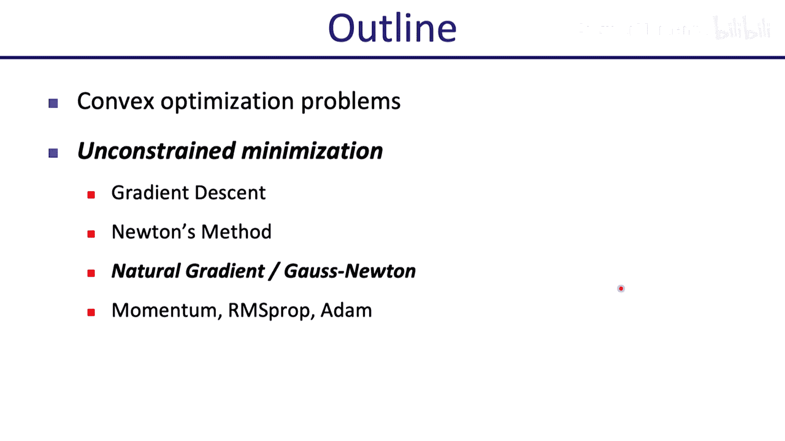
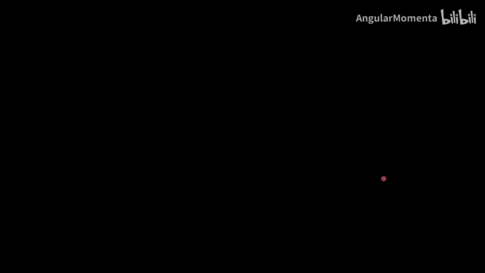
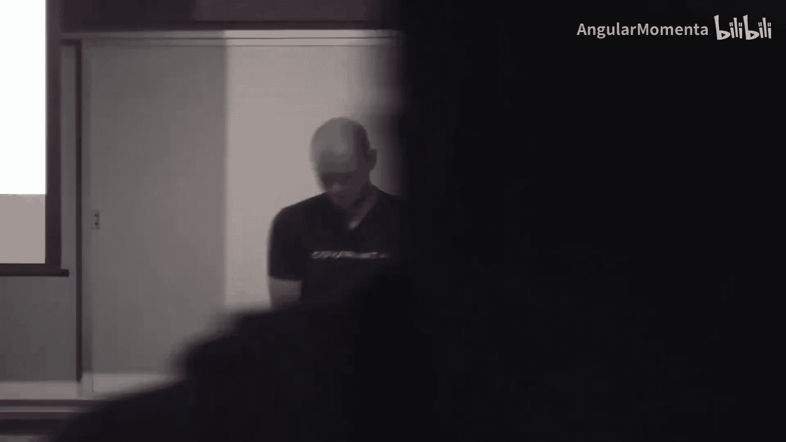
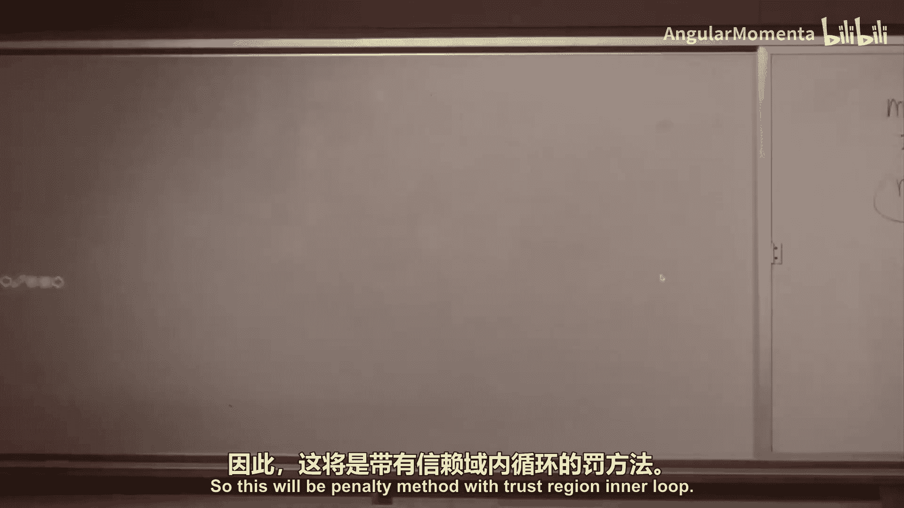
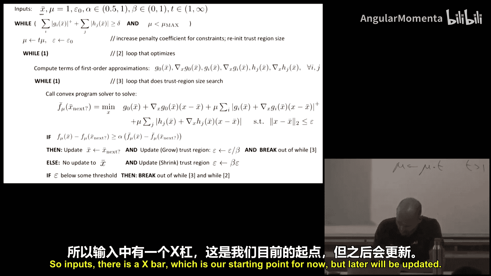
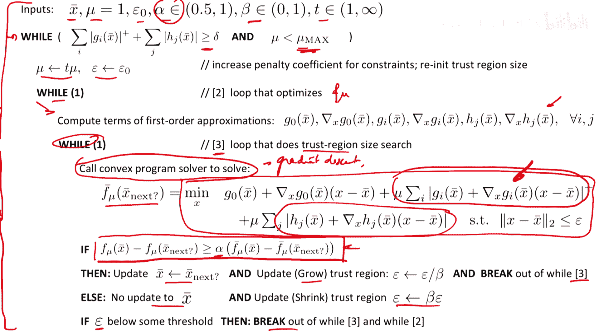
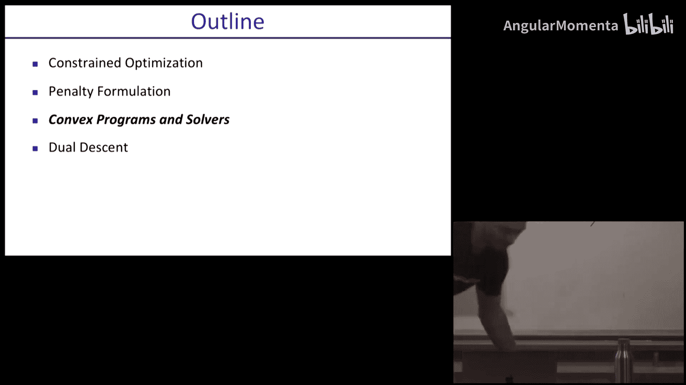
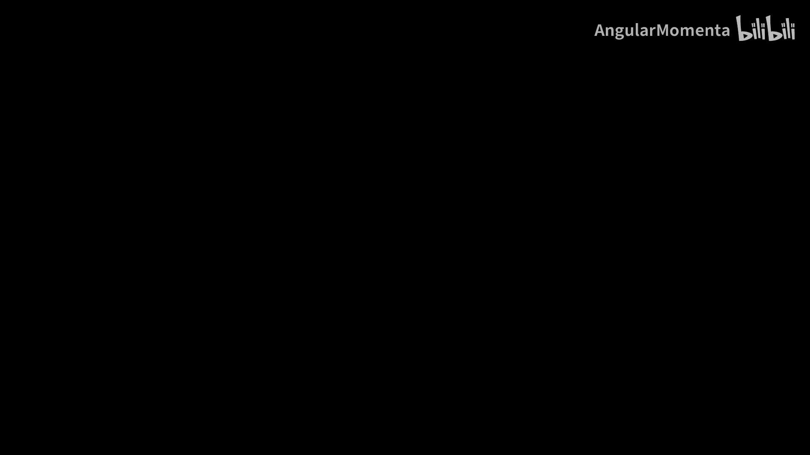
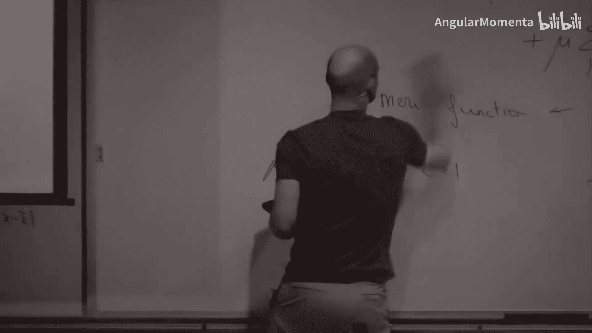
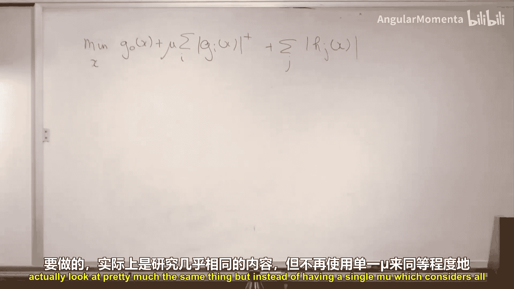

# 【加州大学伯克利分校】高级机器人学-｜-CS287-Advanced-Robotics-at-UC-Berkeley-Fall-2019-p07-7-约束优化--BV1KXqCB4Eua_p7-

All right， let's get started for today。Welcome to。Lecture7 of Advanced Robics， fall 2019。

Today we're going to cover two topics。啲。Main topic is gonna be constrained optimization。

 The main topic for the second half of lecture is gonna be constrained optimization。

 which is the new set of slides。 in the first half of the lecture。

 we're gonna continue our coverage of unconstrained optimization。

 where we still have many important ideas to cover。So。Let's。Look at where we were。

At the end of last lecture。We were doing。Unconstrained optimization， meaning we had an objective。

 and we want to find the minimum of that objective。

 And then we saw this example here where we have F of X is。Half x1 squared plus gamma x2 squared。

And if you look at the contours of this function。Looks like ellipses， concentric ellipses。

 and the choice of gamma will affect， to which extent it looks more like concentric circles than well elongated ellipses。

Well we also size that if it's more elongated， the way grain descent will proceed is actually by hopping back and forth because it'll be in this landscape or let's say I'm facing this。

 I'm facing forward here and left and right， it's super steep。And I should go straight forward。

 but if I'm a little bit off to the left or the right， there'll be a very steep descend。

 so I'll be pushed back and forth， left right and descend that way rather than go straight down。

So that's what's shown on the slides here。 And you can make this abitrarily bad。

 So for a second second degree objective here， you can do this analytically and compute what the sequence of axis will be。

 And you can see you can make this arbitrary slow to converge by making gamma。

Sending gamma far away from one。 If gamma equals one， it's all concentric。

 You go straight to the optum。 If gamma is much bigger than one， you get elongated in this case。

 along the。The X 1 axis， if gamma is close to 0， So also far away from one， but close to 0。

 itll get elongated in the other direction。And you'll get the same effect。All right。

How might we be able to fix this all， by the way， And this is channel， right。

 This is not just for a second degree polyoma。 we're trying to optimize。

 This is true in any function we try to optimize any number of dimensions we can look at locally。

 What is the second order approximation of that function。 We can look at the。Shape of the contours。

 And what we really just need to look at is the eigenvalues of the Hessian。

 which Hessian is the second order approximation。 Locally， eigenvalues of the Hessian。

 the largest and the smallest eigenvalue， the ratio of those。

 That's really what gamma is in what we looked at。 That's restricting attention to just two dimensions in your optimization。

 But those are the two dimensions that together are the worst conditioned。

 If you just look at those two dimensions。 And those will be representative of how poorly your optimization will go with regular grade in descent。

Now， the more dimensions you have， the higher chances， at least， you know。

 two of these dimensions are just off scale from each other， and you start getting this effect。

 And so for high dimensional problems， it's almost guaranteed that you have poor conditioning unless you design your problem in a very。

 very careful way somehow to manage to avoid it。Okay， let's assume we now have to deal with this。

 We have a problem that is poorlyer conditioned， yet we still want to solve it efficiently。

 but we'll see for that as something called Newton's method。So let's work through that on the board。

So in grain descent， we looked at the。Great decent。

 we looked at the first order approximation of the function locally and then found the steepest decent direction。

 took a step in that direction and repeated。For Newton's method。

 we're gonna look at the second order approximation。 So actually， we'll need a bit more space。

 Let me bring this up。So。In Newton's method， will say F。Which we want to optimize。

 We're currently at x。 We want to understand what happens when we change x by a deelta x。

It's approximately equal to F at x plus first order approximation gradient of F of x transpose deelta x。

Plus， then the new term is gonna be a second order approximation， one half。

Delta x transpose now second derivative matrix， the hessian of F x times deelta x。And now， assuming。

The second derivative matrix is the Hessian is positive， definite。

 meaning we have locally a ball shaped function that is shaped the right way to kind of go to a minimum。

 then。We can actually solve this exactly。 We can say， well， if this is our approximation。

 let's look at this thing and let's set the gradient。

Essential we want to find the deelta x that minimizes this， so。We want to find。

We're gonna take the derivative。 I'll write it maybe this way。 derivative Re to Delta X。

And see what it is。 And we want that to be equal to 0。

 That's where we have the optimum of the second order approximation。 What is it。

 Well the first term doesn't depend on Dtaex， The second one will give us gradient of F at X。

 the last one will give us。Plus。Hashen。Times deelta x。 we want this to be equal to 0。Well。

 this tells us Delta x。Equals negative。Inverse of the second derivative matrix times gradient of F。

At X。 And so this thing here。Is a closed form solution to tell us where to go if we're considering the second order approximation of the function。

So pictorially， what it might look like。Is we have an actual function。F。Maybe it goes like this。

Then we have a second order approximation。 We're currently。Here。

 so our secondary approximation looks something。Like this。And。Then。

We'll find the minimum of this thing， which is over here。 And so our previous x。Was。

This is are x axis。 previous version x was here。 This is our x plus delta x。

 And then what we'll do is over here， we'll make a second order approximation to the function and repeat question。

Should it be one over or has it？Oh， should be inverse here， yes。Thank you。Then， once we have。

Expoel X， we repeat the process。 We do a secondoid approximation here。 Maybe it's this new function。

And then the minimum is over here。 And that's gonna to be our next iterate。 and we repeat。

 And it turns out， you know， we'll soon see that this。

 in terms of number of iterations required requires a lot less iterations than a gradient method because it uses a lot more information about the function having access to second derivatives。

So。Let's。Look at the full algorithm。So we have some starting point X。

 we pick some tolerance for convergence。We'll compute the Newton step， just this thing over here。

And then we computes Lada square thing。 What is this Lada square thing if we take the Newton step。

We filled into our second order approximation of the function。And at second node approximation。

 we check， well， how much is the function expected to change， Not not based on having exact access。

 but based on having access just to the second node approximation。

 So this is how much the second node approximation predicts we're gonna improve by doing our newton step。

Or half of that is what it is then。We check if the second approximation doesn't predict much improvement anymore。

 then we call it done。 It's okay， There's not much left to do。

If it does still predict a good amount of improvement， then we have a step direction。

 But now the second order。Step。Might not be。Good enough because we might step too far because our approximation might not be perfect。

 So we'll still run a backtracking line search where we might scale down the step from the original second order approximation step to make sure we make consistent progress in every iteration here。

😊，Now， interesting property of Newton's method is a fine invariance。 What does that mean。

And the kind of intuitive flow what it means is if you do a change of coordinates。

 a linear change of coordinates。Then。It does not affect how fast your algorithm converges。No。

 this is very different from what we looked at with the gradient and descent method when we had just a two dimensional problem。

 And if we changed gamma。That was， that's effectively rescaleing the coordinates。

 That's a linear transformation in your coordinate system。

 It would drastically affect how fast it converges for Newton's method。

 a linear change of coordinates has no effect on convergence speed。

ItMake just more formal if you have a coordinate transformation， we recently had a function of。嗯。

Let's say originally we have a function of X。 And now we're gonna replace x with a times y。

 So y is a inverse x。We could， we now have two functions。 Oral function F of x。

 We can run Newton's method on F of x。 See what happens。 Get a sequence of vi x 0， x 1， x 2。

 and so forth。Then we can say， well， let's now consider the new function， G ofY， which is F。

Of x really。 So F of a times y， we call that G of y。 and we can run newton's method in the y space。

 and we'll get some its， y 0， y1， y 2 and so forth。 It turns out that those interests y 0，1，1， y 2。

 will just be a linear transformation， fixed linear transformation away from x 0。

 And so is the exact same sequence of points that we find in one coordinate system or in the other coordinate system。

 which is a pretty unique property to have。😊，I recommend you， you try to， you know。

 work through this and see if you can prove this， that this property is actually true。

 After you try to check out the slides， we have proof on the slides that you can then check out to see if you figured it out。

Now。Let's compare a gradient descent with Newton's method， so。Function shown on top。

 the contours are the function in dashed lines。 and then X is over here。

 and grain descent is bouncing back and forth。 Finally finds the optim。

Newton's method just needs a couple of steps and gets there。Now， you might w。

 what's that visualization。 Whats that ellipse that's being shown， Well。

 we have a second order approximation in Newton's method。 That second order approximation has。

A constant offset， the linear， the gradient term， and then the Hessian， the quadratic term。

 What's shown here is just the quadratic term。 So at x 0， the quadratic term looks like this。

What it should tell you， actually， is that at x 0。Moving on to the long axis。

Of this quadratic is pretty favorable because that's how it's locally shaped along the short axis is not as favorable because things are very steep there。

 You'll start going back up very quickly。And so you see， indeed。

 that the update is mostly aligned with the long axis because that's favored。 of course。

 also the gradient part， which is ignored in that element that's shown。

 And so we move mostly along that long axis， but not entirely。 And this process then repeats here。

 the gradient has the strongest effect to go here。Okay。

 so one thing you should observe is that it takes less steps to get to the optimum。

 And that's kind of a general property for Newton's method。Bless you。Second example。

10 dimensional problem on the horizontal axis is the number of iterations we have to do。

Left plot is grain descent。 Right plot is Newton's method。 Look。

 grain descent needs about to get to 10 to the negative 4 needs about hundred50 to 200 steps，1084。

1094 is somewhere here。So a new is method that takes about five steps。

 So five steps versus 150 steps。 that's how much more effective this is。Now， keep in mind。

 a Newton step in itself is more expensive because a Newton step requires finding a hesian。

 And so the work you do inside a single it here， shown a horizontal axis K is more computational work than you do in gradient descent。

 So in practice， there's a trade off there that you need to consider。

 But if you just look at the number of iterations。With Newton's method。Far less iterations needed。

A larger version of this example。 And what we're going to look at here is this notion of convergence。

 So with gradient descent， we saw that we had if we have log scale in the。

So aside here also previous plot， if we have log scale on the vertical axis。

 iterations on the horizontal axis， gradient descent has this line behavior which is called linear convergence。

Whereas Newton's method has this parabola here， which is quadratic convergence。 even at larger scale。

 we see this happen and we actually see something interesting happen that initially there's a little bit of linear convergence。

 which often happens in Newton's method。 your first in a regime where it hasn't fully kicked in yet and it's behaving a bit more like grain descent and then second order really kicks in and you get your quadratic convergence。

Let's go back to our original motivating example。 Very simple analytical example。 where we saw， okay。

 grain descent is gonna struggle if we adversararily choose gamma。 And by the way。

 in high dimensions， one of the gammas will probably be pretty bad。 So it's not that， you know。

 it's a rare case。 It's often gonna happen。 Well， grain descent goes this way。

 How will Newton's method go here。 Any thoughts。Suggeession is straight to the optum。

 Why it's a quadratic function， And the Newton step will find a step straight straight to the optum of the quadratic approximation of the function。

 which is the exact function。If it's not period， then there might be some back trackingrack line search。

 and it might not be the actual optim。 But here it's gonna go straight to the opt。

 So that's what it look like one step and done。2 things to think about， One is。

Not always are our functions ball shaped。And so if your hessian has。Some negative eigenvalues。

 meaning that it's not a bullshit function locally。

 Then this Newton step will not necessarily take you to the local minimum based on the quadratic。

 It will take you to some zero gradient point based on the quadratic。 but it might even be a maximum。

 rather than a minimum。So。If you not sure your function is compact locally。

 you can do a check on the hessian。 see if it is。 if it's not， you could add the identity matrix。

 So you just add the identity。 If you have add the identity matrix scaled by large enough positive number。

 at some point， all the eigenvalues will be positive again， because when you add the identity matrix。

 if your original eigenvalues， it'll just add lambda times I to each one of them。So that's one way。

To do it。 And that could resolve those issues。 Another， Another issue to think about is that。

Dealing with the pool hesing can be very expensive if you have a high dimensional space you're optimizing over。

Maybe you just have， I don't know，100 dimension doesn't feel too bad。

 But now the hessian is 100 by 100， which is a million entries and becomes quickly unwieled to deal with。

 especially you go to， let's say， a million dimensional space。 Now。

 a million squared is really large to build that matrix in all its entries。So what can we do instead。

Something called quasi Newton methods， which are essentially trying to do a Newton's method。

 but makes some approximations。 And the idea is that you will never build the actual。Hessian metrics。

You'll just do something that is somewhat second order， but maybe not exactly second order。

 but at least somewhat closing gets a bunch of the benefits。

 but maybe not everything while being more efficient for each individual it。

And then very related to something called natural gradient。 And we'll cover that first。

 and then we'll go to some。Ca， I knew them methods so。Actually， before we do natural gradient。

 any questions about Newton's method。Yes。N near like if the function is。先のル。嗯哼。😊，Trials。

It was gradient。You could。 You could start grain thecent and and later do Newton's method。

 You would save a little bit of time because in early steps， you wouldn't have to do the hessian。

Yeah， could be done。If you look in the Boydden Vandenberger book and you look at the convergence proof of Newton's method and you'll see that the convergence proof will consist exactly of two parts。

 the first part is in the linear regime what's happening and then the second part in the quadratic regime what's happening and I don't know if the proof has something constructive about knowing which regime you're in such that you can constructively just do gradients for a little bit or not。

 not sure。Any other questions about Newton's method。Then let's look at natural gradient。

Which will have some very interesting properties also。

So， natural gradient is。Often motivated by the notion that。Well， we suffer for Newton's method。

 We can be invari to。I find coordinate transformations， which is nice。

So details of coordinate system don't matter as much。Now， in。Caring， you might say。

 well can I be even more invariant to， let's say can I be invariant to a nonlinear reparameterization of my space I'm optimizing over and have an algorithm that。

 you know， if I reparameterize in an inverttable way， I'll still get the same behavior。It's。

Now of me clear how to do that in general。But if the optimization you're doing is over a probability distribution。

 so you have a parameterized probability distribution。So you have something， let's say， P。X。

Prameterterized by theta。 and we're now optimizing over theta not over x。 So it's a distribution。

 We're trying to find parameter by theta。 for example。

 a Gaussian distribution over x space with a mean variance and a meanvari would be sitting inside theta。

嗯。Then you could ask yourself the question if instead of parameterizing the Gaussian by mean and variance。

 What have that parameterized maybe by mean and inverse variance。

 Would I get the same behavior or maybe inverse mean and inverse variance。

 Would I get the same behavior out。And。The reason you might want to be able to hope for this is that in principle。

 there is an intrinsic measure of distance in probability distribution space。

 If you change the parameterization。As long as a distribution is the same distribution。

And you have another distribution。 You can still measure distance within those distributions in a way that doesn't depend on parameterization。

 For example， if you look at the K divergence。Between。Distribution。Pi。Over x。Primized by theta and。

Q over x parameterized by maybe some psi。This will be some number measuring distance between the two distributions。

 if you now parameterize this by some new parameter5， but it's the same distribution P。

Then the caliber is not going change because the calibver is not looking at those parameters explicitly。

 It's just looking at where's the probability mass and。

Does a probability mass overlap a lot or not between those two distributions， specifically。

 K L would be。If it's discrete， well well， let's do continuous integral over x Px theta log。Px。可的。

Over Q x come up psi。Okay， so this is just one distance metric。

 We finish any distance metric that you define directly in the probability mass space and not in the parameter space willll have this property that reparameterizing our distributions will not change the distance between them。

And so in that sense， there is a notion that if we optimize parameters of a distribution。

There's an intrinsic distance that hopefully we can work with rather than some discing parameter space。

Okay， so。No。Let's take a look at。A typical optimization we might do with probability distribution。

 So we might say， we maximize。Over theta， some function F of theta， like we've been doing all along。

 They' usually been minimizing so far， but maximizing same thing。And this going to be max over theta。

Some over I log。Probability of data point X， I under。Pramterization theta。

 So we wanna want to find a parameterization of the distribution that makes data points likely。

 We want high log probability of each data point sum that together。

 Thiss a maximum likely estimateator。 We'll see more of that in the future。 But for now。

 let's just assume this is a given and assume this is what we want。Wellss take a look。

 What's the gradient。Graient of F theta respect to theta。Let's take respect to。

 Let's look at a specific entry P。Is some。Over I is。Same submissions over there。

Then gradient of the log is gradient of what's inside the log divided by what's inside the log。

 So this will be the。P X， I。Theta the theta。I guess maybe I should not use P because if a lot of P。

 I'll call this K entry K。I that a。And then one over P X I。Feddom。Okay。

 now next thing we need is the Hassian。Because we're gonna see what happens in the Hesian。

 So what's the Hessian， The Hessian will be。Where we take another derivative of this quantity。

 Now with respect to theta L。 So we'll do a derivative of this thing Re to theta L， so。Gian。

We already had respect theta K， now， theta L。What is this， Well， we have a summation over there。

 that's not going to go away。Then。Theta appears here and here。 So， and it's a product。

 So we'll have two terms，1 because of derivative the first factor and one because the second factor。

So for the first factor， we already have a derivative there。

 so we'll have a second derivative appear here。Second derivative。P， X， I。T灯。Respect to。Theta L。

 Theta K。Multiplied with， of course， was with it one over P。P X， I。Pta plus。The other term。

 we need to do it of the second thing now， multiply it with the first thing。

 So sum over I multiply the first thing。D P X， I。Here的。The theta K。

 now multiply with derivative of the second thing。 second thing is。Well。

 derivative of1 over something is -1 over that thing squared times the derivative of that thing。

 So we'll have -1 over P X， I。Theta squared times derivative of this thing， which is D P。X I。

Theta and now d theta L。Okay。Now。Let's look at how we can rewrite this a little bit。

 This is equal to the first one。 we're gonna leave untouched。 So some of our eye。Second derivatives。

 P， X， I。Theta。It's5 theta L。睇得 k。And one over P， X， I。没了。The second one。Has a。

Negative sign in front of it。 If we take this negative one out。Some。Over I。

And now we're gonna actually， in some sense work our way back to what we already did。

 and we'll work in reverse。 But we have a reason for that。 We're gonna。Say， okay， the。

This thing here。Multiply with one of these， one over P X I theta is actually back the。

Dirative of the log。Of P， X， I。Theta， to。Theta K， and the second one is the same thing。

Respecttive theta L。If we write out the full hasssing， this is individual entries。

 We write out the full hassian。 Let's put that over here， Ser it all together。The full hasian。

 second derivative F。Theta。Is。Well。We'll have the first thing， which is。Some over I。

Second derivatives。Of P。X， I。Theta， divided by。P。X， I。테aylor。And interesting。

 the second part becomes minus。And they will write the sum again， minus sum over I。Graadient。Log。Pi。

X， I。Theta times。The same thing。Transposed。So it's interesting。 This thing has second derivatives。

 And then this thing only has first derivatives， but we will multiply them together to get some matrix。

What the natural gradient does， it says， well。Who knows？ I mean。

 maybe this thing is shaped the wrong way for maximization。 It might be。Like。

 it might have the wrong sign of eigenvalues and so forth。 Also。

 it has second derivative derivatives in it， which are expensive to compute。 You know what。

 Let's just get rid of this。 ignore it， make an approximation， and just consider。This part over here。

So we're approximating the hessian。With。The part of the Hessian that's easier to compute。

It's one thing easier to compute because just need the gradients。

 and then you multiply them together in the right way。 And some them。

 Then the second thing is that this is guaranteed。To be a function that's shaped like this。

 because this is something times it's transpoposedse。 that's gonna be essentially positive。 always。

 iss a negative sign up front。 So we get is a negative sine quadratic， which looks。😊。

Like this and has a clear optimum locally， at least And with this approximation。

 you'll have a clear optimum。 So we'll get this。Guaranteed correctly shaped function that we can work with。

 That's a local approximation。 We lose something about the second order approximation， but。We get。

 we retain a significant part， and just use that。Now， what's interesting about this is that。

We can then， of course， do the same thing we do with Newton's methods， similar thing here。

 We can just say， okay， natural gradient will just be， I'll use this as my。Approximate hassian。

 and then my step will be hasssian inverse times gradient。 So I'll say my， you know， update。Tta。

Or let's see where we have enough space。Here。I'll say natural gradient。Is equal to。Some over eye。

Grand log， P， X， I。Feda。Sanfe。Transpose all that sum together。Then we invert this。

 That's our approximation to Hessian times。Then the gradient， sum over I， gra。Log。P X I。系啦。

This is a few interesting properties faster to compute than original hessian。

 guaranteed to be negative definite。 So shaped the way we want it shaped。

Also found to be superior in some experiments than the actual hessian。

And it's invariant to re parameterameterization。If you reparmetize。Your distribution。

 like I said earlier， maybe instead of using a theta your mean variance。

 use mean and inverse variance or maybe use inverse mean and inverse variance or whatever。

The sequence of steps you'll go through in your optimization， you'll find the same distribution。

 step after step after step。嗯。We， we haven't proven this。 I'm just dating this property。

So sometimes it's a stronger property than I just being invari to I find reparmatizations。

 but it's kind of a special case where we have kind of a metric that's well defined ahead of time with probability distribution。

The way you would show it would be。Very similar to the way you would show Newton's method is invariant to a re parameterempts。

 essentially explicitly introduce the。Reparameterization。

 but now it can be nonlinear and you check for one update step。Doesn't give you the same update。

 And if it gives you the same for one update step， then again。

 you're good to go for the entire optimization。Any questions about this？Yes， a national gradient。

Not that formula。This is the natural gradient。And what is。Which one。

This thing is the approximate hasssian that is used in a natural gradient method。

 So what I call it like H Tilde， it's not the exact hesian because this is ignored。

 It's the approximation of the hesian that's used。 And so this is denotation is equal to well。

 negative hasssian。 approximation hassian inverse times gradient。Okay。

 if we have no questions on this。 Let's move to。Some other approximations to Newton's method。

It actually will' have a lot of resemblance to the at least two out of three of them will have a lot of resemblance to the。

Natural gradient。Method。But they won't necessarily be for par distributions。

 they can be for anything。So remember that we had the issue in grain descent that。If。

Your coours run run like this。You'll have a lot of hopping back and forth。

And so it takes a long time to get to the optimum。Graan descent。Says。X becomes。X minus alpha。Delta x。

F of x。Where alpha is determined through a line search。Then。

We want to avoid this hopping around behavior。So let's think about how we might be able to avoid that。

Any thoughts。Yeah。As go。So we want to deviate from where the gradient is。

 is pointing us because it's kind of。To local ins is using just this current information about the current slope。

But， ideally。You would know you've been hopping back and forth and maybe use that information to say。

 well， I shouldn't directly follow it。 I should follow more general trend。

And so that's the idea behind grain descent with momentum。The idea there is that rather than。

Following the current gradient directly， we're going to define a velocity。

The velocity is beta times the previous velocity。Plus，1 minus beta times。The gradient。

So initiative velocity might be0， and this is just the direction of your gradient。But then over time。

 this velocity thing will actually average out your gradient。 So initially。

 my gradient might have been this。After that， it's this， some averaging will actually then point to。

More sideways， rather than going back and forth。 And so this philosophy vectors direction。

 which we update。We make X。Equal to x plus alpha times v。

And so whatll happen intuitively is that if you have a high dimensional problem。

And along some coordinates， you hop back and forth a lot。 Well， if you hop back and forth。

 the velocity along those coordinates will。Cancel out。And along coordinates。

 where you do have a consistent gradient in the same direction。

 it'll add up and gain momentum in that direction。And doesn't need to be coordinate aligned。

 This is generally true。 independent of the coordinate system。 So generally。

 directions where you'll consistently want to descend will gain momentum and you'll move in that direction。

 So you'll get something that kind of goes more this way rather than the slow hopping back and forth。

And it's a bit like you using second order information。 It's not exactly a hessian。

 but it's related because youre essentially using the notion that you had a previous gradient and a current gradient and looking at two gradients is like looking at second order information。

 Now， the hessian looks at a lot more than just two gradients。 It's a much higher dimensional object。

 but it's a little bit like it。 once you look at multiple gradients youre using second order information to do better than you can from just first order information。

And this beta might be something like。0。999 or some something that。Tends to。Well。

 maybe not this high， but 0。9 might be a reasonable choice where you mostly retain the previous velocity。

 but you add on a little bit the current new information。Now。

 that's one way to try to deal with the notion that it hops back and forth。

 What's another way to do it。Another way to do it would be to look at the variance in each direction。

So。RMS prop。I grain descend with momentum。RMS Pro says well。If。Along a certain direction。

 migrated changes a lot。 Then I cannot trust it as much。 So maybe I should downscale it。

 So I'm gonna look at the variance in downscale。 At means I think about that。

 should very similar to what's happening here。If。You。Have this。

 like measuring variance along certain directions。 And if there's a lot of variance along a certain direction。

 There's a inverse here， you're downscaling the gradient in that direction。

 whereas keeping it higher in direction where there's not as much variance。

 So same thing will happen here will now have。诶。S。Her。Measuring our。Varariance， and we already had V。

 So we're using S， which gonna be beta times S plus。1 minus beta。Times。The look at the gradient。

And we square each individual entry。 So this querying here means you have a vector and each individual entry gets squared。

So it's really measuring the exponentially moving average of the variances in our gradient vector。

 each individual entry。And then the X update will just be X becomes。Original x plus alpha times。

The gradient that we have right now。Divided by。This thing over here。

 But this thing over here is kind of in squared。 So we're gonna take the square root of that to make it match up divided I by the square root。

Of S， but just S might be tricky because maybe in this component wise square。

 because some entries might be very close to 0。 divided something close to 0。

 and numerical issues could kick in。 So you add some epsilon here to avoid ever dividing by anything too close to 0。

 and epsilon might be。嗯。Well， it's a really small number。 I the right this。

10 to the negative 8 or something like that is a， is a common choice。Now。

These ideas actually have very similar effects in that you're kind of damping out your oscillations here by looking at the averaging here。

 you're doing it in a different way。 You's looking at variances explicitly and then damping it out by looking at variance here。

 you're doing it in a coordinate based way。 like you're doing a per coordinate basis。

 You're measuring variance here， you're not bound to the coordinate system。

 So it's coordinate system independent。But they're doing related things， yet。Somewhat compliment。

 And so there's another algorithm called atom。Which does both in one algorithm。 So in atom。

 you're going to have a velocity。Which is going to be。Beta 1 times V。Plus。1 minus beta 1。

Times the gradient。You're going to have。The variance is measured S。 so beta 2。S。Plus。1 minus beta 2。

The variance。In the gradient。That you're measuring by looking at the squared entries。

And then x is going to be updated as。X plus alpha。V。Just like we had here， but now。We're dividing by。

The square root。Of S plus epsilon。So that's the kind of just combining the two together。

 The extra thing that happens is that people tend to。To get the scaling correct across these。

 divide this by 1 minus beta。1 to the power T where T is counting your iterations。And。

This by 1 minus beta2 to the power T， again， counting iterations because we have exponentially moving average。

It's actually not an average the way I've been writing it。Over here， this will not be an average。

 It's not the not not exactly the average that the right way。 And you。

 you compensate for that because you start with 0， initialize at 0， you kind of lose something。

 And this thing compensates for the fact that you started at 0。

 which is making it not really correct。 that you averaged in 0。

 And so that's what that thing is doing， making up for that。 and then put all on the same scale。

 Thanks to that and have your update rule。Question， yes。The second line is where like。

So the square here。It's the same as a square over here。

 It's a per component squaring of the gradient entries。

So you have a gradient in vectoror and you square each entering that great in vectoror。嗯。Its only。

It's the gradient。 So we have the gradient here， and there is parenthees here。

Around this gradient entity。 and then it's squaring。So， this is。

Approximately doing something second order， doing something like natural grain also except that natural grain actually doesn't do the square root thing。

 So there's a funny difference there。And it often will work more effectively than just using grain descent。

 because it'll have sufficient secondoid effect to not suffer from that hopping back and forth that you can get in regular grain descent。

Let's take a couple minute break here， and then after the break。

 let's look at constrained optimization。I是。小さこ。then when you run that。Yeah。

Okay。第さ。You道。You you don't want to rera。But it power was robust。家说本一。Oh， because， oh。

 we didn't prove that。 I mean， that's exercise。 and why we care。What is， why do we want it。Oh。

Because why should you represent Gaussian by mean and covariance or should represented by mean and inverse covariance。

 What's the right choice。It's not clear。 but if your algorithm doesn't care about what you chose and goes through the same optimization routine。

 you have something that looks at related distribution， not。

The proud realization of the distribution。Because the property you care about is a distribution。

 you don't care about the parameters per se， you care about the distribution that comes from it。

So that's why you prefer to be a variant。F reriization of your distribution。

What's I go an example of a situation？Okay。In common filter we'll see sometimes inverse covariance easier to work with。

 sometimes the regular conveyvariance is easier to work with， but that's not so much the point here。

 the point is that you want to not depend on it。It's not that we think one is bit on the another。

 It's just that we don't want any dependence on it because it's an arbitrary dependence。

And we don't want something arbitrary to affect the quality of our optimization process。All right。

 let's restart。

So far， we've looked at unconstrained optimization。

 Now let's switch gears to constrained optimization。So we're going to first look at the formulation。

 Then we' going look at something called the penalty formulation， a way to solve。

Constraint optimization problems in a very general way。

Some special constrained optimization problems can be solved more efficiently than others。

 They're called convex programs。 We'll look at what they are。

 and also we'll see how they can be used in the inner loop of solving more general problems。

And then we'll look at something dual descent as just something I think is really important for you to know about。

 and we'll make sure we cover that ater end of today or beginning of next lecture。So。

Constrain optimization considers this formulation over here。We're minimizing some function。嗯。G0 of x。

Subject to。Some other functions， G of x small and equal to 0。

 So think of it like some function G of x can define contours and the zero contour you need to lie inside of that。

And H J of X， which are other functions， have to be equal to 0。

 So it's not about being inside of something。 It's essentially。

 you need to be on that function effectively。 For example。

 H J X could represent a plane and you need to be on the plane， or it could be a sinusoid。

 It need to be on that sinusoid curve。 Otherwise you're not valid。All right。

 so this is a problem we want to solve。Let's look at。Actually。

 can I make a quick request for the people in the back。

 It's really distracted for me that you're whispering all the time。

 The two people are not listening and still talking to each other。

 Could it two of you either be quiet or leave。It's very distractive。

 It's hard for me to think through this。Got it。Thanks。Okay。

 so the formulation we want to solve is shown this slide over here。Let's see how we can do this。

We'll keep up the problem we're trying to solve。 and I'll write up how we're going to solve it with a。

Unconstrained optimization problem， which already know how to do so then we're all set to proceed。

Instead of solving the one on the slide， we're gonna solve this。Minimize over x。

We still care about G0。Of x。Then we still care about the constraints。

 We're gonna just put them in the objective。 So we're gonna say， plus。Mu。

 which is some positive scalar。Some over eye。G I of x。Positive parts。 So that means if G I of X。

 G I of X is。Negative。This becomes0 and does not affect the objective。 Original objective。

 we want this to be negative or 0。 So as long as negative or 0， there is no effect on the objective。

 But when G I of X is positive， it stays whatever it is and has an effect on the objective。

 We're trying to minimize。 And so itll have a bad effect on the objective。 And this will be。

Trying to force us to be in the part of space where this actually is small than equal to0。

 otherwise we get penalized。Similarly， for the H。Ci。

We'll take absolute value here because anything away from 0 is bad。 And so。

If H of x equals 0 has no effect on the objective。But when it's nonze， we'll penalize。

And so we see here is that if we have an X that satisfies the constraints and we stay just in that space。

 the constrain satisfied space， we're just optimizing the original objective。

 And whenever we're not in that space， well get penalized for not being in that space。Now。

 you might wonder， there are some tradeoffs here because， I mean， you care about the constraints。

 you care about the objective and maybe you will not satisfy the constraints at the end because you cared more about the objective and not enough about the constraints。

So when we optimize this。We'll call this thing。We'll call this whole thing。 We'll minimizem over x。F。

Mux of x。 And this we call the merit function。And we'll have an outer loop。

 We'll optimize this thing over here。😡，And then we'll say mu becomes mu times some factor T t bigger than 1。

 maybe t equals 10 or 100 or something， so you start caring more and more and more about the constraints。

It turns out that assuming G0 is kind of some kind of smooth。

 reasonably smooth function that if you make mu large enough。You will drive。

These terms to become zero because you'll care so much about these that finally they'll become zero and you'll just be optimizing the original objective。

 you'll find a solution to the constrained optimization problem。You might say。

 well you're large enough， why not just start out setting u equal to infinity。

 then you're definitely large enough， but computationally that's not really practical。

 if you put an infinity here， it doesn't really work because the infinity will dominate everything you can to anything with it。

Related to that， if you make mu too large in the beginning， your prom might not be that wellconed。

 And so your mu will always start somewhat smaller and then scale up over time。

 And in the limit it'll be large enough， such that actually this is satisfied。

 assuming there is a solution to the problem because' possibly you just just no way to satisfy those constraints and you'll keep scaling up your' muing。

 you keep seeing that things are not satisfied and you just don't get there。Okay， now。

The inner optimization of this merit function can be done in many ways。

 You can do this with gradient and descent。 We've covered that。You can do this with Newton's method。

Or you can do something called a trust region method。Let's take a look。 So gradecent should be clear。

 We've covered that。 We know have to run that same for Newton's method。

 We can do quasi Newton methods。 Also， you could run whatever R S prop momentum or atom。

 Or if it lends itself because it the probability solution involved。

 Maybe you can do a natural gradientding。 You can do all of that。😊。

Let's take a look at the trust region version because that's oftened the most popular one in a lot of controls applications and write that one out。

So。嗯。

So this will be penalty method with trust region inner loop， so。Main algorithm。Now we'll look at。

We'll do。嗯。four。Mu equal。One， let's say， well， we， we'll set mu 1， and then we'll have a while loop。

The outside。And then， we'll have。Men。Over。X g0 of x plus。Mu。G I of x。Positive part。 Some overall eye。

Plus mu sum over J， absolute value of is J of x。This thing over here。We're going to now solve with。

Precision method。What does it mean， we're gonna look at min。Over x。Cheese zero。X。At x bar。

 the current point wherere well call x bar now。Then will' linear approximate this gradient。

Expect to x of G0 at x bar。Transpose x minus x bar。Plus。

 and then we'll do the same thing for these terms。 So each of these penalty terms。

 when to come up with a local approximation of them。So， we'll have。Mux sum over I。

Positive part of G at X bar plus。The gradient of G at x bar transpose x minus x bar。

 positive part of this。And we'll do the same thing for the H's plus mu sum over j。

H J x bar plus gradient of HJ at x bar transpose x minus x bar absolute value。

So this is not exactly a first order approximation。 It's a little more complex than that。

 because there are absolute values here that are retained。

 There's the positive part here that's retained。 So it's a slightly more complex phenomenon than just what your gradient method would look at。

But it turns out that this is the kind of problem that is convex。

 meaning it's a easy to solve problem。 And so it's a local approximation that retains。

The key characteristics of the problem。 name， you care about that absolute value。

 You care about this。Positive part of the quantity。

 You don't want to just approximate that with a local line， because that'll lose。

 This is really two lines， a horizontal and a sloped 1。 You don't want to take just one of them。

 Sam thing here。 Absolute value is 2。 You don't want to use just one of them because that doesn't allow you to zone in on that point where you need to be。

And so， we retain those。Now， you don't want to fully optimize this because it's just a local approximation。

 So that'll be a constraint subject to。X has to stay close to x bar within some epsilon ball。

And again， that's a convex constraint。 And this here。This called the。

 this here is the trust region constraint。 It's a region in which you trust your objective outside that region。

 You do not trust your objective。And essentially， you'll solve this。You'll solve this。Find a new。

 This results in a new X。You'll use that X as your X bar to do this again。

 and you'll keep going around， resolving， resolving， resolving。

 just like in Newton's method of have a quadratic approximation， find step， repeat。

 you'll do the same thing over here。 Then at some point。

 this thing will be converged or close enough to converged。At that point， you'll say， okay。

 now mu becomes T times mu。 So I'll say I scale up mu by a factor 10 or 100， and I repeat。

 I go around again。 And so keep in mind that this is not something we solve just once we set up this problem。

We solve it。 We have a new X， which is our new X bar。 We solve it again。 Re， repeat for a fixed mu。

 So we're working with the same mu for quite a while。 And at some point， we scale up mu and repeat。

We haven't yet seen。How to efficiently solve this inner problem。 So for now， we're just。

Trusting that that's the case， yes。How do you constraint again or is like？Yeah， so we。

 we have one constraint left now。 instead of many cons， we have just one constraint。

 a trust region constraint。 That's exactly right。 We， we， we have a constraint again all of a sudden。

 whereas we had gotten rid of it。 But it turns out that's an easy constraint to deal with。

 So we're not worried about it。Okay， now I want to take a look in actual。

Quite a bit of detail as to how this。Shapeps up in a full algorithm。Okay。Go in presentation mode。

Okay， so what do we have here。This is algorithm algorithm fully spelled out that I wrote on the board。

 but giving you the details that are required to be able to actually implement this versus just having the high level intuition。

So inputs， there is a X bar， which is our starting point for now， but later will be updated。

Mux is how much we've penalize for a constrained violation。Epsilon zero is our trust region size。

Alpha will is another high primary we' C what it does， beta。

 and then T is how will scale up mu as we come out of this inner process。

So the outer thing says while。This thing is bigger than Delta。 What is this thing。

 It's the constrained violation measure。So if our constraints are violated more than delta。

We want to continue because we want to keep working。But we also have a mu max。

 If at some point that mu is so large， you might just say we bail out。 We give up。

 We're never gonna get them all satisfied because otherwise。

 you might get an infinite loop if your problem is not solvable。 So thiss kind of a bailout here。

 The Mu max， in case your problem is not solvable somehow。Then。We'll scale up mu。

 we'll set our Epsilon our trust region。Then we need to compute those first order approximations。

 So the derivatives that will come into our inner loop objective。Once we've computed those。

We have an objective， which is this thing。Over here， we're trying to find our next thing。

This quantity over here。That's the problem I wrote on the board。 that's what we're going to solve。

Why is that even living inside a loop， Because maybe our trust region is not the right trust region。

 Maybe we trust it too far out。 So this loop。Here， this while here is to make sure we have the right trust region size。

Then the loop on the outside is a loop that optimizes。 This one optimizes F。Mu。Okay， so。

We'll solve this thing by calling a Comx program solver。 This will give us a solution。

Then we'll check。What is this thing checking， Remember when we did backtrack line search。

We had the approximation to the function， and we checked on the actual function。

 How much progress did we make relative to the approximation we used to find that step。

 Same thing happening here on the left is the actual function。 F mu， on the right is bar F mu。

 which is the approximation we're using with the linearizations in it。

The approximation tells us how much progress we expect to make。

 And then we don't need to make as much progress because it's okay。

 just to be an approximation of a scale factor alpha here。 one of the hyper parameters says， yeah。

 maybe if we just make， you know， have the progress that we expected from our approximation We're good。

😊，And we're happy with what we did。If that's the case， then we do an update。

 and then we also grow the trust region because the approximation was good。

 Things worked out well for us。 Maybe we can do something in a bigger region next time。

And then we're done with finally the size of the trust region。 We had a good trust region。

 and we can break out of while 3， this one here。 and we're back up here finding a new local approximation and repeating。

However， if we didn't make as much progress as we hoped for， we do not update X bar。In fact。

 we could have made too little progress or even done something bad where things got worse。

 Either way， we declare it not a success。 We don't update。Why is it not successful Well。

 we know that locally we should be able to improve。

So we should then just shrink our trust region to only trust things more locally。

 and then we repeat the process。Now， it is possible that as we do this。

 our trust regime keeps shrinking， shrinking， shrinking， shrinking。

 and we never make the expected progress。If that's the case。

 your epsilon will go below a certain threshold。And youll also break out and you'll say， you well。

 I reached a local region where I cannot find any improvement。

That doesn't mean you solve the problem。 It can mean that there's just locally no way to make progress。

 Like there's no way to improve your objective and your constrained violations at the same time。

 and you're just maybe stuck somewhere。And that can happen because if your promise not convex and you solve this kind of。

 you follow this kind of local procedure of reducing constrained violation。

 reducing the objective term， you might just get stuck somewhere where you can't do any better anymore。

So this thing here。Is all you need to solve constraint optimization problems。With a little caveat。

 of course， that you need to call this convex program solver。If you don't have access to that。

 you can replace this with gradient descent。Newton's method， Adam， R S Pro and so forth。

 You just do a few local updates。 And that's it。 But the reason people often like to call the convex program solver is because of the characteristics of the problem。

Alright， so something very specific here。 We're trying to get contrain satisfied。

 And if you do anything like grain descent， anything second order method。

 you don't tend to capture very well。These two terms that we have here。

The absolute value and the positive part things， because theyre very much not smooth。

 They have a kink。 They have something very locally different from a。

Linear or even quadratic approximation。 And so that's why often if you can， you can。

 you use a Comx program solver because it'll exactly deal with that。Kind of complicated。

 but not too complicated constraint or objective terms that you have here。

Okay， any questions about this？Yes。要すの案情。AnIntuition behind choosing beta。

 different choices of beta will shrink your trust region。

More quickly or grow it more quickly or then other way around。嗯。

It's a hyperparmeter you play around with。 I would say something between 0。5 and 0。

9 probably makes a lot of sense going too close to 0。

Is probably too aggressive when you grow with one over beta and when you shrink。 But in principle。

 you could do it， but it might not converge us quickly。 So my natural choice would be 0。9。Yes。😊。

Re slow。Thereそ。It might seem that it this would be slow because how many loops are there， right。

 There's a loop。 Let me grab a different color。 How many loops are involved。Convex program solver。

 that's internally doing some iterative process or you the grain descent same thing then。

You have here compute these first order approximations。 That's something you do outside of that。

 Then there's your scaling of mu。 So it's really 3。Loops happening， which is a lot。 Nevertheless。

 this can be really， really fast。 I mean， not if you have a， you know。

 billion dimensional problem per， but if you have problems with regular control type problems。

 I don't know。10 dimensional， maybe 100 dimensional state space。This can go really， really fast。

Big pars at the inner loop is very， very fast and。That often you don't need too many outer loop iterations。

To get there。Now， one thing people do at times is when you look carefully at your problem in the inner loop。

 if you're really going to solve a convex program。You might want to look at your。Original problem。

And split terms into convex and non conx terms。 For example。

 the objective could have a convex part and a non convex part。The inequality constraints。

 you could have some that are convex and some that are non convex。The equality constraint。

Linear versus nonlinear。And then in the inner loop。You could retain the convex parts。 So this one。

 you retain in your objective directly， because you're going to solve a convex program anyway。

 Why approximate it with that linear approximation from the previous page。

 if you can just keep that part。Similarly。嗯。When we have constraints。

 we would explicitly keep them around。 So instead of having just a trust region constraint。

 we also have the easy constraints to deal with just retained。 For example。

 box constraints on control inputs， you say to a negative one and plus one might as well just retain them in the original format and so forth。

 So that's a way to。Bring in as much global information as you can track to bring into the inner loop to make the inner loop as effective as possible in terms of actually solving the outer loop problem ultimately。

 rather than just， you know， doing its own thing and ignoring what really needs to be solved。

 And so in practice， often there's a game in that regard that you pay attention to。Okay。

 so the two things we have left here are Coms programs and solvers and dual disscent。

Dual disscent is something we can do in five minutes， which is what we have left。

 Come explain and solve as we cannot。 So let's skip ahead to the dual disscent。

And we'll do the Coms program solvers。Next time。

And do will dissent what we do， and let me project something related。Actually， we don't。

 we don't need it。 We can just write it up。 The penalty formulation gave us。Min。Over x。

G0 of x plus mu sum over I。G， I of x， positive part。Plus sum over J。Absolute value is J of x。

In dual descent， what we're going to do is we're going to actually look at pretty much the same thing。

But。Instead of having a single mu。

Which considers all constraints equally strongly。We're going to have。

A separate variable for every constraint。Such that maybe if a constraint is violated more in your objective。

 you pay more attention to it。What we can actually do is in a justified way。 Remember the Lagrangian。

 min。Over like garagerange multipliers。Max。Over x。Lagrangian is G0 of x plus。S over I， lambda I。

 G of x。Actually， Lada has to be small and net0。Plus， new J， H J， some over that。Of x。

So let's think about this in this objective。If a constraint is violated， what will happen。Well。

 first， let's say if the constraintsians are satisfied。 G of X is smaller。Then 0。

 which is a constraint。Well。And the。Lambda， which is trying to work against us。

Just to choose a negative value。Well， the best thing you can do if G I is negative and it has to be negative。

 too is to set equal to 0 because it's trying to make things as small as possible and negative negative will be positive。

 So0 is the best thing it can do。 So if the're constraints satisfied， Lambda will become 0。

 and this will disappear。If you're contrain satisfied here， H J of x equals 0。

 it automatically disappears， the new doesn't even play a role。What if the constraint is violated。

 Constraint is violated if I have G of x。Bigger than zero。Well。

 we can take a very negative Lada and make this extremely negative the objective。

 And that's not what we want。 So we're going to be incentivized when we play this game to make sure the constraint is satisfied。

Same thing here， if we're not satisfied in the constraint。 It's a nonze number。

 We can multiply this with any real number new。 It'll be able to make it very negative and we end up with a very bad outcome for x。

So we see that indeed， this min Max problem is the same as the original problem。

What does dual descent do。They will descend at rates。You optimize。Over x。For fixed。Lambda and new。

And then。You do a great inscent step。For lambmbda and you。So it's a lot like a penalty method。

 It's a little different though， in a penalty method。This is replaced by increase mu， increase mu。

 increase mu。 here it's more subtle。You do a gradient step on Lada Lada are new。

 and this will sometimes new。 Well want to move in the positive direction So negative direction。

 And what is the gradient。 The gradients are very easy， right， What the gradient respect to Lambda D。

 D Lada I， of this objective is just G of x。 So this gradient step is super simple。

 entry Lada I gets added to a G of x entry， new J gets added to its a J of x， That's it。

 So is a very， very cheap update， which will rebalance the emphasis on these different terms。

 and you can show that this actually is guaranteed to improve in every et。

 So if you fully optimized for x。😊，Then you can think of this as really an optimization problem over mu。

 So for any choice of these seemingly fully optimized over X。

 you really have an optimization problem over Lada and mu。 And actually。

 this process is a grain des on Lambda and mu。 And we know that the equilibrium of this game。😊。

Presponse to the optum of that。 And that's what we're doing here。

So very similar to penalty methods and kind of as food for thought。

 something you could think about as well。 What would happen if I replace G I of X with。

The positive part here and replace this with the absolute value。Think about it。

 We're solving an original optimization problem。 We want to edge J of x equals 0。

Does it have a different solution when I say I want absolute value is J of x equal to0， No。

 has the same solution still。I want a G of X。To be。Negative。Is that any difference from saying。

When G I of X is positive， it's violated when it's negative。 I don't care。 No， it's essentially。

 it's so the two problems have the same solution and。So at that point。

 they become extremely close to each other because now you have exactly the same objective。

 except that the mu， single mu becomes lambdas and mus。

 and you have a different update instead of just kind of scaling up by a factor T。

 You have a gradient step。 But actually， these are positive always。 So it'll always be an increase。

 So I'll start behaving extremely similarly， except that things are now have independent parameters for lambda and mu versus a global mu。

 But you can see that these are actually extremely similar formulations。

 Once you look at it this way。😊，Okay， that's it for today， see you next week。

