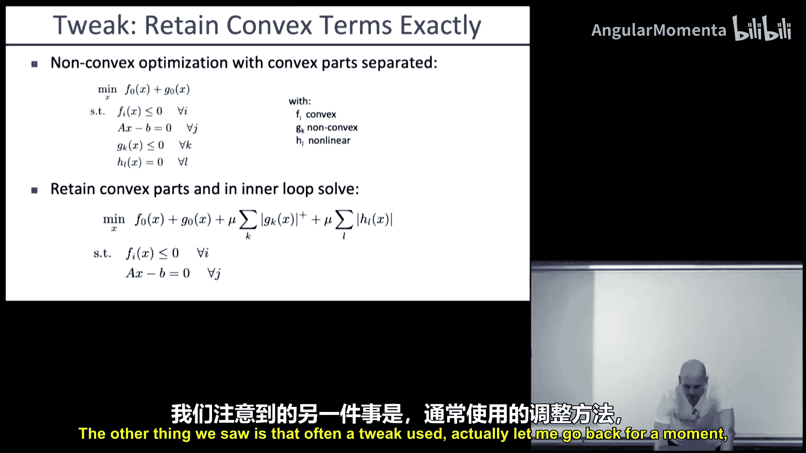
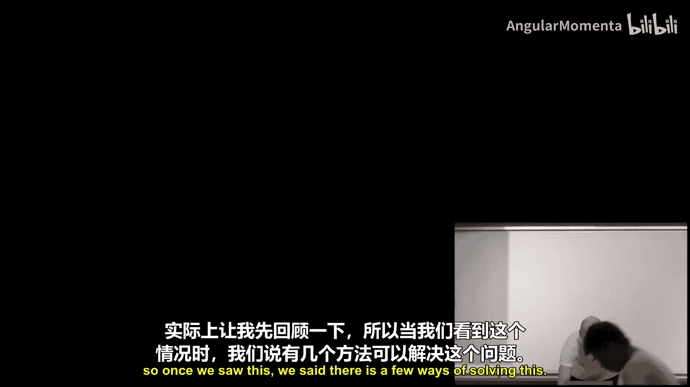
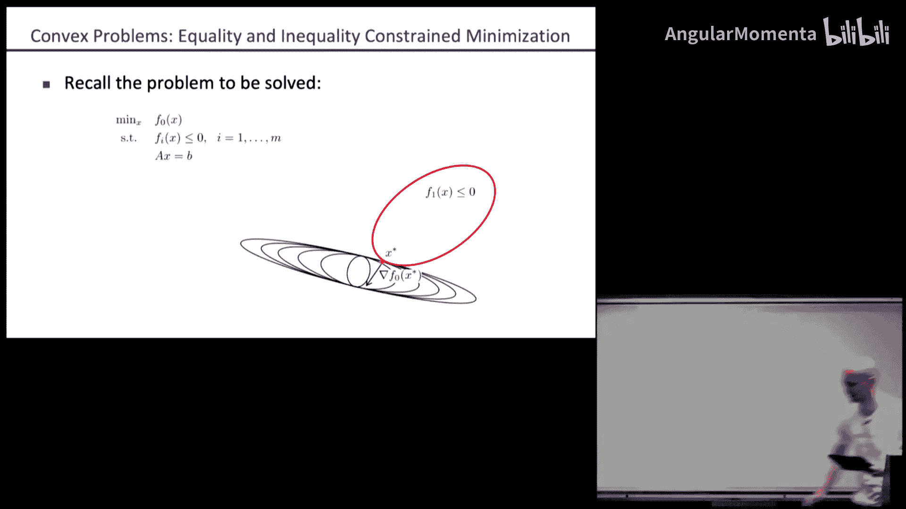
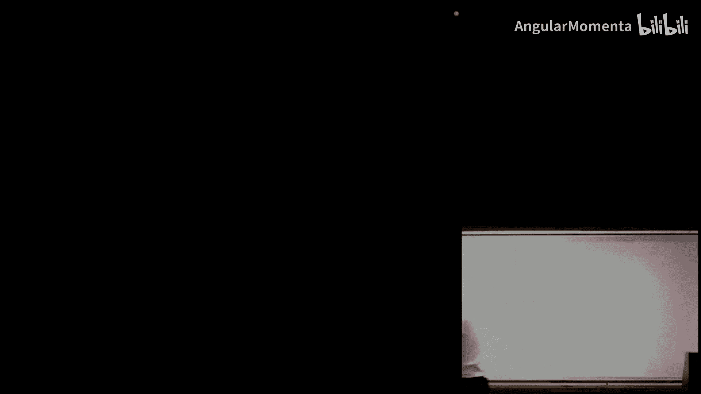
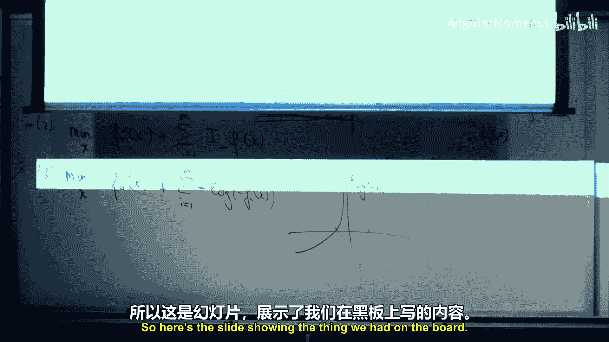
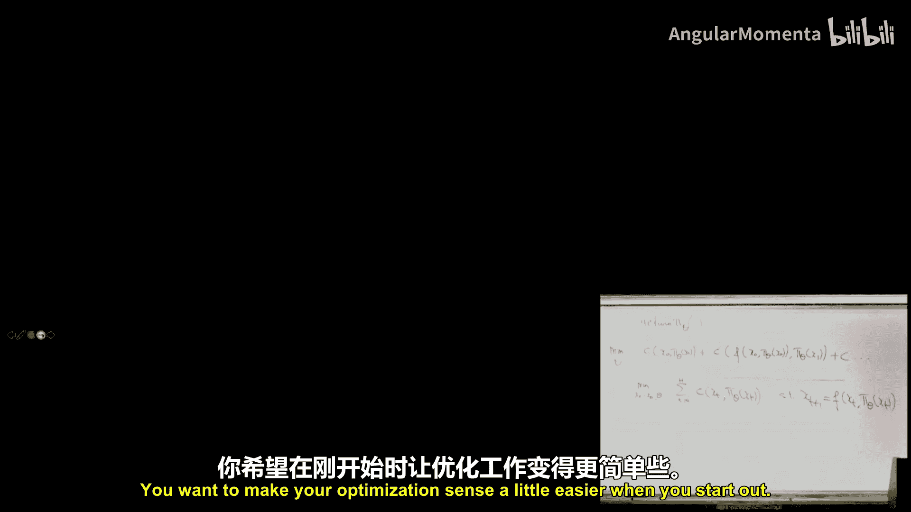
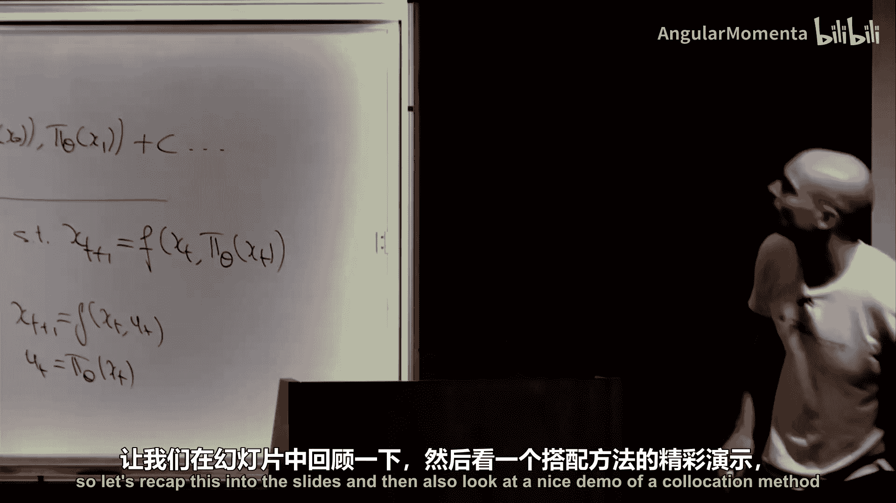
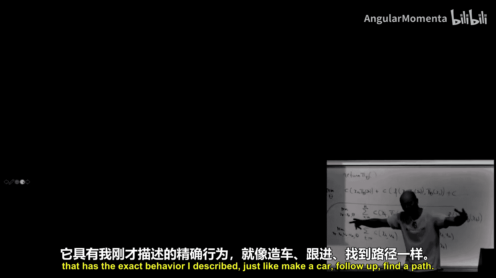
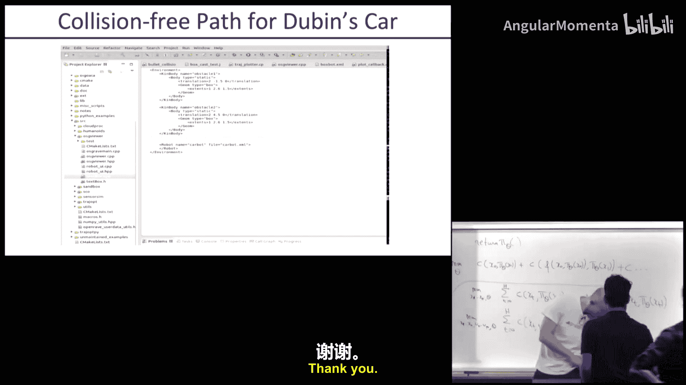

# 【加州大学伯克利分校】高级机器人学-｜-CS287-Advanced-Robotics-at-UC-Berkeley-Fall-2019-p08-8-基于优化的控制：配点法、打靶法、模型预测控制--BV1KXqCB4Eua_p8-

系啲。我企。是想。Hi everyone， welcome to lectureure 8 of。Advanced robotics。So let's see， logistics。

 main announcements are that。Your homework2 was released last week。

 it will be due about six days from now， so next week Wednesday。

Then other announcement is that Igor Mordach， will guest lecture here on Tuesday。 Igor is。Well。

 he's done the most advanced。No- nonlinearar optimization for optimal control with anybody in the world。

 so it's really exciting to have him come lecture here and share kind of his best expertise in the world about how this can be done。

 kind of the highest end version is something called contact invariant optimization。

 and that's one of the main things he'll cover on Tuesday。Let's see， any questions about logistics？

Okay， then let's get started。So had a few things still to wrap up on constrained optimization。

 the first half of lecture will be on that， let's do a quick recap of what we looked at。

 constraint optimization looked at this type of problem。

Minimise some objective function subject to some functions being smaller than 0。

 which defines a region in the space where you're allowed to be。

 and then subject to some other functions equal to zero which defines a very narrow sliver of region in the space where you're allowed to be for each of those equations。

Then the main formulation we saw is something called penalty formulation and what it looked like is this。

Let'm me get a pointer。So here's the original problem。And。

We knew already how to solve unconstrained optimization problems。 So now。

 how do we use that to solve constrained optimization problems。

 Well we introduced the penalty formulation， the original objective plus some coefficient mute times。

What is really the sum of the constraints and these constraints say that the value of G I x had to be negative or 0。

And we we see we sum the positive part of that。 So if they're negative。

 it doesn't contribute to the objective。 But if it's positive， it retains its value。

 That's what that absolute value with the plus means。 And it contributes to the objective。

 We're try to minimize。 So it's a bad thing when it's possible， we get penalized。Senting here。

 H of x is supposed to be0， if it is0 does not contribute to the objective， that's good。

 if it's not zero， possibly contributes to the objective。😡。

Now there's a tradeoff between these constrained terms and the original objective。

 and so if mu is a small value， you might find an x that is actually not satisfying the constraints because it can do better on the objective by violating the constraints。

 It'll be penalized， but not enough to get the constraints satisfied and will happen in an outer loop if you crank up mu higher。

 higher， higher until finally the constraints are satisfied。

 or maybe you find that there is no local opt from where you start where the constraints are satisfied。

Okay， so。Then。From there， we kind of broke it down into a detailed algorithm that's actually implementable directly by writing code。

 matching with what's on the slides here。The other thing we saw is that often a tweak used， actually。

 let me go back for a moment。 So once we saw this， we said there is a few ways of solving this。

 One is gradient descent。

On this objective， and then when you're done， increase mu and repeat。

 another one is a quasi Newton method when you have optimized for x for a fixed mu。

You're done with optimizing for x， you increase mu and repeat， or you can do a trust region method。

And the first two are totally fine to run。 But a reason that often trust region methods are preferred is because these penalty terms have kind of a well。

 a very specific local structure that you can exploit in your inner loop directly rather than just looking at the first order approximation。

 because the first order approximation of these penalty terms is not a great approximation per se。

 because those two terms are not locally linear where you where you want often to be。

 Theyre linear and another linear that together form absolute value or linear and horizontal forming the value。

 Yes， let's question there。 Yeah So could you maybe give us a sense if you face some problem form what order you would。

So typically， I would imagine that if your problem is relatively low。Dimmensional。

 you try trust region method because essentially you'll have solvers to a look at later in this lecture that will solve the inner part。

 the trust region approximation of problem super quickly and very precisely。

 and then you'll iterate over me and hopefully you'll find a good solution。But these solvers often。

Well， these dedicated solvers often don't scale too well。 Once you have really large problems。

 And so if you have a really large problem， I don't know， maybe a million variables or something。

 also depends on the sparsity and so forth in the constraints。

 But once you have larger problems at some point， the trust using inner loop might become a little too expensive。

 and you might resort to just doing grain descent and hope that you find a reasonable solution that way。

And then gradient descent typically will be pretty poorly conditioned because well different variables will contribute differently to the objective。

 so in practice it probably wouldn't be gradient descent by the quasis Newton method。

 Think of gradient descent as something you probably would never really run。

 you'd probably prefer quasis Newton because it's about the same cost to run。

 but will'll scale things better。Now。What happens inside the trust region is this problem is being solved。

 shown here。This problem approximates the objective Well linear approximation App the whats inside those penalty terms with their local linear approximation。

By doing that， we actually have something called a convex problem and convex problems， as we'll see。

 can be solved very efficiently。 And so often this thing， this trust region。

 local problem is solved with a convex optimization solver unless the dimensions don't allow you to do it。

We saw a little more detail about how to do this。 And then we said actually。

 since we're gonna solve the inner loop with a convex optimization solver。

 why't we pay a little more care to looking at what actually is now our original problem because imagine how to constraint of the type constrain live between a negative one it controls live to a negative one and plus one。

 Well， we can just retain that exactly。 we don't need to replace that with anything else。

 And so anything that's a convex constraint， we're just gonna keep and feed it directly as is without approximation into the inner loop solver。

And so they won't become penalty terms， they're just retained as constraints here and then retained in that inner loop solver。

So at this point， we've seen that all the outer parts。 we've not seen what happens on the inside。

 when we actually try to solve that problem shown there， how do we solve it very efficiently。Okay。

 so let's now take a look at that。So Com optimization problems are problems where we have an objective。

And possibly some inequality constraints， some equalityality constraints that are convex。

 meaning every function Fi here has to be convex。 If a function F is convex。

 then it means it's bold shaped。 and the region where it's smaller than zero is a convex set where any two points in the set。

 you take the line between those two points， that entire line lies within a set。

 And so it's a nicely shaped region of which it's easier to optimize than of this disjoint set。

Or non convex boundaries。 Ax equal B is a linear constraint， is our only type of equality constraint。

 because once you have nonlinear equality constraints。

The region over which the region of feasible points becomes noncomvex because once you have a curve and you need to be on that curve and two points on that curve。

 you connect them with a line， you're not on the curve anymore。 And so it's not comevex anymore。Okay。

 so， but let's this is now our assumption。 So it's a strong set of assumptions。

 But we've also seen how we。Pro that doesn't satisfy these assumptions can in the inner loop be molded into this。

 And in the inner loop， we can apply this。 even if the outer problem we're solving might be non convex。

It's a quick reminder。 So it would look something like there's a convex function in 1D。

 but the way you test for it in higher dimensions is the same。

 You take a slice in one direction and you look along that slice。 What does the function look like。

 Does it look such that a line between two points lies above the function， then it comevex， if not。

 it's not comeve。It's a 2D function， you can draw contours。

 but in general that's not going to be possible， but if it is 2D。

 you can look at it and the contours will be complex。Now we have to deal with two things。

 we have to deal with equality constraints and inequality constraints。

So let's first deal with equality constraints and ignore the inequality constraints。

 and then we'll look at the inequality constraints separately。So then the problem is of this form。

 minimize over x， F of x， such that A X equals B。And we'll see three different solution methods。

 elimination， Newton's method， and infeasible start Newton method。The。

 there might be different benefits to them， depending on what type of problem you're solving。

 So we'll cover all three。 Don't think of one as better than the other。

 It just different situations might have different methods be the right fit。Okay。

 so method 1 is elimination。When you have a set of equations， x such as Ax equals B。

K of the canonical thing that you might have seen as well。

 number of equations is equal to number of variables。 And there's a single solution。

 And then actually the optimization problem is not that interesting。

 It's just that one single solution is the opt of your optimization problem you're done。

Usually in optimization problems。 And then the other thing you might have seen is least squares。

 So we have a bunch of equations， and there's no X that satisfies all of them。

 You've tried to find the X that's as close as possible to satisfying all of them Here we're in the opposite regime。

 We're in a regime where there is less equations than unknowns。 So there will be a set of solutions。

So a equal B less equations than unknowns。 there will be a set of solutions。 when that's the case。

 linear algebra tells us there will be a set x such that x equals x hat， which is one solution。

 You just find one solution to the set of equations plus F times z where F is a matrix and z can be any vector then of the right dimensions。

And so。How do you get this？ Well， F needs to spend the null space of a。

 meaning F is something where if you take a linear combination of the columns of a。

 any such linear combination of the sorry， any linear combination of the columns of f。

You multiply that with a， you get0。So we'll have a times F times z always equal to0。

How do we find this F。 One simple thing you could do is compute a single value decomposition of a。

 So single value decomposition will say a equals。 And let me draw a quick picture here， a。

Is in this case， a fat matrix， right？Whereas in least ques。

 which you're probably more used to seeing， it would be a skinny matrix。

 but here we have a fat matrix， less equations than unknowns， this is A。And this will be equal to。

You。识吗？Or well call S there。Times。V transpose。And this one will only have entries on。

This diagonal here， is's not a clear matrix。 It kind of a funny diagonal。

 but only have non zero entries here， which are the singular values。

 This will be an orthogonal matrix。 This will be an orthogonal matrix， meaning。You。

You transpose equal identity and same V V transpose equal identity。

 same for V transpose V and you transpose。You。So that' single valid decomposition。

 which if you actually don't remember， I highly recommend you restudy it because probably the most important concept in linear algebra。

😊，And what we're saying is that essentially when we multiply。We want to find solution to ax equal B。

We already found a solution X hat， we know A。X hat equals B。

 And we're claiming is that we can find other solutions of the type A X hat plus deelta X equals B。

And that these solutions can be found by essentially looking at this matrix V here。

And realizing that。If you have a vector X。Or x plus Dlta x。

Sa X hat plus that delta X will multiplying with V transpose。

 Then the only thing that gets passed through， because these are the only here we have nonze。

 but below it， its all zeros。 So only thing that will get passed through is what goes into。

The first set of rows of V transpose。 If your vector X has a nonze inner product with these rows。

 delegate pasture。 that'll have an effect on the outcome。

 We need to be careful we can't do that because I'll make it not be anymore。 But anything that。

Has zero inner product with the top and nonzero with the bottom here。

We'll be passing through like nothing changed and you'll still get B on the other side。

And what is this， Well， this is， this is V transpose。 So really。

 what this is the last rows of V transpose last columns of V。 And so it's the last set of columns。

A V。That span that are the basis for the things that we can add to the one solution we already have X hat。

And so that's what we can do。 The single value composition， we grab。These rows。

 which we'll think of as columns now。 And that is our F matrix。 So this here is F transpose。

 lives down here。 That's it。 That's all we need。Okay， what are some。Benefits。 Well。

 one benefit is actually， you reduce the dimensionality problem you're solving。 Use to solve over。

Your optimization over X space and Z will be smaller， lower dimensional than X。

 you now solve a lower dimensional problem。 And sometimes that's pretty convenient to do。

 Then often the number of constraints is not that high。

 Then it will not reduce the dimensionality much。 You might not care much for that。

Potential downsides， you first need to solve a equal B and find the null space of A， for example。

 through single valuecom or other methods， then they'll give you F and。

Another big downside is probably the biggest one that why people usually don't use this method is bullet point3。

This elimination might destroy the sparsity of a。 So very often。

 when you set up an optimization problem。You might have a high dimensional variable X that you're optimizing over。

 but the way it participates in constraints and in the objective is very sparse。

 So the matrix a would have mostly zero entries。 And even if your matrix A has mostly zero entries。

 your matrix F will typically be dense。 And so all of a sudden。

 you're dealing with a competition much more expensive problem， even though reduced。

 you reduced the dimensionality。 And so if。Of course。

 if a is not sparse when you start out with there's no reason to worry about this。

 but most practical problems， A will be sparse， and so three will be the issue and you will not want to do it this way。

Any questions about this？So mathematically， we have a way of solving the problem just that we know that in practice often we're not going to want to do it this way because often a will be sparse。

What else can we do， Let's think geometrically about the problem。

 We're minimizing some function F of x。 in this case。

 over two dimensional space so we can draw a picture。 We see the contour there of F of x。

 And if theres no constraint， we'd want to land right in the middle over here。

 but there is a constraint。 A X has to be equal to B。 So we can only be on this line over here。Well。

Can we genetic think about what it means to be an opt， we have to be on the line。😡。

And which point online is going to be correct？Well， the reason this point is correct is from here。

 the gradient points hergonal to that line。 So what do we move to the left or the right。

We don't get any improvement because the inner product with the gradient will be zero。

 whereas for all other points when we're further out。

 the gradient will be telling us to move in and here the gradient again will tell us to move in along the line and it stops where the gradient is orthogonal to that line。

 And so the optimality condition then becomes we are at a constrained optimization problem optimum in this case。

 whenever the gradient。Its orthoagonal to the line， in this case， in general。

 the plane or hyperplan on which you need to live。What does that mean？

We'll do the bottom one here first for the grain to be orthogonal to that plane。

 What does it mean we are toal to the plane well。The way you define that plane is by a set of vectors living in a。

 and you say a times x has to be equal to0， meaning that x or equal to B， so what it means is a。

 the vectors in a span what is autoagonal to the plane。

And we want the gradient to be orthogonal to the planes。

 So that means the gradient should be aligned with whatever are the vectors that live inside A because they define orthogoninality to each of the planes that you need to be in。

So that's this condition here。 You can also write it this way for all Delta x that we can apply to x if。

嗯。A times theta x equals 0 means we remain feasible because we started a feasible。

 We're trying to check if we optimum。 If a change remains feasible， then for that change。

 we have to be orthogonal to the gradient。 So these are two equivalent conditions。Now。

 one way to solve the problem is to just look at those conditions， say。

 can I find a X and a mu such that the gradient equals this thing or can I find a x such that a de whenever a delt x equals 0。

 this is true。Maybe sometimes we can， let's see what we can do。So optimal。

 the conditions we're going to work with is that we want ax star equal B and the gradient。

To be spanned by the columns of a。Allright， so。How do we do this？

Sometimes you can do this analytically。 So for some small problem。

 sometimes you can write this out and you can see， okay， this is just a solution。 closed form。

 you're done。 And then that's great。 that's very convenient。 Most of the time's not going to work。

 So we can actually extend Newton's method to this scenario。😊，Here's what we do。

 We say optimal conditions are here。Let's assume we have a feasible x。 So there's an assumption。

 We will relax that assumption later。 Let's assume we have a feasible x。

 So we already solved a equal B of some x， not the optimal X， but A X。

Then well can use a second order approximation of the function F。In this optimization problem here。

 So now we have this formulation over here。Now， for the second order approximation of the problem。

We can write out the optimality conditions。Which will give us this over here。

 So this is if we assumed our problem was actually a second order problem， which it is not。

 but if it were。Then this would be the equation need to satisfy。

 and because it's a second order approximation。 we take the grain to get those conditions that becomes a linear system of equations。

 and all we need to do is solve a linear system of equations to satisfy the optimality conditions of the local approximation to the real problem。

 the new approximation to the real problem。 And then once we've done that， we can take a step。

 We're in a new spot， we take the new second order approximation and repeat。😊。

So computationally is very feasible， It's very similar to Newton's method。

 When Newton's method applies to the original problem without constraint。

 then you should be able to also run this when there is the equality constraint。Maybe only caveat。

 Oh， let's， let's give the full algorithm。 this would be the full algorithm。

 It's essentially Newton's method all over， except that the Newton step is now obtained by solving this particular problem over here。

 What if there are no constraints。 What happens， then the a matrix is nonexent。

 So these parts disappear。 the new disappears and we just have the standard Newton step。

 Haian times Delta X that we're trying to find is equal to negative the gradient。

 So nicely simplifies still we no， But if there' is an equality constraints set。

 then we have this added to it。Now， you might say Id prefer not to first solve the system of equations to have a feasible starting point。

 Can we do that， just having feasible start method， Actually， we can。

 You can use the exact same idea。 So remember our original optimization problem up here。

Our optimality condition over here。Then we can do the first order approximation of the optimal condition at the current x。

Shown here。And then we just solve that。 So what's different between what we do here and we did before。

 If x were feasible， then a times x will be equal。To be。And so this thing over here。

 b minus Ax would be0， and we have the original thing that we had on the previous slide where we have a0 at the bottom here。

But that's the only difference。 So essentially the same amount of competition has to happen is just that you now have a b minus a X there because we don't have a feasible x yet and over time it'll find something feasible。

Sometimes that's okay， sometimes that's not okay。 Imagine you're solving an optimal control problem。

 you're iteratively solving it， but you might run out of time。

And if your solution has to be feasible to be able to apply it。

 then you might not like this because as long as you're not converged。

 you might not have reached a feasible point and you might prefer to first find a feasible point and stay feasible at all times and so it depends on the situation you're in whether you really care about feasibility every step along the way。

 then while you just care about feasibility once you're converged。

And if you're willing to wait till your conversion， you know。

 there's no reason to first solve for a feasible X， you can just run this。Okay。

 any questions about equality constrained convex problems？And how we solve them， yes。

aiHow do we get the second optimal？Okay， so the question is how do we get this second optimality condition。

 let's go back to the drawing here。So。There is two conditions。

 The first one is just the constraints that's given to us。 We don't have to work to get that。

 The second one is saying the gradient。Of the function has to point in a direction that's hergonal。

To how we can move in the plane。So it's saying gradient。Atagonal to how we can move in the plane。

 So this is the plane we can move in。 Greatness Vagonal。 And why， why is that what it is， Imagine。

 I mean， this is a 2D problem。 And so it's just a line。

 So it's just a single vector living in A iss just two numbers living in A， A 1， A2。

 let's him with a times x equals B。That vector A。That vector A for Ax equal B actually points orthogonal to this plane。

 that's how it works to define a plane or a line。's the vector that sits there lives orthogonal to the line itself。

Essentially， what it's doing is saying that vector is saying in the direction A。

 you need to be a distance B out。And so you need to be a distance B out in direction A。

 So then at some point， your distance B out， and everything orthogonal to a is on that line satisfies the condition。

 Everything else does not。 And so a points orthogonal to that line。

 And we want our grain to be orthogonal to the line。 So that's what we have there。

 we say our grain has to be orthoal has to be orthoal to the line。

 which means in the same direction as a。Now， when there's multiple constraints。

 multiple planes in a higher dimensional space， for each plane you can see it's okay if my gradient is aligned with the A for that specific plane。

But it's actually okay to be aligned with any one of the A's， but not just any one of the's。

 also any linear combination of those A's。 And that's what this condition is saying because imagine you have two planes together。

 They define a line。 It's actually turns out this arbitrary。

 which two planes you use to define that line and the mathworkhouse that if you take just the two vectors you originally had to define those two planes。

 you can take any linear combination。 and that will be everything orthogonal to that line。

 and that will be how you want your gradient to be pointing。And then from here。

 just to quickly recap， what we conclude is essentially that even though this condition in general。

 you cannot solveve for exactly if your problem is a second order optimization problem。

 you can solve it exactly。 So we're to just turn into a second order， solve it exactly and repeat。

If we start feasible， everything will stay feasible， every step along the way。

 if we start infeasible， it'll gradually move towards feasible。😡，Okay。

 now on to inequality constraints。So we're still trying to solve。A convicx optimization problem。

 So what an inequality constraint would look like is something like drawn in red here。

 It's a region where if you take two points in the region， you connect them with a line。

 you're still in that region。For this problem here， if it was not constrained。

 the optimum would be in the middle of that set of contours here， but it is constrained。

 You have to lie inside this region。So。The optimal point will be here。

 We want to be essentially so it's gonna for situation like this is's going to be on the boundary here。

 right， where it can get to the lowest possible contour。 It can probably reach within that set。

 it's in。Now。One thing you might wonder is。You know why。

Why do we treat the inequality constraints and equality constraints separately， Because I mean。

 one thing you could say is well。Isn't it the case that。I can just say， well。If I have ax equal B。

I have a X small， equal to B， A X bigger than equal to B。

 And I can just turn one equality constraint into， two inequality constraints and have the same problem。

But it turns out that the way we're gonna deal with the inequality constraints in this case is quite different。

 and it wouldn't really work if we phrase our original problem this way。

 We have to keep our equality constraints the way they are。All right。

 now let's take a look at how we deal with this。There's actually quite a few methods then。Can。

Deal with solving this kind of problem。 We're gonna see a specific method called a barrier method。

 And then later， I'll point you to some other methods that you might want to check out on your own at some point。

So。Let's raise that。

The problem we want to solve is minten。Over x。F 0。X。Subject to。F I of x small and equal to 0。

 and I'm going to ignore the equality constraints here。

 We can bring them back in using the methods we already have later。

We're gonna actually do something somewhat similar to what we did with the penalty method。

 but it's not gonna be the same ultimate solution， but we're gonna say， well。

 this is a constrained optimization problem， but constrained optimization problems are hard to deal with。

 Let's see if we can turn it into a unconstrained problem。 Well， what could we do。

 We can say instead。Minimize。Over x。F0 of x stays the same plus sum over all constraints。Of。

I negative F of x。Now， remember with the penalty method。

 we had something similar where we had this absolute positive part of the function。

 Here it's something different。 What is this indicator negative thing。He means that if。

If what's inside is negative。😡，We make it 0， so it will not influence the objective because we。

 then were satisfying the constraint。 We don't have to worry about it。But if it's positive。

We make an infinity。Okay， so then this is kind of crazy。 But that's what we're going to do。

 So we're going to say our function。If this is F。I of x living on this axis and on this axis we have。

I negative of F I of X。 This function will be 0。Here。And then jump to infinity。Over here。Now。

 let's think about this， if we do this， does this problem have the same solution as this problem？

Well， it does。 And why does it， Because whenever the constraints are satisfied。

 it will not influence the objective anymore。And so。It doesn't influence the objective。Well。Then。

We're just optimizing this function， and that's what we need to do when we're feasible。

What happens when we're infeasible， one of these FI xs is bigger than0。Well， what happens then？

Is that。This thing will be infinity， makes us very unhappy in the minimization。

 and we'll definitely declare a solution。So these two problems have the same optimum。Okay。

 why don't we like this formulation。 The reason we don't like it is because' a very poorly conditioned problem。

 If you think about it， like you're optimizing this function F 0 of x， you' moving around。

 And then once you step a little too far， all of a sudden your infinity and you didn't see it coming at all。

 And now it's bad。 And actually it doesn't even tell you which direction to move。

 It's like infinity everywhere where you landed now， there's no signal anymore about what to do。

Compareed that to penalty method， which we saw where it would actually have a slope going like this。

 And then， yes， when you cross the boundary， you'd be unhappy。

 but gradual unhappy and know to move back to the boundary here。 we're not doing that we're。

In this formulation making an infinity， but hence that also doesn't really work because you don't get any signal on where to move。

Quest is， can we approximate this， How about if we have a function that maybe is running。This way。

And goes to infinity but gradually and so now you'll see it coming as you move closer to where you're not allowed to be。

 you'll get more and more gradient in force pushing you back in。

So you could take a function that does this。 I'll give you a function。Let's see。嗯。Log。Of。Minus Fi。

Of X will look like this。 I mean， I'm not saying it's， I mean。

 it's going to be cleaner than what I drew， but。The log， remember， log function。

 the way you're used to seeing it is this way。We're now flipping what's on the inside。

 So it's negative。 So it comes on the other side。 not， it's not living there anymore。

 It's living on this side now。 And then actually， the other thing we're doing is we're actually putting a negative sign in front to flip it the other way。

 So essentially flipped it this way。 And after we flip it to this side， we then flip it vertically。

 and we end up with this function over here。Which is。

This function here is log minus log of negative x。So that function has right properties。

 It goes to infinity at 0。 So you don't want to， I mean， it's maybe not ideal ideal because you say。

 well， I'm allowed to be 0。 But you know what， this's maybe fine。

 if you can be just epsilon away from 0。 It'， it's good enough。 So it goes to infinity there。 So。

 you want to stay away from it and you get signal。 Now， the tricky part is that。😊。

It does have quite a bit of signal， and it'll kind of keep you maybe too far away from the boundary。

 You might say， well， anywhere here， I'm probably never gonna end up is just too high cost in this new problem。

 So if I write min。X， which is the new formulation， Min x have 0 x plus well。

 minus because we have a negative sign in front of it。

Eial lets do plus sum over I1 through M negative log。Of minus Fi of x。

Will be kept away too far from the boundary to truly find the problem。 He asked a question。

If you output next， that does cross over to the。You're not allowed to。In this method。

 you're not allowed to and actually when you this is a really good question。😊。

Look you can already imagine that we're going to run a great method on this new objective or something like agreement。

 Newton's method and so forth。 And if you take your step size too large on this new objective and you land on the other side。

Your backtracking line search， part of the backtracking line search has to be backtracking when it tells you infinity。

 I you consider it's still infinity past here， it'll give you not a number or something in practice or a complex number because a log of a negative number will be a complex number。

 depending on the implementation you're using。 Then you gotta check for that。

 And definitely it's a kind of。Common thing that can go wrong。 You don't check for it。

 And then all of a sudden， everything's complex numbers in your optimization。

 you wonder where they came from。 Well， they came from the fact that you took the log of a negative number and they just start showing up。

So that's， that's something to be really careful with。 absolutelyol。

 And so the backtracking lines are supposed to catch that。

 it also turns out that for convex problems， there are certain guarantees。

 So there are certain guarantees that。😊，If you apply Newton steps that it will actually not for the right kind of function living here and log is one of them。

 there are other options， but log is one of them that you will here。

 Newton's step will not get you beyond the barrier it'll automatically keep you on the inside。

 So you would not have that issue。 But if you use grain grain method rather than than Newton's method。

 then the step size is somewhat arbitrary because we know when you rescale the problem。

 you get a different step size just by rescaling the problem。

 So then you don't necessarily have those guarantees， you need to be very careful。So。

This problem will have a different solution from this one or this one。

 because these are the same solution。 These two，1 and two are equivalent。

3 gives us a different solution。But can we get closer， Well， the way we can get closer by saying。

 well， minus log minus f5 of x， What if I actually rescale this What if I put a。

inus1 over T for T a positive number of log minus f of x。 What happens？Well， let's think about it。

 If T is one， we have what we had before。 Now， let's make T bigger， which brings us。

To a coefficient in front of this， bringing this closer to 0。 So this function here。

 then will run closer。To 0。I'll still cross over always at where the inner thing is1。

 then after heroes let's take closer to zero and shoot up later。And the bigger we make T。

The more we are really multiplying with something close to 0。

 and the more this function will be very close to being exactly zero here。

 just slightly below and then slightly above here。 and then only at the very end shoot up。

So we can then say， well， okay， we got it， just said t equal some large number。

And then the problem will be almost equivalent to the original problem。If you make T really large。

 like infinity， then you're actually back to problem 2。

 So the limit of T going to infinity get problem 2。 But if we also know in problem 2。

 we get no signal。 And so intuition should tell you that， well， actually。

 what we should be doing is not just set T really large because the larger T。

 the less signal we get in our optimization。 So what we're gonna do is something gradual。

 Start with the T that's pretty small。Where you get more signal about the shape。

 how your opposition problem is shaped， especially the constraints， because that's where it comes in。

 And then as you solve it for a small initially for a small T， youve solved it。

 You make your T larger。 repeat， repeat， repeat。 So just like in a penalty method。

 we're driving up mu here， we're gonna be driving up T。嗯。Fniest notation， for some reason。

 the way the notation is here is like T will be mu times T in every iteration。

 whereas before he had mus， T times T was just standard notation that different literatures kind of。

 I guess， mix up the T and the mu and use it for the opposite thing。Okay， so。

Any questions about this？This is problem， the main idea for the first half of lecture。All right。

 let's look at some results then when using this。So here's the slide showing the thing we had on the board。

 let's zoom in on that plot。

As。T becomes larger。 This thing gets closer and closer to horizontal first and vertical later。

It's called the barrier method why because you put up this barrier that you're not supposed to go past。

 so you're supposed to start it on the inside of it and never go past that barrier and it keeps you from escaping because it's pretty steep。

Once it look like， okay， you do a centering step， it's called you compute X star T。

 which means the optimal solution for this surrogate problem here。 It's not the real problem。

s a surrogate problem， but it's close to the real problem。 solve this problem。

 and you can still be quality constraints。 We know how to deal with that。

 So now it's just a convex problem with equality constraints no inequalities anymore。

 It's not the original problem， but at least it's related。

Once we found X star for that specific choice of T， we check the stopping criterion。

 essentially if our T has become really， really large。

 then we're ready to stop because we have pretty much the original problem。

 if it's not that large yet， then we increase T by a factor mu and repeat。

Heres this applied to solving linear programs， which is linear objective and linear inequality constraints and linear equality constraints。

This was done with Newton's method， so Newton iteration shown on the horizontal axis due the gap is distance from optimality measured in a specific way。

I's in the vertical axis logmic scale。 And we see we get this kind of。Cratic conversions。

 just like we had with unconstrained problems。And we see， it's， you know。

 not super sensitive to the choice of you， but。Mu in the range of 10 to 200 seems to be reasonable。

 If you go below 10， that's the the graph on the right， If you go below 10。

 the number of iterations you need to get to meet your optimality criterion is very large。1。

40 here versus just 20 here。 So set mu larger than 10 for this kind of problem。Here's another one。

 a geometric program， which is another convex program。

 We have log some X in the objective and log some X in the constraints。

 You can run same method and again， converges in a very small number of iterations。

Standard form LPs can be solved this way。 What's interesting is that it doesn't really slow down。

 So M is on the horizontal axis is counting the number of constraints and the speed of solving this in terms of the number of iterations needed。

 It doesn't go up much with the number of constraints。

 So it's fairly invari the number of constraints， how fast you can get centered。

Initialization might be something you worry about because for this thing。

 we cannot be outside of the barrier。 We need to be on the inside。 How do we do that。 Well。

 here's a simple trick。You solve this other problem first， which is called phase one。

Original problem was。You needed these to be satisfied in a equal B。 Well。

 you can just say I'm choose some arbitrary X， whatever I pick something。

 I then check what is F of x for each F。I see which one is the largest。

I set S equal to the largest one and now I say， okay， now I have a new problem。

 I'm going to start minimizing S from that starting point， but I start feasible。

 So what what I did is I said I want to find in some sense the most feasible point because minimizing S means you might bring this below0。

 if you cannot bring it to0， then it's just an infeasible problem。

 But if you can bring this below  zero， you're kind of in the most feasible part of the space。

 the centered part of the space ignoring the objective。 just want to get centered。

 And so this one we can solve very effectively because we can initial by just making s large enough。

 and then we're good to go。 So as a little trick here is we replace these0 on the right- hand side by S make it large enough。

Find the things that's most centered。 And then we can start the phase2， the actual optimization。

Having just one S here is one way to do it。 You could also have a different S for every constraint that way you're kind of paying more attention in something sense to constraints that are。

Hardest dis satisfy， and it might be slightly better conditioned， ultimately。When you do this。

 the main advantage of doing it this way is that if your problem is infeasible。

 it does not have a solution， it'll help you identify which constraints are causing the trouble and making it not possible to be satisfied。

 and you can go back and say， well， this is even a problem I should be trying to solve because apparently it's not feasible to satisfy all the constraints。

 you can change the problem you're trying to solve and go again。Okay。

 so what are some other methods for convex problems。

 What we've covered is a primmal interior point method or a barrier method。

 What it means is that we're always in the interior of the feasible set。While we run this method。

 it's primal because we only pay attention to the X variable。 We know when there's constraints。

 you can form a lagroian which introduces dual variables。

 and we don't pay attention to those in this method。

So that's one of several ways of solving this kind of problem。

 There are other methods that people use that are， I would say a little more intricate but they could be of interest to you at some point。

 Primal dual interior point methods is where you have the same thing happen both in primmal and dual space。

 So you have a feasible dual space， a feasible primmal space。

 and you solve for both variables at the same time。

Then Prodoable in feasibleas interior point methods。

 essentially they will say I still need to be feasible in terms of the inequality constraints。

 but my equality constraints I can violate like we saw before with just the equality constraints set up and that's what they will do。

 So there's a few different ways of solving these kinds of problems。

One of the reasons he might care about solving the duall at the same time is because there is a property that says that。

The primmal problem will be this complex ball。 The dual problem will sometimes be it this like oppositely shaped ball living below it。

 And at the optimum， they will touch。And so as you're checking your dual space， what your value is。

 taking the primmal space， what your function value is。

 the difference between them is the upper bound and how far away you are from the real optimum。

 And so by solving both the primmal and dual at the same time。

 you actually get this information about how far away you are from optimum。

 which is often nice to have。😊，Any questions about the barrier method？

Then the other thing we covered at the end last time was dual dissent。

 This is yet another way to solve a constraint optimization problem shown the top。Right here。

What I didn't have on the slide last time was the explicit update。And dual descent。

 you optimize over x。 Once you're down optimize over x for currentren choice of lambmbda U。

 you update them with gradient descent， which is just as simple as actually gradient an as because it's maximizing。

Its just these updates over here。 That's all you have to do for the dual variables。

 and then you solve again for X and repeat。Thing I alluded to and also didn't have on the slide is the bottom part here is that。

This is the original problem。It is a new equivalent problem with the same solution。

 if GI of x has to be smaller than0， then the positive part of GI of X has to be smaller than zero。

If H J of x has be equal to0， then the absolute value of H J of x has be equal to 0。

So then we can form a laggrangent for this problem， which gives us this thing over here。

And now all of a sudden， it looks a lot like a penalty formulation。If we run dual descent。

 we have these additive updates to each of the dual variables When we run penalty formulation。

 we just have a single dual variable in some sense mu that we just scale up periodically Other than that。

 they're essentially the same at this point。One of the places dual disscent is。Use the lot。

 is when you have just。A very small number of constraints。 like you might have maybe。For example。

 a recent place where it it's used。Trusee and policy Health musicians will cover a few lectures down the line。

 say you want your policy to stay close to where it used to be there's a constraint about that。Well。

 if you want to satisfy。That constraint。But you don't have the ability to run this kind of full optimization machinery。

 You just want to run gradient descent on the original problem。 This is what it allows you to do。

 You can keep your original problem。 You add your constraint。

 just run grain decent on your original problem。And we know that if this La that is said correctly。

 you're solving the correct problem anyway。 And so you're just doing grain descent on this and then periodically tweak your Lada to ensure actually solving the problem you're supposed to be solving。

 And so it's a way to stay close to the problem that was unconstrained and everything you're doing just with periodically。

 you need to make a slight adjustment to the objective to tweak it to make sure you're solving the constrained problem。

 And so in TrRPO effectively what it led to we'll see some of the things later is that TrRP is a second order method effectively which makes it hard to apply to largescale problems at times。

 PPO proximal policy optimization will essentially do something close to this where you would just adjust the lagrange will apply in front of the constraint and everything else can remain first order all of a sudden and much more scalable。

Okay， let's take a couple minutes break here， and then after the break we'll look at optimization based optimal control。

方。考虑多少钱？お願し。对然后。先你好先生。I sort of。No。なね。All right， let's restart。

So at this point we know how to solve constrain optimization problems and we can revisit them。Now。

 the problem we originally wanted to solve， which is optimal control。

It turns out there's many ways to formulate an optimal control problem as an optimization problem。So。

The key thing we're going to cover for the second half here is a breakdown of formulations because once it's formulated。

 we already have solution methods， it's all about the formulation now。So there is two types。

Of formulations。In terms of。The first axis was shooting。Colocation。

So the difference between shooting and collocation is。Weather。And shooting you。

Directly optimize over the controls。And don't really pay much attention to the state variabless you encounter along the way。

 whereas in colocation， you optimize for both at the same time。

 let me make this more concrete and for now we'll do this to return。Open loop controls。

 So it will return。Is。The sequence of controls U0 u1 till UH because that's our optimal control prompt。

 and we find a sequence of controls that optimizes our cost。Shooting。hobe。Minimize。

Over u 0 u1 up to U H。The cost for being in state x 0 at times 0 and taking control U 0。Plus。

 the cost。For being in state。X1。At time1 and taking action U1。

But we're not having X hour optimization variables in a shooting method。

 So real have here we'll have cost for F。Which is the dynamics of x0 comm by u0， which is x1。

 but we don't put it in the optimization。 we eliminate those variables。And。Control you1。Then。

 plus the cost。For being in state x2 taking control of U2， but again。

 we don't have the x here in a sheeting method， we have only U variables， so it'll be F。Of F of x 0。

 U 0。Ywaan。You too。And so forth。That's a shooting approach。The collocation approach。

 and we'll talk about benefits and downsides in a moment， collocation approach would say。

 you know what， I'm just going to keep the x variables around。So I'm just going to say minimize。

Over u0 x 0。I praiseraise it the other way， x0， u0， x1。You want all the way till X， H。You H。Some。

T equals 0 for H of the cost of X T。U T。Subject 2。X T plus one。Equals。F。Of X T karma beauty。

Because access cannot be arbitrarily chosen， we have to choose them to satisfy the constraints。

 there could be other constraints like you have to align some boundaries and so forth。

 but let's not worry about writing those on。So， let's。Let's think about first。

If we solve this problem or this problem， the optimal solution is going to be the same thing。

 it's going to be the same sequence of controls。There's no difference。

And we have optimization methods at our disposal， so why would you even care about different formulations one versus the other。

 Well let's think back about these optimization methods when they work well， don't work well。

People at issue with optimization methods is one。They're poorly conditioned。

Some variables have much more influence on other variables in complicated ways and so forth。 Well。

 that's going to happen here。Its going to happen very directly because U 0 is coming in everywhere and U 0 has an effect on what the final state is going to be。

 Imagine you're controlling a car。And U zero is saying how much you steer to the left or right in the very beginning。

While they'll have tremendous influence where you end up at yet if you steer 90 degrees to the left in the beginning。

 it have become completely different place than if it did not do that。

And so shooting Meth in general。At going to be poorly conditioned pretty much by design。

 hence difficult optimization problems to solve。Does doesnn't mean you're not solved， I mean。

 we have second order methods you can deal with it at times。

 but it's typically going to be harder to solve。 What's the upside well。

If your state space is very high dimensional。Imagine your work I don't know， an image sp。

 you have an F function that goes from image to next image to next image well then your x variables will be huge。

 there'll be one meapixel images of a million variables at every time。

 then while if you have to keep them around explicitly then maybe it's harder to deal with so the dimension out of x might affect whether you can afford a collocation method or not。

 especially when you is low dimensional， it might be convenient to keep the problem as a whole low dimensional that you optimize over。

The collocation method nicely decouples。Whats the effect of U0。

 well the effect of U0 doesn't propagate anywhere into the future if you use constrained optimization the way we've seen it well。

All that will happen， let's say use a penalty method is that if。

You look at the terms that appear in the penalty method is that U zero just appears in the very first constraint and that's it。

 it does not have any effect on anything that happens later。

And so the X variables decouple the optimization problem typically making a lot better conditioned than if you do this kind of propagation through time of all the controls and effects they have in the future。

No。This， in both cases， is solving for use。 You can actually do the same thing solving for a feedback policy。

 So let's say we want to return。Pi theta， a feedback policy， maybe linear feedback controller。

 k times x or k times x plus some offset K， or maybe a neural network pi theta。

 you want to find a parameter theta。We can do the exact same thing and we can again do shooting or colation。

 Both can be done， so shooting would be men。Over theta。

 because now theta is the only thing we optimize over。Cost。For x0 and taking action。U0 at times0。

 but u 0 is not a variable right now just。Pi theta x0。Plus， actually。

 I'm going to move this up and have a little more space。So， men。Over theta。C of x0， pi theta x 0。

Plus same thing as over here。Except that we replace the U1 with pi theta of x1。

 and we replace U 0 by pi theta of。嗯。X0， so f of x0 comma pi theta of x 0。まあ、パてラ。X1。Plus。

 another cost and so forth here。 I have row three terms out of the many， many terms here。

 only row two。And we can do colorlocation there's two ways to do colorlocation， so let me。Give you。

系咯。One way to do is to say， I'm going to do it exactly。With this set of equations。

 I'm just going to say。Minimize。Over the axis，0。H and theta。Some of the costs。Cast at each time。

For stay at that time and control applied at that time。Subject to。X T plus one。Equals。诶。Of X T。

Im a pi theatre。OfX。You can do it differently。 You can say why don't we col even more。

 that's fine too。 you can say why not just keep the U variables around loso because maybe this pi theta is kind of constraining you the function form of pi Theta doesn't give you the flexibility you want and you want to make your use something else。

 you want to。to make your optimization since it's a little easier when you start out， you can say。

 well， minimize。

Over。X 0 through x， H。U 0 through U H。M datata。Same thing t equals 0 to H。

 but now the cost is in terms of xt and Ut。And then， the constraints are。

X T plus one equals F of X T。Coma UT and。UT has to be pi theta of Xt。And so in this optimization。

 when you run it this way， at times your controls that you optimize over。

 your UTs will not satisfied this your penalty method will only at the end get dissatisfied。

 but it might give you more freedom in terms of initially finding what sequence of controls could be good。

So these are four different formulations and all are solving this。 well。

 that ones solving for feedback policies， on solving or open loop。

 but probably all three on the right。Solve the same problem， all two and left solve the same problem。

 the difference in conditioning and size of the variables that you're dealing with when you're running this。

There's a third axis of choice。You might say， well， open loop controls seem a little fragile。

 like I find open loop control and then I start executing。

 but a little bit of noise in the system and it will not be valid anymore。Well。

 we can do on top of this， you can then during rollouts。Just use。Use 0 through U H。 that's naiveing。

 or you can do something called model， model control， NPC。 Let me spell it out model。Predictive。

Control。What does that mean， it means that after you took your first step。

You just solve the optimization problem again from time 1。

 and then take another step and solve it again， again， again。

And so that's the way to even though you solve for open loop controls。

 you're still applying a feedback policies after every step。

 you check what happened and find outcome relative to where you landed and that's exactly what it means to do feedback control it's just that it's not in a parametric form。

 it's by you having to re every time。Now。You can also do that here。

Because it could be that your pi theta is somewhat restrictive that you feel like， okay。

 it's not as fine tuned to the situation as I want it to be。

 it's just more of a starting point and you can actually take a first step。

And re for the best pi theta for the horizon that remains and repeat， repeat。

 repeat that's not done very often， in fact， I would say it's rarely done， but in principle。

 it's an option you have available to you if you want to do it。Now。

What are some issues of this thing over here？This thing。When you。

Are optimizing for these views what really happens？Well two things will happen。

 one is if you look at your derivatives。U0 appearss in so many places。

 You actually see a lot of shared computation。 So you want to do something more efficient and compute every derivative independently。

 this is called back time。 I'll have a slide illustrating that。

 But the idea is that you'll do shared calculations。

 So anything that reappears as a component that you need to find derivatives with respect to U entries。

 you'll do in a shared way dynamic programming way to minimize computation cost。

 So that's one thing they need to do here， otherwise it gets super expensive very quickly。

 if you set it up in something like tensflow or any kind of automatic presentation package willll automatically do that dynamic programming for you and it'll be very easy。

 But it is something that's important。 Otherwise it won't work。

 at least computation will be too expensive。There's not a thing that's tricky。

You find your current controls as will happen in optimization。 What will happen next。

 you'll essentially have to。Roord is out over time。Do a back propagation。Backwards。

To find the derivatives， and then you can do your optimization step。 or maybe Newton step。

 you need also Hessians。 We a gradient method， just ava the。 you get your gradient do an update。

 tricky thing is that even doing this rollout。There could be。

 even if there's no actual noise in the system， it could be numerical instability leading to small things going differently and ultimately what happens because this is all nonlinear functions。

 you get unstability in your rollout。And so even your optimization actually doesn't work。

What's the fix to that， the fix to that is to then run NPC in the inner loop of your optimization。

 so this becomes very intense， but you would say I have occurred you。

To roll it out because I want to find grains， to find grains。

 I need to roll out into a back propagation to roll it out。

 I can just roll out to U that I currently have。 I have to do NPC as I roll out。 Once I've done that。

 I have a good rollout， then I can do back variationation through that rollout。

 do an update and repeat。 And so that's one way to make this stable and without it often it's just not going to work if you have unstable dynamical system。

 this formulation will not work unless you do something to take care of stabilization in the forward pass。

嗯。Let's see。Let's do a roundup of what's different between the different methods。Shooting。

 we improve the control sequence over time。I said a lot of not so great things about it and making it difficult。

 but actually one great thing about this or this is that at all times you're feasible。

 as you're optimizing， you have a feasible solution。Something you can actually use。

 you can use that sequence of controls。You could use that feedback policy you've found so far。

When you're in the bottom category aloc method， it might be that some of your controls are infeasible or incompatible with things that you need to satisfy your contrain set。

 And so if you actually don't know how well you're doing。 Like when you're running the bottom ones。

 you'll have a score， but that score will be a combination of。

Cost as well as penalty from violating constraints。Well， if you violate the constraints。

 it's just a penalty in your optimization。 But in the real world。

 you don't know what's going to happen。 If you violate your dynamics somewhere， you say， well， yeah。

 in this step， and we you're just going violate the dynamics， it's fine。 And， you know， it's a small。

''s just a penalty。 But that penalty is not actually quantifying what's going to happen when you take that control and propagates forward in time and how this rule is going to play out。

 So you'll have no。No real notion of how well your current thing is doing only once old。

Penalties have gone to zero， well you know， oh， it's feasible and I'm going to do exactly what's written down now in the U's and the Xs。

 but before that things could go completely differently and he wouldn't know it。嗯。This one。

 as I mentioned， is often very poorly conditioned， and that's a bit of a downside of using that mene and need to be very careful when you optimize this objective to deal with the poor conditioning because of different use having such different influence on what happens。

Another downside of this one is that。Both this one and the one over there it's not so clear how to initialize。

Imagine you want a car to go from point A to point B。

But what are the exact controls you need to apply， maybe you can try to think through it' very hard。

But that's all you get to initialize here is the use or some policy。

Here you get to initialize the axis。 If I want my car to go from point A to point B and it's an empty space。

 I can just draw a straight line and say， well， probably car can now follow that straight line。

 but it might be able to follow something relatively close to that and that might be a pretty decent initialization for the solution I'm trying to find and so because you have access to initialization of the axis。

 you have any intuition of what the solution would look like you can actually put it in initialization and often solve a problem that maybe the shooting method because no nonlinear problem might never found the solution but here you have a lot of influence on how you set the problem when you start out so you might have enough information to find a solution。

Another upside side of this one is it makes the competitionation stable by having a decoupling through the axis。

嗯。The main downside of this one here is that it might converge to a local。

Optimum of the surrogate function。That is not actually feasible。

 so you might end up with non-ze penalties and there's no way to improve and that's where you're at。

 And you just now don't know what to do。 Like you could try those sequence of controls and see what happens。

 but you actually don't know based on just the objective that that's going to be any good。

And so you might get stuck in kind of a weird local optimum where you don't have any way to get out and maybe you need to re initialialize it and try again。

 whereas here， if you are in a local optimum， you still know what is going to happen because you know what the rollout is giving you。

Now， of course， in this one， once you're in such a local album。

 you can do what we out and see what happens， but it doesn't then give you anything to improve。So。

Another thing to point out is that the NPC， while probably most critical。

 if you use this formulation， you can also use it here just as well right， if you colloc method。

 you apply your first control， you resve， repeat it and in fact you often have to because if there's noise in the execution。

 again the original sequence of controls will not be good。

question you might have is how about iterative LGR。

 that's another method we saw to solve these kinds of problems， where does that fall。Well。

That falls over here。We're returning a sequence of linear feedback controllers。So returning a policy。

We。Do it with a shooting method in LQR because you kind of roll out the current policy。

 see what happens backate through all of that in a specific way， backgregating with ballot duration。

 But it's ava through everything to find an update and repeat。

 So interval QR falls here is kind of a， you think of it as。Applying Newton's method。

 if you were to apply Newton's method here， you'd see that essentially is going to be or Gaussment method is going to be equivalent to LQR。

 it's just that LQR is structured in a way that，It understands every part of the structure of the problem。

 And so it takes advantage of that in a way that if you just ran a black box Newton method。

 it probably would not be nearly as efficient in this spot for the same problem as the iterative LQR。

 Now， if you want more than a linear feedback controller gets trickier because LQR will not give you that if you want to pi theta that's a neural net。

 then you might still need to resort to just run a newton method or something like this。

 or some people will run LQR first and then behaviorally clone it say okay I now know my sequence of linear feedback controllers。

 Now I'm going to train a policy to be equivalent to those feedback controllers and find that policy that way。

So let me show you let's see bring any questions about this breakdown I realize it's a lot in this kind of not always clear which option to choose。

 but that's just the reality of the situation and what I mostly want is make you aware that。

There is all these formulations and you need to often carefully think for your problem。

 which one you want to apply， yes。Letit like how often the？I leave it on the bottom。I one like， oh。

 5% of the time。So in your penalty method， you could stop early if you want to。

 and then that's what you could have。I mean， you can have an outer loop that says that less than 5% is violated。

 I'm just going to run it and I'm going to run an NPC mode anyway and I hope it's good enough because the small violations won't affect me too much and that's a totally reasonable thing to do。

Yes， when you're doing shooting。Or past you。Actually， to physically execute the。What is it。

That's a good question， so what Id described here was assuming you have access to the real dynamics and you run it in simulation。

In practice， that's not always the case， but often you'll build a model that hopefully is close and so when you actually roll out on the real robot。

 you'll see discrepancies and you'll definitely need NPC or a feedback policy。To be able to succeed。

There's also the notion that you could， in principle， optimize for a while in simulation。

 maybe roll while on the real robot。And then you adjust your model F based on what you sign up rollout。

 At that point， you'd be doing model based to R in some sense。

 but you adjust a model F and then optimize again against a new model and repeat。Yes。

Condition cannot。で有。Yeah， correct， so we should start yeah good point。

 we should start in our optimization over x1 because x0 we don't get to choose。Absolutely right。

And same here。Thanks。

Okay， so let's。

Let's recap this into the slides and then also look at a nice demo of a colocation method that has the exact behavior I described just like make a car。

 follow， find a path so this is a table we move。

冇了。This is a table we had on the board。The third axis of choice was whether to do NPC during rollout or not。

 and when you optimize over just the use， you often will have to do it even during your optimization。

Here's a specific incarnation of an algorithm， this is collocation plus open loop plus NPC。

 that's what's set up over here but you can do other things of course。

We've discussed the instability of open loop shooting。

 we discussed back creation through time being important to avoid duplicate computation。嗯。Then。

This is what it looks like in terms of equations， you would do a fourth pass of your controls applied or your policy applied。

 and then you do。you essentially these derivatives。

 which should be a backward chain of derivative calculations to get out all your gradient gradient entries that you need。

 And so it's not particularly expensive。 It's just linear in the length of your sequence。

 whereas if you do it super naively， you get something exponential in the length of your sequence。嗯。

M， we talked about pros and cons of shooting and colocation and how iterative LQR fits in。Now。

 look at something that I still find pretty magical here。Colocation。four。

Finding a path for the car go from bottom left to top right， then there's an obstacle。

 So the cost here is you have high cost if you're in collision with the obstacle and the dynamics is that you need to satisfy the dynamics of the car。

If we run。Colocation， we get to initialize this with linear interpolation between。

 So we' kind of get a good hint at what we should have。 It's going right through the obstacle。

 But then risk costs associated with that。 And there's a penalty for violating the dynamics。

 And over time， it bends this path into a path the car can actually follow。

 And this actually works surprisingly well in many， many domains where you can just watch it again。

 you can just bend your solution。Your initialization into the actual solution。嗯。Well， in。

Two lectures from now， we'll see more detail about how you need to set up your cost function for collisions to make sure that it's not just01 in collision you're not in because then you don't get any signal。

 you need to set up a better shape cost function for collision than just 01。

 but if you do that it'll actually push things out of collision and find the feasible path and same for the dynamics of the car becoming satisfied。

All right， that's it for today， see you next week。

I think。