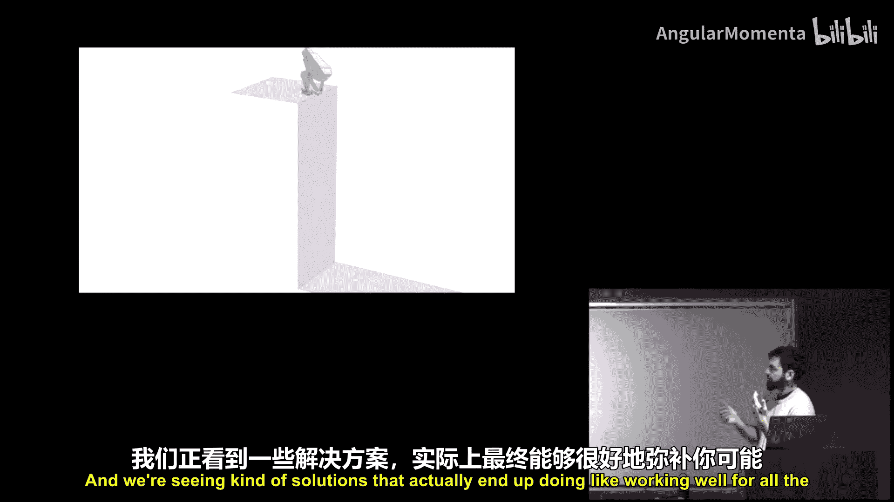
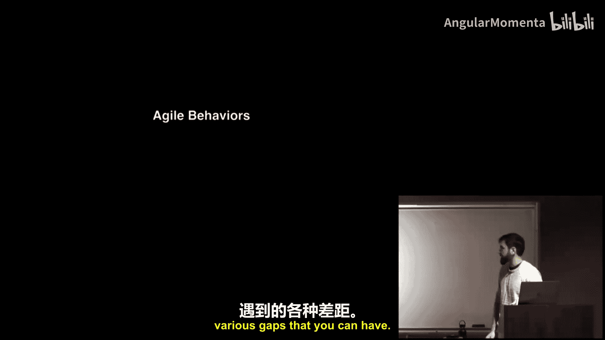
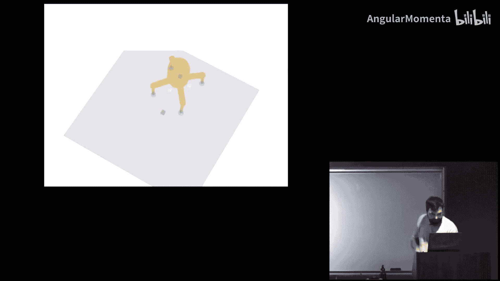
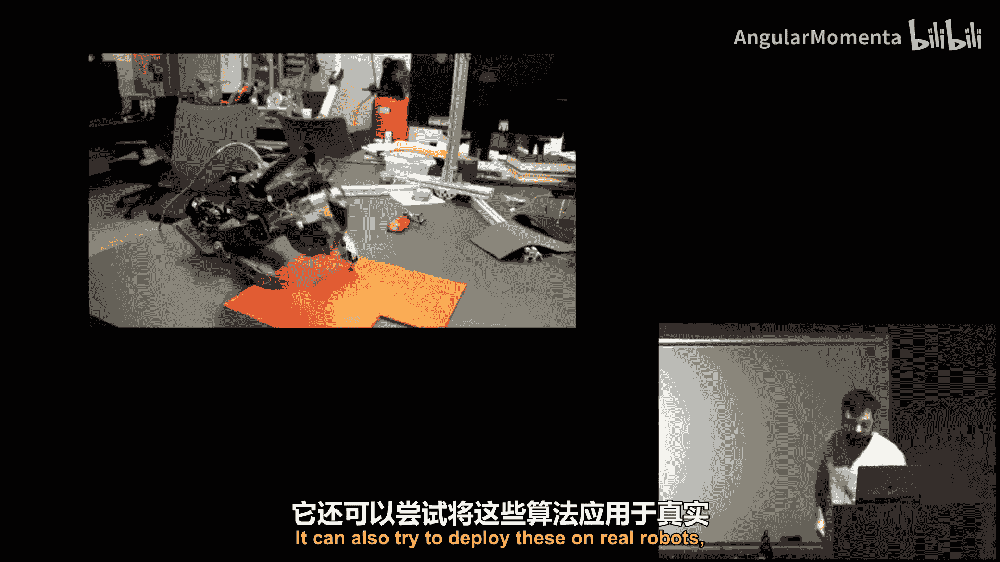
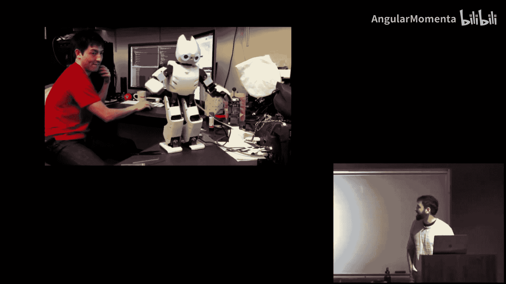
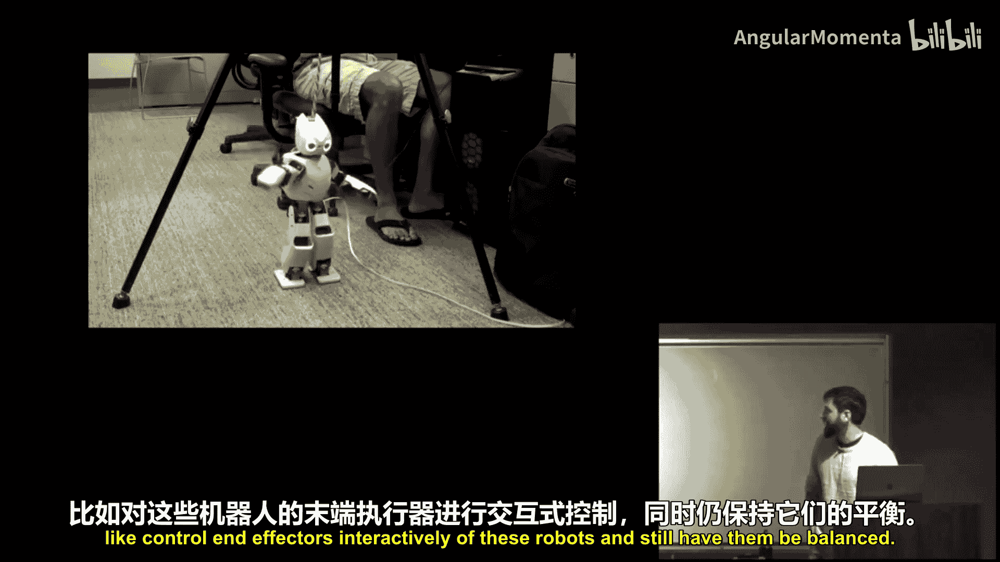
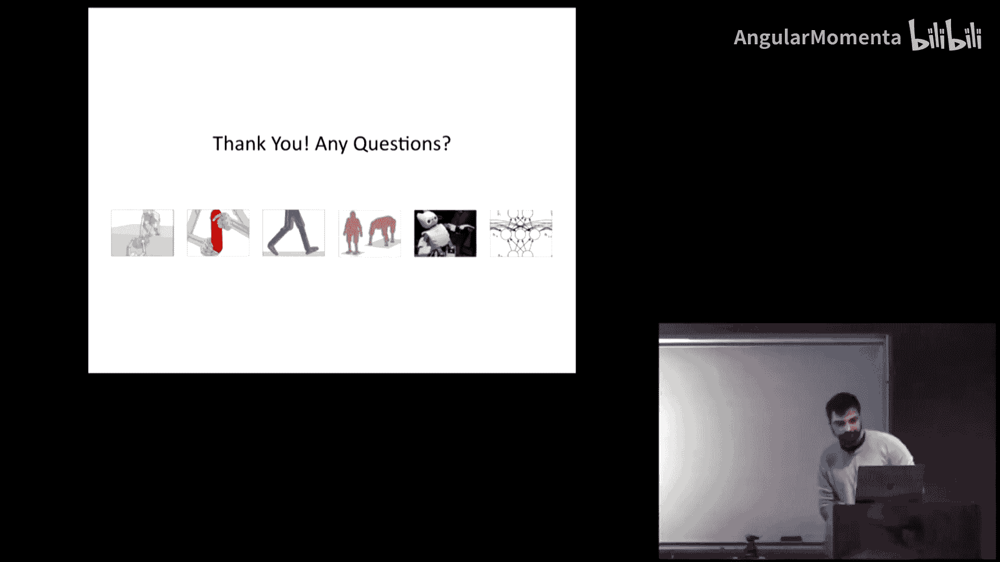
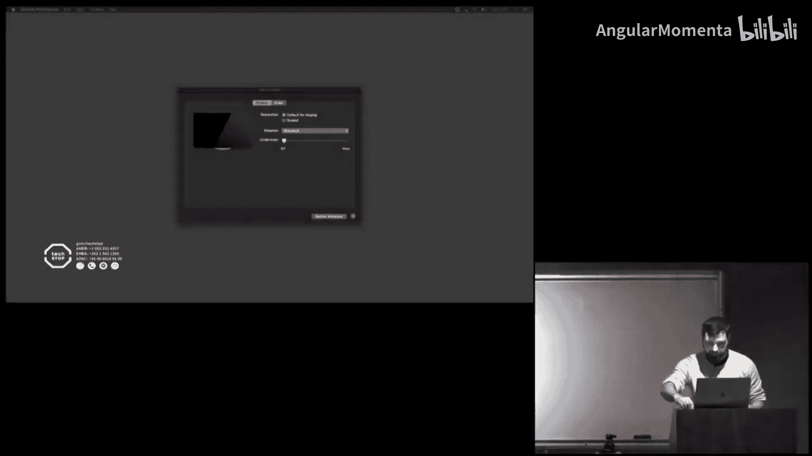

# 【加州大学伯克利分校】高级机器人学-｜-CS287-Advanced-Robotics-at-UC-Berkeley-Fall-2019-p09-9-搭配、拍摄、MPC、接触不变优化--BV1KXqCB4Eua_p9-

Ior Mordch， to give a guest lecture on this topic， he's a research scientist at Google Brain working in machine learning and robotics。

😊，Previously， he was a research scientist at Open AI after completing his PhD at the University of Washington and postdoc here at Brook。

So without further ado， we can。Go ahead and started Yeah， thank you very much for the introduction。

Yeah， so I will continue。😊，I will continue talking about the theme of optimization based control。

And previously in just the last lecture， Peter has talked about locally optimal control and in particular making these distinction between shooting and collocation methods。

And earlier in the lectures， most of what we've talked about。

 we've primarily been looking at forward dynamics models。

 such as next state as some function of the previous state and your controls。

And we looked at advanced methods。For， for shooting classes of problems like looked at LQR or differential dynamic programming。

During the lecture today， we're going to look at direct colocation methods in more detail。

 both for optimizing open loopop policies， Open loopop control sequences。

 and optimizing feedback policies。And we're also going to look at inverse dynamics models where you can recover the controls from just sequences of states。

And we're also going to look at advanced solution methods for optimization problems。

 similar to basically analogs of LQR and D for direct collocation。

And then we're also going to look at。Optimization in the presence of contact and what are the some of the challenges and possible solutions that can arise for that。

 which are like really ubiquitous in robotic settings。

So let's get started with just trajectory optimization and direct colocation。

Make sure to make sure we're on the same page， let's say you have this problem where。

You have a system in some initial state， and you want to minimize or reach some goals， such as。

 for example， reaching the target。And we've looked in the past at forward shootinging methods where you directly optimize for a sequence of controls。

That when rolled out with your forward dynamics function result in some sequence of states。

And you would like to choose such control sequences that minimize some cost function like reaching the goal。

So this is kind of like what we've seen。😊，And the issue that Peter has brought up last time is that this problem has has very poor conditioning Oh and by the way。

 throughout the lecture， like if you have any questions， please feel free feel free to ask。

It can be pretty informal。But this problem has poor conditioning， so for example。

 if you change the initial controls that has very significant implications on the rest of your trajectory and this can be seen more directly if you unpack this set of equations。

 you're basically chaining your forward dynamics function F multiple times so it becomes and any particular state at time T。

 is dependent on all the controls leading up to it。

 so it becomes very basically accumulate sensitivity。

The other issue that I don't think Peter actually brought up is that you have very narrow feasible regions for these problems。

Because this dynamics function， you can think of it as an implicit heart constraint。

 like all of your solutions have to satisfy by construction。These forward dynamics。

So that may result in very narrow feasibleas regions， so if is this two dimensional spaces。

 the space of all your possible trajectory sequences。

 the red region is all the trajectories that satisfy the dynamics equation that you see throughout trajectory so if。

 for example， you're running your optimization and your initial guess for trajectory is somewhere。

 you might have to take very roundabout paths throughout the optimization to reach the solution。

As opposed to， for example， if this was say， a soft constraint and not a hard constraint。

You could see maybe the optimization could take much shorter paths to the solution。

 so it could in the intermediate stages， break the laws of physics have something that is not physically plausible or consistent。

 but then converge on a solution that is。And if you think that this is just like a pathological case or example。

 this actually does come up in practice quite often， so for example。

 collision events that happen with real robots or let's say you have a bipedal robots or some robot that starts standing most of the sequences of controls you try will just lead to it falling down and you're not going to be ho we will see and you will not be able to make much progress there would be very hard so these shooting methods are very prone into falling into local minima and the solutions are very sensitive to the initial guesses of the controls that you choose。

😊，So you could ameliorate this somewhat by choosing initial guesses from demonstrations or potentially doing a lot of randomization and trying a lot of。

Trying basically random search。For this。But there is an alternative。

 as we've seen from the last lecture。As opposed to optimizing for sequences of controls。

 what you can do is optimize directly for the sequences of states and controls potentially。

In the case that I will discuss throughout the lecture。

 we will actually be only directly optimizing for a trajectory of states。

As opposed to states and controls。Where the controls can be recovered implicitly。

 the inverse dynamics function that for a pair of states will give us the control。

 so we don't need to have it as an explicit optimization variable。And in these settings。

 what you have is only the pair wise dependencies。And so you have good conditioning properties that changing。

 for example， X1 has the same effect as changing your optimization variable XT。

 it's not like some of the variables have disproportionately large effects on your cost function。

The other advantages that there's also no instability due to forward integration。

 so we've seen we typically need to take pretty short time steps in forward dynamics simulation because due to time discretization and explicit integrationtegrators like oiluler integration。

 forward integration can quickly grow unstable so we have to take very short time steps we don't have such issues of instability due to forward integration here。

 which is nice。In the。Do you have to use。Yes， so that is a game that you can play。 And in fact。

 many physics simulators do try to have high order integrators like Ugakuuda integrators to try to solve some of these stability issues。

 but it's still basically this is equivalent to using implicit integrationtegrators。

 which are known to be actually like not to go unstable。 In fact， if anything。

 they actually dissipate energy rather than create energy。

 So this is basically the equivalent to using implicit integration methodss。😊。

So these are some of the advantages around conditioning and stability， and the other one is。

 again we can make this dynamics， this dynamics becomes an explicit rather than implicit constraint。

 and so it's a constraint that we impose explicitly rather than having it be satisfied by construction。

😊，And that allows us the freedom it can also either be a hard constraint or it can be a soft constraint in the optimization。

 So the solutions potentially the problem can potentially be less prone to local minima because we can just。

Try infeasible states， like I've discussed。So to summarize the differences， with forward shootinging。

 we optimize over the controls and the trajectory of states becomes implicit just because we roll out the controls。

 we see what states come out， but the dynamics equation this F is an implicit constraint that is always satisfied by construction that is either a bad thing or a good thing like it's either a benefit or a burden and direct collocation you directly optimize over the states whereas and controls and potentially constrained forces come out of it implicitly via the inverse dynamics。

And this dynamics can be an explicit constraint， which can be made soft。

And just to I wanted to very briefly discuss that both of these settings that Peter described in the last lecture and that I've just brought up are just special cases of more general collocation setup so originally this was motivated by solving differential equations where you optimize the parameters you're optimizing is some parameterization of your trajectory and controls and。

😊，You have various ways in how you can actually recover specific states， specific controls。

 and their time derivatives。嗯。And。You basically test the satisfaction of dynamics only at specific points。

 which are called the collocation points。The reason I bring it that up is that theres in numerical methods literature。

 actually many other choices we've just taken a very specific choice where theta is just the sequence of x's。

 but there can be other ways to paraize trajectories you can use like other bases like polynomial basiss of trajectories or Fourier basis and there are many other choices of where you place these collocation points。

 we've just evenly spaced our time steps over a grid which is fine。

 but you can potentially do some other like smarter or adaptive methods So just want to bring up and there's also the other point is like there's nothing sacred about basically choosing two neighboring basing your inverse dynamics on just two neighboring states like this is a local way to parameterize trajectories but you could potentially have an inverse dynamics function that depends on。

Many more states。That is，re just global。 So that is just， yeah， we wanted to have the smaller side。

Any questions， by the way？Before we jump into inverse dynamics yeah。ition about why。えさん。Well。

 its you can't in the shooting methods， you cant， you don't really have the option to make that constraint soft because。

That constraint is by construction is always satisfied， like your x's are a function of your uses。

 so the relationship between them is just always satisfied by construction。Whereas。In our case。

 like in the case that in the top。Formulation that Peter brought up。

You explicitly have the freedom to change your x's and your Us and the relationship between them。

That is an explicit constraint that you're satisfying， so that is not satisfied by construction。

 you have to explicitly enforce it。 Does that make sense。Go。Yep。

How do we know that the adverseverse dynamics map exists？Does it need都 be unique。That's。

 that's right， yes and。So the first question， does it exist， We will get back to that later。

 It need not exist。 You might have some feasible。there is no way to transition from one state to some other state and in this case。

 as we will see， we can have like any inverse dynamics might have some residual。

 I'll get back to later， so you will be able to get information like these pair of states is not possible。

And also even like by how much like the degree to which they are impossible。To your second question。

 is it unique？😊，It。Doesn't。That is a tricky question。

The way that physics simulators have been proposed and built is that you would always have a unique solution。

To this。But。There are some generalizations where basically you might not have a unique solution。

 so there might be multiple controls that lead you to the same thing and people typically like propose some ways to regularize or like some prior to put in such that we can always recover a unique solution but。

That is sort of like a little bit。Foooling yourself。Because even for example。

 if I'm just like in a pose like this， you don't actually know how hard I'm pressing against the table right now。

 right， you just can't recover that from the poses alone。

And people basically propose ways to like some regularization methods to have a unique solution for this。

It's a little artificial。Maybe you'll get into this labor put。看子。First method。

I'll talk in the second。大シ。Yeah， I will get to that a little bit later。In general。

 if you have the power to recover the states via the inverse dynamics， as I will discuss next。

 that's less variables for you to optimize。Yeah， this is a choice that you can make and some of the work has done in one way。

 we will actually see some examples or you can do it in the other way。There's yeah， like no。

It it's been done in both ways。 but I generally the personal feeling。

 and I think there is a body of work that says the second way is favorable if you can have if you do have access to inverse dynamics function。

 you can use it。 The problem is you might not always have that。 And in that case。

 you would have to use the top method。But if you do have it。

 so maybe let's now discuss what is this inverse dynamics function。And unpack that a little bit more。

So again， it describes what are the controls and forces you apply when you transition like you have specifically。

State X of T and Xt plus1， and then what are the controls and forces？

One way you can choose to go about finding this function is just be learning it from data。

 so I think Clickpeer has been talking about learning methods。

 so what you can do is just try to gather a data set where you apply a bunch of controls。

 you look at two pairwise like two neighboring states。

You try to see what is the control that made you transition from that state to the next and use your favorite function appximator like a neural network to try to learn to try to learn a mapping from that input to those outputs that is definitely a way that you can。

 but for rigid multibody dynamics。we can do better if we know the system parameters。

 and so we'll go into this case right now， which I think is useful。

 even if you're going to be using learning， it's useful to see what under the hood。

 the physics simulator， what the ground truth really of physics simulation is and what is the structure of those equations so that even if you're learning it。

 you can maybe incorporate some of your knowledge of the structure into your learning methods。

So let's go into rigid multibody dynamics。And in this case， this state x of T。

 we're going to include in it all the degrees of freedom of our robot。

 let's say all the joint angles and for the root， for example。

 like root position and root orientation。And we can calculate velocities and accelerations of these degrees of freedom just via finite difference in in our case。

 if it's just a for our case。 So a particular U now depends on。

The state at that point in time and the state before and after it。And。

The way that we can recover these controls is basically by generalizing f equals a a， so for example。

 if you had your equations of motion like f equals a a。

 you knew acceleration because you have access to the trajectories， you knew the mass。😊。

You can just like then you know what was the force that was applied。Now。

 in the rigid multibody dynamics， it's a little bit。

 that equation gets a little bit more complicated， but it's still the same idea where you have more generalized mass terms and these specific chorioliis terms。

That depend on velocities。And on the other sides， basically on the fourth side of the equation。

 you have your controls， which。Can be modulated， I believe you've seen it in the LQR lecture。

 they can be modulated by specific matrix， which basically can say that。

 well there are some degrees of freedom I can control with my use。

 but there are some other degrees of freedom， for example， like my root position。

 there's no muscle acts I can apply to like move my root globally。So this B reflects that constraint。

And we also have some constraint forces multiplied by there。

Transformed by their Jacobian and these would be say the contact forces that are applied or if there's any joint limits。

 the forces that prevent your joint limits。 So I've gone over this in just like very。

 very superficial high level If this is something that's interesting to you I would suggest an excellent treatment of this is given in Springer handbook of robotics in chapters 2 and3。

 and there's another which doesn't which talks about unpacks this equation and all these terms。

 how to calculate them doesn't talk too much about contact And if you want to understand contact。

 I think analytical dynamics and new approach is also a really short concise great book on the subject that talks more about these equations with contact Yeah the con forces how do you deal with that fri change directly。

嗯。Yeah， so something that do you mean like frictional constraints due to friction。 Yeah。

 this is something that I actually for brevity haven't mentioned these the variables F have constraints also on themselves like they have to lie the friction is expressed as a cone constraints So F needs to lie within some some cone and there's also complementarity constraint between positions and forces。

 but I would really don't want to go into the details of those but yeah there are some much like there are constraints on cues like joint limits。

 for example， there might be some boundary some boundary constraints。😊，So but at the high level。

Then what you have outverse with your inverse dynamics function。

You basically try to solve this equation， you have all of your Q's and their derivatives。

 and you can solve for the F's and the U's that satisfy this equation。

And that is how you can recover the controls and the contact forces。And if it's not possible。

 like you've asked， if it's actually not possible， there no sequences there's no cues。

That actually make this equation hold。You can also like the minimum of this equation is going to be your inverse dynamics residual。

 so this function R will tell you the degree to which these two states are transition to these states is impossible。

And I should say these equations can be solved either numerically or analytically。

 so there are closed form solutions to solving these equations。And this is， by the way。

 like this is not just for direct allocationlocation methods like your favorite like physics simulator is doing this is solving this problem under the hood anyways。

 except。You know， for forward dynamics， you know the queuees。 So you plug in。 sorry， you know the。

The Q and the velocities。You plug in your controls U and you get accelerations out of it。

 but it's solving exactly the same problem。So this needs to be done anyways。

 or it's being done anyways。So maybe we can go over a simple example for just a 2D particle。

 let's say your equations of motion your f equals a is just some you have some controls and you have some external force G like like gravity。

 so the inverse dynamics function if were just to plug in our finite difference approximation is going to give us that there is this form for you that depends on the x's。

And let's say we're just trying to minimize， let's say our cost is I just want my state X to be small。

That's just for an example。In our initial state it starts at zero， we have。

 we know that our system parameters M and our external forces。

 the unknowns we're going to be solving for is the rest of the trajectory after the initial state。

And the solution could just be basically the state continuing to be at zero。

 the implicit controls where we can recover is G。 so it's kind of like can say the controls were applied were' directly opposing the gravity。

In the other example， for example， if we want to minimize controls instead， so basically effort。

 we don't want to apply any controls。We're going to see the sequence of states that is basically free falling motion and the implicit controls are going to be zero。

 so you can basically get trajectories。That satisfy dynamic set of optimization。

So now I'm going to talk about how we actually solve these。Methods numerically， but before that。

 any more questions？So numerical solution methods， the first thought really is。

I believe you've looked at Tensorflow or torch or various other machine learning frameworks like automatic differentiation frameworks and so the first thought is well this looks like a graph。

 why don't we just set up a graph in TensorF and try to optimize through it with gradient descent and that actually would not be a terrible idea this would be some sensible thing to do but we saw from previous lectures that for shooting methods we could do better we had something that took advantage of higher order derivatives and basically was like an equivalent of second order methods we saw a QR。

 we saw a differential dynamic programming so can we do something similar apply a second order optimization method。

For these direct collocation problems。And why would you want to do that？

So Peter talk gave examples that with second order you have faster convergence rates and residuals tend to be a lot smaller。

 you saw the plots of that from lecture 6， the intuition for me personally is that what you're trying to do is you're trying to solve a simultaneous system of simultaneous constraints that all are overlapping。

And if you were doing it with first order of methods like gradient descent， you could say， well。

 I'm going to try changing my variable， but if you mix one change in your variable。

 you're going to satisfy one constraint， you're going to violate another constraint。

 and so you're always going to be playing this game of catchetchup。

Whereas we know that second order methods or linear system solvers are very。

 very good at satisfying multiple constraints simultaneously so why don't we just take advantage of that and in practice。

 second order methods do tend to be very important for getting these collocation methods to work something that or something that considers simultaneously changing multiple variables on some problems that takes you from you know second order methods take between like 10 to 100 iterations whereas first order takes like between1000 to 10。

000 durations and you're still getting like residuals that are not satisfied so。

I think it tends to be actually more important than for shooting methods to apply this。

So one particular method you can consider is the Gaus Newton method。

 which is very similar to natural gradient， or the idea of natural gradient method that was proposed in lecturec 6。

Where if we had this total trajectory cost。That depended on。Some features。

 so this Phi includes all the features we can think of like this thick controls are inverse dynamics residual。

 maybe other features like end effect positions， basically anything we want to put a cost on。

And if we look at the gradient and hessian， well， the gradient looks pretty straightforward。

The Hessian， and by the way。In case you haven't seen this notation。

 like C sub X means the derivative of C with respect to X。

 and like C X X means like the second derivative of C with respect to X。 So this is。

These subnotation is just derivative derivatives。And if you were to unpack this second order term。

 what you would see is it's something that basically depends on the first derivative of your features and another term that depends on the second derivative of your features phi。

And it's this term， the second term。That actually could be。

Quite tricky to calculate so if it's like inverse dynamics residuals， getting a hesian of that。

Actually， could be quite tricky in practice， whereas just getting the first derivative of it could be done with say finite difference or other types of approximate methods。

So the game you essentially could be playing whereas we're going to be assuming that our cost C are going to be something analytical so that we can get the first and second derivative of C can be calculated very easily。

 let's say it's like a quadratic， so like a case might be if I want my arm and the or my robots and the to go to a particular location。

We might put the end effect position into phi， its coordinates and C might just be like a quadratic between the end effect position and the target。

 so it allows us basically we have the freedom what terms like what do we put in the C。

 what do we put in the phi and ideally in the Phi we want to put things that are hard to differentiate and C is something that's easy to differentiate？

And basically， then what we can do is what happens in practice is we can drop this term and just have this truncated。

Approxiation to the Hessian， which is。You have called the Gaus Newton method。

And so we can find solutions just by。Basically iterating Gauss Newton' steps。In practice。

You can use for stability， aian。 and I think Peter。Talked about this in。Lecture six， I think。As well。

And so I think it would be very instructive maybe on your own time what you can do is take a look at the relationship of these equations that I've proposed of posed and the natural gradient that was covered in lecture and it's kind of same in tuition。

Of dropping terms。So。发。Then the question is。We have this session that we form and it's the size of your state space times the number of steps times the number of collocation steps squared。

 do we actually have to this number can be quite large， do we have to invert it at every iteration？

And the answer is actually。Luckily for us no， because if you look at the structure of the Hessian because the dependencies between like on the constraints are only local。

 the Hessian ends up being block sparse and you can just use like your favorite out of the box sparse linear system solver to solve this like so Pythons call actually works really great you can do better but this is already pretty great and from there's many other methods from numerical methods。

 literature that you can apply to this problem like multi-grid methods or various spectral methods that can speed this up and you can also pose this as constrained optimization as well so where your dynamics can be made hard constraints we'll see example of this later。

As well。So， maybe。Before we get into contact， do you all want to take a short break。

 just take like five minutes since usually and if there's any questions we're just going to talk about contact Yeah。

 maybe like for five minutes， take a break。I'm going to talk about contacting policy learning。

Im sorry， what is the damage of the hesing。It's x times t squared so the size of your state or sorry so this is the state the。

Number of times steps squared or well， the size of the issue is like it's a matrix of these dimensions。

Okay， so so that will be yeah wait， let let me go through this so you have a number of states。

 this or time span and in each of them you have say。So6060 degrees of freedom So six of them。

6 of them。 Yeah， then I see。 Yeah， So if your tea is like typically like。50 to 100 time steps。 Yeah。

 your're like as you say，6， it's like 600 times 600 metrics which is。Maybe be a related question。

 the C matrix that vs spae， is it usually just a lot of one？好快 by你看。It。Tends to be。

 so not quite it does have。This form， but these serve。The band。Of this the bandwidth of this matrix。

Is。Your size of your state space times three。So because it's like relating these。

 but it's not like ones or zeros， like are there are specific like coefficients that are like gold。

 just like they're not ones or zeros。佢实系翻得地方。我 just是可。考いか。快。That is how you would。Calculate yes。

 so you can recover accelerations via this like， yeah， there would just be like ones and minus ones。

 Like if you want it， basically and you can do is。You can get。嗯嗯嗯。Or。最反是。You know， this of your ex's。

 but that is just to get accelerations if you want some other features。

 it's going to be like you quadrant like yeah you put a quadratic around your features and that's the function of accelerations。

So it's a yeah， the coefficients are trickier， but they're never like so much like。Yeah。

 like my inverse dynamics， for example， is going to depend on some like nonlinear way on my acceleration and that would have to be kind of put into the。

Overall matrix。Ex。Iく。啦。快告せ。あ。应该。入されま。Yeah。Yeah， we can start。や。感じだ。Yeah。大夫。I3。Yeah that would。Yes。嗯。

Especially if it's like over。这も说です。Go shape。Yeah， so yeah。

CM sampling based methods have been applied。Can give you a reference if you're interested。

 So I think like one really great example of this is like we're called like Sttomp。Out of CMU。

 like STO MPP， and mostly it looked at for non dynamical for non dynamical systems。

Just for finding kinematic paths， but yes， cross entroping methods。You have to。

You have to be a little bit careful about it with how you parameterize controls because。

Typically with forward shooting， when you apply these methods。

 you just have like Gaussian noise like you make perturbations to your controls via just like independent Gaussian noise。

For direct allocationloc。There's a little bit care about how you propose your perturbations。

 but I think like Sttomp is a paper that has like very short。

 really great motivation that does go over it， but it is a good idea， Yes， it's arguable。Yeah。

It might be a more robust solution。Then the second order methods。

 but second order methods do tend to be faster than finding a solution， especially if you have good。

I sure。かのつは。Yes。And so actually combining the two of them， she will talk a little bit。

 but later is like when we we come to。Okay， well， maybe let's get back to it where we'll talk about optimizing dynamics with contact and also talk about policy learning and this part of the lecture is going to have more videos so if you're fading there' will be at least like some videos to watch。

嗯。So dynamics with contact。Both shooting and colocation methods can be applied to control of movement without contact and actually have been have seen success。

 so for if it's like for flying or driving or swimming robots or finding collision free paths for robots。

 both methods actually do tend to work well。But actually with contact。

 it's difficult to apply either method out of the box。

 know if you have but this comes up a lot if you have。

 say legged robots or if you care about manipulation，Or interaction with the environment。

It's very difficult。 And the challenges are that。Contact introduces discontinuous jumps in your energy landscape。

You might have。2 states like Q1 and Q2 that might be very close and similar to each other。

 But one very small change， if I just place a robot's hand on the table。

 that means the robot has is able to apply contact forces whereas like it couldn't before。

 So the dimensionality of F。Suddenly even changes between two time steps。And in some cases。

 I can yeah， and like that leads to sharp discontinuities in the energy landscape。That's one issue。

Another issue is that we don't actually have any gradient information or any feedback from forces that are inactive。

 so if the robot is might be really， really close to the ground but not actually touching it。

 there is nothing in our optimization landscape that tells us。

 well soon if you just place your foot a little bit lower。

 you would be able to apply forces and have all sorts of actuation capabilities。

 there's no gradient information that's telling you that out of the box。

So typically some of the solutions have been in the past to manually specify sequences of context like all the footsteps for the robot。

 either manually or with some planning methods or use demonstrations that just get you into the ballpark of the motion right away or incorporate some specific motion structure like specific state machines。

嗯。And actually， reinforcement learning is going to be one other example of dealing with this that you will see later in the class that actually has been quite powerful towards addressing this as well。

 So we'll have another option that is actually quite， quite powerful。But。The problem is。

 in all these cases， is that contact activity is an indirect function of state。

 But what if we make it a direct optimization variable like we did for the state。

 What if we directly optimize for。Contact activity。

And that kind of brings me to some of the work that we've done in the past where you start with a direct colocation problem。

Where you optimize for trajectories of all your joint angles of your robot， but also in addition。

 you optimize for these contact variables that are scalar or sorry that basically predescribe a set of possible contact that you can have and if this contact variable is one that means that foot or hand is in contact with the ground at a particular time so you can see an example circled on the left。

For the foot at that initial pose， the contact variable might be one。

 but for the right arm at time T， the contact variable might be0 because it's not touching the ground。

 So I've highlighted all the contacts in red。And because these are contacts。

And poses our explicit optimization variables， you have to explicitly enforce consistency between them。

The contact consistency and the dynamics consistency that we've seen before。

 otherwise you could just get trajectories like the robot just flying towards the goal。

So this contact consistency。嗯。I don't want to go into too much detail on where it comes from。

Very briefly， it comes from the complementarity conditions on forces。And。

Basically what it says is that when the contact variable for a particular limb is one。

 it means that limb must be touching the ground and not sliding。

And when the contact variable for that particular limb is zero。

 the limb is like the palm of the hand or the sole of the foot is free to move in space however at once。

And the dynamics consistency basically is this f equals a A that we've seen before。Except。

We're going to assume that all possible contact forces we can have are always active。

 so the dimensionality of F and JFQ does not change。So the set is constant instead。

To our optimization problem， we're going to have this penalty function that says if the contact is zero。

 we're going to have for a particular limb， we're going to have very high costs on trying to apply that force。

And if the contact variable is one， you don't really have like a very high cost for applying it。

 So inside our inverse dynamics function， we're going to have this this soft nudge。

And so what happens is basically the trajectory optimization。

 you can think of this as like a nested optimization at the high level you optimize for control sequences and at the low level you're finding U's and Fs。

 and it's via these contact variables that high level trajectory optimization guides this low level inverse dynamic solver。

 it tells it okay， I want context to be active we not active here。And at the end。

 we end up with a problem that doesn't have any discontinuities due to contact and always has the gradient and in particular can be solved with standard local optimization methods like the Gaus needton method that we've talked about and on Crca 2012 machines it takes about2 to 10 minutes。

Surprisingly， isn't that much faster these days because most of the effort was spent on GPUs。Comp。

But let's just maybe take a look at the example of how the optimization progresses to give you some intuition。

 let's say we have some initial state like the initial state of the robot here and the goal is for it to be standing over the white crossha target DC see。

Well， early on what you see is the optimization is finding paths that are basically just flying towards the goal and all the blue squares you can see that indicates that it thinks the contact variable is on so it's basically thinking that it's like oh。

 it's pushing off the air and just flying towards a standing pose so this is what I meant by the usefulness of inverse dynamics as a soft constraint。

 it allows you in the intermediate stages just to break laws of physics and entertain all sorts of infeasible possibilities。

But later in the optimization， what we're seeing is that because of this constraint that。

Contexts need to be touching the ground and not sliding。

 You can see it converging onto or touching the ground。 You can see it converging some context。

 either going inactive or being attracted towards the。The floor。

And in the late stages because of the not sliding objective。

 we see that context actually converge to single points in time。And as a result of the optimization。

 you can see a motion that。Is getting up and kind of like is physically plausible。系。

questionThe fact that it was able to push error and the the beginning and later no as it and it slides and then later not slide is that the result of。

You explicitly me。In this case， this was an explicit three stages where yeah。

 like kind of similar to continuation methods， you have some weight。

 you start with some weights being low and you set them higher in the recent results。

 it was actually possible to get away from these three stages and I will show some examples where that's not necessary。

 but because this was just very early work， you know we tried all sorts of things。嗯 yeah。

So what's the difference of like gradually adding？like putting。In。

 instead of what as opposed to what， sorry as。As a heart constraint？That limits the。

The space that you can explore， so if you put it as a heart constraint， you always have to be。

Finding， say， solutions that。嗯。That are basically in the space of。In this space of solutions。

 you cannot。Entertain possibilities， like just flying towards the goal at first。

 So this is what it allows you。To do。Sorry， I'm not quite sure if that makes sense。嗯。

Maybe another way to phrase it。Maybe another intuition is like similar to。

Relaxation methods where let's say for in integer programming like you might。

Always be trying to find like so that your solutions are。Integers。

 but you might be able to apply relaxation methods where， okay。

 they can be continuous continuous variables in the intermediate stages。

 but then they move towards actual towards integers。 So。

 and relaxation methods can be maybe much easier。 Like continuous problems might be much easier to solve。

 So this is this， this is kind of the intuition。😊，So in general， the。

The idea is you try to only softly。Enforce the consistency between various variables that you have。

And it might result in a larger surge space， but it's easier to explore possibilities in via。

Be the main idea of like adding these auxiliary contact variables。

So maybe some of the other examples of what this can get you is a similar goal to what you've had before。

 just stand over the white Cross here， but if you vary the environment。

 you can see a number of different strategies that they can come out。From these optimization methods。

 So here we've allowed the robot just like allowed forces that can pull so the palms can pull and not just push。

 and we're seeing kind of solutions that actually end up doing like。

Working well for all the various like gaps that you can have can also。

Optimize instead of standing at a particular orientation。

 you can flip the orientation and get kind of these handstand behaviors with all the right preparatory motion。

嗯。Or I can place like a bunch of locations like where the hand should be and have a particular velocity and get kind of like a sequence of。

Punches or kicks， like and all the while， you know。

 the agent is keeping or the robot is keeping balanced because well。

 in order to keep making the kicks， it needs to be kind of balanced。嗯。Yeah。

 can also generalize it to non humanoid morphology so you can ask like how would this？

Walking couch like thing， like go over a gap and we're seeing a sensible sketch。For the motion。

You can also optimize for。Interction with props。 So let's say we add additional props and additional variables saying that you can make contact with these props by only get by only specifying the final location of the box。

 we can get a trajectory that makes the character like come up to the box and。

And place it because what happens in the optimization is well。

 first the box just by itself flies towards the goal。But then the optimization asks the questions。

 well in order to fly towards it， it needed to have some contact forces applied to it。

 well in order for it to have contact forces， it needed these contact variables to be active in order for those to be active。

 the hands need to actually be touching the object so it kind of like the optimization sets off a chain of dependencies。

And you can also look at multiple agents or multiple robots coordinating。 And again。

 the only objective here is like on where the box should be， theres nothing。

 there's no objectives or no costs on the movement of what what the robots should do。

Or here if the goal is just to have。The top of the little agent reach a particular height and there's no constraints or no objectives for what the big agent。

 what the big robot should do， we're still getting of like these climbing behaviors。And yeah。

 in this like two agent setting are you optimizing over。Yes， yeah， it's like one big system。

 so it's kind of like a high of mind yet collection of agents， it's not decentralized。

It seems that the agent on the bottom has a tendency to touch the ground。Even before it。嗯。

So I think it's an artifact of this particular set of。

Effort objectives that we've set so we've had some regularizer that was saying I also want my contact forces to be small。

 so I don't want to exert too much contact force and what the consequence of that was it tries to balance all the forces and so instead of standing on two feet it is actually like under its model of metabolic effort it's easier to just。

Place like sit， basically。So yeah， we can also apply it for hand manipulation and it's exactly kind of the same setup where you have now variables for context between the fingers and the object and you can do various things like grasping at a particular。

Orientation。Of a variety of objects。Or manipulation where the goal here is just to have。

The object rotated a particular velocity around the x axis or the Z X。Or the Y axis's。

What we're seeing here though is one consequence of having these dynamics be soft constraints。

 so as you can see here， it generally is a pretty sensible sketch of the motion。

 but like things look a little bit floaty and。And might be breaking。

And like might be breaking the physics a little bit。

 and this is because that inverse dynamics residual again， is just a soft constraint。

 and our trajectory parameterization like we're optimizing for sequences of states that are might be pretty far apart in time so some of the intermediate states like might might not be。

W not be plausible， so there's like always a small residual and this is in contrast to forward cheating methods where you are always going to get something that's plausible。

 but just might be a lot harder to get。Can try different。Robot hands。

Or you can even try multiple hands kind of again， as a hive mind， like you say。

 coordinateor together to pick up。An object。Or。Sorry， actually， just wanted to check how much time。

 when does this lecture officially end at 1220？Oh， 1230， okay， all right， cool。Yeah。

 the other thing I briefly just wanted to describe is you can also put more detailed models of。

 so I know the classes is for robotics， but。You can try other actuation models， for example。

 like muscles and muscles actually have their own very detailed dynamics。

 which you can again write out the equations of motion for。然。And get。More detailed。

Agenent behaviors or robot behaviors that actually then show you are the what are the actual muscles doing and how much are they activating and contracting and this is a case like you've asked are these solutions unique here for the case of muscles they are actually not because like you might be like am I just having very little effort right now or am I contracting really really hard。

 there's no way to disambiguate these two cases so there's just additional regularizations you need to put in place to deal with that and we can see that actually it does tend to recreate human walking patterns both in terms of torques。

And kinematics。And we can just specify higher velocity and get detailed movements of。

Of running at4 meters per second。Or like walking on the moon gravity。Or initiating gates。

Our stopping gates。Jumping to various locations or kicks again。Or back kicks。

 I don't know that one was。Yeah， these motions were fun to generate。

 there's all sorts of things you can do。嗯。So I should bring up another example where you're asking。

 okay do you have to just optimize for the states And again， the answer is no。

 there's been a lot of also successful work that explicitly optimized for states controls and forces and has done so as a heart constraint and so one excellent example is the work of Michael Posa and Rostedrick in 2012 they've done really detailed models of like let's say an ostrich like robot running that were actually there was no residual so you could actually really deployed on on the robot。

 So it's another case。 unfortunately don't have videos for it， but does look great too。So this， yeah。

So all these videos that been seen。Very careful how you define the cost function。ユーザにォ。确实。嗯。

So the cost function。嗯。You basically， the big thing was， again， like。

For motions like moving the box around。You did not want to create create any hint or conform costs in this case。

 so the costs were around satisfying the goal， which is like I want the position of the body to be here。

 which was expressed as a quadratic。Some metabolic energy expenditure。

 like I want to minimize sum of squared of torques。

 I believe like Peter kind of talked about that and minimize sum of squared of maybe contact forces So some measure of effort and some like so we've had general like regularizing objectives on。

The for like basically the pose。 So I want the default pose of the character just to be kind of like close to standing pose。

 This was just something to， you know， make sure I don't do like just like rest like in various poses like that。

 but there wasn't。A kind of like a hint towards like what I should be doing with this box。

 We wanted that to come out of the optimization。 And no， there were no demonstrations here。

 Like again， this was like very explicit not to。See what you can get to Novo because in some cases you might not have like for a robot of a weird morphology。

 you might not have like that big walking couch， you might not be able to get demonstrations for that and lots of robots are weirdly shaped。

嗯。So yeah， for trajectory optimization， I've seen this with generally general approach pre automatic。

It solves an optimization problem to get each clip of this motion or like an open loop trajectory。嗯。

But there isn't really any learning or reuse in these solutions。

And it also can deal with unexpected events， so we're going to be instead of looking for just optimizing for clips。

 we're going to try to look at how we can use these methods for finding feedback policies instead。

And。One of the ways in which you could。That brings us to this。

And one way you can really apply it is Peter talked about model predictive control in the last lecture。

 and that would actually be a really perfectly sensible and I think like a very nice way to。诶。

To be finding control policies with feedback where I optimize like I use my trajectory optimization to plan for the future。

 I take the first step。Act in the real world。I might find myself in a new state。

 but then I just keep repplaning。 I think this is a very good approach to it。

 and I think Peter covered it pretty well， so I'm going to skip it not because it's a bad idea just because he already talked about it。

What instead I'm going to talk about is this approach that I was alluded to in the last lecture for how we can use。

Coocation to get a feedback policy。So。To make sure we're on the same page。

 the policies we're going to be considering is just。嗯。

Some deterministic function that maps from states to our controls。

And what we're going to do is we're going to， in the case of shooting methods。

 optimize for policy parameters that when rolled out forward are going to minimize the cost。

But again， we're going to have these poor conditioning issues。Around forward cheat。

So one way you can try to make this problem easier is to learn from demonstrations。

Where policy learning just becomes a supervised learning problem like maybe another。

Names for it like behavioral cloning is a term that comes up a lot to describe this。

But where I basically have a lot of demonstrations of。Trajectories and controls。

 and I just try to fit a policy to recreate those sequences。

And where can the demonstration come from， well， it can be coming from human demonstration。

 but we can also use our trajectory optimization to arrive。

 to generate arbitrary amounts of this demonstration data for us。

And that's kind of how we're going to approach this problem。So we're going to propose a set of。Tasks。

And use a trajectory optimizer to solve a particular task。

 So let's say I'm starting in some initial state， and I want to walk。Forwards， three meters。

 or might have another task where I want to work backward， two meters。For each of these tasks。

 I'm going to run the direct collocation optimization。

methodethod that I've from the first part of the lecture。I'm going to。

Collect all the states and action pairs from these trajectories and then going to fit a policy。

Like let's say， a neural network。To recreate these。

 So then I would be able to generate all sorts of in between motions that move to all sorts of。

Generalized all sorts of in between velocities。The problem， though。

Is that this data set of trajectories can be inconsistent or very difficult to fit。

So we've looked at example of generated like a flapping bird motion。

 and you can see degrees of freedom for。Both。For the task of the bird just staying in the air。

And one way to achieve it is just to flap very， very chaotically and the other one is to kind of create these regular cyclic patterns of flapping。

 both of them satisfy the task， but one of them might be a lot easier for your neural network or for your policy to fit like the one on the right might actually would be a lot easier to fit than this chaotic behavior and elect。

The other issue is that the set of trajectories might be inconsistent。

 so depending on my random initialization， if I'm standing and I want to start moving forward。

 I might start walking with the right foot or I might start walking with the left foot and both of those would be equally viable but a deterministic neural network will try to fit maybe both of these solutions and do something in between which would not be a sensible interpolation。

😊，So that is why what we're going to do is we're going to have。

 we're going to make make sure that the。Our policy actually feeds back into the trajectory optimization problems。

And the way we can do this is we can。Simultaneously optimize for this pose joint optimization problem。

 optimizing for the policy parameters and this whole set of trajectories where we have the traditional trajectory optimization cost as we've had before。

But we also have this additional term that will。Couple the policies and the controls。

And so what it's going to do。Is it's going to like， so one way。Basically。

 our trajectory optimization is going to propose us。Some， some controls。

And the policy might propose something else。So we have this discrepancy。

And or this inconsistency between trajectories and with the policy outputs。And。

The way we can reduce this discrepancy is we can adjust the policy， so just train it for longer。

 make it fit our sequences of use better， or we can adjust the trajectories instead we can adjust the use to kind of start matching the behavior of the policy pi。

And so the idea here is， again， you've added the auxiliary variables instead of just optimizing for policy parameters。

 we're going to optimize for policy parameters and a bunch of trajectories。

 and they can be inconsistent。But we're going to softly enforce the consistency between the policy。

 behavior and trajectories。 And again， that results in a larger but an easier to explore search space because again。

 your rollouts are not bound to。Much like before we weren't bound to satisfying laws of physics by construction。

 now we're not bound to just trajectories that follow the policy by construction。And in practice。

 we can kind of decompose this joint problem into an alternation of。

Just trajectory optimization problems we can solve for each x independently with this additional quadratic。

 lets us stay close to the policy。There's probabilistic interpretations of this like so if you know like work of guided policy search。

 this is basically same idea except you have KL divergence instead of just a quadratic and a regression problem that is basically our supervised learning problem and we alternate between these problems。

And it can be done on multiple machines， but that's a little beside the point。

And so what that gets us in the end is。Tject or policies now that we can interact with in real time。

 So the green is something that I'm just is a cursor that I'm just controlling interactively。

 And we have this flapping。Bird like character that tries to track the target。

Or we can make the viscosity of the medium just or medium a little bit viscous。

 It's more like a fluid and get this weird turtlelike creature to also track the target。And。

Track target orientation。And so again， even though we were doing trajectory optimization。

 the object we end up with is a feedback policy， is a closed loop。

 is a closed loop policy that that's like a neural network in our case， can be executed in real time。

can also use it for interactive control of bipeds here。

Conting for this biP and you can see the contact forces that are being applied as well。Yeah。

 it's pretty responsive or we can get like shorter bikepeds and get like weird。

Baby chicken things walking。And tracking the cursor as well。嗯。Or weird couches again。

 now walking in real time。Or。Qudrupeds。That。Yeah， move around or turn around。And so in this case。

 it was like。嗯。Maybe on。Sirca 2014 machines。About two to three hours of training all the various trajectories。

 but in the end is you get something that's real time。Or a weird spider。

We really wanted to make the spider go up walls to make it even creepier。

 but we didn't have time before the deadline。

Oh， shoot， is you can also try to deploy these on real robots， like making these。

BipPd robots get up or with interactive policies。have it kind of， oh no。

 I really I was not expecting this to have sound。

But yeah， you can get it to control it interactively or the work that was yet done here at Berkeley。

Control end effectors interactively of these robots and still have them be balanced。

So yeah， that's all I wanted to talk about。😊，If you have happy， still have some time。

Happy to take any questions that you have about any of this work。The time complexity， like。

Time complexity in what sense and solution。Again， I haven't looked at this work recently， although。

Trying to。But at the time for those motions that you saw。

 it' was like two to 10 minutes of optimization on have。系。It increases， but in general。It's。

The increase close is close to linear in the dimensionality because again， like we have the solution。

Is a band like the problem？We're solving is a band diagonal system。

 so we don't have this quadratic or cubic explosion。And complexity。Yeah， any other questions？

And again， also just wanted to say so I think reinforcement learning is another very good alternative to dealing with contact that you will see later in the course。

 very relevant。Hopefully looking at what inverse dynamics solvers do and what's actually happening inside a physics simulator also could be useful for you。

Then the policies you train at the end like were they conceptual no net policies that you。

The party around。How many directions。で general。Yeah。

 they do take as input like the goal location that is explicitly given as an input to the policy and the number of goals typically end up randomizing。

 I think we ended up。For those problems， about 5000 random goals。

 that's kind of like where things start getting。 I don't have like the。

 the plots of performance with respect to number of trajectories。 But in practice， like。

Depending on the problem。1000 to 5000。 So it's like on the order of thousands of trajectories that it starts getting competent。

Yeahep。What are some of the open problems right now？際は？Like what。嗯哼。😊，嗯。Well， one is。

These systems will still。Some look simplistic and。You needed to have。The inverse dynamics model。

 so you needed to know this model and run a physics simulator or use a physics simulator learning these models from data actually I think could be a really powerful step。

So then you would be able to deploy it you know， towards learning in the physical in the physical world。

 I think there's also。Opportunities for more complex and long horizon tasks。

 So here the tasks we're looking at were pretty short， just like I picked something up。

or I place it somewhere else， but you know， like performing a long horizon。

 like a long term sequence of actions， you know， opening a door， opening a cupboard。

 then placing taking something else in， walking around that is。Not something that is。

I think like these methods as you increase the time horizon。

 these methods do start to kind of like become harder to find solutions for so they might basically I think the main failure case is that there is a strong because this is a soft optimization there' is a strong appeal to cheat so if you give it something that's really long horizon that requires making many steps it'll just try to skip steps so it's like oh like for like a tiny amount of time I'm just going to imagine that my doors the cupboard is opened and I'm just going to pick something from it and I'm not going to waste time like making a motion that opens it up so it does tend to fall into these into these local mini。

So I think methods that do incorporate learning。And potentially operating at multiple time scales。

 so maybe I find a proposed trajectory at a very coarse time scale。

 and I do have a learned dynamics model for not just how to go from you know one literal state to the next but how do I go from here to there I want like a kind of like a course or like longer horizon model that will tell me okay。

 this is possible we'll figure out how but it is versus you know me and getting up over here on the ceiling is not going to be possible for sure。

So then you can chain。Multiple optimization， multiple time scales and actually multi grid methods in the numerical methods literature have been one。

😊，pathath towards。K dealing with that。Which could be something interesting that hasn't really been explored in the context of optimal control for robotics too much。

 So that's another。Interesting opportunity。 but basically， long horizon。嗯。And。

More more complex motions。The other is to try to maybe incorporate some hard like for certain cases。

 for certain applications， you would need to。Actually。Deal with heart constraints like。You know， for。

For the case of， let's say biomechanics， if you try to ask the question。

 like we're generated movement and 1。5 meters at 4 meters per second。

 if you ask a question what's the fastest a human can possibly run？

And so you just put the target velocity higher and higher。 these methods are not going to tell you。

 okay， past a certain velocity is just impossible。 they're just going to cheat like little by little。

 start breaking physics to succeed and sometimes you don't want that。

 Sometimes you actually want realisticistic solutions so actually imposing things as a hard constraint。

 imposing dynamic is a hard constraint is another problem that。I think it's worthwhile to look at。

Yeah。So that's just off the bat what I can think of right now。

