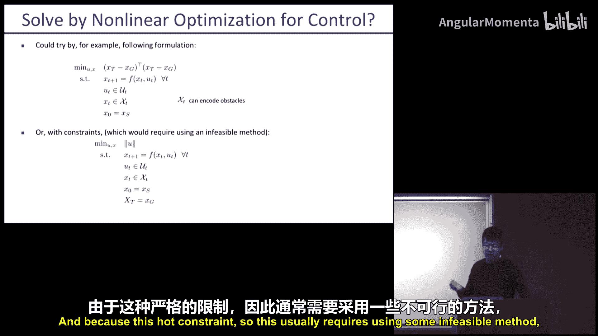
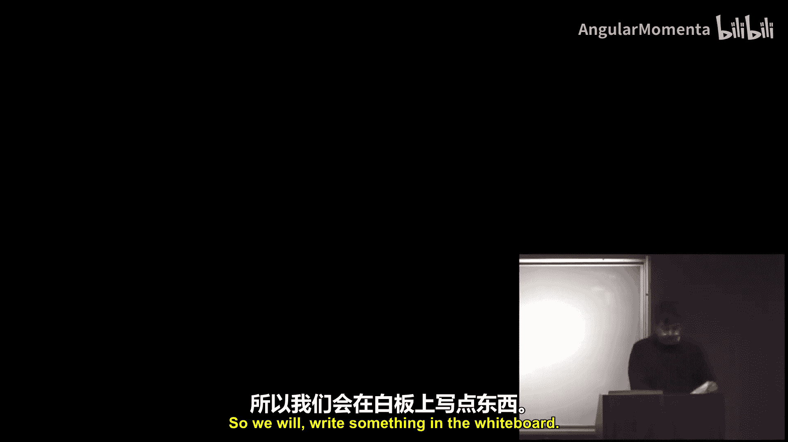
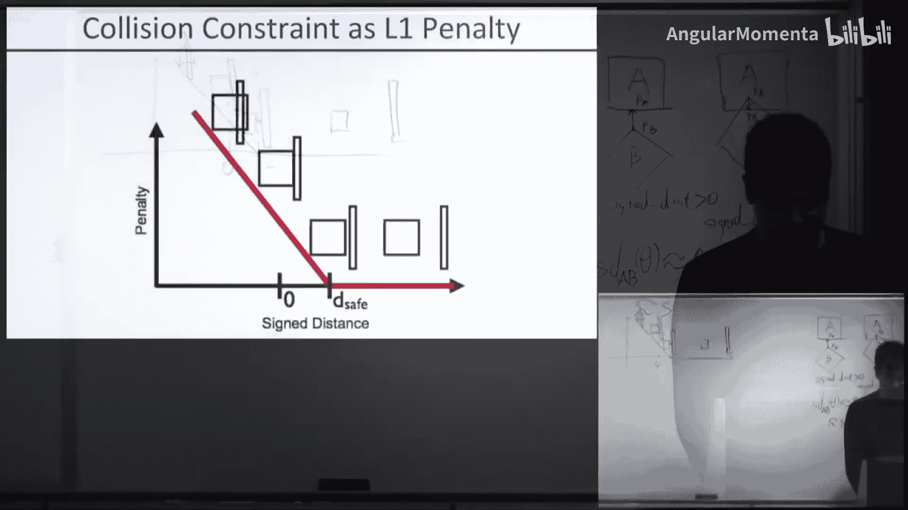
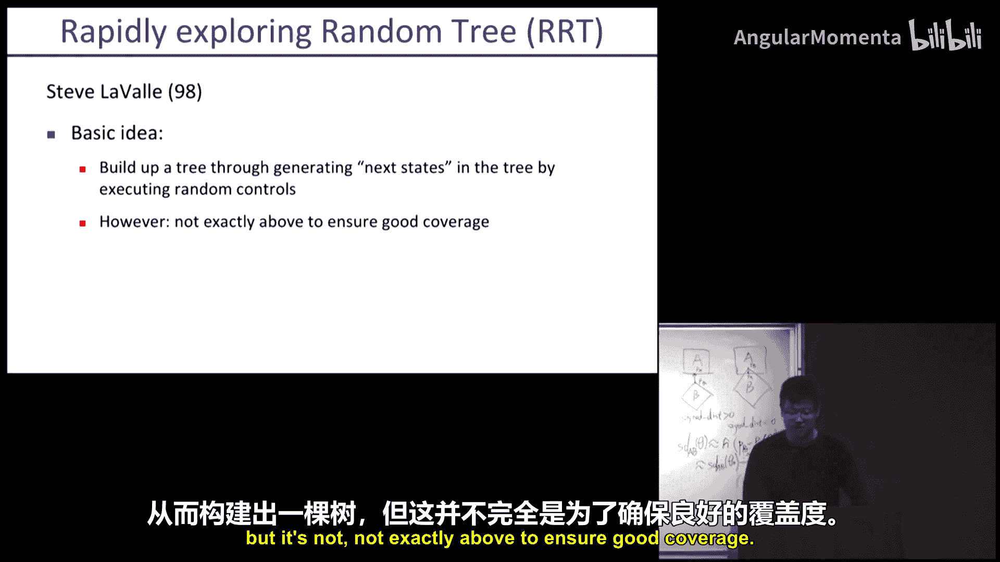
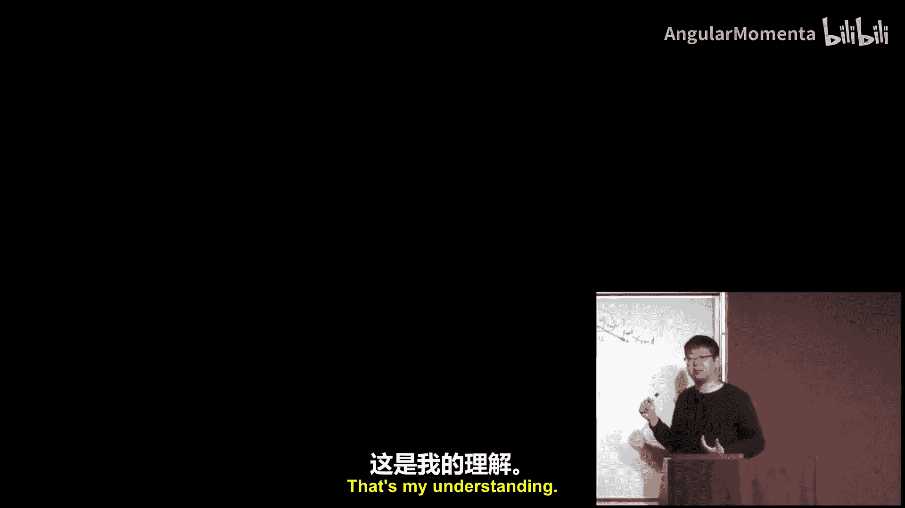
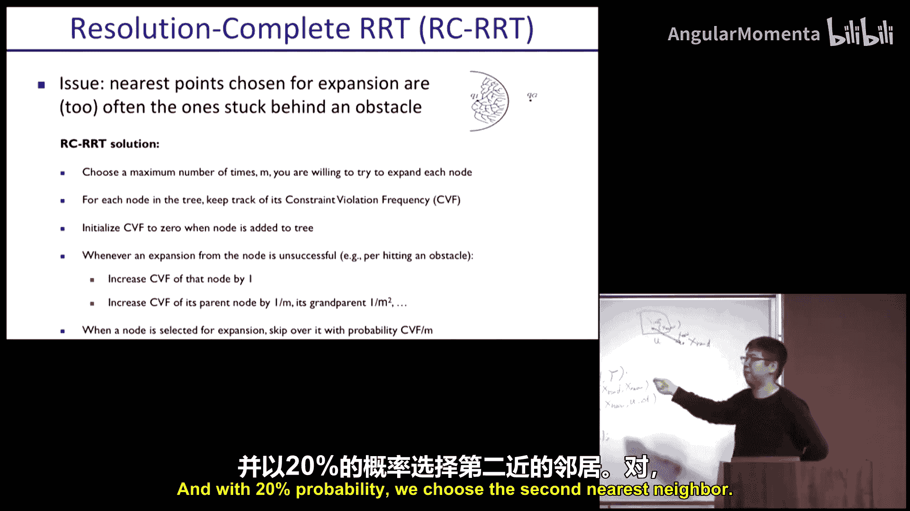
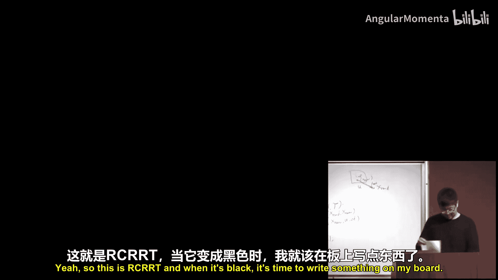
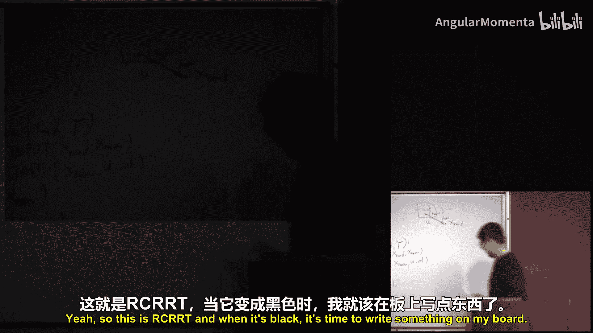
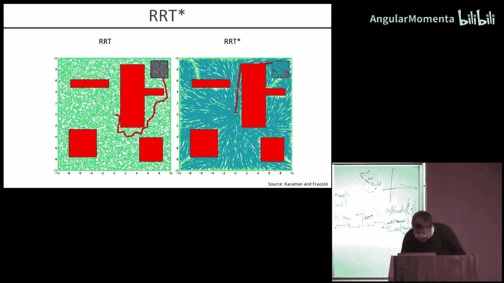

# 【加州大学伯克利分校】高级机器人学-｜-CS287-Advanced-Robotics-at-UC-Berkeley-Fall-2019-p10-10-运动规划：PRM、RRT、Trajopt--BV1KXqCB4Eua_p10-

家后。还。けて。我也没有。That。嗰时候。こだや。啱。Okay， hello， everyone。 I'm Harry。

 So today we will learn motion planning together。 And if you plan to go to Peter Peter's office hour today。

 I think the office hour will still happen。 So you can just go to Peter's office in the regular time。

 So yeah， so that's start。😊，What motion planning。 the problem can be formulated easily。

 So given some start state X S and go state Xg what do we need we need a sequence of control inputs that these from start to go。

 and this is very intuitive but actually solving this problem is very， very tricky。

 So there are two points I can think of one is we need to avoid obstacles and later we will show like avoiding obstacles can be nonconvex and another another point is for systems with under under actuaated the dynamics is tricky because we cannot simply move along any coordinate at will like there are like most of the dynamics system is under underactctuaated dynamics like cars。

 helicopters， airplane and so on。 So we will check a few examples。So。

So this is helicopter pass planning， carppo swing up and acrobo。 If we look at them carefully。

 we will find they are constrained by some joint limits or some other constraints。

 So they are underactctuaated systems。😊，And also， there are some more realistic example example。

 like in the industrial world， there are these things like enmbling a car can be can can be another kind of motion planning problem we want to solve。

And more examples on the left is， is a few agents want to move the piano out of a very constrain room。

 And on the right， we can see one bipedal working agent and like object manipulating robot。

So these are all in line umbrella of motion planning。 Or we can solve this by this method。

 And there is a like a sequence of image on the top row is a simulation figure like in the simulation we want。

 we want the robot to grasp or get the object under the table。

 and the lower row is the actual robot can can follow the follow the trajectory in the simulation and achieve the goal we want。

😊，So today， this is an outline of today's lecture。 Firstly。

 we will learn about configuration space that which is the basic or the。😊，The， the。

Like the configuration space is the starting point。 we want to learn motion planning。 And also。

 we will learn optimization based， the motion planning and the sampling based the motion planning。

 And we will learn the difference between these two。 Yeah。

 so starting starting from configuration space。😊，So some of you might have known。

 but some some might not。 So this is configure。 a concept figure of configuration space On the left is a robot robot arm。

 and on the right is the its configuration space。 the darker the darker area is the constrained area and the white area is the feasible of free space that the the robot arm can move。

 So what is configuration space or sea space。 it is a set X X is the pose of the robot。

 So instead of in the 3D space。 we think of this problem in in another space。

 that is the pose of the of the robot。 So there are two examples the work space on the left is we want to move the the little rectangle in this space and the black triangle is the obstacle。

 And on the right is the configuration space， we can see。😊。

The there are another layer of blue obstacles that is due to the collision between the blue rectangle and the triangle。

 So that's the configuration space。 And on the lower row， we can see similar effect。

 like we want to move the circle and which is another rigid body and on the right， there。

 there is another blue layer that is caused by the collision。

 So this is the difference between work workspace and the configuration space。

So now we want to go into the optimization based motion planning。

So leading motion planning methods based on RRT and A stars slow down a lot as the dimensionality of the state space increase。

 So fast planning is very， very essential in for solving problems。

 and this starts from some reactive control that is potential based method。

 if you are interested in this， you can check this like kind of ancient paper or seminal work and also also there are some optimization based method that optimize over the entire trajectory starting from elastic bands and Trump and is variance like Sttomp and and Emp or Imp so but here we find that in a few benchmarks。

 t opt which is brought here brought here by John Summan over outperform most of other base and we will learn that。

😊，Yes， so it out performform all the bases in both like shortest pass length and also the computation time and also the success rate。

😊，So let's look into detail。 how So can we solve this by nonlinear optimization for control。

 So in the upper part， we can see one formulation like X T is the state at the time step at the like final time step T。

 and X G is our goal。 So with a few constraint subject to X T plus1 equals to F X T U T and U T in U T in set of view and X T set of x and x 0 is at the starting point。

 And can we reform reformulate this into another formulation on the lower part。

 we see that we can actually just minimize U。 But if you look carefully。

 we find there is another constraint。 that is X T equals to X G。 That means we want the。😊。

ultimateut state to be equal to the goal state。 And because this。

 con this con this hot con constraint。 So this usually requires using some invisible method like learned in previous lectures。

So， we will。

Right， something。Myight board。Sos。Oops。So， we want to。Minimize。C的。1，2 T。S over T。

Of the T plus 1 minus。C the。Square。Plus， some other costs。So this is our main objective and。

Subject to。Theta 0 is the。Start。State。嗯。F the tea。In the。Go set。 Go set， sorry。

And there are some moral limits。😊，Such as。Dt limitss。If you are using a rubber arm。

 there are some joint limits you want to follow and。Also， something important。For all。Robots。Parts。

No collision。So this is another constraint like。If you are using a robot arm or any kind of robot。

 you don't want collision。 So as previous mentioned， this part can be。Non convex。

So we cannot simply do convex optimization and solve this。 The。

 the solution we use here to solve this is called。Like sequential convex optimization。

Sequ sequential convex optimization is some kind of method that repeated approximate the non con convex problem with a convex problem and solve the。

 the approximation step by step。 So so looking into detail of this constraint。

 Like for all robot parts， there is no collision。 we can define what is collision。 And here。

 we want to。嗯。Draw something here。So there is body A。Let it be。This is some point at PA。PB。😔，So。If。

P B is outside A， then this。Distance is positive， and we call it sign。Sine distance。

Which is greater than zero。And。This is pretty intuitive。If。This P， B。Is inside a。Because this。Find。

Distance。It's smaller than zero。응 ？我我觉得。我觉得。Oh， these are two bodies， like two rigid body。Yeah。

And yeah。So we can， we can write this。呃。In a more strict way。The sign distance， A to B。Of， of theta。

Is approximately equal to N， P， B minus P。F了。So this is saying this is is the， the， the vector。

 the normal vector。 and this is the distance between these two。 So this decides the there， the。

 the direction and the or or the sign。We can also rewrite this。Yeah， not。S the。AB。Thehita 0。Minus。嗯。

2。Jy。Pa。C the 0。 sorry， it's so big。 Can you still see this。Time theta minus theta 0。

 So this is a different formulation。 like this is the original distance。 And the， the。

 the latter part is the， the。The distance moved from， from， from 0 to from theta 0 to theta。

 and J is sort of a dynamics or， D， a dynamics model or or yeah。And so now we have the。

 now we know what is sign dis distance。 We can add this as a penalty in our optimization problem because we want to。

 we want， we want the sign distance to be positive so that there is no collision， so。😊。

Can I erase this part？P。试下。Oh， so， so P B is， you can， you can imagine P B is a fixed， is。

 is a fixed body and P is P's position is dependent is dependent on Theta。

 Theta is the configuration of a。Yeah。So erasse this part。Oh， I think J is the dynamics。😊。

From this configuration change to this configuration。 So what。

 what should they change in the workspace。 So J is the， the function to do that。Yeah。

And so what kind of penalty we can add。We can。Do something like this。So， we have。

0 sign distance here。 and here we call it safe。5 distance cents。And so in the0 point。We have this。

Square。This rectangle。That has zero s distance。 And at this at this safe distance point。We have。

This square and this rectangle。Has a positive safe distance between these two。Yeah， and。E。

To the left， we have these two overlap， which is collision。 and we want to penalize this。

 So we have a higher value for penalization。 And on the right， we have like very far away bodies。

And as long as it's large， the， the sign distance is larger than the safe distance。

 we don't penalize。 So this is a hinge loss or the H。

 the hinge loss like penalization we want to use for， for this。Optimization problem。O。

Okay， so。Now we want to consider another thing that is continuous time safety。

 So what is continuous time safety。 So if， if you are controlling a robot arm。

 So there is a volume between time steps an arm can sweep out。 So the whole volume of the s out。

 you don't want any collision。 So if you just check collision at every time step。

 then there are still some collision in between time steps。 So you can always reduce the time step。

 but it's kind of hard。 So we we we consider just check the volume and other bodies and check collision between those two。

 So this is actually very fast overall， because you can allow a costly sampling trajectory。

 that means you don't check every consecutive consecutive time step instead。

 you can check like a few steps away and just roughly estimate the。😊，volumeolume。

 So this makes the collision check even more even faster。 And also， actually。

 this method confines better local opt because you check the volume in instead of like1 step points。

 So this is another thing。😊，Now， we will see some。Example。

So this is the collision free pass for Dublin's car。 It starts with collision with somebody。

 And after the optimization， we just derived。😊，It finds the path so that there is no collision and it's a feasible path。

Can explain themhm。The figure in the previous。This one。Okay。Oh， okay。

 so so A is like the robot arm at time step T and8 plus1 is the robot arm at T plus time T plus1。

 And the the shade shaded area is the volume， the robot arm swept out and the B is some obstacle。

 you want to avoid。 So although A T and A plus one are not collide did did not collide with B。

 but the the volume actually collide with B。 So you So what you want to check is the volume does not collide with B instead of just single time step collision。

😊，有高で。我部。Yeah， so， so， so if， if everything is dis discretized。

 So you you only check 8 and 80 plus  one exactly。 But here we want to consider the。

 the time in between 80 and 80 plus 1， yeah。Here you are zooming from 80 to 80 plus one the movement is just a purely linear。

it not。 yeah， it， it can be nonlinear。 Well like if， if the time step。

 the the gap between two time step is very small， is very reasonable to approximate with a linear function。

 but you can always like adver in invent something that is nonlinear。

 then you can cut the time step even smaller。 I think still with a with a linear function。

 or you can invent some new algorithm to check collision。

 because I think collision checking is not only for like linear linear shape， yeah。😊。

And what do you mean by。Oh， cost sampling trajectory means you start you， you can actually check the。

 the swap out volume from 80 to 80 plus 5。 maybe if it's just some linear linear motion。

 So instead of checking 80 and 80 plus 1，80 plus 1 and 80 plus2， like step by step。

 you can just roughly estimate like from 80 to 80 plus 5。

 And although it's not exactly the same volume， but it's similar。 So and。

 if it's linear then it's the same。 So it's much faster， yes。Okay。Some more， some more。Example。

 so this is a industrial box pick， box picking application。

 So the you can see the consecutive path is the planning trajectory。

 and the the robot arm actually followed the planning trajectory and picked the box successfully。

Yeah， maybe we can。Skip this because it just repeatedly do this。嗯。Yeah， there is another。D RRC robot。

Using planning。To go inside a door without clide with this obstacle。That's the。

 that's not the most intuitive way to avoid the obstacle， but that's the algorithm。Yeah。

 and touched about it。Okay， so now we have some algorithms。 We need， we need to benchmark everything。

 So there are two benchmark。 The first one is you just control one arm。 That is 7 degree of freedom。

 and there are  a hundred and 98 problems。 And the harder one is 18 degree of freedom with two arms plus base plus toso。

 and there are 96 problems。And here is the benchmark results。 We find that T opt is。

W which is much faster than like if we check time is faster than sampling based method。

 like a bi directionional R T and Trump。 And if check。

 the success rate is higher and the past is shorter。 So in this kind of problem。

 treasure update is good。 it is better than the other two。One more example。So。First。

 we represent the the lab environment into obstacle space， so。We want to do rich and grab。嗯哼。诶。

Determining how far away。S。Sorry， can you say that。Determine how far away you're。Oh， I see。

 So usually this is， if you are doing this in a simulator， usually you， you cannot decide this。

 although you can always hack the simulator， I think， so usually。😊，As long as the time。

 the time gap is very small， then then it's fine。 But how do we define small， That's another。

 another question。 I would say smaller time time gap will make your algorithm very inefficient because the trajectory horizon will be very。

 very long if the time time step is very small。 But if it's very large then the gap is too large。

 So we miss something in the middle。 So it depends on your problem。

 but also depends on the efficiency you want。 Yeah。

 so the trade off between between like knowing everything and like efficiency solve this。

Let's continue to this video。Yeah， this is in the simulator planning， like the。

The robot arm is planned to grab something， rich and grab something。Very fancy。Yeah。

And it's the actual pure to doing the same thing and success， succeed。And then we want to do。

Throw away。you， you can see that this throw way。 you need to avoid some obstacle， right， so。

And after some optimization， the robot find a path。 There is no collision and。There it is。

And it's very exciting。 So other student also want to watch， And we。😊，Gave them some was。M。😊。

I so slow。어 come on。Yeah， I think， I think that's it。

 I think everyone in the classroom can do faster than this。 But yeah， that's the algorithm。

 And if you think it's too slow， you can like， invent some new algorithm to， to like surpass this。

 yeah， and。😊，One more application。 That's the steerable needle。

 So if you are interested in some medical application or you， if you are familiar with this。

 there sometimes we need some needle to be inside some tissue。

 And even we want the needle to navigate around some sensitive structures in human。

 although it's a simulation。 but we can see is very sensitive。 so some introduction to the needle。

 it has a bubbleel tape is highly flexible。 and it's in the S E 3 space。

 which is R 3 times S O 3 and R 3 is the X V Z， like the the3D space。

 and S O 3 is the 3D rotation space。😊，And there is one more。 There is one more constraint that is。

 it should always follow a constant covature path。 So let's formulate this。So here the yellow part。

 the O is some obstacle。 and we find that。We want to minimize three cost。 One is the cost delta。

 One is cost5 and cost fee and another is cost O。 So there are the translation cost。

 The rotation cost and obstacle cost respectively。 And if you check the constraint subject to the first line might be a little bit tricky。

 but you can you can think of this as so the same as X T plus one equal to F X T U T。

 So the E X P W T is something like rotation motion。

 And the exponential to V T is the the translation motion。 And here we want to say starting from X T。

 we do the rotation and do the translation， we can get X T plus one。

 So I think they use some group theory representation instead of regular representation。 but。The。

 the intuition is simple。And also， there is another constraint that is s distance between between the state and the obstacle should be larger than should be larger than the safe distance plus the the needles distance like some certain boundary。

 we cannot break into。 and X 0 is belong to the entry set。 and X T belongs to the target set。

 P T is the rotation degree， and it it should be smaller than pi and larger than smaller or equal than pi and larger or equal than negative pi。

 And here K K T is the coverter。 So we say we said we should always follow the constant coverver。

 So here K T is always K max。Why the first time。 oh， because there is a inner inner product。

 So the so if you write it， if you give a exponential to both side， you will have X， T E， X， P， W， T。

 X， P， V T times X T is E to the06，6 dimension 0。 and yeah， so that that means。X T。

 do the motion of rotation and do the motion of translation and。

 and take an inverse times the future。 X T plus one should be one， right。

 So because E to the0 is one。 And then the if the inverse of a and the B times together is one。

 then they should be the same。 Yeah， that's why we have a0 on the right side。

 because it's a there is a log on the， on the left side。But， but it's just rough， rough description。

 If you want to， if， you want to know the detail， you can take like Lee L Al or something。Oh，So。

Here is some result。 If we perturb the alpha， the， the coefficient for the obstacle loss， the。

 the obstacle objective， we find when alpha O is one， the distance is small。 and when alpha O is 10。

 the distance is large， you can see that little needle and the the obstacle on the， on the left。

 right。And here is some result。 We find optimization based method can be fast and can have better success rate。

 I would say。And so why is minimizing taste important。啊。I think， I think this is very intuitive。

 like because the needle is inside the human body。 So you don't want the needle to rotate。

 twist in the in the body for。 And if you rotate， you will check the， the， the fake human tissue。

 and it will hurt a lot of things。Yeah， and if we。Ex expandp this to channel layout。

 which is usually called Bra therapy in implants in medical area。 So we want to。

 we want a channel of tube or the needles。 and we want to guide them to some target humor area。

And the cost function the objective and the constraint are similar。 but there is one more thing。

 We relax the constant curvature the previous K T is equal to K max， right。

 So here K T is smaller than K Max larger than K 0。

 And we have one more constraint that is the deelta sum over K T is smaller than C max for the channel planning。

 So because previously is one needle。 and here is a channel。😊，Yeah， so here。

 here are some results on channel layout， yeah。So optimization based method。

 if you are interested in this， you can try it yourself on like with the code from RL L dot Berkeley dot E slash treasure opt。

 And there are a few benchmarks。 you can， you can try out。 And if you find new things。

 please tell us。😊，Yes。So。Some more video。Yes。So it's robot navigation planning。

So this is optimization and the fine trajectory without any collisioncc。Following the trajectory。ok。

Okay， he， he made it。 Yes， so this is more。Thing and yeah。

 so after optimization based motion planning， we want to。

 we also want to look at some sampling based motion planning。 So I think inside of this。

 this section， we want to learn PRM， which is probabilistic road map rapidly and the R T rapidly exploring random trees and smoothing because the trajectory。

 you find with this method can be like very noisy and you want to smooth them out and。😊。

I think we can take a break after PRM， because PRM is very fairly simple。 So， so probaistic roadmap。

 we have a space R N。 that is the the rectangle。And we have some forbidden space。

That is the dark yellow area。And we have some free and feasible space。 that is the light yellow area。

And the configurations are sampled by picking coordinates at random。

 So we randomly select one point in this space。And we repeatedly do this are parallel in parallel。

 like we sample a lot of points。And we find some of the points are feasible。 some of them are not。

So we find the collision free configuration configurations as milestones。

 So the they are marked pink。 These are our mark milestones。

 So each milestone is linked by straight path to its nearest neighbors。

 So it's linked to like you can choose the hyper parametermeter K like 5 or 10。

 You find the 1010 nearest neighbor and connect them with some path。😊。

And then we removed the past that there is a collision in the middle。

And we do this for all the points we have。 and we now we have a graph。So， if。

We want to start from the starting state S， and we want to reach the go G。

 We just do a search with some computer science algorithm。 Yeah， and this is， this is very， very。😊。

Simple algorithm， but very useful。So here is some description initialized set of points with X。

 S and X G。 And then we randomly sample points in configuration space and then connect nearby points if they can not。

 if they can be reached from each other。 So previously。

 we just remove the lines that is blocked by some constraint。 sometimes if， in a real world。

 you can you can always do some optimization to find if two points can be reached or not。

 But in this example case， we just say if there is some collision， it can never be reached。

And then we find the path from X S to X 3 in the graph。Yeah， so so alternatively。

 keep track of connected components。 So this is a better exam。 So you。

 you keep the keep track of connected components so that you don't need to do the final search or you can prune the final search to a regular to a smaller space。

So more example。Oh， I think this cannot be played。 I don't know why。

 but we can see the other example， which is。More interesting。So， this is a robot。Trying to climb。

Yeah， so this setting is very friendly to PRM， because it's just like there is a space。

 and you sample a few points。 And if that point is close to the。😊，To the physical point that you can。

 you can put your foot on， then it's okay。 So I think this task is very particularly friendly to the PRM method。

 yeah。So。Sampling， so how， how do we do sampling we can do we can sample uniform from 0 to one。

 like for each coordinate。 this is one thing。 And we can how how to sample uniformly at random from the surface of the N D unit。

 So we can sample from N D Gaussian。 And because it'strootropic。

 That means the identity is the the the covariance matrix is at identity。

 then we can just normal because for every direction is， is the same。

 And so there is another question for you to think after class。

 So how to sample uniformly at random for orientations in 3D。😊，Yeah， so PRM challenges。

 So when connecting neighboring points， only easy for ho Noromic system。

 that means for which you can move like。You can， you can move freely at will。

 like whenever you want to reach from this point to the other， you can。

 you can do that without any constraint， like joint limits or something。

 and generally requires solving a boundary， boundary value problem。嗯。

So this is similar to our previous optimization problem。 So if previously， we say from two points。

 if there is some collision， we just ignore that line。 And here we say if there is some collision。

 actually， we can do some optimization and find if it's reachable or not， yeah。

And collision checking often takes majority of time in application。 So with PRM， you want you。

 you need to check collision between every every line between every two every pair。

 So there are a lot of lines that is use this。 But we。

 we still need to check collision for every of them。Yes， so here are some pros and cons for PRM。

 The pro is， it's probabilistically complete。 That means with probability 1， if it runs forever。

 it will contain a solution pass if there is a solution path。And the， the cons is obvious。

 The cons are obvious。 It requires to solve two point boundary value problem and also it need to build graph over the entire state space。

 which might be very expensive， yeah。So， yeah， let's take a like 10 minute or 5 minutes break maybe 1010 minutes break。

 And we will go， go into R T。系个。How are these？Equivalent。

 or did you say they were because like this one， this one， it looks like this one doesn't care about。

The magnitude of the use at all， so yeah， they're not applicable。I think so。

This is trying to minimize the target， the the the final location。

 the final state and the target state。 and this is trying to minimize the。The the control。

But with the constraint that the target and the goal should be the same。

 So I think they are at least surrogate， maybe not like strictly equivalent。

 but if you check the sorry， the。Yes， this thing。 here we actually minimize the pass lens。

 like because theta is a degree of freedom of the index configuration space。

 So minimize the control sometimes is minimize the pass lens， but it's not exactly the same， I think。

 yeah。Yeah， but yeah， this one is minimize yes， yes， require yes。

 because sometimes X T cannot be equal to X T。 So sometimes you have to reach some invisible area。

 So that's invisible。And how how did this formulation relate to like， are these two just like not。

 not used right， it's not used like the the one you we we used is this one。 Yes。

 so other costs can be like some smoothness or some， some constant be limit you want to。

 you want to add。 Yeah， and then is joint limit， just like what you mentioned earlier about how like some。

configurationYeah， in the configuration space， maybe the other the next page is oh sorry。系。

Where is the configuration space？Yeah， this one， like the limit is like the this shady shady area。

 Yeah， yeah， because it's limited by the mechanical like problem of a rubber arm or something yeah。

in the previous two lectures been learned about optimization based control。

And then how is it different from motion planning， Because here。

 my understanding is that we again formulate this based on like like an optimization problem and then we use again the shooting or cult methods。

 Yes， yes， yes， is that what we are doing here again Yes methods as I think it's very similar to previous one。

 but motion planning is a specific line of like a problem like so the difference is like what between motion planning。

 What is the difference between like motion planning and optimization is optimization based motion planning or optimization based control。

YeahI think。Well， optimization based things are very similar。 So there is not much difference。

 but but the sampling in like in the sampling in base is very different from， from that。 Yeah， yeah。

 yeah。 what for the， like for the optimization part for the first part and the stuff。

 So what are the methods that we use after the formulated in the optimization for。

So we formulate a non convex optimization problem。 and then we for like every short time set。

 like we linearize them and make them convex optimization。 and as long as it convex optimization。

 we can use like optimization so to to solve this Yes， or gradient based or just two other method。

 second other method。 Yes's what you mean by Yes， yes。

 you iteratively approximate this non convex one by a sequence of convex ones。

 is if we time and time time time it gonna be control because it's not gonna be Yes maybe this action is the best the action which is not as。

😊，Yeah。So I was like， yeah。翻 over。So the point maybe the action something some action is not optimized now。

 but later on will get huge benefit I see。 So there is another kind of method you can if the is some non convex shape。

 so you can you can always linearize them with convexing thats something I can think of but the just Yeah each what happens or。

 so you're saying that might be suboptimal the based all the included Okay， yeah。

 maybe I can cap it to you like。😊，LaterI'm much aware about it。What was your name， Mad， Okay。

 can you send me an email to remind me Okay， what is Oh。

 is the the normal vector like the indicate the the direction。我冇。Yeah， yeah， yeah。ok啊。

So I hope everyone's here， so let's start with some more sampling based motion planning method。

 which is RRT。The basic ideas of R T is very intuitive。

 So we build up a tree through generating next states in the tree by executing random controls。

 and but is。Not exactly about to ensure good coverage， so we will go over RRT on the whiteboard。

So that we can。So。We are doing R T。So。There is a function called。Generate R， RRT。

With some initial initial state X。Some k。For iteration and some Delta T for time。There is a tree。

That is。Initialized with one node。A in initially X in it。And we do a follow for。K equals to1。2 k。2。

We want to do。X rent。So。Random。So we first sample some a random， some。

 some random state from a random， random state state generator and。We find。X near。With。

Nearest neighbor。Nearest。Neighbor。So we found we find the nearest neighbor of。

 of the generated the X rent in the tree。Okay， and then。We select。Select。Input。X。Near。You。😔，Dont， Oh。

 sorry。X near x run， sorry， X run。X near。So we have some randomly sampled point X run。

 and we find this nearest neighbor inside of this tree。

 And this is trying to find some control that can， can go from， from x near to X R。

 So this select input is doing this。And then。We actually perform this U， we just find。New state。

New state。X， near。You。😔，Delta T。And now we have a new point。 We put it in the tree。Ti。😔，Adds。

Or or attacks。X new。And we want to， also add the edge。And。And。😔，And。X near。To ex new。You。😔。

And then we return the， return the tree， so。So let's go。 Oh sorry， This is random。

So we go over this like， we have some initial point X in it。And then， we sample some。X random here。

And we find， and this is in， in the， in the tree， right。

 because we initial initialize the tree with this。 And then we find the nearest neighbor to this。

Right， because there is only only one point。 and it， it is its nearest neighbor。 And we find。

 how can we achieve this X from this。X near。Then we do we find， oh。

 there might be some U that can achieve this line。And then we actually perform this U starting from X near。

 and we find， oh， actually， it almost reached the X run。

 but it doesn't reach X run because it stops at X new。And this is the point that we can achieve。

 actually。And then we， we add this X new to our tree and connect this edge。 This is R T。

Is this clear？nearest neighbor So which point。So for nearest neighbor。

 you select the nearest neighbor of X from this tree。From this tea， yeah。

There might be a lot of points in the tree already。Yeah， yeah。 so。

 so you find the nearest wine in industry this tree。😊，The nearest one for this。Yeah。

The X run is just one point。Yes。嗯。Yeah， please。Does model with。Yes。

 so this is like you have two two state here and you can infer the the U like what kind of action or control you want to perform。

 But when you actual con perform this control the the inverse model like thing is slightly different the different from the real world control。

 And so it only reach X new instead of x random。That's my understanding。

咪声。す。Oh， so if。If it's just points and you， you just， if it just simple points， you can just use。

 you， you can always reach X round with some， some control U。 But if it's a real robot， you。

 the sample point might not reachable。 So although you inferred you， but when you perform you。

 it's not it does not reach X round。 actually，In the simulator， yeah。In a in in a for model， yeah。

Yeah when you are generating the x rain trees。Do you generate by problem？比我打那个。So for X round。

 you just sample， you just randomly sample。 and for X new， you， you， you need to forward。Okay。

 so there's no guarantee。Right。Yes， yes， because it's just simple， yeah。嗯。Yeah。How you find that too。

 So how you solve。Like you can always solve this with an inverse dynamics model，😊，Approxiation。

 I would say， yeah。So。Yeah。So if we check the， the small words below。

 there are some more things like the random states generation generate。Generate the。

 the goal with 1% probability。 So we don't want want it to miss the goal。 And also the select input。

 often a few inputs are sampled。 So they just use sample like to， to get this。 But in harder case。

 you can always learn a dynamic in what dynamics model to do that。Yeah。

So when use the actually random point and expand nearest vertex vertex towards it。

 You can always bias samples toward largest Veri region。

 and veri region is some algorithm that compute the， the area for， for the shortest distance。

 I think， I I'm， I'm not 100% sure about this。 So maybe you need to check it online。 yeah。

So there is。There is a visualization of RRT。😊，So it start from the middle and expand the tree with this algorithm。

 And we can see it expand pretty fast and。Yeah， finally reached the vast figure。嗯。

Between the top and the bottom。Oh， the， the bottom is actually the the， the veri region。 the， the。

 the red line actually divide the space into veri region。 Yeah， and the black line is the。

 the lines we have in the tree， yes。哦。Yes， and here are some R TV practicalities， nearest neighbor。

Need to find the nearest neighbor efficiently。 K D3s data structure can find this。

 And you can also do locality sensitive hashing This， yeah。

 there are some more algorithm you can find for finding nearest neighbors， also select input。 so。

You can。 it's， it's another 2 point boundary value。

222 point boundary value problem that can be solved with optimization， like previous slide like NPM。

 right， so。Yeah。And。RRT extension， when there is no obstacle that is hoomic。 we can do。

 we can do something like this。 And with opt with obstacles。 and it's also hoomic， we can。

We can sample And until we reach some collision， we stop。

 right like that's why we always have a X new instead of， instead of X round。

 because there might be some obstacles。 And for non ho hoomic case。

 So you can approximate solve two point boundary value problem， but its， it's not guaranteed。Yes。

 is is a video。Yes， so this is another picture of growing artist。So with R T in our hand。

 we can do bidirectional R T。 So suppose we want to start from X， S to X G on the left。

 We expand the tree toward different direction。 and until the circle touch X G。 We find the go X G。

And on the right side， we find something new that is bidirectional RRT。

 It starts from both the goal and the starting point。

 both the starting point and the goal and expand together。

 So when the R T trees like reach each other， Then we already find find the past from the starting point to the goal。

 So what's the benefit of doing this。 the the expansion volume is the trick like on the left。

 the expansion volume is very large。 and on the right is regular is smaller like two small circles。

 the area is much smaller than the the left side。Yeah。And like。Extend extending this。

 We can have multi directionional RRT。 So we can always start from some other start from other starting point and expand the R T instead of starting from the starting position。

 And this is particularly useful when there are some trajectory that is hard to explore from one direction。

 but its very easy it's very easy for for R T from other direction。 like like this case。

 So I think the top right figure show that the blue。

 the blue one can hardly explore R T can can hardly explore the trajectory。

 But the red one from outside can easily go into that narrow trajectory。 Yeah。

 so this is the case when you want to use multidirectional RRT。😊，Oh sorryrry。嗯。

We see that in heart shape， right。It's a voluntary done， you cannot go。Yes， yes。 So。

 so the boundary is some rigid body。 you cannot that can cause collision if， if you want to go out。

 So when， whenever you sample a point that is out of the the boundary。

 then you will be blocked by that boundary。 So your X new will still be inside of that boundary。

 And so in that case， it's very hard for the inside one to go go outside。 But the。

 the outside direction can easily go inside because。😊，Because of the shape of the boundary。Yes。

So there is another variant of RRT that is a resolution complete R T RRC， RRT。 So。

 so the issue with R T is nearest points chosen for expansion are too often the ones stuck behind an obstacle。

 This， this is。Showed this is actually showed in this figure， right。

 Like if you want to expand some blue trajectory， it will always start by， by the， by the the。

 the boundary。 So how do we deal with this， We invent the RRC R T。

 So we can go go through this algorithm step by step choose a maximum number of times and you are willing to try to expand each node and for each node industry。

 keep track of its constraint， violation frequency and。Okay。

 so what is constrained violation frequency， That is the frequency that the sample point is out of the。

 out of the boundary。 So that's the constrained violation frequency。

 And then we initialize the CVF constrained violation frequency to 0。

 One node is added to to the tree。 So initialize with， with 0。

And whenever an expansion from the node is unsuccessful， from one point， you want to expand。 And it。

 it， there is some collision between the expansion。 Then it， it's unsuccessful。

 And then we increase the CVF by one。And we increased the CVF of its parents node by one over M and grandparent by one over M squared and so on。

嗯哼。明白。Expanding each。Because I thought in the RRT algorithm， you。1 by日。

Ping a random point and then finding us near name。Mmhmm。Oh， yeah。 So， so when you you have a sample。

 when you sample a point and like you find the nearest neighbor is some point in the already in the tree。

 So you are expanding that point in the tree。Yeah， yeah。So， yeah， so this is， and we， we。

 we need to check the last step when a node is selected for expansion。

 skip over it with probability CVF O M， so。Yes does。Yes， so you need to choose the nearest neighbor。

 And then like in this algorithm， we with we， we do it with 100% probability。 And in this algorithm。

 when we choose the nearest neighbor and we see oh， you， you've been rejected for a few times。

 or you， you failed a few times。 So we just give it 80% probability to still expand this node and with 20% probability。

 we choose the second nearest neighbor。

Yeah， so this is RRC， R T。 And when it's black， it's time to write some。Something on。

M work。

Yeah， so here we want to do something called RRT star。 So， so in this R T is very its very simple。

 but it can be improved。 so if you know a star， so R T star is has a similar intuition as a star。

 So you keep a cost function of different nodes。 And if the nose。Like。

 if you find the shorter parts with a lower cost， then you change the path。 And so that you。

 your tree can find shorter parts than regular R T。And yeah， it's a lot。 So I'll start writing。So。

We have some。Vert vertex said V。Start with accent。Is it too small， okay。😔，X。In it。😔。

And we have some edge set。That is empty。And then。We do a for loop。For I。Wen。😔，And。Do。Still。

 we sample x rent。From a function sample。Free。So the， the。

 the algorithm's functions changed slightly because this from different paper。 But the。

 it's similar as the previous random function like。And there are， there might be some new functions。

 So I， I， I need to explain that as well。So we also find nearest neighbor。嗯。Nearest。G。😔，V E。Ex rent。

So this is getting the nearest neighbor of X R in in the graph with vertex set V and H set E。

And then。With dear。X， nearest。X。Rand。So。This is similar to the select input。

 You want to start from x nearest to go to x round。 But actually。

 you cannot reach x round because there are some certain limits。 So you， you just go to x new。

And we want to check if。嗯。If。Obstale free。Between x nearest。To x new。Then， we want to do。X。Near。Is。

Near。Zi。😔，You got to VE。X new。Min。😔，加吗？R， RRT star， that is coefficient。Or log。Carinality。Overer。

Card。😔，Maybe。😔，To the one or D。And。😔，依了。So this is a new function near。 that is。 So previously。

 we have some， some point here， and we sample a。X rent。And we find its nearest neighbor， X nearest。

Here， and we connect them。We find with the steer function。 We find some。

 some X new here in the middle。We can reach。 And this near function is saying。

Starting from X new as the， as the center， we want to draw a circle with the radius of this。

 And so we want to draw a circle。That is。Like this。

 And the the radius is mean between Eta and this log cardinality of V over cardinality of V。

 So Eta is the limit。For when， when you want to reach from x nearest to x random， there is a。

 there is a limit Eta。 So you cannot go beyond Eta。 that's some constraint we have。

 And this one is saying something like So if there is only once， one component in V。

 then it coin of V is one and log 1 is 0。 So at one is， it 0。 and one is at 2。 So so the。

 the function looks like this。So at1 is 0。And when it's larger， when， when， when the。

 the cardality of V is larger， then the function become larger。

 And when the cardality of V is too large， it becomes smaller。So， on。

So this is searching over this area and find and put all the point inside this area into this set set X near。

啊，Yeah。So。So， we want to do。Something like we。We。X new。Union X new。And。X mean。

We just define a few new variable x mean， which is x nearest。And。We have seemmen。That is cost。X。

 nearest。Cost of x nearest。So if you cannot see this。

 you can always go online and check the next slide。

 So but I'm writing this because I want to explain this to you like step by step。Lai。X nearest。X new。

So here we define a few things like X min is x nearest， We assign x nearest to x mean。

 and we assign cost of x nearest。 That is the cost from the starting point to x nearest plus the cost between x nearest and X new。

 So this is our minimum cost right now。 and。So now we want to do the real thing。For。Each。Exne。In。

X near set。We want to do。 So now we are， we are checking all the points in this circle。And照。

Maybe I need another。So can， can I use another one。So。If。Collion。Free。X near。X new。Cost。

And cause x near。Plus。啊。Plus， cost of line。Exne。X new。Is smaller than cementmen。

So this is saying if from x near， which is different from x nearest。

 So x near is some point in the circle。 So if x near does not have some collision between x near and x new and the cost of x near plus the cost between x near and x new is smaller than than c。

 and what is c。See me is here。Cause the cost of x nearest plus cost of x nearest to x new。 So why。

 Y x near can be can be better than x nearest because x nearest is the nearest neighbor of x round。

 And here x near is within the the circle of x new。 So we are now finding something to， to x new。

 And if this constrain hole。We do。X mean。Is actually x near。Instead of x nearest， and we do s。

Is actually。This thing。Yeah， so here is something like we update the， the。

 the minimum state and the minimum cost if there is some x near point that is even better than the x nearest neighbor。

Yes， so after doing this。We have。哦。The indentation， I think there is something like this。

 like there is a for loop for each each point in， in X near。 And we do this。

 And out of this for loop， we have。一。Is updated with。The new thing we have that is x mean。X6。Yeah。

 and。So we want to do the， the rere。 next， we want to do the revivring of trees， so。For。Each。X near。

In。X near。We want to do。So again， we， we make a for loop in the。

 in the circle of with the center of X new。 and we check every point if。There is no collision。

Collition。Free。Between x6。2 x near。And。Cost of。X6。A plus cost of flying。X6。X near。I I X near， sorry。

Is smaller than。Costta。Of ane。So this is saying if if starting from x new to x near some。

 some point in the big x near that and the cost start from some original some starting state to x new and x new to x near to x near is smaller than the cost of the original like pass to x near。

 then we want to update something。What do we want to update， We want to find the parent。Experent。

Which is P。 That's just the P X near。So P， P， X near is finding its parent。

 and we want to remove this parent because it， it。It it is not。 It is worse than X new。

 So we want X new to be its new new parent or or its new connection。So， exp parent。

So this is re removing experiment to。X near。And we want to add x new。And ane。Yeah。

 so this is the four algorithm， I think。嗯。So I think with this algorithm， we can let me show the。

Prnt it version。Yeah。So。Yeah。So with this algorithm， we can always find a shorter path then。

 then the original R T， because whenever you find the cost is large is smaller than the current loss。

 you you the than the current cost， you just change the path because you re remove the the parent and you use the X new as its new parent。

 so。Yeah， so this is also symptomically optimal。 And the， the main idea here is like swap new point。

 swap the new point in as parent for nearby vertices who can be reached along shorter paths through new point than through their original points。

And we can see some trajectory， like the upper row is R T and the lower row is RRT star。So like。嗯。这个。

我差多。I see。So。So we have some x new and we have that circle and we check every point in this circle。

And， and if。If。Where is the Eve。If it fulfill this constraint。

Then we just go from this point to x new instead of some original。Pass into to X new。Yeah。

 and we do the reverse thing for X near。 If X new is closest to， to X near， then we do， we。

 we remove some original parts to X near and add x new to the， to the set。😊，Yes。So。Yeah。

 I think we haven't finished， but but we finished the main part。 yeah， so after RRT star。

 there is L QR LQR trees。 but yes， so I will leave that to Peter for next lecture。 and thank you。

 Thank you for listening。😊。

