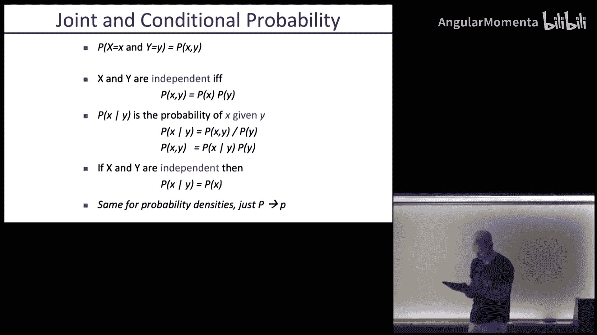
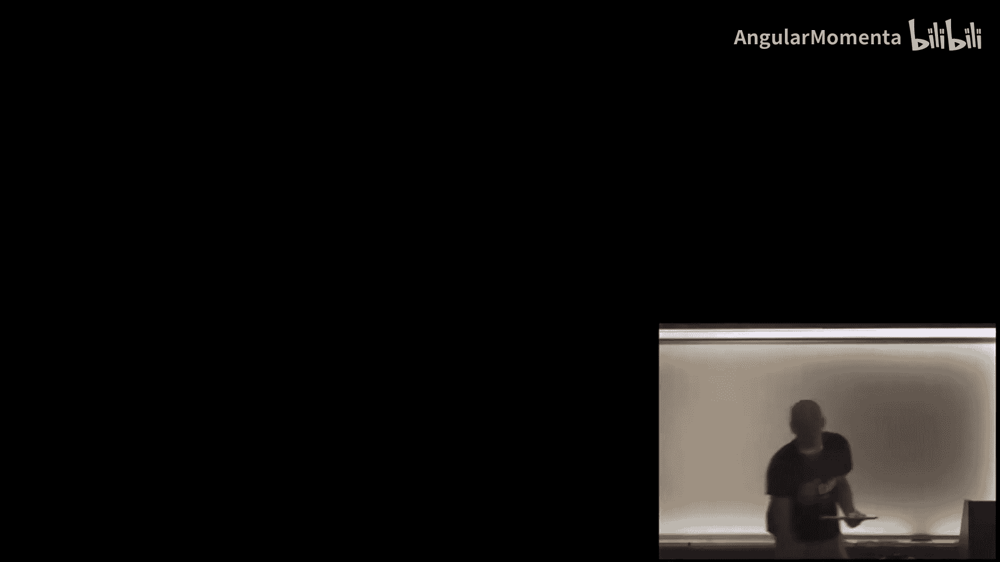
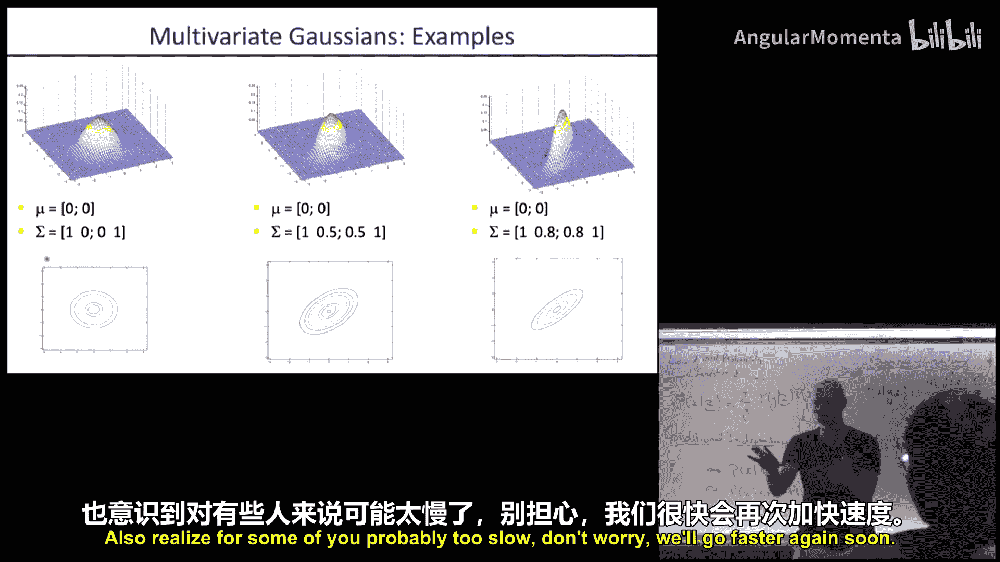
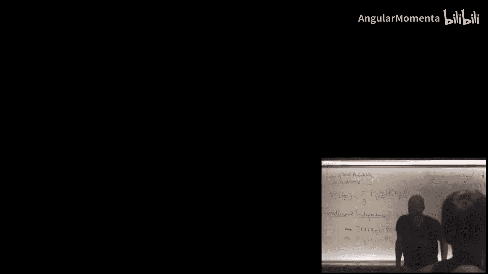

# 【加州大学伯克利分校】高级机器人学-｜-CS287-Advanced-Robotics-at-UC-Berkeley-Fall-2019-p11-11-概率论回顾、贝叶斯滤波器、高斯分布--BV1KXqCB4Eua_p11-

Cs 37， fall 2019。So at Ta Mia last week you covered on Tuesday contactingvari optimization with Igor。

 and on Thursday I believe you covered motion planning with one of the Ts， Harry。呃。

There was a couple of slides that were'ted at the end of last lecture。

 I'm going to let you study those on your own， essentially there's a topic of LQR trees。

 it's not going to come in the homework， but it's quite interesting it's a way to combine motion planning with LQR to have a more efficient motion planner effectively because motion plannings tends to be very local and sampling based。

LQR is a。Not that local， it has a base of attraction。

 and so combining both of those into LQR2s is pretty interesting。

And then the other thing it didn't cover was short cutting。

 typically when you use a sampling based motion planner。

You will at the end of a path that's very jagged。 shortcutting is the idea that you just check if any of the steps along the way you can just skip because it's just a little bit of a detour and use a straight line instead。

 Of course， depends on the dynamics of your system， if your system has peculiar dynamics。

 you cannot just do straight lines。 but if your system is able to follow any path。

Except when there are obstacles， then you can do straight lines。 if there's no obstacle。

 So that's short cutting is a little more detail in the slides and often actually you also run non nonlinearar optimization for control。

 actually at the end to smooth out your path and get a locally optimal path。

 So those are the highlights of what you didn't cover， but we're gonna not cover more detail。

 but the slides have the details。 So they will switch to In sometimes the second part of the course。

 First part of the course was all about finding optimal actions。

 How do we given a dynamical system some environment really find a sequence of actions or a policy that optimizes expected reward。

Now we're going to look at the complementary part， which is trying to make sense of our sinceor readings。

 such that we actually even know what the state of the environment might be and then act against that and we'll need a lot more probability here so we'll start with a bit of probability review。

Then we'll look at base filters， which are going to be the core of what we'll be doing and we'll look at base filters today in the simplest setting which is just discrete state。

 discrete observation， and then we'll look at Gaussians。

 which will allow us next lecture to do it in continuous state spaces and in many ways similar to how LQR give us local solutions similarly with Gaussians even for nonlinear systems。

 we'll be able to find local approximations to the probability distributions。All right。

 any questions？All right， then let's get started。😊，So。

Why might we care about probability in robotics？Well。Often。

 the state of the robot and the state of its environment are unknown and only noisy sensors are available。

 So we don't have a sensor that just says here is a state。 and state you measure something else。

 Priability provides a framework to fuse that sensor information into a reasonable estimate of what the state might be。

 And so the result of what we would compute would be a distribution over possible states that the environment and robot could be in。

There's another reason we care about probability， which is something we've already covered a little bit which is that the dynamic is often stochastic。

 so we can optimize for a particular outcome but only optimize to obtain a good distribution of our outcomes and again probability provides us a framework to deal with that we've done that in simple settings so far but we'll expand that later and we'll actually bring both of those together in a future lecture where we'll look at the notion that the actions you take。

😊，Could be taken to reduce uncertainty about the world so you actively go seek out sensory information that could help you understand better what the state of the world is and then collect more reward。

 For， those are called Poni piece， partial observable mark of decision processes。

 And that'll be somewhat the combination of bringing together what we're covering in the next few lectures and what weve covered in everything so far。

Let's look at an example， helicopter， what would be the state position of the helicopter orientation。

 velocity， anglengular rate。What would be the sensors you have if you don't have direct access to position orientation。

 velocity anglengular， you have access to some of those in a noisy way and then others you don't have access at all。

 so GPS gives you a nois estimate of position， sometimes also a velocity。

 typically only up to a couple meters accuracy， so not super precise。

 but it's a noisy estimate of position。Typically you put inertial sensing on your robot。

 so for a helicopter maybe you have a three axis gyro， so gyro is an angular rate sensor。

 so it gives you three numbers at any given time measuring the angular velocity around the three main axes of the helicopter if you mounted axes aligned。

Then three axiss accelerometer， accelerometers measure acceleration， but not exact acceleration。

 It's a little trickier than that。😊，Measures all zeros in free fall if you're free falling an accelerometer measures all zeros and anything that you do that's not free falling。

 for example， if you're standing on the ground， the accelerometer will measure 9。

81 meters per second squared。Opposite to essentially gravity because you're resisting gravity and that's what it's measuring at that time。

So in some sense， accelerometer is not just and in fact much more accelerometer is about measuring orientation very often than it is about measuring your actual acceleration because any resistance to gravity you'll be able to measure and from that。

 get in some sense， especially if you're on the ground。

 understand where gravity is pointing which gives you a lot of information about your orientation。

Then3 axis magnetometer which well what is a magnetometer it measures the earth magnetic field。

 so earth magnetic field， you might think of it as north。

 but it's actually if you measure it in 3D it's not really north。

 it's roughly north but it actually also points into Earth。

 but it's known which direction it points and you are measuring in the frame of your sensor。

 where is the magnetic field pointing and that gives you information about the orientation of the system that you have some tricky things that of course if you have something that generates its own magnetic field like maybe have。

Some magnets on your system where you have some high currents that induce magnetic fields。

 then you might perturb those measurements and not really get the Earth magnetic field。

 but something else， or you fly near a power line or something it might perturb the measurements you're getting。

Dynamics， there is noise from the wind， there is unmauled dynamics in the engine in the ser motors and in the blades of the helicopter。

 so overall we don't really have access to state directly。

 but we have things that relate pretty closely to state and we should be able to distill from that a likely estimate of the state。

Or a distribution around some mode， maybe of what the state might be。

How about a mobile robot inside a building， the state could be positioned and heading if let's say a slow robot is just slowly moving。

 you don't care about velocity， just the position in the direction it's facing， then sensor oometry。

 which is sensing motion of the auators for example。

 wheel encoders so on your wheels you might measure how much your wheel has turned。

If you didn't know the diameter of your wheel， you know how much you have moved。

 well that's approximately true because the wheel might have slipped。

 there might have been bumps in the road where if it's not flat。

 you don't move as far forward as you thought you would have because you really have been going down and back up。

 but it gives you some kind of measurement of how much you've moved。

Then often people with a laser range finder on a mobile robot。

 why is that it sends out a laser beam and then it measures how long it takes for that beam to come back and that gives you a measurement of twice a distance to the obstacle in that direction and so it's a nice way to directly measure 3D it's a little bit problematic at times because sometimes you have mirrors and then a thing doesn't come back it reflects all in another way or you might have glass that acts much like a mirror and same thing will happen。

 you don't get the measurements back but if you have nice matte surfaces it's a really nice way to measure how far away things are。

Dynamics is noisy because of wheel slipppers。 You might say my wheel turn this much。

 but what if it's slipped， then you don't know what your next state is going to be if you don't know how much it's slipped。

 and it could be unmoded variations in the floor that affect essentially where you end up。Alright。

 so those are two examples just to motivate why we might want to deal with probability distributions in that。

 yeah， if this is what we're faced with or the helicopter is， what we're faced with。

 we're not going have a deterministic notion of this is the state。

 which is gonna have a bunch of sensor information and the result at best will be a distribution over possible states。

Okay so today what we're going to do we're going to do probability review。

 hopefully that's review if what we do in the probability review section is not review。

 you should go study to make sure that it feels like review as soon as possible。

 then we'll do base filters where we will look at the foundation of a lot what we'll cover in the discrete setting and then we'll start looking at Gaussians which will form the foundation for what we'll do next lecture to do it in continuous space。

Alright， so probability theory as a lot of math starts with some actions and then everything falls from that。

 so probability theory actions here is that you have some outcome A and there could be many possible outcomes。

 An outcome A， the probability of the outcome is assigned in number between0 and1。 maybe you。

 I don't know， the probability of being in the correct room for lecture is some probability assigned to it。

😊，Then the probability of the union of all possible outcomes。

 Oomega is essentially everything that could possibly happen， the probability of。

Everything that could possibly happen， something in that set to have happened should be one。

 Otherwise， that's not the proper omega that captures everything。

 And that also means nothing can have a number sign higher than one。

 Then probability don't go above one。 And then probability of the empty set。 Well。

 the empty set is never containing the outcome that happened。

 Whatever happened is something It's not。In the empty set， and so the probability of that is zero。

And then the main thing here is essentially how you kind of keep track of probability。

 the probability of。The union of two possible outcomes。

 A and B is a probability of A plus probability of B。

 but it's possible that A and B happened at the same time。

 and then you're double counting that and you subtract back out the probability that A and B happened at the same time。

 which is a intersection B， and that gives you the probability of the union。

Pctorially looks like this。 you have your omega space， which has all possible events in it。

 Then there is outcomes that make a true。 There is outcomes that make B true。

 and then there's outcomes that make A and B true the intersection and then the probability of a union B is probability of a plus probability of B minus probability of the intersection。

 one abstract or abstract or concrete depending on your mindset way to think of it is that everything that can possibly happen is a point in this rectangle pictorially。

 That's like every possible state the world could be in is a point in that rectangle。 I mean。

 we might never know the exact details of it， but every possible state is a point in that rectangle。

 and then a is a。Property of the state of the world that holds true for all the ones that line that blue circle。

 B is a property of the state that holds true for all the states of the world in the yellow circle and an A intersection B is a property of the world that holds true for all the points that are in the intersection。

And so you can think of A and B just as properties or descriptions of know abstractions of the world of the state。

 whereas individual points in that rectangle are， in some sense， the full state of the world。

 which we probably never observer will never really talk about because we don't care about all the details we'll talk about A and B。

 but。In terms of how it's all set up， that's an easy way to think of it。

Then when you use these actions you can come to new conclusions。

 I mean that's kind of how math works， you pause some actions and then you do some derivations and you have a new thing that's useful to use。

 so for example， probability of a union omega minus a well on the left we just look at what's in the parentheses is well a union with omega minus a that's omega so the probability of omega is1 we derived up to here on the righthand side we use that thing that's probability of union is probability of each individual out event minus probability of the intersection that's this we work that out。

 then we know that this probability is0 and now we have the probability of a plus probability of the complement of a has to be equal to1 and so that's the kind of probability you would derive。

Alright， so there are discrete random variables and continuous random variables。

 So here we have omega， again， the rectangle。 And again。

 think of every point in the rectangle as representing one possible state of the entire world。😊。

And then。X is how I run the variable we work with。X can take on four values if the event in the case the world is in a state that's in that leftmost rectangle。

 we say x equals x1。 If it's in that triangle above， it's x equals x2 and so forth。

And so there's only four values x can take on。The probability associated with x equal x1。

 we can think of like essentially the mass associated with that region in the rectangle and we call P of probability mass function。

 a simpler example than the abstract rectangle there would be a coin flip， heads and tails。

 probability half for each that's another example of a distribution again you can think of as in the con of that rectangle though you can say I have a rectangle as split in half there is heads and tails and。

You know have the states of the entire world。My con came out in heads。

 half the states of the entire world。 My came out tails。

 We're ignoring everything else about the world。 We're just looking at heads versus tails and not the details of everything else in the world。

Continuous random variables X takes on a value and some continuum。

 you cannot now associate a probability with x taking on a specific value because if it's infinitefiling many things。

 it's a continuum， if you want to assign finite probability to things it'll sum up to something higher than one which we can have and needs to be sum to one so we can sum many more actually have to integrate now so we'll do is'll say probability density function is defined as saying that if you look at mass under the curve。

So the probability for x being an interval A to B is the integral from a to B of P of x dx。

 for example， if we think from0 here， maybe till this point。

 we could take the probability mass and that's then the area under the curve would be denoting how much probability we associate with x landing in that interval so again。

 we can't really talk about x taking on a specific value here。

 the best we can do is say probability of x lying in an interval you could say x probability of x taken on a specific value。

 would'd say it's0， but then to have something meaningful。

 you take intervals and assign probability to the intervals。Any questions so far？All right。

 then the most important thing and what we'll be working on is to look at。

Distributions that involve multiple variables。 So why is that， well。

The reason is that as already talked about， we'll have things like real state that we care about and sensory measurements。

 so we want to somehow talk about the joint distribution between the two such that if we measure one of them we can say something about the other one or we will deal with dynamics of the world and so we want to relate the distribution now with the distribution at the next time and so both of these involve joint distributions over two random variables rather than just looking at a single variable。

All right， so the joint distribution over x and y is denoted this way。Then。In simple scenarios。嗯。

Simple scenarios， x and y might be independent， meaning that the probability of x and y taking on specific value。

 small， x， small y is the probability of x taking on value x and y taking on value y。That's the case。

 actually knowing X does not tell you anything about y or the other way around。

 so it's actually a not so interesting case， mathematically it simplifies things。

 but yeah if you had a sensor where your sensor is independent of the state of your system。

 the sensor cannot inform you about the system。Sometimes it's a property that holds true though。

 and then it's good to know and good to take advantage of mathematically。

 but you don't want to build your systems that way necessarily。Then。X given y is the probability of。

😡，X taking on value of small x given y has value small y。

 so what we have here is that as a definition we write it as x given y is the probability of x and y divided by probability of y。

 So think again about that rectangle。 there's a region where y takes on the value small y。

 and that has a certain surface and that's py and we look at the region where x takes on value is small x within that region that's px comma y。

 and then the fraction of the surface it takes up， that's the conditional。

We can also rewrite this as the probability of x comma y is the probability of y times probability of x given y。

 this will become very useful in many many situations because let's say we know the distribution for y and we want to know something about x which might be the distribution at the next time slice and if we know something about x given y is maybe the dynamics of the system to go from y to next time x。

 then this equation will tell something about the joint and hence tell us something about x。

Then if x and y are independent， then the conditional of x given y is the same as the marginal for x。

 so P of x willll call the marginal for x， and so that means that sometimes in our math we'll be able to simplify things if we have an assumption x independent pen of y and we see x given y and P we can just get rid of the y and simplify it to just Px。

All of this is also true for probability densities， it's just in densities often it's a small P。

 but other than that you can write the exact same math and now it'll say something about the densities instead of the actual probability mass。

Now let's work through the equations we'll be using the most。

All right。

So。There are essentially two equations。There are two equations we'll be using a lot。

 and so let's explicitly step through them and see what they are。One is called law of To probability。

Was it saying， it says that。And we'll write it for a discrete case。

The probability distribution for x。Its equal to soparity x equals x is sum over all values y can take on of px。

Come my why。So the reason that will be so important is because often we'll want to get rid of some variables and move to another variable and the way we're going to be doing that is by constructing a joint distribution over those two variables somehow and then summing out the one we don't want anymore。

More specifically， the way this will typically be used is。Here we'll say well， px。

Is equal to sum over y。 and imagine we already had access to the distribution for y。

And we need to construct a joint because we want to bring in X。

 Now we might have a model for how x is related to Y。 So you'll have px given y。

 And so this equation here is one that will find ourselves using。A lot。

 one of the two equations we'll be using over and over。

Same thing can of course be done for densities in densities。

 this summation will become an integral because you have to integrate overall continuous variables。

 values the variable can take on， whereas in discrete variables。

 you just sum otherwise same thing though。In channel， whenever there's a summation。

 you can put an integral same math we'll go through。So that's one of the things we'll use a lot。

The other thing we'll use a lot is Bays rule。Baazel hopefully sounds familiar。How do we derive it。

 We actually derive it from。Looking at the expression for the joint。P， x comm Y is P X。

Given y times py， which is also because the roles of x and y arbitrary。

 it doesn't matter which one comes first or second in this equation here。

 we can swapwab the roles and we have Py given x times px。From that， using just this part over here。

We can write。P X， given y as。Pi。Y given x times。Px。Over。Py。

Let's interpret this equation for a moment。 So what are we doing here。

We're interested in finding a distribution over x given Y。 So associate a story with this。

 Imagine X is the state of the system。 And y is a sensory reading we might obtain。

 And so we want to know， what's the distribution of a possible states of the system。

 given we have a sensory reading， Y。😊，Well。It's not easy to come up with a table for that。

 It's not easy to just say， oh， you know what， I'm just going to build a table for Px given y。

 because it's actually not really how nature works。

 the way nature works is that if there is a state that state causes the readings so this model here。

Is really the causal model。That we have available given a state it will cause a distribution over readings。

 and when you build a sensor and you try to sell to people。

 this is your sensor model that you would provide It'd say this is the distribution over outcomes given this situation。

 this distribution of outcome， given this other situation and so forth， for example。

 for a laser range file， you might say， well， if there's a mat surface at a certain distance。

 the reading you'll get back is within maybe two centimeters。

 like maybe a gaussian tanan deviationation 2 centimeters around the proper distance reading。

 something like that。 So that thing is your calibrated sensor。

 and that you can you can get a distribution for。But what actually ultimately will be distribution of state。

 given that reading will depend on the prior X where you thought ahead of time might be likely states of your system。

 and so they combine together and then of course there's a normalization to make sure things sum to one that's solve as this and often we'll write this as just。

1 over z times py given X times px， or it turns out in a probabilistic robotics book notation。

 a love to use As I'll often write at as8 at times Py given x times px。

So we don't have to much worry about the thing at the bottom， that's just a normalization。

 we just want to understand a thing at the top which brings together the thing for which we are able to build a model。

 which is the relationship from X to Y， and how we can then use it assuming we have a prior over x。

 use it to get the distribution we really want， which is distribution over state。

Any questions about this， These two equations are essentially the ones we'll just use everywhere and what we'll do today。

 next lecture， lecture after that， if you fully understand those， you should be in really good shape。

Now， we can have a new version of this， so。Law of total probability。Again， but with。Conditioning。

What does that mean？嗯。For both of these。Imagine。For the first one here。

 imagine we had already something to condition on。 Maybe there was a measurement in the past that was already there。

 Like， were really interested in。😊，Not going just from why。To X。

 But there's some Z that's already present somewhere。 So what can we do。Well。We can say， okay， P。X。

Givenive C。Its equal to。 we write the same equation， some。Over why。P。Why。Times P。X given y。

 but since we conditioned on Z， we need to everywhere condition on z and if you already I mean notation Y is' conditioning on y nz is just y comma Z you don't need to draw another bar and so what we see happen is that the exact same equation。

Can be written with just additional conditioning on Z or any number of variables。

 as long as you consistently put them everywhere。 so you can always add more conditioning。

And so often that's the version we'll be using because we'll have many things we've already observed in the past。

 we'll want to condition on and then we'll want to apply the equation of the left law of total probability and we'll just carry along everything as we do our math as if it doesn't exist。

 we just need to consistently carry it along straightforward， got to be carefully。

 can drop it anywhere。Same thing is true with bases rule。

 what if you have multiple things you are conditioning on and you already condition on something else。

 no problem。Bys real with conditioning。And the reason this shouldn't really be a surprise is you go back to the original picture of probability right and we have this rectangle and the rectangle is really the foundation of everything with a point in the rectangle corresponding to the full world state and then regions correspond to vows。

 the random variable takes on if we condition on something essentially we're just redefining the rectangle as being only let's say this part that's how our new rectangle and that's the only part of the world we're working with possible states it can take on and once we've done that we put all probability on this thing。

 we kind renormalize it， everything's there that's how our new rectangle and the mass not going to change because we're just looking at this subpart of the whole rectangle but of course we need to do it consistently every step along the way。

 we need to consistently look at that subpart where we are having Z this would be z equals Z we need to keep it consistently to that part we can't sometimes have it sometimes not when we do this。

But then the same thing with bases rule。 Yeah， initially， it was for the full rectangle。

 Now we restricted attention to some subregion。 No problem。 we just condition everywhere。 P X。

 given Y， comma Z。Is equal to。It's equal to， well， what did we have， we had Y given X。But， of course。

 also Z， because Z needs to be in the back everywhere now， then P X。

 But we need to carry along the Z and then normalizedize by。Yhy， again， given Z。 But again。

 the bottom here doesn't really matter much in baseball。 We usually know that we just need to。

Compute the top part for every possible value of x。

 And once we computed the top part for every value of x。

 we can see what it sums to and whatever it sums to is what goes in the bottom。 right。

 And so applying Bays rule is about doing this for all x。And then summing to know what the bottom is。

And so here we see that we can incorporate new evidence。 We already had evidence。

 We had already had X given Z。 We had a past observation。Distribution over x， given that observation。

 then a new thing came in。For y， and we have a model of how y acts given x and z in practice often the z will disappear here because y will only depend on x。

 not on z， but in general Y could depend on x and z。

 and then we can combine that together to know what the now new distribution is over state x。

Then another concept that will be very important is conditional independence， so。Conditional。

Independence is a lot like independence， but a little less strict。 Independence is a property that。

 in some sense， is nice because it simplifies the math whenever you run into it， but。

If your variables are all independent， then you can't really infer anything from one variable about the other variable。

 And so ultimately you get no interesting results out。

 you need the variables to interact to get something interesting out。Now。

 it could be that they interact but in limited ways。

 and that's what Conal independence tries to capture。So， condition dependence。We have。X。

Conditionally independent。Of y， given Z， if and only if。We have P X comma Y given Z equals px。

Givenive Z times PY given Z。So it's like independence。

 the joint being x and y is the product of marginal for x， marginal for y。

 except that it's only true。When you condition on Z， once you know Z， X and Y are independent。

 But as long as you don't know Z， they might have a relationship。 For example。

 Z might be something I don't know， like Z could be。

The weather and X might be is somebody carrying an umbrella and Y might be is the。

Is the pavement wet or something once you know it's raining， you， you don't need to。

 you already know that the rain will cause X and Y independently。 It's not related directly。

 whether pavement is wet and somebody cares umbrella。 It's through the fact that it rains。

 which is the common cause for both of them。 And so that will make X and Y independent given C。

 Another example on the one that we'll see most often in this class is if you know the state of the world。

Then every sense you're reading might be independent very often because if your sensor just acts on the real state of the world。

 then。The reading that happens first， the reading happens next will be unrelated and willll be able to simplify things。

Okay，This is。This is kind of really everything we need。 So we just need three things。

 We need law of total probability， the regular version and the conditioned version。

 We need basees rule， the regular version， the conditioned version。

 and we need the notion of conditional independence， which will allow us to simplify equations。

 This is also equivalent to writing。😊，And often， we'll see it that way， equivalent to。Px。Given。

Z and y， but once you know z x is independent of y being equal to px given z。

 and it's also equivalent to p Y given Z comma X being equal to Y given z because once you know Z。

 X does not tell you anything about y。Now， to be fair。

 this condition dependence assumptions that we'll be making sometimes in the real world might not exactly be true ever。

 but there'll often be reasonable approximations and we might be willing to make them because they drastically simplify the math and the competition we need to do to then run the algorithm in practice so often these things are assumptions we make to approximate things that are almost independent in the real world。

Questions so far。Yes，right side。坏键。Are those usually given to us？So typically。

 the way you would do this is typically what you'd be given is from a previous calculation。

 maybe or just given would be this thing here， which is the prior over x or prior over x given Z。

 You'd be given a model of how。X and z in this case are just x in that case cause y。

 that's your sensor calibration model， for example。

 and that together allows you to compute this product for every possible value of x because we're conditioning on z every possible value of x。

 Yeah， we compute this for every possible value of x because y will be measured in this scenario Z will be measured So y and z will be numbers available to us。

 X will not be known can take on many values and so we'll compute this for every value of x。

 after we've computed this for every value of x we'll have a table of all these row values of x。

And those entries， if we ignore the bottom will not sum to1。

 but we know it's supposed to be a distribution over x given Y and z。

 so then we know and also know we ignore the thing at the bottom that does not depend on x。

 that's key here。 There's no x in here。 So what we're computing is a table with entries that depend on x。

 every x will have its own entry。 and we know all of them are missing the same rescaling which we've ignored but we can find the rescaling by remembering that actually every all the entries in the table have to sum to1。

 And so。Sing all the entries in that table will actually compute this thing over here。

 mathematicalthematically， we know that's a way to compute this。 In practice。

 we don't often pay attention to what it really means。 We just say， hey， we want this。

 we know this thing here does not depend on X so we can ignore it as long as at the end。

 we do a rescaling of all entries with the same scaling。 You cannot rescale one entry for x one way。

 the other one， the other way。 you need a fixed rescaling across all entries that you computed。

So the things written on the board we also have on the slides where often we have a pairing between the discrete version where there's a summation and continuous version where you just replaced that some sign with a little squiggly thing and then you put a D something over the variable instead of putting it under so essentially you just always replace some over the variable with this thing here and then a DY and then you got the same thing just for continuous space。

Base rule。嗯。The terms we didn't name them， but essentially often the x。

 the P of x is called the prior because we have it ahead of time。 Y。

 given x is the likelihood of a measurement。 Y， given the state is x is often what it ends up being。

 sos often called likelihood and evidence is。Yeah， that's just why is what you measure to is the probability of getting that evidence。

This what we just talked about when you do these calculations， often you effectively。

 algorithmically， you computed for all。Accs。You compute that。Top part in the fraction。

 And after you've done that， you know， it has to be rescaleed and you just compute the rescaling and multiply with that in the pros robotics book notation。

 it's a little bit funny that sometimes they use the Eda as the thing you multiply with。

 Sometimes the thing you divide by， you just got to， I guess。Be okay with that。

 it has different meanings in different contexts， but ultimately is just a rescaling and some people like to divide by the rescaling。

 some people like to multiply with one over that thing all the same。

Loaw of total probability with integrals， we saw that ba with conditioning， we saw that。

 we saw conditional independence， what it means， again。

 it's an assumption we often make that will hopefully be approximately true or maybe even fully true so we can use it to simplify our math。

Here's a simple example。😊，We have a robot trying to see if the door is open or not。 Okay。

 was if the probability of the door is open， given some measurement of the sensor of the robot。

It is to illustrate the kind of reasoning behind why we often use base rule。 Pri of being open。

 given some measurement is a diagnostic distribution。

 It's kind of we're trying to diagnose what's the state given a measurement。

 but those distributions often we cannot build。 We cannot。

Deliver a sensor with that distribution because， I mean， you can't do that。

 Imagine you deliver the sensor to somebody and they lock the door and nobody has a key anymore Then your sensor can't know that because you didn't know that ahead of time。

 What you really can build is the opposite distribution， the causal one given a situation。

 what am I going to measure。 And so that's what's available to us。 and that's what we we have to use。

 but it's not what we want the reason about the world。

 So we'll use base rule to get what we want which is the opposite thing。Going from。

The distribution that we know how to model， which is the measurement given the state to the distribution we want to take action。

 which is we want to know whether the door is open or not， or at least a distribution over that。嗯。

For the causal one， it's really just a matter of counting frequencies。

 you might have a physical model that makes it easy。

 but often you just kind of just do a bunch of measurements and you see how often does the sensor read this or that as a function of whether that the door is open or not。

 And now I have my model。Let's do a concrete example。

We have we need to put some numbers into it Pri of a measurement Z， given the door is open is 0。6 Z。

 given the door is not open is 0。3。 So we see that when the door is open。

 we are more likely to measure Z as the outcome than when the door is not open。 so if we measure Z。

 it we should increase our probability that the door is open。And our prior is 50%。Well。

 we can apply Bays rule， we measured Z， we can look at Bays rule， fill this in。

 do the math which is described and find indeed that now after measuring Z。

 which favors the door being open， we have more specifically 0。67 probability that the door is open。

Now you can have another measurement， imagine have another sensor。Wait， where does go？Yeah。

 imagine we have another sensor Z2 How can we integrate that Well we can again apply Bayes rule。

 We already know that we can apply Bayes rule again， even with conditioning in the back。

 we already condition on one measurement， just going to condition on the next measurement and actually do this as many times as we want so to condition on many measurements。

 we can do it one at a time and build it up。So here we have the。嗯。Often。

A assumption is applied to simplify the math。 is that the。

Sensory measurements are all independent given the state of the world because the state of the world is causing what you measure。

 And so if the state of the world is a known entity。

 then each outcome is independent given that state。

That will simplify the math because then when we look at ZN。The nth sensory measurement。

 given the state of the world X and all the other sensory measurements。

 we don't need to build a model for Z N， given x and the other measurements。

 We just need to build a model for Z N given X， the state of the world。

 which is exactly the kind of sensory model that we like to build。

 So we get a simplification happening。Over here， we have ZN condition on everything that's the standard。

Bas row with conditioning， but then we made an assumption this is not gene to。

 but we made an assumption that Z and is independent of the other Z's if we already know the state X。

 and then this here has simplified。Then again， the bottom we don't worry about， there's no x in it。

 we can compute the top parts for every value of x， once we're done。

 we sum it all together to know what the bottom is that we'll normalize it。

We can apply this repeatedly that the idea we just saw that this become ZN given x。

 Px given all the previous ones， there's nothing specific about ZN and we'll see then we get a product over all ZIs given x times prior over x。

 and so now all we need is that sensory model for each sensor given x。

 we multiply primbabil together and we get our posterior distribution。Okay， for the door example。

 we had。In this case， a new sensor Z2， and when we see Z2。

 it actually is more likely to be seen when the door is not open and we observe Z2。

 so when we expect to happen mathematically， we had a twotd probability of the door being open ahead of time after sensor Me 1。

We observe Z2， that probability should drop， but let's check， we can do the math。

 we just applied Bays rule， fill in the numbers， and indeed the probability drops as we expected。

All right。There is。One thing。I want to point out here is that a typical pitfall is that real world sensors are not always super independent。

So。You might have a sensor and you might say， okay。

 maybe I have a laser range finder and it reads a reading。

But then maybe send out two beams next to each other。

 but those two beams might encounter the same kind of noise or the same kind of interference in their paths。

 And so those two measurements might not be independent。 And the assumption we just。When through。

 where this all simplifies， just becomes a product of things is violated。

Even though often in the math will want this in practice be careful。

 you need to think carefully are these sensory readings really independent or imagine laser ranger is reading something at time T and you run it again at time T plus one but nothing has changed in the world then are those really independent readings not totally necessarily because you're measuring the exact same configuration with the exact same sensor so maybe it's not completely independent so be careful what can the effect be imagine you imagine you think they're independent these readings and they're not what do you think will happen。

So let's think about this。 Imagine we have really one reading and really what we should be having in this equation。

 because there's only one one measurement happening。 All the others are just copies that are。

Not independent information， they're just copies of that one reading that's how dependent they are extreme case of dependence。

 we're just you know sort of fitting it in once entire our bases rule thing we say， hey。

 why don't we feed it in 10 times because that way we can incorporate the information even more what would happen。

 feed it in 10 times you multiply this thing in 10 times。

So what will happen is that whatever that measurement is favoring， you'll become overconfident in it。

If it favors door open and maybe normally with one time incorporating that measurement。

 you go from a half to two thirds if incorporated。100 times。

You multiply it in 100 times all of a sudden you'll be at 99% probability instead of where you should be。

 which is two thirds。 That's exactly what happens if you look at the graph here。

So here is a graph showing as a number on the horizontal axis。

 number of times the same measurement is incorporated。Using the math。

 that is the assumption that these measurements are independent and we see that very quickly。

 you can actually flip the probability from being 99% being one observation one state in the world to the other state in the world X1 versus x2 So be very careful about that。

 another places might come as like you might maybe have。

 I don't know accelerometer or gro and the gyro is supposed to measure independently the angular rate of your system。

 but the gyro is a physical system under the hood there is something physical happening there。

 And so it might take time for that physical thing to settle in and really get that measurement。

 And if you read it off I don't know 10000 times per second。 that might not be valid。

 that might only be 10 or 100 independent readings really。

 and if you then use 10000 readings instead of just ones that are actually independent。

 you'll become wildly overconfident in whatever it is that you're measuring rather than keeping a。

distributionion over possible states of the world。Okay。

 let's take a couple minute break here and then let's look at base filters and Gausians。さ。最高。本当です。かね？

I。It's been。要是なり。Actually， it's more paper than it needs much more I get interested。

They' much less I want to use in the classroom。It's not just。Its。来。So in reinforcement。This where is。

This is。I function。Trying to find。To number one。Function so。It's not in。Untabletable for。

Still hiring dimensions like。It's cool to experiment。写。ょ。些很。最少有睇过。I don't know how true that is。呢个要食。

Most of the ones that I've been readinging。Thats really。Yeah mean。过似嘅招整冇。いですか。这个我去。ます。喂别。也你的责任观念。

就这你会生息。All right， let's restart。Any questions about the first half？Yes。不行嗯我。

So I've in a lot of things， we assume a first order Marovian system and kind of touching on the example that you were talking about at the end。

Have you seen in practice whether maybe the first order Markovviian assumption isn't appropriate。

 but a certain like end step Markovviian assumption is appropriate so that we can find this balance between。

Having something that we can get accurate。I guess quantification from。

 but also the joint distributions are not intractable。Yeah。

 so it's always a tradeoff between tractability and match with the real world， I would say。

 I think in general， first order of assumption。I mean， in principle， if you have full state。

 then of course， definition of full state means that the first order assumption will be true。

 otherwise it's not full state， but in practice， your state will not be maybe the full state of the world to be。

Approxiation of the state that you use as your representation for state space。 And as a consequence。

 first order assumptions might not exactly be true， I think。

Often it' dealt with in a pretty much ad hoc way where people just look at the system in say okay。

 for this system， it seems like we need to look this far back or that far back to get what is effectively the state of the system by including enough history。

 but I haven't seen necessarily like a very clear cut way to define it in general。

And this ties directly on what we're going to do now， which is bayes filters。

Often the world is dynamic because robot does things， other agents do things， time is passing by。

 the world changes in various ways as a consequence。

 so how to incorporate actions into what we're doing as well as our sensory readings。

So typical actions。 robotbo turns its wheels to move。 robot uses manipulator to grasp an object。

 a plant grows over time and takes up more space。 actions are never carried out with absolute certainty。

 So in contrast to measurements， actually。😊，Actions generally increase the uncertainty。

 So you have is you will have measurements， reduce the uncertainty in your distribution。

 then action gets taken， which introduces new uncertainty。

 and the distribution becomes higher variances。How to model actions。 Well。

 we can again do it with a probabilitybota distribution。

 So we can say the probability distribution over next state。

 X prime given current state X and action U。 And that again， is a causal model。

 It's something we can build a model for and then use to calculate the distribution over next states。

So， for example， a robot might try to open a door and it might succeed or might not succeed。

 and you might have a model for that， so you might say if the door is already open and or in this case close the robot tries to close the door。

 doors already open well。10% chance， it'll just stay open because it fails。

90% chance it manage to close it if it's already closed， then it'll keep it closed。 Okay。

 that's a model that might or might not be correct。

 but these are the kind of models that we're going to be working with such that we can do calculations about possible states of the world based in our actions we took and sensory readings we get。

Well， this is exactly the law of total probability we're applying here。

 the conditional distribution for x prime next state， given the action U is well。

We have a distribution for current state。 That's what we assume。

 we assume that we know distribution for current state will then multiply in x prime given U and x to get the joint over x prime and x。

 Once you have the joint over x prime and x， we actually just want x prime so we sum out or integrate out x to just get the thing for x prime that's exactly what's happening over here。

 law of total probability with some conditioning。So we can run this for the robot example。

 and I'm going to step through the details here， but you can do you know with those numbers we have the math。

 and you can see okay， given the action that we took。

 the probability of clothes becomes 15 out of 16 and the probability of open is one out of 16。

How about measurements， measurements are what we've been talking about the most so far。

 we'll use Bay rule， why again because we have easy time getting model for sensory reading given state。

 but we don't know how to get a model for state given sensory reading directly because we need to know the prior over states and we'll need to use BayE rule to get that。

Now， in base filters， the framework is that we get a stream of actions and observations。

We have a sensory model， a action model or a dynamics model。

 and a prior distribution for where the state of the system is starting from。

 so these are our givens。What we want is an estimate of the state of the system。At all times。

 we want to keep a running estimate over distribution over possible states for each time T。

Pctorialically， often it's drawn this way， this graph captures the causal relationships that are present in our set of assumptions。

 so x again is the state over time use the actions we take， actions will affect the next state。

 the previous state will affect the next state and the observation in this case assumed to just depend on the state。

 the state of the world determines what we might measure。And so when we get。we look at this graph。

 the explicit assumptions being made is that the measurement at time T。

Given everything that happened before everything happened before only depends on XD。

 so if we know XD， no past states matter， when we know XD， no past measurements matter。

 no past control inputs matter， it's all summarizing state XD but going back to the question of course。

 if your state space doesn't capture everything about the world then this will not be true in this assumption will be violated and typically that's the case you never capture the whole world state in what you do。

 but hopefully you're close enough that this actually works。Then。Same thing for dynamics， next state。

Could in principle， depend on everything that came before。

 but the assumption we make is that it only depends on previous state and action taken。Again。

 the probabilistic robotics book makes some kind of different kind of indexing that I'm personally used to。

 but since that's the best book to go read probably on this if you want to read more。

 I'm sticking with their notation， so they say the action taken。

UT is the one you take that will land you in X T。Normally you would call that Ut -1。

 I think that's what almost everybody calls it。 But in the book they call it Ut Its the action done。

 you know， you take right before you land in state X T。 So that's what it is。

 And that's also reflected in the graph over there。 U T。

 It's actually you take right before you end up in state X T。

So underlying assumptions are independent noise， meaning that this thing here。

These two assumptions mean that。If you let's say had to the domestic model plus noise。

 that the plus noise effect is independent at different times。

And it also assumes if you if you're going to say whatever I get out of these calculations is the correct distribution。

 that's only true if these assumptions are correct。

 if you make any approximations in your dynamics model in your sensory model。

 well those approximations will result in。Miss estimatesimates that you end up with。

 but it's the best you can do， but keep that in mind， there's a lot of assumptions made here。

 and so you only get the result relative to the quality of the assumptions that you made。

 the quality of the models that you built in。Okay， let's step through bays filters。

 So what builds up step by step is the's probably the key thing。For the second part of lecture。

So we want to believe this， which is a distribution over X D， given everything from the past。

 including also the current observation of time T。Now remember it's going to be a recursive thing。

 we're going to already have this presumably for time t minus1。

 and we're going to see if we already had it for t -1， how do we get it for time T？

What's the latest thing that happened， latest thing that happened in that progression is the measurement ZT？

How to incorporate a measurement Bes rule， So ignore everything but X T and Z T。 What we do。

 Px T given Z T would say Bs rule， It's Z T given xt times Xt。Okay， that's exactly what we're doing。

 We're going apply Bayes rule and then some normalization， right， But remember。

 there is also that other stuff。 and we'll just carry it around everywhere。

 We know that we can carry things around everywhere as long as we do it consistently。

 So this is just Bayes rule apply。😊，Now we had some assumptions that the measurement at time T given Xt does not depend on anything else。

 so we just simplify accordingly。Okay， so we've not yet gone from xt -1 to xt。

 We've incorporated the last step the measurement。 Can we now do the transition from x t minus1 to Xt。

Well， let's think about it how do we go from xt minus1 to xt Well xt minus1 if you already have it。

 we're multiply in the dynamics model to get the joint and then sum out xt minus1。Okay。

 that's exactly what we're going to do。 We now say the distribution for。

Xt is xt given xt minus1 time distribution for xt minus1 and integrator sum out xt minus1 ensure we're carrying around all this extra stuff here U1 through UT and the z and so forth but we know that's just extra stuff we can carry around consistently。

 this is just the law of total probability for Xt and Xt minus1。Then we say， well。

 can we simplify this because our mark assumptions， yes we can。

 we don't need to condition on everything that's conditioned on there， Xt。

 given everything in the past only depends on UT and Xt minus1。

And this here is now our complete recursion because this is the thing we assume we already have。

 this is the same thing we wanted to find for Xt， we have is for xt minus1。

And now we can just repeat all the way back to x0 and we're good to go。So at every time step。

 as we track our system， we can incorporate the controls we applied， U at time T。

Here gives distribution over Xt， this thing over here gives distribution over xt。

 given that what we already knew about xt minus-1 and controls we applied。

 and then we get a measurement， we multiply the likelihood of the measurement and then we renormalize in our distribution for Xt and we can keep tracking over time。

All right， the mark of assumption makes us even slightly simpler notation and we're good to go。

All right。So。And then the last thing here is just a notation。 The book uses B， E。

 L believe of X T -1 is a shorthand there's no， there's no assumption here。

 It's not like we can delete all this stuff here。 just to be clear。

 this stuff is not being deleted by some assumption。 It's just the notation， B， E。

 L X T-1 by definition means X T -1。 given all of this。 It's just a shorthand notation。

So for the second to last equation or like the third line from the bottom and the second line。

 it goes U T at the last one。 And then it's Z T-1。 What happened there。Like on the conditioning。Oh。

 okay。 the only thing that happened there essentially that U T was removed。 Yeah。

 it's not fully spelled out。 essentially， U T does not play a role for X T -1 because it comes after。

 And so U T was removed from that。 That's all that happened。好。

And so this is the final result we have， and we can put this in an algorithm。

And this is the algorithm that we'll be running and this is the version for discrete states。

 of course， where we can just tractably compute this， but it's actually very simple。

 You start out with some distribution prior over x， your distribution over x。

 then when you get an observation， you multiply the likelihood of the observation。

 given x Of course if you that for all possible values of x。

 you sum that together normalizedize by it， you have a new believe for x after that observation has come in if it's not an observation that came in but you took an action well then you use the law of total probability。

 dynamic model gets multiplied in you get the next state， and so you can run。

 you don't have to alternate between z and U， you can just have a bunch of z's coming in。

 incorporate them， then take some actions， incorporate that and just repeat over time whenever something come in。

 act upon what happened。So。In summary， base rule allows us to compute priorities that are hard to assess otherwise。

 That's really what's going on here under the hood。

 It's that we don't have direct access to distribution we want。

 We have access to it in sometimes the reverse distribution。 we can use it to get what we want。

Under the market's assumption， this recursive vision updating can be done very efficiently。

 and baseball is our kind of the common policy tool for estimating the state of dynamic systems。

Here's a simple example， imagine your robots supposed to localize， has four measurements。

 and that means measuring in all four directions， and it checks whether there is a wall or not in each of those directions。

 It's a noisy sensor。And we're gonna not go through the math here。

 but we're going to qualitatively see what happens。 Well if it's really over there。

 but we of course don't know where it is the gray the uniform gray means our distribution is uniform over all possible locations。

 We show the location of the robot just to know what's going on。

 but the robot doesn't know that robot just could be anywhere。 get some measurement to come in says。

 wow， I want see things above and below me not to decide sides So the bayige rule update will result in the new distribution。

 then they might say I'm gonna to move， but it might have noise easy motion。

 so it then kind of spreads out the distribution a little bit。Then it measures again。

 what shrinks it again， and this process repeats over time and over time it might localize itself in this building。

 of course， it assumes that access to a map of the building。

 otherwise this whole base update rule wouldn't work out in this case。Okay， that's it for。

Base filters。I want to now move on to Gaussians。We'll look at univvariate Gaussians。

 multivariate Gausians。 We'll look at law of total probability for Gaussians。

 which are already covered。For discrete case， if we'll look at what does the math look like for Gaussians。

 actually we'll do that next lecture， but that's on the menu for us for Gaussians。

 and we'll look at conditioning Bay rule， how it shapes up for Gaussians。Univeevered Gausians。

 What do they look like Is this kind of blob kind of distribution where most of the masses is in the middle。

 But it can actually go all the way to infinity on both sides。

 Theres something called standard deviation sigma and。

68% of the mass lies within one standard deviation of the mean。

 and then it kind of decays out from there。 The mean is usually denoted by mu standard deviation by sigma。

 and then the variance is sigma squared。The density itself is this thing over here。

So it's exponentiated negative x minus mu squared， so let's think about that。When x is close to mu。

 x is equal to mu， that's 0。 and you have e to the power0， which will give you1。And then。嗯。

If you are。The furtherdi you go away。Actually， could be even。Let's see。 Yeah。

 E to about 0' give you one。 If you go further away from you， you start moving away from you。

 this thing will become。And the exponent will become a more and more negative number and that will make the exp of that negative number will be a lower number and density drops exponential exponentials drop very quickly。

 that's also why this nicely integrates to one still because exponentials drop quickly enough。

 there's not a lot of probability mass out in the faraway parts。

The normalization constant up front that's just， you know。

 you do some calculus and you find out that to make sure that this quantity here。

 to make sure it integrates to one， you need to put up front one over sigma one over squared2 pi。

Okay， so what are some properties of Gausians？Well， density is integrate to one。

 so we know that this thing integrates to one。The expected value of your variable x is expected value is you integrate over possible values x can take times probability of taking that value if you work out the integral and not proving that this is the integral here。

 I'm just saying if you work out this integral， you'll see the result is mu。

 so the expected value under a Gaussian is mu not to an expected eer because I mean the name is also saying it's the mean。

 but you can actually do the math in principle and find out that mu is indeed the expected value under a Gaussian distribution。

The variance is defined as。X minus mu squared On average。

 what's your squared deviation away from the mean， You can do the math。 Comp is integral。

 You'll see Sigma squared is the variance， which is what we already called it。

 but in principle you have to calculate and verify that the name we use for sigma squared is actually really what variance means and indeed it is。

Now you might say why might we care about Gaussians， these integrals。

 I mean we figured them out or somebody figured them out， but they're not necessarily the easiest。

 but at least they can be done。 Well there's another reason to care about them aside from them being convenient to work with a central limit theorem。

Clsical C， L T says that let X1 x2 be an infinite sequence of independent random variables with expected values。

 mu and variance Sigma squared。 Then we define a new variable， Z， N。Z N。Is。

The sum of all of them minus the sum of the averages。

So this should be center at around zero because sum of all in minus is the sum of the averages or expectations and then normalized by this quantity over here。

 so scale down。Then for the limit of n going to infinity。

 with infinitely many of those variables being put together in a sum and centered around  zero and normalized。

Then we have z going to a 01， so0 mean san deviationviation 1 Gaussian。

So what that means is that if whatever you care about is the effect of multiple independent factors。

The resultant variable。Is often distributed more or less like a Gaussian。

And the more independent factors contribute to the variable you normally care about。

 the closer that variable you only care about will be distributed according to a Gaussian。

 so it's not just about convenience of math， though that's a big part of it， Another big factor。

 why Gausians are a reasonable thing to use is that。In fact， if there's enough underlying factors。

 it might really be a Gaussian the thing you're looking at。How about multivariate Gausians？Well。

 here's what it looks like。 These are densities where x is now a vector。

 so we again see a normalization happening up front， which has a determinant of sigma in it。

 sigma is a symmetric matrix， the covariance matrix and have x minus mu x minus mu。

So whenever you see something like this， often it's a little hard to make sense of it directly。

 if you haven't seen it before， here's the simplest thing to you you say， okay， yeah。

 there is matrices and vectors， but what if it's just scalar， if it's just scalar。

 it looks like a single Uni at Gaussian again， you just have x minus mu squared。If it's not a scalar。

 what do we have， Well， Sigma is a symmetric matrix。

 so the inverse of sigma is also symmetric matrix。 So have a symmetric matrix。

 symmetric matrices are。As we know from we covered L QR， just the。

Rotation away from being diagonal matrices， just a coordinate transformation away from being diagonal。

 so we can just as well think of it as diagonal matrices if we were just working in the correct coordinate system。

 okay so imagine it's diagonal then we really see like x1 and mu1 interacting with the first entry in that diagonal and x2 mu2 interacting with the second entry and completely independent。

 no interaction so x1 and x2 are their own Gaussians in that coordinate system where now they might have different variances because the diagonal could have different entries for x1 and x2。

 but ultimately is just saying， oh， we have two Gaussians，1 for x11 for x2。

 they could have different variances that's it。Now， if we're not on the coordinate aligned system。

 sure， then it won't look like a diagonal， but the intuition remains the same。

 there exists a coordinate system where this would be diagonal and easy to think about。

Also remember back when we did LQR I told you any matrix can be any symmetric matrix in a quadratic form is fully general because we have a non symmetric matrix。

 the nonsymmetric part cancels out anyway， we did some math on the board on that feel free to revisit so theres no reason to ever consider a non-symmetric matrix sigma because the non symmetric part will just cancel out in that quadratic form。

All right， so we can compute expectations here too Exp value of variable x is of course。

 is mu expected deviation of x from the mean is actually entries in sigma。

 So this is saying expected value of Xi minus mu I。 So how much bigger is X i than its mean。Times。

 how much bigger is xj than its mean？Well， if they're both together bigger and together smaller。

 then this will always be a positive quantity and we'll have a positive number come out if one them tends to be bigger and the other one is smaller and the other way around。

 then they'll have opposite signs， a negative entry will come out and they're completely independent and they're bigger or smaller。

 then all cancel solve it be zero， so sigma IJ is positive when they both together tend to be above average negative when they have counter correlationrelation in terms of above below average and0 when theres no relationship between when they're above or below average。

Let's look at some examples what this looks like。 so here is a plot of a density of a Gaussian mean at 10。

 the first axis is this one， the second axis is this one in all these plots。

Sandnate deviation one for each coordinate， so symmetric Gaussian。We keep standardvation1。

 we shifted。 Now， the mean is at negative 05 for the first coordinate。 we see it shifted。

 What if we shift even more， we also shift it for the second coordinate to mean again。

 this bump just moves around。Let's look at some more examples， again， a starting point。Zero centered。

Farance1， Gaussian。We then。Reduce entries on sigma。 So Sigma's diagonal here。

 So things stay x as a line， nicely symmetric 0。6。6。

 it becomes a taller peak because all the density has to be closer because you're not allowed it to be as far away from the mean as often。

 so the mass has to be more centered。You can make the standard deviationviation larger and things will spread out。

You can also do things that are not diagonal matrices。

 so here again on the left the standard1 in the middle we said x1 and x2 are positively correlated。

 so what do we expect， we expect that there is a lot of mass along the axis where x1 and x2 are both above the mean or both below the mean。

 the mean here is 0 so along the main diagonal we expect there to be a lot of mass which is exactly what we see。

Then here we made it even more 0。8， and we get even more mass along that main diagonal because whenever one is above average。

 the other one should also be above average below average。

 the other ones should be below average most of the time。You can draw is also differently。

 so drawing in this kind of 3D like sketches is sometimes hard to do， much easier to draw contours。

 so the contours of the density shown below the kind of 3D plot then here's a corresponding density contour for the middle one and for the last one。

You see， indeed， the ellipse runs along that main diagonal。

How about some other examples here is negative correlation。

 so here it runs along the opposite axis when x1 is above average， x2 is below average。

 and so we'll get it to run the opposite way。We can make it even more negative， negative 08。

 even stronger negative correlation， or we can make it positive again and also make one have higher variances than the other one。

 so the first coordinate has more variances than the other one。Any questions about these？Okay。

 then next lecture we'll do the math for the total probability law and base rule for Gaussians。

Actually one quick extra announcement for today is today's lecture is probably the one lecture where the pace is probably the most off for most people because you all have very different backgrounds so if it was too fast for you。

 make sure to review everything really carefully to be ready for the next few lectures also realize for some of you probably too slow don't worry we'll go faster again soon。

Okay。

