# 【加州大学伯克利分校】高级机器人学-｜-CS287-Advanced-Robotics-at-UC-Berkeley-Fall-2019-p12-12-卡尔曼滤波器--BV1KXqCB4Eua_p12-

Hi everyone， I'm Ignaancy Larena and I'm going to talk about common filters today。

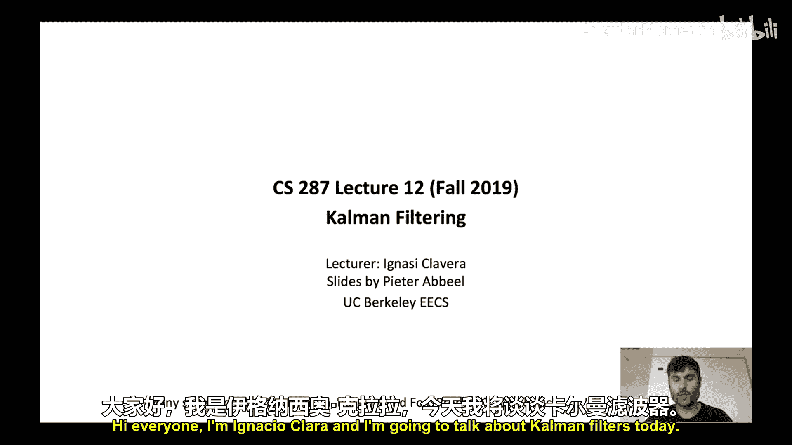

So before talking about common filters and all the machinery。

 we'll firstinate you to do an overview of multire gaussian variables。Because this is like all the。

Mathematical background that we will need here to properly understand Can filters。

When display camera filters， since they are just valid for the linear setup。

 we will explain two extensions of it in for the non nonlinear case。

 one will be the text center K filter， and the other will be the uncented K filter。

 also known as Sigma point filter。

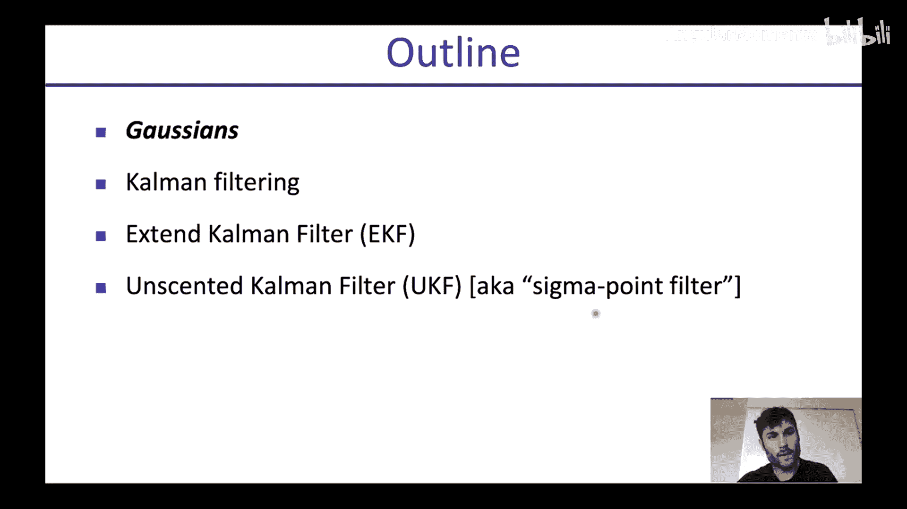

So let's first talk about the multivaris， so a multivari is defined by two parameters。

 one is a vector mu and another one is a matrix sigma and this equation on the top is a definition。

OfOf the PDF multire。And it's essentially defined， but by these terminals are exponential。

 so essentially multivari gasian， it's defined by being the quadratic。

 like the exponential of a quadratic。And we see that the parameter mu access a location parameter which actually just centers。

诶。TheThe PDF and the sigma parameter acts as a scale parameter。This， this sigma， this matrix cannot。

The whatever matrix it has to satisfy three conditions。

 the first one is that it needs to be symmetrical。The second one。Is that it needs to be positive。

 definitely？And the third one is that the inverse。Needs to exist because we need to take the errorss here。

 so we don't want this to be L defined。The other term of the PDF。

 these scar terms here that depends on pi， the dimension n and the determinant of the matrix sigma。

Simply access ourmallesization constant。Thanks to this term over here。

 we have the internal over all possible axis， it's equals to one。

So this relationship will be pre important in the lecture。

This means that the integral of these exponential these exponential terms。

 its equal to the term in the data error， and we will use this little further on。First。

 like some quick notation， given a matrix A， whenever we write down the A between bars。

 it announce that is the determinant of this matrix。

And then when we see a to the power of minus1 since like here and here。

 it den the inverse of this matrix， so essentially the inverse satisfies that the a to the power minus1 times a is equal to density and a times a to the power of minus1。

 it's equals to the identity as well。嗯。For all these equations and formulas。

It's's usually easier if you think of it in the one dimensional case。

 so essentially instead of these metrics being n by n just thing as being one by one。

 which essentially means that this is a scalar。嗯。This is the case of the unverate garden variable we have in the。

In the one by one case， we have that sigma is equal to the square of the lower case sigma。

 and then we have this x minus mu transpose times x minus mu a s x minus mu squared。

Essentially we essentially obtain。The same PDF as in the Uniariate case。

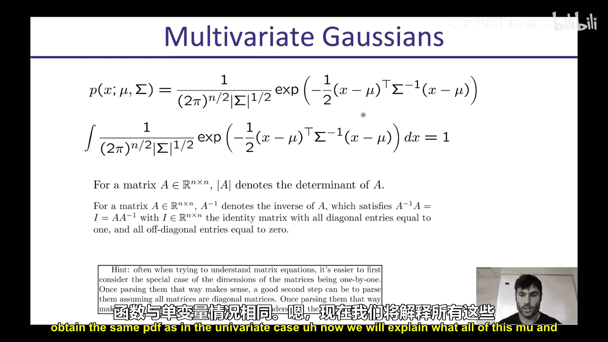

Now we will explain what all of this mu and Sigma parameterss mean。

As probably all of you will have like imagine of the mu mu I is the I component of the other parameter mu。

Refers to the expectation of their random variable X。The I component of the random variable X。

 so essentially if you do the expectation of Xi， you end up obtaining the mui。

And then here we have the vector notation where the internal of these vector x with respect PDF。

Essentially means that taking the， the skillar integral to the integral thats probably all you are used to do for each of the dimensions。

And this extends the same to the matrix case。If we compute。So the core the。

The metric sigma essentially the component of IJ， it's the covariance。

 so it's the IJ components of the covariance matrix。

And we can say because this essentially is the definition of the covariance。

 so Xi minus mui times xj minus mu J， if you take the expectation of this multiplication。

 essentially this is the covariance between these two random variables and if we do the integral of that。

 it ends up。We end up planninging that this the IJ component of the covariance matrix and the sigma matrix。

And in the vector rotationation or matrix nottation in this case。

What this integral means is just doing the integral for each of the components of the matrix。

Okay now we'll see some examples of how these parameters affect the underlying PDF。

So here we have a Gasian distribution date center around。10 so we see that in this in the first axis。

 the mean the mu is center in in the value of1 and then the second axis is center at the value of0 so we have that this。

D shape around the value of 1，0。And then we have a the covariance that is essentially the identity。

The matrix。So if we change the parameter mu， essentially what we have is we just moved the entire function to be centered around another point。

 so right now these is center around the 0。 minus 0。5 and0。

we can just keep shifting this around by just changing the parameter mu。

 that's why it's heavy for the mu act as a location parameter。

So because it's just preserving the shape， but just moving the entire distribution around。

So now we play what happens if we change the covariance matrix。

 so here in this function we have just kept the mu the same where we have just scaled the covariance matrix in this case we have shrink it so now instead of having values the identity they turns to be 11 it's 0。

60。6。And what this results is that this new random variable has less variances。

So all the mass is centered around around mu and what this means is like it the PDF has higher value。

And then on mu and then nearby points。Comvered with the identity covariance。

And instead if what we do is shrinking the covariance metrics， we just make it larger。

 what we end up having is at the points。Around the， around the mean have， actually。

Have a lower value than the previous ones， but the points are further away from the mean have a slightly higher value。

And the reason why is that way it has these different heights is because it has to integrate one so if you。

If you make the points further apart， you have a larger mass that will contribute to the points that around the。

Around the mean to have lower mass。So now we'll consider the cases where the covariance is not diagonal。

 but it have。It has has services are like off they on。

Essentially we have a covariance matrix that is 1。5 and the second row is 0。51。

What this means is that there is a positive correlation between the first axis and the second axis。

 and we can see it in the shape of this distribution。

So what this means is like if we increase the value of the variable x。The probability， the。

 the probability of， of。Of x of y having a higher value also increases。

 And that's why it has this sort of elliptical shape that is aligned to the x x equals y。

 So we have this x equals y that has。Ts where this aipide is one of the axisxes of this aipide is aligned。

And then we can correlate them even more by just increasing the value of these of the an terms。

 and in the limit of these being close to one， because if it's one， then。

You want have the covariance wont be inverable， but in the limit of this being close close to one。

 what we'll have is almost just one line and very。A very thin type shape。

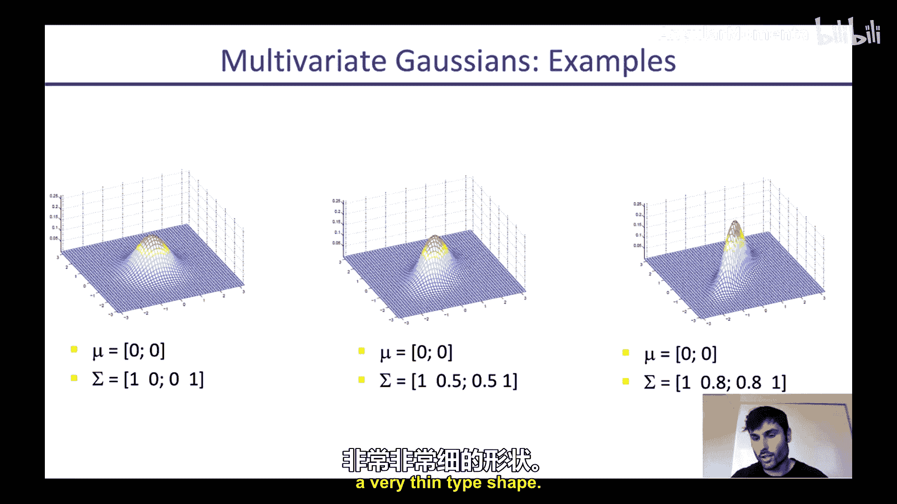

We can see these woods we're referring what like the allipocytes in that。诶嗯。And the different shapes。

So in the first one， we see that this is like a perfect circle。Where three is。There is no。

No misalignment of the axis。However in this case， since the risk correlation between x and y。

 we see that there is one of the axises of the eipide is this。Y equals x term is like diagonal line。

And here we see that this is。Even this distinction or this axis is even more sharp。

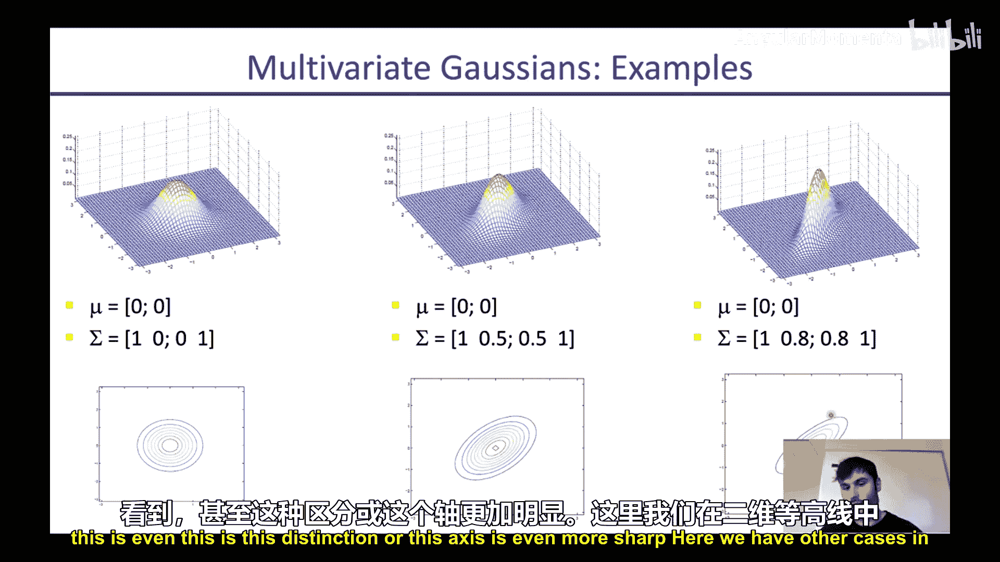

Here we have other cases in this in these2 the contours and we can also have correlations are negative。

 so here we have if the value of the y axis increases actually is more likely for the。

For the x to be to be negative。And we have even stronger correlations when those are negative。And。

Also， we can have cases where the。That。The thels doesn't have to be one to get just be scale up by any constant。

The only conditions that I say before the covarience matrix needs to satisfy is that isn' in vertical。

 it's symmetrical。And it's also a positive step， so its aenvalue are larger than zero。

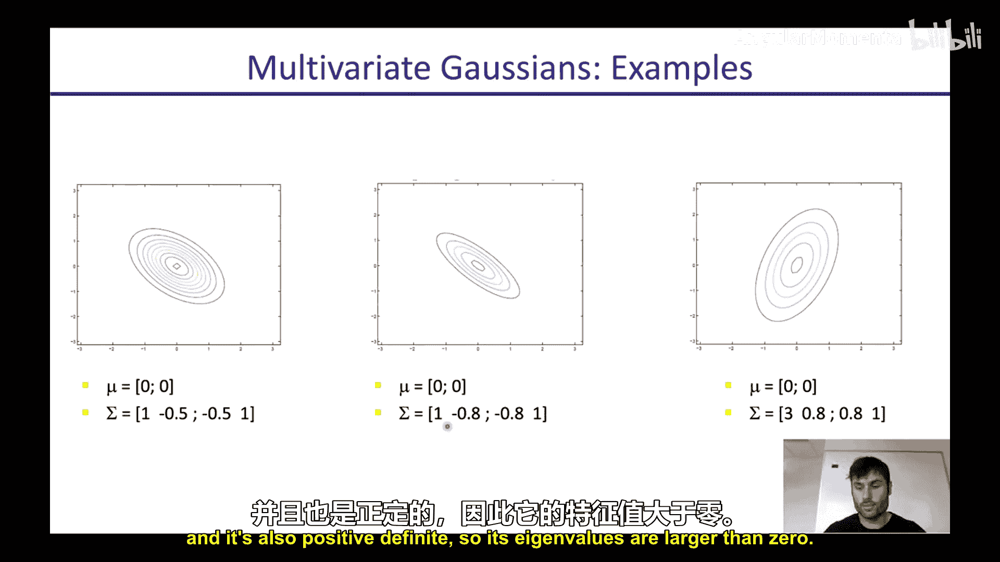

So given a multip Gausian distribution， that is high dimensional。Or has more than two dimensions。

We want to be able to write it down instead of in terms of。It's component。

 so you can imagine a random vector。Just split this random vector into two sets， one is x and y。

 so the combination of those。Leads to the original vector。

And we want to be able to write down the entire vector in terms of the expectation and covariance of x and y。

And why is this useful， this is useful because。We will have to operate。

These higher dimensionals vectors will essentially have to do marginalization and condition。

Of the with actually some entries of the vector， so we want to be able to manipulate。

In terms of the partitions。So this pretty straightforward。

 we can just write down which is write down the mu and the sigma。

Instead terms of like the mu x and mu y they arere respectively the mean of the vectors x and y。

And then the covariance matrix can be written down as a block partition matrix。

which each of the entries are the covariance of x， and then the covariance between x and y and the variance and the covariance of y。

 so here we have all the relationships。

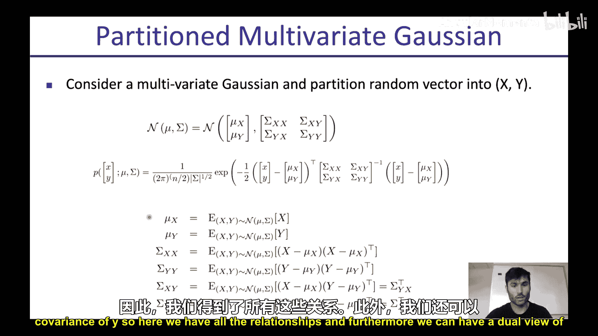

And furthermore， we can have a dual view of the Gasian variable where instead of writing intovari the covariance。

 we write it in terms of the precision matrix that is the gamma function that is the inverse of the covariance。

And the reason why it's useful is because doing algebraic manipulations with the inverse。

 it's very tedious， so it's much more convenient if you can write down the PDF without having to deal with inverses。

 so now the PDF just depends on the precision matrix and it doesn't depend on the inverse of anything。

So using the using the qualities for。For the version of block partition matrices。

It's pretty straightforward to verify this set of relationships。And I someone will notice。

 but this is the sure complement of the。Of the precision matrix。

This is a relationship that pers often in algebra。And then since the precision matrix is the inverse of the covariance。

 we have the covariances there。Inverse of the precision matrix。

 So just swapping the roles of siging gamma， we can get the other relationships that。

That that tell you how to obtain the precision matrix with trans the covariances terms。

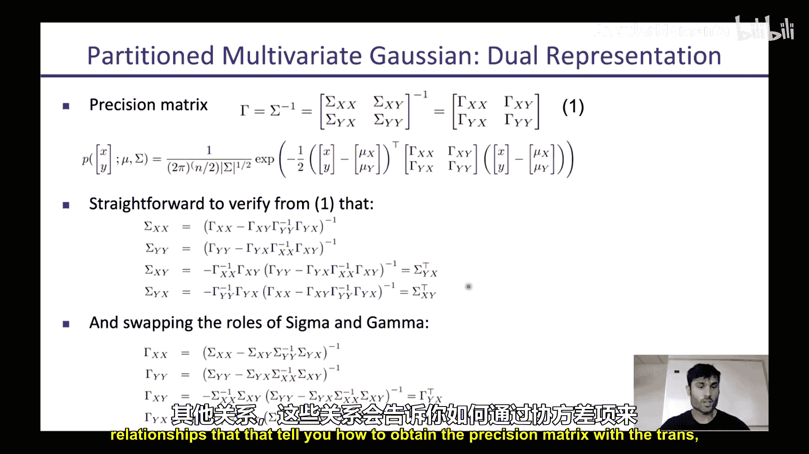

So the first operation that we will see。It's a marginalization。

 so essentially given the joint distribution of x and y。

 where these define a multivari gaussian random variable。We want to find out this region of just x。

So we have。No idea of like what distribution whatsoever will be。

So we will do all these algebraic operations with a precision matrix because as I said before。

It's more convenient and easier to manipulate instead of having the inverse of the covaris here。

So in order to find out what's the marginal of hex。What we need to do is just integrate out the。

The random vector white from the PDF。And。This month， this math looks pretty daunting。

 but we will work through it steps by step by step and we'll see that it's like pretty straightforward to。

To to obtain the marginal of x。So the first line over here is just expanding out。And this the the Pf。

嗯。We essentially discovered that we have this。Term over here， that just depends on x。

 and then this term that just depends on y。And then this other term that depends on accent and y。So。

This term that depends on x， it won't be involved at all with the internal because just the internal with respect Y。

And then the other terms， just depends on y， and this depends on x and y。

It very much resembles like aquadratic， and it's very hard to interpret the exponential of aquadratic。

But we know for almost the first light， so if we go back to it。

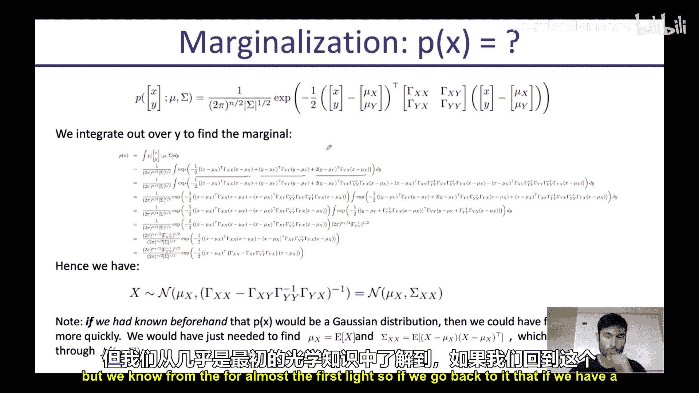

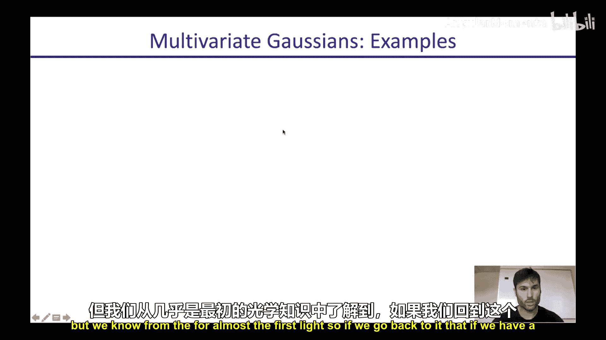

嗯。That if we have a good graphic of this form。We know that the integral。

 so just moving this constant to the other side of the quality。

 we know the integral of this exponential over here。

It's equals to these terms that involve the2 pi the dimension of there。Of the Gaussian variable and。

And the terminal of of the covariance matrix。So we are able to write down the terms of exponential。

So is like something that has this form， then we'll know whats the analytic value of the integral。

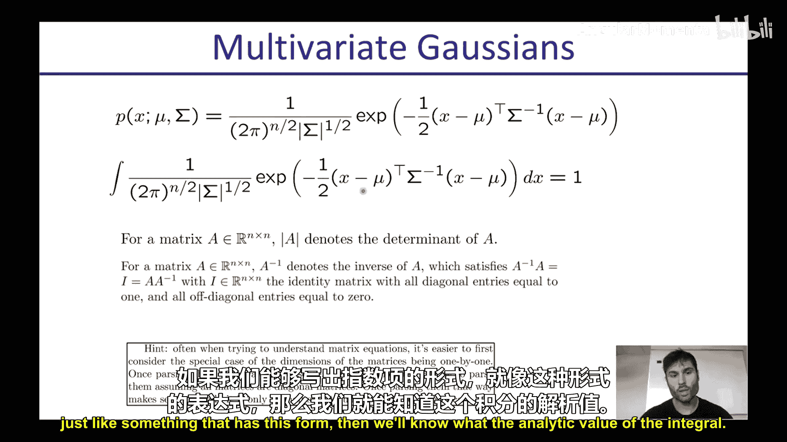

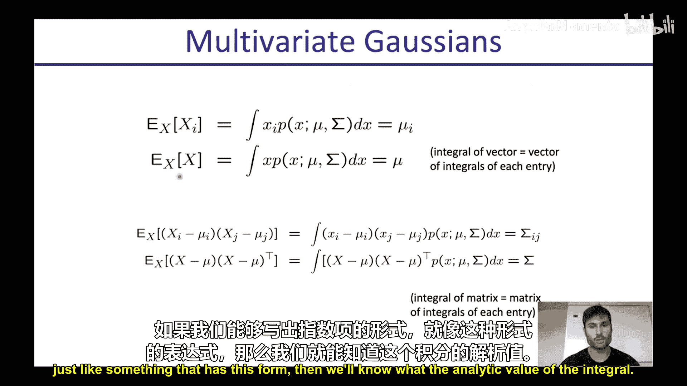

So， and that's what we will try to。To do in this case。

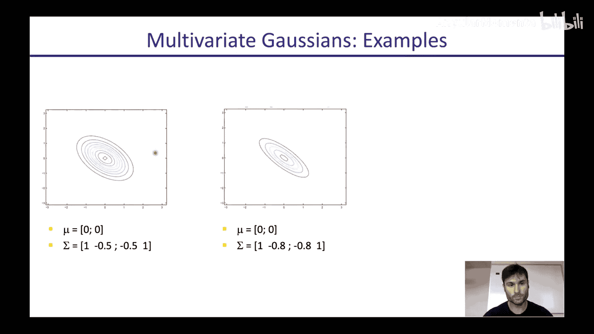

So I say the first term doesn't depend on why， so we'll just completely ignore it。

And then the second term we already have some sort of a quadratic term， right？

But this is not quite what we want because there's other ways we will have。

We don't know what to do with this other term overre here。

So these two terms will just state as they are。And essentially。

 what we will do now is just having the。The completion of square trick， but in higher dimensional。

So we'll try to do that。Typical term of like。诶。A plus。B。Squiirt。Equals to a squared。plus。

Two times a V。诶。Bi。Plus b square。So we'll try to do this in the higher dimensional term。

So here we can consider it like this first term。Is there。A squared？

And then we have to be able to write it in like two AB squared like2 AB。

So we already have the two here， which is nice。And then we can consider that this is like there。诶。

This a square。 So now what we can do simply is just。At this。

Then over're here that is do nothing because it's like gamma y y times gamma y y inverse。

 it just equals to one， so we have other this term。That doesn't modify at all all the equation。

But they give us the A component。Because then we have y minus mu y times gamma y y that is sort of like the square root of this thermo here。

And then。We just need to deal now with the B term and now we know that we see that the B term is this sort of like gamma yy inverse times1 gamma yx times x minus mu x。

So what we do now is just add。All this this B terms squared and subtra subtra again。

So we have modifier all this equation， The only thing that we have done is just adding。

This one over here in force of like。The gamma times the and then adding and subing this B square term。

So。This part over here actually just also just depends on x。

 so we won't be involved at all with the integral， so now what we do is like just put in front all the terms that just depend on x。

And won't be at all affected by the internal。And then now we have these other terms that has the Y involved。

But this term now is like as formula， it's like a squared。And there's like two times B。

And here we have the B score， so we can just write it then as a quadratic。

And now essentially we have the form that we wanted like that we know we know what's in of because this essentially so we can consider that this is。

This is the meal term of asian。This is the evil of the quadratic， and this is again the me term。

Right， so。Now we can just like plug in the formula that we obtain for the PDF。Oh a gotian。

And with like some underdirect manipulations。We obtain that this is the marginal。Of the。Of of b of x。

 So what this will mean is there's this mu x， it's a min。

 and this term over here is the inverse of the。Of the a quars。So essentially we just have that there。

That the Gaussian random， the Gaussian variable X falls。

AGian distribution with mu X and covariance matrix chis。

Sigma Xx by plug the previous relationships that we found out between the precision matrix and the covervarit matrix。

So we have done all these manipulations because we didn't know beforehand what will be the form of the marginal effects。

But notice that if we had noted there that the P of x will have intercaion。

 we could just find out the muo and sigma， so there will be。

Make make our lives way easier because we know that the gaussian variable is just parameterized by the parameter mu and the parameter sigma to like the the mean and the covariance。

 so we could just like have found out the mean and the covariance of。Of the。

 of the variable X in order to。To find this distributionrus。

 but we assumed beforehand that we didn't know what was the form of PFX。

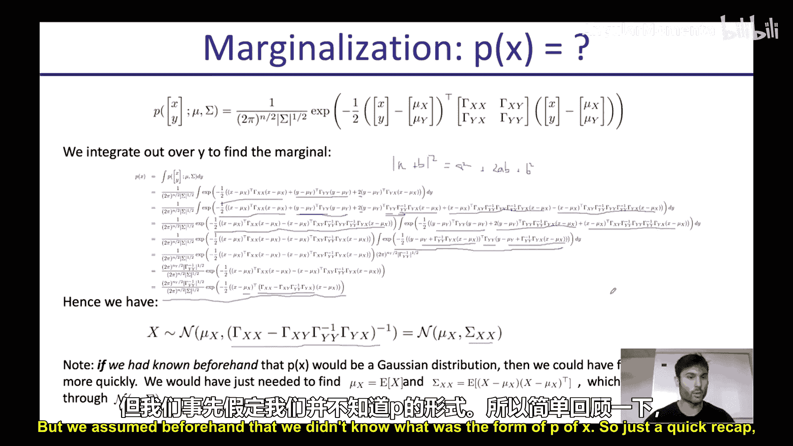

So just a quick recap if we have a drone distribution。That follows this like。

This partition variable with parameters like mu X， mu Y and all the current terms marginalnalizing is pretty straightforward is just get the。

Mu the mu of the parameter x and then thevari， the covariance of the parameter x also。

 and the same if you do it with respect to y。So。You will have to work it will be good for you to work through all the details how to。

Essentially to the competition squared trick， what Ive essentially hinted in the proof before。

 but I just like sort of specify for there。For this scalar case。

 but you should be able to work it out yourself and find out that this internal over here。

Leads to the follow result。So the other operations that we will need in order to。

To fully formulate the camera filter is conditioning。Certainly。

 we have the joint description P of x and y。If we know that the。Value of y is equal to this y0。

What is the value of whats the probability distribution of x condition of y equals to this y0？Again。

 we'll work more or less through this daunting math and it's using the exact same tricks。

Here what we would saying is the probability of x， given y equals to y0 is proportional。

 and that means that it doesn't depend on x。To the to the joint distribution of。

Excellent evaluating y2 y0。So just expanding again this expression。This Qdratic expression。

We find that it appears these three terms， one that just depends on x，2 depends on x and y0。

And this just depends on y  zero， since we're just like。

Finding like proportionals and this term doesn't depend on x。

 we can just completely drop it off and just say like all of this is again proportional。

To choose the terms that depend on x and the pairs that depend on x in this y is0。And again。

 we can do the same， we see this like similarmer or quadratic but not yet a quadratic。

 so we also we will massage this expression by using this computation of square trick again。

 and the tricks are very similar here， we'll also adding。

 we're just multiply it by1 and just doing gamma xx times gamma minus 1xx。And just adding。

Andtrain the b square term in the computation of square strict。So。This term again。

 just the B score term doesn't depend on x， so we'll just like move it away。And say is proportional。

 And the now the other terms over here， just like。They form they form adtic。

 so essentially you end up finding out that the。the conditional of x with y equals to y0。

It essentially gives。This。Quickra term。And this game the。Dcusion distribution， right。

 And now what we have is that is that there。That there。

Man at the mean is given the mu term is given by this。诶。The them will represent this thermoware here。

And here it's missing actually a parentheses。And then the inverse of the covariance will be given by the precision matrix and then here we also have the mean again。

 so here's where we're saying that x condition on y equals y0。

For the ca distribution that has this meaning。And it has covarience equals to the inverse of the precision matrix。

So now we can just write it all in terms of covariances itself a presume matrix， and this is there。

The resulting Ga variable。So we see that the way that that the mean moves is that we have these sort of like。

诶。Arero term or like deviation term that like， how far is this why is you。

With respect to the in and this like the correlation between。X and Y。嗯。Essentially。

 we also see that when you condition on y being equal to y0。

 you could use uncertainty or the variance of the system because here we're essentially from this covariance x。

 we're just subtracting these。Tm release positive。So this is just a recap of the formulas that we've just found out。

In case you want to access it later is your。So now we'll delve into the main part of this lecture。

 there's that common filter。So you can consider a Kaman filter as special case of the bis。

But when the dynamics are linear and the measurements are also linear and then all the。

 if you serve with the Gaussian variable and all the noise that you have in the system。

 it's also Gaussian， then what you're having is like all the all the variables involved are also Gaussians and then。

We can find we can obtain algorithms to like much more efficiently filter and recover this state。

Because the underlying assumption is that。We。We assume that we know the first state。

 so this like initial distribution。And then we have access to the measurements。

But we don't have access to the underlying state， we don't have the Xt。And。

Given the measurements we want to be able to recover what's the state of the system。

And this is a pretty common case in robotics where you directly don't have access to the state of the system。

 but you just have access to the sensors。That you have incorporated into your robotic system？

So also what what this graph is saying is that there。Goion that the variable Xt plus one。

It just depends on X， T and U T。So there is no further dependency， so if you know Xc and UT。

 you are able to recover the distribution of xc+1。And then these ZTs just depends on the underlying state。

 there is no other dependency。So there are three updates in this common filter and the first it's。

The time of date。 So the time of data is just。Obtain the prior that you know of Xt plus one given X T。

 So here we done。Yet assume that we have observed the measurements of the sensor。

 which is now that given Xt and our dynamic model， what is the Xt plus one that I predict？

So here we assume that we know the probability of Xd given the previous measurements and actions。

And now we want to know what will be there Paul the this version of xt plus one。So。

We can just write this down as marginalizing the join of xt plus 1 and Xt。And essentially this join。

 we can now apply the bias this rule and we could write it down。

As the probability of xt plus 1 given an xt。And all the measurements and all the actions。

Times the quality of Xd， given again all the measurements and all the actions that we have here。

So if we saw before in the graph。Xt plus 1 just depends on xc and UT。

 so we can actually just throw away all the measurements in this term。

And the other component over here is like the probability of Xt given z T。

 a given z of all the measurementsher。And you。This is what we assume that we know at this current concept。

 so you have like this sort of like inductive assumption。

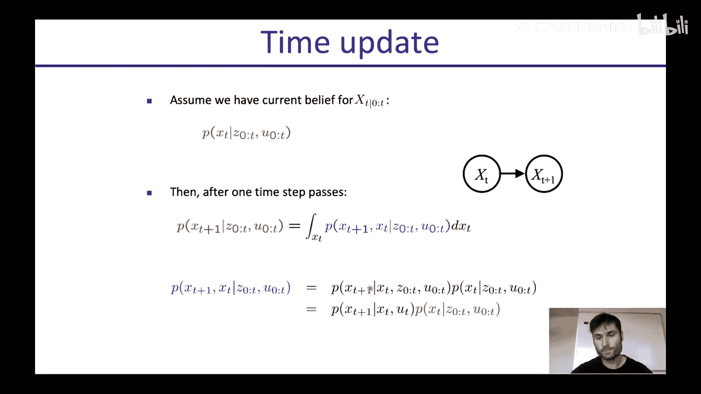

So。We want to be able to find this joint distribution and in order to find the joint distribution。

We just need to find out this term over here because we already know what's the。

What's the we assume that we know what's the this probability of Xc。

Given the measurements and actions。So we can expand out this term because。

We have the relationship between Xt and Xt plus 1 is linear。

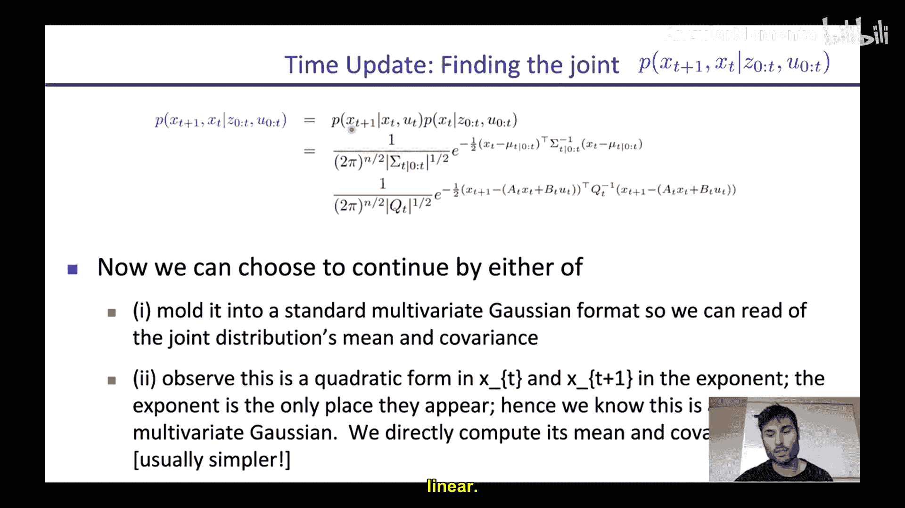

Essentially， if we go back to the first slide。No。Given Xt。

The only randomness in xt plus one is just the nice that we incorporated。So。

What this is say in the given X。The random variable that x plus1 followss。

 it's a Gaussian variable centered。In A times xc plus Bt times Ut。嗯。

And then it has a synthesisal relevance is here。 the only variance in the。In the。

 in this variable is the one given by the， by the。Gauusian variable， this nice eps G。

 So essentially we have， we find we have a。Gausian variable that it center。

In this prediction of dynamics and has noise GT。

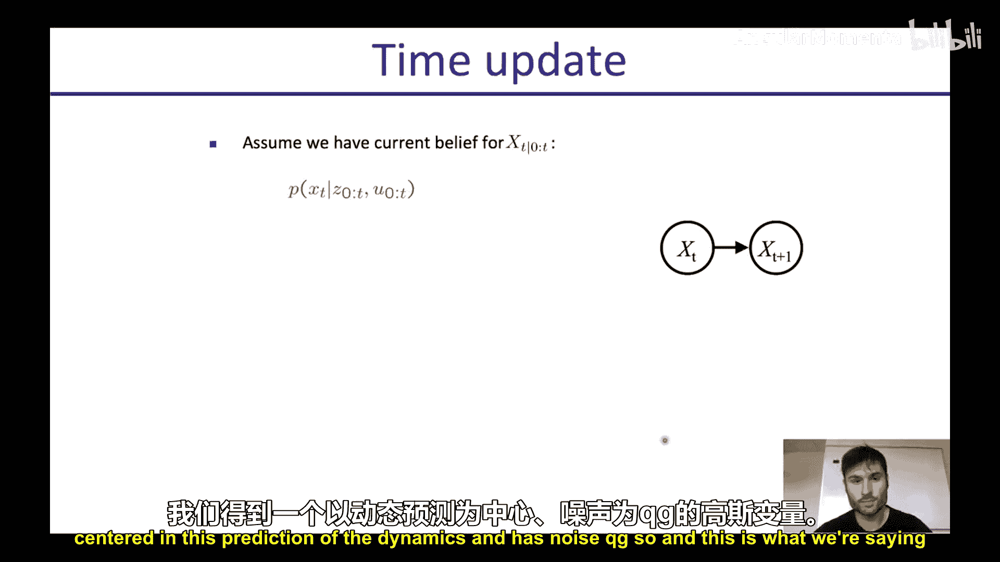

So and this is what we're saying here， we have。第四。This gaussian variable that is like how new the one printed by dynamicss and the covariance is Q。

And then， the other term。Over here is just the one we assume that it's known it's just a gaussian variable that has mean mue。

Given all the past and sigma T， given all the past again。So。In order to find this joint distribution。

 we can approach two ways。 One is like。Morely as we had it before and just do all the tricks with computation ofquidratics。

Or。The other way of finding it is by seeing that this's an exponential of quadratic terms。

And has like if you have an exponential quadratic terms to Gaussian distribution。

 so now we can just find the Gaussian distribution by finding its min and covariance matrices and this is essentially how you should proceed always that you know there is a Casian distribution because it's much more convenient。

Use now would in order to find the PDF of this join， we just need to do the expectation。

Of these of these variables and also find the covariance of this。

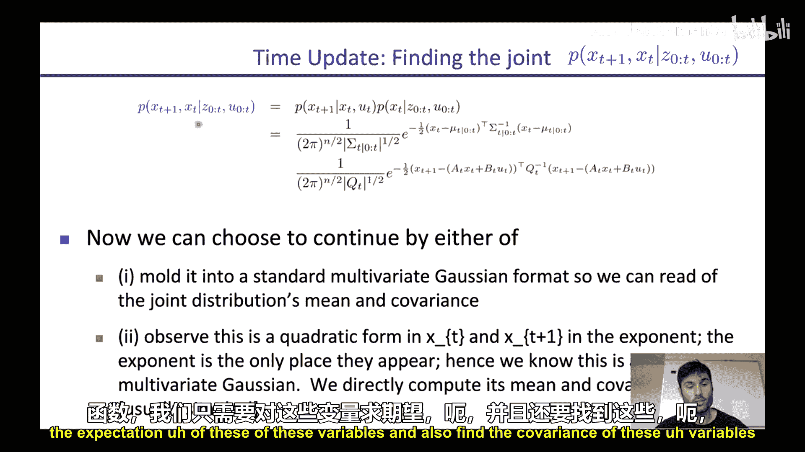

Varables。So。He in a lot of daunting maths， but it's pretty。

 pretty actually pretty straightforward and you should be able to work through it without looking at this at this slide。

So， essentially， we have the。That thejo Russian follows。诶。

Gussian distribution because we saw that this is the exponential of a quadratic。

And then we'll just define these parameters mui given the past from the O to T and then mue plus  one given the past from the O2 T。

 so here' is what I said that。We haven't condition on the current measurement。

 once we condition the current measurement， we'll see that this condition will be from0 to t plus 1。

And the same for these covariances terms。So yeah， this is our assumption that。

Mut t from zero to T and sigma T from zero to T， it's assumed to be known。

 so we know the underlying distribution。Of X D。And。In order to find this。

 so you can work through all of these。 But in order to find like this mu t plus one given the past。

 it what I explained before。 just， you just like the。The formula of the dynamics。

And then you just take the expectationation and since everything is linear。You just have to。

You end up having the the。The expected the demean of the x plus  one。It's just the。

It's just the dynamics evaluated on the mean of the previous handset。And。Yeah。

 you can work through all the all the covariances， but essentially just ping the。

The the formula the dynamics。 And since everything gets。Linear。

 you have that a a lot of the terms of the noise just cancels out。

What you end up having is that the covarience is just。A times there coence of there of。

Xc times a transpose， and then the extra noise。The extra certainty given by the noise。

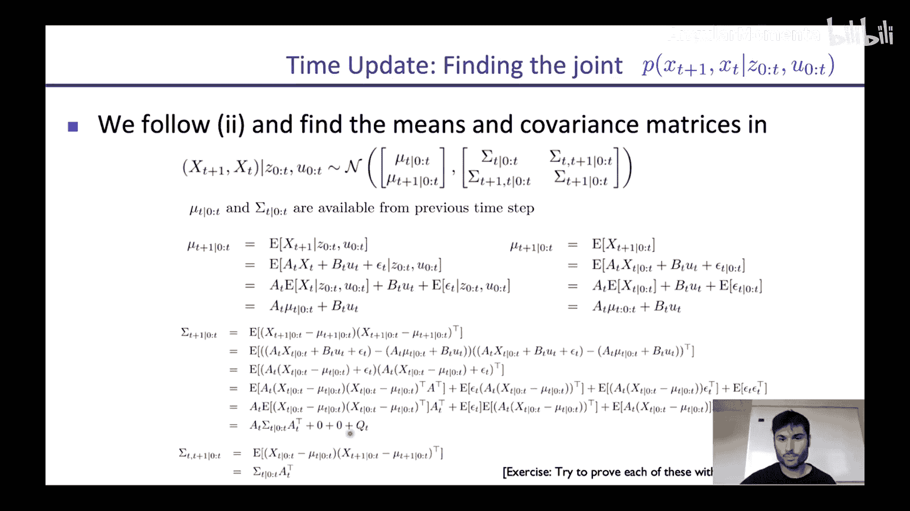

So this is the recap over time update。We assume that we know the。

The underlying distribution of the Xt， given all the previous measurements。嗯。

We have the formula as dynamics， so we actually assume that we have the underlying dynamics and we sort of like know how the noise is behaved。

So with these assumptions， then we find that the joint distribution of xt plus 1 and Xt fall a Gaussian distribution with this mean and covariance。

And now we can directly apply the formulas that we saw for the marginalization。

To obtain just a distribution of x d plus1 given all the past。So。这 what。This is the formula that we。

That we saw in the multivariate Gasian case。

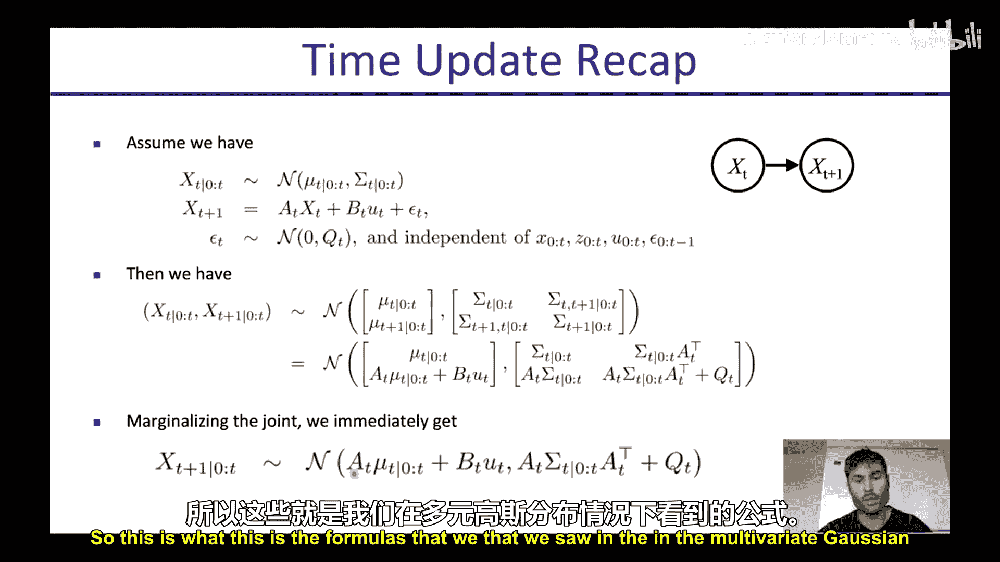

So this is true for any。Gusian variables that they're related with they have a linear dependency。

So it。And if a casian variable follows a certain ca distribution。

 and then we have that another cas variable w。It's related linearly with this susian variable v plus some extra nice that it's independent of V。

 then all that we have formulated here and develop just applies。Straightforly。嗯。So the other step。

It's once you see the observation， so you have a system and you apply some action and you get to a new state。

And then your sensors apply just like send you the observation。And now given this observation。

 you know more things about their underlying system。

 so you want to you want to know what's the underlying system condition on this new observation。

So now we assume we have the prior that we have obtained in the previous slides。

We know that we see that we know x plus one。Given the past。

 but we have already not seen the measurement。And then we assume that way that the underlying state and their measurement related is through this linear equation。

 so we have this CT that multiplies the x+。Ct plus1 that multiplies x plus1。Plus some constant term。

 and then we haven't noticed that it's independent of all the previous random variables。So。Then。

 we can just。Find again that the join will be an exponential of a quadratic。And hence。

 you can just find the parallels， mu and Sigma。Because you know it's a caian variable。

And just working through the math the same way that we fund the join for the Xt and Xt+1。

 now we can do the exact same steps to find the join of xt+1 and the T+1。

And once we find a joint distribution， what we can do is just conditioning on Ct plus one。

Equals to the measurement that we have seen here， lowercase Z T plus1。

And we can just apply the equations that we。That we obtain in the multi ga case。For the conditioning。

 and we can just apply those straightforwardly to obtain the Gaussian distribution。That x d plus one。

 given the previous measurements and actions。The distribution that this random variable follows。

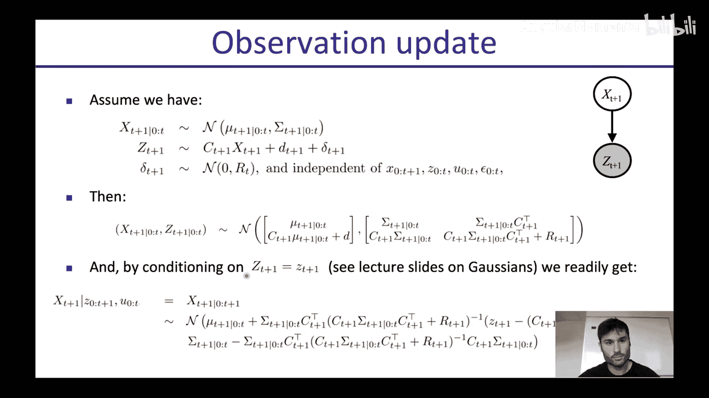

So。With this， with this two plates。We know the entire algorithm of the camera filter。So。

Essentially how the system develops is that you start with some initial state that follows a pretty fine Gaussian distribution。

And then a deep step， you alternate between。Predicting what your system。

 how your system will behave without actually knowing the measurement and then incorporating the measurement。

Into your your beliefs to have like a more。Acrd state of your system。So。

People who usually write the common update is by the means of this common gain。

That is essentially how much you have to rectify your system。See that in the measurement of date。

 the mean is given by the previous mean。And then， you have this。诶。第四。

Error term that is given like this is the actual measurement。

 this 6 plus one is the measurement that you see。And this how much it deviates from the middle。

And then， you just。You just incorporate this into the next mean by the common gain or also known as innovation essentially。

different how might is their prediction has to change given the error that you have seen。嗯。Finally。

 this common gain is also incorporated into it also appears in the expression of the covariance。

That essentially says， how might you reduce your uncertainty by seeing these measurement。

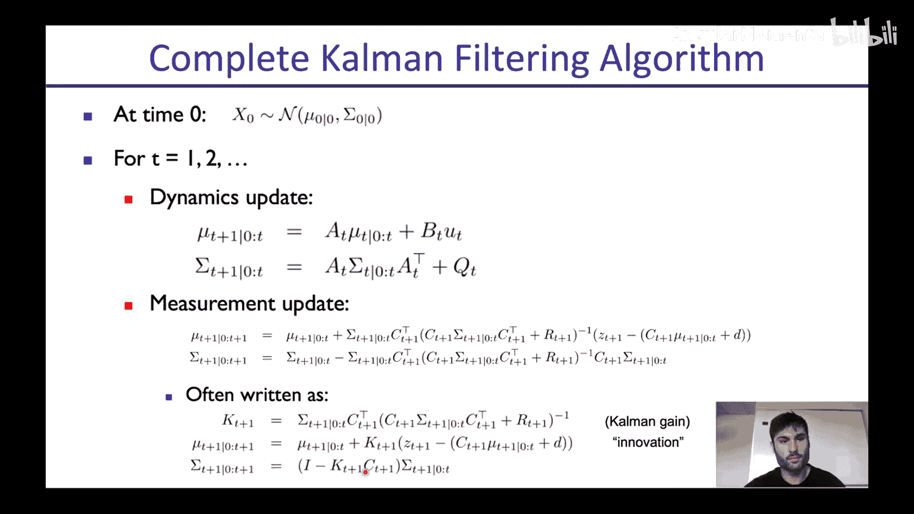

So。This carbon filter is very much use nowadays because it's very efficient。

And it gives you the optimal results， so essentially all the prediction that have that we see it just involves matrix multiplications。

So these can be implemented like very efficiently。And we have the extra benefit that this is the optimal thing that you can do for car systems that are linear。

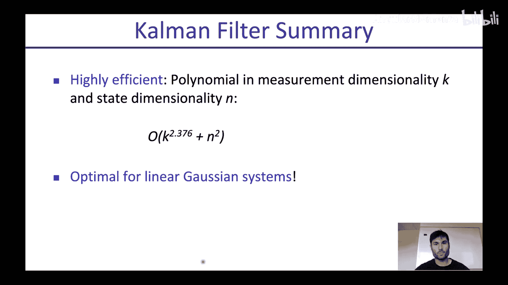

So in the previous part， we saw how to estimate the state of a system when all the transitions and all the measurements follow a linear function。

But。

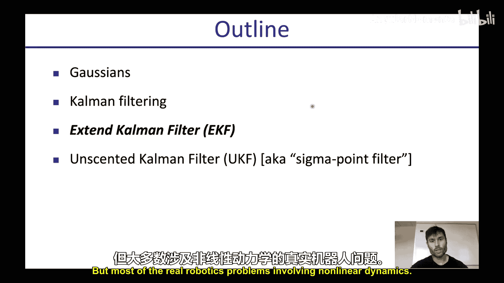

Most of the real robotics problems involving nonlinear dynamics。

 so essentially your function that maps from state in action to next state is nonlinear and also the function that maps from state to measurement its nonlinear as well。

So， but we have the assumption。the function is deter deterministic and you have to choose some extra noise on top of this obviously this function and more the noise is caution。

So。In the linear setting， essentially what we have is that this function FG。

 that the dynamics has just the form of a linear function AT times x plus BG times the action。

And the function that。That computes the measurement in the linear setting it's just a linear feature of the state。

HCA is essentially CT times x plus these DT。

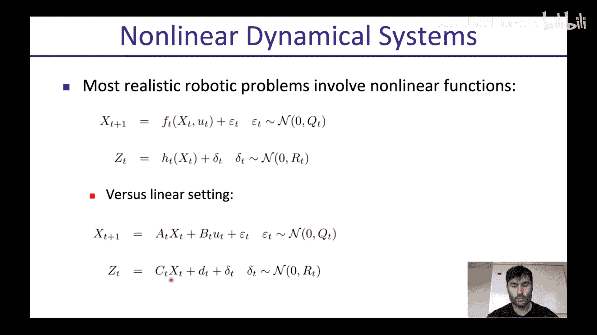

How， but how like？Does these linear nonlinear functions affect the quality distribution？

In the case that we have a linear function， this function y equals a x plus B。

 and we pass through it Gaussian distribution。we end what we end up having is another Gaussian distribution。

 the only thing is like this Gaussian distribution has mean that it's different and a standard deviation that is different。

 so essentially is shifting and scaling the original Gaussian distribution。

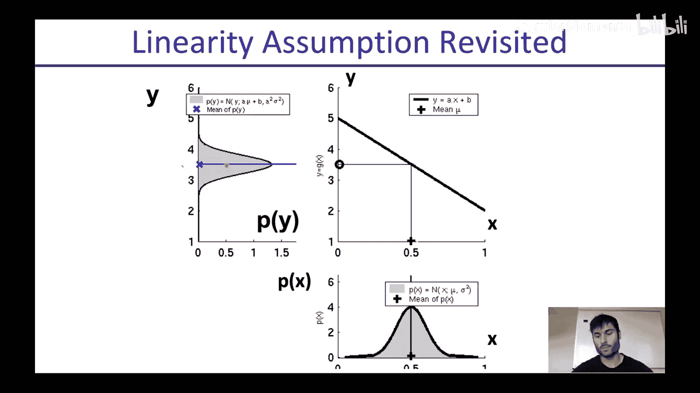

Higher when we have。Not only your functions， the behavior is completely different。So for instance。

 here we have this function G PG of H。诶嗯。And we pass through it again， a Gaussian function。However。

 in this case， the quality distribution is the gray。Part of this plot。It's non gaian。

 it's not like even Uni model here we see that there's these two modes that appear。

 so the policy distribution that you pass through these pseudo nonlinear functions can be abitarily。

So。We。It's very hard to determine and to compute the。

The underlying distribution that appears when you pass Gauss through through linear functions。Here。

 the the blue curve， it's the caussian that closely the most。

Closely matches the distribution P of y the gray one。So。In order to find discussion。

 essentially discussion is fine to minimizing some distance from。

A Gaussian with parameterm sigma and the distribution P of Y， and in this case。

 the sensor that we use is the k divergence。And so this is the closest Gaussian in terms of the Cal dirgence is the blue curve that we saw here。

But in order to compute so we know that the Gaussian is just parameterized。

 but the mean and standard variation， so what we can do in order to find to find this Gausstion is to just compute the mean and Sd of P of y and just assign those。

To Chi action， and this is the way that we can find also this discussion distribution of P of Y。

However， in order to compute the mean and deviation， we need to know the underlying distribution。

 so we have already done all the work of funding P of y and that's the hard part that the heart is usually not tractable is how to compute P of y hence like we don't know what the。

We don't know how to obtain analytically the Gausian distribution of P of Y。

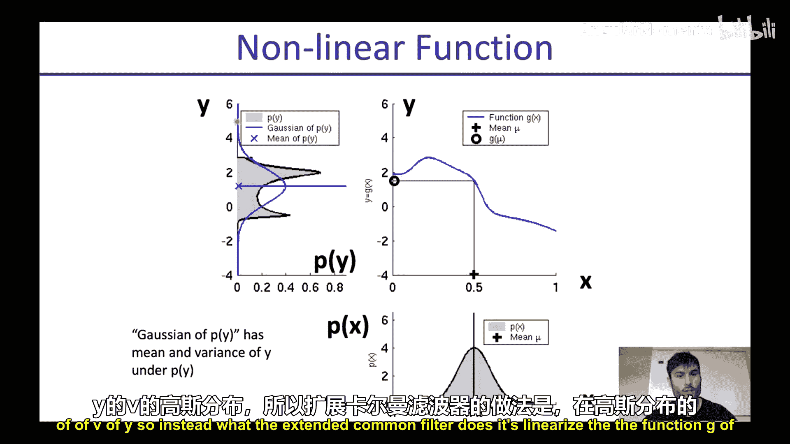

So instead with the extent common filter does， its linearize the。

The function G of x are on the mean of the Gaussian。

 so essentially we just take the first order Taylor approximation。Of the。Of the function。

And the way that we compute the Gausian is just surpassing the Gaussian through the linear function that we just obtained。

And we see that the Gaussian that we obtain is not exactly the one。

That you will obtain by like minimizing the CAL dirgence。But in some cases， it's close enough。So。

Here we see a case where where these like linearization fails and this is essentially when you have high variance。

 the problem when you have high variance is that you have a lot of points。

There are outsider realm where this function with this approximation。

 this first or the approximation the of the function is valid。 So in those cases， we'll have。

In the case that we have like high vns， we will end up with a Gaussian distribution that it's pretty different from the one that you will obtain if you were to fit。

Digtion to the true or underlying distribution。Or like the。

The benefit of this is like we very rarely work in those cases where we have high variances。Because。

If we have high uncertainty of what's our state， that's actually not even good enough。

 even if you had the true distribution， because if you cannot accurately measure the state。

 you probably won't be able to do any control on top of it。However， in the case that we have。

little variances， then all the mass is centered around the mill。

 so all the mass is centered through the points。That are。

They are like sort of valid for the title approximation。 So in these cases。

 we see the red red curve and the blue one almost match are almost identical。 So in the case we have。

Low variances。Then this AKF linearization， it's valid。

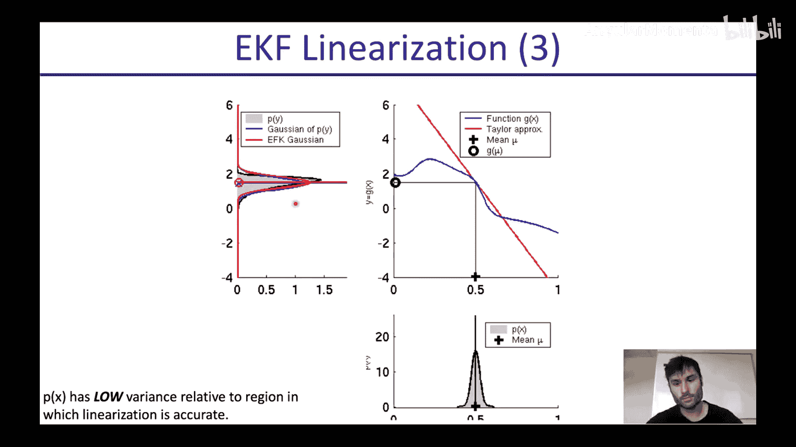

。So the way that that compute the first order approximation usually just is。

Eva the current function around the mean and you compute derivative all the function around the mean。

There is like very often the case that the analytic derivative is not available and people in such cases just use finite differences。

 so you can obtain these linearization by just doing finite difference。

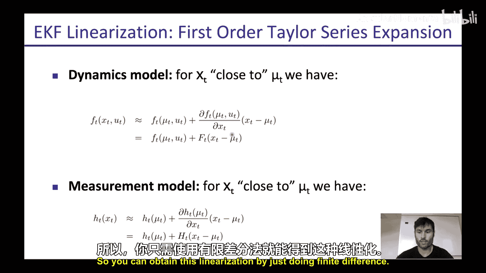

And then once you have the linear dynamics and the。And the the decision for the measurement function。

Then you apply the exact same algorithm。诶。that we have obtained the column filter。

 but you just change the A， B， C and D mattresses by to be just the linear terms that you have obtaining your linearization。

 so it's pretty easy and straightforward once you have the common filter to just just extend it to the non nonlinear setup。

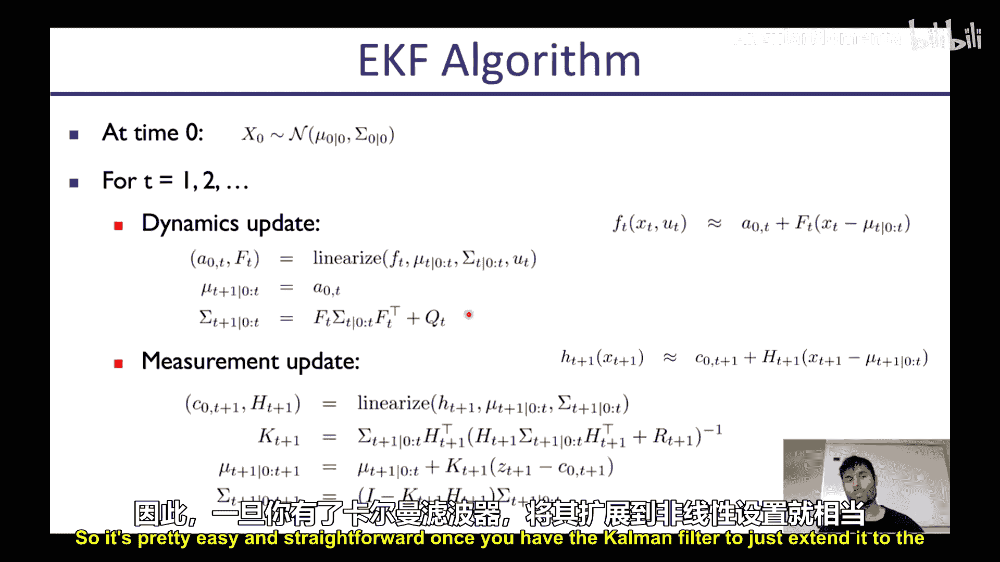

So this item is still very efficient， it's in the same order that is the same order as the Cal F update。

 and it just depends how computationally expensive obtain that this is but in the case that you have analytical derivative that is like really really the same it's really straightforward and the exact same cost。

The only problem is that。Its not optimal anymore because we have adding this extra assumption within this extra approximation on the non nonlinear functions。

Then what I have is like one is not optimal and two that it can diverge if this non nonlinear is high。

 especially when you have a lot of like multimodality。However。

 in practice works really well and people use it a lot and there are further extensions that are more efficient and better。

But。But in practice， it works really， really well and of works has been done on top of these standard cameral filters。

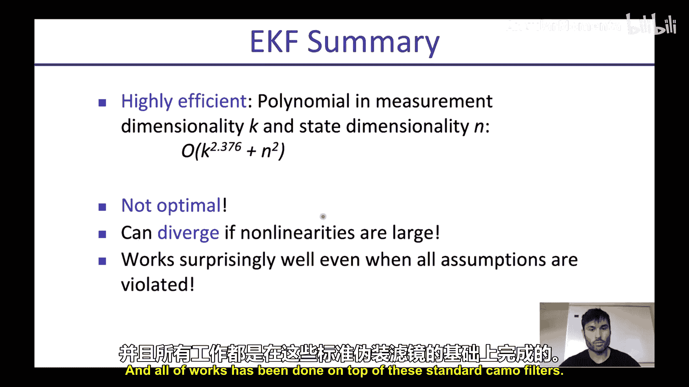

Now we're going to explain the uncented common filter that it's another way of doing common filtering when you have non nonlinear dynamics。

So because like essentially what the extend cable filter does is just linearizing the dynamics。

 doing the approximation the dynamics and then。Use all the machinery of the common filter to compute the estimate of your state。

But the UKF does instead is doing the approximationus in the Gausian of P of Y。

 so the Gausian distribution after the nuliary team。

And we do this approximation by sampling specific set of points。In that sense。

 the approximation that is carried out instead of being in the mality。

 it just happens in the distribution level。

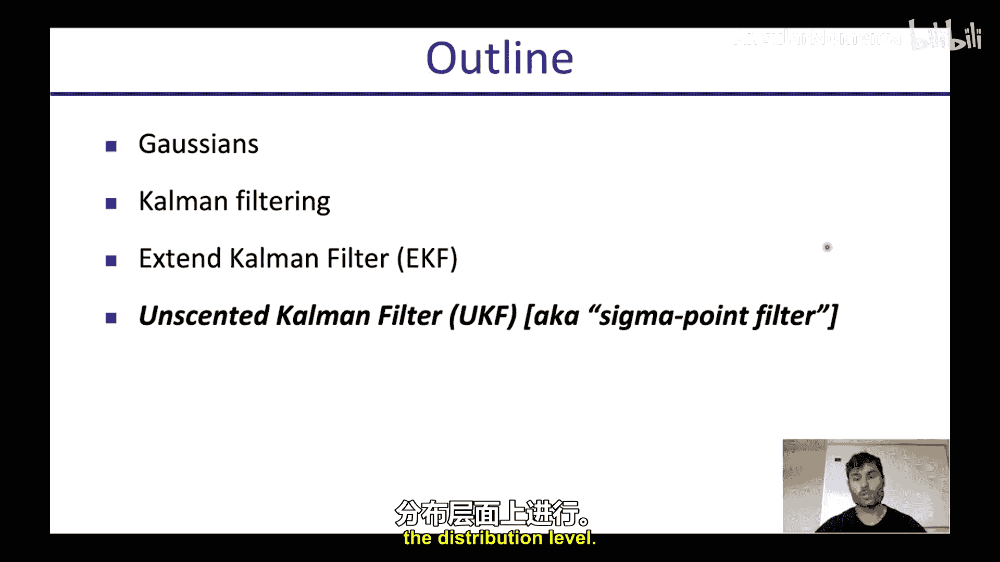

Here this plot shows us the difference between doing UF and。EKF。

 So in the extended common filter case we do is just pass this option to the。To the ta approximation。

 So we'll have like this line over here， the title approximation around the mean of the non nonlinear function。

And then this is the resulting and then you use the resulting Gaussian。For the cabin field group。

Instead in the UF case， what we do is sample a set of points。

 so here in this case we'll sample the min and then two points that are certain distance away of the min。

And pass these three points， avoiding like analytically the non linearity and then fitting a Gaussian distribution。

On the image of these three points。And we see that doing this procedure resorts to a more accurate caching distribution that if we were to do the extended cabin filtering。

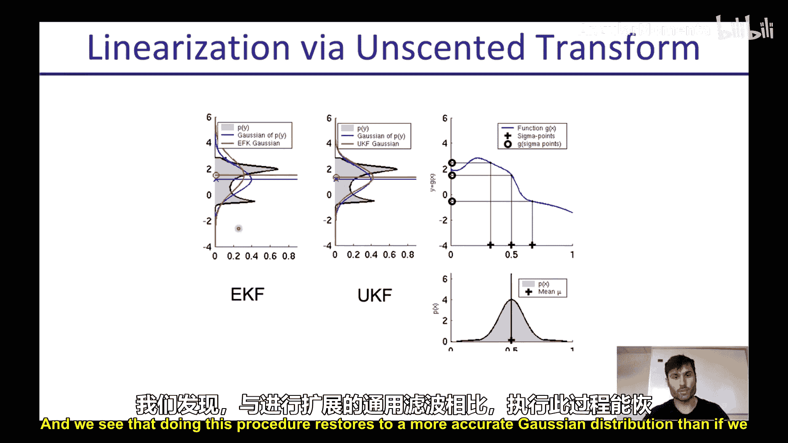

So here we see the case of when we have higher bars。And we said the AKF， EKF has。

It's a pretty poor approximation of the real Gaussian。Instead， if we use the Sigma point estimate。

That the UKF gives us it's a much closer approximation。 So we see the。

That the blue and the red curve are。Much more closer than the blue and red curve in there。

And extended camel feature。And。In the case that we have lower variances。

Then we see that both methods need to fairly the same results。

And you can actually prove in the case of being finite difference。

That there's an equivalentvalence between UKF and AKF。

Because you can consider if these sigma points are pretty close way。

 you can consider these adjusting finite differences。

There's this analogy between the Sigma point estimate。

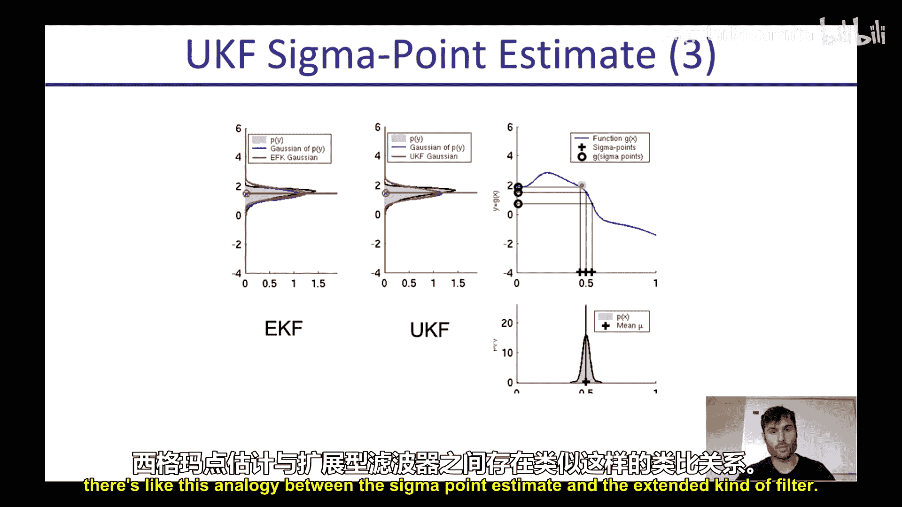

And the extended kind of filter。So essentially how the SigMma point estimate works is that。要。

You have this set of points that one will be the mean and then the other points that are。Certain。

Standard deviation apart from the mean and then you pass these points through the non linearity。

And this results in a set of points are the image of least standard。

 and then what you do is just fitting Gaussian distribution into these points over here。

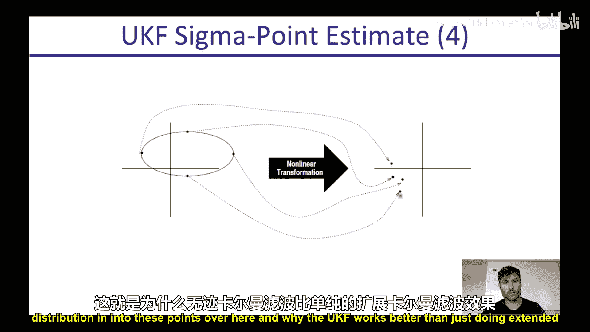

And why the UF works better than just the extended came filtering and the reason is that when we do extended came filtering。

 what were doing essentially is just removing all these。Terms on the tail。

 all the higher order terms of f， and we is keep on the on the function。

 the value of the function of the mean and the and the Jacobian。However， by doing the UF method。

 but we keep all the terms。诶。Of the nonlinear function。

 because essentially we're evaluating exactly the function at the sigma points。

But what we do is just approximating the and distribution。

 and that allows us to use all the moments of the nonlinear function and just。Trade off the the。

And just use the two moments for the Gaussian distribution that we want to evaluate。

 essentially because we did the min and the covarience matrix。

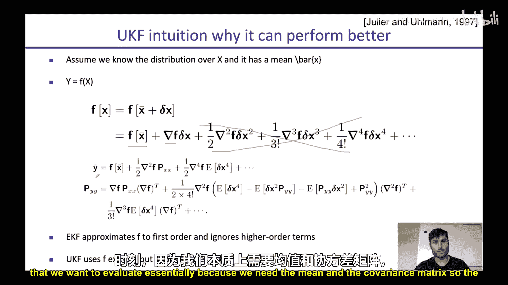

So， there。UKF essentially uses the minimal set of points。In order to compute the。

The mean and the covariance。Of the Gaussian function， the the Gaussian of P of Y。

And the minimal set of points that then set it transformer uses are the mean。

And then all these points are like。N plus K distance away from the covariance。 So we see that this。

Terms are the， this is the I column。 So essentially it just uses the axis。

Of thevariance the covariance and just scales it by this a square root of n plus k。

And just little people use n plus k equals3。But these K terms。

 this N plus K term allows you to fine tune。The resulting distribution get to be more accurate。

So and here what it means to here we're essentially taking the square root of a matrix。

And the essentially what it means is。Any any matrix such that if you multiply it to its transfers leads to the covariance。

 so this P of xx it's a sigma that we've been seeing is a covariance matrix of the。Off。

 of the random variable X。

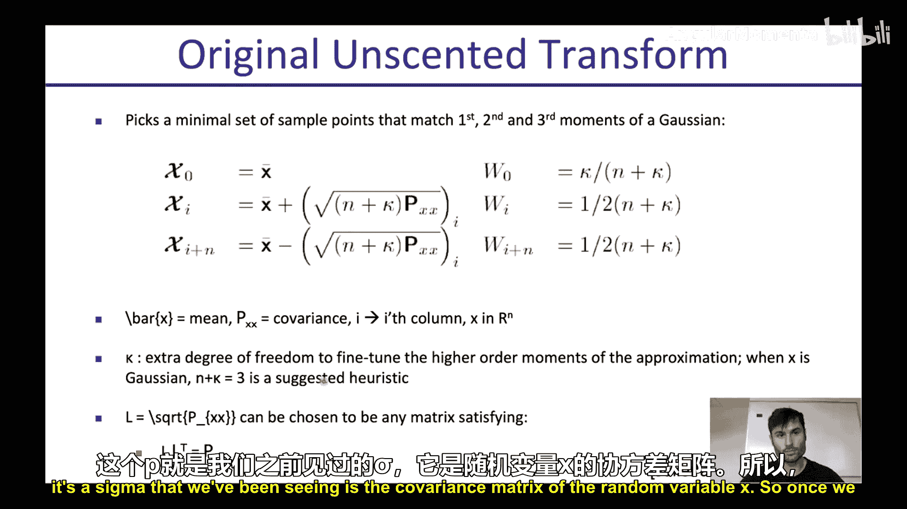

So once we do the unsettled transform and we obtain the sigma and themin。

 we can simply use the Calon filter update because now we have a Gausian distribution。So。

Then you can almost apply through probably the Cal filter approach that we saw in the past。

And then to compute the covariance between points x and the Z， there are the measurements。

 you just use these sigma points。That comes from the seted transform。

 and you can just compute the covariance between the points before and after the nonlinear nonlinear transformation。

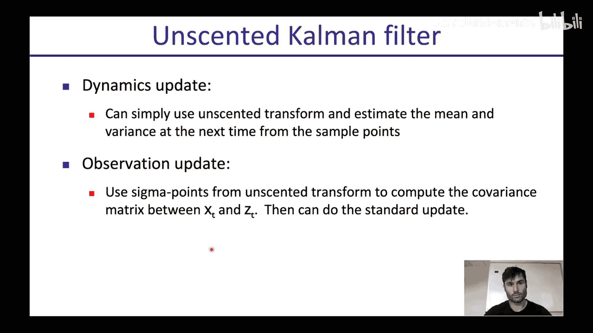

So here just for reference the entire algorithm。诶。That leads to the command filter。

And you should take a look at it and make sure to understand each of the。Each of the steps。

 but it's essentially the steps that I use。

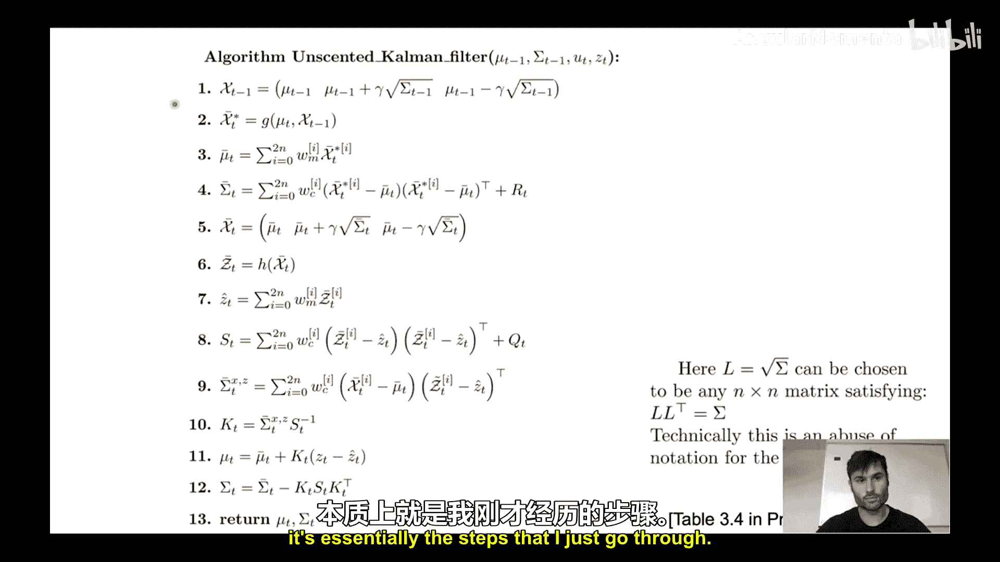

Go through。So the summary， this is。More efficient than the than the AKF。And in practice。

 it just runs faster。And it leads to better results。 and the further benefit is that in most cases。

 exact derivatives are not available and people obtain bridges doing a finite difference and this。

This computational is pretty slow， especially when you go to higher dimensional systems。So。

In general， like this UF leads to a better performance。And it's faster than it than doing EKF。

However， the same as extended Common filter， this approach is still not optimal。

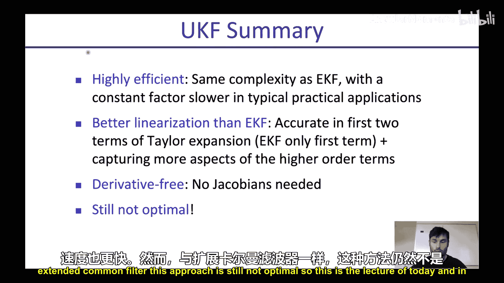

So this is the lecture of today and in the next lectures we'll see。

How to estimate the transitionion dynamics and the measurement functions。

 because essentially we have just assumed in entire lecture that we know the underlying dynamics of the systems and we know the measurement。

 but this is actually not always the case， so it will develop algorithms in order to estimate these variables as well。

And the only thing that we'll see is called to do smoothing， essentially。

 if we have seen more steps in the past， can we refine our predictions of what werere the。

If we have students sorry， if we have seen more steps into the future， can we refine？

Our predictions of what were the underlying state at a past timestead。

 so all of these we see it next Tuesday。

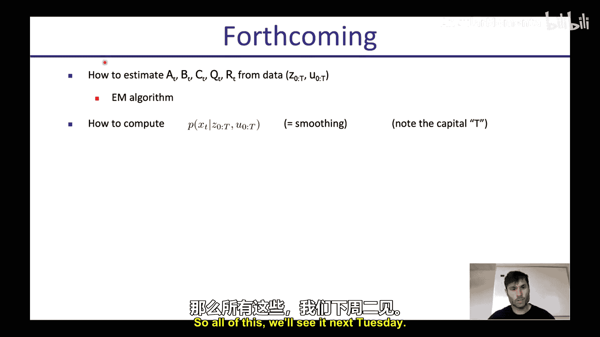