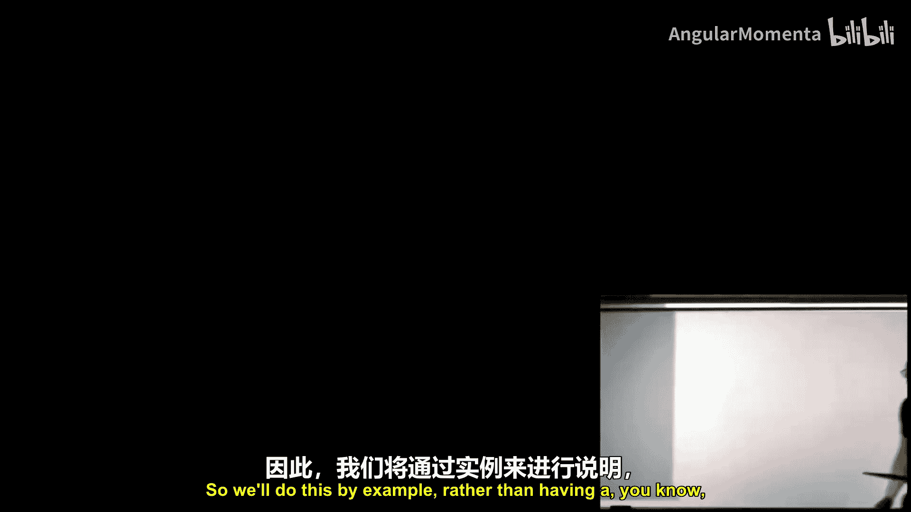
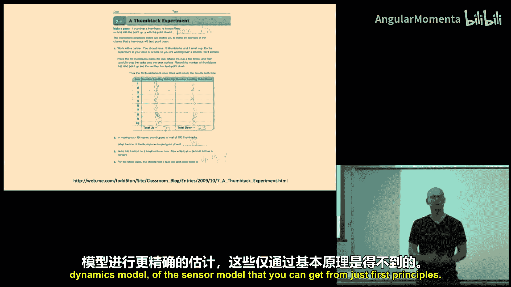
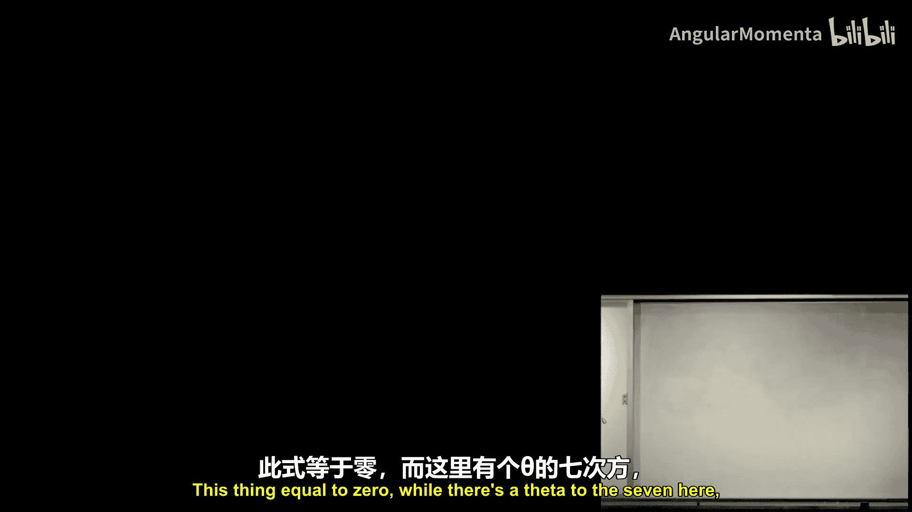
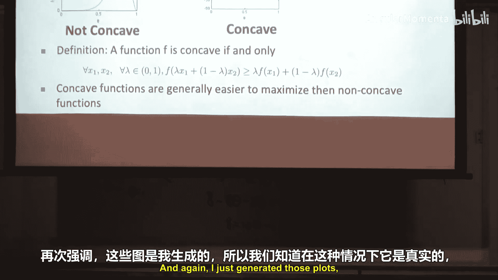
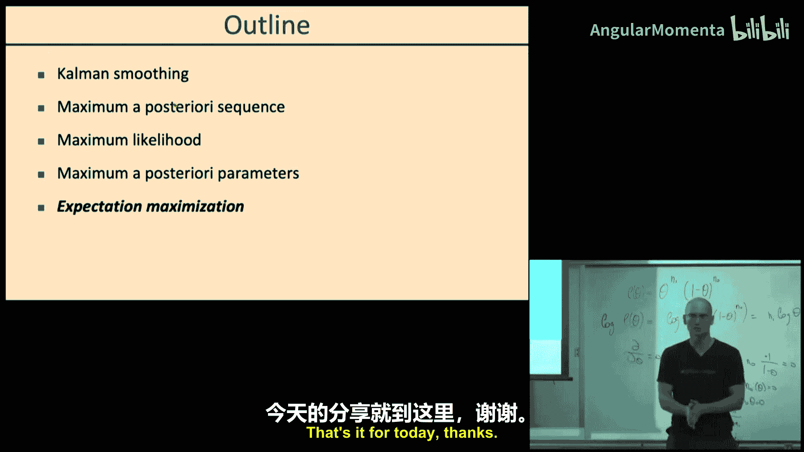
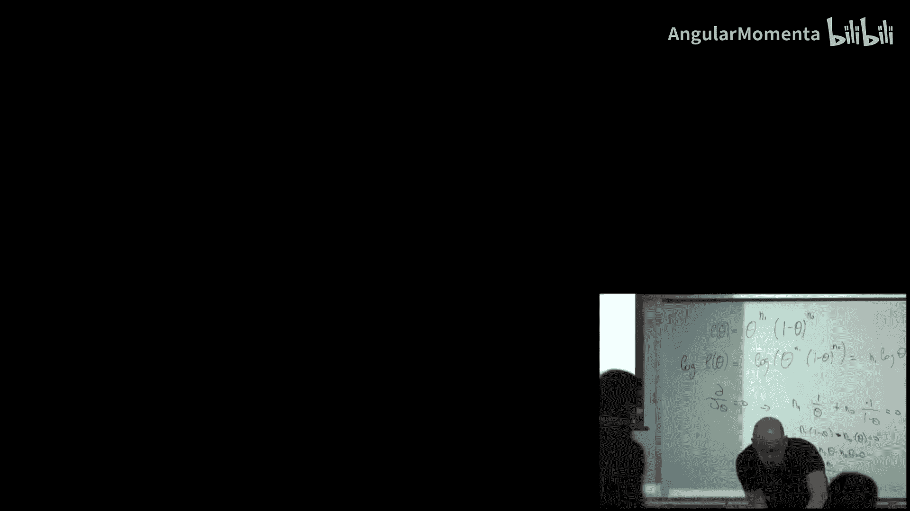

# 【加州大学伯克利分校】高级机器人学-｜-CS287-Advanced-Robotics-at-UC-Berkeley-Fall-2019-p13-13-卡尔曼平滑器、最大后验概率、最大似然、期望最大化--BV1KXqCB4Eua_p13-

All right， welcome everyone， welcome to Le 13 of CS 287。Last week on Thursday。

 there was no live lecture， but we actually did cover the material。

 So Ignasi did a recording at home and posted a video on Piazza so you can watch lecture 12 on video。

 There will be no live version of that lecture。 But this way we can keep up with a course and not lose a lecture slot。

Today lecture 13， we'll look at Kael smoother's maximum posterior estimation。

 maximum likelihood and expectation maximization。😊，Allright， so this is our menu for today。

 Let's start with smoothing。What's the main idea behind smoothing， Let's go back to filtering。

 which we've been doing In filtering， what you have is you try to find a distribution over a variable X T。

After you have observed some sensor measurements， z0 through Zt。And ideally， over time。

 I keep track of this。 when you go to the next time， you again find a distribution for X T plus one。

 given all observations up to time， T plus one and repeat。Now， if you look at this very symmetric。

 you only use information from the past， and often that's indeed the best you can do because right now you need to know the state of the robot as well as possible。

 so the best you can do is filtering in that situation。But what if you're postproces your data。

 you already collected your data and want to know where was my robot back at time T。

 you should also use the information that happened after。

 and so that's called smoothing in smoothing you use all the sensor observationss before and after to come to a conclusion about the distribution over state of your robot or your environment。

Now in the figures I drew here， I ignored the actions and in principle。

 it could be action everywhere for every time slice， but it does not change the math in any way。

 what does the action do the only thing the action does if we're doing estimation is that the conditional distribution of xt plus1 given Xt becomes conditional xt plus1 given xt and the action but once the action is fixed because you have the whole sequence is just indexing into a conditional distribution and putting it there indexed by the action and so let's assume that already happened。

 we already have a conditional distribution or Xt given xt minus1 and maybe it's indexed by the action maybe there was no actions it doesn't really matter。

 the math is the same。All right， so as we think about smoothing and comparative filtering。

 let's work out the basics on the board。So we'll do this by example， rather than having a， you know。

 just very。

General， like。Any kind of horizon problem will pick a very specific horizon， just H 2。

So we're interested in。Let me put this up。We'll be interested in the probability distribution。

Over state at time2。 So that's our example in general， it be any time T。

 but we're going to do by example for time2 given。Observations at times zero，1， and two。Now。

 one thing we know is that this is proportional to the joint distribution over x2。

And the observation C0， Z1， Z2。Again， what does this sign mean， the proportional sign。

 what it means is that we're looking at a distribution over x2。

And what it means then we can evaluate this quantity here for all values of x2。

And once we have all the numbers for every possible value of x2， we can just sum those together。

 divide by that sum， and that we'll normalize it， make this sum to one and get the actual conditional。

Now， the model we have is this HMM like model， so how do we write out this thing over here。

 it's equal to。Some。Over variables we have ignored because we have a chain in how the probability distribution is set up and we left out x0 and x1。

 but as we write out the joint distribution， they'll appear in it so we'll sum out over x0 n x1。

And then we can write out the full chain rule for this HMM。😊，Z2， given x2 before that。

 there was x2 given x1 then。With that there was right before that z1 given x1 and then before that there was x1 given x0 and before that there was z0 given x0 and then distribution for x0 and the graph corresponding to this is x0。

Let's do capitals x0， x1。X2。And then observed z0。C 1。Z2。

So we just wrote out to full joint over all six variables here。

 but then we only care about these four， so we sum out over0 and x1 to get distribution over just the four we care about。

Now， what do we do in filtering？ Well， we can actually start looking at some reorganization here。

 X 0。 Where does it appear， X0 only appears at the end here。So as we look at this summation。

 we can actually move it。 We can say this is really x0 summation can happen in the back here。

 So some。Over egg0， px1， give an egg0。P0， given x 0， P X 0， because as far as x0 is concerned。

 everything up front is a constant。 And bringing up a constant up front is fine to do。

 That's essentially saying multiplying every term with a constant or first summit altogether and then multiplying with the constant is the same thing。

Then how about x1 x1 does not appear in here， so we can bring this up front so we can bring p Z2 given x2 up front。

 and then we have the summation over x1， and then this one does have x1 in it， and so does this one。

And then this one， after we sum out over x0， we'll have x1 and z0 in it。 Z0 is a constant。

 but x1 will be in it， so we have to keep it in the back behind this submission。Now。

 let's give these some meaning in how we would actually run the filtering algorithm。 Wed say， okay。

 this thing here is actually the joint。 I the join between。Z0， well， let's try x first。

 join between x0 and z0。Then we multiply with x1 given x0， and we sum out over x0。

 We've seen this last week。 This will give us。The joint between x1 and z0。Then we multiply with Z1。

 given x1。So multiply it this conditional at this point。We have。C 1， comma x1， comma Z0。

Then we multiply with x2 given an x1。 So here。We'd have。P X 2， comma Z1， comma X1， comma Z0。

 Then we sum it over x1。 So it disappears。 So after here， we have P X 2， comma Z2， comma。Sorry， C1。

 come on C1， C0。And then here we'm multiply Z2 given x2， so at this point we have p Z2， comma x2。

 comma z1， comma Z0， which is indeed what we have over here。

And so what we see is that we can recursively compute the joint distribution between the latest state variable。

 x2 and all past observations。And the calculation we do is pretty much the same every time we just multiply in an observation。

 they will multiply in the dynamics model and sum over the past variable。

 Then we multiply in the next observation， multiply in dynamics。

 sum out over the past state variable and repeat。So we have a general recursive approach to finding。

These things。 And let's see where we're going to put this。Let me put it。Over here。We have P。X。

 T plus 1。Coma Z，0 through。Zt is equal to sum over xt。The D model X T plus1。Given X T。

Times xt comma z0 through Zt。And then to bring in that last observation， Z T plus1。

Which is ultimately what we want here for that update。 Now we have Z0 through Zt and Zt plus1。

Is going to be multiplying this thing with the condition of observation， given everything else。 So P。

 Z， T plus 1， given X， T plus1。Times what we have here， px T plus 1 comma z0 through CTt。Now。

 these updated equations are very easy to run， and that's all you need to do to run filtering as a quick reminder。

When we go from the joint， so here we have the join between xt plus1 and z0 through Zt and here we have added on zt plus1 in general we need to multiply with the conditional of Zt plus 1。

 given all the variables already present here， not just this one variable need to multiply with the new variable condition and all variables you already have。

But in this model we have a conditional independence。

 we don't need to condition on the past observations if we have the current state。

 and so that's why we just have xt plus1 here and not xt plus 1 and all observations to condition on because once we know xt plus one。

 those past observations， don't need to the condition on anymore， they're independent of Zt plus1。

And that's shown in the graph structure here， when we're looking at， we're getting Z2。

 given everything in the past is the same thing as Z2 just given x2。

 and that's exactly what's happening here why we only condition on the x T+ one。So that's filtering。

 And we covered that。 But we covered it now in a different way than not last time。

 slightly a different way。 so we can now match up smoothing with what we saw here in filtering。

 I'm going to have to use a slightly smaller font for。😊，This example。Actually。What how much smaller？

嗯。Burn is in your memories。 I'll use the entire width of the board as needed to cover smoothing。

 So youve got this。And。We'll use the full width。So， smoothing。Now we care about。

Let me try out here the context we will have。X2 again。And after it， there I should be x3。And X4。

 and there will be observations， Z4， Z3。Z2， and I should all things before it also x1。X0。

And observation Z1。C，0。Now we're interested in the distribution for x2， given all observations。

 This is something you can do after the fact。 after the fact analysis。

 what happened to my system that I have all the information available。

So the quantity we're after is P。X2。Given。Z0， Z1， Z2， Z3， Z4。Now， again。

 we know this is proportional to。The joint between all these variables， x2， comma， Z0， Z1， Z2， C3。C4。

Now， we don't directly have this kind of joint available。

 What we have available here is something of the form that involves all of these variables。

 So all the conditionals multiply together in that graph over there is what we have available。

 And then some variables we're not going to care about。 X 0， x1， x3 and x 4， we don't care about。

 We'll write out the full joint over all 10 variables and then sum out the four variables we don't care about。

 So what's the full joint， The full joint would be。😊，Z4。Given x4。

 that's happening all the way at the end， then x4。Given x3。Then。Z3， give an x3。X 3。Given x2。Z2。

Give an x2 and then we'll continue on this other board。X2。Given x1。Z1。Give an next one。X1。Give an x0。

Z0， given x0， and then the prior Px0。This is the full joint。Now for this full joint。

 we know we don't care about x 0， x1， x3 and x4， so we're going to sum them out。To get rid of them。

 x0， x1， x3， x4， we sum over to get this quantity over here。All right。

 now we're going to play the Sam trick。Is there when we sum out？

Over these variables is their way to rearrange this into smaller calculations。

 We don't need to first multiply everything together。 and then finally get the sum out。

 but we can do smaller bytes calculations when we sum some variables out， make them disappear。

 And that way， not have this exponential blowup as the thing becomes bigger because if you do it naively this way。

 this summation that the variables are binary， let's say then there will be two to the horizon number of terms in the summation。

 but by bringing them in in the right spots。 He reduces and you get a linear competition in the length of the network rather than an exponential calculation。

 So can we do the same thing here。😊，Well， let's see how about x0。

 actually we can play the sameas before， x0 instead of summing over it over here。

Where does it appear only in the back here， so let's just insert that sum over here。How about x1？

All of these are constants as far as x1 is concerned。

 so we can put the summation over x1 over here and get rid of it over here。Then。As we think。Of。

This thing here。So we have this calculation happening。As a first calculation。

 then after that we can do this calculation。Which we know from filtering， this is giving us。

The quantities we saw in filtering because everything happening here is what what we did in filtering。

 We know what those quantities are going to be。嗯。Then。How about these here。

 what can we reorganize here to make this the summations kind of move in？Well。嗯。

It's going to be similar to what we have happening here。

 x0 is the furthest out in the chain and so it gets on the most inner side。

 simply will be true for x4 that's the furthest way。

 so actually going to be able to first look at x4 and say we're just going to sum over x4。

Let's forget about X for now， we'll need to squeeze in there， but we'll sum over X4。

So we're left with。Smation over x4。And we can actually just do this part。

There's no explore anywhere else。The result of that。

It will be something that does involve x3 because as we sum out x4， theses are constants。

 but there's still an x3 in here， so we need to put on the outside。Still a summation of x3。

 it's still in there。And multiply in every appearance of x3， this one， this one。

 And so we have this thing。Over here。Now， let's look at the quantities we have after we group things this way。

 So let's start again over here。 What do we get。If you look at。This quantity over here。

 we looked at it in filtering。 This is computing P X 1。Coma Z0， comma Z1。

 simple recursive calculation。Then we look at this one over here。This quantity here。

 we have not seen it in filtering， but we can interpret it。 What is Z Z 4， given x 4， x4 give x 3。

 Does this really。Then Z4。Coma x4， given x3 is what we have over here。Then we sum over x4。

 so we sum out X4， so we end up with here is P Z4， x4 is being summed out given x3。All right。Now。

 as we keep processing this and this will in the future call a backward message be。X3。

 x3 is the variable。Then。Once we multiply in Z3， given。X，3。What do we。What do we get？We get。Actually。

 we multiply in multipleing。 so we multiply in this one Z 3 given x3， which would give us。P Z3。

 comma Z4， give an x3， if we go up to here。Then we will multi apply x3。Give an X2。

 which will make it。Multpine x3 given x2 brings x3 to the from P， X3， Z3， Z 4， given x2。

 then we sum out x3。And we're left with P。Z3。Z4。Given x2。So from one side of the chain。

 we get the probability of the evidence that comes after x2， given x2 that's living here。Over here。

 we have the join between x1， Z0， Z1。 But actually。

 we can multiply in this thing and sum out over x1。 So we'll get。P。X2， comma Z0， Z1。

So you have the joint of VX2 with the past evidence， then we have。

Bringing in the current evidence at time 2。 And we know the conditional distribution for the later evidence given X 2。

 So if we multiply all three of these together， we get exactly。This。Quantity over here。

 which is thejo between x2 and all the evidences。And so key thing to observe here is that evidence that comes from the past is just a standard forward filter being run that's shown over here。

E coming from the future is some kind of backwards filter running that does these updates here that work from the back of the chain back to X2 and give you a conditional of all future evidence given x2。

 and of course you need the evidence at the actual time to also incorporate it to get the full evidence。

Alright， so。In terms of math that we did here， optimally all it is is writing out the full joint distribution and moving around the summations and discovering the structure of how we can do calculations from the front and from the back。

To bring in to the time where we're at in a way that is not exponential in the number of variables we're considering。

 it's linear。 Every calculation is simple， and we do one simple calculation per time slices to work our way to time two。

All right， any questions about this？Then let me project in。Type at lateag。

Equations we just derived by example on the board， but we're going to look at。嗯。

So you have this on the slide， so this is what we did。We did this， the whole smoothing thing。

This is the full。Filter equations at the bottom。m going to magnify them。

 There's a backward and a forward。We can combine them to get to local。So here's the full thing。

We can run a filter forward， and we'll call those things a messages in some sense， indexed by time。

 So very simple set of update equations incorporate the dynamics model and the next observation and repeat。

Then backward pass does something very similar， but works its way from the back。

 you initialize with just uniform because you have nothing really to go up。

 There's no prior at the end。 you have just nothing to start from。

 and then you start bringing in evidence and you bring in the dynamics that got you there so the dynamics into the times step you were working from but otherwise it looks exactly the same。

 and once you have those， you can combine them to get the distribution for the variable Xt jointly with all evidence at all times。

Now one thing that might come up in practice is that as you run this， the way it's shown here。

 even though mathematically is the simplest way， you might run into numerical problems because as you compute a joint over more and more variables。

 the actual probability value will keep going down and down and you might get underflow where you get numbers that are below numbers you can represent in floating point。

So in practice， even though the math is kind of simple and cleanest when working with the joint。

 often you would renormalize as you work along。 So just say， okay。

 I have maybe currently my this thing is really a joint with all past evidence but I can also just renormalize it and forget about it being a joint and just say hey。

 I'm just gonna renormalize this and know that it's now a conditional instead of a joint What do you lose。

 you you lose that probability， you don't know any the probability of all the evidence。

 you just have a conditional now for x2 or whatever time size of this given everything else。

 If you do care about the actual value because you want to say was this a likely or unlikely run that I just saw happen。

 then you can keep track of these in log space， you can just keep track of the log probabilities instead of the actual probabilities in that way avoid the underflow。

Allright， so。Last thing to do if you do it this way is just a normalization， but again， as I said。

 for numerical reasons， often you'll be doing the normalization as you work along to make sure things stay in the range that your floating point is computation is happy with。

Now we can do other things， the same ideas we can use to find pairwise posteriors， for example。

 the posterior between xt and Xt plus1 jointly with all the evidence。

From what we derived on the board， it should be clear what's going to happen here。

 Xt and X T plus swans sit next to each other。 We're going to work our way from the front and the back towards them。

And we're gonna stop right before each one of them coming from each side and then multiply in the middle the conditional X T plus one given X T and the evidences for that time slice。

 In fact， one week you could mathematically think of it is just to think of is what if you make X T and X T plus one。

 one variable。 as if it's one variable， we ignore that it's really two variables。

 Then exactly the same calculation can be done。 And then when you unpack this one variable。

 you'll see that you'll have to introduce an X t plus one given X T into it because you're unpacking the details。

 Otherwise， it's just the same thing。 So you compute this forward and backward messages。

 And then when you are hitting the middle point， you essentially just have the backward coming in X T plus one。

 The forward coming into X T。 you multiplying the conditional and the one observation conditional that you hadn't incorporate yet。

😊，Now， you might wonder why would we care about pairwise posteriors。

 I shall come clear later in this lecture For now you might say， well， why would we ever care。

 but we'll clarify that。All right， so these are just the laws applied。

But same as we did on the board。you might take this to the next level， a little harder to do。

 do this has an exercise， can I find the joint between Xt and Xt plus k。

 which is not a neighboring variable。With all the evidence。

 can imagine that there will be definitely again messages coming from left and right。

 but you'll have to a little bit of thinking about what you do with the stuff in the middle because you'll have to sum over those variables in a way。

 but not lose X T as you work your way to X T plus K because then you don't recover the joint。

 You need to keep somehow Xt around So you'll essentially do something like we did right on somethingming out over X T。

 you just keep it around。And you skip the summing out over Xt and keep working your way forward all the way to X t plus K。

 and the XT will just still be in there because you never summed out over it。

What is the common smoother， The common smoother is exactly what we just covered。

Applied to the situation where these probability distributions are conditional Gausians。

 where conditional of xt plus1 given xt is a linear Gaussian。

 and a condition of Zt given xt is a linear Gaussian。And then they're concrete。

 They're not just like these abstract distributions。 but in that specific case。

 you get the common smoother。So you find that the math for common smoother is very similar to common filter。

 which Ignai covered。 They'll be very similar equations happening that are really just matrix updates。

 You don't need to do any explicit integration， any kind of weird integrals that are hard to compute No。

 these closed forms。 you just manipulate matrices。 and you'll find updates for your covariance metrics。

 and for your mean。 And this case， itll come from both sides。

 and then it'll come together and give you this smooth estimate based on evidence from both sides。😊。

So well。You could do it as an exercise， see if you can work through that if you want to check if you really understood the derivations that were done in the previous lecture for the common filter。

 you could see if you can find the derivations for the backward pass。

 The forward pass will stay the same。 The backward pass will be the new thing。

 Can you find what that looks like。 And if you can do that that means you really understood how this works。

Now we can also look at the results， imagine we run a Calel filter or a Cal smoother how well does it work。

 so a natural comparison would be something along the lines of let's say I have some dynamical system and I don't get to observe the state directly but I get to see some observations so I would run a kmon filter but since I'm running an experiment I could say well okay let me actually give myself access to the state see what it is and see how precise my filter is。

 how well does it track the state and that might be good for debugging and just understanding how well a Calel filter could work。

But then you could also do something for the smoother。 You could say， oh。

 let me also run the smoother。 And what would you hope for。

 You'd hope for the smoother the smoother estimate to have a mean。

That is closer to the real estate than the filter。 It doesn't always have to be closer。

 but an expectation it should be closer because it brings in more information by bringing in more information。

 it should be able to do better。Where might this be most pronounced at time zero because at time zero。

 the filter will have no information yet， but the smooth will have incorporated everything。

From the future to estimate the state of time  zero。

We will not be pronounced at all at the very end because at the very end of your time sequence。

 the smoother in the filter use the exact same information， and they should have the same estimate。

 Otherwise something funny going on。 I mean， maybe some numerical things going on， but overall。

 they should have the same estimate because they use exact same information to get the estimate at the last time slice in between。

 you can think of it as the smoother having roughly twice as much information。

 it's not necessarily exact as it depends on the exact conditional probabilities it can depend on a lot of things。

 but。In general， we can think about having twice as much information。

 especially roughly in the middle， and so you'd expect the variance to be about half。

Meaning that the average deviation from the real estate for the smoothooer should be about half in terms of variance compared to the average square deviation should be about a half compared to the filter。

 Well， take a look。 Here's some Matlab code。 wrote the while back and ran this experiment。

And so what we have here is a plot， we just did 20 time steps。

We see in solid line the state there are two state variables。 So's one state variable shown in blue。

 one state variable shown in green， twodimenal space。 and we see the state。

 the green variable starts at the top there。 blue starts at the bottom here。

 Then we can look at the smoother in dotted and the filter in dashed。 We look at the estimates。

 for example， early on here。 We see that Well， the filter really has no clue and it's just starting out and it's not really close to the state。

 but the smoother is very close because it has seen all the future to understand what the state might be now。

 Then at the very end， we see that they're very close together because that's just the way it is。

 You might say why is it never perfectly。On the state。

 Why does it not at the end know the state perfectly。

 Maybe you've seen some things where it says a common fault that will converse to the correct state。

 That's only trues no noise in the system。 If there's no noise then over time， it'll nail the state。

 but because there is noise in this simulation， there's noise on the observations。

 noise in the dynamics。You can never perfectly know the state because you never get access to it all you get is noisy measurements。

 but what you will see is that over time the common photota will converge to a kind of fixed variance。

 a fixed expected squared error around the state， you'll get that kind of convergence。

 but we won't converge to the actual state per se。Any questions about this？Yes， Sirro， Ashhi。

 when use the mic。So you talked about the normalization at the very end。

Is that trivial in every instance or are there are certain instances in which you can't do it analytically or it's computationalally intractable？

Yeah， so。I would say this is even a more general question。

 as we look at these update equations for filter and smoother， are theytractable？In general。

 and in general， they are not。And we'll actually see approximations later this lecture where we it's not tractable because they are integrals and the integrals。

 you need to do an numerical in high dimensions， you can't do it precisely because you need to populate that high dimensional space to get a reasonable approximation to your integral。

 you're not going to be able to do it or in a discrete space if your state space is very large。

 imagine， I don't know。 Imagine a state variable。Has is a vector。 So x is a vector。

 Let's say x 0 is a vector。 and each entry in that x0 vector can take on， I don't know。100 values。

 And maybe it's 100 entries。 Now， you have 100 to 100 possible。

Values for your state and you can't enumerate that in this summation because 100 to the 100 will be far too much to work with and so things we'll see later this lecture is how to deal with this when I would say the equivalent of enter the valueqR when it's a nonlinearar system but maybe locally it's close to linear and then locally you can approximate with linear Gausians and that's the extended oh you already cover that that's extended common filter。

 common filter that you covered last lecture and we'll cover next lecture is particle filters which will essentially do sample-based approximations to this entire calculation so they'll say I can't cover everything let me just run a particle filter。

 which is much like the samplingbased approaches to value that we saw it's the counterpart。

 you just sample a bunch of states， look at the value update particle filters the equivalent you sample a bunch of possible states you don't know which one's correct。

 you propagate them all reweight them based on whether the evidence is compatible with them or not and that way get an approximate estimate of the distribution。

And so yes， absolutely in general， these filter calculations are not possible to do exactly。

 but in special cases， discrete， small number of hours the state can take on， yes。

 very feasible and linear Gaussian distributions for a next state given current state and observation given current state。

 again we can do it in closed form those are the only ones that are tractable。

 the other ones you'll do approximations。😊，Yes， actually， let me use this。

What's an example of a smoother being useful in that you want to know the posterior you're given future evidence？

Yeah， so a question is about the smoother being useful。

 I'm going to defer the answer to that till the second half of a lecture because we're kind of building up to where we're going to use it。

 And so let's see if we still have that question after lecture。But it's a very valid question。

 just a little bit of patience。So what we've covered so far is filtering and smoothing。

Which returns at distribution。For the marginal， what is the distribution for state at time T。

 given all observations or given all past observations？

But sometimes we care about it something a little different。

 so top is filtering middle is smoothing bottom you see in red all the states are marked。

 we want to know what is the most likely joint across all of them Now typically a joint distribution over many variables is not easy to represent so typically what you would do instead of trying to find the full joint over all of them。

 given all the evidence youd say let's find the single most likely state combination over all times So what is the single most likely path in state space that was followed based on all the observations I had。

That's maximum posterii estimation， it's about finding the max instead of the distribution。Now。

 we won't work through the math on the board for this one。

 but it is a good exercise to try on your own and the results are on the slides。

 but effectively what you'll see happen in these slides is that。

Instead of looking at a summation over the variables。

 we look at a max over the variables and a max will interact with this whole set of equations essentially the same way as a summation would。

 and we'll play the exact same trick。 we'll see like which factors have a dependence on each on the variable where maxing over。

 bring that in a smaller group together。 and so we'll recursively be able to calculate the max while running along the sequence。

 so。😊，There will be a max that started at x0 and the observation z0。

 What is the x0 that's most likely， given the observation so far。

 But actually we'll do a little more than that。 If what we do is find the x0 that's most likely based on the observation。

 It's not the silicon compatible with everything that's following。

 So instead've just computed the most likely x0， we'll say for every x0。

 we're going to calculate how likely it is。 given the evidence we've seen so far。From there。

 we will then say once we have that， we can combine that with the model for x 1。

 given x 0 and observation for Z 1， given x1 to find。

How likely each x1 is if we match it with the best x0 for that x1。 so essentially saying for each x1。

 how likely is it if I get to match it with the best， the most compatible x0。

 that's what lives in M1 x1 do the same thing we'll find what how likely is each x2。

 assuming I get to match it with the best possible choice for x0 and x1。

And so it's exactly the same thing as they're saying。

Was the probability for some x2 value summed over x0 and x1。

 We're just saying if we got to pick the best x0 and x1。 So replacing that sum with a max。

 otherwise the same thing is happening。 samee for then x3 and so forth。Now。

 generally this would be the update equation， just as simple as the ones we saw for filtering。

 but now the summation becomes a max， that's the only difference because we're not saying what's the probability。

Combine the overall possible values of the other variables。's if I got to choose the best。

Choice of value for the other variables。Now， one thing that happens when you run this at the end of the day。

 what you have is for the last variable xh， capital H at the very end you'll say for each value that can take on。

How likely is it， assuming the other ones take on the best matching， But that's then all you have。

 actually you have to keep some pointers around。 When you do this max here。

 you have to keep track of for each value of X T。Which value of  xt minus1 is the one that was chosen as the max。

 so you can work your way back along the chain along those pointers to find the full sequence so the details are shown here。

But essentially very simple， is' just like the filtering operations， except that。Now。We have。

For allXD， we have to store the arg max。 so we remember the most compatible value from the previous time slice。

 So when at the very end， we're done at capital T。We can see， okay for all values of x capital t。

 which one is the most likely if it gets to be completed in its optimal way， you pick that one。

 follow from that value to what the previous value should be。

 previous value all the way back to the front。So very efficient algorithm and you can do this。

 for example， in a tabler case， you can do it in general as long as the competition is tractable as long as you can do that maximization。

 sometimes a maximization is easier to do than an integral so sometimes this thing is more tractable to run than doing the actualile filtering because well maximing you can run great inc and maybe at least find a local maximum whereas if you need to do an integration。

 you kind of have to sum over everything in the space and you can be less tractable very often。

Now one special case is the common filter or the linear Gaussian setting。

 so summations become integral sure。Can't enumerate overall inis。

 but we can find solutions efficiently。 We know that we have because we have multivariate Gausians everywhere。

TheThe crazy thing is in some sense that for the common filter， if you think about it。

 if you run your common filter， you find a mean everywhere。

That sequence of means is actually also the most likely sequence。

 So there is no difference in a common filter between。See。

Maximum posterii and the means that you find every step these from the smoother。

 not to fill it from the smoother because you want the most likely full sequence。

 so you need to account for everything。Why is that， Well， think about it。

 What if you do an exact calculation， you do an exact calculation。

 forget about any kind of algorithms， you say I'm going to compute a full joint。Over all X。

 given the evidence， that's going to be a Gausian。 It's going a Gaussian over all X is。

 given the evidence。 Well， if we have a Gausian for all X given the evidence。

 what's the thing that's most likely， it's。The means， all the means。

 And if you wonder what's the most likely for the single time slice， given all the evidence。

 it's also the mean for that single time slice。 So it's a very special case where the means and the full correlated maximum posterior are actually the same。

 and it's because I mean， big part is essentially it's a very simple distribution compared to most distributions and it happens to simplify that way。

An alternative you can do in situations like this often is in this case， in particular。

 you can solve an optimization problem because essentially trying to find the set of variables that maximizes the objective。

 namely the log， some of the log probabilities of the evidences is just a comics optimization problem。

 you can also find it that way。All right，So far， we looked at estimation。

 We are given a model for dynamics and a model for measurements。

 and from that we estimate distribution over state or a max most likely sequence over state。

 Second half of lecture， we'll actually start looking at how we can estimate the parameters in these distribution。

 we're assuming they're given to us。 We're assuming we're given dynamics model we're assuming we're given the observation model in practice。

 you're typically not given them， you have to come up with them。 by hand might be hard。

 more convenient might be to collect data and estimate them。

 And so we'll look at that in when we're restart in two minutes。都 have。ね。When。完。嗯。Yeah。我哋就。因为受不了。

为什要这。你可去。They do it all the way down。Yeah。我。Let me mute it for a moment。做就较讲呢佢。

That's we something like that。Okay oh yeah。第二就个。That got something about weekend handle。Right。多。是奥这。

最大。there was always a thing。Or sometimes you get to work with the national's just the way you want to reorganize those terms。

 so that's essentially being played out along the you work as a Cavarianceance and you look at the plot。

Do you just have kind of see which one。Yeah， because we you actually combine me。点晒佢。我。

I see the white I' going to start the AP adjust to the that time。是那边。你 look at。よしでな。sure。

Yeah that wordt。觉得我就蹲。It has to be proper distribution。实。And only。thinkYou can have。

No we just need to find a mean there sort。知道。So we know that when we're seeing the way like。

I think I'm extremely white。就可以。一。大じ。I。together。X。没是。佢。要是。はくし。だけそれで。

But we love to start from companies it's got to be。Yeah。I mean， especially we didn know it but。

this point this gra form。十年。Or negative saatic points。好。No。あか。你。Okay。我几同你放。All right， let's restart。

So let's look at estimating some parameters。嗯 around one。So， simple example。

Let's say we have a thumbtack。And you want to build a probability distribution when you throw it up and it lands on the table or in the ground。

 Will it actually be pointing up or will it be lying on its side with the kind of needly thing pointing diagonally down。

Well， what do you think was the probability of up or down， probably you know。

 in principle you could think about a first principle， say， well the airflow around this thing。

 what might happen and so forth， not going to be easy to come up with a very precise number。

So how do we get this parameter then to know a probability of up versus down？

Well we can run an experiment， imagine we do it 10 times and with this is the results we get。

 we see it's up eight times and down twice， if that's the outcome of our experiments。

 then we might just say well， probability of up is 0。8。And who might just work with that。

 now I might say well。It's too small an experiment。 Need to run this for longer。 Sure， actually。

 somebody did this。 And so any thoughts what the probability ash is going to be。0。8， you think 0。8。

 maybe I don't know yet， we'll know in the next slide， any other guesses？😊，Two thirds。

It's very hard to know。 I mean， it's very empirical。 So it turns out。Total up 77， total down 23。

 So they tossed up 10 of them every time and then looked at how many were up versus down。 So yeah。

77% chance occurring to this experiment that you land the point of thing up。Okay。

 so that might be our best model we can make for this short of somebody collecting even more data and getting a more precise estimate of this thing。

But I mean， this kind of a somewhat。Specifically designed scenario。

 where it's very hard to just do some first principles。

 but even when you do have first principles available for the dynamical system you're trying to model。

 often a lot of details you won't know very precisely。

 And so very often you'll still want to run experiments to get a more precise estimate of the dynamics model of the sensor model that you can get from just first principles。

 So let's take a more general look at how this math works out and how we can generalize this to other things。

So the first thing is that we said， okay。77 up 23 down，77% chance。 that seems pretty reasonable。

 But what if your distribution is more complex， What are you going to do， I mean。

 maybe there's no way to just do counting。 So what are you going to do then。Well。

 the general principle， ideally wed find a general principle that always applies and in the case of the thumbtack experiment still simplifies and gives us the same solution we already know。

 so how could we generalize this notion that we're just counting to get our best estimate？Well。

 there's something called likelihood， so imagine we observe。E up。Two down。

And let's say the probability off up。We call theta。Then we can say。

 you know what's the probability of a sequence that we observe， may we have up down， down， up。

 up up up up till the end， what's the probability of that， Well， we can write it out。

 if we say the probability of up is theta， then the probability of up down。

 down all up would be theta times1 minus theta times1 minus theta times theta。

And this would be seven times one time in this two times， and so total we'd have theta to the8。

Times1 minus theta squared as the probability of that particular sequence happening。

 we'll call as the likelihood。Of what we saw happen， if we choose a parameter vector theta。

 then we could say， well。How should we choose theta？Again， we chose it by doing counts。

 but we're hoping to find a more general principle that will reduce accounts in this case。

 but in other cases still be possible to apply。So you could say， well。

 a more general principle would be to say， I want to find the parameter the。

That maximizes this score， because whichever theta maximizes this score is the data that makes what I saw happen in the world more likely to happen than any other data would have made it。

 So it's the best explanation of how the world works， at least the part of the world that I observe。

So you can say， okay， well what does this thing look like， you can plot this thing。

 look something like this。Theta will live between 0 and 1 of course， because it's a probability。

 and then this function theta to81 minus theta squared， what does that look like or 0。5 over here。

 it'll look like this。With it turns out。The peak will be at 0。8。

And so that's nice because that means that the principle we intuitively thought was pretty good。

 which is just counting， corresponds to something more general。

 which is looking at the likelihood of what of the experiment under the parameter and then find a parameter that maximizes the likelihood。

😊，Now， in general， plotting will not be really an option。

 you'll need to somehow find this thing without having to plotted。

 but we've covered optimization already in the class。 we can look at derivatives。

 gradients and find the optimal of this thinging for this very simple objective。

 we can just say derivative of this thing。With respect to theta is equal to。 Well， what is it。

 It's something like8 theta to the power 7，1 minus theta squared plus。嗯。

Theta to the8 times 1 minus theta。Well， two times1 minus theta， and then there's a minus here。

 so we Ill have another negative1 appearing here。Okay，If the function really looks like this。

 I mean the derivative is actually0 over here and over here。

 so hopefully we can find where this is equal to 0 easily and really we find hopefully that at 0。8。

 So let's see this thing equal to 0 well there's a theta to the 7 here or theta to the 8 over there。

So we can rewrite this as so want this is equal to 0， but this is equal to。Theta。2D7 times。

 Actually I've plotted it wrong。 it's like going to go like this here。

Theta to the 7 times 1 minus theta we can bring up front， and then there is left8，1 minus theta。

Plus two times theta equal to0。So， we see that。This thing will be equal to 0 when theta is equal to 0。

 theta equal to 1。So those are actually minima rather than maxma。

 they're bad places to be but they have a derivative of that's0。

 and then the other thing is whenever thising is equal to 0， which is 8 minus8 theta plus 2 theta。

Equal to zero， is that working out for us， hopefully it's working out。Oh， the，-1。

 there's a  sign loss。 somewhere we' at -2 here，-2 theta。 So we have a minus over here。

 And so then we have。8 equals 10 theta。 So theta equals 0。8。

 So we've got the three places where derivative equals 0，01 and 0。8。 And this is， of course。

 the one we want。 We can verify this by plotting， or we can verify by taking the second derivative at that spot and seeing that it's a negative second derivative。

 which gives us that shape。Now， this math was。Kind of O。 We can do it。 But I sha't practice。

 people often prefer to do the math slightly differently。 They'll say， okay， in general。

 we have a likelihood。 Maybe of the type L theta equals。Theta to the power N1。

 how often we saw the first outcome。One must stated and 0 often we saw outcome 0。

And we can work through the same can ofath we saw over there。But instead。

 we can actually look at also the log of L theta， the log likelihood， which will be。Log。

Of theta to the n1， y minus theta to the n0。She's equal to n1 log。Theta plus and zero log。

1 minus theta。Why is it okay to look at the log instead of the original thing？

When you're trying to maximize or minimize by taking the log at every point on the function。

You are doing monotonic transformation。 something was the highest point。

 It'll still be the highest point for that function because the lowest will still be the lowest。

 The ordering stays the same。 So it's okay to take the log。Then the derivative。

Become simple because we don't have this product of stuff anymore。

 We have a sum of things because the log of a product is sum of the logs。 and we take derivatives。

 We use the sum of derivatives， which is simpler than this thing。

 where if we had many complicated terms multipied together。

 they'd all like stayed together in complicated ways and be a lot more hair to work with。

 and we can do this thing derivative。Resspective theatre。Equal to zero is what we want。

 Let's look at the derivative。 So n1 times 1 over theta plus n0 times 1 over1 minus theta。

 and then a negative one here。That equal to0。They were multiply by theta and1 minus theta。

 so we have n1，1 minus theta plus well， minus。And zero。Theta equals 0。

 So now we need to reorganize this a little bit。 We end up with n1 minus n1 theta minus n0 theta equals 0。

 so。Theta equals n1 over n0 plus N1， which is what we're hoping for because an intuitive result。

 we thought should be the right one， but we're recovering it in a principle way that does not depend at all on a distribution of this format。

 You could have any kind of distribution and apply the same principle。

 You could say I have a distribution is a complicated functional form very hair form。

 but I can still say this is the likelihood score under that form。

 Let me find the parameters that make this maximally likely。

Now this plot over here is another reason people like the logs。

 it simplifies the math that you do by hand， actually also simplifies the math if you do it numerically because numerically。

 once you take the log，This plot on log scale on this axis， rather than the original scale。

 will actually look more。Like this。 So it's a nice concave shape with a single opt。

 There's not this weird curvature happening where you also because this tend to be difficult to optimize with。

 you don't have that show up， it's much nicer behaved。 And so by taking the log。

 you get something numerically easier to work with just as well as often analytically easier to work with。

We always talked about convex problems which are problems shaped like this and those are easy to minimize。

 well these are concave problems in this case， they're easy to maximize the same thing。

 same algorithms can be applied guaranteed to find the one maximum that exists for this thing。

 it was a question there wondering。Intuitive， intuitively， how can you。See the come。

The cocave feature。So intuitive， yeah so。It's always。

 I mean if you take a class in convex optimization you'll see that you know half of the class is dedicated to building intuition of how you eyeball something's comevex or not and symptom with concave。

 I mean it's the same kind of thing。 it's hard to say like how intuitively you would do that short of like working through all those principles and starting to recognize all the patterns in this case we can just plotted so I made a actual precise plot of what it looks like and we'll see that it looks beautifully concave but yeah in practice you would look at second derivatives。

 eigenvalues of the hessian， if they're all if they're all negative。

 then you have a nice concave shape its no。No magic recipe short of all those tricks that they teach in the comic optimization classes。

So we covered this， we covered this， we covered it。The log is a monoonic transformation。

 we can just work with the log instead of the original thing， and then these are the two plots。

 and again I just generated those plots。 and so we know in this case it's true because these are the precise plots for that objective。

But generally， it's going to be true that the log will。

 the way the log is shared itll essentially help you getting maximum likelihood problems often will become better conditioned when you take the log compared to keeping the original。

And we said， yeah， remember convex concave， convex was the ones we covered before。

 any line between two points on the function should be above the function。

 concave is the other way around and that means you have a unique optimum。

 a unique maximum when you have that。Now effectively you can apply this principle to any kind of distribution we saw just a be newia distribution up or down outcome for the thumbtack Well how about multitonnoial where it can take on different values 1。

2，3 and so forth up to capital K well we receive some samples x13 xM we can just see what's the log likelihood of these samples well is the log of the product of theta 1 to the power how often we had outcome 1。

 theta 2 to power how often we have outcome 2 and so forth and this is what we end up with。

And then we can do the math and find that again， it comes down to counting。How about an HMM。

 imagine if some sample from an HMM where would see both the state x and the observation Z at all times？

If we have that， we could estimate the model， the dynamics model and the observation model again by doing counts。

 but through it precisely we could look at the to principally derive this。

 we can look at these are the models we want to estimate let's look at the likelihood of this sequence of observation。

 state and sensor observation right out the likelihood under the joint distribution then we can run the kind of optimization in this case can be done in closed form and we'll find that indeed we'll get the counts for conditional of stateta time T given state time t minus-1 and the counts for the conditional of observation given state。

It doesn't need to be count based distributions or discrete distributions here is a continuous distribution exponential distribution。

 and exponential is of the form lambda e to the negative lambda x x can only take on positive values here and lambda is a choice and it determines how quickly the sting decays versus maybe having a heavier tail。

You get some examples， some samples from distribution 3。18。21。7， you can just say， well。

 what is the probability of each of these samples under this density。

 multiply all of them together or take the log of the product of all of them and then see what maximizes it and in this case Lada is 3 over 13 and that might not have been as easy to read off by just looking at these numbers might not have said oh it's three over 13。

 you have to do a little bit more math， derive what it is and you find that you know the equation comes down to。

What you see here， which is some summation of all the values youve got in the denominator and then number of samples on top。

So this is the general version。 your lambda will be some D。

One over the average of the x values that you perceive。Do the same thing for distributions。

 How about uniform distribution。What do you think will be the outcome there？We can plug in the math。

 but actually for uniform， its intuitive it's much simpler。For uniform。

 you want to maximize the probability of things you sell， but it has to be uniform。

So essentially you look at the furthest out samples and it's the last spot where you assign any probability and everything in between has the same probability。

So uniform thing that maximized it would be this sting when your highest sample is B。

 your lowest sample is A， you put all of the mass between A and B， and its uniform has to be equal。

How about Gaussians can do the same thing。 The math is again the same。

 We're not going to work through the details。 but essentially， you say that's my density function。

 When I have a sample or multiple samples。 I'm going maximize。

The product of the probabil of these samples or sum of the log probabil of these samples。

 log is convenient here because the Gaussian is an exponential in it and the exponential cancels with the log and you work through the math。

 what do you see， well， the mean of the Gaussian will be the mean of your samples。

 that's the maximum likelihood estimate， and the variance parameter of your Gaussian will actually be the empirical variance on your samples。

 not too surprising but formally derived that that is actually the right thing to do to the maximum likelihood estimation for a Gaussian。

How about conditional Gausian， conditional Gaussian would be where you have a distribution where y is effectively a linear regression of x。

 but it could be higher dimensional， of course， y equals a0 plus A1 x plus noise。

 that's a linear Gaussian from 1 d to 1 d。You can get a bunch of samples。

 work through it and find the maximum likely estimate。 What is it going to be， Well。

 you have to do some math， you'll have a bunch of y's and x's。

 and this will be the probability of their combination。 And then you'll have to look at， okay。

 what maximizes the product of those probabilities， You do a bunch of math。 What comes out。 Well。

 you see that effectively you get a least square solution。

That you have to do to find the parameters of this linear Gaussian。

 and you will find that the variance is essentially the empirical variance left when estimating y from x based on your best estimate of that linear fit。

You can do this for multivaried Gaussians。 Again， the math is going to be more hair actually this higher dimensional and so forth。

 but ultimately just very linear math。 There's no trickery happening。

 You're just saying this is my density。 This is my data。

 Just plug away at it and out some result for these kind of distributions in nice closed format again。

Conditional multivari Gaussian y equals c times x will come something that looks like least square solution for the C matrix。

 and then for the covariance matrix， we'll get the empirical covariance on the samples。

If you actually want to work through this and get this result。

 here are some key matrix identities that are useful otherwise you probably won't get to this result and so these are just kind of things that you at some point might have derived in a previous class or might have never derived it might be a surprise right now。

 but these are true quantities that can come in very handy when doing these multi well multidimensional derivations with Gaussians you'll see these trick will help you out probably one of the more intriguing ones is like the gradient of the log of the determinant of a matrix with respect to the entries in that matrix is just the inverse of that matrix。

Why does it matter Well， remember， a multivaried Gaussian has that determinant of the covariance covariance matrix up front and you'll need to find derivative respect to the entries in the covariance matrix。

 you to maximize the likelihood。 and the covariance matrix is a parameter。

 try to find the right setting of that whole matrix。 youll have to take derivatives of that thing。

 And so it turns out nice closed form for this。 If you don't know about this。 you might say， oh。

 well， no closed form possible。 It's going to have to do this numerically。

 but it turns out you can do this in closed form。Alright， so how about。

A fully observed linear Gaussian Bayesian filter setting。

 so you have Xt plus 1 equals AXt plus B T plus WT， Z T plus 1 equals CXt plus D plus VT。

 This is a standard common filter type setting。If everything is observed。

You can actually apply maximum likelihood to find A， B， C， D。

And the covariance matrix Q for W and the cavevariance matrix R for V。

 and that we have a model of your system。Now one thing you might want to be wary of is done。

Sometimes you don't want to just do the maximum likely estimate。

 You might want to pay attention to something else， so。Think about Thtack example。

 let's say I had five ups。Would you say that the probability of down is 0， Probably you would not。

 because you might say， well， you never know it could be down sometimes。

And so what that means is that you have some prior information that is not present yet or reflected yet in this data。

 data is too small。 you have knowledged about the world that you've condensed in this notion that actually sometimes it could fall the other way。

 just hasn't happened yet in this experiment。So what you can do。

 you can introduce a prior explicitly to account for that。

 you can say while my prior is something that some probability on theta， some1 minus theta。

 I raise them to the same power here， Theta times1 minus theta is as if I have seen one time theta come out。

 which is up one times one minus theta which is down and say I assume that already happened the ahead of time hasn't happened yet。

 but I know it could happen， let's assume it already happened and then multipied it in with everything else。

Those kind of priors are particularly convenient， you come up with a lot of priors。

 if you take priors that look like as if you already ran an experiment， you say。

 assume I already ran the experiment and already saw a few times as a few times that。

 then it'll be in the same form factor as the likelihood and if your derivation for maximum likelihood came out nice and closed form。

 then this will come out nicely enclo form too because it'll be the same derivation。

 you just introduce some fake experiments in the mix， but otherwise everything's the same。

For this kind of B newia experiment， this is what it could look like if you have theta to the power alphapha minus-1。

1 minus theta to the power beta minus1。And then close form on the right there。

 you'll see that effectively add pseudo counts。 Al -1 beta -1 pseudo counts as if it has happened。

 but hasn't happened。 for some of these choices， by the way， like simple ones。

 you might think about like the sine 1 heres alpha equal2 beta equal2。

 it's like you put as if each side has already happened once。

 but then in the extreme where alpha and beta are smaller than one。

 it's as if you have a negative version of it happening。

 It's like you think it's not likely both have already happened。

 It's actually more likely only one could have happened and you're prior comes out the opposite way where you see that it puts a lot of weight on either。

1 or 0， not a lot of weight in the middle。 that's possible too。

 you don't have to make it uniform your prior。 And's whatever you think might be likely。

 And so if you think I think it's always going to be the same。

 but I don't know which side is going to be， but it's always going to be the same。

 then you'd have this alpha beta equals 0。5 as a reasonable prior。

There's something called deishle distribution， which generalizes this to multinoial variables but the high level。

 I mean， there's a lot of symbols here， but high level is the same thing。

 You're just saying I pretend I already saw a few experiments。

 I have pseudo counts for those pretend experiments。

 and I multiply the probability of those into the likelihood of the actual experiments。

Do the same thing for a Gausian to make the math work out。

 you want the prior for your mean of your Gaussian， there you also be a Gausian。

 because then you have a Gausian， multiply it with a Gaussian and we know that's again a Gaussian and the math will be easy。

If you said， well， Hahi， I think the prior for the mean is that I know it's guaranteed to be positive and never be negative。

 So Gaussian is not the right fit because the Gaussian， even if I without positive。

 it'll still have something running negative。Well。Then it's not going to work out as nicely with your math。

 And you'll probably have to make a tradeoff。 You might say， you know what， it's fine。

 I take a Gaussian far enough positive， a small enough variance。

 There very low probability mass and a negative， and the math will work out cleanly。

 And that's what I'm going to use。 Or you might say no。

 I'm going to use some other kind of prior and now have to do some numerical optimization to find the maximum likely maximum posterior estimate because it's not closed form anymore。

 So typically you'll make a tradeoff between convenience and precision of the prior that you are imposeosing in your problem。

😊，You can do the same thing for conditional linear ga Gaus and you can have ps there。

 you can have ps over the linear coefficient a， but more generally。

 you can have ps of the matrix that goes from x to y or from Xt to Xt plus1， that matrix A。

 here are some examples of this worked out so the slides can just work through what it looks like when you have a prior。

 So there are some points shown in blue。The true。Relation shown in green。

 So that's what we're hoping to recover。 But the data is noisy。

 So the maximum likelihood estimate on a small amount of data shown in red is actually pretty far off from green。

 But if we had a prior that in this case， things that coefficients are more likely to be small rather than be large。

 it'll kind of regularize that and you'll find the black line。

 which is running closer to horizontal compared to the red line。Now。

 one thing you also want to do and don't want to forget about is cross validation。

 So whenever you have some data。And you just fit to the data。

 it's possible that you're memorizing data overfitting it rather than paying attention to the real pattern。

We saw this in value， sample based value， you don't want to just overfit a few samples and make sure that you fit your neural net in a way that it generalizes to other data。

So typically what you do is you just split your data into train and validation data。

And then for a range of priors， you can compute the maximum posterior。

And then C on the validation data， which estimate of your maximum posterior parameter gives the best performance on the validation data。

 and that tells you that the prior you used to estimate that was the better prior。

That's the same thing in standard neural net learning it'd say I put some coefficient in front of weights square because I want to keep the weights small。

 the coefficient in front of that is a choice， it's a hyperparameter。

 it's a prior over your weights effectively a Gaussian prior over your weights that you're putting in。

 same thing would be happening here， you put in a prior and then in cross validation。

 find out which prior yielded the best results。Now。

 what we covered so far assumed in all of the maximum likelihood。

 the maximum posterior that we observe all the data。

 we can write out the density or the probability of all that data。

 and there's no unobserved variables。What we're going to cover next week， Tuesday。

 because on Thursday， we'll do particle filters。 when Tuesday。

 we'll wrap up this part where we'll look at what to do when there's variables we did not observe and still want to do a maximum likelihood estimation。

That's it for today， thanks。

