# 【加州大学伯克利分校】高级机器人学-｜-CS287-Advanced-Robotics-at-UC-Berkeley-Fall-2019-p14-14-粒子滤波器--BV1KXqCB4Eua_p14-

Hi everyone， welcome to Think Le 13 of CS287 Advanced Robics。Today we have a guest lecture。

 Wolfram Bgert， Wolfram is professor at the University of Freiberg is also leading a lot of the。

 well， I don't know how much detail I can say， but a lot of the AI and robotics efforts at Tiyota Research Institute here in Mountain View。

Wram is。One of the pioneers in probabilistic robotics robotics used to be not so probabilistic until Wolfram Sebastian and Di Fox wrote the probabilistic Robics book。

 which is linked on our course website， which really introduce the whole community to probabilistic methods to doing robotics and so it's a really great pleasure to have Wolfra here today has he's the world leading expert on many things including particle Fing。

 which we'll cover today， and so' be able to web directly from the world expert。

 which is really nice， please join me in welcoming Wolfrarum Thank you。Great。

 so I hope that sound is on， right？Don't hear it exactly。 It's good。 Oh， we are done。 Thanks。

 Thanks for coming。 It's a great pleasure for me to be here and give this lecture about particle filters。

 a little bit of the context。 And we are going to talk about。😊，The math behind it。

 the algorithms behind them and then also like seeing a couple of examples of particle filter in practice and if you want to know about application examples。

 then I can directly tell you about what I'm actually doing here in the Bay Area right now I'm working for。

Toyota Research Institute as V P for Auto driving technology and， in fact。

 like building real robots that operate in the real world and like robots like those over here for those who need actually basically the。

 the technology that you're going to talk about in in this lecture。

 And if you want to work with a robot like this， talk to me afterwards。Okay。

 so what is behind this lecture， usually when you build a robot that needs to operate in an environment and doing this in an autonomous fashion。

 then it is usually helpful if the robot knows about its own state and maybe also about the state of the environment。

Today we're going to mostly talk about the state of the vehicle itself and the other like more extended version of that is only briefly mentioned。

 but in principle the math behind us is exactly the same as we're going to talk in this lecture and the algorithms that are used also the very same the only difference is the representations and there's a particular trick that makes estimation in higher dimensional space is more feasible so you're going to talk briefly recap the recursive base filter hopefully known to all of you and answer that attack that question of how to actually represent the belief of that is basically a probabilistic way or probabilistic belief that we are representing equations in a few seconds。

Typically， you also want to know how to maximize it。

 We are not going to address this in this course or in this lecture today。

 but we' are going to talk about particle filters as an efficient way of representing such a probabilistic belief and in particular。

 in situations where this belief doesn't look like a be shaped curve and it's rather a non-gaussian distribution。

 the key principle of that is we want to have a discrete approximation of that belief by so-called set of hypotheses or particles mathematically。

 it's actually not a set。 It's a mighty set because we cannot guarantee that two hypotheses are exactly the same。

 So please apologize for this slight inaccuracy of mutation there but it is actually easier to to speak。

 and what we additionally are going to use is the so-called survival of the fittest scheme maybe if you have heard about genetic algorithms or evolutionary strategies。

 It's very， very similar。 but what is。Going on in that representation in particle filters。

Brief recap about base filters what we are interested in typically is we want to know to have a belief about the state of the dynamical system and this is basically something like posterior distribution about the state given all the actions that that system has carried out and all the observations it has made and so use are the actions and these are or that are the observations could be camera features and camera images。

Distances recorded by LiDArs or ultrasound sensors， whatever sensor you have。

 could be the perceptions and the actions of a mobile robot， for example。

 are like the wheel turns and then using autoomeory or autoomes are turned into like angles per second and from that you can actually calculate what action the robot might have carried out。

Based on on these wheel terms and using a couple of like mathematical derivations， based theorem。

 a couple of independence assumptions， law of total probability。

 another two markov assumptions you end up basically with this equation down here and the nice aspect of this equation is is that it is actually recursive。

 So what were interested in is the belief or here we are the belief at state at at time T。

 And we can reduce this to this equation over here where we do have the belief at time T -1。

 And there are two components in here。 The first one is this integral。

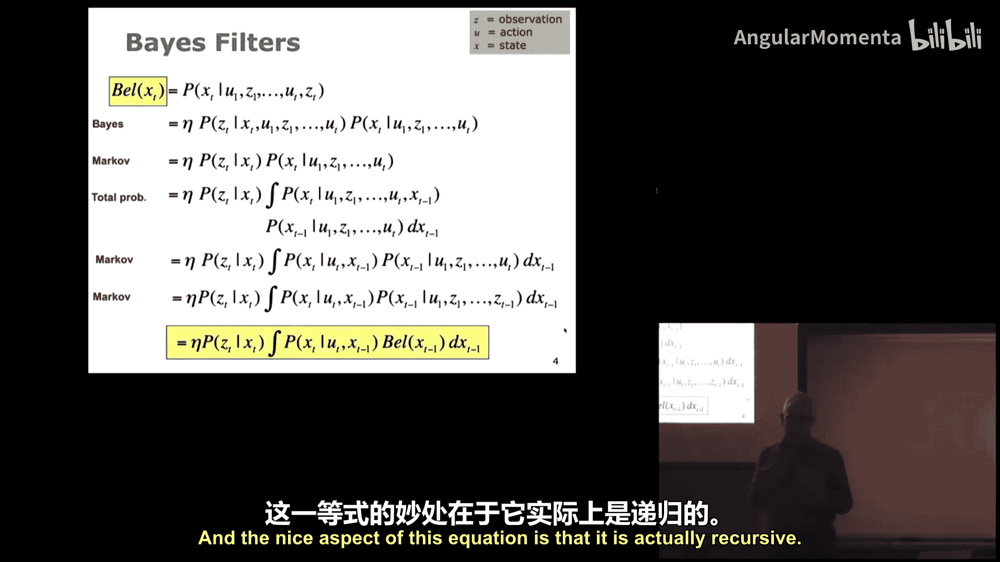

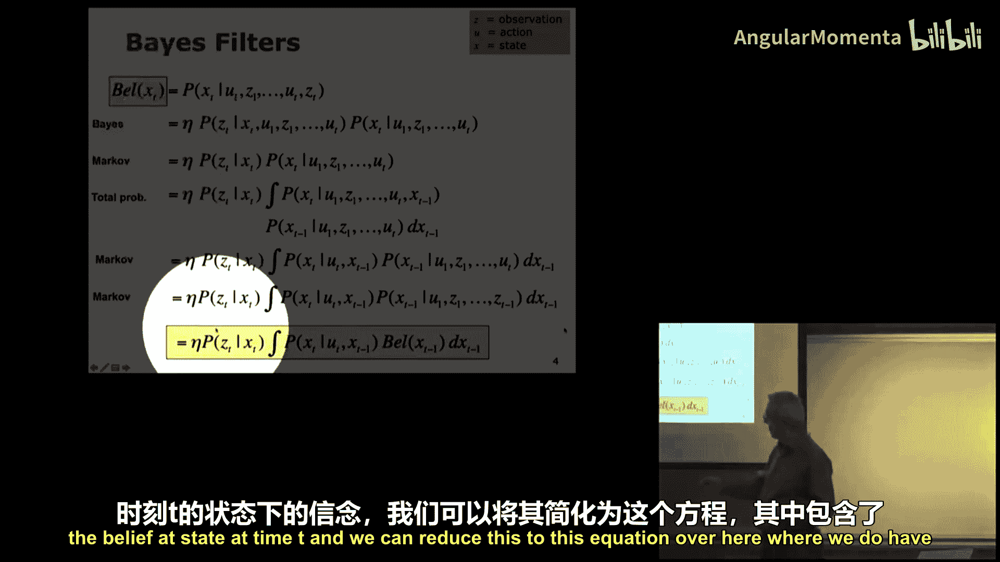

嗯。And and the second one is like this multiplication on on the lefthand side。

 And the terms are this one over here is we call this a transition model。

 It's basically the probability that you end up in state X T， given you executed action。

 you at time T， and were at in state X T minus-1 before。

 it's a probabilistic way of representing the action。 know。

 So if you carry out an action and I want to actually describe the distribution about where I might end up given I was in X T before and execute that action。

 So it's known from Markov decision processes， reinforcement learning or these kind of approaches。

And this term over here is a so called observation likelihood。😊，Which measure measure。

 which is the likelihood of observing this measurement Z at time T。

 given we are in state X at time T and。For those of you who like neural networks。

 there's one operation that is also like typically present in neural networks。 This is this part。

 this integral over here is basically nothing else in a convolution of that previous belief over here with this probabilistic transition auto motion model so we basically integrate over all potential prior states multiply those with the probability that we end up being in XT。

 given that prior state。And then we multiply that resulting state with the likelihood of that observation。

And this eater over here is normalr making sure that the belief sums up to an overall X T。

 and it falls out of this base theoryem it actually can also be analytically calculated in an implementations of this。

 it actually falls off while you actually do this calculation。

 So even in the particle of filter implementation， we will later us see this normalization happening in the algorithm。

 So this is basically。How you can do like Og， likecursive base filtering estimation for the estimation of the state of a dynamical system。

That doesn't answer everything。 So typically what we need to specify for actually making that work on a real system is that model over here。

 the transition model， we will briefly speak about how they can be represented and also the observation likelihood function right What is the likelihood of making a specific observation。

 given we are in specific state。 Both are really complicated typically and the best way of obtaining them is to use statistics。

 making lots of experiments and figuring out。How they actually look like and so that we can。

 in the end， use them in this recursive bas filtering scheme。In addition。

 what is unknown is what the prior is， so usually。If you do not know anything about the state of the system。

You would assume that this is a uniform distribution。 It a robot can be everywhere。

 or the system can be in every state with an equal probability。

 And but the final question is how to actually represent this belief。

 What is the data structure that we are using in order to represent that that belief。

 and there are a couple of implementations。On the market。 and one of。

The most popular ones actually is the so called product filterter。

That what we are not going to discuss in detail here is how to maximize this belief。

 so we actually if you are interested in the maximum likelihood answer。

Right based on all the information that you got， that is something that we are not going to cover in that lecture that's actually requires another additional lecture。

 even like things like the transition model or the likelihood model， you can dive very。

 very deep into those and to have like。Separate lectures about how to actually properly represent these type of models or more advanced versions of those。

So if you think about like an application of this in the context of robot localization， this is。

AVery， very simplistic example of a robot living in a one-dimenal corridor and all that the robot can do is actually moving forward and backward in that corridor。

 you could imagine this being like cleaning robot， vacuum cleaning robot that does nothing else and collecting all the dirt in the corridor and if you want to do this in a systematic fashion and not just moving around randomly。

 then you might use the position of the vehicle in order to figure out which places you covered and which not。

And for that， the robot actually。Need something like a probabilistic belief。

 And if you imagine that you switch the robot on in the morning。

 robot doesn't know anything about where you put it。

 then it might have something like a uniform belief about its current post in that onedial corridoror。

So the road in addition has a sensor and someone programmed a relatively simplistic。

 likelihood model for us， which basically says when there's a door in the camera image right and the system says yes。

 I'm in front of the door and then when it's not and the hope is at least that the camera that this system says I'm not in front of the door but we are only using door detections here and because。

We have also created some sort of statistics， like how often this door detector actually fires。

 And this is basically nothing else but that function over here。 Basically。

 the closer you are to a door， the more often it it fires。

 So this is basically the likelihood of observing a door， given that detector。

Depending on the state of the vehicle in the corridor。

So now let's assume that we switch the robot on just by chance it is in front of a door。

 the camera fires and says， hey， I see a door。So it's basically that what we are observing is this measurement over here。

 this Z。So， and our likelihood model looks exactly like this。

 And we are now starting with the left hand side of that equation。

 Were basically like inferring from that， given that we had a uniform prior， which is our this。😊。

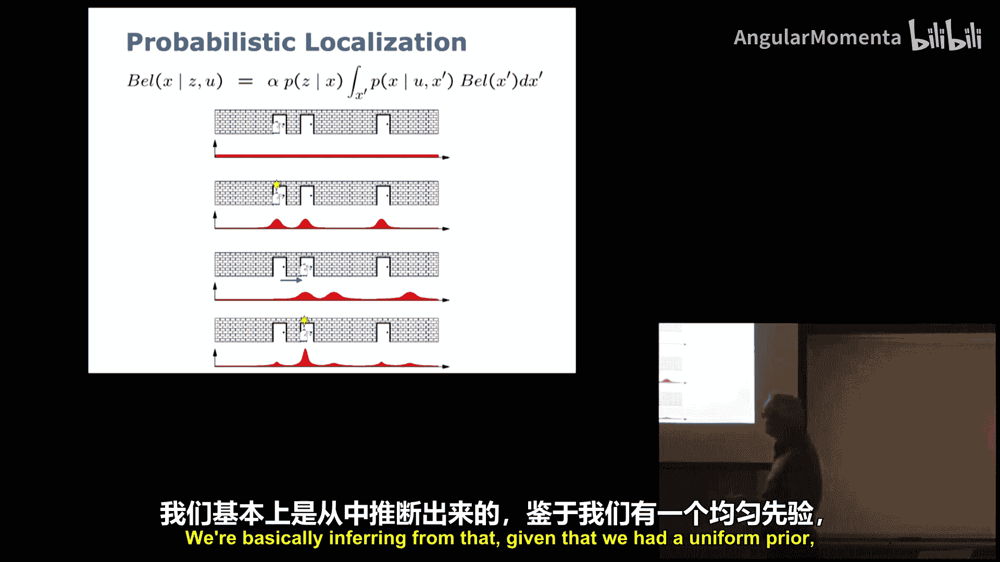

Instead of this integral here， we have having nothing else but this uniform function。

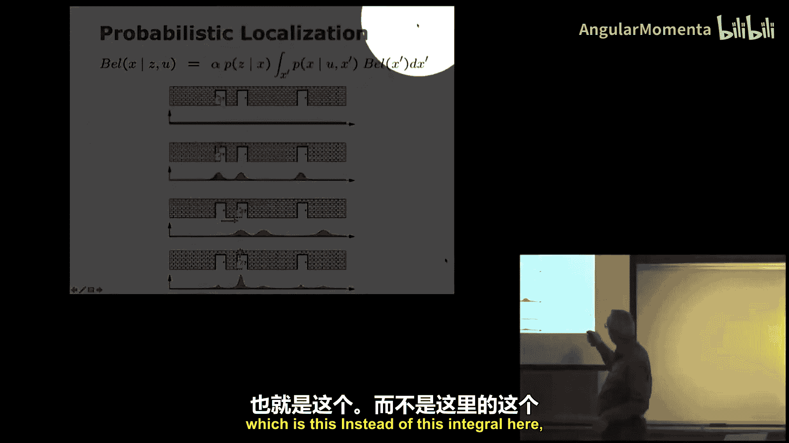

And P of Z given x is a function that basically looks like this one over here。

 It's actually proportional to that。So what we do now is we multiply our prior with our observation likelihood model and normalize it using this constant that named Al in this term。

And what we end up having is a distribution like this over here。

So it's actually the belief then does not look any different than the the observation likelihood model。

 apart from constant from a constant factor。So now let's assume that the robot moves forward。

 the robot starts actually moving and typically actions increase uncertainty。 In most cases。

 there are exceptions。 So if I keep going， if I don't know where I am。

 and I keep going for an hour forward right now， then it's very。

 very likely that I'm stuck in front of a wall in this room。 but usually it increases uncertainty。

 So if theres only free space and I keep moving then because of the uncertainty in my movements。

 I will increase the uncertainty about my post。😊，And you can like。

Red this as a convolution operation。 It's basically this integral that you see on the right hand side。

 What we're doing is we're taking our K belief。In convolving it with this transition model。

 we are basically calculating for every position， taking the belief that we have been at another position before and multiplying this with the transition model that we end up in x given me were in x prime before。

 there's nothing else but convolving this or you can't imagine this as a process of convolving this distribution over here and shifting it according to the movement。

That would be a very， very naive implementation of this， but in principle， basically。

Calculate need to calculate this integral over here。

And and which means that this convolution operation typically smooths things out。

 and you get a distribution that is shifted and a little bit more flat。

 So the peaks are not that high anymore， meaning uncertainty has increased。

Now let's assume in the robot passes the other door， the next door。

 the sensor of fire the camera fires again， and that what we need to do now we are right now in there we calculated this integral over there is basically this function。

 you get another observation， we basically need to perform this multiplication on the left hand side。

And what we are basically doing now is we are multiplying those two functions over here to obtain this one down here。

So this is basically that operation of the。Of the base filter。 And once we normalize this。

 then we end up having this function over here。And what you can see from it is basically we end up having five picks。

In that distribution， like one is consistent with two observations。 There's this one over here。

 and the other four are only consistent with just one observation。

 And the interesting aspect is some are a little bit。

Sooer than the others because they were the first observations。

 And after movement so they have been convolved， whereas those have not been convolved。 So That for。

 this is kind of like the how this function how we obtain this function is that comes out of of this equation up there and the hope is that as time goes by right and all we collect all the measurements and move around。

The robot will get more and more certain， meaning that this distribution。

Peaks in one state so that we can actually have a high certainty about where what the current state of the vehicle is。

 but it doesn't necessarily need to be。can even be that in ambiguous worlds that the robot actually doesn't know in which state it is because two rooms are absolutely identical and keeps moving in in one of these two rooms。

 And then the robot actually cannot tell in which of the two rooms it would be。

 and that means that this distribution has actually two peaks。

And then there's nothing the robot can actually do other than reasoning about its uncertainty and trying to figure out which actions it needs to carry out in order to minimize that uncertainty。

 which is kind of like that what people do in active vision， for example。So key question is。

 that's what we are going to answer in this course is how can we represent such a distribution。

 And it means that we need to do some function approximation and an interesting way of representing distributions is。

Using particles or so called samples。 So imagine that we like have a distribution like this function F over here。

And you want to represent these by samples， this distribution or function。

 then that what we can do is basically have higher density of hypothesis or particles in places where the function has a high value and a lower density。

Where it has a low value。 So basically what that means is that if we integrate locally or we count the number of hypotheses locally。

 then that gives us an approximation about like what the actual function value is。

SoAnd you can do this with arbitrarily shaped。FunalTns like these are used， for example。

 when you do integration， Monte Carlo integration is if you know this is very， very similar to that。

Basically， sample randomly， and then you evaluate the function And this gives you in the end。

 the area under the curve。This is something here we just collect these or。

Have samples that are actually more dense in places where the function has a high value and and less dense everywhere else。

 The key question is， how can we get such a distribution。

 So how can we get hypothees or samples that are distributed according to a specific function。

Different ways for doing this。 One very， very popular approach is a so called rejection sampling approach。

 So let's assume we have this function F over here。And you want to have samples that are distributed。

 according to that function。And usually you apply schemes like this for functions that are easy to evaluate。

 but hard to sample from， which for example， is the case for emotional model that can be an enormously complex model that you can like it' an analytical function that you can easily evaluate。

 but it's hard to actually generate a distribution of particles from that function。

And rejection sampling works as follows， right basically。Sample in that interval of interest。

 like a uniform value。 Let's assume that is x in this case。Again。

 sample another value that's called y value that is lies between the max of that function。And 0。

 it would be like this is F of x。 This would be this constant C over here。And then you make a very。

 very simplistic test， namely if F is larger than C， then we keep the sample， otherwise we reject it。

Which means that if this comparison over there， make sure that in places where this function is like very。

 very low the。It's very， very there's a very high likelihood that this sample is rejected。

And so in cases where the function is high， there's a higher probability that it is it is kept。

 So we you drag that x。 we draw another x。Now we have f of x over there， x prime and we sample C。

 and then F of x prime is larger than c over there， so we keep that x。

 so this is basically rejection sampling。Any idea which type of function is the worst case for this scheme？

The professors was first， but I asked their student。A uniform distribution。

 Let's assume we have a uniform distribution。So it's， it's a constant value。 We do have。

Like any type of constant that is beyond that， right， let's say。

The max of that uniform distribution is a， the max that we sample from is B， right。

 the ratio that we keep that sample then is。I think a divided by B， something like that。That is。

 depending on where B is， it's not that bad right if B is close to a。B equals a。

 then it's actually the probability is one。 let we keep it。

 So that is actually relatively basically the best case that can happen。😊。

But what is the opposite of that uniform？😊，what。eltaYeah。

 it's a direct distribution right it can be like some of direct distributions like like if you have only one peak where that all the probability mass accumulates you basically so that we have just one peak over here。

 we have this kind be sample one over here， it's zero withdraw it the chance that we hit exactly that peak and it continuous world is virtually。

😊，how long will this algorithm run？Forever good。 So you actually need to keep keep track of that that' when you implement it so don't be naive。

 right， if you use it， it can actually， depending on what your function looks like。

 can be enormously complex。😊，But the advantage of that is you can sample from an arbitrary distribution。

 which is pretty cool。 The other thing is here in this。😊。

And this is why this is important in a computer， every programming language typically has a way to sample from a uniform distribution。

 it's your rant operation whatever that is called in your favorite programming language。

Samples from a uniform distribution， but sampling from any other distribution right we don't have a number random number generator for or a sample of for so this is basically a way if you want to sample from。

 for example， a Gaussian distribution， you can exactly use this scheme they are more efficient ones pretty cool ones as well。

 but if you want to do this then you can actually sample from an arbitrary distribution。

It's important here to see that we sample from a uniform one in that case。 So。

 but there is a way to actually use non uniform distributions as well。

 And this is the importance sampling principle。So like if we want to sample from this distribution。

 we do not need to sample from a uniform。 Let's assume we do have a way sample from a more informed distribution。

 right， like the most informed distribution would be。The target the target itself， F Excel itself。

 So， so what we are using is the proposal， this is a rat one here to actually in the hope is that with the proposal we get as close as possible to the target because then we get the samples already in places where we want to keep them。

 So but the idea is that we can we have a different distribution that looks more closely than F than the uniform distribution。

 the only thing that we need to do now， in addition to that is take into account that we didn't sample from a uniform run And in order to do this。

 we calculate a so-called importance weight。 So we give the samples height or they look like towers all of a sudden。

 And this is basically nothing else。 but the。The ratio of F divided by G。

 That is basically the height of these samples。So and this principle is basically underlying。

 mathematically underlying the particle filter algorithm。So what we need in particle filters。

 the representation is nothing else but a set a multi set mathematically correct of hypothesisthees。

And importance weights and one weight for every， for every particle hypothesis。Mathematicically。

 like because these are just peaks， We have this。Thisued some of these direct distributions over here。

 So this is basically the posteror that we are having。Just to give you one primitive example。

 how that works is actually an example generated by Data Fox。

 It's all times of robot soccer with iball robots and at that time they at the soccer fields with landmarks and they had relatively simplistic landmark detectors。

 which was just using the color code and you can actually estimate distance to that based on the size of that of that color codeed field。

Seegment in your image。 And so you get some information about the distance。

 but what you don't get because these are circular landmarks。

 you do not actually you only get the bearing to the landmark。 you get actually bearing and distance。

 which means that usually when you observe a landmark。

 you get something like a circular distribution around that landmark and the the radioius of that distribution is given by the estimated distance。

So geometrically for an observation， like when you see。

 when we see those three landmarks 12 and 3 and like get the appropriate appropriate distances calculated by the size of the segment and geometrically。

 they would look like this over here。 And what you're interested in now is like getting a probe。😊。

Probilistic belief about where the vehicle might be or the robot might be。 And if we do this。

 like in a probabilistic fashion， like let's assume this is our P of Z given X。

 withs actually that function。Expressed here in a discrete fashion。

 And you can actually see that by these pixels that in the image。 So again。

 like for for distribution for the landmark 2 and for landmark 3。And normally。

 like if we were able to just like get these directly， then we can multiply the three。

 and then we get this distribution over here as a posterior about where the vehicle might be based on just no movement。

 just the multiplication of these distributions。😊，But now in a sampling based world。

 maybe we have particles。 like we cannot directly do this anymore because we do have these。Particles。

 or we want to reason about these particles and what we need to do now is like stay in this representation and keep these particles as the belief over the state of the vehicle。

And here is where what we want to have， you want to have samples that are distributed according to those three distributions。

In fact， we could now， like， take those three distributions and multiply them and then sample from that result。

 But then that's actually not that what we。Would like to do simply because the maintaining such distributions can actually be enormously complex。

because they need like this is a two dimensional field that we need here。

 but in higher dimensional cases， this can actually be。Hardly tractable。

 so we are actually interested in just using particles and just evaluating those likelihood functions。

 And this is that what that we want to have。😊，So the idea is now to basically generate。

A set of particles from one observation。And then this is our proposal distribution and then using the others。

 like the multiplication of the other two as the target distribution of all the three as a target distribution and then get the now the other two and then basically divide those the resulting like。

The importance weight of the first ones， which is uniform by the have the importance weights set to the likelihood of those two observations。

 that's basically that what we are doing。So mathematically we'll see this in a second so we can sample from each of those and let's assume we sample from one and what we are now interested in calculating importance weights let's assume we sample from the left hand side one first and then we calculate importance weights for those hypotheses over there based on those two distributions but cause of symmetry we can use any of the three and then like calculate the importance weights based on the other two。

Mathematicically， we are interested in a target distribution about like where the vehicle might be。

 given all three observations。 you do have a sampling distribution， we sample。

 create samples from one observation for example， this rejection sampling principle。

 and then in order to calculate the true distribution。

 we need to calculate the importance weights which turn out to be the product of the likelihoods of all the other two the all the other observations。

 apart from the one we sampled from it's basically in our case， the other two。

Arcs or arc like distributions。So and if you do this right that would be the weighted samples for all three in principle what we do is we sample from one of the or we take one of the three and then calculate the importance weights of the other and the resulting distribution might then look like this over here。

So the key principle is we have kind of like a set of hypotheses， and we calculate。

Importance weights for those。 And you can now think about the result over here as something like a resulting set of hypotheses generated according to the importance weights。

 It's kind of like you could think about the result as being a deck of cards where you actually multiply every cart。

 according to its importance weight。 So the frequency of a car depends on the importance weight that you have。

 And then when you draw then from that deck of cards。With replacements， you to put it back in， you。

 in the end， get a distribution that is proportional to these important weights。

 There's going to be the algorithm that we are basically going to use in principle。

 This is how it works。Then you get this type of representation in the end。

 You could also regard of this that you increase the transparency of a particle width or decreasing importance weight。

 So the lower the importance weight is the more transparent it is。 and the result would look very。

 very similar to that one over here。 I mean， you don't see semi transparent particles here。

 But in principle， it's a very same。So how does particle filter localization work， So basically。

 we represent our belief by a set of hypotheses。 we take one of these hypotheses out of the。

Hypo this set， one of the particles， we draw it from that set。

And then comes this step where we actually。Calculate a potentially new place for that particle。

 basically。We say we propagate it through the motion model。

 like X prime is the one that we get from this this big current belief。

 one of the particles in the particle set， we like sample a new like a potential place for that particle or state for that particle in robot localization that would be a hypothesis where the robot might be given the motion that it executed。

So this is something that we basically we that according to that distribution。

Next one is we calculate the importance weight based on the observation likelihood。

 We look into our camera or whatever sensor we have and calculate what is the likelihood of that observation。

 given that state that we just calculated。 This gives our importance weight。😊。

And the next step is that we perform this why we call this survival of the fittest operation。

 we resample from that set and we will later out discuss how that works exactly this deck of car principle。

 a deck of cards and form that and we get a new belief up there and we basically repeat this process like as long as we actually get updates from autoometry or movements or a sense or perceptions。

This is how it works in。In practice and that what we are going to do now in the next figure。

This operation， because it's actually here we draw from the current belief， which in principle。

 is a weighted set of particles。And there's a reampling operation transforms this weighted set of particles。

Into another weighted set off particles where the particles represent the very same distribution as the ones that we have already。

However， with uniform importance weights。 So usually what happens is we get like towers of different heights and this reampmbling operation calculates new towers that all have the same height。

 but represent the very same distribution。So that is what is happening because we have to draw here and there。

 we basically perform this in one step。 It is basically like in the visualization that you see in a second。

 it happens like in what is one operation。Coming back， right？Like to that figure that we saw。 sorry。

 I forgot to remove that animation here。 but in principle。

 this is exactly like where we need this particular operation。 once we have this distribution。

 let's assume we。Higher的。An undergrad for for coming up with this distribution over here。

 And we use this scheme to actually sample from this。 It's basically， he gives us that function。

 the implementation of that function。 And we use this algorithm over here to calculate potentially new places for。

 for every hypothesis。 This is a scheme that we're using for that。 And then you basically。喂。

You need another undergrad to implement that observation likelihood model。 And once we have that。

 we can calculate the import weight。 And that's all you need to do。

 You plug this into your computer or into your。Part filter algorithm。

 And then from there on you can actually。Estimate the position of the vehicle in the real world。

 let it be a car or your robot at home， whatever。 right Here's another visualization。

 We saw this with a distribution。 And here's the very same visualization with。With particles。

 initially， fact these are just randomly distributed particles。Doesnt matter if you。

 you use them like， if you calculate the uniform distribution by just going towards like sampling then equidistantly。

 or if you just use your random number generator and your computer for doing that。

 This is the second version。So the next step is like。

 let's assume again we have the observation first， we calculate the importance weight as trust the observation likelihood。

😊，Given that observation and the state of that。That particle a hypothesis。

 right So that's basically like this is our observation likelihood once again。 And then in the end。

 we get these towers with a high proportional to the the observation likelihood。

 This is just because we normalize the weights so that they sum up to one overall hyposes。

And now the next step is that the robot moves and in that step。

 we actually need to pass the hypothesis through that motion model so we sample new potential states from that and at the very same time we perform the resampling operation。

 this magic thing that converts weighted particles into a set of particles with equal weights that represent the very same distribution idea or approximation another approximation of that distribution with uniformly weighted particles。

 you would see how that algorithm works in a few seconds so what happens now is the robot moves forward and we like propagate the particles through that motion model and at the same time resample in a way like with this deck of cards。

😊，Operation and get particles I distributed like this over here。And again， Mike。

 if you have another observation， we weigh these particles。Like another movement。

 And then you see that these particles typically cluster。In places that are consistent with。

Movements and observations。 And as our observations were consistent with the real world。

 we do have a distribution that is close to that what the true state is。

So part of the filter algorithm is basically nothing else， but then a procedure that。

Like uses particles for representing the belief or hypothe weighted particles。

 the weight is the target distribution divided by a proposal distribution that is in the context of localization is nothing else。

 but for one observation， the observation likelihood of the latest measurement。

 given the state of the particle and the resembling operation。

 this magic thing that we only implicitly talked about thus far is the operation that replaces。

A particle set containing unlikely state hypotheses with likely ones。

 basically by drawing more likely cards from that。Big golf club。And this is the algorithm over here。

😊，So you basically like the very first step is that we perform this reampling operation like this basically we sample from the current the current set of weighted particles。

Like a number， which is basically the index of a particle。

 And we draw that particle with the probability that is proportional to that importance weight。

 meaning higher particles with higher weights are drawn more often than others。

 This is this index J that we calculate。 We then take X J， which is like X T。

we calculate XT from the previous one that we draw from that particle I said。

 passing it through that motion model with the rejection sampling principle。

 we calculate the importance of it， which is proportional to the observation likelihood。

We normalize the importance weights。 That's why we calculate this some of the importance weights up and add this new particle to the particle to the new particle set。

 And this is the normalization operation down here。This is basically that what we are doing。诶。

Just to sum this up here， like how this works is like in the first place。

 what we are doing is we draw a particle from that。Existing set of particles。

 we pass it through that motion model。 We say we draw a new pose according to the pose of that particle and the action carried out by the robot。

 We get a new state or post of the vehicle。Then we calculate the importance vector of vector。

 which is like if you do the math exactly， then it turns out to be just the the observation likelihood of your measurement that he given that state of the particle。

 and that gives you the yeah， sorry。系。That gives you the new set of the new belief。

 and let me see the next is the resampling operation。

 and I was told that we're going to do a short break in between five minutes， seven。

 I do always seven minutes。In Frework， which is like getting to the bathroom and back and all the operations in between7 minutes。

Okay， let's do 12 at， according to that clock，57， according to mine。What is this pointer？

Its pretty coolね。せて。It has an IU building。Yeah。You know what the advantage is。

 you do not need to point at the thing because you can see it on the screen as well。

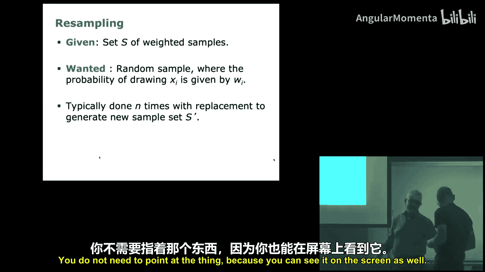

It knows。Yeah and there you know， often you have to these presentations when you have a big screen in front of you then you can stand there and point down。

 otherwise you able have to turn around。

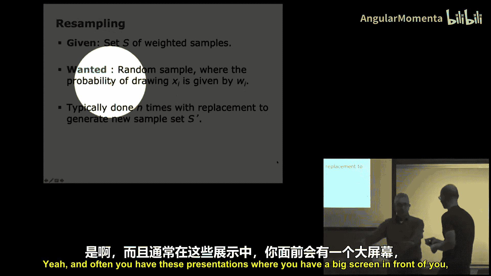

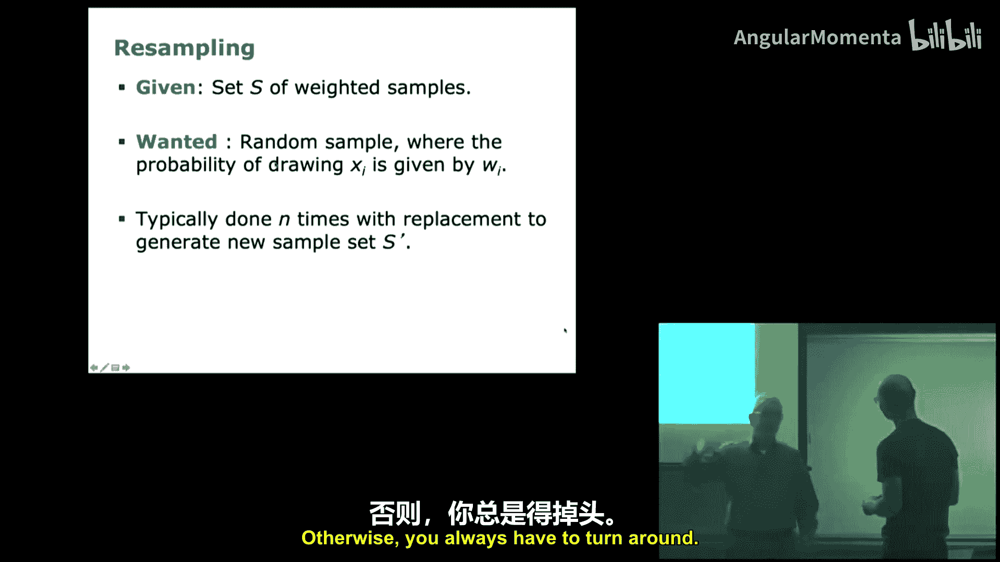

放几。If anyone wants to try it， it's faithful。

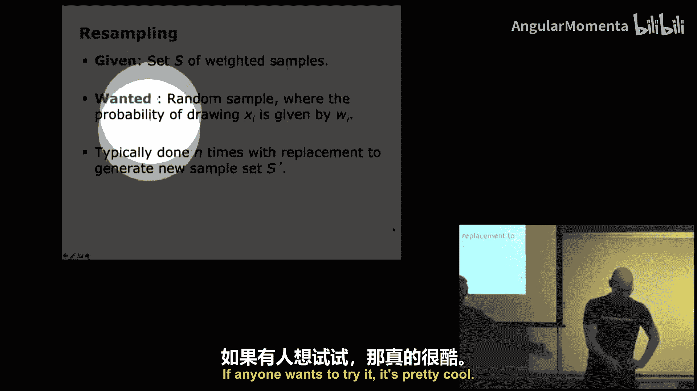

And you can't program it it also has a real like a red dot if you want to if this。

 gaming operation is to calibrate No， it's just like an IU。然后。But他们。

It is just like I think it initializes at the last position then it takes your movement to see when you click I click this one。

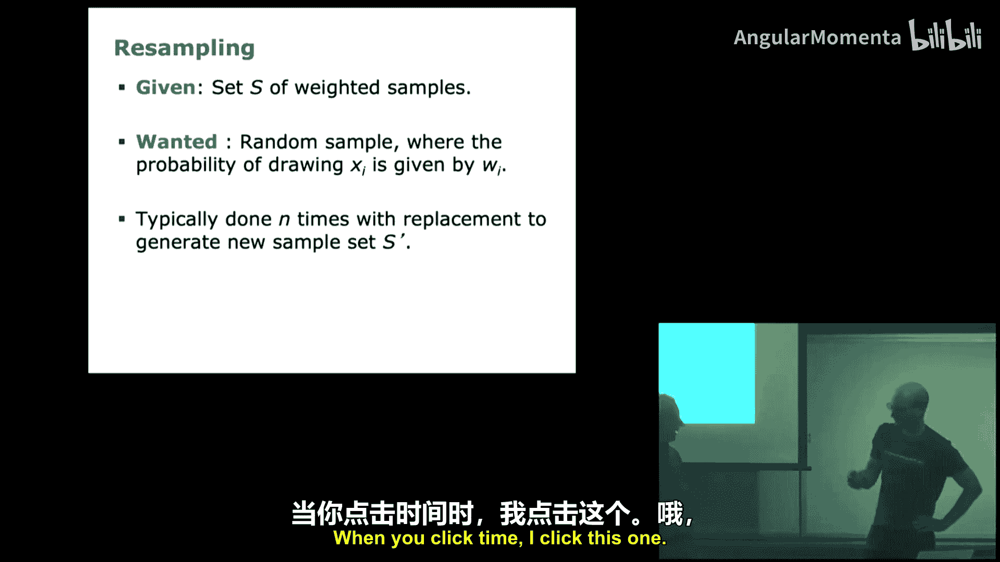

OhYeah， it is because it is directly done on the graphic it's just just wherever you start as the middle of screen or some part of scan So the only comment is when you have this presentation mode presentation board means I now cannot see my next。

😊。

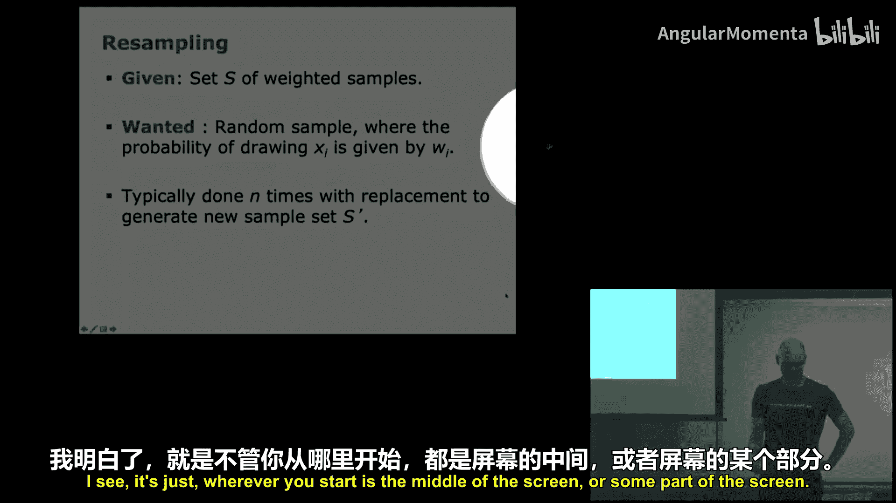

Whi is like it I think it is also possible doing that。

 but it's my documentation I'm giving but it's pretty so particularly when you recall things and you do a direct screen grab then it's also in otherwise because it is recorded it is recorded here so whenever people watching on it。

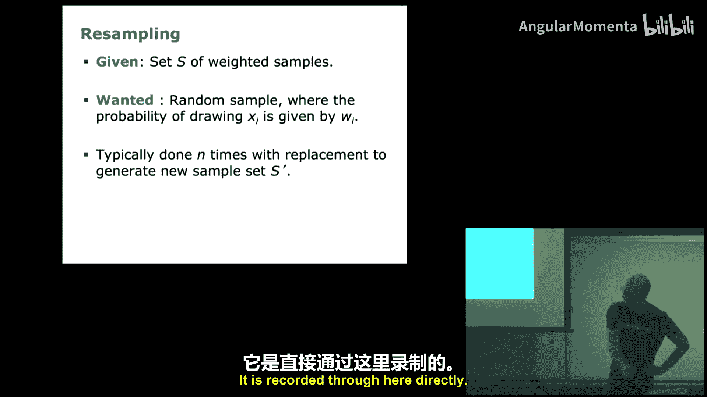

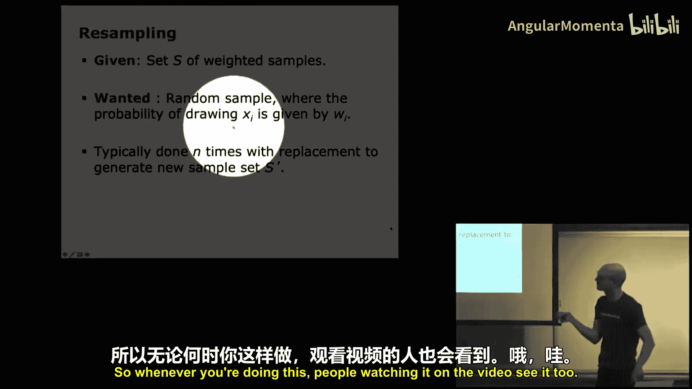

Yeah， I walked one my lab as my hands disappeared。is it right。😊。

But it doesn't work well with paying I to do these Googlegle slides。So you got a minute。

I' think about your words more about the topic。不他起来我。Ted5， which is。Yeah。稳稳。

We10 years ago a long time we don to see which teacher。Yeah yeah， that was pretty cool。

 but that paper was being found from PMM。So I'm more thinking about can we use the same methodology but applies it to？

wing enough so basically we have a better。因为啲咁。第二件 should that be be possible。上面啲一。

He back and basically。日处嘅。run to my。系三个。什机制先。stay。国际六埋者前系有要有。The right down。Right。

 because in that paper， I don't think。It places like how the experiment was carried out。

I thinking because we have。And we have some。cico what about second？

Say 20 seconds so I run a smaller phone。What second like。Whatever I have and then my。

And selectly removing different。All right， because for the 25， the proposal set out。

But for this course， I think there' a probably。Hello， I。诶本人嗰面发真有地讲。啊呢睇。Yeah。

Thank you so much for that。Arely， that's。Right。weren。In， yeah。好的好的好的。Re right。Thatこれ。

Did you post there， did you tweet that？We didn't maybe just start with the election。

 but I won't record a video if you're using your pointer。ついた。That's what I。こ。

Let me do this on the next slide。😊，Is there a slides coming off that？好。Yeah。

 mean you're tempted to you point towards it and that why it was a little bit hesitant to me。

And I'm not really used to because this big button always goes forward。You need to practice。

I'll capture it。I don't have five second words。Yeah makes， yeah， that's true。ふ。😊，57。

They to go we're German and start on time。 Not really，😊，Good。 this width would really start on time。

 Okay， so that operation that we haven't like a。😊，Talked about in detail this this reampling operation。

 And thisarrow is also actually pretty cool。 And how this is done。😊。

You're going to talk about two variants of that and while first one is a rather naive one and the second one is a little bit more fancy and maybe we will talk about the difference or the properties of those So what we typically have what we typically have is we do have a set of weighted particles with uneven importance weights and what we want to have is typically a set of particles that is distributed according to this weighted particle set with hypothees with the importance weights that are uniform。

And the。A reason why we want to have this， I like assume that we let this algorithm run without this operation。

 So these particles will basically spread out according to the our motion model。

 We sampled from that motion model。 So the positions are determined from that sampling operation or the the states。

And they all have different importance ways。 And what happens is typically that some particles get into spaces of this or areas of that that。

That the configuration space of the system that is extremely unlikely。 So we will have like very。

 very high differences or large differences between the importance weight。

 and some particles basically if you think about this distribution like are in areas where we have a very。

 very very， very low likelihood， which means that they actually do not contribute to that to the approximation of that distribution。

 removing these hypotheses would actually not help us a lot when we when it comes to like the accuracy of that representation。

So what we want to have is basically particles that are close to the the peaks of that distribution so that we actually can get more details about how the distribution actually looks like。

 And this is why we need this reampmbling operation。

And what we do is basically we take like with the like with these car deck of cards if you multiply every like every particle。

 according to or proportional to that importance weight。

 and that depends solely on the memory that you have and the resolution that you want to have and then we draw from this deck of cards randomly in order to figure out which particles should actually be in the new particle set。

 this is basically what this operation is about。 and。Like from a like。

More like a rhythmithic point of view that is we are in that in the following regime。

 right we have like a set of particles， So W1 to Wn and we arrange them now in a circle。

 and you can regard this as a roette wheel where the holes in that wheel are their size as proportional to the importance weight。

 And if you now throw a sphere into that roette wheel it will end up in these in these bins with the probability that is proportional to these importance weights under the assumption yeah。

 or exactly the importance weights when they sum up to one。

 which basically means mathematically what we do is we just draw an angle like this one over here and then we need to calculate the bin in which that angle falls right So in this case。

 it would be the bin 3 for particle 3 would be taken。😊。

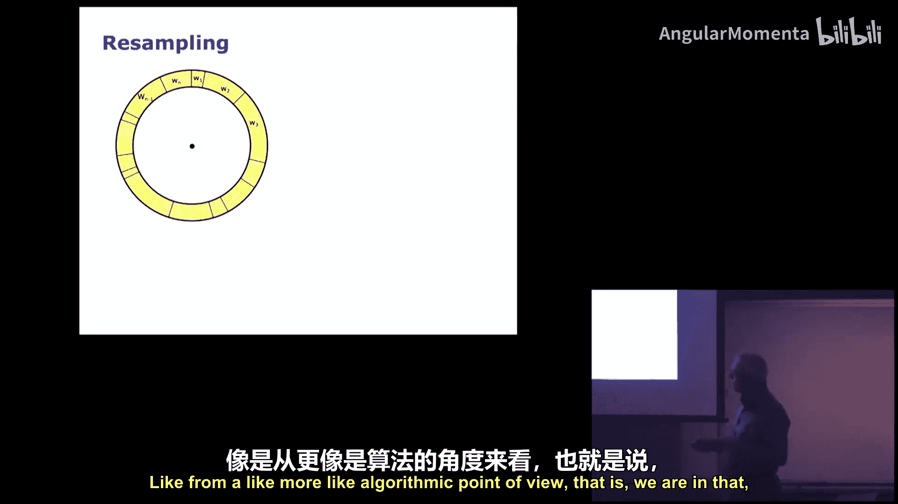

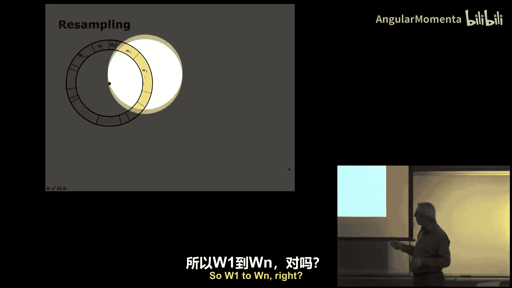

Basically， just you draw a cart from that deck。 And then it's basically the number of cards。

 equal cards in that deck is the size of that bin。And so we repeat this n times and by doing so we get like n new particles So the operations that we need to do is like drawing an angle or if you arrange them in an array all these particles。

 you actually want to draw a number between0 and1 and you want to know which particle is that in which into into which bin this number falls。

系啊。Trsh is， how expensive is that operation。 If you do want to implement that， drawing an angle。

 figuring out which bin is it。What is the cost of that operation？orderder of the number。

For just that， the search is the number of particles。 If you implement it in an array。

 you run through that array and check， does it fall into that bin right that was what you。

That's great。 And you need to do this n time。 So it would be n squared。 Someone said n squared。😊。

Can you do this more efficiently？So I give you a hint。 So imagine we， instead of。Calculating。

 looking just at the importance weight， we look at the right。

Borders of the importance way and their positions，Which basically is an ordered set of numbers。

All we need to store in this array is just like the where it ends。 We get the start from the。

 the where it ends of the previous one。 right， And if we do search in such an ordered。Set。

 that's log n。 and the pro is binary search。 So you can do this in log n。Which is cool。

 Lock is virtually constant for every number that we can imagine。 But on the other hand， I。😊。

Sit in front of your computer， like students hate lock n， because even if it's a 10。

 it is like a factor of 10 that it takes longer， so that's why people don't like lock。

So that's basically that procedure Soette wheel， binary search and lock N the operation。

 there Drly is a faster version of that。And this version works like as follows。

 So all we need to do is we need to sample one angle between one and one divided by n n being the number of particles。

And then we advance。

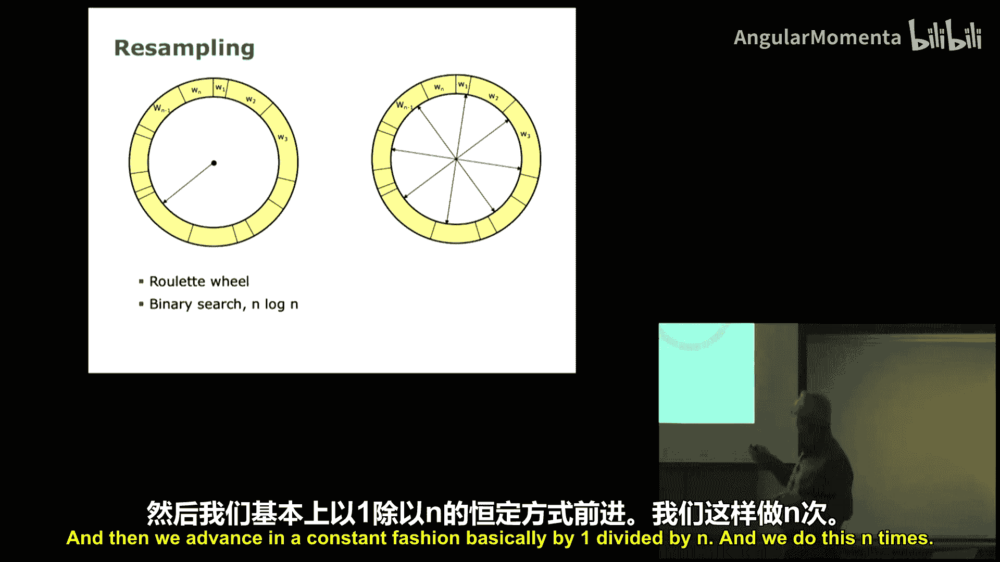

In a constant fashion， basically by one divided by n。

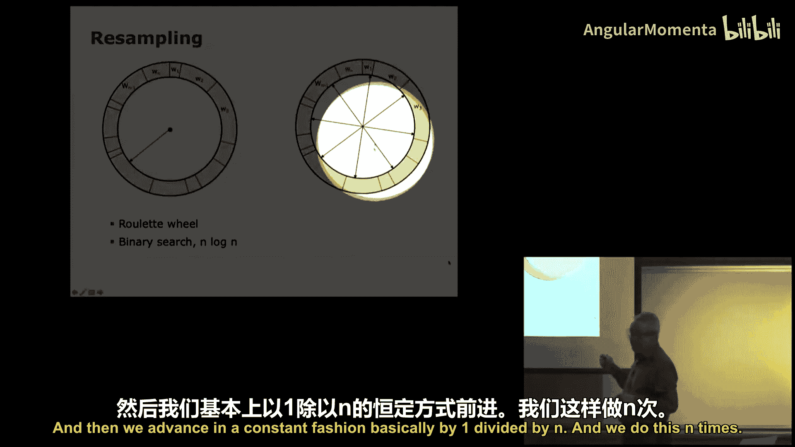

And we do this n times。And where N would be like every particle。

 like in whose bin we then step by doing that operation is the one that we keep。

And my argument is that this operation can be done faster than lock N。Per particle。

Why is that the case？要死就。Yeah， so we start with one divided by n is a first angle。 right。

 It's randomly chosen angle between one0 and one divided by n。 That's this angle over here。

 like the difference from the vertical。

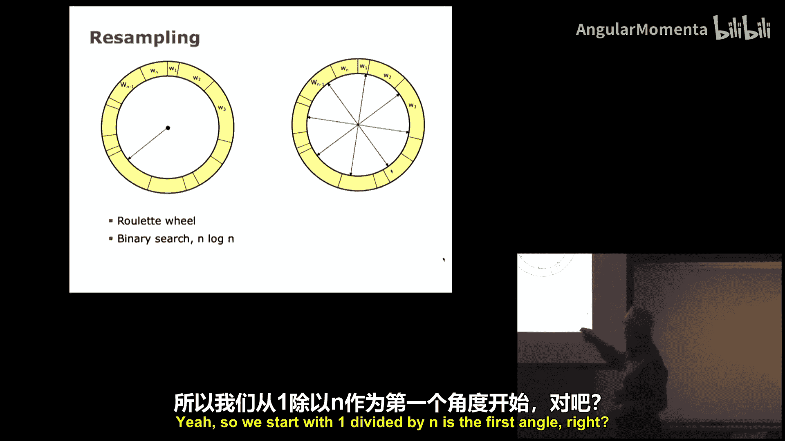

And then we advanced by one by pan。And check into which particle that falls。

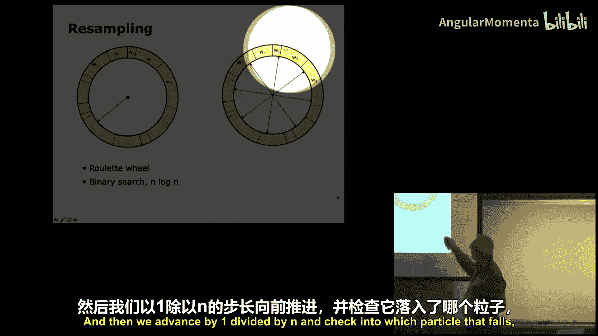

Or which particles has been that fault？And then we advanced we I by N again。

This time it's just linear total loop。Research each of the。Yeah。And how often do we need to touch？

Yeah， some are touched twice， but some are skipped。

 but we never go backwards because we only go forward and we need this to do this n times。

 we actually end up like with an operation that is constant per particlea。

And this has another advantage and we will talk about this in a very few seconds。

 so basically there are different versions of this and then this is called stochastic universal sampling or systematic sampling has linear time complexity in the number of particles。

Yeah， professors always tend to say it's easy to implement。い。😊，And has a low variance。

 And the low variance is actually the key。 And we will talk about this easy implementation in a second。

 And I will point you to pitfalls there as well。 I stepped into them as well。 I implemented that。

 but it has low variance。 So let's assume。😊，We perform。 We have a weighted set of particles。

 and it doesn't matter now。 as's too that the weights are。Uniform or nonunform。 we just perform。

 perform reampling operations。 So let's assume what we do know is we have a set of particles。

 We perform a reampling operation。 And then we repeat the reampling operation。

 Although these particles have the uniform weights already。 Nobody hinders us from doing this。

 that would just mean that these bins have all the very same size。

And now let's assume we go back to that roulette wheel。So。

What we are doing there is we are basically drawing angles and checking in which bin that false and keeping that particles。

 and we are withdrawing all particles that don't get selected by this。

This arc all this angle that we have there by this arrow。

So if we do have n different tum at different particles and we perform this operation once。

What is going to happen？In terms of it give you like。

know it's difficult to answer in terms of the diversity of particless let's assume we have n different particles and they are actually different。

😊，And we perform this operation once， drawing n angles。

 like how many different particles are we going to have afterwards。way lesser than that。

How much that is， But it's not guaranteed that we will have n different particles。

And as time goes to infinity， right？How many different particles will we have if we do this infinitely often？

Different ones， only one。Which means that we are going to lose diversity。 And in the end。

 we will have like all the or function approximation will be just the direct distribution at the peak of that。

That。Particle set ideally， it doesn't need to be。 just if you choose the wrong one。

 then you might lose the maximum likelihood particle。If you perform the very same operation with。

This scheme over here，So we draw angle between， And now let's assume that all the particles have the very same weight。

And we are end in different ones。 right the very same way it means。The weight of every particle is。

1 divided by n， The first angle is drawn between0 and one divided by n。

And that's easy to implement means we need to carefully think about the left and right border of that。

 that would be in the algorithm in a second。So let's assume we do this correctly。

 like dealing with the borders， because if you exactly hit the border。

 if we choose one divided by end， we need to know this is the left one or the right one。

 we need to be consistent about that。But let's assume we have done this properly。

 like what is going to happen if we perform one reampling operation。

All the particles have one divided by n as important we， and they are all different。We do this once。

 we have how many different particles。And。So this is why that says low variance。Here。

 you're basically。Like。In keeping the variance of that of that particle set。

 and it is independent of how often we sample it might be with this Roette wheel approach in the worst case。

 we are going to end up even after one reampmbling operation。

 we end up having a diversity of just one particle because all the arrow fall into just one bin。

 nobody tells our random number generator that it is not supposed to do that。

It has relatively low likelihood， but if you repeat that then the variance about the particles that you're going to have is with this approach is substantially lower than with the left hand side one。

And it's faster。 And coming back to easy to implement。 this is actually how it works。

 And you need to initialize these thresholds。 in this case。

 I exclude the0 and include the one divided by n。 you keep this being consistent overall。

 then you actually。😊，And this is the operation where actually sum up the Cs this is basically calculating the righthand side borders of this。

 and then we run through the samples and skip the ones that we step over。

 That is this wide loop over here。 and the ones we end in are those ones we keep。

 and then we increment this threshold we are one divided by and we could basically go to the next arrow。

 And you can see here that we never go back。 we skip over some。 So in the end。

 we touch every of these Cs， which are'll calculate it over here。

 there's a right-hand side borders of that interval。

 So we run just ones over the entire particle set。😊。

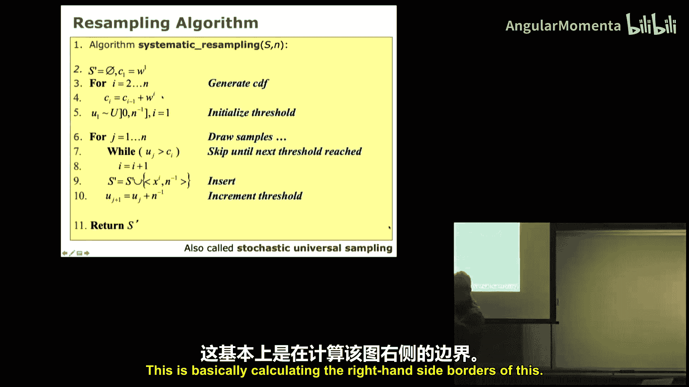

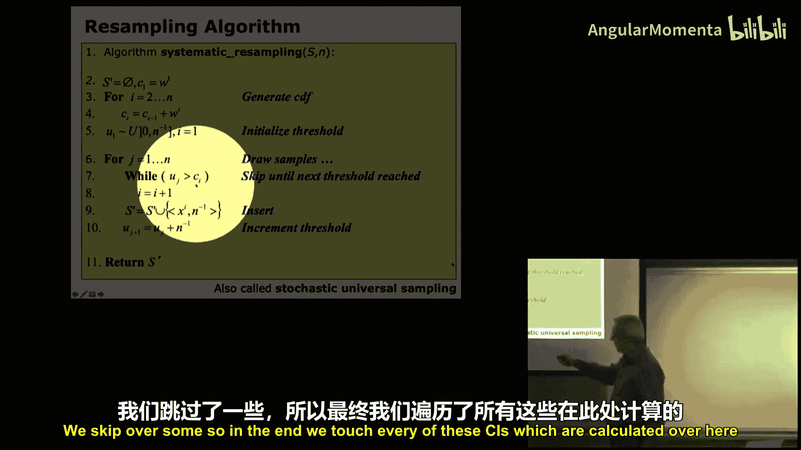

Easy to implement as exactly that requires an afternoon so depending on how skilled you are and debugging and all these kind of things。

But this was basically。The operation that is typically deused in that context。Yeah， is there any。

In any way not the other way of sampling would ever be preferred or is this just strictly better？

I think。I've never seen a case where the other one would be of advantage。 You know， it。

 it is particularly when you think about， I mean， you're basically losing states and you're basically losing diversity or。

 I mean， every type of redundancy。 If you think about this as a function approximation。

 basically prevents you from having a sample somewhere else that might provide you with a better way of approximating that function right。

I never encountered any case or any paper that said that other approach is actually better。

You might need to ask mathematicians about that。 But my intuition is that， no。That's a good question。

Yeah so。This is the way it works。 And what we're going to look at now is like how this can actually be used for N。

 The other thing is。When you do the other answer to this is in other context。

 when you are not just using this for localization purposes these particle filters are extremely powerful right now。

 like when we speak about localization that is a relatively small state space for a vehicle like living on a plane like that X and y plus the orientation and so it's a three dimensional state and mean having like throwing away three dimensional states is' not very costly。

 But if you think about alternative applications with higher dimensional robots like flying vehicles six dimensional and or it could even be when you do this in other context of any you add variables。

 for example， you can use particle filters also to estimate additional components of the state space So we have for example。

 used this for。Estimating the diameter of the tires of a wheel of the vehicle。

And the advantage of that is if you think about， for example。

 a forklifter that goes from a to B and lifts up the heavy loads and when picks up a load than actually the diameter of of the wheel shrinks。

 which means that you need to have a different motion model or transition model。

 because when you sample from a model that takes into account the wheel diameter then you can actually have better predictions and have the particles in better places which means that your state space is higher dimensional and you invest a lot of time computing these higher dimensions and then throwing away particles just。

Based on a re operation might then be not very， very effective。And it can be really expensive。

 people have also used this for slamM simultaneous localization and mapping and then in the particle filterer context the entire map becomes part of the state of a particle。

 which then means that when you perform this re samplingling operation in the wrong fashion you throw away an entire map and that can be a huge fraction of your memory so you invest a lot of calculations into these individual states that you then throw away using a suboptimal reampmbling operation。

Typically， you need to be very careful about that。Yeah so。Again。

 like in localization and just to give you like a few examples that actually works in practice and can be used for on real robots like that is all this is done。

 the proposal distribution is just the motion model and the observation model is used to calculate the importance weights So motion models typically like this is when you look at papers often refer to these banana shaped distributions and the best spot here is like this part or here you also have kind of like a little banana over here's kind of dessert banana that there you have there。

 and so this is a 2D representation of a 3D state So this is a robot actually performs translational arrows and X and y and a rotational arrow and it's just a projection of these particles onto the 2D space。

 and this is actually calculated from。

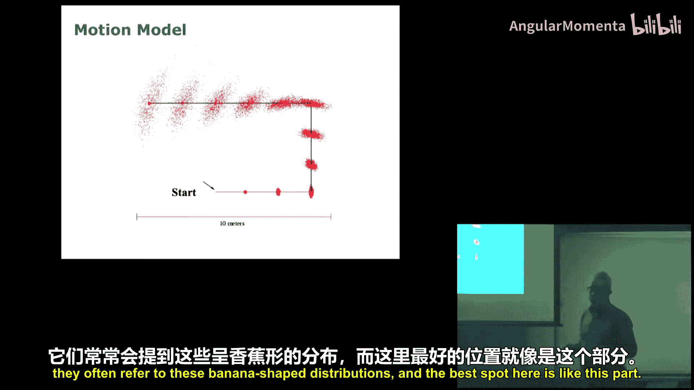

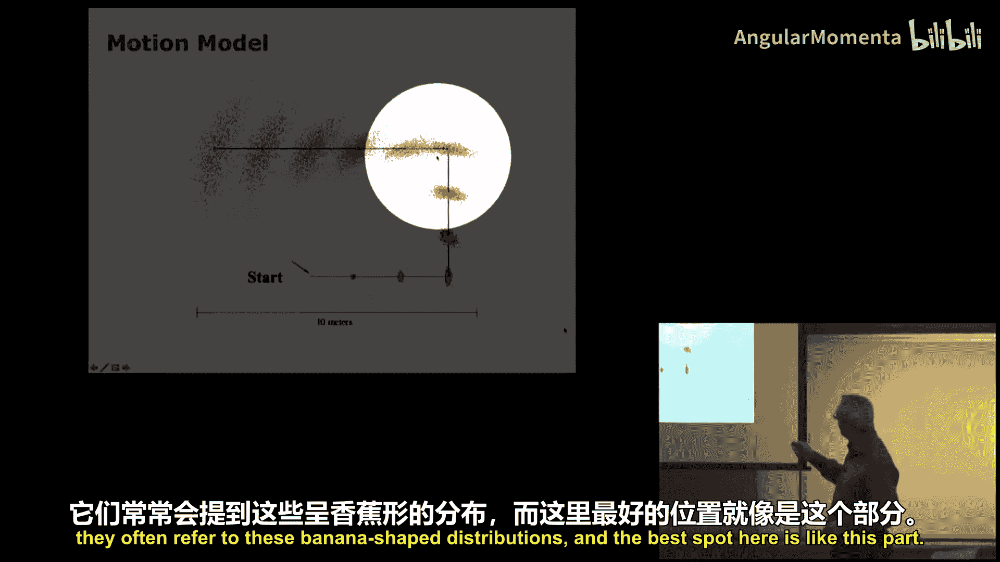

This function P of x prime given x and U and with 10，000 particles starting at 0，00。

 and then we passed like all of them through that motion model once。

And in the very first case that gives a distribution like this one over here。

 And if we again pass those again through that transition model。

 we get a distribution like this over here。 And in the third step at the distribution like this over here。

 the interesting aspect is like。This distribution like。

Indiicates something about the Angr versus translational error。So when it looks like like a vertical。

 like like a banana that is kind of like a banana is that because in practice。

 it's a little bit curved here and so that is basically the case because you have a relatively higharrow in in rotation here so that model this is a robot that does relatively high rotational  errors if you have low rotational errors in in your transition model。

 then those particles will be peaked and this distribution will be more longitudinal because I mean it's more let's say more circular because x and y might be in the very same。

 depending if you have more in x which would be that direction and it would be more longitudinal if you have rotational  errors and that forces 2 L gate along the y xs in this plot。

In this case， because every particle is equally likely when you res， you have to discretize。诶。

Actually that is just like there's the advantage of the particle filter over other representations like histograms is it just stores Xy and theta it's just real numbers that you have every particle is a triple of real numbers。

 X Y and theD orientation。And then you use this rejection sampling scheme to that function P of x prime given x and U。

 you pass it through， or basically we tend to say we calculate a potentially new space according to that transition model。

That needs to be carefully designed。 This is basically。系啲。

Repeated operation of P of X prime given X and U。 And here we like we sample that set from this set。

 And basically， what we are asking is。Where would this particle end up。

 given the operation by the robot。 And this is basically that that black line over here。

I do not know what the units were。 It's just for， says 10 meters here might be something like2 meters or something like that。

Well it's actually according to a motion model where you can say， for example， a very。

 very simplistic one could be in every step we do have a normally distributed Gaussian error in。

In the translation， right in x， a normally distributed muted  error in y and a normally distributeded  error in the rotation of the vehicle。

So basically use a normal district， you only assume these arrows to be independent。

 so you take your current hypothesis x and y in theta and you draw an x prime y prime and theta prime according to discussion it is centered at two meters and then for x and center at zero for y with different standard deviations and center at0 for the angle as well or the angle offset and then you add those to your current hypothesis or particle this is where these positions end up's basically that operation that answer your question。

啊。So that might be a motion model， and this is one of the observation models that you might use。

 So this is just the statistics or often you actually measure a certain distance。

Given you having your map tells you how far things are away， given that state of the app。

 the particle So given you have a map， right， if I do have a like ultrasound sensor that tells me it's going to be3 and a half meters is up to that wall over there and my sensor points into that direction。

 given the state that I'm currently in if another state looks like that。 then the distance is larger。

 So it will have a lower likelihood。And in fact， like those states where I'm exactly 3 and a half meters away from there。

 they are actually extremely likely or more likely than others。 And here is。That plot for。

 I think this is， it doesn't matter。 This is 2 be 30 or so right。 So it's basically。

 according to the state of the particle in the direction of the measurement that would be。

 I would expect。In the map to measure 2m and 30 centimetersm， something like that over here。

And then we can read from this function。 This red function is a typical likelihood model。

 we look at if the sensor measures like 2 m， then that would be the importance weight。

This can be done implemented very， very effectively in just lookup tables。 You know。

 you basically can discretize your observation like in case of load dimensional once， you know。

 and then just convert it into a lookup table。 So every operation here for that likelihood importance weight calculation is just the lookup in。

 in a table。It's super fast。 and yeah you need to precalculate this for all distances。

 it takes a little bit of space， but it can be done very。

 very effectively if you have1 steps measurements， for example。

 So there is a way how to get these importance waves。All right so。Again， this is with the operation。

That you want what we are interested in resembling， we spoke about this。

 And this is an example of the this， an application of this。

 This is a real data set is's actually more than 20 years old。

 this data set and these these figures that you see here is one of the very first applications of this used to that case data from。

Merva， a robot that we installed in the Smithsonian Museum of American History in Washington D。

 C as a tour guide。 And this is and you can see in some cases like spurious measurements simply because people walk through that museum as well。

 and the goal of that robot is actually to perform global localization。

 So it uses its laser range scanner to measure distances。 you see a gray the map that we used。

So basically it just displays the borders， the others and yeah。Just for visualization purposes。

 it transitions between white and gray is actually where the obstacles or the surface of the obstacles are。

 So what we have now in the very beginning is a randomly distributed set of particles。

 Random in X Y and orientation orientation is something we don't show here。So the first step。

 like this is the first measurement。Actually。Depiced at the most likely state。

 it turns out that yeah， this actually us over here。 we had our desks at that spot。

 So that corner is actually this one over here。

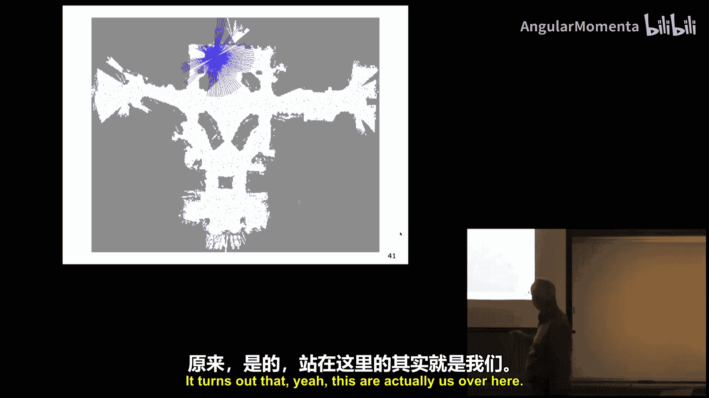

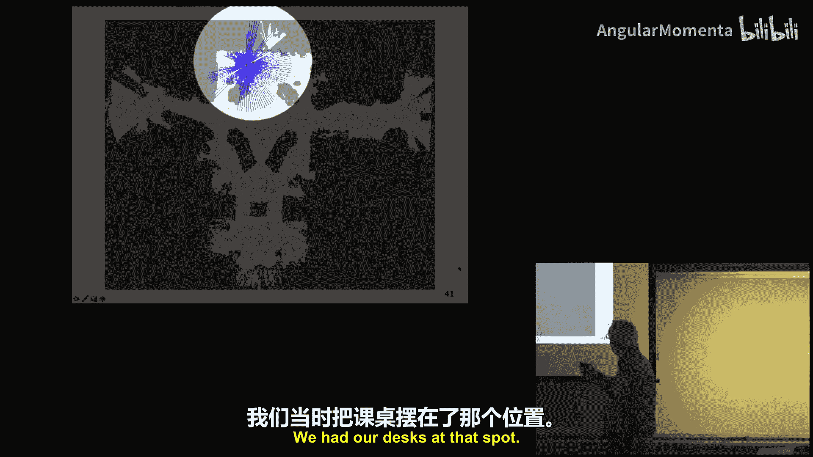

So it's relatively close to， to the true post。 The problem typically is that。

You never have a hypothesis at the exact right spot in the very beginning。

So it's kind of like a trade off between how many particles you need or you want for initialization purposes and also like what your computation time is that you can spend on a vehicle。

 turns out that you will see that over time， these particles that actually converge to the true post of the vehicle and all these particles are located at at the two spot of the vehicle。

 which means that for approximation purposes， you do not need to have 10000 particles that as long as you are kind of confident or the system is confident where the robot is。

 And this is why they are also schemes of dynamically adapting when adjusting the number of hypothesis or particles and so on and so forth。

 But let's first of all， look at how that works。 So we get the robot is always depicted at the particle that is most happy and the most happy particle is that one with the highest importance weight。

 And already here we see orientation is kind of okay and it's close to where it is。

So what we do is we weigh these hypothes and darker means higher weight and then we resample we'll see this in a second and you will actually see a better contrast there。

All but here you can see a couple of hypotheses like emerging。

 So next step is that we calculate the importance of weight again。

 resample and then propagate according to the movement。

 You see now we are actually closer to the trueop pose and the interesting aspect now is by the fact that through that reampling operation。

We get more and diverse particles in the areas of high likelihood。

 There's a higher chance of actually getting closer to the true posts of the vehicle。

 So we accumulate more particles in the relevant areas of the belief。

Which means we actually kind of like， if you think about this。

 we are in a gradient and cloud getting closer to the two pose。

this disadvantage of the particle filter。 You never get the maximum of that。

 The maximum likelihoodli is is you can only get an approximation of that。 And for that。

 you would need to have like optimization based approaches， like。Smoothing techniques often that。

So next again is like waited according to reampling operation， propagating the particles。

 I know you see like how dense that gets so all the 10。

000 particles are close together where the robot actually is。系。

It actually nicely fits map is not accurate， as you see here you now you can see carefully that in the center it's actually like darker。

 right？

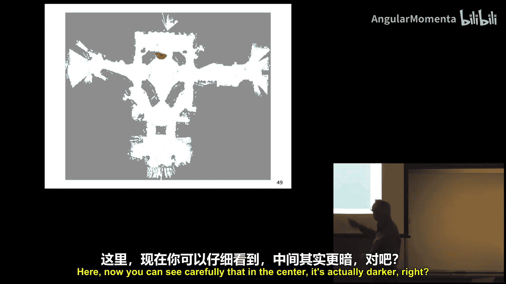

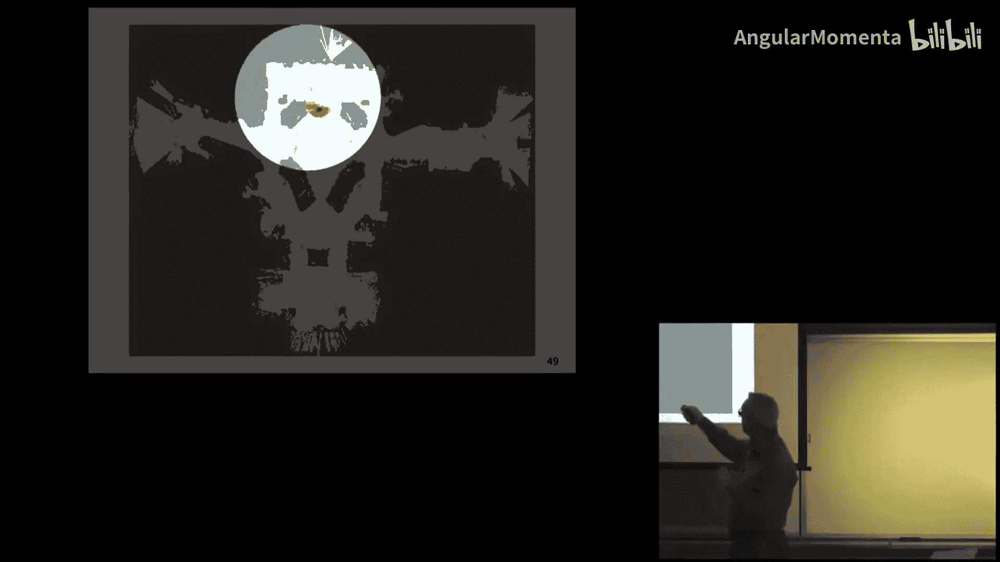

If you keep going。It keeps accumulating the particles。

 And then whenever you do this prediction operation the particles gets spread out because of the uncertainty in the robot motions。

 It's kind of like a tradeoff between the the prediction where you actually try to capture everything that might happen might happen from step T to T plus1。

 When you have the correction， the perception that tells you what actually happened。

 that focuses your the space again， And when you implement this。

 you need to carefully design those two two components。 This is why they are so super important。

here's another example of one of the famous videos of a robot performing global localization in a highly symmetric corridoror environment with ultrasound sensors。

 and you see all these hypotheses， mighty hypotheses， multiple hypotheses。

Becauseimp because the robot doesnt know exactly in front which door is。

 which it can detect only by these measurements going through the doorways。

 And and the cord is also rotationally symmetric。 That is why we have two peaks。

 And this dose can only be distinguished by entering one of those two rooms。 interestingly。

 because of the high uncertainty there， the end， the particles said also by four case is happening now。

 you see that because like it might be the case that the robot actually had turned right。

 although the measurements are turning left。But then if you keep going， that actually sorts。

Typically sorts out， but that doesn't mean that。That it is that it always converts。

 even a particle filter can diverge。In cases where your motion model is not correct。

 you're overly optimistic with the motion model that is a typical source of divergence right and the other one is if your observation model is not correct or maybe also too strict if it's too peaked。

 then you throw away like too many particles in the reampmbling operation right so you might be overly confident about where you are。

And here's another example also from Minerva。 This was a robot， very same environment。

 and it's actually a super simplistic sensor model that is。😊。

A ceiling mosaic at that time generated by Frank Deardt。Of the length。

 we had an upward facing camera over here。

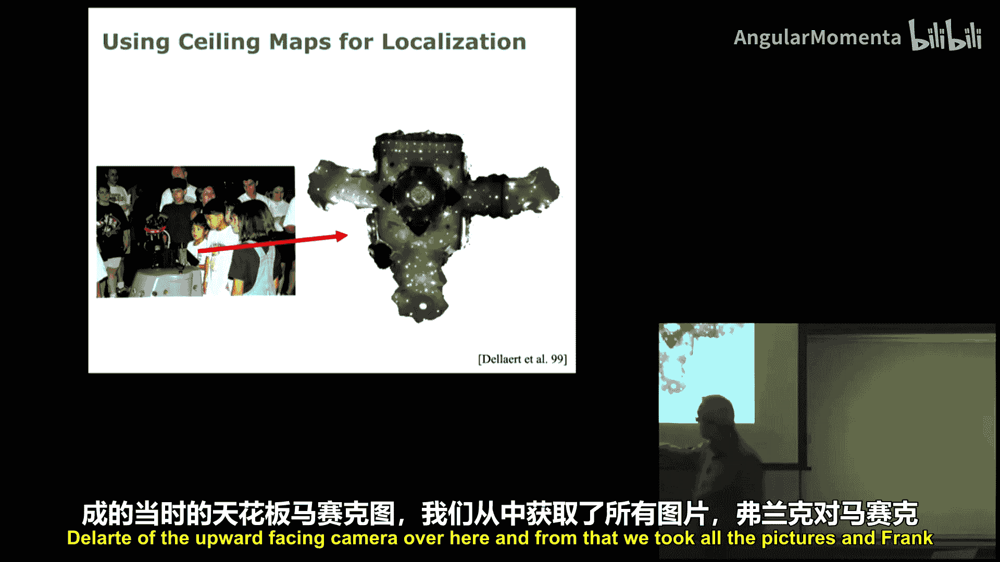

And from that， we took all the pictures。 and Frank was interested in Mosaic King。

 So he generated the ceiling mosaic of the Smithsonian。 And you see all the lights in there。

 And then I designed a super simplistic model for that。 He basically took the center。😊。

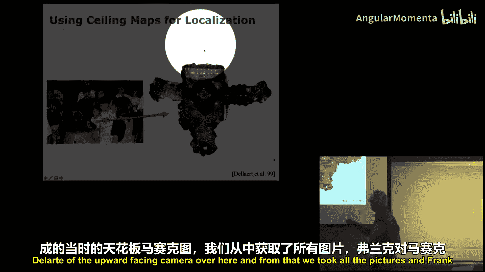

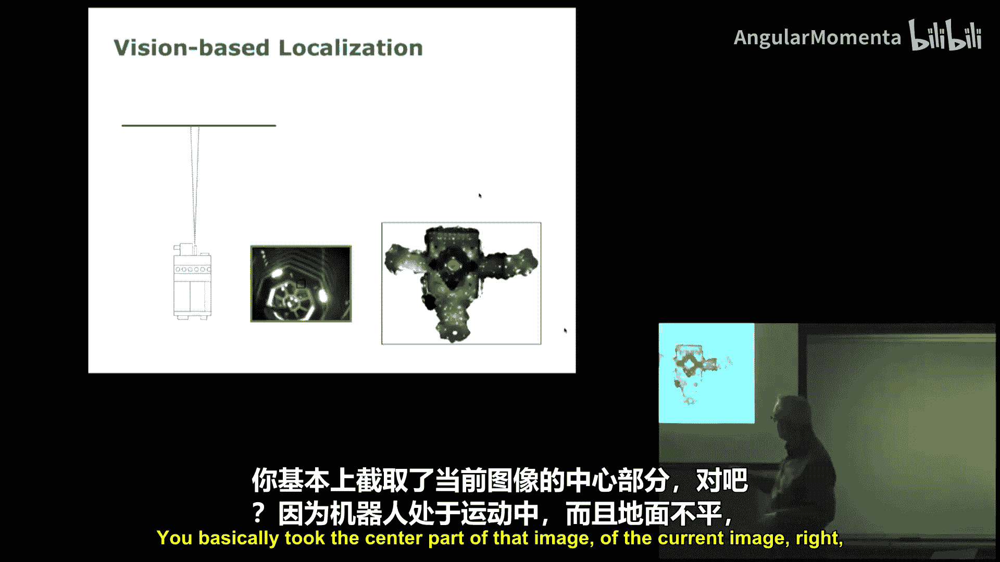

Part of that image of the current image， right， blurt because the robot is in motion and Ted。

Floor wasn't even。 So I took those， I think it was 10 by 10 pixels over here and calculated the average intensity of that。

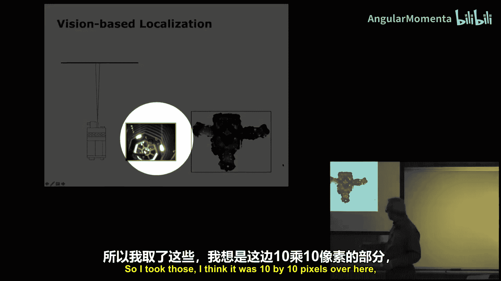

Image。And then I had a very， very simplistic error function。

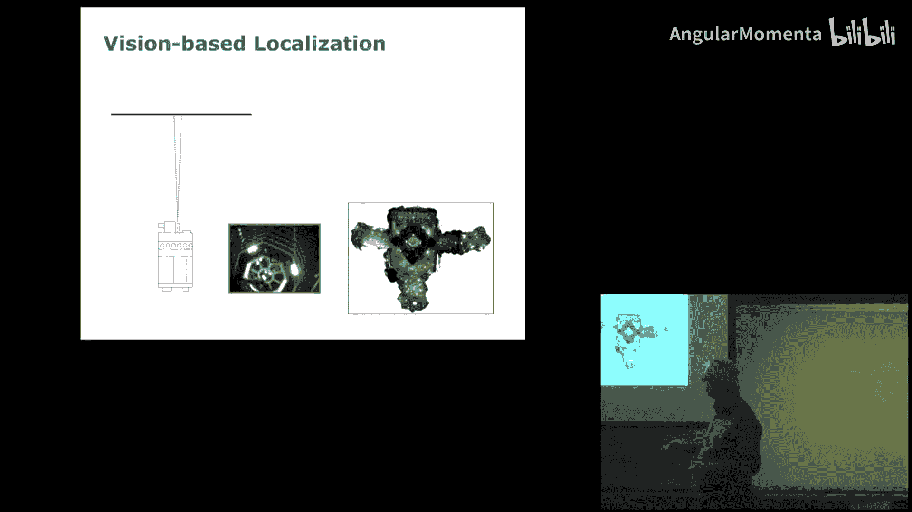

Which is basically nothing else but the Gaussian。 I looked at the looked up like given the state of the particle。

 like what would the intensity in the mosaic， What is the intensity that the average intent intensity that I measure。

 And then I use the Gaussian to basically to like。

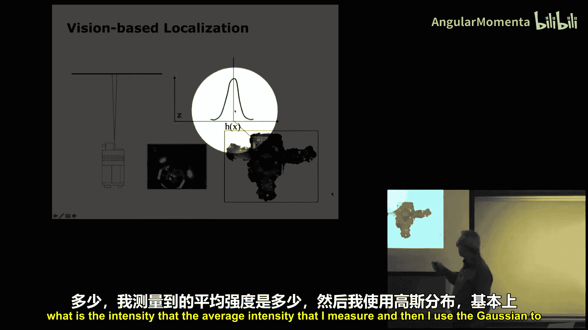

It's basically the square distance of those individual pixels And then that gives you the likelihood。

 And once you do this and hope this video runs。 So there are a couple of measurements。

 it's actually interesting。 if this is your center image then maybe it's more 20 by 20 pixels or and then you can actually calculate P of Z given x。

 given that mosaic。 So for example， like this is when you under a light。

 and actually there where lights are， it's dark meanss high probability。 And when it's dark。

 it's a low probability。 And then you do have like next to a light then you can actually see in that distribution that there are black circles around the light So everywhere where you are around like close to a light。

 it's higher likelihood and anywhere else。 And this is if you are under when there's no light then like lights have very。

 very low likelihood。😊。

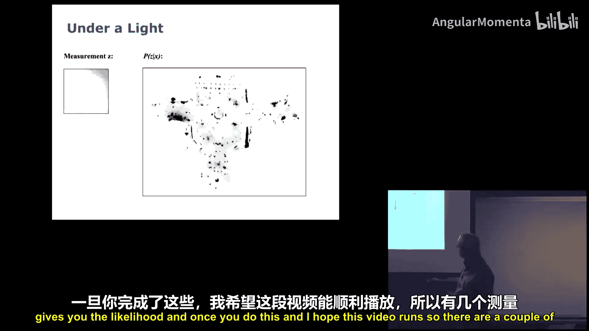

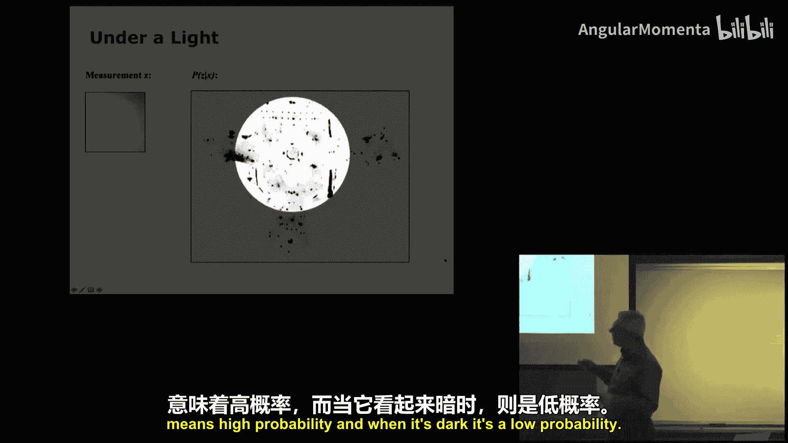

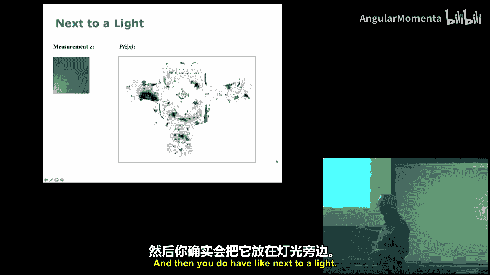

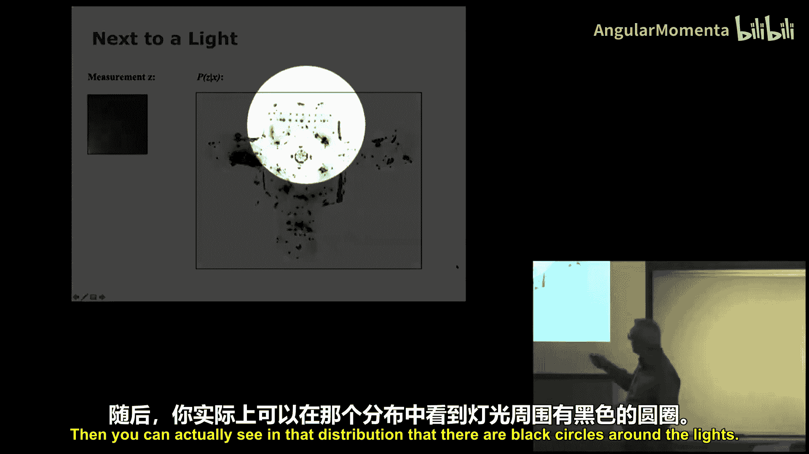

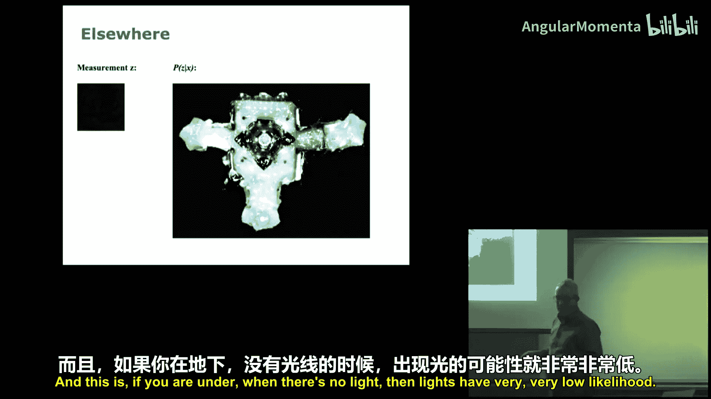

And if you let this run， this is a true trajectory， I think， again，10000 particles。

 So there's a yellow dot in here that it's here where this thing is， it's hard to see， but。

You can see from time to time， screen driving was not that good at that time。

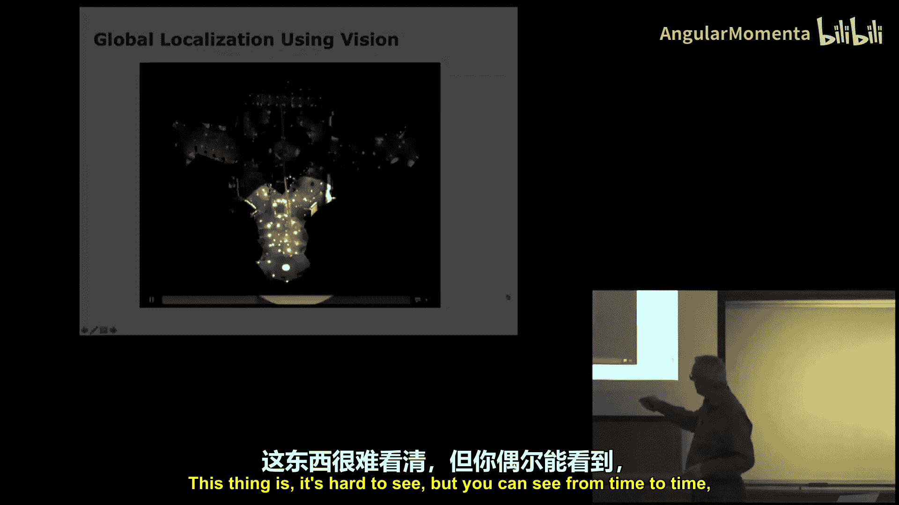

So you can actually， just with this super simplistic model， you can perform global localization。

 There a robot just based on， on ceiling lights。And this is something that differentiates the particle filter from other types of filters like common filter that it is inherently able for doing this。

 a common filter can also do global organization。 It doesn't mean that it cannot do。

 but because of the low amount of linearity is actually more complicated。

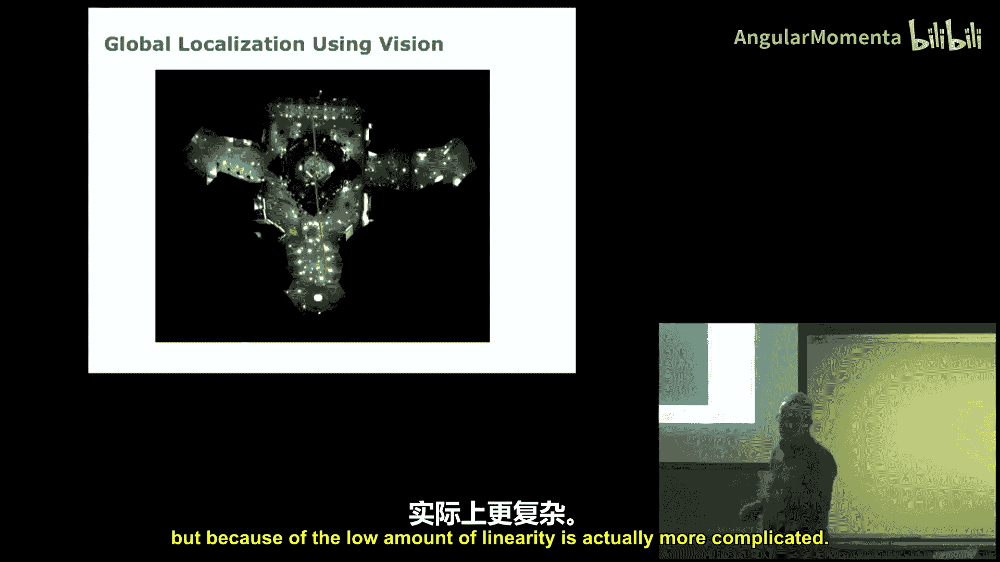

诶。So what we basically can do of shown is we can do global localization。

 which is pretty interesting so you can like initialize it and it can keep track the extensions for that for doing like dealing with localization errors。

Kitip robot problem。 That's popular in robot soccer where you take the robot put it to another place and the robot has to figure out that it made an error or that is somewhere else now。

 there's several ways of doing this。 People have started modifying that particle filter algorithm。

 but that's actually the wrong way。 the right way for doing this is changing your transition model and there is one way would be to basically guessing at every point in time that you are teleported somewhere else。

 meaning that you need to have in your motion model need to have a component that says I'm not taking your dormittry。

 I'm guessing a random spot from time to time。 And then you would actually at every time step。

 you would guess that robot is somewhere else。 One minute。YeahWe'll be done in a minute。

 this one approach for doing this disadvantage is that the robot actually at every point in time guesses。

 oh I might be in the Starbucks next door or so And if all of a sudden。

 the measurements are consistent with that for whatsoever reasons because there are people around and it looks like the Starbucksbucks restaurant and all of a sudden all the probability mask will shift over and the robot will actually believe it has been transit and there's no reason for doing this when the robot is actually happy with its observations。

😊，So what people have been doing is。Either what I mentioned。

 randomly guessing new places or the alternative is to look at the average likelihood of your observations。

 basically， if they drop， meaning that。The like the robot is unhappy with his observations。

 Nothing fits really。 So， and that is something that you can do。

 to generate the statistics about like what is the typical observation likelihood that I have when I'm happy then when you get below that threshold。

 you would even learn that。 and you could basically say， okay， I'm proportional to that。

 I'm guessing random locations。 And the more unhappy I get， the more。

Willing I am to accept being somewhere else， and that's actually the most robust approach for doing that。

That is the summary and with that I'm basically done。 I hope you enjoyed it。 I did it and see you。😊。

I'm sorry， it's start。

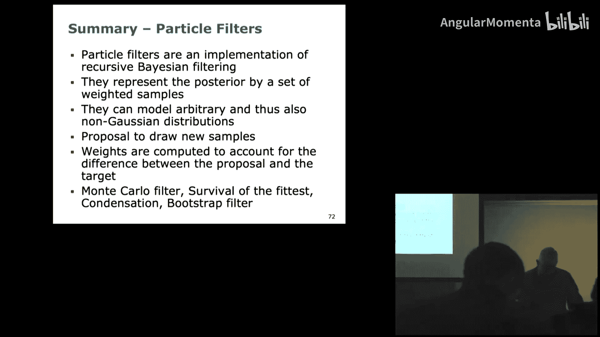

I think Profes later。

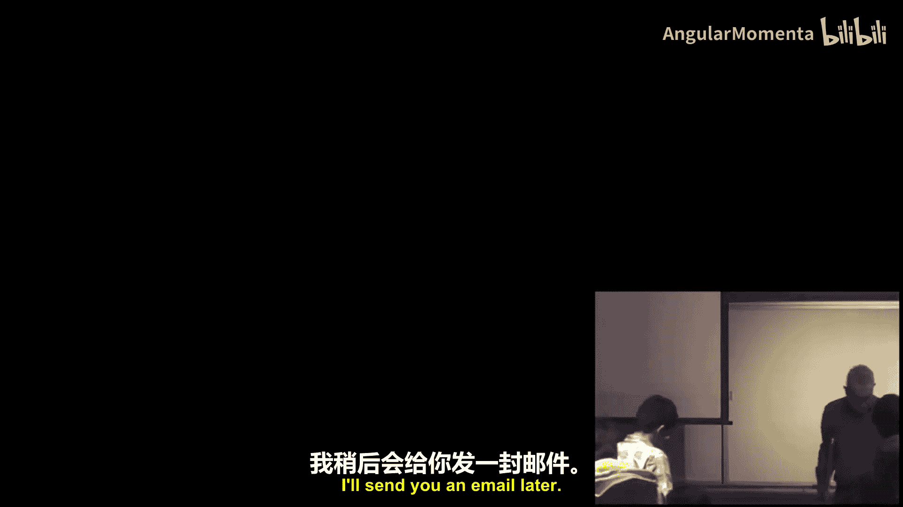