# 【加州大学伯克利分校】高级机器人学-｜-CS287-Advanced-Robotics-at-UC-Berkeley-Fall-2019-p15-15-部分可观察马尔可夫决策过程（POMDPs）--BV1KXqCB4Eua_p15-

Welcome to lecture 15 of advanced robotics。 We're going to cover Po piece。

 partially observable mark decision processes today。

 We actually still had a little bit of cover from lecture 13。 We saw maximum likelihood。

 but we didn't yet cover expectation maximization。 So I'm going switch out of this。😊。

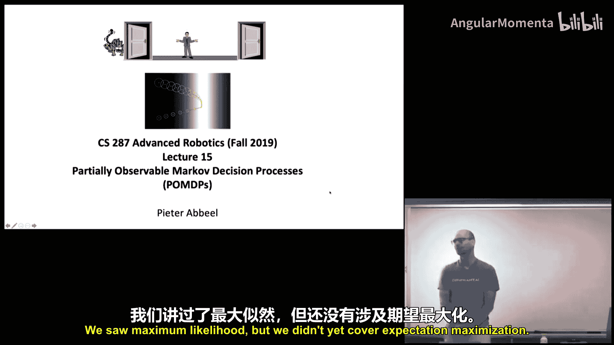

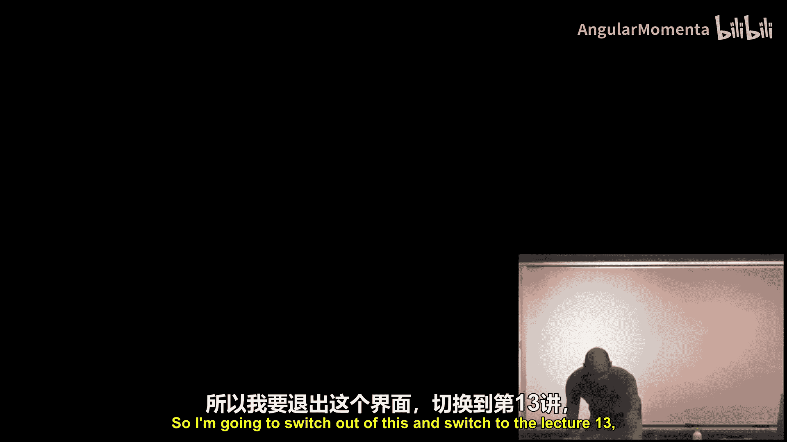

And switch to。啲。Leecture 13。Last section of lecture。Expectation maximization。So。

What do we cover in lecture 13 that directly ties into we covered maximum likelihood。

 And the idea was that you try to find the parameters of your probability distribution， such that。

Under those parameters， the data you collected is maximally likely。

 And so then those parameters might make for the best explanation of your data。

 and that's the parameters we're going to choose。We looked at maximum a posterii because maybe you don't have infinite data。

 And so maybe you have some prior knowledge that maybe， you know。

 it's never a zero probability for some outcome。 So you want to bound it away from that or steer it away from that。

 So you can put in prior information， often in the form of fake data as if you dreammed up some data。

 added it and then do maximum likelihood。Objective multiplied with the prior to get the a postteriary parameters。

Then。The thing we didn't cover yet is expectation maximization。 And' especially pretty important。

 So imagine we're trying to。Fit a mixture of two Gausians。 So what we have here is。

Equal probability of coming from one Gaussian or the other Gaussian， they have different means。

 they could have same or different covariance。And what we then see if we look at the maximum likelihood objective。

 Oh， by the way， I got this now， too。 If we look at if we look at， let's see。😊。

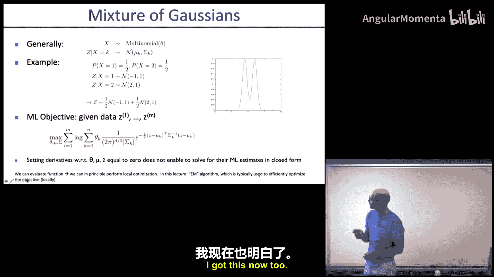

If we look at the maximum likelihood objective。嗯。We have maximization over the parameters theta。

 which is probability of mode 1 versus mode 2， mu， which is the means of each Gausian。

 sigmatic covariances of each Gaussian， we want to log probability of the data。

But it's under the mixture distribution， which is a sum of two distributions。

 and so what we have is the log of a sum of things。

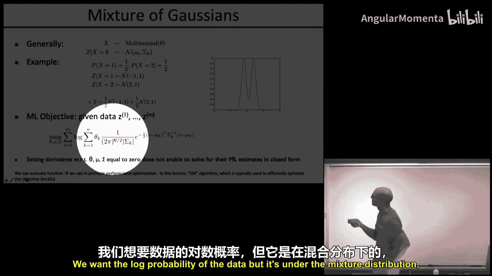

Usually we have maximum likely to have the log of a product of things。

 and it naturally becomes a sum of logs and the math becomes very easy。Here。

 if we just take derivative set the equal to0， then we actually won't be able to find a closed form solution for the parameters theta U and sigma。

So you could say， well， we can just run gradient descent。 That's one way to go。

 But what people have found more effective is something called expectation maxim。

 It's still running an optimization， but it's running the optimization in a very specific way。So。

Let's look at that。 So here's our。X is the underlying discrete variable could take on the value 1 or 2。

Equal probability。 Z is the continuous variable and comes from a Gaussian。

 and the Gaussian it comes from depends on whether x was equal to  one or equal to 2。

 will come from a different mean。We're given some data just disease， but no X。

 so we don't know which Gaussian it came from， we just know that it came from one of those two Gaussians and we have data point C。

Can we find a maximum likely estimates from mu1 and mu 2。

 Let's assume we know the prior is fixed over x1 and x being1 or2。 It's one half， one half。

 I just want to find the two mus。Okay。The basic idea for AM。 And this is really a thing that。

And the high level is the key thing to retain basic idea if Xi were known。For each data sample。

 not just a Z I， but also the Xi， it's a very easy problem because then you can just split it。

 These are the Xs where it's one。 This is where it's  two。 when it's one。

 you estimate the mean of disease that belong to that group of data。

 and the other group of data will be for the mean for mu2。In EM。

 the setting that you're given is that the underlying latent variable is not given to you。

So what can you do， You can decide to alternate an E step or expectation step。

 We'll try to fill in the missing data。 So you might say， okay， well， I only have disease。

 but I'm gonna guess the axis。 And then once I have guess the axis now I have X N Z。

 and now I can easily do a closed form solution to find the mean for each of the two Gaussians。Now。

When I describe it this way， it sounds pretty heuristic。 you just kind of fill in the data。

 maybe based on some posterior or something， and then estimate the parameters based on that and you repeat。

 when I should derive that is a proper way of optimizing the objective。

And this is what we're going to look at is the E derivation， which is。嗯。

Go to use Jensen's inequality， which is the most widely used inequality in pretty much anything machine learning。

 AI， it seems。So let's step through that and。Formmerly derive that。

Altnating between trying to fill in the data and then maximizing what the filled in data and repeat is actually the correct thing to do。

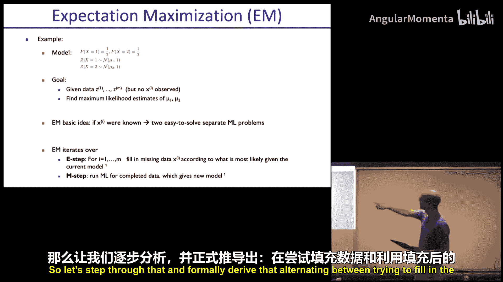

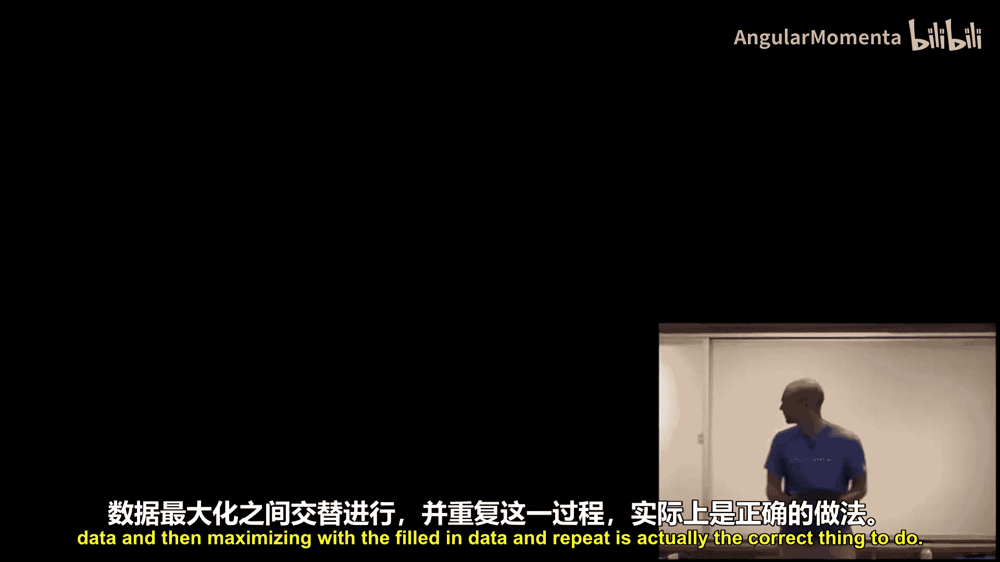

Sir。We'll have a maximization of our theta。Which is all our。Parameters of our distribution。

So still maximum likelihood。We look at the。Long。And in principle there would be a summation here。

 but I'm just going to have one term， in principle there's multiple data points。

 you have sum of these， but we'll just have one data point。

 So log and then x is unobserved if to integrate over it or sum over it。

And then we have a joint distribution between x。And Z， which has parameters theta。

And integrate out over x， because all we get to observe is Z。

 And so we're trying to maximize the likelihood of Z。 And this thing here。

Is the marginal probability for Z。 So trying to maximize the log probability of z'。 So x。

Not observed。Z observed。If you want to go to the more canonical setting， we have a lot of data。

 then all that would happen is you have a summation here over I， and you'd have a ZI。Over here。

 that's the only difference。 But then we'll just do the math that we're doing now multiple times for each term in the summation。

 So we're just gonna focus on one term。 and then we don't have to index into I everywhere。Okay， now。

Now we're going to play a trick that is kind of。Well。

 I wouldn't say it's obvious at all until you've seen it many times and then you're like， oh。

 that's always the trick you play and say this is equal to。Max over theta。Log。Interegral over x。

Q of x。Divided by Q of x， and we haven't even defined Q of x。 It's just some distribution。P。

X comma Z， theta， d X。So that's the same thing because we just multipied it and divide by what then together becomes just a factor of one。

Now。We're going to use。Is Gen's inequality？To try to simplify this， what is chance's inequality？

Victorialically what it is。It says that if you have。Some function。 And here we have， let's say。

 a concave function that we're maximizing。 if a function like this。Where。For any two points。

 let's call this x axis for any two points， x1 and x2。The line lies below the function。

That we can say well。Let's do this by example first， let's say we have x1。X 2。

This is our function f of x。If we think about a distribution over the values x can take on。

Some probability。X equal x1， some amount of probability x equals x2。 And let's say it that sums to1。

And maybe let's call this one。One minus lambda and this one lambda。

There we can see what is the expected value？Well， what is the function value at the expected value of x？

And we're going to wonder how that relates to。Expected value。 So expectation is is over x。

 Exp value over x of。F of x。 So we're wondering if we can swap the expectation and the F。

If we can this were equal， then we could just swap them and then。When we're looking at things here。

 maybe， I mean， log probability， maybe we could make things simpler。

 So how do they relate to each other。 Let's look at a simple example。 So here。

 expected value for x would be， then wed have F of。Let's say lambda is1 to keep it simple。

 So let's say lambda equals12。Go by example， f of12 x1 plus12 x2。Should you this thing over here。

12 x1 plus 12 x2。Bring this up。F of that thing。Right here。

Then this side is the expected value of f of x， so this is really then1 f of x1 plus1 half f of x2。

Which is this point over here。So what do we see， the function value of the expected value of x is bigger。

Then the expected function value。Now， I did this with one half。

 but you can imagine that if I picked any lambda between0 and 1。

 the same thing would be true because it's really about the fact that this line lies below the function and that will make the sign go this way。

And imagine I took。Multiple x's that could take on that multiple hours X could take on。

 Maybe it could be an x 3 also。Then the same thing will happen。

 We'll just have some kind of average of x1 x2 x3。 After we take the average。

 we project onto to the line above， whereas if we actually look at the。Sorry。

 we take an average of X 1 x to x3， just like we did here for X 1 and x 2。 we go to the function。

 and we'll see that the function is above and the same thing if we average x 1 x to x 3。

 maybe depending on the weighting we end up over here， we go up。 And again。

 we see the function is above the line， which means the function of the expected value is bigger than the expected value of the function。

So Gens inequality says in generality， so this was an example， but it sayses in generality that。

Function。Applied to the expected value of x is bigger than or equal to the expected value of function of x。

 assuming the function looks like that。 Obviously， if the function were curved the other way。

 the inequality would go the other way。 It's because the function is curved like a。

 like a hill effectively， that you get this inequality。So。This is。Jame call says if。F concave。Then。

F of the expected value of x is bigger than expected value of F of x。And。Equality， only。If。F is。

A fine， meaning F is a line or a hyperplane。Because if F is actually a line， well， if F were a line。

Then the line connecting the points will be the same as the line that is F， and you'll have equality。

But if it's not a fine， then you'll always have a difference between the two。Okay。

 so now that we know this， let's take a look。 What do we have here， We have an expected value。

 so let's write explicit that we have max。Over theta。Then we have the log。

 which is going to be our F， by the way， then we have the expected value with x coming from Q of x。

Of。Pi。X comma Z theta over。Q of x。Now， chance's inequality says that we can。

 if the function ever is concave， we can。Flip the order of log and expectation。 Well， log is concave。

 so we can flip the order of log and expectation。 so we can say。This is logus F。

 F of the expected value is bigger than expected value F。

 So we can say bigger than or equal to the max。Over theta。Expected value x， according to Q of x。

Of and then log。P x comma z theta over Q of x。You might say it's a lot of math and you now have a queue you have a lot of other things introduced that maybe don't simplify。

 but you'll soon see that actually now we have something simpler to work with。

 even though there is more symbols involved here than there were over there。

 it's actually a simpler thing to work with。So。What does this mean？A couple of things。

 we want to check。We're trying to maximize over theta， and we now found another function。

That is actually smaller than our original function。

And so you have some function we're trying to maximize。And we found another function that's smaller。

We know that it's equal。Whenever f is f fine。 So whenever this is。This thing over here is AF。Well。

 a very special case of AFa is the one that tends to be used。This is going to be with equality if。

This is a constant because if this thing is a constant。

 then it's a special kind of line that just runs horizontal。 So if this is a constant。

 we have equality。So， if we make。Q of x。Proportal to。P x comm as the theta， we have equality。

But Q of x is a distribution。So how do you make a distribution over x proportional to something like that S x and z in it。

 well the only way that's going to happen is if Q of x is equal to the conditional of x given z under the current parameters data。

So equality， if  Q of x is equal to conditional x givenancy。Now， here is our algorithm。 then。 I said。

 we're going to fill in the blanks when we don't know the hidden variable X。

 we're going to fill it in by inferring it。 That's exactly what's happening here。

We say I'm going to find the condition of x given z。

That is what we call Q of x once we have found Q of x。Well， once we found Q of x。

 look at this objective。What's left in in the objective。

 the bottom part here doesn't matter because Q is now fixed。

 but we're left with expected value under Q of x of the log probability of x comma Z。

 And so this thing here。It's like saying， I'm gonna imagine x were discrete for a moment。

 I'm gonna fill in based on that distribution here。 X given Z， some pseudo counts。

 Let's say I have a bit equal probability and x equal 1 and 2。

 Then this would say half the time I want to look at the log probability under x equal 1。

 half the time I want to look at the log probability of z under x equal 2。

 And so this thing here will be the thing。We then optimize and we actually be in closed form。

 It'll look well for simple distributions being closed form because it looks just like having an expectation where we have actually now filled in the axis。

 This is filling in the axis。 and this is just log likelihood。

 And now we have observed X because we filled in from Q of X。

 and Z was always observed because Z is the variable that we saw from the beginning。😊。

So we'll see some examples for that pictorially， what happens is。This is our original objective。

So call it the likelihood。Of our data under their parameter parameter vector theta。

Then this objective over here is a lower bound， so maybe right now we're here。

This horizontalal axis would be where theta lives。Maybe we're here right now。This is our theta。

Theta from our current iteration， maybe iteration1。Then wed say， well。

 instead of looking at the original function， we're finding a lower bound which is equal by choosing the correct Q of x equal here。

 And in fact， it even showed that the gradients are the same。 It'll actually be tangential。

 and it'll go below。 So strictly below， so it might look something like this。So finding。

X given Z is really finding this new objective function that we can then use here to optimize Theta often easily ch at this point over here。

 Then once we're here， Ash Clotman， will'll have a new bound。Coming here and from there。

 it'll probably jump over here and we'll find this local optimum。

 It's not guaranteed to be globally optimal， but it will locally optimize。

 and it'll do it in a somewhat second order way。 It's not just a gradient step。

 It understands much more about the optimization objective than a gradient would do。All right， so。

Let's take a look at what the full algorithm looks like then。So。

What we have is at the top what I drive on the board， which is mags log， maximize。

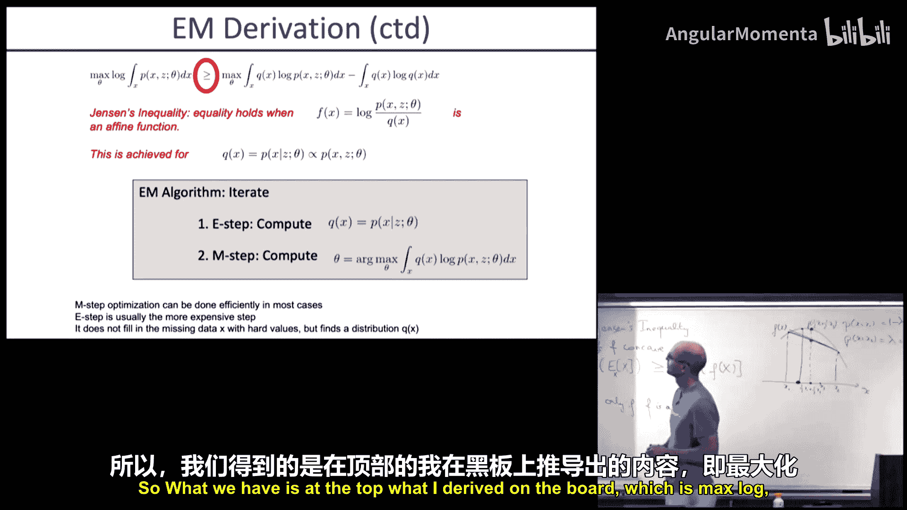

The log probability of the data， which is Z where x is a hidden variable。

 we need to integrate out over。

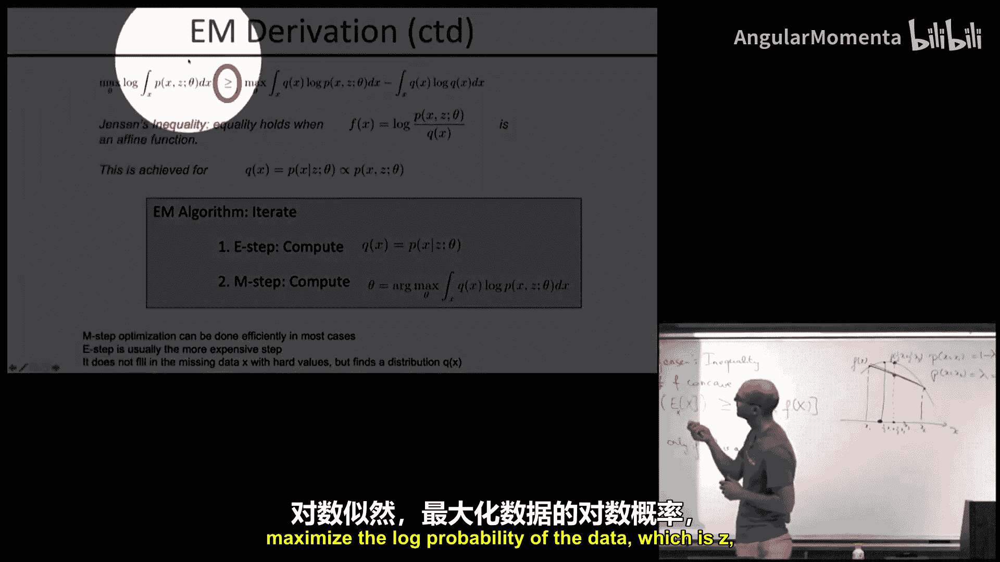

We then apply chances in equality， which is the full top line。

 We know it helps with equality when that thing is aine， which in practice。

 we can achieve by just making it constant。 And so we set Q of x equal to the condition of x given z under the current parameter vector theta。

Then from there， we iterate。 So once we found Qx。We can go to the M step。

 which is just optimizing this thing over here。 Again。

 this thing is fairly simple because it's integral over x。 Q of x。

 But this is essentially like pseudo counts。 It's like filling in your data。

 That's what Q of x is doing。 And then for fully observed data。

 you have seen both the x and the Z for each one of them。 now。

 you can now look at the log probability joint of x and Z maximize data for that。 and repeat。

So let's look at some examples。 Here's this in action。 So horizontal axis is mu。

 a single parameter because I mean， to make graphs， it's nice to have only one parameter。

 and I ran this on a mixture of Gausians data set where you have essentially two Gaussians。

 one has a mean of negative mu， the other one mean of positive mu。

 but we don't know mu And then can here see what the objective looks like。

 And so we see two peaks naturally because negative mu and positive mu are kind of swappable in the description I gave。

 And so we see that it actually finds this bound。 if you plot it out carefully I'll go to peak of that bound and I'll repeat as you run Em。

Here is two iterations in action， so we have。An assumption that there's only one parameter or mu。

 which results in mu1 and mu 2 being these values。 and we have mu and the horizontallas。

 That's our theta here。 and we try to maximize the objective。

 the likelihood and the red curves are the lower bounds。 and so we locally have a lower bound。

 The first one happens。Over here。

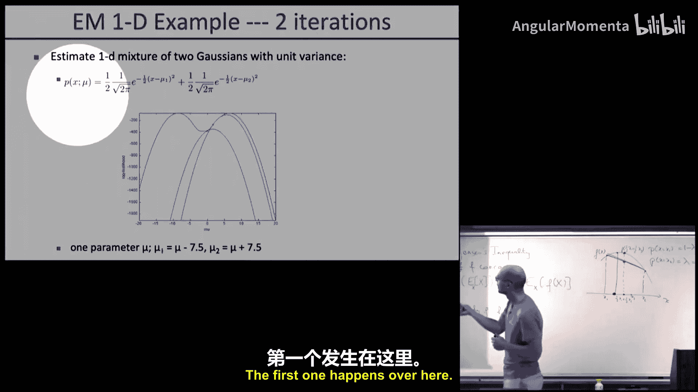

We have lower bound。 This is then。The red one's lower bound， the optimum is here from there。

 we end up at this point， have the new lower bound。

 and at this point we're getting very close to the optimum。

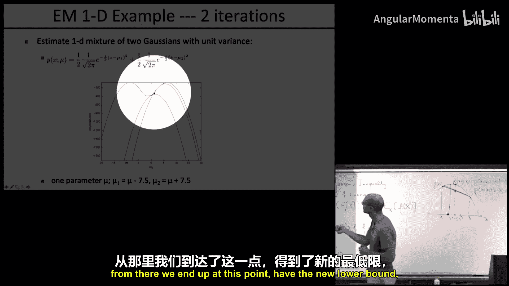

Okay， so if you look at the math for EM for mixture of Gaussians， you observe disease， but not the X。

 what the probability of x being。Essentially， the identification of the Gaussian you're coming from well。

 it's shown over there。You can find the probability for each value you could take on and then once you have that。

 youve filled in your excess effectively， but with fractional values。

 you don't fill them in with the most likely but fractional and then from there you have the objective that's easy to optimize the thetas here correspond to。

The x is the T has a mixture of probabilitybabil。Working this all out X take on a specific value of k proportional to theta k。

 which is the prior for x and the density of of that Gaussian at the data point that's not normalized。

 but you can normalize this across all values X can take on that gives you the counts once you have those counts filled in over here。

You get a standard Gaussian objective that decouples for each of the mus。

 each of the Gausians has its own mu and possibly sigma。

 and has its own set of terms coming from this very simple maximum likelihood for a Gaussian。

You do the same thing for HMMs。 not going to do all the details here。 but remember HMM。

 you have a dynamics model and an observation model。Often you don't observe the underlying state。

 you only observe the sensory measurements。 and the question is。

 can you recover the dynamics model and the sensory observation model from just having a sequence of sensory measurements？

That's， again， a maximum likely problem that we， I mean， you can set it up that way。

 but it'll have hidden variables。 And so if you look at applying， you apply chances inequality here。

 look at what happens， get the same thing and always the same thing。

 You get that you need to compute the conditional of。X， which is hidden given the observations。

 which you actually get from the smoother， smoother gives you the condition of X。

 given the observations， and then you can come， you can use that X and the sensor observation Z together to do maximum likelihood on the conditional of sensory observation given state。

Then for the dynamics model， you actually need to run the smoother to extract the joint。

Distribution over X T and X T plus1 for all T because need a joint distribution between two time slices。

 to able to fit to that the conditional of the next time slices given the previous one。

And so remember when we talked about the smoother and I said， oh。

 you can actually also run it to get out the join between two time steps。

 and it'll be useful at some point。 This is where it's useful。

 Its be able to recover the dynamics model the that is associated with the dynamics of the state of this process。

So。What you would do is you would run。Sooer to find both the joint between Xt and Xt plus 1 and the marginal for Xt。

 which you'll use with the observation Zt。One quick observation here is in the kind of general derivation of EM。

It'll say find the conditional of all unobserved variables given the observed variables and plug that in。

That's actually very hard to represent directlylic because it's many。

 many unobserved variables and the joint will be a very unwieldy thing。But often。

 when you look at the deals， that's what happened here。 If you look at the details。

 let's assume we have access to the full joint。Work through the details。

 We'll see that actually the only way the full joint is used is by using the marginal over x。

At each time slice T。 And by using the joint over two time slices。

 So you don't need the actual full joint， it's enough to find the marginal and the pairwise marginal for neighboring time stepss。

You can do this for Gaussians， let's say you have a linear Gaussian system。

 much like a common filter setup， you're given the control inputs， you're given the observations。

 not given the states。You might not even have a dynamics model， you might not even have AB，CD。

 you might not even have Q&R， but you have a sequence of sensory observations。

Can you back it all out， well， that's an HMM again， what do you do？You run a forward pass。

 a backward pass。 We actually didn't put the backward pass equations on the slides when we covered the smoother initially。

 we said you should be able to derive this。 But if you're curious， this is actually the result。

 For pass， backward pass。From that。You get the relevant。Quantities， which is the distributions for x。

Margiinally at each time an X and X D and X T plus one。

 which are the things we need to then be able to derive the maximum likelihood estimates of Q and R。

 And then， of course， after we found Q and R， let's say we need to find Q AndR。

 the covariance matrices， we rerun the filter in the smoother。Get new marginals， reestimate Q&R。

 repeat， repeat， repeat。I'm not showing the equations for how to estimate A， B， C， and D， for A B， C。

 and D， you actually need to。Find the for A， you need to find the joint between T and T plus1。

And then you'll have something like a least squares problem。

 It's a little more complicated because an an least squares。

 you have full certainty on one variable and gives just an uncertainty。

 you're supposed to break the other one。 But here we'll have a joint over x D and x d plus one。

 Both have uncertainty。 So itll look a lot like least squares if you work through how you determine a。

 but it won't be exactly the same as least squares。

We still have to account for the uncertainty on X T。Now。

 one thing to do when you run this is to keep track of the likelihood。So。

We're optimizing this objective called likelihood， and so every update it should improve if it does not。

 it's likely there's a bug or maybe numerical problems or something。

So what does the likelihood look like， Like is log join probability over all the sensory observations because we don't see。

The underlying states X is no likely to over that。Is integrated out。 So what is that really。

 its probability for C 0。 and then the conditionsal of Z T， given all the past ones。嗯。

You can these are the equations for finding this。 So the next observation mean and variance for Z are given by these simple updates here。

 and once you have those then you can fill into the Gaussian density， take the log and get。

Get to some of the log probabilities。 It's a really good way to make sure you don't have any bugs。

 if this thing is not consistently going up， it means something is wrong in your implementation。

Becomes even more important if you， let's say were to run an extended common filter。

Because when you run an extended comma filter， the assumptions I just talked about are actually broken because you'll do a second order update as you run EM。

We do it based on having linearized your dynamics along a path and how did you linearize as by Well。

 essentially linearizing along your estimated states。 And those will be a guess。

 And since you have a guess there。 and then that guess might be wrong。

 the bound that talked about might actually not hold true。

 So because that bound is assuming that you actually have a linear system。

 you run filter smoother on the linear system。Em Bo tells you， okay， now， if I make a step。

 it'll be better， it'll only be better on the linear system。

So we'll have to do after you in an extended comma folder setting。

 try to find the parameters of the system。 after you found that update。

 you'll have to do a line search。 say did that really improve an original objective or not。

 How do you do that line search？ Well， that's by looking at evaluating the actual objective that you care about。

 checking that you're not overstepping effectively。Okay， that's it for expectation maximization。

 let's maybe pause here for some questions about that。So in your。I want to take this moment。

So it seems like you're。You're converting your problem into some kind of concave problem that lower bounds your thing。

 I'm sort of confused or lack intuition for why when you jump to the maximum of that concave lower bound。

 you can't overshoot and kind of keep jumping back and forth between the peaks like。

If you look at the curves you drew， right， it seems like you could。

Jump to the peak of your concave lower bound and overshoot。Yeah， so。It's a good question。

 So maybe let's try it out。 So imagine there's two peaks because that's really the question right。

 there's two peaks might you not conver because you jump back and forth。嗯。

So let's look at this scenario with two peaks。And I'll just draw it by example。So the concern。

 the potential concern。Of why you might not converge is imagine you're currently here， let's say。And。

Your next step， maybe。Lands you。Over here。Yeah， somehow。

And then maybe I'll jump back and forth between the two and soon you get started because it has to be lower。

Yeah， so because because it's guaranteed to be a lower bound。

 this thing prevents that from happening so that it's actually it's a global lower bound。

 maybe that's key。 it's not just a local， it's not just that it's locally rat where you are a lower bound。

 It's a global lower bound on the objective。 And so that's why it wouldn't be able to do that。

Because once you have a global lower bound， the only way to get there。

 we need to have some pretty crazy。Running thing that somehow peaks over here， which is possible。

 but at some point you'll exceed this level and once you've exceeded that level。

 you won't have any way back to the other side。Any other questions？Okay。

 then let's take our break now and then in a couple minutes let's start the part on Poty Peas。

Profesor the。Probability of thed variable， given the observed variables again。

 do you have to use a smoother or。Allright， you remember like setting。 Yes。

 you would use this morning。 about something like counts like if you're like flipping a。

The coin or something can。So there's a common smoother。

 but actually it's also called a smoother when you just have a discrete HMM。

So the forward pass would be a filtering pass and the backward pass would be the smoother pass。

 and you'd still want to do both a forward and a backward pass。

To get the conditional distributions given all observations。So every step you updating your。

 you just updating data。So first you find the hidden variables once you've done that。Effectively。

 you've filled an your data set and everything is observed at that point the maximum likely objective tends to become easy to evaluate and find the optimum。

 but it's just a bound， it's not the one you really want to optimize that usually in closed form。

Find a new setting of the parameters of the distribution。 So a dynamics model and observation model。

 And then when youre on the filter and smooth again。

 you'll have a different result because the parameters have changed。

 And so then you'll repeat this process。はてます。Can you provide some more intuition here。

 so for the E M。 So we instead of optimizing over this， we instead maximizing over this。

 But I see that these terms are the same。 So the P X， the joint X Z appears again here。

 So why we can simplify things to inside side。The reason it works is if you have the right choice of Q。

 the right choice of Q optimizing this thing is going to do the same thing as optimizing this thing over here。

have this cu， then this objective here will be a well。will be the right objective to optimize。

 to find better parameters。 But after you've done it。

 you must to go back and find a new queuee because after you've optimized。

Your parameters and your MTP if you were to。Now redderive what Q of x should be。

 you'll see it's different because Q of x is the condition of x given z under the parameter vector theta。

 where you just change theta so you've got to go change your Q and repeat。Okay， yeah， thanks。 sure。

All right， welcome back everyone。Let's take a look at。Palmty piece。So。Here's the outline for today。

I'm going to do a quick introduction to what Po theP are。We'll see。You can solve them exactly。

 but it's usually impractical， because it's too expensive computationally。

And then we'll look at locally optimal solutions for PDP。I think at the end。

 we might look at the separation principle or maybe for next time。All right。

We'll still have a mark of decision process that will not have changed。

So we're all familiar with this。And the goal will still be to optimize expected reward。

But the difference is going to be that we don't get to observe the state。

 When look at the diagram over there。 The environment outputs state for the agent to observe。

 is not going to be available anymore。 It's still going to exist。 There will be a state。

 We assume there is some system underneath。 We just don't get to observe it directly。So。

We'll have the world。Agent takes an action into the world outcomes rewards still。

 but then observation O， which is not necessarily directly to state。 Now。

 you can think of MDP as special palm DP because MDP is a Palm DP where the observation equals the state。

We've seen a lot now about how to deal with the fact that we only get observations。

 not the real state。 we've seen prolistic reasoning to get out most likely state estimates and means and covariance and all related things。

 So how can we now essentially solve problems where this is actually a thing because in MDP。

 that's not a thing but in PoDP， we really need to worry about what the underlying state might be And the outcome here we really be that in some things we gonna have to do two things you can imagine。

 okay， one thing you have to do is run a filter at all times。

The filter will keep track for you of the distribution of possible states。

And that's the best you can know about the world if all you have is a pop。

The best you can do is get the distribution over possible states at the current time。

Then your policy will not take in a state an output action will take in a distribution over possible states。

 an output in action based on that distribution。Now here's a kind of canonical palm D P example from Leslie cabling's early papers on Palm D Ps。

 You are in a room。 It's kind of a bad situation， but you're in a room。 and there's only two doors。

 and you kind of want to exit that room。 but behind one of the doors。

 there's a tiger and ti likes to eat you。 So if you take the wrong door， it's very bad for you。

Penalty for wrong opening here is -100。 I mean， it's very benign。Penalty forget getting eaten。

Probably most of you would give a more negative reward for that。

The reward for correct opening is plus 10， so the correct door gives you plus 10， that's nice。

But now the interesting thing is that you don't have to just choose。

 you can actually also listen and maybe the tireger is growling and then the tiger growls。

 you might be able to locate which door the tiger was behind。

And so there's a model here where it says that if the tiger is behind， when you listen。

 you just decide to listen， you hear it growl。Essential， have。

85% correctness in your sensory model of determining whether it came from the left or the right。

 So if you listen many， many times， then over time， as you run your filter。

 you might accumulate enough certainty that your probability of the tiger behind one door versus the other becomes very peaked at that point。

 you might be able to take the risk and say I'm taking the door where I don't think the tiger is it's no guarantees。

 it might still be there。 but if you say it's-100， maybe it's just a robot， it's not you。

 And so you can say for the robot， it's -100 to exit on the tiger side and plus10 to exit the other side。

 and then can imagine that once here， 90% sure。About 90% are more sure about which side the tiger is at。

It's actually better not to listen anymore because you pay for listening。

 it's better to take your chances and on expectation， youll have。

 if you're 90% sure have a reward of0 at 90% on expectation。 And so if you're more than 90% sure。

ll have a reward on expectation higher than zero， which is better than negative one for listening。

Okay， so。What we really have all of a sudden now is something called a belief state。In some sense。

 we can say a PoniP is just an MDP， iss just a。嗯。These slides are not fully updated。 Oh well。

 a poyP is just a。MD p。Where you， instead of having a state that's a state in the world。

 it's your probability distribution is the state。 And think about， okay， let's say only have。

One time step。And maybe。I listened and I started with a 50，50。And then。

If I hear something on the left， then my distribution shifts based on on the right。

 my distribution shifts the other way。And so。What we see here is that we can think of this as a search problem almost where we start with a distribution over possible states。

And then we get to take action， which will introduce a branching， then we get an observation。

 which will induce another branching。 And if we run a filter through all that at the end of those two steps。

 we'll have a new distribution over possible states。And if we look at this graph。

 we might want to try to optimize where we end up in that graph。 So all of a sudden。

 we actually have a very feasible problem in the sense that it's clear the formalism is clear。

Just transitionition from distribution to distribution distribution。

 It depends on actions and observations， observations you don't really control。

 So you'll have to average。According to the correct probabilities。

 the outcomes that happen under a branch that's an observation branch， but then for the actions。

 you can maximize and choose the branch that's best。

 And so you get effectively an expected max problem。 So it's just like an MP。

 But we're now the state effectively is probability distribution。

So I actually fixed this in my slide， but somehow it didn propagate through。

But it's close enough to correct。Your policy is gonna map from the interval 0，1 to either listen。

 open left， Open right。 What should the policy be， Well， roughly listen until sure and then open。

 What are the cutoffs。 Well， if you only have one time step。 This is all you have。

 then need to be 90% sure， so。At。嗯。Essentially。Distribution to0。1， you'll go。

In the direction you're confident，0。9 to1， you'll go the direction you're confident。

 you'll have an expected reward above 0。 And between that。

 you'll just listen and you'll never exit the room only at one time。

 So it's better to incur a negative one guaranteed than taking the risk of exiting with a tiger there。

Then what you can do and this really should be drawn。With arrows going into that。

 but essentially when there's two time steps left。You can say based on I know the solution for probably one time step left。

From that I can now infer， I can essentially back tracecing that graph and say， okay。What if I。

We to first listen。Which is pretty much the right thing to do when there's two time steps left unless you're extremely。

 extremely certain， but。It turns out that in this tiger environment， after you win or lose。

 you get reset into the room。 So the way it was defined is that even when there's two time steps left。

 you probably prefer to listen first because either way。

If you are very confident and you take an exit， you get dropped back into the thing with it 0。5 or 0。

5， you only have to listen the next time。 and so you'll include a negative one of listening no matter what。

 even if you exited the first time you little quirk in the thing。

 so you're guaranteed to always want to listen first。After you listen。

 which is always the right thing， depending on what you hear。

 you might end up in one of those three intervals shown above。

 and so that's kind of what the arrows that somehow got dropped。

Should would have shown as the kind of probabilistic transition from the different original intervals into。

 depending on what you hear into the top intervals。 And once you know which top interval you are。

 you know， at the last time， step whether to listen again or exit through one of the doors。

So the canonical solution method for P DP， is just say it's a continuous state， believe MDP。

 you can run value tu on this。 essentially build a dynamics model。

 The D model is now when I take an action， I have a distribution I take action。

 I apply my dynamics model， which is the dynamics update in the filter。

 then I'll have a distribution of a possible observations。

Because given my distribution of possible states， I can predict the probability of each of the possible observations。

 say， okay， I know the probability of each possible observation。 Now I have a branching。

 probabilistic branching for each observation that could happen。

 Each of them resulting in a different posterior after the observation。

 So that is our full dynamic model going from current。😊，Distribution to a， essentially。

Distribution over possible future distributions， depending on which observation we got。

So think of the distribution over x as just， you know that's your state， that's your new state。

 then essentially your state transitions from the current state to a set of possible future states。

If you solve this MDP， you'll get very interesting behavior。

 So automatically do information gathering as needed。

 you'll say I need to listen first before I take action。Or maybe the robot is in a dark room。

 The robot might say， oh， I should switch on the light so I can see something before I tried to grab something。

And so these are the kind of things that you hope to get out of a Palm DP。

 You hope to get from your solution， something that says， I don't even have information yet。

 Here is the most informative thing I can do to maximize reward in the long run by collecting new information now。

Now， the tricky thing is even if you have only two possible states， let's say tiger on the left。

 tiger on the right。You still have infinitely many belief states because any number between 0 and one is a belief state。

 So even for。State space is only two states， you have inling many possible beliefs。

Which means that you right away are in the regime of exact value not being practical at all。

 You'll need to use approximate methods。 So you might use function approximation。

 just like we saw for large state spaces， just this will be even in a case of a small state space will be a massive belief state space already。

So what I just described is what it looks like。 So let's step through this。

 each believe node will have a action node successor。 So you have a believe node。

 you have a actions available， A possible consequences or。

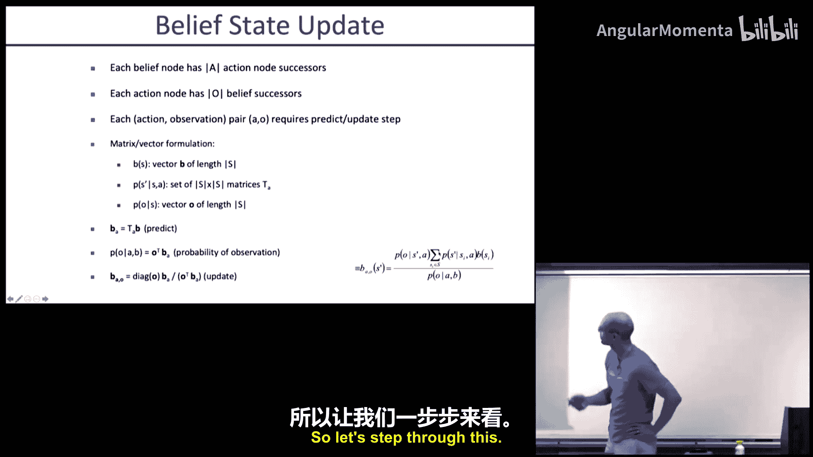

Distributions available for the next time。Then each action node once that's happened。

 will be numbers of observations in the observation space， possible next things you could observe。

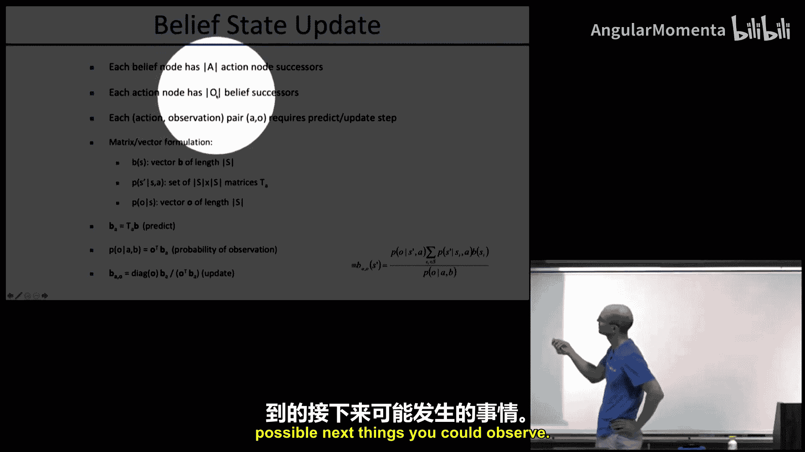

And you'll have a branching on each possible observation。

Then for each combination of action followed by possible observation。

 you can compute the resulting distribution if I had taken this action。

 then how to observe this sting。 This is the posterior I end up with。

 You can also associate probabilities with that transition。And this is really those equations。

 So if we have。

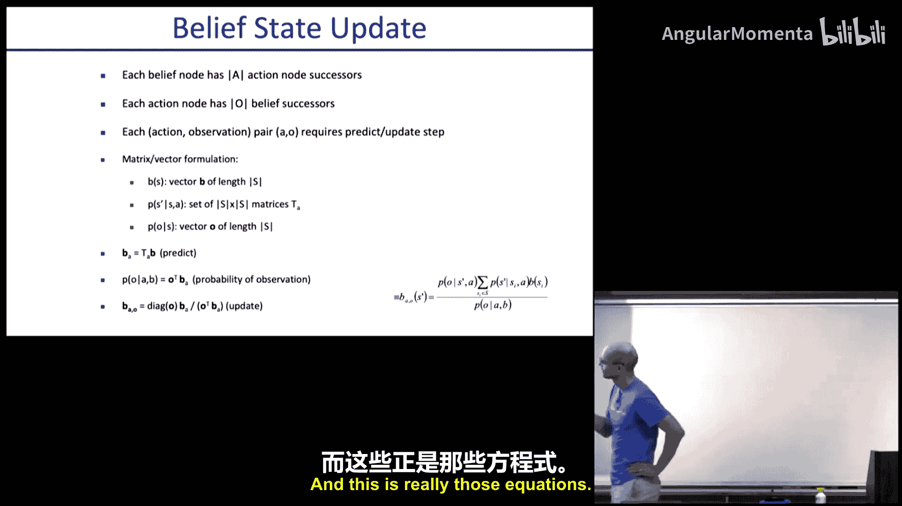

Right now， a belief factor， B of s。We have a transition model and we have an observation model。

We can predict the next belief by just applying our transition model to the belief。

This is just saying myronition model under action A is just a matrix。

 and I multiply with a vector that's the believe over possible states。

 I get the believe for the next time。Then I have an observation。

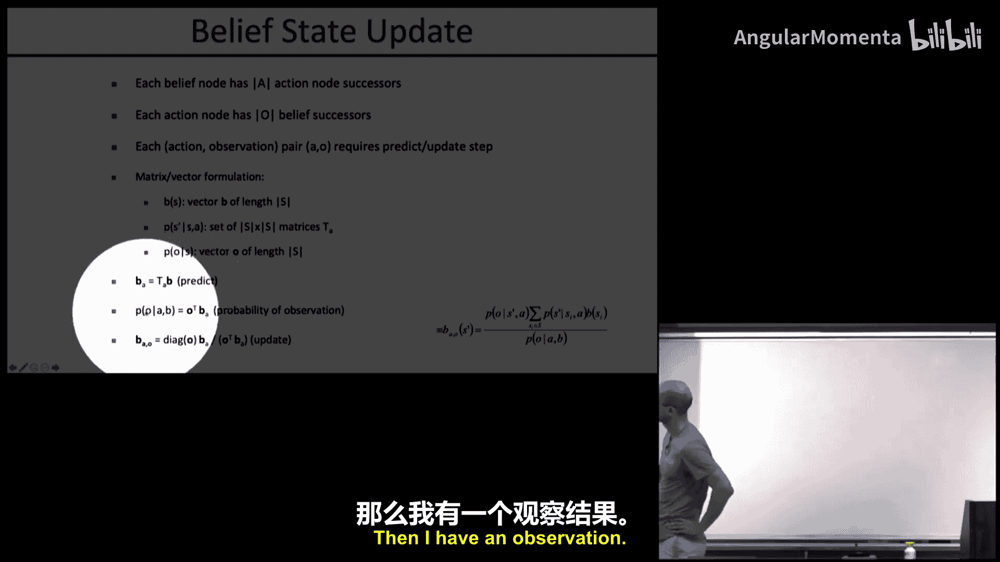

With the observation， reweight， as we know in observations， we reweight the belief。

 which is done by just this operation over here， up front diagonal of observations。

 times the believe， and then we renormalize。

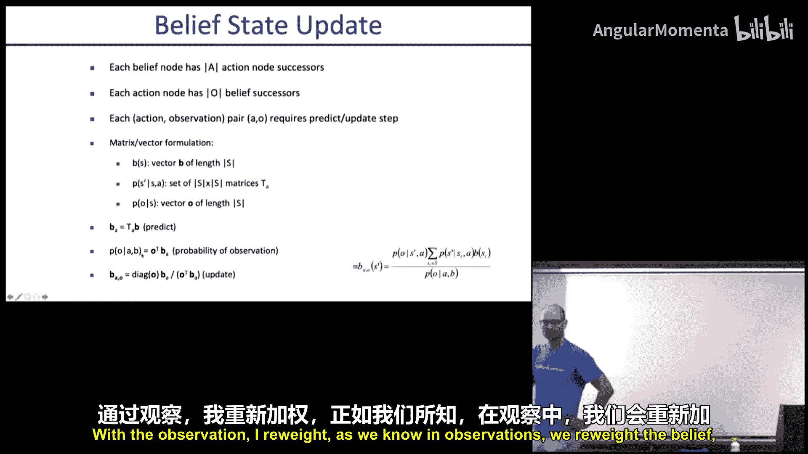

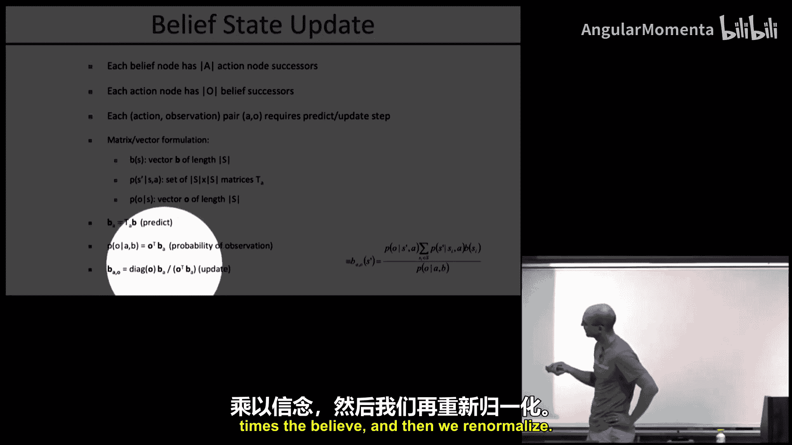

And we're good to go。 So that's how our new belief state。

 So very simple calculation There's nothing complicated about this。

 It's just like what we've done in filtering。But the reason we're challenged is because the number。

If you want to run valid on this， you effectively have to sign a value to every possible belief states and there's just so many possible belief states that we can'tractably do this。

What else can we do？We can just do look ahead， so just essentially NPC， NPC in belief space。

 because then we don't have to worry about infinitely many states。Well。

 right now we have a distribution， that distribution， if we have， let's say an action。

 let's say two actions and two possible observations， then if we look two steps ahead。

 we'll have branching on action， which is two observation two。

 and well have four possible next belief states。And so we go from one to four。

 we go another step in the future， we go to 16 to 64 and so forth， but over a limited horizon。

 we can actually look ahead if there's not too many actions， not too many possible observations。

 we can do an exact look ahead。If there's a lot of actions， a lot of possible observations。

 we could do sampling instead state we say we might do sampling of possible actions。

 sampling of possible observations， and approximately look ahead based on that。And so again。

 key here is that because you always have a current belief state。

 when you do NPC like belief space control。You don't have to start from infinitely many at finding values for them。

 You start from the one you're currently in， your current belief state and branch from there。

So that's actually medium practical to do。嗯。What else can we do？

There is some highly specialized techniques， alpha vector point based techniques。

 which essentially say that if you keep track of your belief state correctly and then you look at the value function。

 and I should take on a specific form。Your value function will be a。Essentially， a。

bunchunch of hyperplanes in belief space。So your a function will not be just anything in belief space。

 whichs a bunch of hyperplanes。 And so if you can keep track of all the hyperplanes。Then together。

 you have the function。 Now， the number of hyperplans you need to keep track of still explodes quickly。

 But in principle， there is a clever trick you can apply that you can look up if you want to。

 with alpha vectors to still do validation， maybe over a few time steps， exactly。

 even if you can't do it over infinitely many time steps。Here's another thing you can do。

 You can plan in the MP。 So what does that mean， You're just gonna ignore it's a Po DP。 So you say。

 yeah， it's a P DP。 But you know what。I have a belief state。 and my most likely state is。

 I don't know， some state。 Let's just assume I'm in that state。

I will have run filetriration in the underlying MDP。

 which might be tractable or have the solution for an MDP。

 and I just take the optimal action under the assumption that the most likely state in my belief is actually the state。

Is that a good strategy， Well， sometimes it is if you don't have a whole lot of uncertainty。

 that can be pretty good。When will this completely fail， This will completely fail if。

The optimal strategy is to do explicit information gathering。

 because you're essentially erasing the notion that you don't have state information。

 You're just saying whatever is the most likely state， I'm assuming that's it。

And so whenever you have a unimotal。Believe that it's very concentrated。 This might work pretty well。

 We have a very widely spread out belief， a lot of uncertainty。

 and you should be doing information gathering。 This will never do that。Okay。

 so mostly not so positive news so far， though you could run your kind of value function approximation methods that we covered for state space and run it over belief space。

 but I should read some good news， just like in value where for continuous problems。

 we could run L QR and optimization based control to still find solution in high dimensional spaces。

😊，We can do the same thing for PodiP because we just said they're not any different。

 They are just belief state MDP。 And so we should be able to run the same optimization there。

Some motivation for this originally when this kind of line of work became very popular around 2010。

1112 was kind of some of these robots starting to pop up that are not super precise。

 and they might need to measure their state and have uncertainty about their state as they go along and maybe need to information gathering to succeed at certain problems。

So some low cost robot arms， some surgical robots that are not super precise due to cable stretch and other things。

Now， imagine we're gonna model our uncertainty as a Gaussian。

 So we have start and this is a particle filter running。 But then we can say， okay。

 what if we fit it with Gausians。 And let's say maybe it's good enough。

Then all we need to keep track of is a and a covariance。

And so underlying a Palm D P is really a filtering process。 We know that。

 And so if we can assume when， let's say an extended kel filter is good enough， then we can actually。

Say the dynamics is the dynamics of an extended common filter。

It's an update to mean covariance that will happen over time。Now that's pretty low dimensional。

 That's just meaning covariance。 The belief state becomes a relatively small space that we can actually optimize over。

So let's look at one of the popular examples， imagine your robot starts in the top left。

The goal is in the bottom left。If you have full state information， you would just move straight down。

And go to the target state。 And that's the lowest cost thing to do because you get there at the quickest。

So state's place plan， state's place plan would look like this。But now。

 let's say we don't know exactly where we are as a robot。 There is uncertainty。

 and the circle shown around the start state is actually signalling the uncertainty。

1 standard deviationviation of uncertainty around that start state。Then if you move down。

 youll end up with even more uncertainty by the time you think you arrive and you might not at all be on the target。

 You might be in that bigger circle around the target。

But now let's assume we have measurements available。 Let's say something like GPS measurements。

 but the GPS doesn't really work We're in the black area。

 It's dark and it works well we you're in a bright area。Then what would you want to do。

 then you'd want to move off to the right， get into the bright area。

 localize yourself very precisely。 And once you've localized yourself very precisely。

 move back out to the target。 And hopefully as you move back out。

 the new uncertainty accumulated while you're moving out is relatively small。

 you can get much closer to the target。So here's what the belief space plan would look like。

 And so now the question， of course， is how can you automatically get this plan。

 instead of us designing the plan， give get the thing to say that is the thing you should do。

 move to the bright area， then move back。Quick thing。 This depends on the settings of the problem。

 right， Imagine as you move， you accumulate a massive amount of uncertainty。

Then you might conclude that the shortest path is most important because the further you move。

 the more uncertainty you accumulate。 In this case， as you move to see here。

 not a lot of uncertainty is accumulated， but initially you have a lot of uncertainty。

 and you can go reduce that and then come to the target fairly precisely。

So how do we get this belief space plan？Well， what does belief space look like。

 Our problem in this case would be to keep track of a mean and a covariance。

 So with have a Gaussian here， that's the representation of our current belief。

 But there are many possible beliefs。 Every choice of mean and covariance gives us a new possible belief。

We can keep track of it over time with a base filter。 in this case。

 let's say an extended common filter。So we can do planning through optimization。 In state space。

 this is how we did it。 In state space， we said， minimize the cost of a sequence of states and actions such that we satisfy the dynamics。

And then we said， well， so W is noise。 We said， let's do a deterministic approximation of that。

 And then we'll replan。 We'll do NPC as we go along to compensate it for the fact we didn't know the noise that was coming。

Well， we can do the same thing for Gaussian belief space。So what does it look like Now。

 our cost is over means and covariances because that's all we'll have available。

 We can't give it a cost over the actual state because that would essentially require knowing the state doesn't really work。

 So cost is over means and covariances。And the dynamics is how the media covariance update over time through the extended common filter。

But you think of the ETF just as an F dynamics。 It's really the same thing。

 We have the same problem again， except instead of x being the variable。

 that's the thing we optimize as a sequence of things over time is going to be mu in sigma。Well。

 we don't know what we're going to observe。 Z T plus one is an observation。 It depends on the state。

 It depends on the noise in the sensory measurement。 We don't know what's going to be。

But we've dealt with that before。 if we have something that's stochastic in this optimization。

 we replace it with the most likely thing。 W T with0 mean Gausians。

 we replace it with 0 here we'll replace it with the most likely measurement。

 So if H is our measurement function， which has Gaussian noise around it。

 then we' replace Z of T plus1 with H of F of mu at time T and U time T。Okay， so at this point。

 we have an optimization problem we can actually solve。 It's not a simple one。 I mean。

 the EKF has somewhat complicated matrix updates in it。But it is a clean optimization problem。

 We have a formulation， and we can just run gradient de or something else to try to find the outcome。

In these papers， this will solve the sequential Comvex programming。

I see the later papers by yourpha numberberg also solved with I about QR。

It2VQR is just a general method to optimize a sequence of states and controls。Well。

 just think of mu and Sigma as your state， U is still your control。

 and so you can apply iter about QR just as well to solve this problem。If you do that。

 if you run any optimization formulation， any optimization algorithm that actually optimizes well。

 So either sequential convex programming or it will develop Q R。

 you'll end up with this plan automatically。 So it'll infer on its own。

 I need to go collect data about where I am before I move out。う。Now， one thing you might wonder is。

 how does this scale and what is the best way to formulate this because we had one formulation here。

But a very common scenario is that we want to， when we think about state。

 it's not just the position of the robot。It's also the position of landmarks the robot is localizing itself against。

So if have a robot and landmarks and it's trying to map out the position of the landmarks。

 which it doesn't know in its own location。All of a sudden， we have a very large state space。

Coors of robot and coordinates of all landmarks， that's a slam problem。Now。

 when the case space becomes larger and larger， that covariance metrics become bigger and bigger and bigger。

 and you start wondering， well， will this still scale or not， how well will this work？

So we did a study and we looked at three different formulations。 Remember。

 we have shooting and collocation methods。But here we can actually do a partial collocation。

 let's first look at shooting and collocation。Shooting means we have a cost that depends on just essentially the mean initial time。

 the covariance at initial time and the controls。And then at the end， we need to be at the target。

 That's a constraint。And we need to be feasible at every step。

 But the left thing here is what we're looking at， shooting。

 essentially backward creation through time approach。

 We don't have explicit variables for the means at different times。

 We just have initial state and controls and optimized for the control sequence。

 Those are our only variable。In full collocation。We optimize over all variables， the means。

The covariances and， of course， still the controls。And that's what we've seen before。

 where state was really mean in covariance。 And now it's。Become mean covariance。Now， the thing is。

 if we have all the conveyvariance matrix at all times as our variables。

 the optimization problem becomes very big and not very actually。

 you'll see in the graphs very intractable in practice。

 even though matrix calculus is only cubic in the size of this of the dimensionality of your space。

 cubic in something that's already quadratic in your size of the space because you're quadratic by building a covariance matrix。

 then cubic in that， all of a sudden， things become very big and too expensive。😊。

So partial collocation says we want to maintain the notion that we want to colcate on the means。

 because we know that by collocation， especially if we have a target state。

 we can have better initialization， we can force the thing to be shaped to find a solution more easily than shooting methods can。

 We have a more stable optimization because we don't need to backroate through time。We just。

 the means anchor this at every time step。 And so the expectations that with partial collocation get the stability of collocation。

 but not the blowing up amount of variables that you get from full collocation。

So that's exactly what we get。 So full collocation in red as a function of the number of landmarks in the space that we have uncertainty over blows very quickly and becomes impractical。

 Most efficient is the partial collocation， far more efficient than either of the other alternatives。

 including also itative L QR LQ G shown here。So here's an， here's the type of problem we looked at。

 So special landmarks， well the。The red crosses are the landmarks。

 The robot starts at the bottom left。And the goal for the robot is to find the path such as that at the end of its trajectory。

It's。Maximally reduced uncertainty about the locations of the landmarks。

 initially it doesn't know where they are。But by following a path and coming near them and by keeping track of for how much it has moved when it went from one landmark to the other one。

 it should be able to lowize them all relative to each other and build a map of the environment where every landmark has a specific location has low uncertainty。

If you do a kind of standard thing， you just trace that rectangle。

 we're only showing the uncertainty on the robot here。

 But because the robot maintains a lot of uncertainty about the landmarks。

 it also has a lot of uncertainty about itself because the reason it's going to be able to localize itself is by reducing uncertainty on the landmarks is one big joint distribution。

 And the uncertainty on the location of the robot gives you some kind of measure of how certain it is about where the landmarks are also。

Well， what we wanted to do。 I mean， the sensory model under the hood here is that the closer the robot is to a landmark。

 the more precisely it can measure its location， The further it's away。

 the less precisely it can measure it。 is far away it cannot measure it at all。

 So you're too far away from any landmarks。 you get no measurements at all。Yes what it then does。

 it says after you in belief based optimization， it follows this path that actually visits the landmarks very closely has a lot less uncertainty about itself。

 as well as about the landmarks， even though that's not shown here。

So the beauty here is that you get information gathering for free。 Like。

 it will be smart enough to go collect information as needed to maximize。 In this case。

 the reliability of the map。Now， there are a few tricky things that come up in practice。

 So the way I describe it we just run optimization and we'll get a nice solution out。

 And that was true for the original light tar domain。

 But what if this is a light tar domain where you get good measurement here， but nothing here。

 So it's utter nothing or a good measurement。Well。If you initialize with the certainty equivalent solution and then run your optimization。

 you set up your EKF， muse， Sigma， full thing， partial col， all the good stuff。

What do you think is going to happen？This is a local optimum。

 It's not going to move away from this because if it moves towards the light。

 any motion towards the light will not give you a measurement yet。

 any local motion will not give you any reduction in uncertainty， In fact， increasing uncertaintyty。

 because by moving more。You generate more uncertainty。 you have a longer path。

 and it's actually worse， So it's a pretty tough local optim to get out of。In fact。

 it's a very good local optimal optimal until you realize there's something even much better if you were willing to move very far。

So how to make that happen？One thing could be just use a lot of random initializations and to say。

 well， maybe one of them will actually randomly be in the white region。

 and if it spends any time there， it'll realize to bend its path more to spend time there。

Maybe you say I'm just gonna， I don't know， initialize it by hand to spend some time there。

 But I mean， random， yeah， maybe you're lucky in a low dimensional space itll work out。

 The more popular thing has been to shape。 So just like in reinforced learning。

 where you shape the reward to make your learning better conditioned you can shape optimization problems of this type。

 so。And say， I'm gonna。Inits say that the measurements are actually available。

Everywhere with different levels of noise。And I'll say， oh， I should move into the brighter region。

Then I'm going to actually。Bring it slowly， more closer to the original problem， say。

It's called a homotopia method， where you essentially take your original optimization problem。

 make it softer， make it better condition， and then gradually bring it back to the problem you really want to solve。

 And by doing so。😊，The solutions you find for the simpler problems are hopefully good initializations for the harder problem you want to solve later。

Here it is just about moving into the region where you can measure your location。

 something happens with cameras and occlusion though。

 Imagine you have a camera and the yellow cone is the field of view。

And you want to maybe see something， but there's an obstacle。 the bottom plots have an obstacle。 Now。

 you cannot see what's behind the obstacle， the white region is invisible。

 And so here robot is getting measurements from seeing things。 If your view is blocked。

 you're not getting any measurements。 That's the same challenge we had over here。

 You're either blocked and see nothing or you're not blocked and you actually are able to see something and you get a measurement。

So can we do the same thing here。Well， we cannot in execution。

 see something that is actually not visible。 If we're occluded， we're occluded。

 We're thinking about the planning。 Can we plan a path for the robot that accounts for the fact that。

You really should go look at it and reshape the optimization to get that to happen。 We actually can。

 So the way to do it， we here it's a 0，1 thing measurement or no measurement。

 depending on whether you are in the cone of the camera or not。Well， what if we make it different。

 We say that we soften this and we do it based on the distance from the visible region。 So red here。

We have visible， the yellow part。 if something， if the robots set up such that something is almost。

The camera's move to almost seeing something。Is going get a noisy measurement。

 And if you can completely see it's less noisy。 If it's very far away from the boundary。

 it's going get a very noisy measurement。 So you have a gradation of noise depending on how far away you are from being within the cone of what the camera can see。

😊，And I should do this in the common filters。 So in the common filter update。

 you can make a small change。

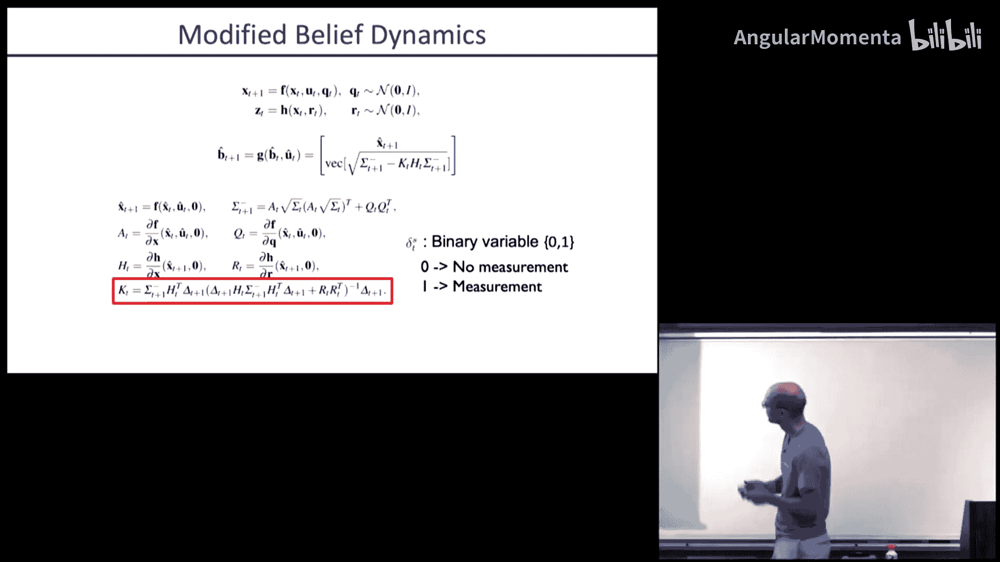

Normally， it's a binary variable， dis variableable delta that's appearing here and a comma again update here。

 here， here。

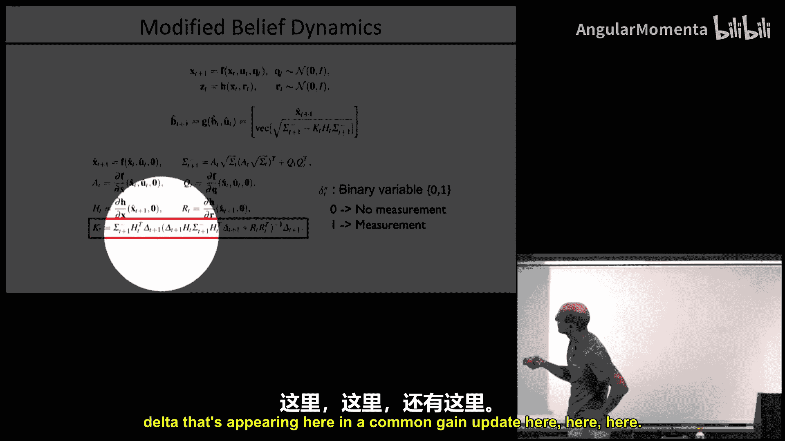

Normally。That is going to be a binary variable，01。 When you have a measurement， that's 0。

 you get nothing out。 when you don't have a measurement， it's0， you get nothing。

 When you do have a measurement， it's one， and you get a reduction in uncertainty。

We can make this thing scale between 0 and 1， depending on the distance。

 the signine distance to where you are in the measurable region。

By doing that and doing that gradually， we can have a sequence of optimization problems where're solving for the sequence of means and covariances and controls。

Will be a much better shaped optimization problem than the original one。We able to find solutions。So。

We solve the a problem with the current value of alpha， which will be a very smooth out version。

 And we increase alpha。 We reinteg the belief charge。 essentially。

 we we run the current solution we found as our initialization， and then repeat。😊，Okay。

 so here's a full algorithm。 This is from the specific paper。

 but I'm not going to step into the details here， but at a high level， we know what's happening here。

And you actually get this kind of solution。 You get it to find those paths。

 and then it'll know to move into the visible region and then move back out。But。

If that's all you do and you just have a sequence of controls。Here's what happens。 Your thing。

 actually， due to noise does not make it into the visible region。It's ready to turn around。

 it turns around。 and now you still have a lot of uncertainty。She need to do replanning。

As you run this， because the sequence of controls you found is not necessarily guaranteed to actually get you there。

 So you do continuous replanning， rerun this optimization。

They need to do something else if you are not in the region where you get to measure。

You don't get a common filter update because it did not have a measurement。

And so as you are progressing， some contradiction happens。 You're progressing off to the right。

And your mean is putting you in the measurable region。

 but you don't get a measurement because you're not actually there yet and you don't get a measurement。

 You don't do a comm filter update。 And so you're kind of thinking you made it in the measurable region。

 You're all excited。 You made it there。 You believe space plan will say， oh。

 it's time to turn around。 it'll start turning around and you actually shouldn't have turn around because you have not measured anything yet。

😊，Now， the reason that happens is because you're ignoring one type of measurement。

 The measurement you're ignoring is the fact that you're not getting a measurement。

 The fact that you're not getting a measurement is giving you information about that you are not yet in that region。

 So the question is， how to incorporate that。Well。Imagine。You think you're in the sensing region。

 which is the yellow region， but you're not。And let's do this in 1D in the middle plot。

 what it really means you thought you're in the yellow region somewhere， but you're actually not。

 so you should cut that off。 you should take your Gaussian。

 cut off that entire tail that's in the yellow region。

 refit a new Gaussian that puts essentially all not all because it's a Gaussian。

 but essentially all its mass into the region where you know you can be based on not having a measurement and then you have the new Gaussian shown on the right。

Once you do that， you know you're not yet out there。 And so if you ignore it， this is what you get。

 if you understand this， you know you're not yet in the measurement region。

 Your belief will tell you that。 And you'll as you replan。

 will'll keep moving out toll finally get in the measurement region。

 and then you'll be able to localize yourself， move back。So it's very subtle thing。

 It's a subtle thing that it's nice to use commona filters。 you have a good measurement model。

 but keep in mind that sometimes you need that extra thing。

 which is the notion that if you don't get a measurement， it tells you something about where you are。

 And that's not going to be a regular common filter update is going to be one of those Gaussian truncation type updates rather than a regular common filter update。

😊，Here are some plots showing that indeed this works better this way。

 we can do this with also robot arms， doesn't robots that navigate the arm。

 the camera is at the bottom here。 It's looking up。 the arm is blocking the view of the camera。

 can't see anything。 So you've got a robot arm to move out of the way to see where the object is。

 the actual object is where the green square is。 The mean is where the yellow square is。

 if you just do a certainty equivalent plan。That's not gonna work because then you just move to the mean and you think you're done。

 but you're actually not done。 That's ignoring uncertainty。

 When you properly solve it in belief space， you'll realize I have uncertainty。 I need to open up。

 get a measurement that narrows down the uncertainty。 Then when I see the thing。

 I can move towards it and get it。Here's another one where in this case。

 the camera can move and soll the optimization will both figure out how to move the camera and move the arm to make things visible again on the first panel is the initial state。

 Second panel is if you just ignore the fact that there is a belief it's you assume the mean is the real state。

 you'll just move to your mean and you won't actually have the object you willll never have seen it。

 if you work in belief space。 the camera will move to see it。

 the robot arm will move to make sure it's not occluded and then reach the right spot。

And you did the same thing with Slam。 So the same things will happen there。 you'll have。

The robot move towards landmarks， making sure they become visible and then localizing itself with higher certainty and so forth。

 And again， all of it just falls out of the Bel space plan。 You don't have to specify this by hand。

So one important thing is collision avoidance。I'm going to mostly let you read this part yourself。

 but the notion is that if you have uncertainty， you need to be extra careful about collisions because if you don't know where you are。

 well， then you might need to use that uncertainty as an extra safety margin around you when you do your collision tracking。

And so you have a bubble around you against which you collision check instead of just against a meanme。

嗯。Can be done in various ways。The kind of cleanest way when you have a robot with joint uncertainty is to use sigma points。

 just like we saw， well， Ignosy covered it with you， the uncended common filter。

Looks at these sigma points to represent the uncertainty to represent the Gaussian。

 you can do the same thing with the links of the robot。

 You look at the sigma points for each of the joint angles。

 Turn that through the kinematic chain of the robot into sigma points of each of the joint of each of the links。

 And then you can have an uncertainty around where the links might be。

 You can take the comexhull of those possible the sigma points that you get for the links to get the region that you're worried about that you might get in collision with。

So I'll let you look at the details for that。Key， again。

 is that you do MPC and all of this in belief space it even more important to MPC than in regular control because。

The reason to MPC is because of uncertainty。 If something is not as expected， you can replan。

 but in belief space， you have so much uncertainty。

 Your measurement is gonna tell you things you didn't know anything about ahead of time。

 So you need to use that measurement to your benefit and replan as much as possible。

Here's this an action for a degree of freedom， playing a robot avoiding if you just do kind of a simple path。

 this is what you do， but if you account for your uncertainty。

 you realize that this is a better path。 we have to move away a little bit。

 go to the left where you get measurements about your uncertainty。

 move back out and still keep things in a safe region。嗯。

Probably of collision is much lower when you do it in belief space with replanning than if you just do it naively。

IMean， this is some of the target is。Better with re planningning。

 much better with re planningning than open loop belief based plan execution。Okay。

 in the last two minutes we have here before 1230， I want to tell you about separation principle。

Kind of a crazy thing。If if you actually have state observations。Well。

 if you have a linear dynamic system with state X T and observations that are some linear combination of the state plus noise is Z T。

Then effectively， if all you observe is Z， you have a belief based problem。

Because you'd never get the C X。 it's belief space。

 You should do belief space planning on this thing。It turns out that belief space planning。

Will be equivalent to just planning against assuming your mean estimate is the correct estimate of the state。

 This is a very special case。 The only case I'm aware of this is true is for linear dynamical systems with linear observation model。

 everything， Gaussian， it will happen to coincide。Once your dynamics is nonlinear。

 this is not true anymore。 And so if nonlinear dynamics。

 you'll have effectively extended comma filter or uned comma filter you run to believe space planning over that。

 it will not be certainty equivalent。 But if the system is actually linear。It is cnequient。

 and the reason is that if the system is actually linear。No matter what actions you take。

 if you work through the math， no matter what actions you take。

 the covariance matrix on your state will be the same。

 You cannot affect the covariance matrix on your state。

And since you can not affect the covariance matrix on your state。

 all of a sudden it's not a police based problem because the covariance is going to evolve according to a fixed dynamics。

 which you have no control over。And the co is exactly the thing that makes it a belief problem versus not in this case。

 And again apparently it's not because you have no control over it。Of course， it's generally true。

 if you cannot affect the covariance， then it will not be relevant to do believe phase plane。

 But in pretty much every other problem， your actions will affect the covariance matrix because your actions will affect the type of measurement you get。

 The type of measurement you get will affect your covariance， but in this linear dynamical system。

You have no control over the type of measurement you get。 It's always a Zt equals C Xt plus VT。

 And so somehow the math simplifies covariance equations are open loop。

 not dependent on your actions。 hence the problem is equivalent to certainty equivalent。

 the certain equivalent problem。 So the optimal belief space execution for a problem like this is you run a common filter。

 and you do LQR。 And so as you run your common filter， then you apply LQR。

 mill linearar feedback controller onto to the mean estimate of your state。

 and that's it nothing more complicated needed。Don't let that distract you from the fact that that's really an exception。

 but I think it's a pretty important exception to be aware of。So we covered Poni piece today。

 it's about sensor measurements being accessible to you， but not the exact state。

We saw exact methods can be pretty hard to run。 We saw locally optimal solutions where you have mean covariance and Gaussian belief space that you have a dynamics for。

 We can direct to optimize for it。We can use homotopia methods for dealing with discontinuities in sensing domain。

And we also use the truncation， the Gaussian truncation to account for the fact we did not get a measurement。

 even though maybe we thought we should have gotten a measurement。

We can use Sigma health for collision avoidance， and then this little quirky thing at the end is separation principle that's somehow for a linear systems。

 linear observation model。Your controls don't affect to errandance。

 Hence this whole thing becomes not important as the one exception。All right， see you next lecture。

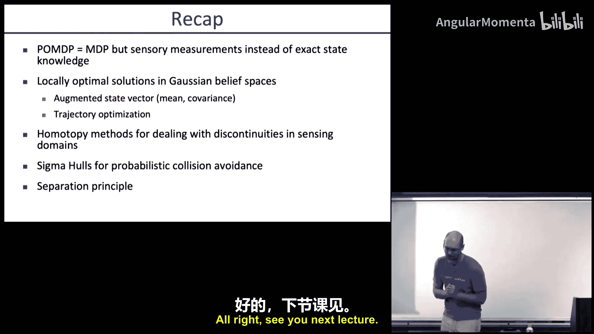

Yeah。

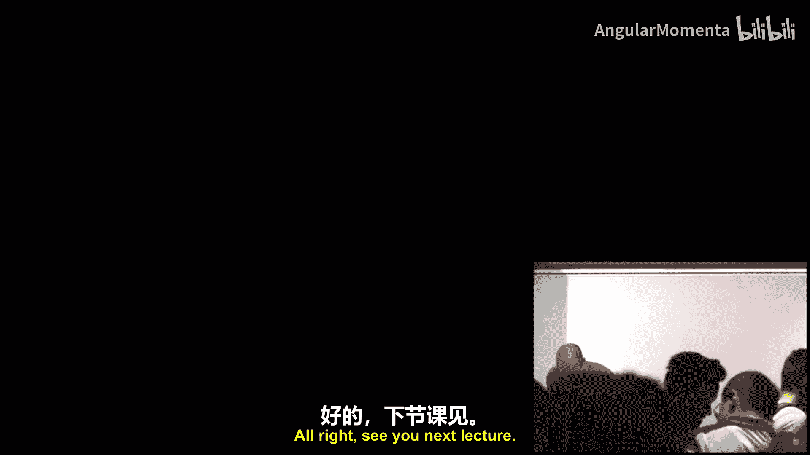