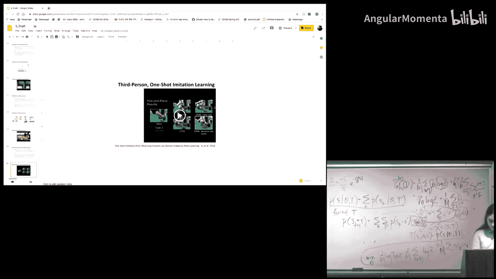
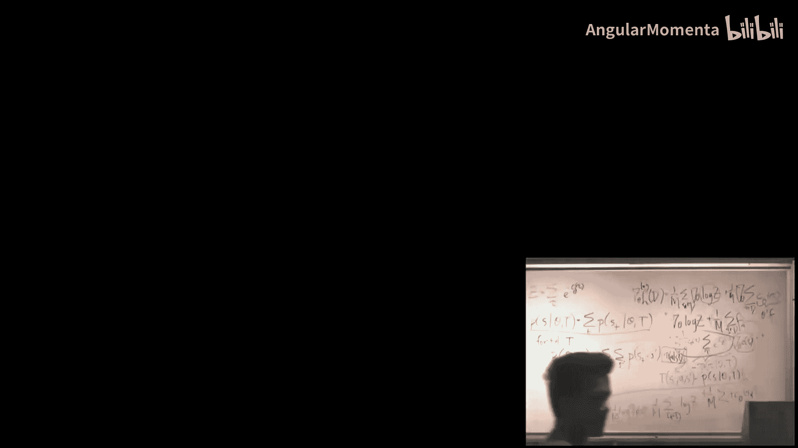

# 【加州大学伯克利分校】高级机器人学-｜-CS287-Advanced-Robotics-at-UC-Berkeley-Fall-2019-p16-17-模仿学习--BV1KXqCB4Eua_p16-

Oh， they're actually。是で。介绍我。在一个。あ。是我。2。钱对佢。嗯。当你晒。快一点。a very ta day。啊。Really。Okay。

We will wait until there's a few more people。Trickling in。

 but we might as well get started now since it's 1110。 Hi everyone。

 welcome to CS 287 lecturec number 17 Peter's not in town so I'll be filling in for a lecture on imitation learning。

😊，So to outline today's lecture， we're going to start with some problem setup。

Then talk about supervised learning of policies， inverse optimal control。

 and then of course an analysis of both of these approaches。And then at the end。

 we'll see some examples of more recent work in robotic imitation learning。So to set up the problem。

 we have as input or what we're given is our state and action space and transition model of the MDP that we're acting in。

 but we may or may not have access to the transition model。嗯。

Then we are also given demonstrations which are samples from some expert policy pi star。

As opposed to the usual setup that we've been kind of operating under for the。

Since the beginning of the semester。We've assumed so far that we have access to this cost function。

 which is specifying kind of like the goal of the robot。But maybe this is harder than it seems。

To provide。So in the homeworks， we've been giving you this nice reward function that is usually a pretty simple straightforward function of the state。

嗯。But sometimes in more complicated situations， it's not as easy to specify the task or communicate the robot its objective。

So for example， we can think about trying to get a robot to clean a room for us。

It's harder than you might imagine to specify reward function for this。

Especially when the observations or the states are really high dimensional， such as using images。So。

We might try to use this general perception by using images， but you it。

If we try to learn a mapping from pixels to reward， that's already pretty difficult。

 maybe we have to use some CD techniques or some heavy engineering in order to get a lower dimensional representation that we can specify a reward on。

😊，So this sounds kind of hard， so maybe you know it's probably easier to use a lower dimensional input that we might have access to。

 right？😊，So。Maybe we think about using some internal sensor that we have that tells us how much dust we pick up intuitively if we want to clean a room。

A pretty good indication if we have done our job is if we've picked up a lot of dust。

 but even using such a simple representation and reward function。

That if we communicated to a human might make sense， it's easy for。

A robots to optimize for the wrong thing， so if we want to pick up as much dust as possible。

 the robot can maybe learn to cheat by just picking up a sufficient amount， dumping it。

 picking it back up and keep on with this process so that it can keep collecting reward trivially without actually completing the task。

So。This is something called reward exploitation and that's something that people in AI safety have thought a lot about。

 so this is kind of a silly innocuous example， but we can imagine that in higher risk scenarios this could have pretty harmful repercussions。

ok。So。What we might want to do is reduce the chance for misinterpretation of。

What the robot's objective is and to do this， we can use。Demonstrations。

 so these demonstrations are presumably demonstrations of good behavior。😊。

And these demonstrations can capture nuances in how we want a test to be accomplished。

So in our cleaning robot example， we if we show the robot how to clean the room。

 it can kind of glean from our demonstrations hopefully that we want to also obey social norms。

 we don't want to be disrupting the humans during cleaning。

 we don't want to be breaking things just so we can pick it up。

This is just a way that we can reduce the misinterpretation。

This is what we do in imitation learning is we learn from demonstrations。

So in this lecture we'll be covering two broad angles from which people are approaching imitation learning。

 one is direct estimation of the optimal policy。And the other is inverse optimal control or inverse RL。

Where we try to estimate the reward function and then use that to learn piSt。

Are there any questions on the setup？Okay， cool， so we'll dive in by talking about imitation learning manifested as a supervised learning problem。

😊，So again， here's our input and our demonstrations are actually these input and output pairs of pi star because piSt is just a function。

嗯。And because we have these input output pairs， we can just use supervised learning to approximate this function。

So we can just pick our favorite model， some we can use a neural network， decision tree， SVM。

 whatever we want， of course， subject to the constraints of whether。

We're in a discrete or continuous stay in action space。We can then use these to learn a pi star。

This sounds really great because supervised learning works。😊。

And we get demonstrations of optimal behavior。 So were we should be good to go， right。

 but it's not so simple in this case because we have。

We only have data from the optimal policy and since we're operating in an MDP。

 the distribution of states that we encounter is determined largely by the actions that we take。

So in supervised learning， a common assumption is that our training and test distributions are the same and we get IID samples from these。

But the。呃。The distribution of states that we see under an optimal policy will definitely not be the same as if we just run out a learned policy right off the bat。

 so maybe we can see an example of this by。Thinking about trying to teach a self driving car。

So maybe I want this selfding car to drive on this nice hillside road and I am an expert driver。

 so I will demonstrate how I want the car to drive so here the dotted line can represent kind of the main trajectory that I took when I was demonstrating。

How to drive on this road？So now we train our supervised learning model and then we run out our policies so maybe in the beginning it's doing okay and then it starts to wobble a little bit and maybe it see states that I didn't see when I was demonstrating so we're not guaranteed to do well。

 but maybe it still output something and by chance we get back on track。😊，嗯。

No baby when we're turning we're turning slightly too much and then we see this。

 we kind of get out of the distribution and we're not so lucky this time we take a little bit more of a wrong action。

 turn even more and now we see this nice lake over here and we're totally out of distribution。

 our car doesn't know what to do and then we drive off the cliff。

So this is because we have these compounding errors that come from。

Like maybe a small error initially that takes us out of distribution and into a region where we don't know what to do。

So。In 2016， NviDdia had a self driving car project and they kind of。

They recognize that this is a problem。So what they did is kind of they augmented their data set。

 their training data with data that could help。The self driving car learn how to correct itself。

 even though the expert never made a mistake necessarily。 So there here we。

They added extra cameras to the side so that we get an angle that kind of simulates if we drift it a little bit and then。

They manually adjusted for the shift in rotation。And then they trained。So here are the results。

So we can see that's doing a pretty good job of following the lanes。Even on this kind of offered。

Perio。诶。But。In this project， they kind of used a very problem specific trick or augmentation kind of like maybe one would call a hack。

 but something that's more generally applicable， maybe is。This algorithm called dagger and dagger。

Is short for data set aggregation。 So before we jump into the algorithm， the high level。

The high level。Goal of this algorithm is to bridge the gap between P pi star and P P theta。

 and how are we going to do this？We'll ask the expert what they would have done when they encountered the out of distribution states that we encountered while running out our policy。

 and now since we have these expert labels for what went wrong or what happened when we went wrong。

 we won't make the same mistakes， hopefully and we'll start bridging the gap between the expert policy and our policy。

So。Here's the algorithm。We start from a behavioral cl policy usually and then run out our policy。

 get a bunch of data， and then ask the expert to go in and relabel for what actions they would have taken in those states。

So we throw out the actions that we took。Replace them with the expert actions。

 and then we train on the aggregated data set so that we get this corrected information。So。

What's nice about this is that we have some theoretical guarantees if we make certain assumptions。

As you might imagine， this is pretty expensive and it might not always be possible。

So here in the example we had before， maybe like I saw that the car went off road or off veered off a little bit。

 but I could tell it to steer back on track and then hopefully it would learn to have more robust behavior。

So here's some follow up work。That uses dagger。To fly a drone in this forest。

 and it is able to fly in an area that it has never seen before。

And this sounds really appealing because we can kind of bridge this gap that we were talking about and we really like supervised learning since it works。

😊，This is not always possible， we can't always have access to an expert that is going to be ready to。

Be able to answer the queries for all these observations that we encounter。

So that leads us into inverse optimal control。And the question is。

 can we do better with the expert data that we're given from the start？嗯。The aerial cloning。

 we just mimic the expert。And we don't have any notion of intention。

 so we're blindly kind of parroting what the expert is doing。

 and this is kind of the root of the problem that we just talked about if the expert never makes any mistakes。

 when we inevitably make mistakes we won't know how to correct for it。嗯。So。Maybe。

We can see why maybe having an understanding of what the expert is trying to do might be more helpful than just blindly following what we've seen the expert do。

So。In not all cases where we have a perfectly optimal expert。

 but within this behavioral clo framework， we don't have any way to kind of account for expert subvolity。

If the expert has a slightly different embodiment and has like different actions or different action space than our robot。

 we might not even be able to use behavioral cloning。

 but if we can try to understand what the expert is doing。

 maybe we can still accomplish similar tasks。And maybe what's more applicable is the idea of robustness。

Again， if we're making mistakes。Or we encounter things that the expert never saw。

 some things that are unexpected， then if we have an understanding or conceptualization of what the expert is trying to do。

 maybe we can still succeed。So in summary， finding out what the teacher is trying to do can potentially enable us to do better than the demonstrator。

ok。So in inverse optimal control。We have as input， the same thing， data in action space。

 perhaps access to a transition model and the demonstrations。

 and what we're trying to do now is to learn the reward function and then use the reward function to learn piSt。

Yeah。ok。So。To start， we'll make some simplifying assumptions so that we can kind of analyze。😊。

What's going on so first we're going to assume a linear reward function on a featureurized state。

 so we have these states that we're going to map to some feature vector that will kind of hopefully capture what is important about the state and this is something we can manually defined and then we're going to parameterize the reward by this weight vector W。

And。Under this formulation， we have that the value function with respect to a particular reward function and policy。

😊，Is given by the classic expected discounted sum of rewards on the left。

 so under a certain policy and evaluated with the particular reward function。

 so if we just sub on the right here。We just subend R here to get W transpose phi。And then。

Because W is not random and it's linear， we can just pull it out of the expectation。

And now we have this W transpo time， this expectation of the discounted sum of feature vectors。So。

 and we'll call this the future expectations， which will become relevant in just a bit， first。

The takeaway from this right now is that we can represent kind of the performance of a policy under some reward function as this W transpose mu。

Of pi term。Are there any questions on this so far？Okay， cool， so。Okay。

 so if our goal is to learn a reward。Like how do we know what a good reward function is or like what characterizes an acceptable reward even？

So by definition， we can see that under a true reward function。

 by definition the value or the performance of the optimal policy must be greater than or equal to the value of any other policy。

And then if we remember that the value is just the W transpose mu term， we can express our。

Objective as this。ok。Now， in 2004。Peter and Andrew Ing had this paper that kind of gave us this really nice insight that maybe what's not important is maybe finding the one true reward function that we might assume underlies the intentions of what our expert is doing。

 maybe it's good enough or not maybe， but it's good enough to match the future expectations。

 and this will imply that our policy is matching the expert policy。So。If we hear we're just saying。

If the future expectations are sufficiently close， then the policy's performance will be sufficiently close and that means we're doing as well as the experts doing under the reward function that we care about。

ok。So to sketch out the algorithm that they propose。

 we start with our assumption and initialize some reward function。

 some linear reward function and some initial policy then what we'll do is continue iterating by。😊。

alternating between guessing a reward function and then finding the optimal policy with respect to that reward function。

 and the high level idea here is that we're getting closer and closer to the expert' performance。

Yeah。But here there's this gaping hole where we are trying to guess the reward。

How do we guess the reward？In the initial IRL formulation by Andrew and Stut Russell back in 2000。

 we get this idea of degeneracy， so what this means is there exists many reward functions that might be optimal or for which the expert policy is optimal。

😊，So。For example。Kind of。A pathological case is if we have a constant reward function that is so you can think of just a reward function of zero everywhere。

 it satisfies this inequality。So that means our expert policy looks optimal under this reward function。

But maybe this is like clearly not the most useful reward function。

 it's not capturing any kind of intent of the expert。😊，嗯。

But this is not just limited to kind of pathological cases， for example。

If you see me walking towards the door， maybe I'm trying to go talk to someone or maybe I'm trying to inspect the door handle because I think it's interesting or maybe I want to go out and get lunch。

 it's not really clear what the reward function is。诶。Or what kind of objective I'm optimizing for？So。

In short， we have a lot of reward functions that could possibly be optimal。

 so how do we pick one because here we wanted to guess the reward such that。

Or guess a reward that makes our policy optimal。How do we resolve this ambiguity？

We can kind of take inspiration from kind of classic classification problems。So。

If we have this binary classification problem and we're using a linear separator。

 there are many possible solutions that satisfy the constraint that we are separating the two classes。

😊，I guess the insight that kind of people had was we want to maximally separate these classes and how do we do this。

 we find the or we try to maximize the margin where the margin is the minimum kind of distance from the boundary。

So they formalize this with the hard margin SVM。And we can use a similar idea here。

Kind the intuition is that we want to maximally separate the optimal policy or the policy that is induced by our learned reward function from suboptimal policies。

And so。We'll call this， this is like analogous to the margin because here's the policy performance of under the。

Optimmal policy and any other policy， and then we want to separate it maximally。With this。

We want to separate via gamma。So this looks eerily similar to the hard margin SVM objective。

 and so we can just use the same trick where we get the sign distance to the boundary and use and turn this into a QP。

And then that makes it。Attractable to solve。 Okay， so we slap this objective in here and solve it using。

A QP solver， any generics QB solver。And then this is finding the reward function again。

 such that the demonstrator's policy maximally outperforms the previously found policies。

 so we're going to be comparing against like pi zero。

 pi1 and so on until our current pi looks close to。😊，The optimal policy。

Or are the demonstrator's policy？So。Using this max margin formulation is one way to break tieize。

 but we're still not guaranteed to capture the demonstrators like underlying true reward function or what we might think of their true underlying reward function that kind of describes fully what the intent is。

And it's hard to optimize with more expressive reward functions like neural networks。

And kind of what I alluded to earlier is that in behavioral cloning。

 we don't account for expert subopity or the chance of expert subopity。嗯。

One wayOne extension of this is to use the same SVM analogy and use a soft margin SVM so we were kind of allowing some leeway。

To account for expert subopality， and if you're interested in looking at that。

 you can see maximum margin planning。This paper from 2006。ok。Cool。

 so are there any questions on yeah？If we use a soft margin premium， can I exceed the。

Performance of the expert。诶。I'm not sure about in this case， actually。 yeah， I can look out for you。

ok。So， next。I'll talk about max entropy IRL， so kind of the problems that we just introduced with this feature matching using max margin is that we're still not like fully addressing this ambiguity problem and kind of brushing under the rug。

 this expert sub optimality， but this paper by Zbart at all in 2008 introduces a probabilistic framework in which we can think about modeling the expert behavior。

And this employs the principle of maximum entropy， so basically what we want to do is pick the least committed distribution subject to the constraint that we still need to be matching the future expectations。

So。Basically， the way that we're going to break ties is by choosing the distribution that gives us that uses the least assumptions。

 we're not committing to any one in particular， so kind of in the max margin formulation。

 we are choosing arbitrarily this objective， but it might not be the case that this is what we really want and maybe what we want。

Yeah， maybe what we want is something else， so we're going to try to use the least assumptions。

In picking our distribution， okay。What we're going to do is assume again。

 a linear reward function and known dynamics。诶。And model the experts。

AThe probability of a trajectory under an optimal policy as proportional to the exponential？

Of the reward function。So we can interpret this as。

Is if the cost is really low or if the cost is really high。

 it's exponentially less likely that it came from an optimal actor。

But here we're allowing the optimal actor to kind of not be optimal all the time。

 it has low probability of having these low reward。u。Trajectories。Okay。We can show， or。

It can be shown that if we model it like this。And when we have linear reward function。

This is equivalent to modeling the expert as minimizing this objective。

 so this objective is minimizing the expected cost under the policy while maximizing the entropy of the policy。

And that's。The way this principle of maximum entropy is coming into play。系嘅。So。诶。To write this out。

 we're going to assume。This cost function parameterized by theta。And since it's linear。

 we can write it as this where F is the features of the state。And then we're assuming that we know。

T or T is the transition probabilities。So we know our dynamics。

And we're going to use maximum likelihood。😊，To maximize the likelihood of these demonstration trajectories。

 the observed demonstration trajectories。We want to maximize with respect to the parameters that we're learning。

 the likelihood。Of these observed。Demonstrations。🤧ok。So this likelihood we can write as。诶。

The normalized。嗯。 the normalized。Distribution here。

Where this little tau is a trajectory from the observed demonstrations。嗯。ok。

So now we're going to plug in for P of tau。This。So we said is proportional to this because we have a normalizing factor。

 which is just going to be the sum overall all trajectories of this。So。For now we call that Z。

And we know that this is the same thing as minimizing the negative。

 maximizing this is minimizing the negative， and to make our lives easier because we have this product use we'll optimize the log instead。

😊，So we're going to minimize。The negative log。o。This guy。Okay。所以。We'll minimize the normalized log。

So。We can kind of expand this out。And get that this is just the sum。嗯。Okay。

So now we can break this down further by saying that this will be negative log of Z。诶。Yeah。

 this will just become1 over M。Of。Lug Z， the sum。And。minus one over m。Someam。Howeverever。This。

We cancel out the log in the E and get negative。Costs of the trajectories。And then we can。

Distribute the negative out。Okay。So now I've written too big and ran out of space。

Let's just keep in mind that this is our objective for maximizing the likelihood。

And remove these assumptions。Okay， so if this is our objective。

 what we can do is just take the gradient and set it to zero。Or we're going to use gradient a sense。

 sorry， so we're going to find the gradient with respect to theta。Fuck。嗯。From here。

 we have one over M。Gradient with respect theta of log Z。And。Plusss one over M。

Very respective theatre。That was the sum of the costs。Okay。

 so if we sub in the linear function for this cost and we note that this is constant for this log Z is constant。

Over the trajectories， because this is precisely the sum over all of the trajectories possible。

So I'll write that here。Some of all trajectories of this。Hunction。😔，诶。

We can cancel out this one over m term， oh， where M is the cardinality of D。

This is just the gradient of log Z。And then this is。Onent over。Again， this is theta transpose F。

So the gradient withtro theta is just F。ok。So using chain rule。We can simplify this。2。😔。

Negative one over。some。So this is just1 over z。嗯。Let's see。It's goodny。

And then we pull the gradient inside for a chain roll。And then keep this term around。ok。So。

We note that this。It's just the probability of this particular。Trajectory。So。

Because we have this proportional probability divided by the sum of all possible trajectories。

So this is。The probability of this trajectory， given theta and T now why is it given theta and T？So。

Our cost function is what gives rise to the policy and the policy。

 combined with the dynamics will give us the trajectories。So that's where this comes from。

And since it's all linear。😊，诶。We can kind of just turn this into sum over the states。

Because the sum of our trajectories will be intractable， but we can figure out how to compute this。

And then using the same observation here， we can just get that this is the features of the state。

All right。No。So this is our initial objective。Okay， and we've turned it into this。

 so the gradient is this term。Plus， this term。诶。And we can compute this。

 but we don't know how yet to compute this。So in order to actually compute this。

 we'll use a DP algorithm。诶。We note that the probability of this state。

Is the some overall time steps of the？Visiting that state。At that time step。And。

How we'll do this is we'll kind of do this forward computation。So。

We'll say that this is the marginalization over the joint。

Of all the previous states and actions that it could take or that could get us here。

This T plus one is this？Times。It's getting messy， but times our policy。

And then times the transition probability that we get there。I'll write that out here。

So S prime is we're marginalizing over the states at time T and the actions that we can take from those states in order to get the probability of this state at the next time step。

Okay， so now we know how to compute this。And we can。Formulate this in an algorithm。

 So here's the algorithm。 We initialize some theta。

And gather some demonstrations so we have our data set。

And it's all for the optimal policy with respect to the current cost function。

 and that's where we're getting this， by the way。😊。

We have to solve for the optimal policy and when we have a tabular setting we can use something like value iteration like we've learned earlier。

😊，So we get this policy and then sulfur this。Using the algorithm we just described and then compute the gradient as follows and then update with one gradient step。

And then we repeat this process， so once you updated your theta， your cost function changes。

 so you'll have a different policy。Okay。Are there any questions on this？Okay。

 so now we'll see some examples of more recent work in imitation learning。In robotic applications。

The first that we'll look at is motivated by the fact that we don't have existing control interfaces。

For robotic manipulation like we do for self driving cars or。piiloting drones。

 so earlier we had some examples of self drivingriv cars and this is pretty easy to provide demonstrations as humans because the observations that we see are exactly those that the robot will see。

😊，And we can measure the actions that we took， the steering actions that is。

And similar to piloting drones， we have a remote control and then get these same observations that we would。

If the drone was flying itself。But in robotic manipulation when we have。

Especially when we're doing things from vision， things get a little complicated because usual methods of providing demonstrations involve taking the robot and physically guiding it through the actions we wanted to take。

 and this is called kinesthetic teaching。But when we have visual input， we as humans。

 if we're guiding the robot， this will cause some visual obstruction or some。

Hardships for the perception algorithms that we're using。

Because it'll have to ignore the human and the observation。So in this paper。

 they thought how can we provide demonstrations， high quality demonstrations。

 while also keeping it inexpensive？So。They developed a cost effective consumer grade VR teleyopation system。

So that the human can control the robot without actually having to manually guide it physically。

 so there's no vision problem there。They use a single neural network architecture that performs all the tasks from vision。

And for the imitation learning algorithm itself， they use behavioral cloning augmented with an auxiliary loss to make it goal oriented。

 so let's talk more about this auxiliary loss in a bit。

 but the idea is if you add some source of self supervision。😊。

We can kind of make incorporate some ideas from inverse reinforcement learning。

And get better performance， so we'll talk about the auxiliary loss。Shortly。

 but here's a depiction of the VR system and someone controlling the robot。With it。

 and then on the right， the efficacy of the auxiliary loss。ok。So。In this work。

 the inputs to the policy were raw images concatenated with the endeffective position after some learned function was applied to it。

😊，So。Now we get to the auxiliary loss and during training。

We have access to kind of the task and the full demonstration that was given。Per rollout。

What they did in their experiments was have two auxiliary tasks， each with this auxiliary loss。

 so it's just a regression loss。So what they're trying to do is predict the current end effector position given the raw image as well as what the final endeector position will be at the end of the demonstration。

 so this is kind of where the goal orientedness comes from。

 we are predicting the final state of the robot from just the observations。And in this sense。

 we're kind of inferring what the goal is。呃。Yeah， and that will influence the features because we'll be back proping through this。

Function。With this auxiliary loss。And they show that it helps with learning。

So we can see a demonstration of their results， so the human is demonstrating via VR。😊。

Tll the operation。How to do this pick and place task？And then。The robot execution。

 the learn behavior。So they show it on a fairly wide range of robotic manipulation tasks。诶。

Are there any questions on this paper？ok。YeahSo if you're interested。

 this paper is called Deep Imitation Learning for complex Manulation Test from virtualt realityity。

 teleoperation from Peter's Group back in 2018。啊。Yeah。ok。So。In the previous example。

 what was nice is that we have this control interface now from which we can provide high quality demonstrations。

To learn from， but we still need quite a few demonstrations。Still not too much。

 but in order to be very effective we need。OhQuite a bit of demonstrations。

That brings us to the field of study or a line of research and imitation learning that has to do with few shot learning。

 so what we want to do in this setting is use prior experience in order to learn from a single demonstration or few demonstrations。

So。I'll talk about the first。Such successful result。诶。

And this paper is called One shot Iitation Learning。Back in 2017。So ideally， we can learn a task。

From a few demonstrations and furthermore we want to be able to generalize to any kind of instantiation of the task。

 so what they look at in this paper is building towers of blocks。

So blocks kind of induce this combinatorial space so we can kind of combine them in any way we want。

And we don't want to just use a ton of demonstrations just to learn how to stack some blocks in a particular configuration。

 we want to be able to build any configuration if we're just shown an example。嗯。

So in order to accomplish this， they use a meta learning approach。

 so what they do is train on pairs of demonstrations and try to use one to predict the actions of the other。

And。One key contribution of this work is that is their proposed architecture。

 which consists of these three networks。😊，And if you're interested， you can check out the paper。😊。

But here is a high level kind of schematic of what their architecture looks like。

And here's a sample video of some of the results。So they're able to accomplish this really。

 really long horizon task using a single demonstration。Okay。嗯。

Another line of research is third person imitation learning。

So far we've assumed that the observations and actions that we get from the demonstrator are aligned with the robots。

 and this way we can use supervised learning approaches like behavioral cloning。

And this is what's called。First person imitation。But what humans do or what humans are capable of is observing other people maybe with slightly different or observing others。

Even。Things with different morphologies and are able to imitate just by observing them。

So in this paper， what they do is try to translate between different contexts where contexts are differences in viewpoints。

 surroundings and objects。In order to learn from just observing。So in this paper。

 they learn a context aware translation model using multiple demonstrations of the same task。😊。

And then when faced with a new context， they translate the demonstrations and follow the trajectory。

 so this means that we don't necessarily need the robot itself to be guided through in the first person in order to imitate so on the left is a figure from the paper that shows their context a aware translation model。

And I guess a very high level view of what this is is we're just mapping to some shared latent space where the features are aligned and then we can decode into。

😊，The two different contexts or two contexts that were given at the time。

And then a schematic of their entire approach is on the right。😊，We have a demonstration。

 we get a current target context that the robot is acting in and then translate the demonstration and use this for。

An our algorithm。So here the robot。Is using。Has to use a tool in order to accomplish the task because we explicitly or in this paper。

 they explicitly avoid。Handling domain shift。 and this is one like kind of。Big limitation of。

Such approaches。So。So what they're varying here instead of the actual embodiment of the robot and having to resolve differences in morphology that induces like a really hard vision problem。

 they use things that a human demonstrator and a robot demonstrator can both use。

 and then we learned we learned some optimal behavior based on observing。Observing the human。ok。

So we saw one shot imitation learning or a few shot learning。

 and we saw a third person imitation learning， why not combine both。

 so we can imitate others by observing a single demonstration。😊。

So can we get robots that do the same？This is a really enticing prospect because it's one really natural and intuitive wave。

 if we want to teach a robot how to do something is just to demonstrate how to do it ourselves。

But just like the previous paper， it's really difficult to resolve differences in morphology。😊，And。

Again， in this paper， they use tools so that a human demonstrator and robot can use the same。2。Yeah。

 they don't have to account for differences in morphmorphology， they can just use the same tool。Okay。

 in this paper。They acknowledged some previous work which explicitly uses。

Some manual corresponds using pose detection to kind of align like the robots endeor with the human hand。

 for example， instead they take a data driven approach and they try to overcome the differences。诶。

Yeah， sorry， they use a data driven approach。😊，One additional problem is maybe we can't even find a mapping between a robot and a human because our robot might not be a humanoid robot。

So。Instead， they try to infer the goal from the demonstration instead of trying to like find this mapping between human and robot。

 if we are just trying to infer what the human demonstrator is trying to do。

 no matter the morphology of the robot， we can hopefully accomplish the same thing。

So this is also a meta learning approach， so what they do is build a rich prior on structurally similar tasks so this is like the meta training phase and what they do is try infer the policy given a human demo。

😊，What this requires is aligned robot and human demos。So it learns from all these training samples。

 it should learn how to infer the corresponding robot demo when given a human demo。Okay。

 and another thing they do in this paper。Is use temporal convolutions to integrate temporal information in the demonstration because the demonstration is a video if you're interested。

 you can check out the paper， it's called One shot Iitation from Observing Human via domain adaptive Me learning。

😊，Also known as Dael。Okay， we can see some of their results here。😊，So。

Not only is there a difference between the demonstrator and the robot so a human is demonstrating。

They accomplish。Kind of circumventing。Problems with。Like other domain adaptation。So the background。

 for example。Is different？And then they show also on another robot that they're able to。嗯。

Achieve good results。ok 诶。Yeah， that's all I have， do you guys have any questions。

 otherwise you can be set free early。Okay， thanks。

