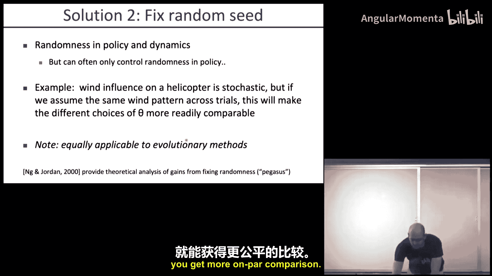
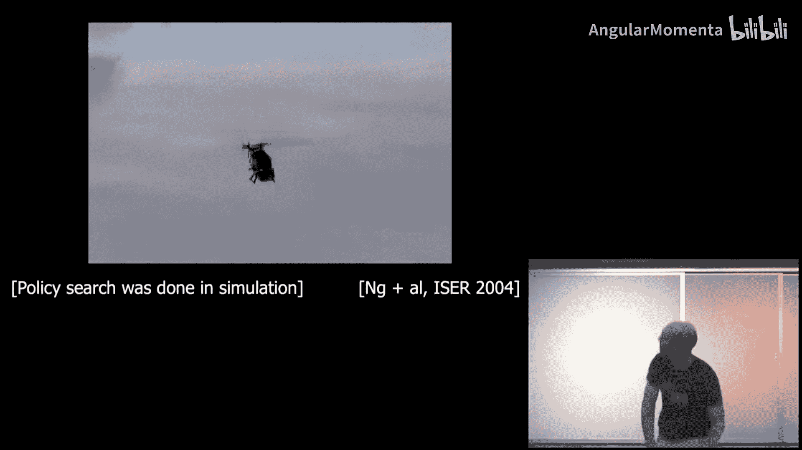
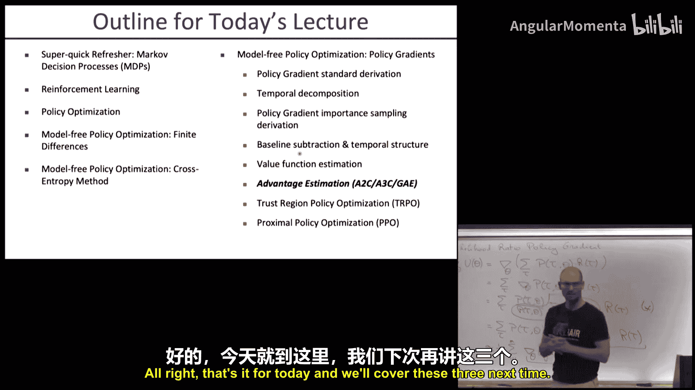
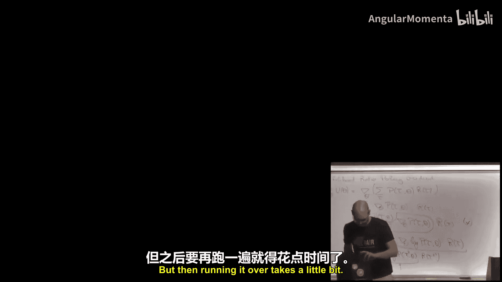

# 【加州大学伯克利分校】高级机器人学-｜-CS287-Advanced-Robotics-at-UC-Berkeley-Fall-2019-p17-18-强化学习-I：策略梯度--BV1KXqCB4Eua_p17-

All right， welcome everyone to lecturec 18 of 287 advancedance Robics。Today。

 we're going to cover our first session on reinforcement learning。First。

 a few quick logistical announcements。 you have a homework for due on Monday。

And you have your final project proposal due on Wednesday， so keep that in mind。

 Wednesday is your final project proposal deadline。嗯。

Final project supposed to be something more open ended than homework， ideally something researchy。

 but it doesn't I mean， have to be a paper， but hopefully the best projects do turn into papers ultimately。

It's about investigating something open and then related to the class if you're not really sure what to do for your final project。

 contact us and we can help brainstorm together。Any logistical questions？All right。

 then let's get started。So we have a lot to cover today。

 I don't think we're going to cover all of this today。 we'll see well continue next week。

I want to do a quicker refresher of MDPs， then we'll switch to reinforcement learning。

We'll look at policy optimization and mostly I'm going to want to look with you at policy gradients。

 but before doing so I want to highlight two other policy optimization methods that are also model free that in principle are also available to you and often easy to try and worth trying just as a quick check。

 sometimes they work really well。All right， so quick refresh on MDPs in an MDP。

 we have an agent interacting with the world and the goal is for the agent to maximize expected reward in that environment and the assumption is the agent gets to observe the state。

More formal under the hood， what we have is we have a set of states that's given to us。

 a set of actions that's given to us， a transition model given to us， a reward function given to us。

 and then there might be a discount factor that's given to us and then hope is that we can find a policy pi star which maximizes expected reward。

We'll still have the same formalism， but in reinforcement learning。

 what's going to change is that while we have the same system in action。

 we don't have access to the dynamics model of the world and we don't have direct access to the reward function so the agent is now expected to optimize expected reward without having access to the underlying description of the system so as a consequence the agent will need to learn to optimize the expected reward by acting in the environment。

 learning about properties of the environment and based on that improving its behavior and collecting more and more reward over time。

Now， within reinforcement learningerss I show quite a wide range of methodologies。

 not say there's really two big categories， there's policy optimization methods which say okay what we only need to find is a policy。

 so let's just focus on that and let's see how we can maybe start from some policy and improve it over time to get a better policy。

On the other hand， there are dynamic programming methods those methods look at essentially the Belman update they say okay this is Belllman equation that relates the optimal value function for K times steps to go to the one for K plus one steps to go and if we run this forever。

 we got the optimal value function for infinite horizon it's a fixed point equation。

 if we can find a solution to that fixed point equation that comes from dynamic programming。

 then from that we can derive the optimal policy with one step look ahead。

Or if we do it with Q functions rather than v value functions。

 then it's already encoded right in there what the policy is going to be。

And so these really exploit different things， or different ways of looking at the problem。

 policy optimization， which we'll cover today， is really about a optimization of the policy directly and。

Dynamic programming methods focus on the value function aspect first。

 Now there is something that lives at the junction of both called actor critic methods and we'll also look at those that take some aspects of policy gradient。

 some aspect of dynamic programming ba together in one method。

So let's start with policy optimization， so in policy optimization now。

 effectively the agent is some policy。And we'll have some external mechanism。

 hopefully available to improve that policy over time。 For example。

 the policy could be a neural network that goes some current observation to action taken。

And so if this neural network is parameterized by a parameter in vector theta。

 then really what we're doing is solving this optimization problem。

 maximize expected sum of rewards accumulated over time under the policy pi theta。

 and if we change the policy pi theta， we can run that new policy。

Maybe 100 rollouts and see how much reward it accumulates and compare。

 and so we have a very direct measurement of how well we're doing。

We can just at any given point in time， roll it out， evaluate performance。

 and see if we've been improving or not。Typically， even though we know that the optimal policy in an MDP。

 or the reason optimal policy does' deteristic in MDP， if there are ties。

 then there could be a stochastic optimal policy， but generally the optimal policy in an MDDP is deterministic。

We'll actually optimize over a much wider class of policies which is stochastic policies。

 which of course include deterministic ones for very special kind of distribution。

 so you might wonder why do that if we know the optimal policy is deterministic。

 why optimize over all stochastic policies it's really two reasons。One reason is that， well。

 if we have an approximate solution we're trying to come up with， we parameterized the policy。

 It's not guaranteed necessarily that in a parameterized setting that we have a the policy as the optimal one second。

And more importantly， it smooths out the problem。Because by having stochastic policy class。

 you can make a small change to your policy， shifting a little bit of probability mass from one action to another action in some state。

 and that's a very gradual change。Whereas if you have deterministic policies and let's say discrete actions。

 then as you switch an action in some state， you have a discrete change and it's not a smooth optimization problem。

 so by looking at stochastic policies we'll get a smooth optimization problem even in the case that we have discrete actions。

You might wonder well why policy optimization， I mean。

 value function methods are good too and I'm not going to try to declare one is better than the other。

 they have different benefits， but here are some benefits of why you might care about policy optimization。

 For many problems， the policy could be simpler than the value function。 Imagine。

 let's say a robotic grasp robots supposed to pick something up。

The strategy might be relatively simple for some objects。

 you just have to move towards it with an open gripper， then close around the object。

 then you have the object。So that's a relatively simple strategy。

 but if you think about what's the value then you have to think about exactly how long is it going to take before I actually have grasped the object is that all encoded and the value function through the discounting and all of a sudden you have a much harder problem to figure out。

If you learn a value function， you actually don't directly know what to do。

 you still need to do one step look ahead。So we need to not just learn a value function。

 but also a dynamics model so we can do one step look ahead with that dynamics model to know what to do。

And so now also need to learn two things， and if an error in one of them is happening。

 then we have an error in the action we take。You could also learn a Q function。

 but often for continuous spaces， the arcms over all the actions available to you of the Q value function can be pretty expensive to compute。

 so other challenges there。Now again， I'm not trying to say conclusion is we should always do policy optimization just saying these are reasons why policy optimization could be a very valid method for you to use in addition to this dash there is a very practical reason that is not on the slides which is you can always evaluate your performance with evaluate function method you can evaluate performance by using one step look ahead but you're not directly optimizing it so you're not guaranteed in every update to your value function that your performance is improving whereas with policy optimization we have update you can check and directly improve it over time。

Another reason you might care about policy optimizationization is because there's been a lot of success with it。

 so here are some of the pioneering successes with policy optimizationization。The first one is。

4our legged locomotion， then helicopter fly two legged locomotion， ball and a cup problem。

 Atari games， navigation and a labyrinth， Mojoko style simulated control problems。

 real robot control problems and go where was a combination of policy optimization and value function optimization。

So a lot of the early success stories in reinforcement learning have been through policy optimization。

Take another slice of it， if you look at conceptual pauseization optimized directly what you care about。

Whereas in dynamic programming， it's very indirect。 You exploit the problem structure。

 You know that there is some structure that。If the Belmont equation is satisfied。

 you should be optimal， but when you're approximately satisfied。

 it's less clear how well you're going to do。Polics optimizationization tends to be more compatible with rich architectures。

 including recurrences， more versatile and more compatible with auxiliary objectives。

 because maybe you want your network to learn against multiple objectives rather than just the reinforce learning objective。

 having auxiliary objectives can help you learn more quickly about structuring the environment。

 because the reward might be sparse。And on the other hand。

 dynamic programming is more compatibled with exploration and off policy learning and is more s efficient when they work because of the compatibility with off policy learning。

One quick note， we've actually done policy optimization before， ILQR is a policy optimization method。

The optimization based control methods， collocation， shooting， NPC， contact invari optimization。

 they're all policy optimization methods。But these assumed access to the dynamics model and the reward function。

 which we don't have available now in reinforcement learning。Note that in the third lecture on RL。

 we'll look at model based RL and in model based RL， we learn a dynamics model。

 we learn a reward function， and then we can start applying those methods again。

But right now we're going to look at model free methods where we don't try to learn a model。

 we don't have a model either， we just interact with the world and see if we can directly optimize the policy。

Any questions about the context in which we're working？Okay。

So we'll see three model free policy optimization methods。 We'll see or three categories。

 finite differences， cross entropy and policy gradients。The first two will do relatively quickly。

 They're also simpler from a conceptual point of view。

 but often they can work and we want to be aware of them。So。Final differences。This is really about。

We have now a policy we try to optimize。And we don't have access to dynamics model so we can not do our back through time to get a derivative of our policy parameters to do an update。

 but we can actually do finite difference， we can say well， we have some parameter vector theta。

 we can perturb an entry in theta， making it a little more positive plus epsilon minus epsilon。

Compare how well we do by doing two rollouts， and that gives us a finite difference estimate of the derivative with to that one component in our parameter vector theta。

And then we can do this for every entry in our parameter vector theta and we get an approximation of the gradient。

 and to do this we don't need access to a model， we just need to be able to do rollouts。

 we roll out with different perturbations of the parameter vector theta。

Now this is fairly straightforward， I mean you can always do this to get approximations to your gradient and actually。

I would say。When I see approximations， I would say it actually can be a better approximation at times because it's over a slightly wider interval than totally local。

 and so sometimes it's a better approximation than the actual derivative。

In terms of what you'll want to use in your optimization。But there can be some challenges。

 One of the challenges that often your system is stochastic。And imagine you have a stochastic system。

And in your stochastic system， we， you perturb theta and you get an outcome。

 So vertical axis here is the sum of rewards that you get back。

 horizontalorizonal axis is our one parameter theta that we can change。 And we see that for。This。

 let's see。We see that for。This setting over here of theta。

We have a distribution over possible returns， and we did a rollout and we happened to get this thing over here。

Now for the new setting of theta， we also have a distribution over possible。Returns。

 but we do one rollout so we get one sample from that distribution and we happen to land over here and so by doing one rollout for one setting of data。

 another rollout for another setting of data， in this case we're actually misinformed about the gradient because by these two samples it seems like the second the is actually worse。

Based on the two samples we got， but in reality， the underlying trend is that it's better。

And so what we have here is no in our gradient estimate because of the。

Sttochchasticity in the rollouts that we do。So what can we do about this Well， if there'stoacity。

 one thing you can do is you can average， if you average over multiple rollouts。

 this effect should go away because then you should get the mean for each setting of the and you can compare the means and you have the trend that you want。

Well， the one thing about doing that is that if you average over many samples， you pay a high cost。

 you are now doing many， many rollouts to just get one derivative entry。But what else can we do？

 Well， it depends， but imagine， imagine you have access to the actual simulator。

Then one thing you could do is you could say， I'm just going to get rid of the noise。

 I'm just going to always output。The mean next state and make it into a deterministic dynamic system。

But now you're losing some aspects of what the system is really like。

We can make a slight tweak on this。 What we can do is when we do two rollouts。

 we can fix the random seed。 and so across the two rollouts， the same random seed is used。

 setting up with the same offset from the mean across the two rollouts and that way you get a correct derivatives out。

Well， the randomness could be both in the policy and in the dynamics。

 in the policy you always have control over it so you can just fix the random seat at the beginning of your run and that's it。

In。The dynamics you don't always have control， but sometimes you do if you do it in simulation。

 you have control of it if you do it in real world often you don't what's an example in practice。

 imagine you have a helicopter trying to learn to fly and the world is stochastic meaning the wind gust experienced by the helicopter are going to be different in every rollout then the wind gust could potentially have a higher effect on the performance then the actual change in your parameter setting。

So you need to be aware of that and maybe collect multiple rollouts or。

Maybe just make bigger change in your parameter setting so it has a bigger effect compared to the wind。

 but it really depends on what's practical with your system。

This idea of fixing the random seed whenever you can do it can be very。

 very powerful and can be applied across other methods， too。 So right now。

 I'm talking about perturbation。For a finite difference approximation to the gradient。

 but you can do the same thing for evolutionary methods， cross entropy method。

 you do multiple rollouts， you want to compare them in an on par way。

 so if you fix the random seed you get more on par comparison。

So let's look at an example of this inaction， so for this helicopter。

 a simulator was built then in the simulator， policy optimization was run in a model freeway。

 so there's a policy that's parameterized in some way the parameters you do find a difference to see what you should update each parameter in which direction repeat many。

 many times once your optimization has converged， you deployed on real helicopter。And。

Here is what you get。So we have a policy that's reliably controlling this algorithm。

 which has a very hard control problem。Even harder when you fly upside down。

And this was first enabled through reinforcement learning。

If you're curious about what's under the hood。

What's under the hood here is a policy that's highly parameterized。Why， well。

 if you do this finite difference kind of thing， you're not super sample efficient because to get a gradient you need to do if you have let's say 100 entries in your parameter effect。

 you need to do 200 rollouts， so it gets expensive very quickly。But。

Here the number of parameters is only 12， so you only need essentially 24 robots to do the finite difference and be able to do an update。

 It parameter tries in a very specific way or four controls to your helicopter theres the vertical control。

 the collective control which changes the angle of the blades， the steeper the angle of the blades。

 the more area push down and so the more force you get up on the helicopter that's the collective control and it says okay well that's going to depend on my Z coordinate and my Z velocity because that's the main thing I care about for that vertical and then the elevator and ale run controls are essentially changing the angle of attack of the blades as you cycle through your 360 rotation。

 you could have a steeper angle left versus right or steeper angle front versus back and that will result in differential amount of air being pushed down front back。

 left right which will start rotating your helicopter。

So those two control the angular rate really around the forward axis and the sideways axis of the helicopter and what is that is that depends on the X coordinate。

 you imagine x will'll say x is forward， then you care about putting your nose down or up to be able to move forward or backwards。

So x is in there and then the anglenoted by the angleular rate denoted by Q is in there and the actual angle denoted by n Y and then。

Aerron is the same thing for the lateral direction。

 and then the rudder controls the angle of attack of the tail rotor。

 which will influence how much your tail spins around。

 but actually the most important thing is that because of the countertorrque from the motor between the motor and the helicopter by default fold the helicopter with counterpin to the blades。

And you don't want to be spinning all the time， and so the tail rotors's main effect is to make sure that you have a countertorrque to the helicopter spinning and keeping it stable。

 but then of course you want to change the direction you're facing。

 you can adjust the tail rotor thrust a little bit to point in a different direction。

So those are the four control inputs you have。 It was parameterized in a way for them to depend specifically on the variables that you think matter the most that way you reduce the number of parameters in your policy to 12。

 and it's possible to train with finite differences in a pretty efficient way to find a good controller。

Here's another example of results of policy optimization with finite differences video。The snake。

 the policy is parameterized by effectively a sine wave pattern。

 and you choose how much you activate to the amplitude of the sine wave of controls along the length of the snake。

 as well as the phase offsets between the different frequency sine waves。

 And so there's a handful of parameters there that you then optimize and you get out something that can actually climb upon a step。

Similarly for the four legged robot， here is a essentially hard coding policy。

Because once you parameterize your policy， you could also make your own guesses at the parameters and put something in place and then play with it a little bit until you find a good setting。

Then you can train it， collecting your rollouts。嗯。With different settings of those parameters perturbing them to get your finite differences。

 do updates over time and then after it's fully trained， here's what you get。

 which is faster walking， which is really important for winning Robbo Cup games because I mean if you can run faster than your opponents。

 you can of course get to the ball more quickly and actually this is the team that used to win pretty much all the time in this league。

So finite differences can work quite well， Most success， however， is in low dimensional spaces。

But if you have a low dimensional problem， you might as well try it。

 and it could be a good way to sanity check your other implementations against。What else do we have。

 We can look at cross entrytropy method or more evolutionary methods。

What the evolutionary methods do is say， well， we still want to optimize our policy。

 and a ti algorithm would be something along lines of， make some random change to the parameters。

 if the result improves， keep the change， if the result doesn't improve。

 discard the change and repeat。Or you could do this at a population level。

 you have a bunch of policy parameter settings， you perturb all of them。

 and then the ones who do better， you keep， the ones who do worse。

 you discard and you kind of regenerate to regrow your population once you do that population level effectively you get the cross entropy method。

So cross entropy method says we initialize some mean and some variance for a Gaussian representing our parameter vector。

 then we iterate， we sample parameter vectors， full parameter vectors from that Gaussian。

 so I here theta I is a full parameter vector now just one entry in parameter there's a full parameter vector。

 we sample parameter vector from the Gaussian for each one of them。

We then perform a rollout to get a return， which scores how good that parameter vector is。

Then we can look at the top  K%， let's say， top 10% of rollouts fit a new diagonal Gaussian to the parameter records corresponding to them and repeat。

That's cross entropy。 We saw it in one of the first lectures。 It's a policy optimization method。

 It's model free。 You don't need access to a dynamics model to do is you just need to be able to do rollouts。

 get the evaluations back， and then you can update your mean variance of the Gaussian here。

Ccroross entropy is very simple， can work surprisingly well。

 its very scalable because it's very paraizzable， what I just described is 100% parallellyizzable。

 which is really nice if you look at the experiments with crossentroppy method。

 the scaling is essentially linear meaning that as you increase the number of machines you run it on。

You linear speed up with a number of machines， your number of evaluations you can do in the speed at which you get to your results。

It does not take advantage of any temporal structure。

 And I would say that's really the key thing we're going to start doing。

 And what follows is we're going to find a method that really takes advantage of temporal structure and also。

Compared to finite differences doesn't need。Two rollouts per single entry in the grade inveor。

All right， any questions about everything we covered so far because we're going to completely switch gears to policy gradient methods now？

All right， let's do policy gradients。嗯。That's going。そんだよ。All right， so。

A bit of notation to get started。 We're interested in optimizing the sum of rewards accumulated over time。

 and we're going to have a shorthand notation for that。So。P click。So tau。Stands for trajectory。

And it's going to be。State of time zero。Controls at time zero， stateta time 1， controls at time1。

All the way till。St at time age， maybe controls at time age， they don't tend to matter really。

 but it's simpler to have stayed in control everywhere to not have to special case the last time slice。

We'll then also say our tau。Is equal to sum。T equals0 through H， S T， UT。And in this new notation。

 our goal is to find。A policy pi theta that maximizes。U， which depends on our choice of theta。

 which is the expected。Some of rewards。Assuming we act according to P theta。Which。Is equal to。

The sum。Over all possible trajectories we might experience。

The probability of experiencing that trajectory when using the policy pi theta times the reward along that trajectory。

So this here。Is the thing we're trying to optimize。

NowRealizing it's hiding a little bit of structure。

 I'm hiding the fact that Tau is really a sequence of states and actions。

 but for now I'll be convenient and later we'll bring that back。

 but we'll start with this abstraction。Now， what's the。Likelihood。Raceio。Policy gradient。

So a lot of people just call it policy gradient。 and so you'll have to get used to different people using slightly of different terminology。

 So often it's just called policy gradient what we're going to cover， but in principle。

If you think about the fundamental mathematical meaning of a policy gradient。

A policy gradient can be computed in many， many ways。

 using finite differences as a way to approximate the policy gradient。

 using back creation through time if you have a dynamics model and a reward function available also gives you a gradient of the policy so there's many ways to get it now in practice people often use the likelihood ratio policy gradient and often in shorthand your safe policy gradient。

 but just to be clear in principle we know other ways of computing policy gradients。

 but now we're looking at this one and we'll see good reason why this one's so popular as we progress。

So。Again， this is our objective。So we really try to optimize respective theta and as we know often we can't do it in closed forms。

 so we'll use a gradient respective theta to do an update and repeat。Alright， so what's。

The gradient in here， gradient respect theta of u of theta。It's equal to。Graient， respective。

Some over tau probability of trajectory tau under theta times。Our。Tao。Now。The gradient。

Of the sum is the sum of the gradients so we can bring that in。

We'll bring this grain and then now also。The reward of a trajectory does not depend on the parameter vector we used。

 The reward just depends on the states and actions that were taken。So as they noted here。

 no depends on theta， so really all we have is grade respective theta of probability trajectory tell theta times R。

Tao。Now we'll play a special trick， which only in hindsight might be meaningful。

 but you'll see that it works out well for us。Multiply and divide by the same entity。Pitao。Theta。

Pta Theta。Times grad theta。P tau theta。Our fit， our towel。Now let's look at this combination here。

The gradient of P over P itself， that's the gradient of the log of P。So we can rewrite this as。

Some overtell P。Tau theta times grad theta log。P。Tau theta times R。Tao。Now。Typically。

 there's a very large number of trajectories that are possible and summing over all possible trajectories or in continuous space。

 integrating over all possible trajectories is impractical。

 So we' going to have to use a sample based approximation of this。谁。mightight still fit here。

 sample based approximation。Can people see the bottom of the board from the back？It's fine。Great。

 we can do a sample based approximation。 So it's approximately。

Because it's sample based now equal to the average。Over M trajectories tau。So tau I。

 I from1 through M。We're going to average- so this is a expectation here on the this。

We can compute this expectation by taking samples from that distribution。 How do we do that。

 We do rollouts。 these are distribution over which directories under our policy pi theta。

 So we use our policy pi theta， do a bunch of rollouts。 And then instead of。

 and then we can compute the average， This is the quantity we're averaging。 So then we say， okay。

 it's the average of that quantity。 So the average of。The grad Theta log。Pitao。Theta times are tau。

 but now index the tas by I' because we have sample trajectories tau I rather than summing over all of them。

Note that this probability distribution here disappeared in what we have below。

It didn't disappear in a bad way， it's still there implicitly。

 but we don't write it anymore here because the sampling is taking care of the averaging。

Because this is an expectation， respect to this distribution， we take it empirically。

 we don't reweight the samples by distribution itself， that thing disappears。

 the expectation is done by samples， so this is our policy gradient equation。

Now let's inspect this and maybe retrospect why we did what we did in principle。

 we already had a policy gradient equation here， that's a policy gradient equation just as well。

So why did we keep going well？Here we have a sum overall trajectories。

It's all possibly infinite integral and so forth， so it's a complex thing to compute。

So the reason we actually multiplied and divided by the probability distribution here is that we could introduce the probability distribution up front。

Giving us an expectation， once we have an expectation， we can replace it by an empirical average。

 and so the multiply and divide here was done to end up with a expectation of a slightly different quantity。

 a grad log rather than grad quantity， but that's fine。

 and then we can take the empirical version of that expectation totractly compute an approximate policy gradient。

Now， when you look at this equation。Kin of one thing that's quite interesting is that we never take the derivative which of the reward function R。

Even though our objective。Is optimizing expected reward。

 And you might naturally imagine like gradient of that thing should then have gradients of where the reward is coming from。

 especially not showing up here。嗯。Somewhat surprising in some ways， intuitively。

 why is this happening， because the way we formulated it is because we're saying we're optimizing a distribution over trajectories。

And what we're really doing is shifting probability mass around。

Which is very different from what we used to do in our。Optimization for control methods。

 where we had a single trajectory。And we tried to shift the trajectory so we're doing something very different here and the early lectures we had single trajectory tried to shift the trajectory make it better here。

 we say we're considering all trajectories， we just trying to make sure the mass probability mass lives mostly on the good ones and so it's a very different perspective on things so we don't need a derivative then in respect to the reward of the reward functions with with respect to anything。

 which means that this kind of policy gradient you can be calculated for reward functions that are discontinuous。

 you could have a01 reward function， and you can still have a gradient。

And this also ties back to my earlier comments saying that by looking atastic the family of stochastic policies。

We make the problem smoother， we can make gradual changes， and that's exactly what we're doing。

 we can gradually shift probability mass， have a smooth optimization problem。

 even though the reward function could be discontinuous。So。Now。Let's take another step。

 So it'd be nice to look in detail at this quantity over here。 Well。

 the reward on that trajectory we will given when we do a rollout something tells us this is how much reward you got。

😊，But how about the grid log probability of tau under theta， can we compute that quantity？Well。

 let's see。Ground respect theta。Log。Probability of our trajectory tau I under theta。

 So this we did a rollout， our I rollout， and we're curious about this quantity because we need it。

Well， let's see。This is。Equal2。Gra respect theta of log。And what lives inside here？

What was the probability of a trajectory？It's。The product of the probabilities of all the transitions that happen along the trajectory。

 So product。For t going from0 to the end。Of the probability。Of S T plus1。

Encounted in trajectory I given。We were instead state STI and to control UTI。And then of course。

 the probability of taking that specific control under pi theta。So this is our。

Probability of that trajectory that we just experienced。This here。Is the D model？

This here is the policy。Okay， now。The log of a product is the。Some of the logs。 So let's apply that。

 gra the spec theta of。Some。T from 0 through H of the log of what's inside。Log。

P T plus1 I given S T I。Y T。Hi。Plus。Great respect theta of。Sum t equals0 through H。Log。Pi Theta， UTI。

Given SDI。Now something interesting happens。 the first term here。

Grad respect to theta of this quantity。 This quantity does not have theta in it。

 and the grad of something respect to theta doesn't have theta in it is0。

 This does not depend on theta。 So this is equal to0 plus then listing over here。

And this is pretty exciting what's happening here because when we looked at this original objective that we need to take derivative of。

 well， the dynamics appeared and we're not having access to the dynamics in the current scenario。

 and actually it turns out we don't need to。 the dynamics disappears when we take the gradients。

So we're left with this thing over here。And this thing over here。

 the gradient of a sum is sum of the gradient is sum over t equals0 through H。Oh， I drop。

Do I drop something。No， we got everything， so then we got grad Theta。Log。Pytheta， U T I。Given ST。系。

How about this quantity， This quantity we can compute easily。

 Our policy is what we we have a parameterization for it。 We choose our policy structure。

 We have access to it。Poplet choice these days would be a neural network， you have a neural network。

 that outputs a distribution over actions given state。

 and you can just do back propagation through the network to find the grad log probability of action given state。

 in fact most often have a neural network， you output a probability and you optimize the log probability of the output so you have to compute the grad log probability pretty much all the time and so all the existing frameworks even if they were originally built for classification or regression。

 they actually completely support this just as well。

 grad log probability easily computed through Tensorflow pitor whatever you like to use。

So once we have this thing over here。For our rollout， we can compute。 We can compute this。 We have。

This quantity here， then we multiply with a reward experienced along that trajectory and we have one term in our gradient。

 and then we average a bunch of those terms and together we have an estimate of the gradient。

So just to quickly recap what is our procedure， our procedure will be。

 we have a current policy pi theta， we do M rollouts with a policy。

 then for each rollout we compute these quantities with some back propagation through our policy network。

 let's say and then we can multiply the quantity we get with the reward experience along this trajectory and here is our gradient testament。

 then we can take a step in the direction of the gradient。

 assuming we're maximize trying to maximize we're take a step in the direction of the gradient and repeat。

Okay， let's take a short break here， and after the break。

 we'll see an alternative derivation to this。对。All right。

 let's restart any questions about the first half？Yes。So for the log pies。

How does policy gradient like how stable is it？With respect to rare events actually showing up in your。

Look ahead or trajectories， and the reason why I ask is because the log of a very small number is going to be very negative。

 it's going to lead to a very big gradient update。TheCon。嗯。

I haven't seen that as any specific concern that there would be instabilities in this log specifically or the grain of that。

AsTo the question of what happens with rare event type things really。

It will affect the number of samples you need to get a good grade estimate。

 so there are very rare events。That have extreme reward， then you somehow need to sample them。

Because if they have extreme reward， they affect the objective quite a bit。

 And so where that's where， of course， exploration comes in and so forth。 But essentially。

 the notion that。Things you don't do very often， and hence youd still explore。

 have very high or very low reward means that you need a lot of samples to experience them。All right。

 so we've seen one derivation of。The likely ratio policy gradient here。

We've seen in detail how we can compute the actual。Turm in there up here。This will keep the same。

 meaning that we're not going to change this， but I'm going to give you a different derivation of this part over here。

And the different derivation can give you some additional insight。

 maybe make it look a little less magical about the multiplying divide and all of a sudden having this log in there and so forth and also the new derivation could give us later。

Actually， something beyond just。A gradient， it could give us a local approximation to the objective that we can do multiple optimization steps on instead of just getting the gradient out。

So。The derivation we'll see now is coming from important sampling。

We're still interested in U as a function of parameter vector theta。It's。

Now can to be written as follows。 So U of the is the expected。Value。When theta tau。

 the distribution over so the directorories get sampled from a distribution according to theta。Of。

Atelo。Now， in general， there's something called important sampling that says the expected value。

Of some quantity， we have x as a random variable going to P of x。Expected value of F of x。

That's equal to the expected value when x is sampled according to Q。

But now we're off because we sample according to Q， so our samples appear with the wrong frequencies。

 they appear with the frequency according to Q rather than p， so it encompass it for that。

 we're going to multiply with P of x， divide out the Q effect times half of x。

So that's an based S importance based。Not estimate。 This is exact of the expectation here。Now。

 the reason you might switch to this as opposed to this is that maybe you have a distribution Q。

 you know how to sample from， but you don't know how to sample from P。

 but you know how to evaluate P， you know， when you have a sample， you can evaluate P of X。

And so when that's the case， you want to find an ideally nearby distribution Q that you can sample from and use important sampling to get your estimate。

 so then you'd say approximately equal to1 over m sum I equal 1 through M of。嗯。P X， I over。Q X I。

F of Xi。We're the Xi。Are sample from Q as opposed to P。

So that's an importance weighted estimate of the expectation。And it's a general thing you can always。

 I mean， you can apply is nothing to do with policy gradients or anything like that。

 we're just going to use this general idea。Within our apostse gradient derivation here。So。

I talked about P and Q， in our case here， where really P will correspond to pi。

Theta that we're considering a new distribution。Policy we're considering and Q will be equivalent to pi。

Theta old。 So we have an old policy。And we can sample from the old policy。In fact。

 the old policy is available to us， we are unsampling with the old policy and we're curious if we can use those samples to say something about a new policy。

And this tells us that indeed in principle we can， we can sample from Q。

And then it can tell us something about what the expectation would be if we were taking our expectation really with respect to P。

 and then we can imagine that we as we vary P in this thing over here， varying P。

Will give us different expectations。We can all do it with the same samples from Q。

 So we sample once from Q， and we vary P， and we'll get different outcomes here。

 and we can actually optimize P and try to find the P that gives us the best expectation。

 And that's exactly what we're going to do。 We're gonna try to find the P that is the pi theta that gives us the best expectation。

Based on all we have available is samples from Q， which is from our old policy。So。

This is equal to expected value。Theta comes from Theta。To comes from T old。Pi。To。Respect to。

Theta over P tau respect to theta old， have to compensate。Then。R of the trajectory。So。

I haven't written P and Q here。 I've written P and P Theta and P Theta old。All right， now。This。

Is the exact same objective as we had before just written differently and introduce this。Raatio。

 we can now say， okay， if this is the objective we're optimizing we're trying to find the best pi theta。

First thing we should do is compute a gradient maybe so we can take a step in the right direction。

 so what's our gradient expected theta of U theta。Well， it's equal2。

Grand of expected value of the expected value of gradient。

 So expected value tau according to theta old。Of gradient spec theta P。

Tau theta over P tau theta old。There's a different theta。 The gradient doesn't affect this one。

 This is the actual theta， then our。Tao。Okay。Now。Imagine。

We are currently at Theta old and we want to understand what is our gradient。

 then we should evaluate this gradient at theta old。Evaluate this thing at theta old。

 so then really we have here this thing evaluated at the old。Well。Looking at this。

 we actually see we get back what we had。Over here。This is the expectation under。Theta old。

 Everythings static all over their expression， or theta old of。

This ratio over here is the same ratio we have。Over here， this expectation over there。

 the expectation so that's a sum over trajectories。

 P trajectoryject under theta that summation is the same as the expectation。

 So actually this thing here。And。This thing here are exactly the same。

 they' the exact same equation just derived in a different way。

And so what we see now is that we have two ways of driving the same thing because the next two steps we take there。

 well they're going to be the same steps over here because we're already at the identical spot between the two sides。

 we just came at it from a different direction。Over there we multipied and divide by the same thing。

 it's a lot like the importance weighting actually it's just that we knew we're going to use the same thing twice here。

 we have something more general， we multiply and divide by different things here。

 and then it cancels out over here。U。So same thing。

 you might wonder why do we care about driving the same thing twice well this might give you a little more insight into what's really going on。

 what's really going on as we compute a policy grid is that we have a importance weighted objective we're optimizing。

And we just locally take a step， but in principle as we'll see next lecture， we can take many。

 many more steps on this objective if we want to， we' need to take just one step and so we have a new objective that we're able to evaluate and repeatedly take steps on before we might then do new rollouts。

 establish our next objective and repeat。Okay， so we covered a lot on the board actually。

 we covered those first three bullet points， so let's step through what we have on the slides here。

 this matches our objective we put on the board， we derived the policy gradient equation and the sample based representation thereof。

We realized that even if the reward function is discontinuous， we still have a gradient。

 which kind of created normally we have discontinuous functions， no gradients available， but。

By having a distribution， essentially a stochastic policy。

 we have a distribution over our trajectories and we're really shifting the mass of that distribution rather than trying to change any single trajectory。

 that's why this works out So intuition here is that you might have three rollouts。

 some of them are better than others and you try to shift the probability mass to the better ones。

So you're just trying to change the probabilities of experienced paths。

 you're not trying to actually change the paths themselves。Then we saw well。

 that grad log probability of trajectory， well we might look scared because it has a dynamics model in the probability。

 but actually the gradient， if you look at it， the dynamics model will not participate and we get something that does not require a dynamics model to evaluate。

Putting it all together， our grand estimate consists of。We do a bunch of rollouts。

 then over those rollouts we average the gridlock probability of trajectory times reward along the trajectory。

 where the grid log probability of trajectory can be given by the sum of gralock probabilitybabil of each action given state。

So all we need to compute this groundlock really of action given state for each time slice that we experienced。

 and that's enough to then compose our policy gradient estimate from that。

Now we saw an alternate derivation to important sampling。Gives us the same policy gradient。

 exact same expression just derived in a different way。

 but this thing on the top is often called a surrogate loss。

 and we can actually use this surrogate loss in the future and take multiple steps on it and say of just one gradient step。

Now， what's left for us to do quite a few things actually to make this work， what I described so far。

 if you just implement it that way， it's going to be extremely sample and efficient。

We need to exploit more structure。So。It's going to be actually unbiased me if you take infinitely many samples。

 you'll get the correct policy gradient， but the infinite many samples part is something you don't want to do and in practice。

 of course。Infinite is never a practical thing to do。

 but the number of samples you need to get a reasonable estimate is going to be very， very high。

 We're going to reduce the need in terms of how many samples we need。Byintroducing a baseline。

 exploringing more temporal structure and then。Likely next lecture。

 looking at trust regions and natural gradients to further improve things。So again。

 let's look at the intuition， the intuition of a policy gradient that we just covered is that you're going to shift the probability mass。

If。Paths have positive reward， you make them all the actions。

 action given state along those trajectories more likely。

 and for every path that had negative reward， you decrease the log probability of action given state for everything you encounter along those paths。

Now， some crazy things are going to happen。 Imagine your rewards are always positive。

 Then for everything you experienced， you're trying to make the probability of your action given state more likely than it was before。

😊，Doesn't really work probabilities we shouldn have sum to one it can't make everything more like。

 essentially you're trying to lift everything you experienced。

 of course it'll come at the expense of other things。

 but it's not a very intelligent way of doing things because if you experience something pretty bad like almost zero and the others are 10 and1000。

 why are you still lifting the probability of that thing？

Even if you're lifting it less than the others。Okay。

So what we're going to do is we're going to introduce the baseline。 The natural thing to say is that。

I don't want to increase the probability of everything I did。

 I just want to experience it and increase it if。The experience was better than average。

 if my rollout was better than the average rollout。

 increase the probability of the actions given state otherwise decrease， can I do that Well you can。

 so you can subtract out a baseline， so B is a baseline and you can think of it as you know simplest way to think of it as the average across all your rollouts of how much reward you got。

You look at that average and now when you subtract it out， anything that's above average。

 grad log probability gets increased， everything that's below average。

 grad log probability goes down。There' a derivation on the left They are not going to step through。

 but if you do the math， you'll see that。Attracting that baseline does not affect the correctness of this being a policy gradient。

Because it turns out if you compute the expectation。Of the baseline contribution， it's zero。

She's just shown on the left。Now， it might sound a little magical。

 but it's just how the math works out and intuitively what it comes down to is that。

 it's okay to check whether you're better or worse than average rather just in the absolute increase everything and in fact。

 by doing this， you'll have less variance， you'll be able to get a preciser estimate of your gradient for a given number of samples。

So this will reduce the sample complexity already quite a bit。

Because now we move things sub that are better average down that are worse than average as opposed to trying to move everything up。

And then have the suming to one compensate it for that ultimately。What else can we do？Well。

 let's look at that temporal structure。 So the gra log probability is shown at the top for trajectories。

 Second line is really what we have now。But let's break it up。

 if you look at that second line and go to the third line。

 I broke it up into terms that happen before the current time slice and terms that happen from the current time slice onwards。

YouLook at the grad log probability of action given state times a reward that happened before plus reward that happened after。

Well， the action you take at the current time could not affect any more of the reward you got already in the past。

So there is no way that the reward you got in the past should affect how much you increase or decrease the grad law probably the current action given state。

So we should just get rid of that term， doesn't depend on you， we can just get rid of it。

We also realized that the baseline can actually depend on the state because you can start at the current time and look at everything from there。

And just keep it B， it needs to be constant from there， but that's it。

And so removing the terms that don dependent current action can lower the variance。

 we end up with this equation over here。And now we're at a point that's actually pretty good。

 and also makes sense with saying that we look at the grid log probability of action given state。

And the amount by which we increase or decrease depends on how the reward we got from that time onwards and that trajectory compares to on average how much reward do we get from that state onwards。

 so even any previous time we were in that state on average。

 how much do we get and do we do better or worse than what we get on average from that state。

 if we did better crank up the probability of the actions we took the worse， bring it down。

Now it might not have exactly available how much your an average get from that state。

 but that's kind of maybe an ideal thing we could put there and in practice we'll put in approximation。

Okay， so。TheImportant thing here is that we now sum from the current time onwards when we look at the rewards that we multiply and not reward for the entire trajectory。

 So exploiting the temporal structure。 remember early on I said。

The methods we looked at the finite difference， the crosscent method don't really look at the temporal structure here。

 we're now looking at the temporal structure， we're specifically looking at increasing or decreasing probability of an action based on specifically what happened from that action onwards。

 as opposed to always looking at entire trajectories。Okay， so what might be some good choices for B。

You can take a constant constant baseline， which is just average reward along trajectoryjecties。

 So we know we can take any constant there。 It's fun。

 It'll always still be a correct policy gradient， but the benefit we get from using something more precise is that we reduce the variance。

 I we need less samples to get a precise estimate of our policy gradient。

 So this is one thing we can fill in。 it's not that great doesn't exploit any a temporal aspects you can do something like optimal baseline。

 which means you can do some math and say I want to minimize the variance of my policy gradient estimate。

 that's an objective。 if I work to that objective， falls out a baseline you're supposed to use to optimize that objective。

 What is that doing It's saying I'm going to use as my baseline a weighted So instead of just the unweighted average of reward still average of rewards along trajectories。

 but it's a weighted average where things that have very high grad log probability squared。

 So things where the through it of the。Action given state is very steep。

 will contribute more highly to the average on things where it's a less steep derivative。

So that's the optimal way of reweighting your rewards， so that's one thing you could do。

You can make it time dependent。 You can see my baseline will only look at things then onwards not。

Things that happened in the past。 So I want to look at， let's say， for time slice T。

 I look on average from T on boards over all trajectories。 How much did I get averagever that。

You can make it stay dependent so you can say my baseline is going to depend on the state。

 how much reward do I expect to get from that state。 That's the value function for that state。

 We'll need a way to estimate that value function， but in principle。

s very that's the most natural thing to choose because that's really the comparison we want Whats the value I expect from that state under my current policy did I do better or worse According shift to probability mass。

So we'll look at that in a moment how to get that。Okay， so different choices here。

 most common is to try to put the value function there。So how do we get the value function？Well。

 so we need this thing over here。 How do we get it Not it is not an optimal value function。

 so we don't need to find the optimal value function。 We need the value of the policy。

 We've actually looked at this in the past。 We can do policy evaluation。

 but policy evaluation requires a model to run all updated equations。

 We can do something much simpler though。We can just collect trajectories and we can regress against the empirical returns。

 So we can just say for all trajectories we collected。I can look at。

A slice of that literature from time T onwards and look how much reward was obtained。

And I can see the value under my policy in that state ST in trajectory I。Is。

Approximateated by this sample estimate and say I'm going to essentially just train a neural net that maps from state to reward achieved from that state onwards across my trajectories。

I train on neuralNe and then I can use it to then subtract it out as a way that might generalize better than you know。

Just doing some sample based evaluation。 So I'm going to compute V Phi。

 So Phi is not a parameter here。 I have a parameterized value function。

 and I can just run gradient into descent on this objective here， just a supervised learning problem。

 straight up supervised learning to get the value function out。To do this correctly。

 you actually have to use separate samples for fitting the value function and for computing a policy gradient。

 it should be pretty clear why， why imagine you do something very you have an extremely good value function fitter and it perfectly fits everything。

Well， then this thing will be exactly equal to this thing and if you look at the policy screen。

 these two things will cancel out。So that's not going to work。

 You don't get a policy gradient estimate。 again， that's natural because you're trying to compare this sample estimate where you got in this sample with the average。

 But if your average estimate is just using the sample directly that you're not really comparing with the average。

 you need to have a separate set of rollouts based on which you compute the average And so you have a separate set of rollouts which you do this。

 in practice， often what you can do is not worry about it。

 the reason you can decide not to worry about it is because。

Your value function is not going to be perfectly fitting these rewards。

 it'll try to generalize across many rollouts。 And so in practice， you can often just do it。

 but in the extreme， if you had something that perfectly fitted at your samples。

 you can' do it on the same samples。 Also in practice often you will not change your value function completely to the optimum here。

 you'll just make a few gradient updates and already have a value function from the previous round and so effectively incorporating a lot of past samples to get your value function estimate for the current round but keep that in mind that in principle theoretically speaking。

 if you do what's shown on this slide， you need a separate set of trajectories to get your V phi。

 yes。Would you do your value function fitting before policy gradient or would you do them kind of like at the same time？

What do you fit first， that's a good question。In principle， it could come first。

 doesn't really matter。But the reason to do it first would be that effectively you would definitely not be using those samples then so you use all past trajectories from as you're running a policy gradient have your best value function estimate based on that。

 you do new rollout use since we know you can use any baseline any baseline is fine right iss just the closer to the value function。

 the better is's going to perform so we can use it but we can use any baseline。

 we can use based on all past samples， get that value function。

Use that and then afterwards incorporate these samples to update the value function used in the next one and repeat。

You don't need to do this is called Monte Carlo estimation estimation of V Pi。

 Why is that because you use the exact used rollouts to estimate your value function。

 you can also do bootstrapping。 So remember the Belmont equation for policy evaluation。

 Well you can do a sample based evaluation of that So shown at the bottom here， you can run。

An optimization that tries to make the value function at the next time。

 consistent with the value function at the current time。

 and then some regularization to make sure you don't overfit。What would you use。

 Would you use Monte Carlo or would you use bootsottrap。 Well， that's a design choice。

 You can choose whatever you want to do， and we'll actually see mixes between the two of them at some point。

 but。In practice， if you're trying to get something working。

 this thing with the bootstrap in it has some weird feedback cycle in it。

 The next value function depends on the previous one and previous one and so forth。

 and it's often not as stable to run So in your first implementations。

 typically you would use Monte Carlo， use a large number of samples。

 you fit your valid function then separate set of samples to get the grid log probabilities from and that way you know you're doing theoretically the right thing and in the limit of enough samples they should work。

Now， this thing in principle can be more sample efficient。

 but can give you a lot of challenges in making sure it's stable。So at this point。

 we actually have a complete policy grant algorithm。We can。Let's step through what we have。

We initialized ouruls parameter。Typically a vector theta， some baseline we might have available。

Then sum itations would collect a set of trajectories by executing the current policy。

At each time step in each trajectory， we compute the return RT then onward。

 so we store that information as we run through a trajectory。

 we store reward accumulated then onwards。We didn't compute the advantage estimate， which is。

There word accumulated den in wordss minus the baseline from that state。 Now。

 how do we get the baseline well， typically by value function fitting。

 So we refit the baseline as it comes to your question， we first compute the advantage。

 we first compute that difference。After we've computed the difference。

 we can refit the value function。So the difference is not being computed。

Based on a new samples have not computed to the value function。

 So this is the order in which it goes compute advantage can refit the value function ready for next time。

So Val function here is called B。 Then we sum this。We take all these terms。

 we can now compute a gradient estimate， which is this summation of all these terms。

 we take a step in that direction and repeat。So not that many lines of code actually。

 it's fairly simple in many ways。It will be I mean。

 we can still do additional tweaks to this to make this more efficient。

 but this is the foundation of pretty much any policy grain algorithm will look exactly like this so any questions about this algorithm。

So what are we still missing to make it even more efficient and that actually should led the things that have led to the actual breakthroughs and deep reinforcement that started to happen in 2013。

 14，15 are the three pieces that are still listed there that is，The difference we're computing here。

Advantage here， the reward then onwards mine is the baseline。

 it's still a pretty noisy estimate based on what I described so far。

 how can we make this less noisy， that's what A2C A3C and GAE are about。

Then the other part that we haven't really looked at is stepsizing。

 remember we had line searches and optimization and so forth。

 but line searches are expensive in RL because you take a step。

 you do many rolliss and make a smaller step or a bigger step， very expensive。

And remember we looked at things like natural gradients， second order methods， and again。

 those have been key to the to a level that it works for large scale neural net training for policies rather than only working for very small problems。

All right， that's it for today and we'll cover these three next time。

なほどな。Yeah。佢解。我都。So I terrible I see options。like like29。Doing。So like going through a lecture。Yeah。

R the lower takes。

Yes。