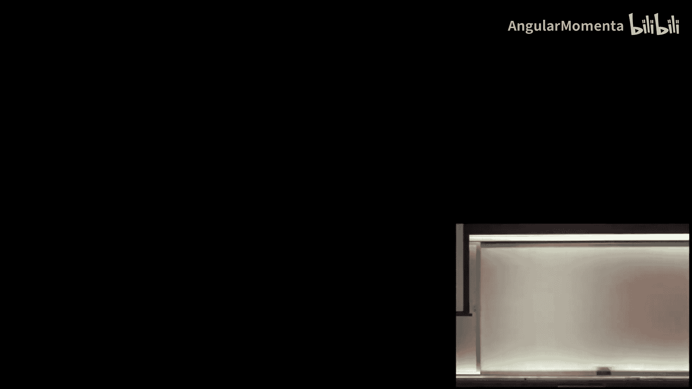
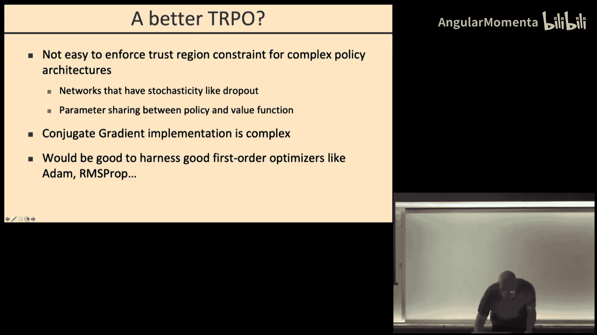
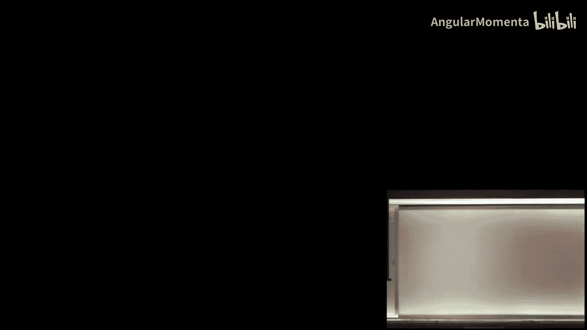
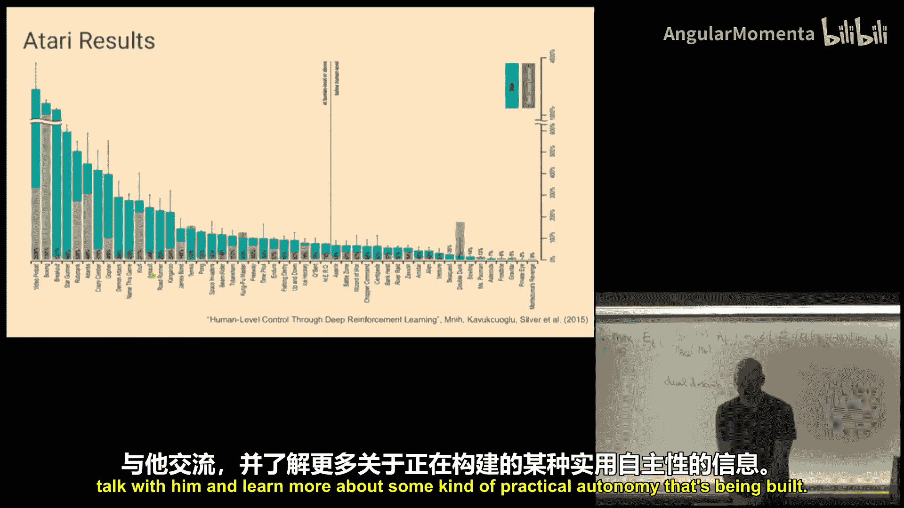
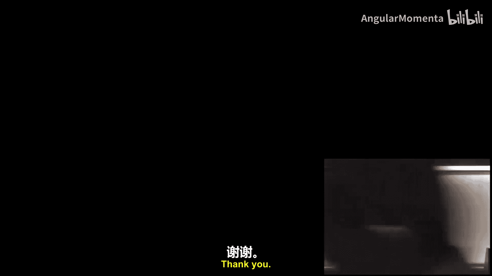

# 【加州大学伯克利分校】高级机器人学-｜-CS287-Advanced-Robotics-at-UC-Berkeley-Fall-2019-p18-19-离策略、无模型强化学习：深度Q网络、软Q学习、深度确定性策略梯度、软演员-评论家算法--BV1KXqCB4Eua_p18-

Everyone， welcome to the 19th lecture of CS 287， Fall 2019 today we're going to mostly cover off policy model free methods but before that couple of logistics。

 so we've announced a few important things on Piazza but I also want to announce them in class one。

The exam for the class has a handout with the questions and the answers so there should be zero question ambiguity when you come to the exam because you've seen the questions before。

 you've seen the answers before but these are the things that we think are the most important things for you to really really know it's about 20 pages the handout is almost complete we're gonna to add a few things we covered in today's lecture and add a few things we cover in Thursday's lecture but other than that the handout is complete and so we post that on Piazza please study that the questions will come literally from the handout and the answers will be expected to be literally what's on that handout and it's all things we covered in class but it's laid out a little more kind of specifically in the handout in a way that you have question answer specifically for you to study。

The timing of the exam will be next week， Thursday evening for most of you。

 there are a few of you who have conflicts and Laura sorting out a resolution for that if you haven't sorted it out make sure to do it really soon because after tonight probably it's too late so contact Laura as soon as possible to resolve if you have a conflict Any questions about the exam。

All right。Then let's get started with a lecture for today。Today。

 most of what we're going to is off policy methods。

 but I want to first recap what we covered last lecture which is policy gradients and there's a part we didn't cover yet that's actually really important in policy gradients which is the trust region aspects to make sure you can optimize in a much more efficient way than if you just do gradient steps so let's start with that and then we'll switch to the off policy methods。

What I wanted。う嗯ん。

So as a quick recap in policy gradienting methods， the likely ratio of policy gradient。

 what we do is we essentially optimize。Our distribution over trajectories。

 And so when we take the derivative of the objective。

 really what we're doing is we're shifting the probability mass onto trajectories that are higher reward and away from trajectories that are lower reward。

As we worked through that， we came at the following gradient update， which is with some。Overall。

Trajecty suite Collectin。With some overall times in those trajectories。

 and we look at the grad spec theta， which is a policy parameterization log。Pi。

Theta action we took at time T and trajectory I。Or we've been writing U。

 so let's write you action we took time T， introductory I， given we instead instead ST。

And trajectoryject。Ire time T。And。Then we would multiply this with。The sum。K。

 from that time till the end of reward。We obtain。In states。SK， taking action， UK and trajectory I。

And then we subtract out a sort the summation is this part。

 and then we subtract out a baseline to reduce the variance and the natural baseline is to subtract out your estimate of the value function。

 so we are estimating a value function at the same time。

 which might be parameterized by V phi for state s。Ti。Introjectory eye。There we go。

So that's our policy gradient update equation。If you want to put this into。

 let's say a Tensorflow Pi torch or other automatic differentiation framework。

 it's actually very easy。You can just provide as your objective。Just forget about this part。

If you remove that grand part， you have an objective you can optimize， you can say maximize。

Over theta。This thing。Over here and then you ask for it to optimize and then it'll compute the gradient for you and it'll take some steps for you and then at some point you say enough steps because this is only locally valid you're not going to let it runal convergence and then you collect more trajectories for the new set of trajectories you do the same thing again over and over and in parallel you fit your V Phi so your V Phi。

Of。S。TI。It's fitted to your empirical estimate is typical， so it would be fitted to。

Some over fact the thing that's shown there， K equal T to H are。SK I。UKI。And you minimize。

This squared error or maybe a Hober loss if you don't want to pay too much attention to the big errors。

 minimize this。Over phi， sum over I and T， and that gives you an updated V phi。

 but maybe you want to do a small number of steps because again it's just current data and you don't want to overfit to the current data so probably you don't fully minimize you just have an objective。

 run a few steps and that's your updated V Phi。 so that's really all you have to do to run a policy3 method and of course use the roll to happen under the policy pi theta。

Now， what we haven't looked at yet is what we've seen in the past and optimization matters a lot is the step size if you optimize this objective。

How far do you want to step when you take a grain step or how long are you willing to optimize this objective if you're just running an optimization directly on this surrogate loss called surrogate loss is not the real loss。

 The real loss is the expected rewards and the policy。

 And this is just a proxy that we think is reasonable locally。 And so how local。Is that。

 is it extremely local in certain directions， you can go maybe further than other directions。

 and that's what we want to address now。Any questions about this because that's what we'll be building up upon for the first 20 minutes in this lecture。

Okay， and then maybe one extra thing that's worth noting。

 we saw an alternative derivation of the policy gradient where we saw it instead of having。This。

As our objective here， we could also have instead。This ratio， importance ratio。

Pi theta over pi theta old and the gradient of this thing is the same thing as the gradient of when we put the log in there。

 they have the same gradient locally， they're the same。

 but in fact even though the log is common in policy gradient derivation people focus on the policy gradient what we're going to start looking at now which is trust region methods。

 this objective is a somewhat closer local fit than the one with the log and so if you're actually going to optimize the surrogate loss。

 most often this gets used as a surrogate loss rather than putting the log there and we'll see that happening what we cover today。

All right， let's。So the first thing I want going to cover is trust Region policy optimization。

 which was the first method to successfully optimize large neural network policies with， I mean。

 a reinforcement method to optimize large neural network policies to learn to control simulated robots。

 and then we'll see a kind of a new version of that PPO。

 which is more often used these days that can be understood very directly once you understand TRPO。

So。Stepsizing in trust regions。 Stepsizing is necessary as grade is only a first order approximation。

 terribleible step sizes are always an issue， but how about just not so great step size is what happens Well。

 in supervised learning， let's say if a not so great step size is step too far。

 Well you'll look at the next batch of data， it'll。

Bring it back in the other direction and it essentially is self correct。

 you might have wasted a little bit of time， but it's self correct for it。In reinforcement learning。

 what happens， you step too far， you have a terrible policy。There's no data waiting for you。

 that terrible policy is the thing that's going to collect the data that you're going to use for the next step。

Okay， well， then nexts be a batch will be corrected under this terrible policy and it's not really clear how to recover because that terrible policy might just get zero reward。

 a very negative reward and not give you much signal in its rollouts and so the only thing you can do then is just say hey。

 maybe go back to what I had before or shrink my step size and hope that this time it'll work better。

So no automatic self correction happening in RL because you collect the data under the policy that you're learning。

Now。You can say okay， what can we do， the simplest thing would be essentially line search in the direction of the gradient。

 it's very simple， you have a gradient direction， you line search in that direction。

 you see which is the optimal step for every step size， you can do a bunch of rollouts。

 measure the performance and see which one is best。嗯。It's simple。

 but it's also expensive because for every evaluation on the line， you have to do a lot of work。

Let me give you a little bit of extra color when we're covering optimization methods earlier on。嗯。

We also had line searches， but very often in those line searches when you're doing。

 let's say convex optimization， there are little tricks you can play that makes your line search much。

 much cheaper than evaluating the original objective， you have some shortcuts that make it cheaper。

 but here you just have to do a full evaluation and so it's as expensive evaluating your objective to do a line search and you have to do it multiple times so not great。

 So's also naive because it ignores that maybe your linear approximation in some directions is better than other directions And so maybe in some directions you can trust it more and go further other directions。

 you cannot。So what can we do that's more advanced。 We can have trust regions， trust region。

Tries to spell out where the approximation。Given by the gradient is good。

 and that region is called the trust region。 We've actually seen this a little bit before when we're covering the penalty method for constrained optimization in the inner loop。

Of our preferred method， we had a trust region， but very simple trust region。

 we're just a quadratic trust region， hardcoded to be staying within an epsilon ball。

 but now we want to see if we can do better， we're actually seeing something that does a little better when you do second order methods with a Hessian。

 let's say effectively have a Hessian defining your trust region and we're going to try to do something similar here。

Once you have a trust region， you can solve for the best point within a trust region。

 so imagine you have your gradient， which defines your first order objective。

 then if you had a trust region in this case， we're going to define by the k divergence between distribution over trajectories we had。

Before the change under theta and then after the change under theta plus deelta theta。Why？Well。

 how is our gradient computed， it's based on rollouts from policy pi theta and so the gradient approximation is based on data under theta which will only be valid if。

 well the new policy collects similar trajectories。

 if the new policy collects very different trajectories then that first order approximation will not be very valid。

And so what does it mean to collect similar trajectories it means that the divergence between distribution over trajectories under new and old policy is small。

So you think about some intuition here can imagine some action that you're taking that doesn't really in some state the action you take doesn't affect very much what the next state is。

 well that action you' got a lot of liberty in terms of changing that because not changing your trajectory distribution。

 but if in some state the action you take has a massive effect the states that come after。

 then changing the action distribution in that state will have a very big effect on this KL divergence。

Okay， so how do we evaluate this scaleale？ Well， let's see what it is。 is distance between。Well。

 it's kind of a pseudo distance between。Distributions over trajectories。

 probability of trajectories given over there， it's a product of the probabilityability of action given state and next state given current state and action。

The kale is an expected log probability ratio of。The two distributions， well。

 let's fill in our expression for the probability of trajectory。Fill that in。 And now， again。

 something magical happens。 The magical thing that happens is that the dynamics。

 probability of the next state given current state in action cancels out in that ratio。 So we， again。

 don't need to know the dynamics model to evaluate this distance， this c divergence。

 which is really nice。 We have the same thing happen in the policys grain calculation itself where the dynamics would disappear as we do our calculation。

😊，Then you might say， well， isn't the dynamic still sitting up from the probability of a trajectory under policy pi theta？

 Yes， it is， but that's an expectation right， And so we can just do rollouts under our current policy and evaluate an approximation to this expectation from samples and this what we have。

 So the expected log odds ratio of probability of action given state under。

Old policy over probability action give a state under new policy。Okay， so what does it give us。

 We have now turned the top objective into something much more concrete where we know we have access to all the quantities。

 we get these quantities from our rollouts， the gradient we've seen on the board just before。

 how to get it， and then that log probability ratio。

 well we just look at our rollouts and we look at the ratio， we can just insert it right there。

So now how to enforce this constraint， given we have some complex policies like neural networks。Well。

 we've seen constrained optimization and so we can in principle run some constrained optimization。

 but it's pretty complex to run it for this。In the TrRPO paper。

 it was shown that one way to do this that works quite well is to have a second order approximation of the K divergence。

So that kL divergence shown there， the log probability ratio， second order to approximation。

At that point you have essentially a squared condition。

 you essentially have something in the form that a square deviation should be small。

 but a measured by the Hessian squared deviation from the previous setting of theta。

So first order approximation is kept constant， meaning that it doesn't change there's nothing second order happening there it's just first order。

 and then the hessian here is actually called the fishs information matrix because hessian of the k divergence that's just what it happens to be and it looks like this。

 so it's fairly straightforward to compute in the sense that to get the fish information matrix or the hessian here all you need is gradient you never need to compute actual second derivatives。

Now these gradients will be multipied with your transpose and build a big matrix and if you're a large network that's still tricky to deal with because a matrix。

 if you have a million parameters and you have a matrix of a million by a million， it's pretty big。

 a lot of things to deal with， but we'll see how to deal with that soon。

So what we then have is the second order approximation for the KL。

And which can be obtained from grade calculations。 So our problem now is the following。

We maximize this locally linear objective subject to this second order constraint。Okay。

 are we done well when theta is high dimensional inverting this F theta is somewhat imprac which you would have to do in kind of the canonical way of solving this because the canonical way of solving this would say that actually your step direction should be F theta inverse times G hat。

 and then you just need to find the right step size which epsilon determines。

So we need an efficient scheme to find effectively the F theta inverse times Ghad consgate grading can do this for us。

 can we do even better？We can do even better than that。 So now at this point。

 we know how to solve the problem above using conjugate gradient。

 which is a standard optimization method。 But can we do even better？ Well， we can。

 We saw that we could use a more。Precise surrogate loss， not just to。Greatrainened approximation。

 but a national circuitgate loss that's closer， such as the log probability of action given state in the circuitgate loss or the importance ratio。

So let's take a look at that and that'll give us the full TrRPO algorithm。Here we are。

 so we have maximize over pi or called pi theta， it's just called pi here， the surrogate loss。

Wwhich is the expected value under Pythid old， what does this mean we're going to have samples that approximate this expectation for each rollout。

 each action in state we have we're going to have an entry in this objective。

 which is the probability under the new policy of action given state。

 that's what the neural net prescribes divided by a fixed number here pi old。

Action given stayed and then multiplied by the advantage under the old policy。Okay， so。

Then we have a constraint， the c dirgence should be small。

 so we don't want to move too far away from our previous policy。Flaogram。

 run the policy for T time steps or n trajectories。

 estimate the advantage functions which we know how to do。

 essentially the sum of rewards from that state onwards minus the value function。

 then compute the policy gradient which we know how to do or you can put in that surrogate loss objective depending on what you do。

 then you can run con gradient to optimize the surrogate loss。

 or just use the first sort approximation then we do a line search on the surrogate loss and the KL constraint。

So it's a little bit complex， but it's actually a very well motivated method in the sense that you now clearly define in which region you trust your local approximation。

 within that region， you're going to find the optimal point， move to that。

 and then get new trajectories， which gives you a new region in which you can trust your new surrogate loss and repeat。

One of the big things this did for reinforced learning was effectively that reinforcement can be a bit unstable if it's not run carefully if it bad step sizes and so forth。

 and this allowed to have a very kind of stable algorithm that can reliably optimize our objectives and so these are some of the first results obtained and optimizing policies for these Mojoco environments which is since kind of morphd into Open eye gym but at the time Open eye gym did' even exist yet。

 it was all straight up Mojoco and you see here policies learned by TrRPO that are I think about neural that's what about 100。

000 parameters in it that have been trained to control these robots。Here is the learning in action。

It's more dancing than walking， but it's optimizing。It objectivejective gradually。

And actually then learns to run pretty well。Now。ActuallyI think this is the same video we just watched here are the learning curves。

Green。And blue are two versions of TrRPO vine and single path is what they're called here because it different slide variations of how to run it。

 We see that they are learning the fastest。 Sometimes there's a bit of a tie still with some past reinforced learning methods at the time。

 but they're always among the fastest this is for the simpler environments， carpole and swimmer。

 then going to more complex environments， Hopper and Walker。

 we see that they strictly dominate compared to past methods。

 The beauty actually was that with this method you can not just trained for Mojoco environments or simulated robots。

 you can actually learn to play atti games just as well。

 So it's a very general approach whereas at the time， the Q learning methods， for example， DQN that。

Had learned to play at games， not very clear how to make it work for the simulated robot environments because they have continuous action outputs and DQN has a network that has a Q value output for every possible action because we have continuous action so you can now have a Q value output for every possible action because you need infinitely many outputs which doesn't work。

Then in addition to TrRPO， which we just saw to solve a more complex problem like humanoid。

 what was needed was to add the generalized advantage estimation that we covered last time。

 so when we look at the policy grain estimate， there is a sum of future rewards。

 which is the Monte Carlo estimate minus value function replaced that sum over future rewards。

 give the minus value function， but the sum over future rewards is replaced by an exponentialated average between some over future rewards and the bootstrap versions of immediate reward plus value。

 immediate reward plus next reward plus value， immediate reward plus next plus next reward plus value and so forth。

 exponential averaging those give a much more stable and sample efficient estimate of the advantage function and allowed us to get the first results on a much higher dimensional problem like humanoid。

And here you see it actually graduallyual over time， learn to control itself and learn to run。

 It's very interesting because at the time。This is 2015，16。

All the work on leggged locomotion was based on much more traditional methods。

 people weren't really using reinforcement learning to have a robot learn to run。

 they were just thinking about static stability， dynamic stability， center of mass。

 support triangles， things like that to try to come up with good designs of control policies。

 but this showed that if you can train long enough and of course requires a bit of data collection and training。

 you can actually learn this around having to design this by hand。

It's a little bit of extra intuition there to some extent is that if you look at traditional control methods。

 what's very popular， what's very popular is how do you hand design something very crafty。

 but that's often hard to do， what else is popular is linear controllers。

 but the linear controllers are limited in what they can do so there might be time varying linear controllers but it's time varying really what you want。

 it' really depends on the state that you're in which linear controller you should use。

 not on the time， and in some sense that's what a neural network does。

 a neural network essentially has a bunch of layers that process the state you're currently in and then at the very last layer it outputs a linear controller。

And so effectively what you're doing with the neural network is you're selecting the right linear controller for the current situation。

 at least if you have values that's effectively what's happening and so it's in some sense not too surprising。

 a neural network can do well at this with values because people are already all the time in the past designing compositions of linear controllers is' just that now we let the neural network decide on the composition rather than try to do it by hand and so people would do it in the past with linear time varying controllers or with hybrid systems where you decide on a mode that you're in and within that mode you have a linear feedback controller and this is actually much more flexible because you think about it carefully the neural network processes the state。

And it doesn't directly switch from one linear controller to another one where you switch mode it's a very gradual thing。

 it's along one axis in a high dimensional space that you just make one change。

 and so it's a dimension， but not axis a aligned dimension changes to the linear controller rather than one linear controller to the other one to the other one。

 very gradual changes in comparison to typical hybrid control systems。Now， of course。

 it took a while to figure out how to optimize the parameters in a neural network in a reliable way that you can find this automatically。

 but in some way in hindsight it shouldn't be too surprising that this is possible because people were already trying to do very similar things by hand。

Now， what do we have left， PPO PPO is， I would say。

 one of the main current methods that people like to use。 It's probably the。

Most advisable method to use if your data collection is fast。

 so I would say right now in reinforcement is not a single method you'd always favor。

 it really depends on the situation you're in， if your data collection is really fast。

 almost instantaneous， then PPO has a lot of advantages well later see that off policy methods can be beneficial when your data collection maybe is a little more expensive。

 a little slower because youll reuse your collected data more often。

 but intuitively if your data collection is very fast， most of the point in reusing all data。

 we should just get fresh data under the current policy and keep optimizing from there right on try to get a little more signal out of your old data and so when your data collection is fast as we'll see in some results later。

 Open eyes dota to or the inhand manipulation efforts which is don't learn in simulation。

 very fast data collection， then PPO is the natural go to method。

So let's write out what exactly it does。See， let's first maybe argue why we're not totally happy with TRPO yet。

 It's not that easy to enforce a trustration constraint for complex policy architecture。

 especially that one I have stochasticity， like dropout or have parameter sharing between a policy and a value function。

 So that's。That's an inconvenience。 you often want parameter sharing。

 Conrating implementation is complex。 Yes， I mean， John Schulman definitely got it working beautifully and you could maybe reuse his code。

 but it's nice if we could have methods that are a little simpler to implement。And at the same time。

 maybe have other benefits。For example， we look at standard neural net optimizes like atom and RMS Pro。

 they're really， really simple。 What if we could just rely upon them instead of on a conjugate gradient method to solve our problem。

 Let's see what we can do。

So。We。I'm going to write out the TrRP objective again。 And then from there， we're going to。Go to the。

Version1 of the PPO objective and from there we'll go to version 2 of the PPO objective。

 so need a lot of space here， let's see TrRPO。What does it do， well， we max。Over theta。

Our empirical expected value in our algorithm， I ideally would have the exact expected value。

 of course。 But in practice， we have rolls， empirical expected value of。Pi theta， A T given S over。

Pi theta old。AT， given ST， this is overall times encountered in any trajectories times our estimate of the advantage of taking that action A state ST。

 and again， advantage would be roughly rewards you got then onwards minus the value of that state。

 but it could be more sophisticated like in generalized advantage estimation。

 we have a combination of sum of rewards and reward plus value and so forth minus the value function and then subject to。

That the expected value empirically， again， because that's all we have of。KL。Between the old policy。

Pytheta old。And。Pi theta， new。Evaluated in the states that we visited is more than some deelta。Okay。

 again， the reason this is kind of annoying to optimize is because constraint is hard to enforce a lot of extra machinery needed to make that work。

 and also if you， let's say， think， okay， maybe I can do this with a second approximation still with a high dimensional policy。

 that second order approximation is still something very big and difficult to deal with。

So what can we do， we've actually seen something similar before。

How can we turn a constrained optimization problem into an unconstrained optimization problem。

 We can form the ygrangian。 So instead， we can say。Maximize， let's see。Well， let's right it here。

 maximize。Over theta。Expected value。 and then same thing as we have on the left。

But then we have Larrange multiplier beta。And then again， same thing we have on the left。

So we know that if we pick the right choice of our lagangrange multiplier， the exact right choice。

 of course， we might not know ahead of time what it's going to be。

 We've picked the exact right choice， the optimum of this objective is the same as a solution to the constrained optimization problem。

So if we can just find the right。Beta， we're good to go。 How do we find the right beta？Well。

We have seen something called dual disscent。And what does dual descent do， well， it puts a min。

Over beta up from here。And in this case， because the inequality constraint。

 beta is going to have to stay positive。Well put a min over beta in front there。

 and then we say well， we're going to alternate， we're going to do some updates on theta。

And then after that， we'll do an update on beta， the update on beta will be informed by effectively the grain of this thing。

 which will look at whether on average this is satisfied。Or not。

 whether the expected KL is more than or equal to delta， that will determine the sign of this thing。

 And so our beta will go up or down， depending on whether we are satisfying the constraint。

 Often it's done a bit more heurically and not through an actual dual descent and people will just say okay。

 I run some updates on data after I do some updates on data， I check。Are my constraints。

 is my constraints satisfied。 If so， then my beta can be a little smaller。

 doesn't need to push as hard on making sure the constraint is satisfied。

 And if my constraint is not satisfied， let's just crank up my beta a little bit。

 And hopefully then an next round when I do some more updates on the。

 I'll get something that satisfies the constraints。 So I'll just be some kind of。

Periodic nudging of beta。 What's the beauty。 Once you have an objective like this。

 you can just feed it into any first order optimizer or close to first order like Adam or arm S pre。

 You just give it this objective。As a function of data， let it do a bunch of steps。

 then you nudge your beta。And then you collect your next set of trajectories and now again。

 with your new beta， you let the optimizer do a few steps over theta。

 you nudge your beta as needed and keep repeating。Now。

One reason this might still not be fully satisfactory is because I mean。

 this is still a bit of stuff to deal with， can we make this even simpler？

So how can we make this even simpler， let's see？If think carefully about what's really happening。

Is that we're trying to ensure。Dad。We stay。We keep our policy pi theta close to our old policy pi Theta。

While， of course， moving a little bit away to improve our score in the objective。So in some sense。

 what's happening here is that。We don't trust our objective when we're too far away from the old pi theta。

If we're too far away， we don't trust it。 And that's what the second term is trying to do。

 Can we write this in another way。 So this is the most popular version of PPO that's most often run these days is to say。

 okay， let's start again from those first principles。 and let's define this thing called our our R。

 our ratio。RRT theta as。Pi theta。AT。Given ST over pi theta old。AT， given ST。So R at theta old。

Is equal to one。One is the center point here。 All right， not zero， nothing else。

 One is the center point。 If you stay where you were， this ratio is one is the importance ratio。So。

Really what we want is in some sense， if we look at that objective。

 maximizing this r times the advantage， we want r to stay close to one。

 if the ratio stays close to one， we can trust our objective if it's away from one。

 we don't trust it， we can actually do this on an individual perter basis。

Any term in the objective where the ratio is away from one too far， we cannot trust anymore。

 any term where it is still close to one we can trust。

 and we can nudge based on that term in the objective in which direction the policy should go。

So here's the PPO objective called L C， because there's some clipping happening。

This is again a surrogate loss， we have a bunch of deies just like there're a surrogate loss。

 it's going to be again， an expected value。But now what we're going to look at。Is。Clickpped version。

Of Rt theta。Between one minus epsilon and one plus epsilon。Times a had T。

It's going to be a little more to it， but let's parse this part first。What is this saying？

Let's say no clipping is happening。 There's no clipping happening。

 We're close enough to one that no clipping happens。 Well。

 then it's really just this objective again， this term here。

What is happening if I nudge the to get somewhere where for a specific？嗯。Specific time。

 so specific action in state payer， this ratio moves too far away from one。 it becomes。

 let's say bigger than one plus epsilon。 What's happening。

 It means that we've been pushing up the probability of that action。

 Like if this grows higher and higher it means that that was a probably in action with a great advantage。

 we keep pushing up the probability of that action but we don't want to keep pushing it because we can't trust this too far out。

 And so once we pushed it so far that pi theta action given state has become one plus epsilon。

This thing will clip。😡，Meaning that the dependence on theta will disappear and when we look at a gradient of the objective with to theta。

 that term will not contribute anymore so even though。

If we didn't clip this term due to a large advantage here。

 let's say we try to keep pushing us to higher and higher probability on80 given ST due to the clipping。

 the optimization won't have access to that single anymore and it won't continue to push in that direction。

 So the maximum you can do effectively for any action given state and at the maximum you can do。

I's get to。A ratio of one plus epsilon。 That's not entirely true。

 If there is a lot of other evidence in your objective。

You could still be pushed beyond one plus epsilon， but on your own。

 this term in itself will not be able to contribute beyond reaching one plus epsilon。 After that。

 the term stops contributing to the objective。Again。

 it's a little subtle because it's not like you can now go past one plus epsilon， you could。

 but only have other terms in your objective push you there because yourself。

 once you're one plus epsilon， you disappear from the you have no derivative anymore because you become a constant theta disappears in your term and when theta disappears in your term。

 the gradient respect to theta as zero and you don't get to contribute anymore。

So that's the key idea same in the other direction， if an advantage is very negative。

 then naturally you'd be pushed towards lower values so it probably would be driven down to lower one。

 lower， lower， lower once you had one minus epsilon。This term， due to clipping。

 will stop contributing to the optimization。And so it's still possible you keep going down of these other terms in the objective that drive you down。

 but you cannot on your own by just having one very negative advantage。

 try to drive it down on your own very far。Now， what else is there in the objective。

 there's a little bit extra， which is that there reserve， an extra min。Over this objective。

 which I just described。And the original objective， RRT theta。A hat T。Okay。So what does that mean。

 We're really maximizing this， right， we're trying to maximize this。Over theta。

 so by having this min here， it's saying that， well， as I introduced this clipped objective。

Just in case it introduced some weirdness where I become overly optimistic due to clipping the effect of some actions in some places and somehow it works out in my favor in a way that I didn't anticipate。

 well， this is making sure you're never，Being more optimistic in your overall objective than what the original thing would have said。

 because you to take the most conservative of the two estimates of your objective。In many ways。

 this is very complex because there's a lot of symbol there and there's a lot to parse。

 but from an implementation perspective， this is really。

 really simple because now all you do is you collect a bunch of rollouts for each rollout。

At every state action pair， you compute the advantage which we know how to do。

And you retain for each state action pair， you retain a state action pair as well as the advantage。

 and then you just build up your objective， this thing here you feed it into an optimizer like Pyth TensorFlow and it'll just do the work for you and you take a bunch of steps on this objective and then at some point you。

Get new rollouts， fresh data， and repeat。Any questions about this？Yes。This kindら。Quened or。

I trust Le。谢 it。It performances depend on the first。Tragjectly。

Not sure I' understand on the question。 I'll give you the mic sounds like might need some iteration here。

 So my question is， is this kind of the algorithmism depends on the。First， trajectory。

So it depends on all your trajectories， so every rollout you do。

Will show up in the objective Now if your question is does it depend on the initialization of your policy and does it find a local optimum versus global optimum absolutely。

 these are local optimization methods and so if you have a very bad initialization。

 it might find a not so great local optimum and of course a lot of tricks people play they might initialize some demonstrations so supervised learning to match demonstrations and from there optimize the policy or they might do reward shaping which introduces more signal into the trajectories or they might have a curriculum where they first solve easier tasks and harder tasks a lot of tricks like that to alleviate that。

 but yeah openly this is a local optimization method and so you'll have to be aware of that when you run it and not count on it on its own being a reliable global optimization。

Question there。So because of the min， it seems like the clipping on one plus epsilon is doing something。

 but then the bottom， the lower bound clip of one minus epsilon。

 so like if R T of theta is less than one minus epsilon， the min would。

Make the lower bound clip not do anything， Is that true？Let's see。Let me think about that offline。

 it's possible， it's possible that we need to change the parentheses slightly on this。

 let me think about it offline。All right， then let's take a break， and in the second half of lecture。

 let's look at off policy methods。Yeah。对。呢近。とわ先。Okay。I think。我费我。Thanks。个。Oh no。咁以为。Yeah。都会同。

not like the。Yeah。と。上嘅。我啲呢啲。うだ。All right， let's restart。嗯。

Let's first look at this again here and the question about。

Could this one epsilon and how does that interact with the ratio here？

You need to think through all the possible s scenarionas with this being positive， negative。

 and then the ratio being driven up or down。 and so I think the regime that you're curious about where this kicks in is when this is actually positive。

So it's a little counterative， but this is positive。 It's very positive。

 principle one to drive the probability up。But you have many。

 many samples that contribute to your objective as you take your gradientding steps。

It turns out even though this is positive。You're driving down the ratio。

Just counter into it and just think about this term it could never happen because there's a lot of terms in your objective it's that this is positive。

 yet nevertheless you're driving down。This probability。

Due to some trade off with other terms in the objective。

Then you might decide because you get clicked at one minus epsilon that you're happy to indefinly drive this down。

 even though the advantage is very very high， you might be willing to drive this down the ratio down if you just have this part。

 might will't drive down that ratio really， really low because worst case you just end up by one minus epsilon doesn't go very bad。

That's where this one will kick in because then this term here。

 as you keep driving it lower and lower below one， this one will be lower than this one。

 and so it's a very counter setting because it's essentially advantage positive。

 yet the ratios being driven down because of other terms in the objective that are somehow dominating and you don't want this to be completely ignored and by the clipping you would get completely ignored when you really shouldn't be ignored and then this thing kicks in over here。

So that's where it kicks in on the one minus epsilon side。Another question， yes。

What do you mean by other terms So the objective is an expected value and so each term in the objective is of this format。

 but really all the data we collected consists of state action pairs followed by with an advantage after we do our rollouts。

 so after the rollouts are done。What happens is you do rollouts。

And the result of the rollout would be things of the type ST。AT， an estimated advantage。

For that slot。 And those are the things you keep around。 you might also keep。

Your policy evaluation around because you know're gonna have to back propagate through it。

 but maybe you don't。 you just store it。 and then later you redo the forward propagation and back propagation。

 But this is key。 This is what you have to store from your rollouts。

 Every one of those contributes to this objective。 This expectation here is really weighted some an average of each of those experiences contributing。

And so each one individually has this complex structure。

 so this complex structure is not happening on the outside of it。

 is happening in each individual term， looking at each individual term。

Can I still essentially trust that ratio for this individual term。

 or am I hitting the bounds of4 minus epson1+ epsilon？And then the extra thing that's happening。

 that's quite important is that。You don't want to。Let other terms take advantage of the fact that this terms getting clipped and just completely dominate some optimization。

 making this one in principle really bad， but by the clipping， it would not look bad。

 And so that's where this one will kick in。So let's take a look at other class of methods。

 which is off policy methods within off policy， there'll be two types。

 queue learning and kind of Q based。Policy gradients are cu based actor critic。

 whatever you want to call it。So。This is the outline and we'll probably get through the first three bullet points today and then we'll do the next three on Thursday and wrap up RL on Thursday with also some model based R。

So what's the storyline， TRPO， PPO， there's an important sampling surrogate loss。

 which allows us to do more than a grading step， but it's still very， very local。

If our data collection is super cheap， that's fine， we do a local step， collect new data and repeat。

 and that's the regime where you're going to want to use PPO you have the best wall clock time。Again。

 it's something if you look at papers， people usually put sample complexity。

 but very often in practice care about wall clock time and so often in today's papers。

 sample complexity in there horizontallaxis you'll see something like cuating or soft a critic dominate PPO in terms of sample complexity。

 but wall clock time is whole different thing and so often PPO will easily dominate on wall clock time if sampling is cheap。

So what if we do care about sample complexity though。

 it is expensive to get samples or it's slow to get samples， could we reuse our samples more。

 do something more globally off policy， the important sampling is somewhat off policy because we get data from one policy and we optimize another policy。

 it is off policy but it's very limited off policy so what can we do Yes。

 we can actually do something。Remember the dynamic programming structure when we run value or policy evaluation？

It looks at the per time step breakdown of the process。Once you do a per time step breakdown。

 you can actually start reusing things a lot more。Because a per time step breakdown。

 you're simply looking at the dynamics of the system from time T to T plus1。And that's reusable。

Much more easily than a full trajectory because a full trajectory。

 well that was trajectory was collected under a current policy。

 and so that sequence of transitions would be very specific to the current policy。

 but individual transitions could in principle happen under any policy as long as not a deterministic policy。

 any stochastic policy could in principle have any transition happen so these individual transitions you should be able to reuse。

 rep puzzleled together to evaluate a new policy in a more fundamentally off policy way than we've done so far。

So Q learning and DQN is a deep neural network version that was the first successful one。

it looks at the one step sampled off policy bellman backups can do more sample reuse as a consequence。

 more data efficient learning directly about the optimal policy。And we'll look at that in a moment。

 I want to give you a whole story before we start。 And then we can look at the details。

 So it looks at。Per time step， Belman updates trying to learn about the optimal policy。

 looking at the Belman update equation。So why wouldn't you always use this if you can use any state action reward state transition to learn about the optimal policy。

 why wouldn't you always just do that well it's often a bit less stable because you can imagine that if your optimal policy is very different from the policy you collect data under that you don't necessarily get a whole lot of signal in these one step up this because if you're always taking action1。

 the optimal policy will take action2， well this data is always taking action1 is' not telling you a whole lot about what would happen when you take action2。

 your optimal policy needs to learn about that。So there's still limits in what you can learn if your data doesn't support it's extracting the signal。

 it's just not going to be there， so theres some limitations there。And it's often a bit less stable。

So as a consequence， often something intermediate is very popular。

 which is you still look at the one step transitions like cuing。

 but you do it off policy around the current policy essentially look at and we'll look at the details soon or next lecture。

 but it's essentially looking at the Belmont of equation。For a policy improvement。

 remember we had policy evaluation and improvement in policy。

 that's what the second thing will be about， whereas the first thing Q learning is about the update equation with the max in it。

 thealu update equation。 The second thing will often be a bit more stable because your data more directly supports giving you the signal you need to do local improvements。

 yet they can be a bit more off policy than PPpoO or TrRPO because it's not evaluating based on these entire trajectories which are very much on policy then but based on single step transitions。

 And so there's a few different ideas， a player will recap this again later once we've seen it all in detail。

 So first thing we need to figure out is Q learning。 What's Q learning。 Well， quick recap。

 what are Q values， the Belman equation tells us that the optimal value， Q star S。

Is the expected sum of rewards you get from starting state S taking action A and acting optimally then onwards and we know that it satisfies this equation over here。

 so we can find a solution to that equation we know what to do because then we just take the action and maximizes the entry of Q star essay for current state S how can we find it we actually saw this in one of the very first lectures you can run Q value duration rather than v value duration shown here and that we'll converge to the optimal Q values。

Now， of course， a little bit of trickiness here that。If the state space is large。

 you can loop over all states and actions to do this update and definitely not multiple time still convergence。

 and so what are you going to do？Well， it's a bunch of things you might want to do。

But in terms of intuition， let's look at this over here。 We have an expectation here。

 a sum over possible next states。You can imagine that maybe we can replace this expectation by a sample estimate of that expectation。

 and you can imagine that maybe random looping over all possible states will actually have a neural network approximating the Q function。

And so hopefully it'll generalize the states you didn't do an update for。All right。

 so first we'll do the tabular thing， no function approximation yet， what's happening here？

First equation is again， the standard validation with Q values。We rewrite it as an expectation。

 so exact same thing， nothing changed or just as an expectation。Once it's an expectation。

 we're going to say， oh， really what we're doing is we should average that thing on the right hand side to get an update for the thing on the left。

Well。Okay。We have a state action pair and we'll get the next state S prime。

 we'll consider our old estimate that we have so far for the Q value for SA。And we can say， well。

 we need some average of reward plus max over actions Q value at the next state。

We're going to take a sample average from one sample hour。We say， okay， we call it our target。

 the reward we experience plus gamma times the max over actions of the Q value in the next state。

 That's just one entry of the average that we want to compute here。 Just take one entry。

Use that as our target now using just one such outcome， one sample is not going to be very precise。

 so you don't want to update all the way to that sample value because we need to average many the way we're going to average this by saying we had an old estimate。

We retain mostly the old estimates， so alpha might be something I don't know。0。1 or something。

 so we most retain the old estimate and it slightly nudge it towards what this current sample said it should be。

And then we just collect data， that's all I need to can you just collect a ton of data and just keep running those updates。

 and it turns out for Tabler Q learning， if you run this long enough and under certain technical conditions。

 this is guaranteed to end up at the optimal Q values Q star for each state action pair。So very。

 very simple。嗯。Now full algorithm， you start with some Q0 essay for all state inact。

 this is our initial Q values， it's just a big table with an entry for every state and every action that can be taken。

Then you get an initial state in your MDP。And then you repeat。You sample your action。

 get the next status prime， if it's a terminal state， well。

 then there's not going to be any Q values happening afterwards anymore。

 so then your target value is just a reward you got in that transition， that's it。

If it's not a terminal state， and then you have to restart， if it's not a terminal state， well。

 then the target is going to be reward plus max over Q values at the next state may be discounted。

We collected our target value from this one experience。

 then we nudge the Q value at SA in the direction that this target prescribes。And we repeat。

That's it。That's Q learning， very simple to implement。

That's very nice because it's very few lines of code。

 and it's guaranteed to converge on some technical condition to the right thing。Okay。

 how do we sample our actions， maybe choose random actions that could work。

 maybe you could also choose an action that maximizes the current Q value at the current state。

It's called the greedy approach， why is it called greedy because you're trying to take the action that maximizes reward you're getting now based on what you learned so far。

 but greedy isn't always the best because maybe what you learned so far is not that precise yet and you really should not be optimizing for reward right now you should be taking actions that allow it to get information about other rewards you haven't learned about yet。

 that would be called exploration。So Epsilon greedy is something where you choose a random action with probability Epsilon。

 and otherwise you choose the action greedily。So what are some properties and epsilon greedy。

 I mean epsilon greedy is very pop， the simple simple intention of Q learning would be you run epsilon greedy for action selection maybe epsilon initially pretty close to one because initially you have no idea what to do you shouldn't trust your Q values and then over time you kneel it down to become closer and closer to zero because your Q values have more and more converged。

All right， what are some properties， some very good properties， it cons to the optimal policy。

 even if you're acting subboly at all times， even if you never care about acting optimally。

 you'll still find the optimal policy why because we saw the update equations and we noticed a stochastic approximation。

That over time， converges the solution to the original equations。

 which find the solution to the Belman equation， which is the optimal Q values。

This called off policy learning because you have to never even act optimally yet your Q values at some point will somehow encode the optimal Q values hence the optimal policy。

Some caveats。You have to explore enough。😡，It's not like it works off policy in the sense that let's say you know。

 you need to find optimal policy for cooking in the kitchen and you're always going to the bathroom taking showers and that you can take showers to learn about cooking that's too much off policy you need to explore all state action pairs a lot so。

You have to eventually make the learning rate small enough。

 otherwise it keeps hopping around and doesn't really converge。

 but assuming you explore enough means you visit every state action pair infinitely often which is a lot。

 but I mean that's the technical condition in practice just visiting them frequently is good enough and you make the learning rate go to zero over time。

But not too quickly， because then you don't learn about enough things you only learn about your early experience。

So gradually decay a learning rate。IfTo make it a little more technical。

 we need to visit all states and actions infinitely often。

But it doesn't matter how you select actions， that's just you need to make sure there's enough exploration and visit all states and actions infinitely often。

And the learning rate schedule that you could use is this thing here， you ensure that your alpha T。

Where T indexes over time in your experience， alpha Ts sum to infinity。

 meaning that what does that mean if this sums to infinity means that imagine at a current time。

 I don't know。 sometime capital T。And maybe you've had nothing but bad luck so far。

 And your explorations been unlucky The data of collect is unlucky。

 I've had all the unlikely events happen to you that are not representative of how the world works。

 Sometimes， you know， flip a coin 10 times is 10 times the same side。 right。

 So let's say all this stuff happened in kind of a。

Not really the way you'd expect to want to learn from。Well， from that time， cavalty onwards。

 you still have learning steps available that sum to infinity at any given time the learning steps you have in the future ahead of you will together sum to infinity。

That's what it means this first condition， so no matter how unlucky you were in your experiences。

 you still have enough learning capability left in the future to compensate for it。

Then the second thing it ensures that the variances of your estimator isn't。Infinite。

 because if infinite variances on your estimator， well。

 then you're not going get convergence to some nice final result。

So how can you achieve this if alpha t equals 1 over t。

 you have something sum over t1 over t sum to infinity。

 but then sum over t1 over t squared is finite and so that's one way to achieve it。

 you can refine this you can say oh maybe one over the number of times have visited state action pairs so far because really your learning rate so depend on that specific state action pair。

 how often you've been there， not in general necessarily how long you've been learning。Okay。

 so there's some nice papers proving those theoretical guarantees。So let's look at this in action。

 here's a simple robot， this robot has two actuated joints。

It's essentially an arm and it can try to crawl， so it's a very simple locomotion task。

It's a very low dimension problem， only two variables that we get to control to joint angles that we can increase or decrease。

 so we can actually discretize this。And then run queue learning in the disctized space。

 The simulator under hood will still be the continuous simulator。 but when we run our queue learning。

 we look at distized states， two dimensional disretized states。

And two dimensional discretized actions。Oops， video。So here's it in action。

 we see Epsilon at the bottom left， one of those hyperparameters we have in Q learning。

 epsilon equals 0。8， meaning we mostly take random actions， so it's mostly doing random actions here。

 not very dedicated to what the Q values are saying would be the right thing to do。

 so it's really focused on exploring。We see gamma equals 0。9。

 so it roughly cares about rewards up to 10 times steps into the future then。Our alpha is one here。

Then at some point in this video very soon we'll see epsilon start decreasing What do you expect to happen when we decrease epsilon Well we take more exploitation actions。

 less exploratory actions and so we expect to happen that if it collected enough data。

 if it visit every state action pair infinitely often yet then it should the optimal Q value is already in there and when it starts listening to them it should do pretty well。

 we see indeed I mean it didn't visit everything infinitely off it visit everything sufficiently often that when we decrease epsilon。

 we see actually what is in the Q function and it actually does quite well and with epsilon equal to zero just directly listening to the Q function。

 it learns to crawl very effectively。Or I'd executes crawling very effectively。

Under the hood we can also look at the Q values changing over time， so on the left is the values。

 so horizontal axis vertical axis corresponds to discretization of the two angles in that robot arm。

 the two joint angles on the right subplot is the Q values which relate to whether you increase or decrease specific jointangle we accelerated here and we see that at some point we have some region with very good value and Q value in other regions with very bad Q values and values because that's where it's not in a good situation to move forward fast。

All right， So that's an example of this inaction now。

If you want to do this with more complicated problems。

 you're not going to be able to tabulate everything， so imagine grid Gr worldd， sure， okay。

 10 states， no problem， but Tes 10 to the 60 states， well you cannot tabulate that。

 then Atari 10 to the 308 states in BraM state measurement or if you do it in pixel space tend0 to the 16。

000 something states， nobody can tabulate that， it's just impractical。All right。

 how about continuous， well again， crawler， it's okay， about 100 states， not too bad。

Hopper 10 to the 10 states if you disctize in a reasonable way， yeah。

 that's becoming pretty hard to do， rather impractical， I would say。

 and then humanoid completely impractical。So we need something else。

So we need to generalize across states， and we've seen this before。

 so instead of having a table with a Q value for every state action pair。

 we need some kind of function。So we don't want a table for everything in memory。

 we want some kind of function that generalizes。How we're going to do this。

 Well we're going have to do approximate Q learning then if we don't have the Q values available。

 we need something that approximates then。So we have a parameter Q function Q theta SA。Okay。

 so what do we do with this？Let's say it's a linear function。

 then we just have a weighted sum of features， but it could also be a neural net or a decision tree and so forth。

 doesn't really matter。 same methods will apply。What's our learning rule going to look like remember Q learning was very simple。

 we collect data and for every state action reward state combination that we experienced we computed a target value and then tried to update towards that target value。

We're now going to get to update a tabler entry towards the target value。

But for every state action we had there's still a function value Q theta of SA and maybe we can nudge that Q theta SA in the direction of the target by updating theta。

 that's exactly what we're going to do well compute our target value and then we nudge in that direction by saying we have an objective could be a squared loss could be a Hober loss and we say we need to nudge a Q value for that state action pair in the direction of the target。

 we do a grain update and the next datata， another grain update or maybe we do it with mini batches and so forth。

All right， let me pause here， this is the foundation for everything Q learning， let me make sure。

This slide is clear， especially the bottom equation there。Al right， so we have our basic algorithm。

 we can just do rollouts and while we run our rollouts。

 we can just do these updates and that should be our approximate Q learning approach。Now。

This is what we had， but kind of spell out more big， so bigger fond version of what we just had。Now。

Let's say we want to run this。Here's what it actually looks like as an algorithm。

 and let's step through that so we know exactly what it does。So。We initialize our replay memory。

 This is DQ N。 So don't worry too much about submemory。 We keep experiences in。

 We initialize our action value function， which is a。

Neal network that takes in state and outputs a Q value for every possible action so the discrete action space。

Then we initialize a target action value function， So we'll have two neural nets。

 it turns out in some sense， okay， so we keep track of two neural nets that look the same but have different parameters。

Then we initialize our sequence， some starts state， don't worry about the Phis。

 the Phis is just this is for Atari so in Atari if you just look at the current frame。

 you don't have information about velocity， don't know where things are moving。

 you need to look at a sequence of frames to see where things are moving so essentially what it's doing is this trending instead of looking at one frame it's saying we need to look at four frames and look at the four frames together that's really what the Phi thing is doing here。

Okay， so we probability Epsilon selected random action， epsilon greedy。

 otherwise we select the action that maximizes the Q value for the current state that we're in。

Then we execute the action。We observe a reward and image that we experience at the next time。

 then we do some processing here to combine images to have four images in sequence around just one image so we can see the velocity of things moving in the screen。

Then we stored that transition， which is effectively state action reward state at the next time in our replay buffer。

So there's our experience collection。 Then we do some learning。 We go to our replay buffer。

 We take a bunch of。😊，Those transitions。 and we're going to learn from them。For each transition。

 we look at computing the target value which in DQM paper they call y。

 so for each experience we compute the target value if the episode terminated at that time。

 just look at the instantaneous reward if it did not terminate。

 look at reward plus Q value at the next time。We now found our target values。

 now we set of power regression objective。 We want our Q function to begin closer to our target values。

 We do a few gradient decent updates or atom Rs prop to fourth updates on the network parameters and we've done our learning for this iteration and then we repeat。

 Now there's one extra thing happening here that there is this two Q functions。 There is Q and Q hat。

 what's the deal there。 Well， because your target is computed。From your Q values。

 you have this loop happening。 You like， you take targets from your Q values。

 you update in that direction， and this process repeats， and this can often be unstable。

 The way to make this more stable is to say I'm going to have a。Old Q value from a little while ago。

 keep that fixed for a while and use that to compute my targets。

 or you might compute a Poac average which a running average over your past Q values and use that polyac average as your target。

😡，This will stabilize the learning so don't have this feedback loop that's going too quickly。

 there' is still a feedback loop over time because at some point you use the new Q value function into the old。

 but that happens with sufficient delay that this feedback loop is more stable than it would be if you do it instantaneously。

So that's key learning， this was done with Huber loss instead of quadratic loss andneing the expiration rate down to zero or close to zero using RMS prop instead of SGD。

Putting this all in place result in the first very big result in deep reinforcement and the entire results from Deep Mind show possible to run this DQN algorithm。

For a neural network from its own trial error to learn to play a range of Atari games。

 architectureure underneath， very simple， just confident， much like Alexnet， a slightly smaller one。

 but the learning updates and again that exactly right stabilizing Q learning with the two Q functions and doing everything just really right made it work。

Aieevd superhuman performance on a wide range of Atara games just around the same algorithm。

 no change， on many of the games， it'll actually achieve super humanman performance。

 which is pretty amazing。嗯。Let's see。Let's stop here for today and then we'll look at variations on DQN on Thursday。

 Oh， one quick other announcement on Thursday， we'll have after lecture a interesting demo。

 So on Thursday， a friend of mine from Miami slash New York is coming by and many of you probably have written scooters in the past。

 it's a lot of fun。 Well， he runs one of the scooter companies。

 and he's building autonomous control onto some of the scooter so they can automatically like reposition himself in the sidewalk out of people's way。

 maybe go to a charging station， things like that。 So he'll bring that。

 it'll be for after lecture if you're interested， make sure you allocate a little bit of time after lecture。

 so he can see that in action， talk with him and learn more about some kind of practical autonomy that's being built。

 All right， see on Thursday。😊。

Yeah。Okay。

さ。对。