# 【加州大学伯克利分校】高级机器人学-｜-CS287-Advanced-Robotics-at-UC-Berkeley-Fall-2019-p19-20-基于模型的强化学习--BV1KXqCB4Eua_p19-

Everyone， welcome to Le 20 of CS 287， Advanced Robics。

 a couple of extra exciting things for today's lecture， one。

 we have a second camera crew today recording some Broll for a business school course。Ari over there。

 if you like to be shot and sit more to the front， if you'd like to not be shot and sit more to the back。

 we also have CTO of Bd and the entire technical team for this specific project。

 I think Key want to stand up for a moment。😊，So Keith leads the bold scooter as a CTO and specifically today is here because they've actually built a autonomous version of the scooter and so after lecture today。

 stick around to get a demo and learn more about autonomous scooters and yeah looking forward to seeing it too。

Thank you very much， I know why I got into this was Peter's helicopter videos back in 2004。Correct。

Yeah。Be careful if thing might fly。So let's see， logistically for the class。

Yesterday your final project proposals were due， so hopefully you did that if you didn't do that please let me know and hopefully we can still find a solution and there is one more homework that's coming out in the next half weekish probably by Monday and that's your last homework and then final project and last homework that's it for the class。

All right， any logistical questions？So today we're going to cover model based R。

 but actually we still have about half of off policy model free left to do first so let's recap the storyline there and in a second half of lecture we'll go to model based Ar。

So we covered on policy model3RL and the main algorithms there were TRPO and PPO and the beauties that they're very stable。

 relatively easy to work with， but they don't heavily reuse past experience to essentially just use the latest samples to optimize the surrogate loss and that's it。

 and so limit off policy reuse of your samples。If you don't care about off policy were because samples are cheap to collect。

 then it doesn't matter because you can use the latest samples at all times and just collect more。

 but if samples are expensive to collect because maybe you need to collect samples in the real world or you need to pay money to collect them。

 then you might want to reuse them more so than。PPO or T RPO would do。 What can we do。

 We can actually do something called Q learning， which we started covering last lecture。

 which we'll quickly recap now from there we'll use。 we'll move to soft Q learning。

 soft A critic and DP G。All right， so quick recap of Q learning with。Function approximation。

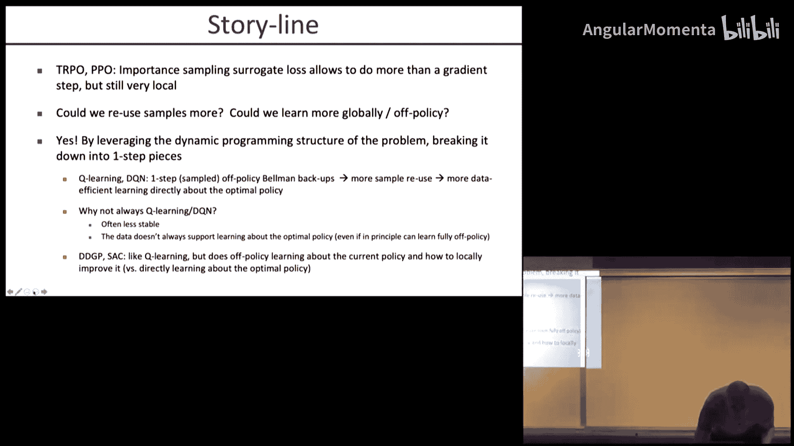

So today， we'll see D Q N。 We'll see。Soft。2， and then we'll see DDPG。And S。

And they're all quite related。 So I'm going to try to have them all on the board at the same time。

So DQ1。It consists of really two parts。 One is collecting data。

 The other thing is then after data has been collected and put in a replay buffer。

 updating the queue function that you learn from that data。First part， and this will iterate。

Collect data。Which is。Things that form ST， RRT， A， S T plus1。And put it into the replay buffer。

And then after a bunch of new data has been collected or possibly asynchronously have a data collection process and a learning process working asynchronously。

 you do a few updates to your Q function。 So the loss you put forward is。Some over some experiences。

 let's say next cake as it doesn't need to be exactly the most recent ones。

 experiences you get from your replay buffer。Of often squared loss or Hober loss， the target。

 often called。Why of。S。Okay。Minus what you currently have， which is your Q value Q theta of。SK。Okay。

And what's your target？Your target YSK is equal to。

The reward you got in that experience when you state Sk took action ak plus gamma times。

And then max over actions at the next time， not necessarily the action you took。

 but the action that maximizes the Q value at the next time the max over a。Prime for next time， Q。

The state you are in at the next time， so Sk plus1， comma， and then a prime。

 you get to maximize over。Now。Nively， you might use also Q theta here。

 but in practice that doesn't work in a very stable way because now you have this feedback loop that's very rapid and might destabilize the learning。

 So in practice， often you have a delayed。Theta minus is a delayed version of theta。

 which you could just periodically update。 so this you iterate frequently and then every now and then you said theta minus equal to the current theta and then you go around the inner loop very often again。

So that's standard DQN。Any questions about this？All right，This algorithm is essentially what。

Succeeded。putting deep reinforcement learning。On the map back in 2000。13。

 when Deep Minds show that this approach is able to learn to play Atari games from its own trial and error。

 and the data collection was done by just epsilon greedy at the time。

 So most of the time take action that maximizes your Q value， but then with some small probability。

 you take a random action。😊。

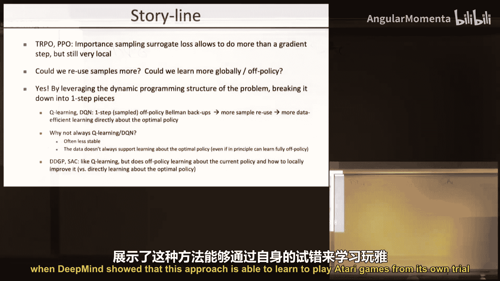

So the entire results from 2013 on a wide range of games。

 the exact same code was able to train a neural network to reliably play these games。

 The network itself was much like Alexnet just a bunch of convolutional layers followed by a few fully connected layers。

 Maybe the main thing to pay attention to is that it had an output for every possible action。

 So the Q network took in。Images output a value for each possible action。

 so this only works if you have discrete action spaces， otherwise you can't really do this。

Results were in about two thirds of the games， the DQN network learned to play better than human players。

 and in about one thirdd， not so much。 the one third where it didn't do as well typically is characterized by needing better exploration。

 So where random exploration just doesn't really expose the interesting parts of the game。

 then you don't get any signal in your Q learning。 and so you can't actually learn the optimal Q values because you haven't seen the things that lead to optimal behavior。

Now， what can you do to further improve this， One thing is that。

If you think about the target values being computed with this max over actions， well。

 initially your Q function is pretty noisy and if you take the max over actionss of this thing that's pretty noisy。

 then it might just be due to noise that a certain action looks better than other actions and then you take the max and so you get a drift towards higher Q values that's not really justified that's just really the noise propagating rather than something that's actual signal。

 so how to avoid is in double DQN what you do is you compute the arc max on one Q network。

And then you take the max。In another network， but the max is using the argmax actually you get from the first Q network。

 so you use two networks， one gives you the aGmax， the other one gives you the value associated with the action you get there that way if in one network due to noise。

 you pick a certain action。 Well in the other network。

 very likely the noise will not be the same and it won't be highly overestimated Q value that's propagating。

That helps a lot in stabilizing and ensuring that you don't offer overestimate your Q values and gives quite a bit better results on the Atara games。

Another thing you can do to make this work better is prioritize experience replay。

 such a very simple idea when you think about the loss function in queue learning。

It's a loss to get Q values closer to target values。 Now。

 if your Q value is already very closer to target value。

 you're kind of just wasting time computing the gradients of that loss and doing updates that don't contribute much。

 So prioritize experience replay。 will'll check whenever that error is large。

 keep track of that and prioritize。Data from the replay buffer where the Belmon era is large to get more informed updates。

It's a couple of other things you might want to look at。

Dwilling DQN is an architecture where the Q network is architected to explicitly also have a value function in it。

 and we know that Q function and value functions are related。

 now you have one network that has both Q and value function in it。

 which regularizes the learning quite a bit distributional DQN is a very different idea where instead of having a Q value that comes out as a real number。

 you have。A categorical output for a Q value so I'm trying to say my Q value is this number。

 you say I have bins， maybe 100 bins possible some sense intervals my Q value can lie into。

 and you just try to predict which bin it falls into so you get a classification problem rather than a regression problem。

It actually works quite a bit better。 it's not 100% clear yet why a lot of people suspect is because you propagate more signal because if all you propagate is the average Q value。

 you lose a lot of information but imagine you propagate specific queue values that can happen at times。

 for example， maybe sometimes you have a reward in the game that's plus 10 sometimes plus 30 that's different from an average getting 20 and so you propagate more informative signal through distributional Q learning looking at more detail of the future it's closer to almost predicting future states because if the reward is distinct at future times it's like trying to track what states you're gonna to visit in the future and keeping track of that。

Noisy DQN is a different way to explore rather than exploring by taking epsilon greedy random actions。

 you perturb the weights in the Q function。Why might you do this？ Well。

 random actions can jitter you around， which is good to introduce some randomness。

 But let's say you're aged in a hallway and you're just being jittered around。

 You're never gonna make it to one end though the other end it is going to take a very long time。

 But if you shift the weights， then you might shift them in favor of going to the left or in favor of going to the right。

 If you keep the shifted weights for a few steps in a row。

 you'll actually make some progress in one or the other direction rather than jittering back and forth。

😊，And so this can really help with exploration， it's not a full solution to exploration。

 it can make a difference。Now。If we want to use continuous action spaces。

 what I just described is actually not going to work anymore because you could not output a Q value for every possible continuous action value。

So what can we do？Let's work through the overall algorithm on the board。So。

The challenge we're trying to address is that。We cannot have an output for every action because we have a continuous action space。

Now you might say， well， oh， question， can't you just use a Q network？

Or you can pass in any action to it。It's exactly what we're going to do。Absolutely。

 so we cannot output a Q value for every action anymore。

 What we can do is we can feed in the actions and if we feed in the actions。

 we can still have a Q value for every possible state action pair。Now。

 the issue with feeding in the action is now when we're supposed to act。

Let's say when we're acting here， collecting data， want to find the action that maximizes the Q function。

 we have to solve an optimization problem。We have to find the action that maximizes the value for the current state。

The optimizationization problem can be expensive to solve。

 and so what we need to find is a solution to that a way to not have to worry about doing expensive calculations in every step that we take when collecting data。

So。That's one thing that softq learning is going to resolve。

 The other thing is going to resolve at the same time is' going to introduce entropy bonuses again。

 So it's going to try to ensure that we have more exploration thanks to entropy bonuses。

So to resolve the main challenge， when we're acting， we're going to have a policy。

So even though we're doing Q learning， we're going to explicitly parameterize the policy that we're learning。

And it's going to be a policy where we try to find a distribution over actions given state。

Now what might be the way to get a policy if we have a Q network Well。

 one way to get a policy when we have a Q network is to say what we really want is the maximumary policy corresponding to the Q values and we know what that is from an earlier lecture is going to be a policy that's proportional to X。

Q。80。Now， how do we find that policy， We can actually run gradient descent on this objective。

 So we'll have a parameterized policy pi theta。Our Q function。

 Well let's say we still use data for Q。 So we'll use。5ive for the policy， parameterized policy。Pfi。

And we can find this by minimizing。Over5hi the k divergence。Between。

Let's see which direction between the policy。Pifi。At S。And。The unnmalized distribution。

 but unormalizes final just be a constant in the Cal divergence loss。

 So we don't have to worry about that， X。Q， theta， S。And then this can vary。And so。

We'll have this part here where we minimize this summed over multiple。

Data points where we update our policy。Once we have our updated policy， we can act according to it。

 get new data。And we'll still have a Q learning update。

 But since we're doing soft Q learning now to introduce entropy bonuses， we'll have。An update for Q。

That is。Our。Q value should be equal to。Reward a time。T plus。

Expected value over state at time T plus one of the value at time T plus1。 And again。

 this is another thing we'll need to learn is。Value function here。And our value function。

Will be equal to。The softm over Q values log。Integral now， X。Q ST A。

Integrated over possible actions we could take at that time。

And so now we're keeping track of three things。A value function， a cube function， and a policy。

This will turn into a loss。 So for this thing， we'll have a negative sign here。

 We'll square this thing。And summit over many time slices and minimize over theta。This one here。

Will minimize。Over Psi。Some of men。Of。This thing squared Now there's a little bit of an issue here。

 This thing here to integral overall actions is often intractable to compute。

 So what we'll do for this one here， we'll use a sample based approximation So rather than integrating。

 we just sample a few actions。 we can sample them from the policy which is would be on policy sampling if you believe it're possibly pretty good。

 but you can actually also do completely off policy because it's Q learning。

 you can just sample actions and estimate integral with an empirical average over the actions and so we have three learning problems that we're solving in every atration of learning updates it we collect more data we repeat。

Any questions about this？Yes。Why do we have to do a log an exponent of Q， Why can't we just use。

Q value so。So the question is why do we use the log X here because we're doing soft queue learning here。

 So making two modifications in one go， we're making it soft queue learning where we want to maximize some of our words plus entropy and the plus entropy leads to this being the thing the softm rather than the hardm。

And。That I mean， in principle， there could be a temperature that you insert。

 but you can also rescale the reward。 that's equivalent。

 And so imagine we rescale the reward to account for temperature。

 then this is what it will look like。 Just log some exp。はき。Thanks， Harrian。All right。

 let's look at some results from this method。So this is the soft Q learning equations that we saw on the board。

Moving the policy closers。Something something called time variational gradient descent and it is more general than just for Q learnings。

 essentially whenever you have a implicitly defined distribution by an energy function and you want to explicitly sample from it because when you just have energy function。

 it's hard to sample from that distribution， you can try to find a policy or any kind of conditional distribution you can sample from by minimizing the KL between the thing you can actually sample from。

 which in this case is the policy and the energy-based defined distribution in this case through Q function。

All right。

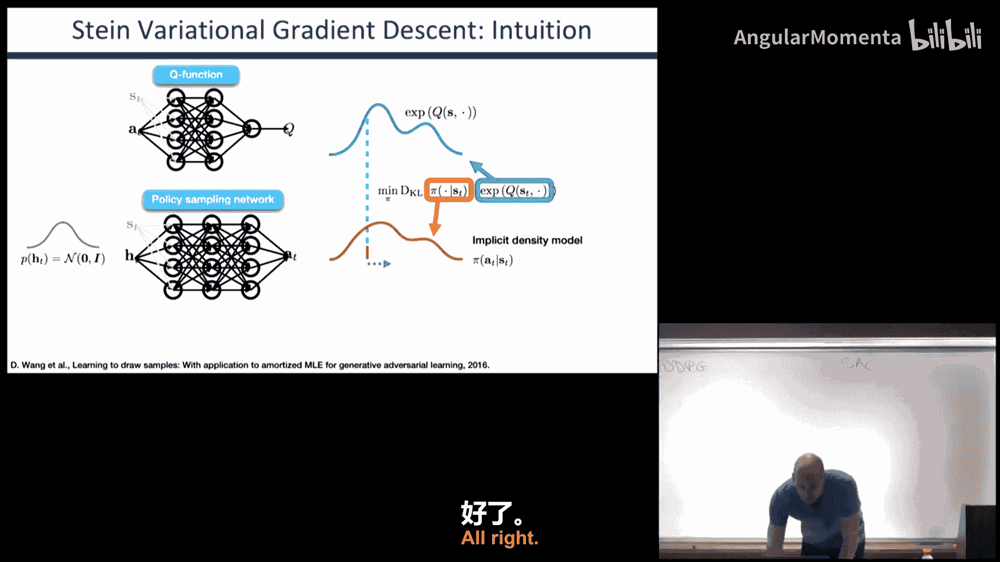

So。Wing is still off。Here is what we have when the robot starts out， random exploration。

The goal is to put the Lego block， the yellow block on top of the red block。Then。After 12 minutes。

After 30 minutes， the 30 minutes actually getting pretty good。

 it's finding the target reasonably well。And after。One hour。

It's able to consistently stack the block so in just an hour of training on the real robot。

 so it's actually pretty fast's able to acquire this skill。Or two hours here。

You can actually perturbine， which is pretty interesting。

And that speaks to the robustness of the policy it's learned。 And you might wonder， well。

 why is this so special while I think about regular key learning。

At the point you're converged or a any non maximum entropy version。 when you're converged。

 you might have found a very specific path you try to always follow。

 And the only thing your policy has learned is following that very specific path。

 but by using max entropy。Whenever there is freedom to introduce noise and still succeed is going to do that during training and be used to introduce any that noise and be more stable。

 and so that means that then if during testing， extra noise gets introduced externally。

 it's actually ready for that because it's explored the entire space and learns something robust across the entire space around just one very specific solution。

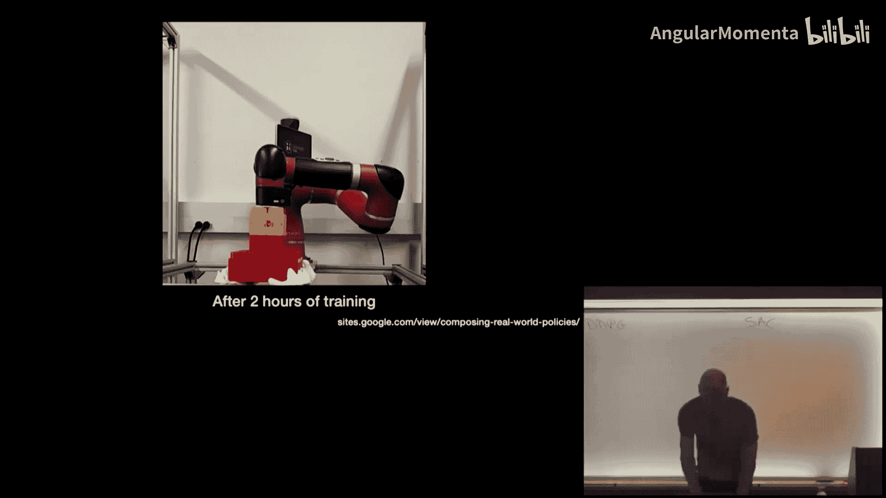

Okay。Before we switch to DDPG， any questions about Q learning or soft Q learning？

 that's the robot which state the time So good question。

 So what information does the robot have available here。 So the robot knows its own joint angles。

 So for each joint， that knows the angle it's had it also has a reward function and often a lot of trickery comes into to make sure you define the right reward function。

 The reward function here is based on distance to the target location。

 So it knows distance to target And so because it knows distance to target。

 the reward is very well shaped for the initial learning It's going very quickly learn to get closer to the target where it is not well shaped because it's just Euclidean distance to target It's once you're close because you need to come in from the top and the reward function doesn't capture the notion of coming in from the top is just straight line distance to the target。

 And so a lot of the learning happens in the。

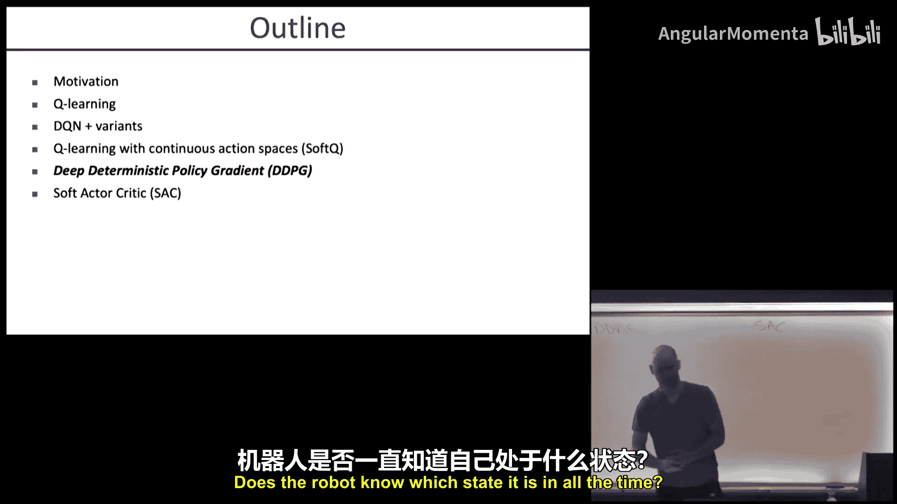

Second half happens all around how to get the block to approach the right way so you get onto the target because if you come in from the side or the wrong angle。

 you're never going to get there you're going to get stuck。

So wait the joint slips a little bit so you know your sensor is off like after know hour it's a good question。

 a real robot， it's very easy for maybe your sensory measurements to be wrong at some point and there's some drifting。

 In that case， there's a couple of things。 I mean， one thing is maybe you do visionbased learning and the camera can compensate for it。

 but this one is not using vision in these experiments。

 but there's no reason in principle you couldn't also include vision the learning would probably a lot slower because visual information is very high dimensional and it takes a long time to distill the information from but in principle。

 no reason you couldn't。 The other thing you could do is you could continue learning so。

The canonical use and what's shown here is you run queue learning for two hours。 and then you say。

 here's my policy。 I'm good to go。 Let's just keep using it。 But in principle。

 there's no reason you couldn't just let it run。After it's deployed and continue to improve。

 which means that if anything slips in terms of。Let's say encoder ratings， your encoders are off now。

 you can actually keep adapting。 Now the question then does remain。

 is your reward function measured accurately， because if your reward is not measured accurately。

 well， then you're learning against the wrong reward。

 So you've got to make sure that at least for the reward function。

 you've got something that's fairly close to ground truth。

 otherwise you learn against the wrong thing。A simple way to do this though could be to have periodic human interaction because in any of these methods。

 we don't need a differentiable reward function。 It's all just taking reward that was experienced a number。

 And so a human could watch it and say， give it a score like this was this good this good and you could directly learn from that so you don't need to necessarily program the reward function to it as long as somebody provides the numbers periodically to the system。

Now， of course， in research， we tend to program the reward function into it because otherwise you' got to sit there all the time and score the robot。

 which is very， very tedious， but in practice maybe that's what you need to do if you want to really solve for the human' reward function and not for something that might be off。

Now， one thing。With key learning is that while it's perfectly off policy， which is nice in theory。

 in practice， it's not always going to learn as off policy as you want it to off policy learning tends to be somewhat unstable because off policy learning means that you try to learn something about state action pairs。

 you have barely visited or have not visited at all from data that's coming from visiting other parts of the state space and you can't really expect to get a lot of signal there。

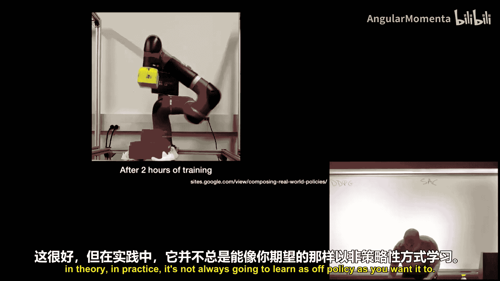

And so in practice。When you run Q learning， well， you actually run it pretty close to on policy because you run the max action or the soft max action most of the time。

 and then maybe sometimes some exploration。Given me you're doing that anyway。

 you could also look at algorithms that are more explicitly。Closer to on policy。

 log DDPG and soft a critic， which learn the Q function for the current policy rather than try to directly learn the optimal Q function。

 which you might not have the data support for。 And so often it can be a bit more stable to run DDPG or S。

 So let's take a look at those algorithms。

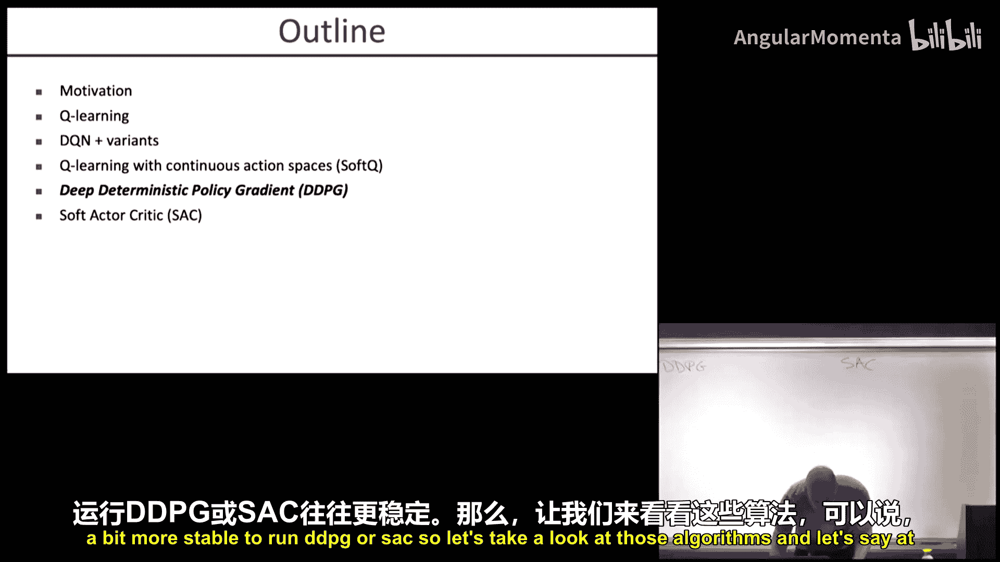

And I would say at this point。

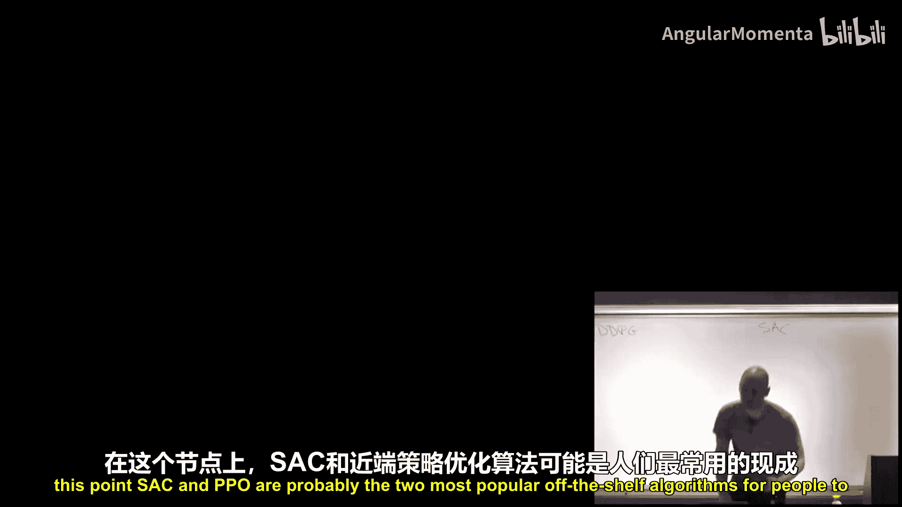

SAC and PPO are probably the two most popular of the shelf algorithms for people to run。

 And so we'll actually first see DP G， but EPG is kind of， I would say， a precursor to S。

 I can think of S as the maximum entry version of DP G。

 It's not 100% right is a couple subtle differences。 but essentially the hard version。

 the softm version。Alright， so in DDPG， we're going to first execute rollouts。 as in most of this。

 so we do some rollouts。These realouts are going to be under the current policy。

 it's on policy methods or largely on policy under current policy。And there'll be some noise。

For exploration。So actually， a lot like Q learning。

 you mostly follow what the Q values describe over there and then every now and then some noise。

Now the updates we do here。Are going to be to learn a Q function that is the Q function of the current policy。

So。We have。Our objective is sum over multiple time steps we've collected。Q phi。

 our parameters Q function。At ST after taking action UT。Should be close to our target。

 which here is called Q hat。For ST， UT。And then maybe squared loss。What is our target here？

Our target here is。Q hat。ST U T equals the reward we experienced in that rollout。Plus。Gamma times。Q。

Fi。ST plus 1。UT plus one for now。嗯。We'll make a slight change to this later。

And then we do a policy update。So we'll ultimately have DDPG for now I'm writing out the predecessor SQG0。

 and then I'll tell you what to change to get DDPG。Now， to get our。Actions， again。

 we're hoping to deal with continuous action spaces。

So we're going to have a parameterized policy again that extracts the max actions in a parameterized form so we don't have to solve an optimization problem every time we try to di in action。

And so the grant updates on the policy。And what's special about what DDPG is doing is that。

Rather than minimizing this diversions that we saw over here， which is maybe a fairly general thing。

 it does something a little more specialized。That only works under the assumption that you have essentially a continuous action space。

So it'll say。The grant update。So theta， well。Theta becomes。Theta plus alpha times。

And then we have a gradient update， which looks at。The Q values。Remember， Q is parameter by5hi。

 this gradient in disres respect to the policy。 So you can see I have Q values。For each。State。

I can look at what is my Q value as a function of。What my policy prescribes me to do。

And so I can directly optimize the policy by looking at， if I change my policy。

 how much would I improve my Q values in the states that I've visited so far？Now， of course。

 you can only do this if this has continuous action output。

 otherwise this gradient in respect to theta， which has to go through gradient of Q with respect to its actions。

 gradient of Q respect to its actions is only going to work with the chain rule if you have continuous action space。

Now， we said we're going to have some noise for exploration。 so the policy might have。

Some Gaussian noise called VT that goes into it。And so when you act at the current policy。

 you'll sample some noise that gets fed into the policy and your action will be somewhat noisy as a consequence。

 but you remember what noise went in and reused that specific noise as you do your backproagation here and so that's essentially the reparameerization trick which we've seen before。

 but applied here to extracting a policy from the Q function。This is SVG0。

What else can we do beyond what's here。Well。One thing we can do is instead of just looking at the robotouts we currently have。

 which SG0 does。 now we're going to transition to DDPG。We could retain a replay buffer。

 So instead of just taking the recent ones， we put this into a replay buffer。

We'll also put it in a replay buffer。Some of the data is old。

 and we need to be aware that this data is old and it's off policy data。 Can we correct for it， Well。

 the way we can correct for it is to say， well， actually， as we look at the target Q value here。

We're trying to get the Q value under the current policy。

 but the action UT plus1 coming from the replay buffer is an old action from an old policy。

 so what can we do， we don't actually put UT plus1 here。

 we replace this with the current pi theta of ST plus1。

Potentially with some noise also if you want to do that， but you can also put a zero there。

And so this is what allows you not to do off policy learning， you'll get to reuse your old data。

To learn the Q value for the current policy。If you run this long enough over enough data。

 it will actually converge to the Q values of a current policy。

 and then this is essentially the policy extraction again from those Q values。

 which in the very early lectures we covered essentially the policyeration。

 policy improvement update。 this is the policy improvement update in policy tueration happening right there。

So keep in mind at this point， we are going， this thing here makes it off policy。

Which has good benefits because that means that you can use all your past data in principle to update your Q values。

 so let's say you collected a bunch of data and you want to be sample efficient。

 you can do a lot of updates on your old data to update the Q function， update to policy and repeat。

Compareed this to PPO， which we just use the most recent data。Any questions about NBG， Yes。

 then why we care about on policyouts。That's a good question。

 Why do we roll out on the current policy， I would say that's the main difference between the pure queue learning approaches and the Q based policy grain slash Q based actor critics。

 I would call these two I means。Q based。Policy gradient or Q based actor critic is kind of not clear what exactly you'd want to call its because there's so many components to it。

 whereas that's pure Q learning。The reason you might want to do this as opposed to direct key learning is the same reason you might want to do policy gradients rather than Q learning。

 It's much easier to track performance of these because as you do updates。

 your policy is supposed to gradually improve over time。 whereas in Q learning。

 essentially what's supposed to happen is your Belmont error gets reduced。

 but it doesn't necessarily directly translate in better performance and it's harder to kind of get this monotonic improvement。

 harder to debug at times， Q learning tends to be very if you collect your data completely off policy。

 you have just harder time learning good key values。 And so this will often work more stable。

 And now with a caveat， there's how DPG itself。Its not that easy to run stably。

 but once we go to the soft version， that's one of the most stable。

 maybe the most stable current R algorithm。 if you use just want to use something out of the box。

 have to worry about the least and just hope is going to work out of the box。

 this is going to probably be the one that you want to use The soft version of this。

 And so why is it more stable because it's more directly optimizing a policy compared to Q learning。

 So the data for the Q function learning is more on policy， even though in principle。

 it's allowed to be a bit off policy and you can track progress more directly。All right。

 let's take a look at results from SVG and。DDPG。So we saw this one on the board。

 this is the basic version of DDPG， which is really SVG0， turns out there's other versions of SVG。的。

0ero refer to the fact that we。Only have one reward here。 And then the Q function。

 If there's a one there， you look at reward plus multiple time steps。

 and a K means you have K time steps of reward once K is。Now zero。

 what happens is you can not do off policy learning because if you look at the sequence of rewards encountered。

 well that sequence of rewards encountered is own policy， and so often it can be as data efficient。

The zero version will often be more data efficient。

 So it tested a bunch of 2D robotics tasks and actually it works quite well at the time。

These were some of the most sample efficient results for reinforcement learning。

Here is a swimmer going to target and same for the other environments。

 it actually works quite well with relatively small number of samples。Now。

When you start making it off policy becomes even more efficient。

 so DDPG put the off policy update into the target value for the Q function。

 here is the full approach that we wrote on the board and it's more sample efficient than the SVG approaches because it reuses the data in an off policy way。

Here's thePG in action on a couple of environments。Here is a reacher。At the time DDPG was the first。

To successfully learn， to control these kinds of robots from pixels。Why， well。

 likely because when you learn from pixels， you。Need more single and need to train for a longer time if you use an on policy policy gradient method。

 you need a lot more data， then DDPG could learn the queue functions and then quite efficiently learn to control these robots just from pixels。

LetsSee， go to the pixel based version， here's based on pixel features。

 meaning it's just getting the images as input rather than the underlying state and again it's learned to succeed at the task。

Now， at the time， it's kind of interesting， DDPG was super sample efficient that if you looked at the paper was like very。

 very efficient， but anybody who tried to reproduce the DDPG results ran into trouble and actually didn't really work all that well。

 And so it's like great results。 And if you are Tim Lily crap from Deep Min。

 It was like working amazing。 And then pretty much everybody else would not have the same amazing results。

 And so I mean， it's kind of nice to have an argument that's super efficient。

 but if it's not very robust。 And if it's hard to reproduce the results at the level that you'd hoped for。

 then maybe you need something a little different to make it more stable。

 And that's really where soft actor grid comes in。 So amazing results but very hard to get a stable implementation。

 And also across random seeds， some random seeds would do really， really well。

 initializations and others wouldn't do so well。 And so the question is， how do we stabilize this。😊。

That's where soft actic critic comes in。 The key difference is that now in the objective。

 we add an entropy term。 What does the entropy term do， Well， what it does。

 it encourages exploration， it also makes the policies more robust because as you execute a maximum entropy against the maximum entry objective。

You will try to find policies that can see a lot of variation and deal with that variation， in fact。

 they'll introduce their own variation during execution。

 their own random noise to introduce more variation and make sure they're robust to it。

So let's take a look at soft a critic， which is。One of the most widely used algorithms today。

 which achieves similar， a better sample efficiency than。DDPG， but keep in mind， in many ways。

 is the same algorithm is just the maximum entropy version。

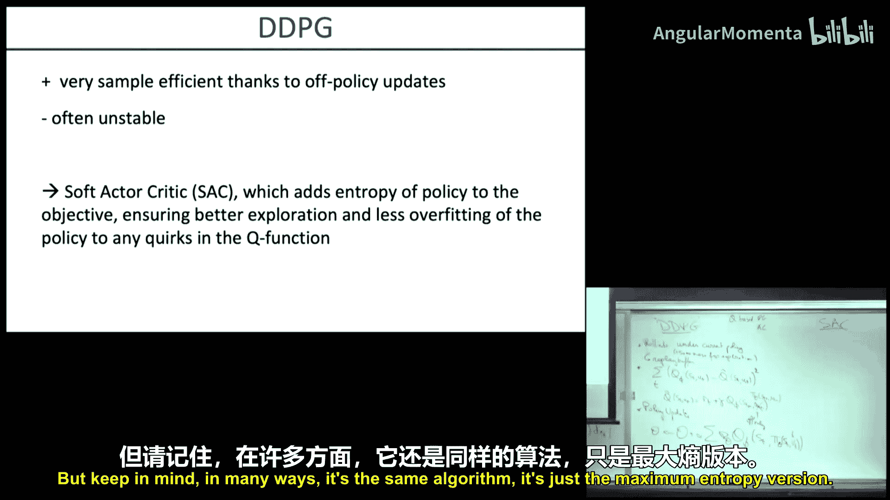

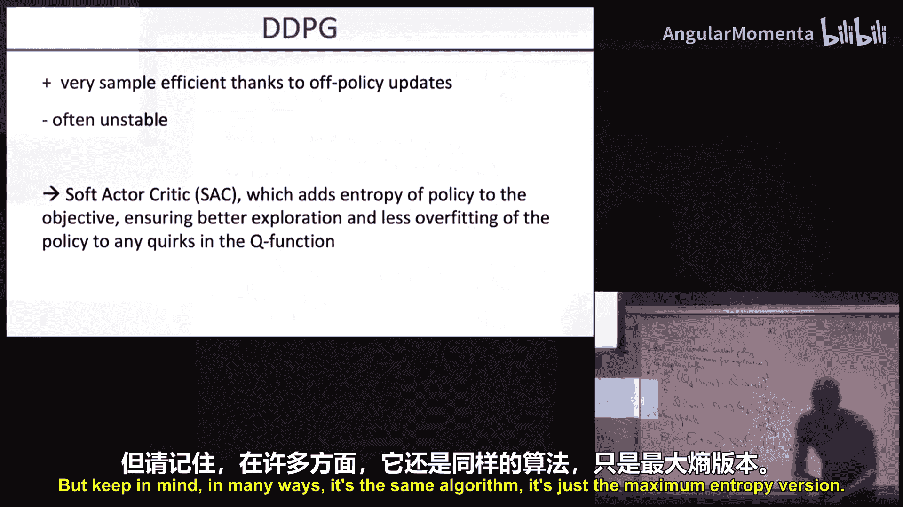

So S， what's our objective？We try to find a policy。Pi。That。Pi Phi that maximizes this objective。

Some over。Times。In the rollout。Then we have an expected value of。States and actions we encounter。Now。

 depends on。Essentially， the distribution we' encountered due to our policy。And we encounter rewards。

And we also evaluate the entropy。Of our policy， pie5。Action given state。So。

Everything else being equal， you'd rather randomize over your actions， but of course。

 if to get high reward， you need to choose a very specific action in certain state。

 you'll still want to do it because of the reward term and the objective。

What does the algorithm look like， will it trade？Rollouts。From。Pi Phi。

 and they go into our replay buffer。And then just like in soft Q learning。

 we're going to be learning three functions。 We're going to learn a policy， a value function。

 and a Q function。So。Was the cost function。For the value function， we have。Expected value。

With states。Coming from our replay buffer。Then。We have the value in our state St should be close。

To the expected。Value of take actions according to our policy pi5hi。Of， well， what is the value。

 It's really。The value under our current policies is， again。

 evaluating the value of the current policy is。Really， the Q function。

Averaged based on action taken according to the policy。And so far。

 this would just be a regular value function， but we have a max entropy objective。

 So in addition here， we have minus log。Pifi。Action。Given state。

So a state has higher value if from that state， you tend to take high entropy distribution over actions。

This， then we。Triryed to minimize over Psi。 So this is the thing we're minimizing over here。

 choice of psi。How about our target Q values？😡，Our target Q values is Q hat。SD。

Coma 8 equals the reward we encountered。Plus， gamma times expected value of S T plus 1 of V。So。

S deepless one。Okay。That's our target Q value in practice that expected value。

 we might not have anything available except for just the fact that we be the next data point S T plus1。

 and we just have to use that。But yeah， so that， that's all available to you。 This， by the way。

 the action is fixed here。 This comes from a replay buffer only experience of S T plus one。

 If you have a dynamics model by any chance， you can resample from that and augment your data pool。

 But if you don't have a dynamics model， you would just have your S T plus one from your replay buffer。

And then， the policy。Would be optimized by looking at the divergence。

Between pi phi at S coming from the replay buffer。Relative to the exponiated。Q values， Q theta， S。

Over some normalizing constant。 But again， it's not going to matter as this constant。

And so we have the same objective as we had in。Soft。Q learning here。 same thing。 In fact。

 they look very， very similar。 If you look at what's different between the two。 Well。

 it's pretty much the same。 We're learning three entities， policy， value function， Q function。

 we learn them in a soft way， the difference is really in the fact that when we learn our。Q function。

We learn it on policy， so we learn on policy Q function here as a consequence。

 the value function we learn is also on policy and so other than that extremely similar。

 but soft At critic learns the on policy value and Q function。

 this tries to learn the optimal Q function directly。

 which is often much harder to stabilize and make sure it works well。

And then you can play similar tricks， of course， as I talked about with the original DQ N。

 you can say， oh， I should do double DQ N， which means essentially you'd keep two Q functions around。

 And when you， you know， to stabilizebilize things or to value functions。

 then you can do Pol averaging to keep an old one around to regress on to rather than having this very tight feedback loop where you might have something destabilize because your targets here come from the value the same the value targets come from Q。

 So if you're not careful， this could destabilize So you keep kind of a running an average over past Q values and V values to stabilize this thing。

Any questions about S。好呢平啊。Is adding mean like that entry was always like an idea or there's any cases where you wouldn't want to do that。

Yeah， it's a good question because I mean， in some sense。

Some algorithms like if you look at the original PPO， it does not necessarily have the entrypy bonus。

 but you can add it。 I mean， it's not that hard to add it in and you get typically you get better exploratory behavior。

 So I would say generally speaking， it's a good thing to do it adds another hyperparameter。

 which is the temperature in front of the entropy and you might have to kneel that over time in some kind of clever way and then you might say。

 well， if that's what we're doing anyway， maybe I should just have a hyperparameter for maybe directly temperature my policy or introducing random actions in the mix if it's off policy method and you're in some sense tuning something similar but the beauty of having entropy is that it's a little more attuned to the state because when you have an entropy。

And to be introducing the randomness you will in some states start decreasing randomness pretty quickly because those statess are critical for you to take the right action。

 whereas other states， it's much more open ended the what you get to do。

 and so it'll have more randomness there。 So in sometimes it seems a cleaner way of doing it but it doesn't necessarily always help because if you you still have a temperature hyper parametera otherwise you just have a kind of hyper parameter on how much randomness you might introduce in your policy。

Kith， so it's possible to come up as a policy for these Atari games。

 or is it just or these things don't really。Work on the you have to or how does the policy look like on an authority game？

So。DQN， of course， became famous around the Atara Game。

 and after the Atara game results can of historically looking， it was first DQN in 2013。

 It worked well in the Attiara Game。It didn't work well on continuous control problems because of the issues we kind of resolved here。

 which is you need continuous actions and continuous actions are not compatibled with the original DQN architecture。

In parallel， the policy grade methods got developed and actually people found them easier to get to work。

 TrRPO PPO more stable is more of a direct optimization。

 And so those worked well both from continuous control and for the Attiara games and so all of these work just fine for the atti games。

 No problem you can well not all of them DDPG does not allow to deal with continuous actions requires continuous actions So DDPG is not particularly compatible with atti games that once you do this Cal divergence way of updating the policy rather than the。

Graient going through the Q function， you can again deal with discrete actions。

 And so soft tactic critic and soft Q can be applied to discrete action space is no problem。

 And in fact， people run soft tactic critic on the entire games at times， andll it'll work just fine。

😊，It really depends a lot on what you're trying to do。If you're。

I would say if you look at the spectrum of algorithms， there is。

Policcy gradient methods with PPO probably being the most used one today。

 There is these Qbased policy gradient s ari methods and there is more Q learning direct Q learning based methods。

 and as you go from policy gradient to Q learning， often it's a little hard to get to work as you go more and more off policy。

 but also you can often get more data efficient So you're trying to generate a plot where the horizontal axis is number of samples collected in your environment the vertical axis is performance then Q learning is often going to give you the best plot because you reuse your samples maximally but sometimes hard to get to work and you actually spend a lot of compute on all your samples On the other hand。

 if your horizontal axis is well clock time vertical axis is still performance。

 and if your samples are cheap to collect， then often PPO will be your method of choice because it's more stable to run and it always uses the latest samples and the latest or more informative than the old ones So you might as well use the latest if they're cheap to collect。

 and then soft tactic critic is kind of in a happy medium and that happy medium I would say makes is one of the most popular methods today。

If you look at most papers coming out today， almost everyone compares to soft actor critic whenever they come up with a new idea to see how it fares against that or have an augmentation of soft actor critic to see if their augmentation makes it maybe better than just a simpler like original version。

Alright， let's look at some。Soft actor critic。And。Videos。So we put this on the board。

 oh the screen is not down。We saw this on the board， we saw the kind of cleanup version。

Let's look at some learning curves。So。Here， we have exactly the phenomenon I was talking about。

 We have。Soft tactic critic learning in a very sample， efficient way shown in。Yellow， we have DDPG。

 which we know is essentially the same algorithm that is the nons version。

 And probably if somebody tunes it really， really right。

 they can get that green curve somewhere close to the soft a critic。

 but it's just harder to get it really tuned right。

 And if you just run it out of the box or with some limited tuning， here's what we end up with。

 It doesn't learn anything on the humanoid problem。Then PPO is shown over here。 Well。

 it's less sample efficient。 Why， because it doesn't reuse the data and off policy way that softte critic is going to do。

 And so you expect it to be a bit less sample efficient but ultimately all get to the same level of performance。

 Now， one of the interesting things is Thomas Hannoya， he used not Berkeley。

 who came up with this method at the time， the way he would showcase his the work。

 he would essentially say。I run all the other model free methods。And I show you the best performance。

 the best policy I read， let's say。5 random seeds and of the five random seeds have picked the best one。

And show you the result of that one。 So the algorithm is somewhat unstable。

 Some of these random seats will find no good results。

 but then the best one often still pretty decent。 and then we show the worst one for soft a critic and show that it's actually as good or better than the best one from the other algorithms showcasing how essentially robust and stable the soft ari approaches relative to most Rl approaches。

 And so here you see the learning curves on a wider different runss。 And again。

 if you look carefully the learning curves， you'll see that the variance on these soft a critic curve is actually pretty small while being well above everybody else。

 And some other methods in some of the runs have really high variances。

 meaning across different runs that was very different level of performance achieve。Here is。

SoSoft data critic policies in action， so this Hopper found a really good， robust strategy。

Two legged walker。起了。It really as Cheeetah。Some of the very， very best results ever on Chetah。

And pretty interesting strategy here where it mostly uses。

Kind of two legs for propelling itself forward and the other two just do not fall forward or backwards。

 which is not exactly how you imagine running for this robot， but it's optimizing some reward。

 That's velocity off to the right。 and this just happens to be the way to optimize it。Humanoid。

There's nothing in the reward function about how to hold your arms as a can。

So it hass found an interesting way to hold its armss。😊，um。Here found a different thing。

Then actually was tested on some real robots。 so here's a four legged real robot and soft tactic critic reliably working on that。

Even when with perturbation to the environment， again that's kind of illustrating some of the benefits you often get from maximum entropy approach is that you're more robust at perturbation because while you're training。

 you're perturbing yourself and so you used to being perttuurbed。

 it didn't know that obstacle was there just kind of just trying to get through doesn't have a camera is just you know doing this regular locomotion with perturbation forces caused by those blocks。

睇。Then。Turning evolve with。Robot hand。The bottom right is what the robot sees。

So lower resolution version。Now what we see， but。Somewhat the same view。

And then Lego block stacking again and also master that。So quick recap of the storyline。t。

Important sampling on the surrogate loss to be able to do more than just a gradient step。

But it cannot reuse samples as much as if you start looking at the dynamic programming formulation where you look at one step transitions rather than full rollouts。

 the one step transitions by leveraging those you can go off policy Q learning does that in the most extreme way。

 often not as stable as a policy grain method， softft tactic critic is kind of the happy intermediate in many ways。

 you looks at the one step transitions to allow for off policy learning。

But then still updates a policy and learns largely on policy in terms of data collection and the data it's then using in the replay buffer to do stable learning yet more sample efficient than if you don't look at them one step transitions and don't get that off policy benefit。

Something very interesting that we wrote up two years ago is that there's actually very close equivalence between policy gradients and softq learning so you might think policy gradients and softq learning are so different。

 but actually if you look at the details of soft queue learning and if you assume that in softQ learning you collect your data according to the Boltzman policy which is the expd Q function probability distribution。

 if you collect your data according to that policy well then effectively you're following a very specific policy you're following a policy and you're updating a queue function which in turn updates the policy through the Cal divergence maybe you look at the details of that。

 it actually starts looking a lot as a whole like a policy gradient update and so in practice even though well talk about Q learning as being so different in practice a lot of people use the Boltzman。

 the softmax policy for the data collection and hence at that point it brings Q learning a lot closer to the soft methods here as well。

As policy grant methods。All right， let's take just a one minute break because I want to cover a bit of model biel still today。

 So one minute break and then we'll start model biel。Okay。Alright。

 let's restart model based R What are we going to cover， we're going to cover the basics。

 then ensemble methods， we're going to look at the asynchronous model based R and vision based model based R。

 the asynchronous and vision based will for sure be for next week。So quick reminder in RL。

 what do we do who have Asian interacting with the world collecting experiences。

 hoping to maximize reward？What's model based URL， you collect data under the current policy。

 learn the dynamics model from all data collected so far。

 and then you effectively run RL inside the dynamics model because you now have a simulator。

 and so you can run the RL in the simulator， which might make you more data efficient because instead of using your samples to directly update your Q function or policy。

 use your samples to build a simulator and then you can do all the learning in the simulator。

Now it might be that the policy you find this way is not the best yet because your simulator is imperfect。

 you run that policy in the real world， get new data where that policy thought the good stuff was going to be if it's right you're done。

 you collect your higher rewards that's it in practice often you're not done you see that it's not that great。

 but you collect data， that data allows you to improve your model。

 now in the new model you run reinforcement learning again。

 that new model will know that the past policy was not so great because the data now supported not being so great and it'll find a new policy you'll try next time in the real world and repeat。

Why would you do things this way， you would anticipate better data efficiency because you get a model out of data rather than directly updating policies or Q functions。

 and you learn a model which could be nice because now if your reward function changes。

 you can use that same model to learn against a new reward function and have a new policy against a new reward function。

So again， here's the algorithm benefits， better sample efficiency， hopefully。

 so why is it not used all the time if we have a method that's more sample efficient and a lot of people love to plot horizontal axis sample complexity vertical axis performance。

 why wouldn't you do this all the time？Well， often there are instaabbilities and we'll look at that more in a moment and fixes to it and often it does not achieve the same level of performance as model free methods and so that's a problem because now you say。

 oh， I'm very sample efficient， but I saturate at a lower level of performance。

 you might not be happy with the outcome I'd say well yeah sample efficient but bad outcome。

 what's the point I'd rather take more samples and get to a better outcome。

So we'll see fixes to both of those and both will rely on learning ensembles of dynamics models rather than learning a single dynamics model。

So。What's under the hood， Under the hood， There is overfitting that's happening in model based neural。

 Now there's two types of overfitting that can happen。

 First type of overfitting is model based neuralil learns a model from state in action to next state。

That's a supervised learning problem When you do supervised learning。

 you could overfit your training data， memorize the training data， do poorly on test data。

 but we know how to avoid that， so we should just avoid that that's not the real specific challenge to mal bistro。

 just do that right。The real challenge is that your policy， when you optimize it in your simulator。

 tends to find regions in simulation where your policy looks like it's getting really good performance。

 but that part of the simulator is not reflective of reality。

 so it's your policy optimization overfitting to the quirks of the learned simulator and taking advantage of some of those quirks to get really good performance and sim but bad performance in the real world。

Now， if we think about it， what can you do about this。

 We're think about a mismatch between real world and learned simulator。

 How do we measure that mismatch？ Well， we could train an ensemble。

 if we train an ensemble of models。If the model in ensemble agree。

 it means the data supports what they're saying。 if the models in the ensemble disagree。

 it means the data does not support what's happening in that part of the space。

 and you maybe should not have your policy go there because it's a part of the space where you cannot trust your learning simulators。

So that's exactly what model ensemble trust visionion policy optimization does there's a lot of detail here。

 but really what it comes down to is instead of learning one model， learning an ensemble of models。

And when you train， you keep track of agreement or disagreement between those models and you have an new objective。

 something that keeps you away from where these models disagree。

 you don't want to have policy grand updates based on the parts of the space where the models disagree。

 so it's very simple， you collect your data， do policy grant updates in the simulator but when the models disagree。

 you downweigh or get rid of that data because it's not the signal that you want to use。Okay。

 so we can then simulation run TPO or PPO。 this paper happened around TRPO。

 And here are the learning curves for these environments。 So we have in green。

 the proposed method and other colors are。PPO and TrRPO standard model free methods。

 and then in purple DDPG and SVG infinity， which is another kind of older model based method。

And we see here that the approach I described does a lot better in terms of learning a lot faster。

 low rhythmmic scale and the horizontal axis。 So being a little bit sooner up is often a factor of 10 or 100 faster and we see that it does actually pretty well in most of these environments some of them like half cheetah。

 it doesn't really get to the same level of performance as the model free methods。

So we can also abllate this。You can do TRP in the simulator， or you can do。

Back creation through time in the simulator， different ways of optimizing your objective。

 we see here that running TrRPO or generally a policy gradient method rather than a back through time method leads to more robust optimization of your policy。

Why might that be， I think that's still a bit of an open problem。

 One reason could be that the policy gradient methods introduce noise and you get a more robust optimization process a bit like the maximum entropy thing。

 maybe you do backward through time with max entropy， you'll get something similar Who knows。

 or it could be that backward through time has exploding vanishing gradient issues so you don't get a signal that you really want。

 whereas policy gradient methods with likelihood ratio don't have that issue。Here's another ablation。

 It's looking at the number of models in the ensemble。

 If you have one modeling the ensemble that's shown in green， it doesn't do nearly as well。

 So having this ensemble and staying away from where the ensemble disagrees is really critical because you're just one model you can't do this and the performance is a lot less。

Do you need 20 models， the yellow curve， not really if you have 10 models。

 it's enough So in terms of computational efficiency， you might just want to work with 10 models。

 not more than that for at least snake， half Chean。

 and of course this is going to depend on the complexity of your environment。

 very complex environments might require a larger ensemble to understand the kind of intricacies of where you already learned enough about the environment versus where you don't have enough support yet。

So。We get this to work very stably。 But actually， if you look carefully at some of these problems。

 it does not get at the same level of performance as model free methods。So what to do about this？

Well， the reason this happens because the learned ensemble of models is imperfect。

 if it is an ensemble models， it doesn't perfectly match the real world。

And there's actually two complications there， one is it doesn't match the real world。Two。

 you're trying to find a policy that works across every member of the ensemble。

And that's a robust policy， robust policies are great because they're robust。

 they can deal with variation， but if there's a lot of variation。

 you'll end up with a very conservative policy that can also not leverage the specifics of your environment that you're actually in is trying to find a solution that works everywhere。

So one thing is you say， well， just learn better dynamics models。

 but people have not really succeeded at that。Second fix is to do something called meta learning。

In meta learning， the idea is that instead of learning a single policy。

That is good across all members of the ensemble， you're going to learn a adaptive policy。

That whenever dropped into any of the ensemble members gets to quickly adapt to the specifics of that ensemble and be specialized to whatever environment it's in。

 And then the hope is that when it's dropped in the real world。

 it'll also specialize to the real world。 And so you learn。To be an adaptive policy。

 so there's going to be a recurrent neural network now rather than a feed forward network。

 and this recurrent neural network will take in state action rewards stayed over time and will be trained such that when deployed in a new environment。

 it can quickly adapt to however that environment tends to behave。What does it look like as a whole。

 we still it tradeed in some outer loop over data collection with our current adaptive policies。

 don't worry about the details too much， just assume soon for now this is one policy。

 our current policy collects data。Then we learned an ensemble of case simulators from all past data。

We run meta policy optimization over the ensemble， learn a recurrent neural network that no matter which member of the ensemble gets dropped into。

 can achieve high performance， thanks to the ability to adapt to the specific member of the ensemble it's dropped into。

This gives you a meta policy that is a recurrent neural network that is ready to adapt to hopefully the real world。

Now in reinforcement learning， exploration really matters。

 so we do actually a slight extra thing rather than dropping this meta policy in the real world。

 hoping it'll adapt quickly enough and be done。We know that likely we need to collect more exploratory data before our simulators are going to support ending up with the right policy。

 So actually do an adaptation step to each of the models in the ensemble。

 which will now lead to a range of policies。And that range of policies gets adopted。

 gets tried out in the real world， that's the adaptive policies shown at the top， and we repeat。

If I want to see this in more detail， I mean you'll have the slides， you can stare at this later。

 that's what I just showed but laid out in pseudocode。

So we tested this on these standard opening IG environments。 And heres what it looks like。

 on the left， we have。

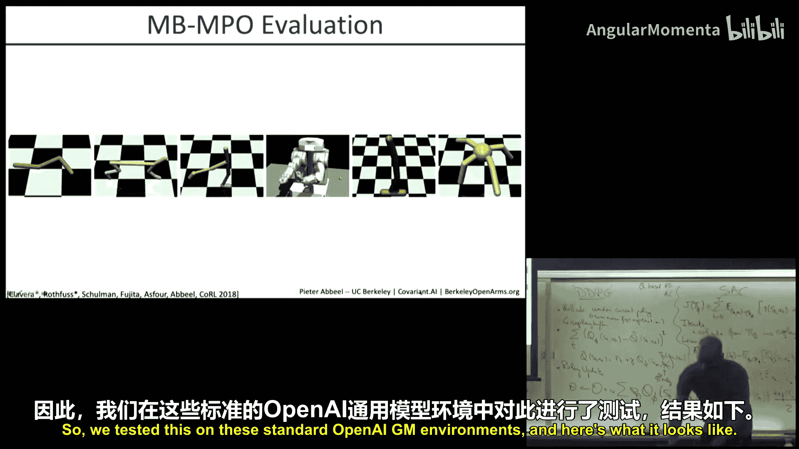

N the MPPO， the model based with meta policy optimization on the right PPO。

We see PPO is still exploring， has really have not learned anything yet about how to control this cheetah robot。

Whereas MBMPO after about 45 minutes of real world interaction time。

Has mastered running the cheetah off to the right。 And so see in about 45 minutes。

 we can learn to control this robot。Now， one quick caveat here， of course。

 if all we care about is controlling the cheetah robot， why we would learn a model。

 we already have a model， Mojoko gives us the model， this is just a research experiment we say。

 assuming we don't have unlimited access to the Mojoco simulator。

 we want to minimize how many samples we collect from the Mojoco simulator。

We're going to model based around learn simulators。

 neural net simulators and see if we can through that more efficiently learn to control the CheeetA robot。

Here， same thing for the 2D walker and for ant， again in about 45 minutes of interaction with the Mijoco simulator。

 it's possible。For the metapoli optimization approach。

 multi basedase metapoli optimization to learn a policy that can adapt to the actual simulator and be successful there。

 whereas PPO of course， in 45 minutes or an hour， will not yet know how to control these robots。

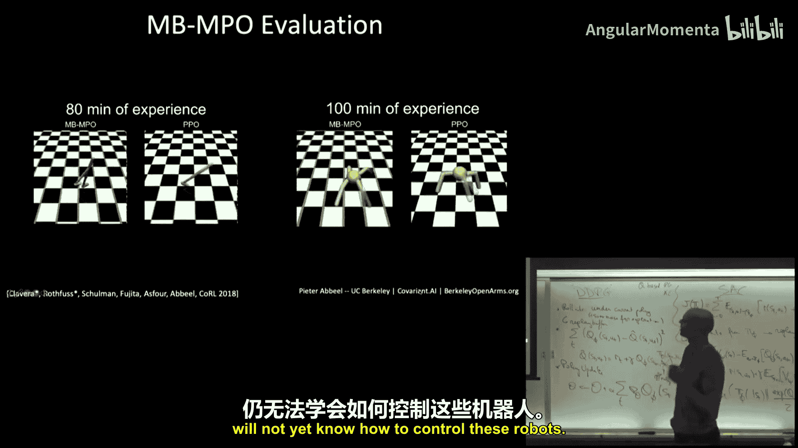

More quantitatively， these are the learning curves in red is the model based meta policy optimization。

 and in the other colors are different model free methods， actor。

 which is a natural gradient version of policy gradient， TRPO， PPO， DDPG。

What are the main things we want to look at here， One is that the model based method shoots up more quickly。

 so it's more data efficient。But that's always been true for model based methods。

 What's so special about this specific result is that is the first model based approach that achieves the same asymptotic performance as model free。

So we're not compromising on the asymptotic performance。

 We're getting the same asymptotic performance。Yet a lot more sample efficient。

We can also compare with what I just covered the model ensemble trustfuion policy optimization where we learn a single feed forward network that is robust across all learn models in the ensemble。

 which is going to learn something a little more conservative and that's why I's going to saturate lower and actually learn a little slower so here previous day of the art the model ensemble TrRPO in blue and then the learning and adaptive policy。

 MBmbMPO in red and on most environments it makes a significant difference in terms of performance you end up achieving。

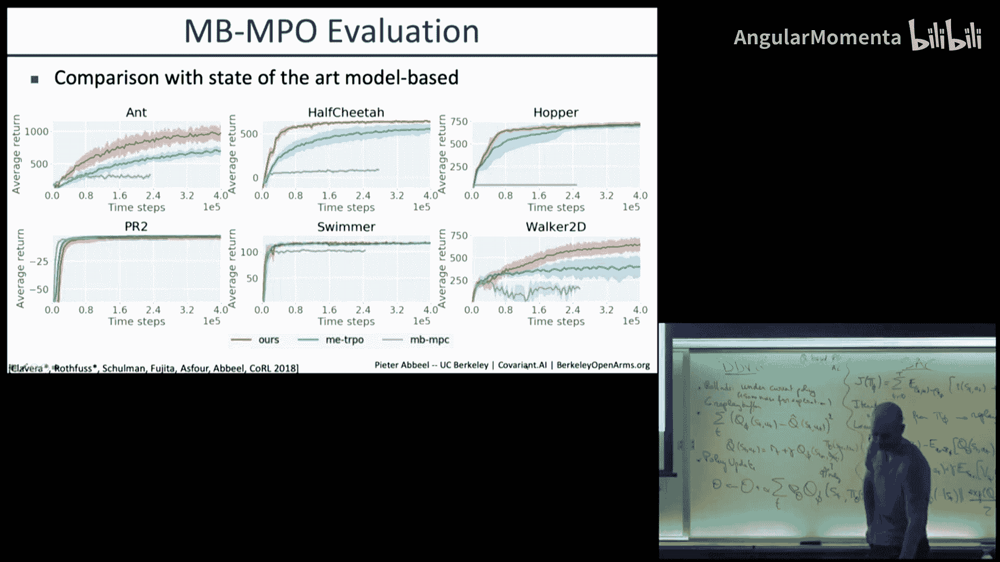

You can also run this real robots， so here is PR2 robot learning to stack the block。

On the left with model based meta policy optimization on the right with PPO。

 And in about 10 minutes of real world interaction， it's learned the policy that can reliably stack。

The red block onto to the yellow block there。 So 10 minutes， that's it。 So very。

 very fast learning compared to really any past work。

 except for some very highly specialized work for this kind of setting。

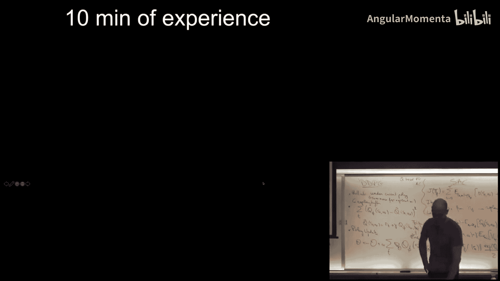

So are we done， Not really。 The reason we're not done。

 even though that video when you watch it looks very appealing， actually。

 if you go watch the PR 2 run that algorithm， most of the time it's doing nothing。

 It'll just collect data for 30 seconds and do a massive amount of compute。

And that's really what's happening behind the scenes。 if you look at these learning curves。

 it's okay。 horizontal X is just data collected， but in model- based methods。

 the amount of compute you do behind the scenes means that your wall clock time is actually pretty long often before you get to good performance because well that's what you're doing。

 you're trading off。You want less samples in exchange you're going do it just a lot more compute。

 So question is， can we make this close it to real time？

The results achieved in model based reinforcement so far tend to be limited to shorter horizons than model free methods tend to succeed at。

Something where when you learn a similulator。The simulator accumulates error over time。

 and so your simulator might not be as precise over long horizons。

 making it hard to learn things about long horizon problems you need to solve。

Then what I just showed you was from state， but maybe we want to do things from images。So。

Limiitted the short horizon。 I don't know of any good fixes for yet。

 but next lecture we'll look at the how to make it real time and how to do it from images rather than from state。

So that's it for today。Right now we have some cool demos， Keith， do you want to。

 I think we can stop the recording for the lecture in the back， I not sure you hear me。

 stop the recording of the lecture。

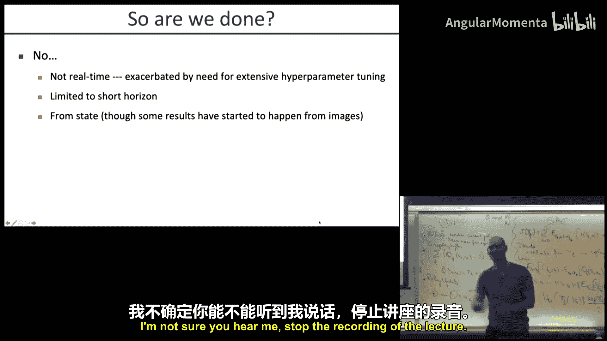

And then we can do some of the demos。