# 【加州大学伯克利分校】高级机器人学-｜-CS287-Advanced-Robotics-at-UC-Berkeley-Fall-2019-p20-21-物理模拟--BV1KXqCB4Eua_p20-

Yeah。All right， welcome everyone to lecture 21 of CS27 today in the second half we'll look at how to make your computer simulate physics in the first half we're going to wrap up some ideas around model based that we didn't yet get the cover yet last time a couple of logistical things first though。

You have an exam coming up， you should have received exam slots， you also have onpiazza。

 all the material to study question， answer format。

 so it should be very clear when you get the questions what these questions are asking for because you have a handout that tells you what the answer should be to those questions。

嗯。And yeah， we'll run some random thing ahead of time to randomly extract some subset of those 20 questions。

 and then you'll have a handout to complete。Let's see， homework5 is still being finalized。

 hopefully going out in the next couple of days。And whenever it goes out。

 you'll have two weeks to complete it。And soon we'll share some sign ups for final project presentations。

Any logistical questions？All right， to technical content。 then。 So last time we covered。

The foundations of model based R L。 And so the kind of。

mainin kind of algorithm outline was collect data under the current policy。

 learn a dynamics model from past data， old past data。

 and improve the policy by using the dynamics model and repeat。

And we saw historically there are some challenges with this because often the dynamics model you have learned doesn't match with the real world all that closely。

 and when you optimize your policy， you might take advantage of essentially quirks of the simulator that you learned and think you're going to do really well because in simulation it looks really good。

 but in reality it might not work so well。One way on is just you should learn a better model go around this loop for longer。

 but if the space is big， this might actually be hard to achieve。

 the solutions we saw that seem to work better are ensemble-based methods where essentially you have an ensemble keeping track of a posterior over possible dynamics models and then you can try to learn a policy that either directly works across all members of the ensemble or is an adaptive policy that whichever member it's dropped into。

 it knows how to adapt quickly， so also it can probably adapt quickly to the real world。

So we saw that actually doing the adaptive approach can give us learning curves that are very impressive where we see model based or all shoot up much more quickly than model free methods。

 which we expect， but not only that also achieve the same level of performance as model free methods。

And then we even watched a video of a。

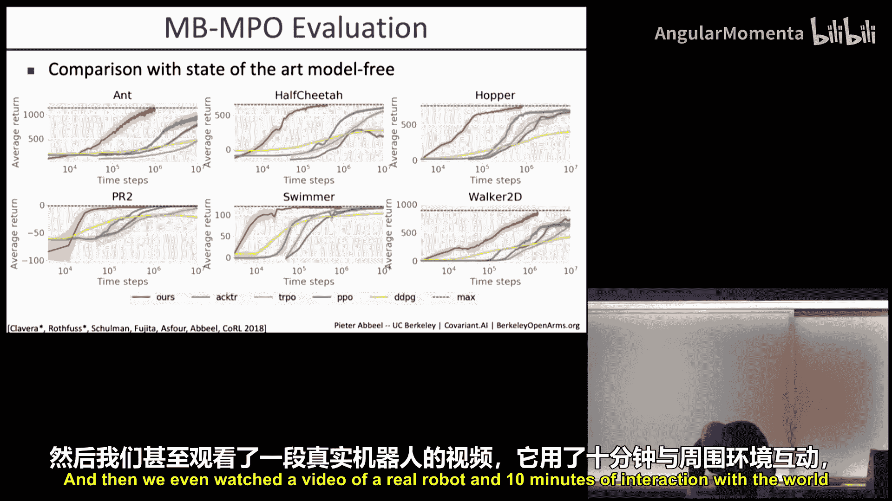

Real robot。And10 minutes of interaction with the world learning to stack a Legoblock。

 the model based with Mepoli optimization approach shown on the left and then PPO model free shown on the right and so in about 10 minutes the model based approach is able to learn to do this which is really。

 really fast， but when I say in about 10 minutes it's more subtle than that if think are we done with all this。

 actually it's not really happening in real time。

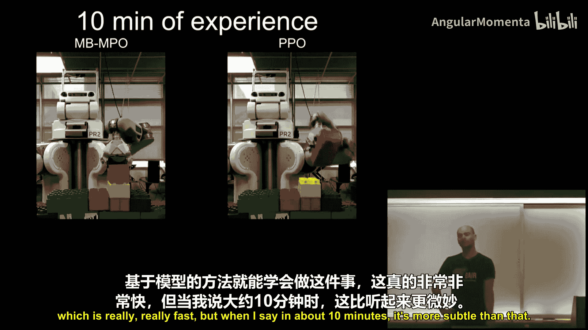

When you're on model based drill， often in the background， you do a lot of calculations。

 I'm going to say 10 minutes of real world interaction， sure， 10 minutes of real world interaction。

But it'll do half a minute of real world interaction fall by 10 minutes of compute。

 fall by another half minute of real world interaction and repeat。

 and so the question you might ask is can we get this close to real time。

 not to mention if you really experiment with actual robots。

 often you need to tune hyperparameters and so if your experimental cycle is really slow。

 it's hard to get these hyperparameters tuned to get this to work well。

Then another limitation in current model based real methods is they often limited to short horizon problems because your simulator will have a hard time simulating precisely。

 you learned simulator， will have a hard time simulating precisely over a long horizons。

 and so it's hard to learn about what to do over a long horizon and your simulator if a simulator can't simulate that。

And then the other things that a lot of is from state。

 so the two things we' want to touch upon now are resolving that first bullet point and the third one。

To some extent， and the second one， I guess， is maybe maybe by the time the lecture comes around next year。

 we'll be able to say more about that。 but for now， I'd say it's fairly unsolved。So。

How about this real time thing。 So the typical way you would run model based。

 you have an environment， you collect data， then you say， okay。

 time to learn a model from all the data I put in my data buffer。

 then time to improve my policy by running it in my simulator that was learned from that data。

 And now I have the best I can possibly do presumably based on the data I've collected so far。

 let me put that in the real world and hopefully it does better than the previous policy and repeat。

😊，So in some sense this is meaningful because you say if I'm going to collect data。

 I'm going to do all the work that I could possibly do with that data to learn a model。

 then I'm do all the work I can possibly do to improve the policy and then I'm going to deploy that policy and so I'm using all past experiences to have the best possible policy deployed to collect data from again and repeat。

 so it makes sense to do it this way， but it also means that often between your data collection。

And then all the learning happening in the next data collection there's just a long time span and question is can we avoid this and one way to do this of course。

 is to say， well， instead of doing this in a synchronous fashion where there is three steps to get executed one after the other how about doing it asynchronously。

 there's always data collection happening。And similarly there is model learning workers and policy improvement workers and they continually all pass the results to each other。

 so as you get a new data point， it gets passed to the data buffer which gets pulled from by the model learning worker which right away might use the latest data doesn't wait until you finish a bunch of episodes just pull it right away same for your policy improvement worker。

 it will continually update a simulator it's learning against with the latest model parameters that come from the model learning worker and then data collection will happen always with a new policy because whenever you're collecting data you're going to draw the latest policy parameters and execute on that。

So some questions， of course， that come up then is。

 will this have the same level of performance because we're not essentially consoliing everything we could have gotten out of our data before we do data collection again？

Might have some effect on policy regularization。 and the reason it might be effect on regularization is because you're now always learning in a different model。

 The model is always changing， so maybe it has some effect that it kind of regularizes your policy。

 which could make it more robust。Couldative effects on data exploration， again。

 why might it have some effect there， well， if you always change the policy。

Then the way you collect data is in a more diverse and more exploratory way than if you have this policy you think is the best policy and you then collect a ton of data with that policy and repeat。

And how robust is this to hyperparameters。 The interesting thing is that in what I described。

 there are pretty much no hyperparameters。 So if this works。

 this would be nice because you're just continually feeding data through and you don't have to worry about how long do I train the model。

 how long do I train the policy， how long do I collect data。

 It's just all happening all at the same time， No tuning of how long it should take。😊。

And then you can ask， well， how robust is that that whole thing to data collection frequency because well。

 now you have some kind of implicit dependence on the speed at which your robot collects data。

 because speed at which your robots collect data determines really the speed at which new data goes through this loop。

 and that can depend a lot from system to system， how fast you can collect data may of many of that collect data in parallel and so forth。

So how does it perform this， a very recent paper presented at Coral two weeks ago， we're comparing。

Asynchronous。Mugel ensemble T，RPO， model ensemble PP，O and。NBMO。

 which is the meta learninging version。And we compare that with baselines， the baselines are the。

Synchronous versions of the same algorithms， as well as the model free methods， TrRPO and PPO。

And we'll look at average return versus time， which is does is actually learned fast when we watch the robot in real time。

 is it faster， and we can look at average return versus sample complexity。

 the number of time steps it takes in terms of data collection。Well， here's against wall clock time。

Solid lines are the asynchronous versions and the dashed lines are the synchronous versions。

 So we see that if we look at wall clock time， clearly being asynchronous is much more effective than being synchronous and well。

 the modelfree methods take a lot longer。 This is here run on Mojoco environments where essentially from ajoko environments。

 you can think of okay， guess we could run this faster than real time。

 That's one of the beauties of doing research with them。

 you can also run them as if it were real time。 say if this robot what we're in the real world。

 how long would it take to collect one rollout because there's a real time system behind Mojoko that you can access So what it would be in real time on these Mojoco environments。

Then how about sample complexity， sample complexity is actually fairly comparable between the two approaches。

 So somehow this notion that。😊，You。Collect your data。

Not necessarily from something that has consolidated everything you've seen in the past。

 but is quite different， asynchronously collected， is's just about a sample efficient。

 in fact a little bit more sample efficient in some scenarios。

 especially real world scenarios and we'll see an analysis of that soon。

So let's think about the policy regularization and the exploration during data collection。

 How can we investigate this， Well， rather than running asynchronous versus synchronous。

 we can run synchronous and to make one modification that is。Do。

Update the policy frequently under which we。Well， policy learning organizationsization is update the model frequently and then exploration data because is updating the policy frequently。

 so policy learning。The synchronous approach is shown on the left， it all passes one after the other。

 partially asynchronous will pull in the latest model at all times to keep learning the policy against whatever is the latest model。

And so what you expect to happen is that now this is a policy that is not just learned against an ensemble。

 but is learned against an ensemble that is continually changing。

 and so you might get additional robustness out of your policy。

 additional regularization during learning， meaning you're avoiding even more so overfitting to any specific model you might have learned because it's only there very briefly。

And that's indeed what happens so if you look at the interleaved versus in order learning。

 we see that interleaved learning actually learns a lot more quickly likely due to not overfitting to any specific model by seeing it for too long。

😊，So it's an additional benefit of the asynchronous approach， aside from running more real time。

 it also actually seems to learn policies in a cleaner way。

We can investigate the same thing for the data collection。 What if we send out。

Whatever is the current latest policy， rather than waiting to be converged in the current simulator and then send out the policy as a converge one for the current simulator。

What could happen while different things could happen。

 it could be the case that while these policies we send out are not that great because they're not as optimized。

 then we actually do worse， or it could be that because we send different policies at all times that the data we collect is actually more informative。

And that more informative data because it's more exploratory。

 allows us to overall learn more quickly。Turns out the latter is the effect that dominates and we see indeed。

 you can learn faster if you continually update the policy under which you collect your data。

Then you can see how sensitive is this to the data collection frequency because it's this arbitrary time scale and the whole process is how long does it take to get data in the real world compared to everything else so we experiment with a sampling speed speeding up by a factor 2x slowing it down by a factor 2X and we said it indeed。

 I mean it does have an influence in different environments that certain data collection speeds are slightly better than others but it is pretty close to each other。

You can ask the question， can it work for real robotic tasks。

 can we now essentially run a model based RL demo where we just show up and five or10 minutes later it's actually doing the job and you watch the learning all in action。

In fact， it's possible， so for reaching， let's see。For reaching， it's able to learn and。About 300。

Time steps， which is quite fast then。

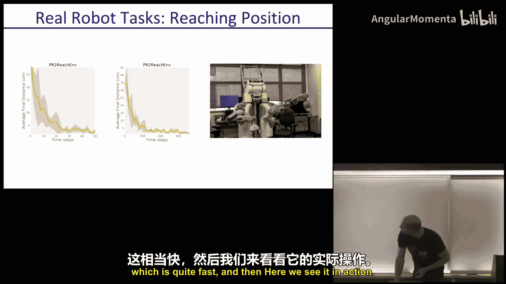

Here with Siid。In action， so。There is synchronous。On the left， asynchronous on the right。So。

After 60 seconds， the asynchronous。Its already is starting to reach the target pretty well。

 whereas synchronous well， synchronous has collected far less data has done far less learning and is in there yet。

 So in about two minutes it gets the job done。

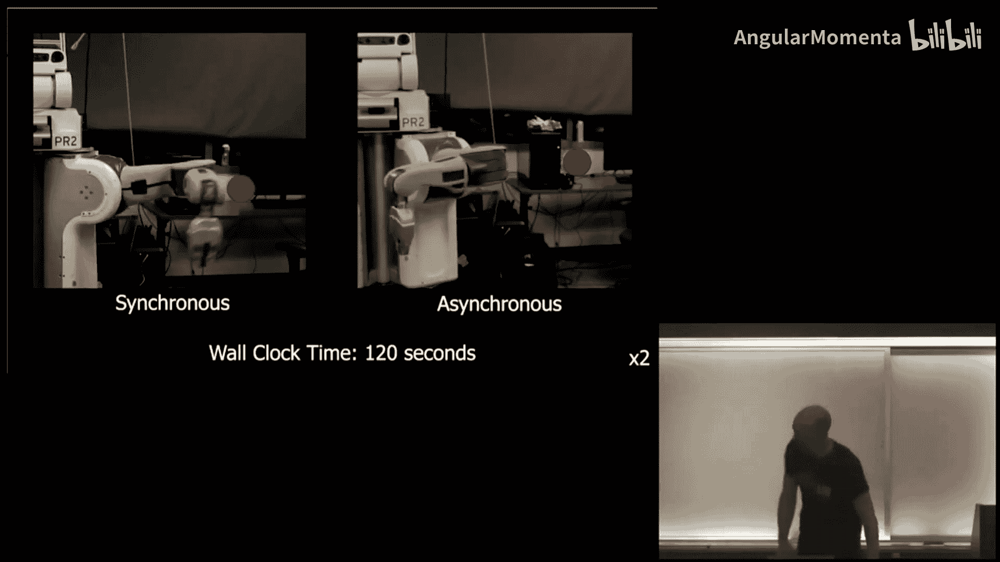

How about getting the shape into the matching opening？

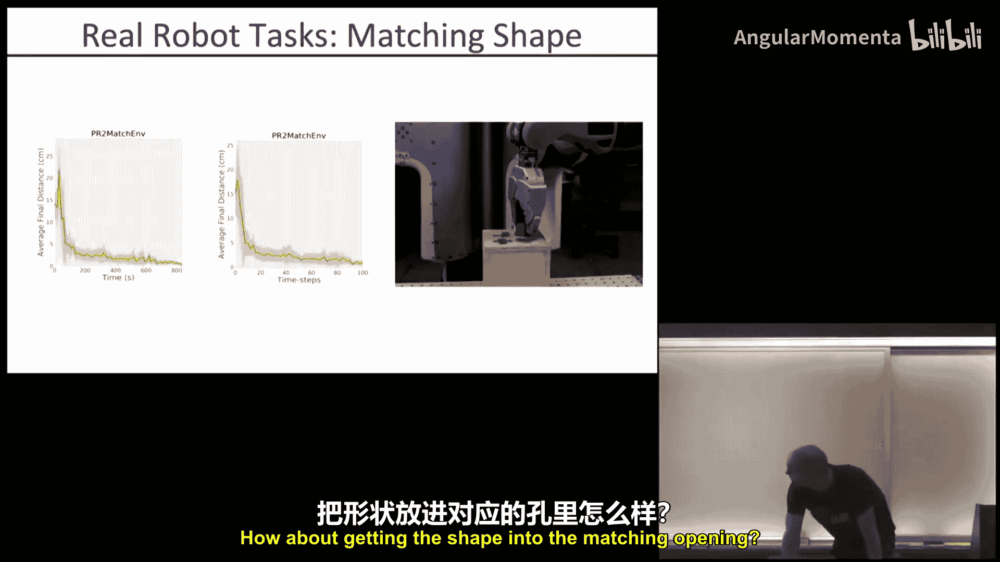

Same thing here， synchronous versus asynchronous。Asynchronous again in just a couple minutes。

Wall clock time is able to get the block in the mashing oven in two minutes its already getting it in。

Whereas synchronous still has a lot of learning to do at that point in time。

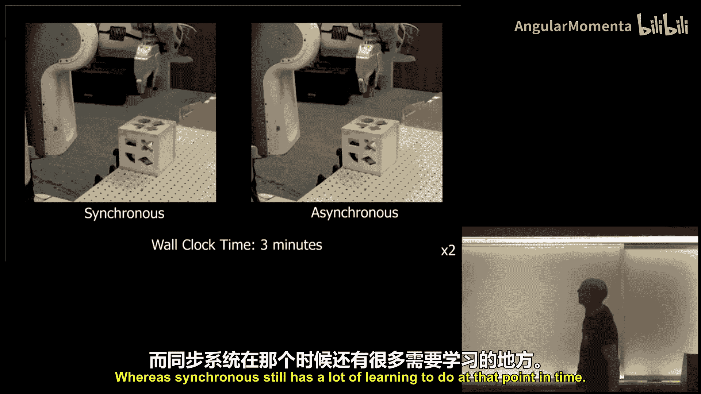

How about another task getting liga blocks stacked same thing here also by the way the curves on the left are a comparison of synchronous versus asynchronous。

 one of them requires about 150 time steps to get there the other one about 20 so a factor seven different is wall clock time so here again asynchronous on the right。

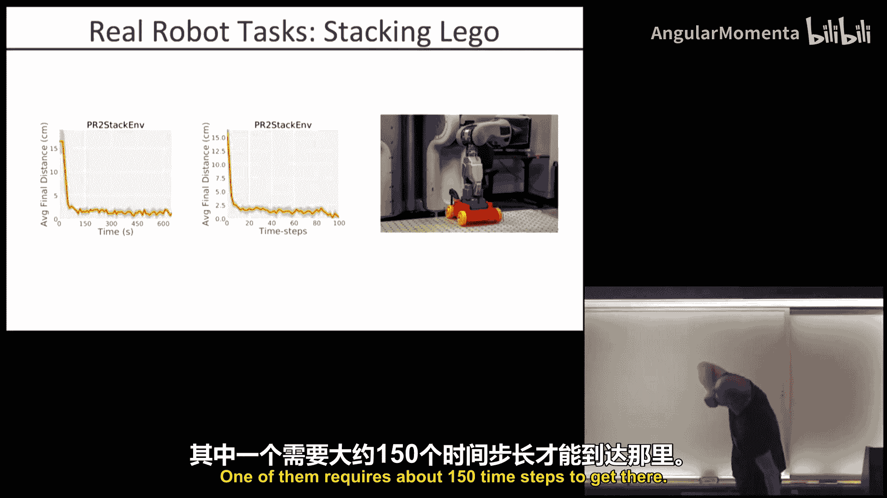

Learning to get the block and the matching opening。

 I believe it takes about five minutes in this case of。Real time， whereas synchronous。

 as we know from the plot in previous slide will take about seven times longer。

And so now we effectively have very fast， real time。Moel based Rl for some pretty complex tasks。

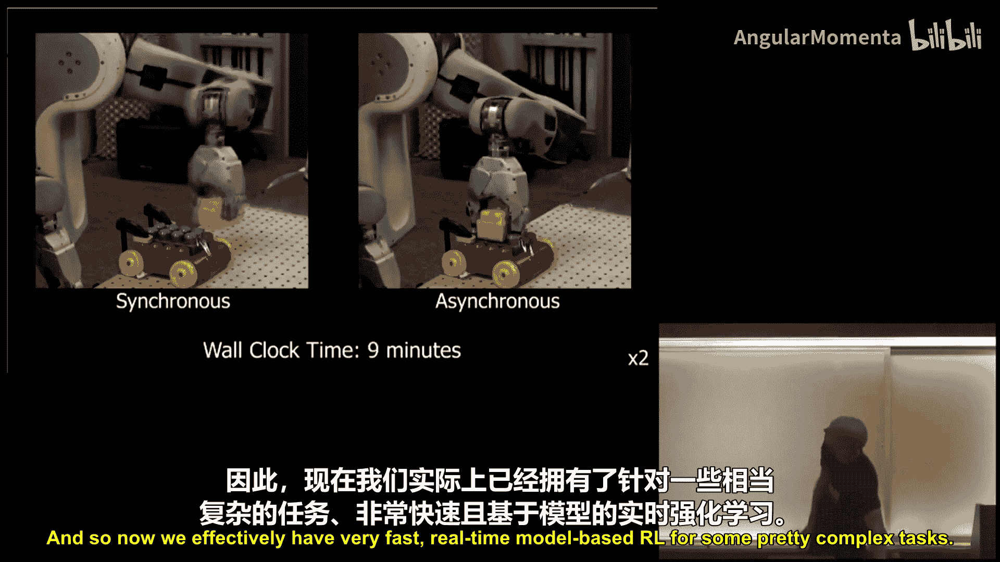

So quick summary of what's possible now。can do。Essentialially real time learning for robotic manipulation tasks。

 these are in state space， by the way， just to be clear。

 sample efficiency is better actually running asynchronously thanks to probably better policy regularization。

 better exploration when collecting data， very effective on real robots。All right。

 so what's the missing piece here that we haven't covered so much yet is division based， yes。

Possibly overfit by pulling your data so much， even though you have different models。

But you're pooling the same data so much that the data isn't updating fast enough。

Well the question is， could there be still some overfitting happening？Overfitting， of course。

 can happen in many ways， but the specific question is the kind of model bias effect。

 can your policy overfi your simulator because maybe your simulator doesn't change that quickly and that's actually one of the things to pay attention to if you run this。

If your models update very quickly， you can often even not bother having an ensemble because， well。

 it's always a new model every time and it's quite significantly different every time。

 and then it's effectively acting as a sequence of models which act as an ensemble。🤢，However。

 if your models change only slowly because the way your data collection rate is and the way your model updates as a consequence。

 then you still want to have the ensemble so there's a question there in practice do you still need or do you' not need any more the ensemble and it depends exactly on what you're asking about。

 which is how fast to the underlying models that you learn update based on the data you collect。

 the faster they update the less you're going to need an ensemble and the slower they update。

 the more you're still going to want an ensemble but they kind of serve a little bit the same purpose。

 so it really depends on the situation what's needed。So vision based model based all。

 What's different about it。 Well now you need to somehow learn to simulate the world as you perceive it。

 not in state space， we need to simulate it in pixel space because you just get pixels in and then you see pixels out the next time and you're supposed to learn to predict what happens and。

Build a simulator that can do that。One of maybe the kind of most widely seen works is the world Model's work by David Ha and collaborators。

Essentially they looked at as this kind of this doom environment， which is a simple。

 simulated environment where you move around this nation and you also do some shooting in this case。

 essentially they proposed a very， I would say natural approach， they said well。😊。

I don't want to go from current frame to next frame directly because then I need to learn directly on pixels everything。

 that's not the most efficient way to learn， there is an underlying state to all of this。

 why not try to compress what I see into an underlying state and then back out to the visual observation。

What's a method to get there while modern method you could possibly use is a variational autoencoder because that's what they do to take it in some sensory information。

 turn into a compressed state and then reconstruct。If you set it up that way。

 then maybe in the latent Z space， you can learn a dynamics model there。

 which might be more effective to learn， and you might also be able to learn a policy that relies on Z rather than relying on pixel values so now your policy in something lower dimensional then let's say many。

 many pixels it might be able to learn more quickly because if you're taking lower dimensional information。

 often you can find a signal more quickly that if you have very high dimensional information coming in。

So。What does it look like so then you need to simulate in this latent space then beyond that you want to of course。

 have a policy and of course you're going to condition the actions your policy takes and so if you set this up。

 you can say okay I'm going to train a VE， I'm going to learn an R&N on top of that action conditional R&N that simulates in a latent space and once I have that I can run reinforcement learning in this new simulator which is really a Z space。

Simulator where I can learn to act。They tested this on a car racing environment。

 so the input to the neural net is the overhead view that is shown here or one snapshot is shown here。

And it needs to steer the car to stay on the road and go fast。U。

Who here is familiar with Jan Lacoon's cake， you know， quick raise of hands。Some of you。

 so Yang Mcccun has his cake。Well， young lacoon cake or cake and for luck cake。

 essentially the story is as follows。When you have a cake。

 like the ones shown there and you make the analogy with machine learning， especially deep learning。

 well， in deep learning， reinforcement learning doesn't give you much signal。

There is just roof sparse rewards and so if you think about the kick as the whole problem you're dealing with。

 well， the reinforcement is just a cherry on the kick becauses not much signal there。

 it's important you can't live without it， but it's not giving you a lot of signal。

Then supervised learning where people still need to annotate and so they provide signal by annotation。

 but it's very laborious， so it's not going to be a lot of signal still going a medium amount of signal。

 that's the icing on the kick， again you want it you need it but it's not where the main meat is of the cake。

 the main meat is the whole foundation of the cake and that's unsupervised learning or selfurvised learning if you want to kind of use his terminology and so the whole idea that he puts forward is that when you want to learn something。

😊，You should really be mostly focused on self-supvised or unsupervised learning because that's where you can get the most data。

 if you can extract signal from that massive amount of data that's very easy to get。 then from there。

 hopefully a little bit of supervised learning， a little bit of reinforcement learning。

 and then finally I have something that works。And this experiment here actually illustrates this pretty well。

 So if you look at the number of parameters in the neural network。Shown here。

 so the neural network consists of a variational encoder， an RNN， and a policy。

 so really three neural nets。Well， look。The VAE has about 4 million parameters。 The RNN。

 which is really supervised learning for the dynamics model， has 4 and1000 parameters。

 and the controller neural network as has 800 parameters。

 so we indeed see this kind of scaling effect Ym loves to talk about in this experiment where the controller can actually be quite small。

And also doesn't get as much signal， so it can only learn so much compared to the unsurprised part and the supervised part。

So world models is， in some sense， kind of， I would say。

 maybe one of the simplest things you could try。 and if you do it right。

 it actually can work surprisingly well。 There are slightly more sophisticated things you can do。

 There's the action conditional video prediction using G networks in Atari games。

 model based R for Atari and learning latent dynamics。For planning from Pixelss album called Planet。

 these are some papers that you might want to check out if you want to learn more about this。

 where there's some very good results on learning models from pixels。

To then learn to act in that environment。Now， here's a very different idea， imagine。You know。

 you're going to do control。So he knows is going to train a VAE then hope that the embedding is good。

 you say， I know I'm going to do control and I know how to do control。

 I know that it's really convenient to do control with LQR。Then in principle。

 you could decide to say， I'm going to set up my space such that。In the latent space。

I'm going to have a linear dynamics model， or potentially time vary linear， but in this case linear。

 I'm going to have a linear dynamics model。And if I can do that。

 if I can learn a latent space where the dynamics model is linear。

 and of course here that means the loss has to be on next frame prediction。

 you have to say current frame， embed， predict the next embedded state。

 project back out to the next image you're going to see。

Where you force the next latent state prediction to be a linear prediction。

 if you can learn that way， then you have forced the system into having a linear underlying representation and you've made your control problem a lot easier because you know how to solve those problems really well so embed the control does that and it shows successfully learning controllers for essentially。

Pendulum， cardpo and3 link Car where we also know that in principle linear control should work quite well in the underlying space。

 but then here it's not learned from directly having access to the underlying space the system just has access to images of the type you're seeing there and from that forces into a space where linear system is a good way to describe the dynamics and then control just falls out of it。

 so it's a very nice kind of coming together of understanding optimal control and understanding representation learning that allows you to get a really nice result here。

Then， actually。One of our teamss， Laura Smith， with a few collaborators。

 worked on extending this to linear time varying systems and was able to then succeed at this on more complicated systems like actual real robots。

 so this robot's stacking Lego blocks was learned from pixels now where essentially it would learn an embedding space in which the dynamics is linear or near linear and then it would run law of detail here。

 but it run iterative LQR under the hood。To find a controller and learn extremely efficiently to do Lego block stacking just from pixels as input。

Another work in this direction is a deep spatial autoenrs。

 the idea here was that if we know so in most representation learning。

You might go from image to some latent space that still looks like an image。

But if your latent space still looks like an image and has in some sense， pixels that are not RGB。

 but just embedding vector pixels it's not as clear how you turn that into control signal。

 you might still have to do a lot of work or how you learn a dynamic model in that space so what Chelsea here proposed Chelsea Finnin proposes to say that after you do a bunch of convolutional layers。

 you introduce a spatial softm， which for each feature map。Figures out the soft max。

Of in which location this thing is maximally active， but in a soft way， maximally active。

 then feeds out the coordinates in the image。 So now I get out real numbers。 There are coordinates。

 hopefully of objects in your scene or maybe parts of objects in your scene。

 and then you can run your control or learn to control in that space which would correspond to state space。

 hopefully。Here's another line of work。Where。Essentially。

 the embedding was learned to be such that certain properties that you think are going to be true for robotic systems are forced to be true during learning。

 So you go from image to embedding space， but what do you say， well。

 so P is doing the embedding of the observation to hopefully the realstate space。

 What is L variation， that's something that says the embedding of different images should be as far apart as possible。

So this is trying to spread things out and everything else will try to bring things together。

 so is trying to spread things out， then the slowness has that if you embed two consecutive frames。

 they should be embedded close to each other because they're related they happen right after each other。

Inertia if。If something is moving at some sense， a certain speed。

 it should keep moving at that speed， so the velocity at time t and T plus1 should be similar。

 or you could say acceleration， the acceleration should be small。Then conservation of velocity。

 so the speed at the next time and energy should be similar to speed at the previous time is not always true because forces could be applied。

 but this is a way to incentivize it whenever possible to do that， and then controllability。

 which essentially you want your system to be embedded in a space where the I mean there's a strong relationship between the actions you take and what the next state is going to be。

So they also had some good success in this relatively simple simulated environment。

 but it's hard because you're taken pixels rather than raw state。

Then another angle people looked at this well， you can turn a rich autoenr。

 but for it to output meaningful state。 maybe you need to regularize it some extra。

 So what they showed is that if you， it's called a beta Ve。

 But the idea here is actually fairly simple。 The idea is that you。Try to。

Make your latent variables more independent than theyomaly would be so regular VE kind of has a regularization I'm coming from a Gaussian。

 you try to make it maximally independent each of the variables then maybe the representation you get is easier to learn on top of because variables have been disentangled compared to all of them being closely related to each other at any time。

This showed by doing that， you can actually learn things that can transfer more quickly when you really change what the environment looks like。

 so they would train regular DQN versus cuulating with this VAE that I talked about with maximal disentanglement or not maximal but optimizing for disentanglement and show that it actually transfers a lot better when you then change the environment that'll work a lot better for Darla than for traditional DQN。

What else is there and again we're kind of just going through a bunch of ideas here at a high level just to give you a notion of what's happening out there。

 causal info again。When you train again， it's about generating realistic images。

 But if you just all way you do is generate realistic images。

 you ignore the dynamics of the environment。 causal infofogan tries to do the same thing。

 but account for dynamics in the environment， making sure or trying to make sure。 And when， you know。

 it works well。 That's what it does。 it essentially tries to make sure that。If you have。Two states。

Two embedding states， and you interpolate between them that the images you see rendered along that interpolation are not just realistic images。

 but actually a sequence of images that is a reasonable sequence to try to achieve in the real world so we can do that anything say I have a current image。

 I have a goal image and I'm going to embed both of them。

 do a linear interpolation in embedding space， project back out to a sequence of images。

 and I'm going to try to do control to follow that sequence of images as targets for my robot to follow。

Planet we talked about earlier。Pasent a few extra things compared to things I mentioned so far。

 one is multistep prediction， especially something very useful at times where you say hey。

 I know that my dynamic model can easily become inaccurate over long horizons。

 but what if I just directly optimize for that I just put it in my loss and say I'm now just trying to predict next state given current state action I'm trying to predict state five steps from now given current state and the five intervening actions。

But directly optimizing for that， you can often get somewhat longer horizon reliable simulation and then they also they do planning。

 So direct planning， as opposed to let's say， running a policy gradient method in the simulator。

 Why might this help。 What might be the tradeoffs。 Let's think about that。 You've learned your model。

 you can either run NPC in your model or you can run policy gradients or something like that in your model and then use the policy that comes from it。

Well， if you think as the model of having all the information you've collected from the environment。

Condensed in your model， then running planning slash NC should do better because。

You're not somehow ballneing yourself through learning a policy or saying this is the model。

 I'm just going to find the best sequence of actions against the model。

 take the first one and repeat。So often it'll work a lot better to run NPC against a model。

 where there's some downsides， often it's slower because you' got to run an optimization every time you take a step。

 you need to run your optimization， a second downside could be that sometimes by having a parameterized policy you can generalize in ways that you your actions that you find with NPC might overfit to some quirks in the model more easily。

Then here's another line of work that's been pretty exciting。

 It's been happening the last couple of years， a lot out of Ser 11's lab， actually。

 showing that it's becoming more and more possible to do video prediction for videos that are pretty high resolution once you can do video prediction。

 action conditional video prediction。 Well， then you can run NPC often using crosscenttropy method or something like that。

 to find a sequence of actions， execute the first one and repeat to try to achieve goals shown in a goal image。

😊，Now， one thing you might think about is say， well， well， well， I mean。

 I simulating this entire scene， maybe that's you know okay here because the scene is not too complicated and kind of everything that's semicomp in the scene is something you care about。

 but what about if people do things like dropping a glass bottle and it shatters into pieces？

Do you really want to learn to simulate that and how precise youre going to be able to do that。

 You're really going to get all those details right。 It's going to be very hard。 In fact。

 I think it's probably impossible。 I mean， depends on initial condition and so forth will be quite delicate and you're not going to get the exact match with reality。

So， but maybe you don't need to。 I mean， when you drop a bottle and it breaks。

 you don't care about all the details。 you care that it broke。

 and that's all you needed to know for next time to decide not to drop it if you don't want it to break。

 So you could say well， we should not simulate in pixel space。

 we should actually simulate in a latent space。 Okay So let's make a latent space。

 We take our image put in latent space。 and then predict the next latent variable。

 We don't care about reconstructing image。 We just want the next latent variable。 So okay。

 let's make it really good at predicting the next latent variable。 What's the solution gonna be。

 It's gonna to make latent variable always the same identical。 let's say always zero。 because well。

 that's the easiest way to make sure you can always predict the next latent variable。 So then I say。

 oh， I guess we need to reconstruct after all。 Maybe you could。

 but then we're back to where we started where you're now trying to reconstruct again。

 Is there something else we can do。This work， Po Argaal and collaborators show that maybe the way to think about this is to say。

 hey， what we care about is action。So maybe we don't need to reconstruct the image。

 I mean we might still do it as a regularizer。 it might not be the main thing we need to be able to do。

 We need our latent space just to be such that。Given latent stta time t， latent stta time t plus 1。

 can we predict the action that was taken to go from T to T plus1？So we're going to embed。

But optimize the embedding such that we're capable of predicting the action that was taking between time steps and so that allows us to ignore everything in the embedding that we cannot affect noiseisy stuff in the background we can now have any influence on doesn't have to go in this embedding because it doesn't help us predict the action that was taken from T to D plus one So it's a very interesting way to approach the prompt directly think about what we care about it's action。

We learn embeddings that allow us to predict action from T to T plus1 and so forth。

That actually work quite well。 then you could say well， action。

 maybe something else we care about rewards。 maybe we also want to predict rewards that happen。

 So again， let's not worry about predicting the actual frames。 let's just predict rewards。

 And maybe this one is just rewards predictionron for depending on essentially giving a way of making your billiards shot。

 How much reward are you going to get。 That's what it's trying to predict without necessarily worrying about all the details of everything in the scene。

Generalization of that is successor features if your reward has many， many features in it。

 so there's many， many contributors to your reward。

 try to independently predict the future of all of those features rather than just simply the sum of them in that reward。

😊，Once you do that you can say well sounds good， you can actually then do this action conditional and that's what Greg Khan and collaborators did here。

 such an action conditional prediction of future features that relate to reward and so you learn a latent state that's focused on the things that are going to matter for your decision making and it' actually worked really well learning to navigate so this robot learned to navigate in Corrihoba just driving around on its own and a night of practicing driving around on its own。

 it learned really well to predict。The features that matter for a word related to collision。

 sometimes also related to doors and things like that。

 and then from there it could run either Q learning on that or NPC against that to find actions that avoid collisions。

Fulfully vision based。So there's another thing you might want to think about。

 It's just some reference。 I'm going to step in it you can think about。What。

Is the ideal state representation can we come with a notion of given some sensory observation what is the proper way of turning that into state and there's a bunch of work trying to do that。

 trying to declare objectives and properties of what it means to be a correct underlying state representation。

嗯。There's a whole paper claiming that know they have a separation principle for control and age of deep learning。

 Or remember separation principle。 what was that， it was saying that for linear dynamical systems。

We had this notion now。If we don't have access to the state， we just have access to observations。

 which are again， linear plus Gaussian noise in the state。The optimal。

Policy will run a common filter。And use the mean output of the common filter to do control as if that mean is the true state。

 so that's a separation principle where you can several design your controller。

 assuming you have access to full state and your filter which tries to find the posterior over states That's what the separation principle refers to and this is trying to generalize this to deep learninging scenarios where of course you wouldn't have a linear system a very high dimensional。

 let's say pixel input and what can you do there。All right， that's what I had for model Bi。

 Any questions about this before we switch gears。Okay。

 let's take a couple minutes break and then let's switch to physics simulation。All right。Re start。

So we're going to take a look at physics simulation。 obviously you can do。

Multiple semester courses on just how to do physics simulation。

So the fact that we're going to try to do in 35 minutes means we're not going to be experts at least not worlding and leading experts at the end of the 35 minutes。

But hopefully you can get a gist of what are some of the concepts that go into this and be aware of pitfalls that might be present in certain scenarios and so just generally get a sense for what。

You might want to look for， maybe if your physics simulation doesn't work right or you want to get started on building one。

 what are the keywords to look for and how does it relate to the results you're getting？

So a very fast lining tour of physics simulation， 35 minutes。

 we'll look at Newton's laws for rigid body motion， lagangian formulation。

 that will go from continuous time to discrete time， which we have to do to run things on a computer。

 and then we'll look at contact and collisions， which of course complicate things a lot。

Now as I said， we're not going to cover anywhere near what you need to know to truly be an expert。

 but there are resources out there for you to become an expert if you want to。

 so Featherstone's book is probably the reference almost everybody will refer you to if you ask them okay how where to learn more about physics simulation on a computer。

 how do you do it， that that book is the starting point。Pretty thick book。

 but that's good because it means it's very comprehensive。

 Then two of the most popular physics simulators， Mojoko and bullet have quite a bit of documentation available on how they work。

 So it's not just a black box。 they actually have written up papers sometimes even like almost books like Mojoko's like online book describing how it works。

 So the information is out there。 And then the one at the bottom here is kind of somebody who's a game。

Gaming software engineer who wrote up kind of a mini tutorial on some of the key things that matter for physics engines。

So。Where to start， we want to simulate physics and want to simulate it at the mechanical level is what we're going to。

Pa attention to here。 So well what is it is just f equals MA right。

 I mean if that's what we need to do， we need to make sure that at all times the accelerations of our objects are you know the forest they experience divided by mass。

 and now if your object is a not just a point mass， but a rigid body， you don't want to describe。

In your simulator， the velocities and positions of every single point on that object。

 you want to represent that object as just a position， velocity orientation and angular rate。

 and so then the way it gets put together as the equation at the bottom here there still f equals MA where this applies to the center of mass of the rigid object。

 So the center of mass will follow that principle， but you also want to know the orientation of your object they need to also track the differential equation at the bottom or the torques are equal to the inertial moments matrix which。

It tends to be a positive definite symmetric matrix。

 inertial moments matrix times the time derivative。

 so the dot on top and the notation we'll be using here tends to mean time derivative。

 so the time derivative of the anglengular rate。Times inertial metrics。

 but then there's this other thing there which essentially comes down to the fact that the way inertia works in its。

When you spin something around a given axis， it's actually for most axes if it's an asymmetric object。

 it will not continue to spin around that one axis。

 it'll start tumbling around and change the axis around which it spins and so that's in sometimes what that second term accounts for now each object tends to have at least three axes。

 three I mean eigenvector axes of that inertial metrics if you spin around any one of those three axes it'll keep spinning around it but for other axes it often will not。

 because the inertia around different aes is not the same。So that's what that is。

 that's why it looks more complicated and just a tau equals i times omega dot。All right。We have。

But this is a known thing。 You can compute。 So I tends to just be。

 you need to essentially do a compute an integral that looks at the。Mass description of your object。

 where the mass is relative to the center of mass， and once you do the right integral calculation which is very tractable。

 you will have your I matrix and if you have the mass measured。

 then you can actually have all the things you need for this， you have INM， then you can simulate。

 you just need to know what forces you need to apply what torques you need to apply or are being applied and then simulate。

Now。Things can get complicated pretty quickly because you think about the forces， well。

 imagine you have a robot with a link like here， arm and dislike like a link。

 Now there's a lot of forces happening in the joint。

And the details of those forces are pretty complicated。

 but at the same time we have a very simple abstraction that the end of my upper arm link and the beginning of my forearm link are going to be joined together at that point and that point is going to be the join between them at all times。

 assuming no bad deformation so the way we simulate is at this point should stay put。

 but Newton's laws don't really tell you how to do that。I mean。

 you could get into the details of all the forces in that joint。

 but that's very complicated to simulate， given we know that there's this imvariant。

 can we do something that maybe is a bit more tractable than simulating all the forces in that joint。

Well。Whenever is multi body systems with constraints and internal forces。

 there is a lagrangian formulation for dynamics that actually makes it much easier。

To write down the differential equations that govern the motion of this multi body system。

How do Lagangian dynamics work？It's， it's essentially a very clean recipe。

 It says we need to define some generalized coordinates。 R I。 So I have maybe。

R1 or r0 could be one jointangle， and then r1 could be the other rotation axiss that have here。

 and then this one would have every degree of freedom would have a coordinate associated with it。

Maybe we need this total kinetic energy， so we need to somehow be able to write out for our multibody system as a function of the generalized coordinates and more importantly as a function of the time derivatives because kinetic energy tends to relate to how fast you move。

 the time derivatives are the generalized coordinates， what's our total kinetic energy。

 what's our total potential energy。And what are generalized forces。Okay。

 so generalized force essentially comes down to tying forces into the degree of freedom that they're acting upon。

The laggrangian then is t minus u， and we have that the essentially we have this equation here tying the generalized forces。

Into the time derivative and the coordinate derivative of our lagrangian。

So this is the equation we can use and will be valid for any system， and so it's a recipe。

 you come up with the quantities in that bullet point list and then out all the quantities you need to write down this set of equations if there's more than one degree of freedom。

 set of equations that govern the dynamics of your system。Once we've done that。

 we end up with a set of differential equations that we can use to simulate our system。

So let's actually do this by example。We'll do a very simple example to kind of well showcase that this is very feasible。

 though of course， in some scenarios， you're going to have to do more work。So。Let's look at this。

Lagrangian thing。In a very simple case， so imagine we just have a point mass。

We want to simulate a point mass。 We all know what we need to do is just f equals MA。

 but we want to verify that this new idea actually matches up with the intuition we already have for point mass to build confidence in this new idea and also see it in the context of something we already understand。

 so not everything is new。So point mass， what do we need generalized coordinates。

 what will be our generalized coordinates， well， is going to be X， Y， z。

Then kinetic energy was the kinetic energy of a point mass。

 it1 half mass times velocity squared that's kinetic energy for a point mass t。

Equals 12 mass times velocity squared but expressing generalized coordinates。

 so x dot squared plus y dot squared plus z dot squared。How about potential energy？Well。

 what the potential energy of a mass， it depends on how high it is above Earth。

 essentially like the higher you're up， the more potential energy。

 which you can turn into kinetic energy by dropping。So potential energy。U equals mass times G。

 which is。Well， essentially 9。81 meters per second squared times z， which is your height。

Where you measure height from， it doesn't matter too much in potential energy the way potential energy will show up is that the absolute offset doesn't really matter。

 like if you said plus a constant here。That does not depend on the generalized coordinates in any way。

 the equations of motions we're going to get are going to be the same anyway。

 so let's just call it Z and not worry too much about exactly what's the zero point。

 but a natural zero point could be the surface。So what are the equations now。

 so this thing over here for each generalized。Force， what are the forces here。

 we can apply a force along。For generalized forces need to be aligned with generalized coordinates。

 so we have a force along X along y along Z。And so we see that equations of motion are for each generalized force。

This one， f of x is equal to。DDT， derivative respect to time of what the Laangian。

But then derivative respect to。Q dot I， so that's in this case， x dot。Minus DL。D X。

What is this well L？Is t minus u， so L is 1 M。X dot squared plus y dot squared plus z dot squared。

Minus mgZ。So D L， D X dot， for look at this will be。D， L， D， X dot will be equal to。M times x dot。

Then we have direct respect to t in front of it， this will make it so the T in front of it will make it the time derivative this thing will make this double dot that's what it means to have double dot2 time derivatives so this first thing is M times X double dot then minus DL dx L here。

Well， there's no X in it。So that's going to be zero。

 And so we have for our first out of three equations that f of x equals m times x double dot。

How about。F Y， well， the roles of x and Y are really the same。 I mean。

 Z is the direction which the potential energy works。 X and Y are the both horizontal directions。

 So we can either grind to it again。 we can just see， well， the roles of x and Y are the same。

 So the equation here will be F Y equals M times Y double dot。How about Fz。

 what is that going to be equal have to be equal to or what's that going to be causing Well Fz is going to be equal to。

The first term， DDT， D L， DZ dot， that first term here will be similar to the X term。

 which will be M times z dot， but then the second term。D L DZ， there is actually a Z over here。

 and I'll be M times G。 So we have M times Z double dot minus。M times。Zi。So if we look at this。

 another way to look at this to say。We have found here， dad。

X double dot equals F force and x direction Fx over M。

Y double dot equals force in the y direction over M and Z double dot equals external force。

 not caused by potential energy。 That's what these generalized forces are。

 Po energy is separately accounted for Ex force F Z divided by M。Plus。G。

 and so that's exactly what we expect the point mass will be susceptible to external forces and that will cause accelerations and then of course there's gravity。

 which is another external force but it's an external force we put into our potential energy and so it's captured there。

So that's one example。 and for this example you might say， well。

 that's a lot of work to arrive to a conclusion， we long knew ahead of time。

 but hopefully built our confidence in that this actually does the right thing and in a simple scenario we can see how to grind through this and I'd say that's the beauty here all we had to do is grind through this we did not have to come up with very clever tricks。

 No， just grind through this method and outcomes a set of differential equations describing the equations of motion of。

Pooint mass， in this case。So put this in the slide also， how about something like this。

 a two link arm？While we are to generalize coordinates。

 they are going to be the angle theta 1 and theta 2。

And then we'll have some shorthand notation for signs and cosines and so forth， because otherwise。

 it's not gonna fit on the slide。 But the generalized coordinates are just theta 1 and theta 2。

 Those are Q1 and Q2。 Now， what do we need to do， We need to find expressions for kinetic and potential energy as a function of those coordinates。

 Or by the way， what this thing。I didn't clarify this， so this thing over here。

To understand this generalized force thing it's really。It's really saying。诶。What is the work done。

 So Q is really the。The work done。Along a generalized coordinate， So for each force that you have。

 FJ external force。It'll be aligned with some generalized coordinate as that force is exerted as a generalized coordinate changes。

 some work will be done， the traditional work is force supplies time displacement。

 so force time displacement as's a classical physics thing for work。

 but it also be torque times change of angle so those are the most common one I mean torque times change of angle or force times linear displacement and that's really here the generalized version of that and you look for every external force or torque。

 you look at how much is applied to that specific generalized coordinate and then that's where you put in there。

So what do we need， we need those generalized forces， we also need the kinetic and potential energy。

 so what are they？Well， we can look at that thing over there。 There is essentially two links。

 There is a。First link and a second link， we can look at。Where the masses are。

 So the links here are assumed to have no mass， just a very simple model。

 assume that the mass all lives in those blue balls。 Okay。

 just a specific dynamical system for ease to work with。

 So really care about is the velocities of those masses and the altitude。

 the z coordinates of those masses that's going to affect。The kinetic and potential energy。

 And so that's what being computed here。 You can think of the first thing as the。

X coordinate the first one x， yeah first one x， and then the second one is the vertical coordinate z。

And we compute that for x1 and x2， and we can also write out the velocities as a function of the generalized coordinates。

 So the location， what this is saying is the location of M2 is this expression over here。

 It's x1 plus this and x1 is over here， and then the velocity of x2 is this thing over here。

Once we have the velocities of our masses as a function of generalized coordinates。

 we can write out kinetic energy， if we have the positions we can write out the potential energy U。😊。

Then at this point， we can write out the equations of motion where the internalized force here is the torques。

And we have these expressions here， which again， might be hard to come up with otherwise if you just do Newtonian theory say。

 what force is the link applied to the mass and we found force equalql count force a lot of work you have to do to get here。

 whereasas now you can just write out these quantities that are。

Just following a recipe to get them and you get your two equations of motion， y2。

 because there is two degrees of freedom。Here is other equations of motion and don know I just put down these are kinematic equations。

 often you'll use kinematic equations so there's no forces here。

 just kind of a slight switch of gears for a moment， but often you'll say something like okay。

 I have velocities that depend on in this case， my steering angle and my forward velocity speed and I can write out something kinematic。

 the path of the car will follow as a function of my steering and forward velocity。

But let's go to another Lagangian1 cardpo again you work through all of this ultimately you end up with an equation shown at the top and in fact they'll pretty much always look like this。

 you'll have something times Q double dot， so second derivative respect to time of each of the degrees of freedom general as coordinates。

 then something that depends on Q and Q dot and then that depends on gravity and then something that depends on the external inputs。

Acrobot， so cart polele you have only one control is the force horizontal force in acrobat。

 you also have only one control input which is the torque at the middle joint there。

 you don't get to control the torque where it's attached to the world only in the elbow you get to apply a torque。

 you're supposed to still be able to control this， go through the same exercise end up with equations of motion。

So what do we have at this point， We have a way to go from。Potitionial energy， kinetic energy。

Equations to the equations of motion。Now kind of what we ignore a little bit and often need to add in as forces is friction and drag because when theres contact between objects。

 it's not the kinetic energy， not the potential energy that contributes this。

 it's going to be those external forces， you need to understand what external forces are present。

So two objects， one sitting on top of the other， if you try to push one。

 the one on top away from the one at the bottom， it's going to be a friction force working against you。

 something called static friction and dynamic friction。

 static friction is the friction when it's not moving yet。

And so when it's not moving yet often the resistance is higher than when it already started moving。

 And so there' is this friction coefficient， which is saying that the friction force working against you is friction coefficient times the normal force。

 So the heavier something is， the more normal force there is to support it。

And the more friction force can be generated。 You can never have more friction force than the friction coefficient times the normal force。

Now that friction coefficient will typically drop once you start moving so it's funny effective push very hard。

 nothing happens， push harder or harder， still nothing happens。

 and then all of a sudden things start moving and then actually the friction will drop when it starts moving and you'll accelerate it even more。

It's not a force that you often want to account for drag forces。

 so when something is going through a fluid could be gas fluid or liquid fluid because it's pushing the molecules of the fluid out of the way to move through the fluid。

 it's experiencing some kind of force pushing back against it， which will slow it down。

 it's why if you drop let's say an object from very high。

 it will not accelerate at 1G all the way through because there's these drag forces slowing it down。

Okay， how big is that going to be。 Here's kind of， I mean。

 you' got to do this specific and probably want to collect data on whatever system you're working with。

 but the general notions that drag forces will be some coefficient， which depends on。The well。

 sometimes the material as well as the fluid type of fluid that you're in times the surface area that you're trying to push through that fluid。

 times the density of the fluid， the denser the fluid。

 the more drag force you're going to experience just like when you're run in water it's a lot more tiring than when you run in air and then times velocity square。

 so that's interesting in that the faster you go， the more drag force you experience。

 but it's not linear it's quadratic。So this is also why， I mean， if you look at the efficiency。

 let's say you you drive， I don't know， drive at Tesla。

 I'll tell you how many miles you have left left to drive right under your current charge。

 the faster you drive， the less mileage you have with your car。I mean， from a， I mean。

 once you have a reasonable speed， the faster you go， the less mileage you have left。

Because the amount of drag force you encounter squares quadraically with。The speed you're going at。

 but the amount of time saved of getting somewhere on scales linearly with the speed you're going at。

 and so overall you have less mileage left by going faster and so'll often tell you。

 you know if you want to get to the supercharr with the charge you have left。

 you should not go above 70 miles an hour anymore or you have too much drag effectively and won't make it it does those calculations。

So these are forces that in Lagrangian formulation would be external forces that we might want to add in to account for things that happen in the real world。

Now， when you specify a robot， robots are so common that there's some kind of standard way of specifying them。

 so instead of necessarily following the whole lagroian approach。

 you can actually just specify the sequence of links your robot exists of you just say first link is this long and the end point of that link ends up relative to the start point of the link over there。

Now you see how heavy the link is and what the moment of inertia is of that link。

 and if you specify the sequence。In this standard coordinate system。

 you effectively have a full description of your robot's physical properties。

 at least for this kind of sim， and then most simulators will take this in maybe in the form of a URDF file which describes the properties of your robot and then build the differential equations on its home from that。

Now， what else we need to do， we need to go from continuous time to discrete time。

 because everything we've seen is differential equations。

 So we've seen how to turn a physical system。Into。A differential equation describing how it behaves。

 but computers don't really do continuous。

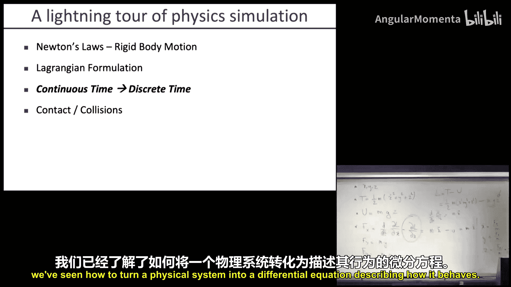

Simulation， they do things in discrete time。 So what now， imagine we have a。System。

 and we're going to look it in a generalized way。 So we're not going to worry about the specifics of what we're simulating。

 but we have something why。And a time derivative of y is some function。Often of just why。

 depending on the state that you're in， there is things that happen to you。

 but it'll also be a function of time。Because maybe some forces get applied over time。

 not just as a function of y。 So if we have F， we've seen how to find F。

 F is the whole lagroian thing that we just cover。 We know how to find F。

But now let's say we know F and we know at times 0 equals y0。

 how do we now know y at some later time T？Well， sometimes we can do it in closed form， of course。

 some differential equations of closed form solutions。

 most famous ones will be things like y dot equals a times y， and y0 equals y0。

 then y equals y0 times x。A times T is。Proud you know。

 best known like closed form solution for a differential equation。

 but very often the equations we end up with are not in that beautiful form where just y do equals A Y。

 We have something much more complex。 So what do we do， Maybe you can find a closed form solution。

 Probably not for complicated systems。 So what can we do。 There's something called forward eer。😊。

And it says to compute y at discrete time step n plus1， if I know y at discrete time step Yn。

And to go from n to n plus1， an amount of the delta t is often denoted by H in the literature here。

 I'm going to say well。We worry on Yn， we know the time derivatives。

So we can just say it's going to be plus h times F。Add time N and Yn。

So since just saying we know the derivative， let's assume that derivative does not change， but。

 of course， the derivative actually does change because the derivative depends on why and why is the thing that's changing。

 Let's assume it doesn't change。 Let's assume that for a small time interval。

 whatever the derivative is now is a good enough approximation。

 And let's just assume it stays constant for。There as much time， and then we can simulate forward。

Now。Here's something。This is one way to do it， another way to do it is say backward orderer。

The idea here is you say yn plus 1 equals Yn plus H F。Ti。N plus1， Y n plus1。

Kind of sometimes might seem crazy， but it's the same thing really。

 you're saying I'm going to pick one point where I look at the derivative and use it assuming it's constant for the entire interval。

 instead of picking out the beginning， I'm pick it at the end of the interval。 Now。

 when you have this。Since you're solving for Yn plus1 and it appears on both sides now you have to solve some system of equations to find yn plus1。

 so the calculations going into this might be computational more expensive because here you just get the derivative。

 you know it from this evaluation， you just compute the next one here。

 not nonlinear your system of equations to solve。So we might say dad， you know。

 the reason people would do that， they must have a very good reason。 Otherwise。

 they are just doing extra work with no payoff from it。 And there's actually very good reason。

 So let's take a look at why people。Often don't like。Or cannot get away with the first formulation。

So in the first formulation。Forward oiler， often also called so forward or explicit。

It's explicit because you can compute the derivative and just use it。

 and here it's implicit because you don't have the derivative available， you can just use it。

 It's implicit in this equation。Imagine our simple example again。Y dot equals。

 and I will say negative A， let's assume a is a positive number， negative a times y was a solution。

Y and a t equals y at0 x。Negative A T， What does it look like， Well， you start somewhere here。

 which is0 y 0。 This is T， and you essentially go。Like this。Okay。

 now let's apply forward orderer and it's an approximation。 you can see what is going。

 I'm going to show you that the approximation can sometimes be pretty bad and we need to be careful。

4 says why？At。N plus1。Equals。Y n。Minus a。Y N。Times H。So that's equal to。1 minus a times H times。

YN now H is how long we simulate， and a is something that essentially says how fast you're being driven to zero in the real system。

Let's look at different conditions， let imagine。1-8 times H is。A number。

This thing is going to be positive。 This is positive。 So this is going to be a number below one。

 The question is， how far below one is it going to be， Let's say1 minus Ah lies between 0 and1。

Then what happens Well， depending on how close is to zero。

 we might just jump very quickly to something very close to zero even more quickly。

 something like that might happen。嗯。Why more quickly than the original well， because I mean。

 the derivative becomes less steep later， so when you're approximated with where you're now。

 you're going to be steeper than the original。So maybe we go a little more quickly to zero。

 that might be okay。 but what if this thing here？It's actually smaller than0。

 1 minus Ah smaller than0。And actually， let it can be， I mean。

 how about it if it's smaller than negative1？😊，Then what happens is。We will have this thing flipped。

To the other side add something that's absolute value larger than y0， so that may be over here。

 then we'll again have it multipied with a negative number that's absolute value bigger than one will become bigger and absolute value。

 but now on the positive side and this thing actually completely goes out of control unstable even though the real system is a very simple stable system driving itself to zero。

 And interestingly， the bigger a is the more negative you might end up being here。 So the bigger a。

 the stiffer the system is what is called the easier it drives itself to0。

 the quicker you'll get in these oscillations。 What's the fix while we all know that in principle this should work was the fix you need to make your H really small right So your H。

You can't let this happen right You need to stay above  zero so to make sure H is very small And so the bigger your a。

 the smaller your H needs to be。 And so for a larger a。

 your H needs to be tiny because H needs to be tiny。

 the amount of time it takes to get along this axis for tiny H will be a ridiculous amount of competition for it finally get there。

 And so the tricky thing here is that with forward oiler。

You can get these instabilities for stiff systems that have steep derivatives。

Forcing you if you want to stick with forward orderer to use very small time steps。

 which might make it extremely time consuming。 How about backward Soer。

 backward orderer says yn plus 1 equals Yn minus a Yn plus1 times H。This case。

 actually we don't have to solve a nonlinear system of equation we can do this in closed form。

 and we have yn plus1 equals。1 over1 plus a times H times Yn。This thing here。

 this number here is always。Between0 and1。 So this thing is guaranteed to always drive your y to0 independent of your step size。

 Now， a large step size will make it less precise。 a large step size will think you're right away there and a smaller step size will more precisely track the path。

 but no matter what step size you pick for H， you don't have these instabilities。

And so that's a big advantage of the backward now。Keep in mind， sometimes it's not that easy。

 I did it in closed form here， sometimes to solve this thing。

 you have a nonlinear system of equations to deal with making it somewhat hard to solve。Now。

In practice， so let me show you。

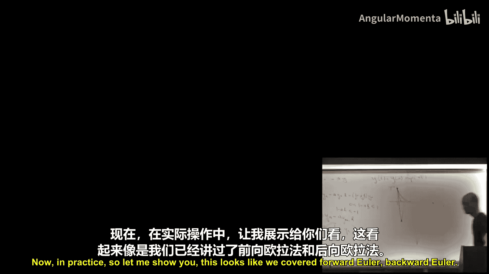

This looks like。We covered $4。Backward Oer， you can actually do something semi implicit。

 which is in between where for state use one time for velocity use the other time。

This kind of interesting is actually it has some interesting properties where it tends to manage to have conservation of energy。

That's a good problem to have because if your system conserves energy in the discrete time approximation。

 it might lead to more realistic simulation and so interesting little intermediate here。

Then's thing called run kuda methods， which I don't want to step into the details of them。

 but I want you to be aware of because these are often the ones， the method of choice。

 and it essentially looks at for y and plus 1 equals y and plus an average of derivatives at four different places。

Where does evaluate the derivatives there's actually a procedure for this it says， first of all。

 I'm doing it at the current point。Then I'm going to simulate forward。From the current point。

 there's a simulation forward。Half time， half time it go forward， so yn plus K1 over2。

 evaluate there。I'm going to evaluate there if I had used K2 as my derivative。

 so I had to the if I had to use the0 do I get at the end of the interval。

 I get my K3 and then there is at the variant that involved K4 So it's essentially a recipe that doesn't require solving no nonlinearar equations like the backward orderer that uses a mix of derivatives at different times。

 of course approximately achieved and not the exact ones at that time because it's a forward progression to get those numbers but that tends to be one of the most popular methods and it has good properties in terms of your H does not have to be as small as it needs to be for Eer methods to get the same level of precision。

 of course you do a little bit more work per step。😊。

Then in one minute I want to cover this so we can switch topics next time context and collision Col checking tend to have a broad face and a narrow phase what does it mean broad phase is about there's so many objects。

 which one should I even carefully collision check。

 you split up your space into regions and you see which one live in the same region。

 but the ones that live in the same region of your space， you might design some bounding boxes。

 axis line makes it very easy to check if there might be overlap。

 So say a checking overlap between objects， check overlap between the bounding boxes of the objects。

 which makes it easy to do。That's broad phase， it won't give you a true answer but they'll let you know if it's possible these objects might be in collision because if the bounding boxes don't overlap。

 then definitely the objects won't overlap so the way of getting a very quick check which objects might overlap。

And so to split the space， often people use something called quad tree。

 split in volumes and see who is in wt volumes， something could be in two volumes。

 if they're next to it chter those volumes because not everything will be nicely split off by a volume and then you can just see okay who's in the same volume now let's check if theyre bounding boxes overlap or let's do a sweep along an axis and see if there is overlap on the projection of these objects。

Then once you did your broad phase collision check。

 you had to put a few candidates that might be in collision。

The underlying thing that's easy to check is Comx to Coms。

So if two objects are convex you can check very quickly whether they are colliding or not。

 so what you do in practice， you often take your originally non convex object。

 turn it into a union of convex objects， and you do collision checking for each of the members of that union against the other objects convex parts。

Ogans for this are called。GJK and EPAN， those are actually fairly sophisticated and complicated algorithms。

 the beautyauties that they're available， I mean implementations are available。

 but they're pretty complicated to do very efficient checking of collisions or not having collision between two Comvex objects。

Then once you have contact。What do you do， Well， if there is collision， meaning there's overlap。

 it means you run your simulator for too long。Because you know that that collision。

 before the overlap happened， they would have collided and had repelling forces to each other。

So the simplest thing you could do is you could say， oh well， I need to reduce my time step。

 I step for too long， let me step short， see this collision。

 and do a kind of bisection search so you'll know when it comes into collision。

 and then you can from there simulate to collision forces and continue。Another thing you can do。

 you can actually solve your equations that do essentially conservation of momentum and energy where you do it then not instantaneously because the time scale might be tricky to deal with。

 you do it with impulses so essentially say if。I have an interval that happened over that interval。

 the integral of forces applied to an object should be equal to the mass times change in velocity。

And so that is essentially saying， I'm not going to do instantaneous things。

 I'm going to do it overight the longer intervals。 So I don't have to worry about like all the details of the time stepping ins。

 Of course， you still need to be careful。 You don't want to。

The crazy thing is that' if you make your time steps too large two objects have passed right through each other and your collision check will not even know that we're on the other side of each other before so you need to be careful about that。

 but this thing is a way to not have to go to the lowest。

 lowest level of checking out what time every collision is happening。

 you have a bunch of bodies that are colliding， coming back apart and this thing will give you integrated over time。

 the effect that you'd have on the set of objects。If you do this right。

 you can get pretty impressive things so Mojoko is one that you've been using I mean here's a video from the Mojoko homepage。

 but this is all physics simulation right there's a bunch of objects。

 There is equations of motion for them。There's degrees of freedom。

 everything we talked about it's all in there， but then as you run this to find those generalized forces that are part of the equations of motion。

 you actually need to understand when collisions happen when they don't happen and simulate the forces that or the impact。

 the impulse that comes from them。And so Mojoko can simulate a very wide range of robots and objects。

 similarly for bullet， which is， I mean， I guess their rivals in some sense。

 a lot of people like to use both of them， they're both very highly used these days bullet also spends a lot of time with a builder of bullet and interestingly both of these are essentially not exactly but almost one person projects like Mjoko is essentially Amotorov University of Washington。

 that's what he does and so so one person projects building one of the two most widely used simulators in anything robotics and。

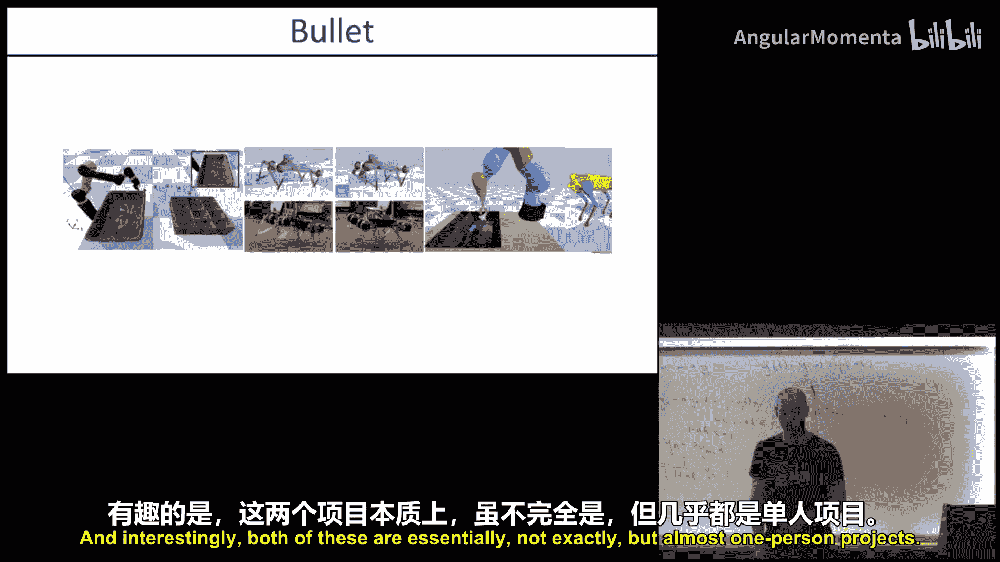

Reinforcement against the fourth research sent for bullet is Erwin Coummans from he's now at Google but used to do it on his own before。

 and essentially it's。I to say it's 100% of all him。

 that's not a fair thing because people do contribute， but it's again。

 largely just one person managing to build this entire thing。

 It's pretty amazing because most software these days is not a one personson effort and definitely not complicated software like this。

 but in both cases， it actually has been single singular driving forces making it happen in everybody using it。

Keep in mind none of these simulators are perfectly accurate， why they're not perfectly accurate one。

Now that you understand how they work， you realize it's hard to make it perfectly accurate because you do a discrete time stepping。

 You have to collision check the forces that come from that。

 and there's just complicated geometries and so forth， never going to be perfect。 That's one。 and2。

You never have perfect measurements of the world so the initial state is not right。

 and the properties of your robot are not exactly right， you put inertia， you put in measurements。

 you put in friction coefficients， all of those are not precise。And so what we'll see next Tuesday。

 Josh Tobin from an Open Eye formerly Berkeley PhD student then Open eye research scientist who pioneered a lot of the work on the randomization。

 will give us a lecture on how you can get around this。

Given that your simulators are never going to be perfect。

 but hopefully somewhat representative of real world。

 how you can randomize your simulator in a way that you end up with learning something that can actually be effective in the real world so that's next Tuesday No lecture on Thursday just the exam on Thursday and yeah next lecture on Tuesday thanks。

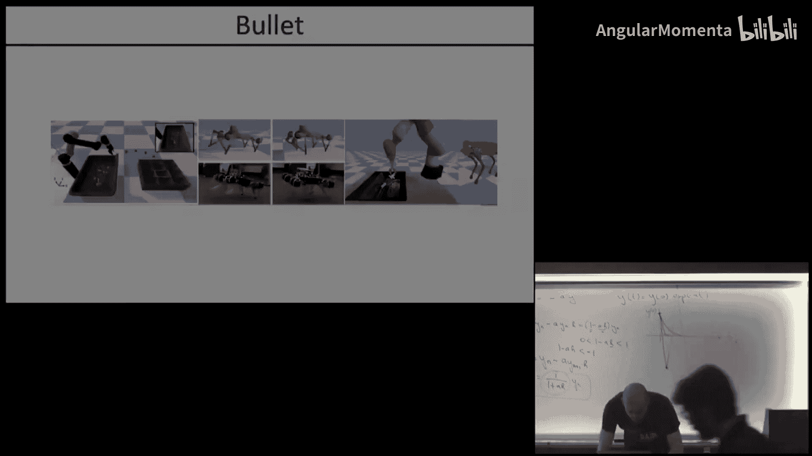