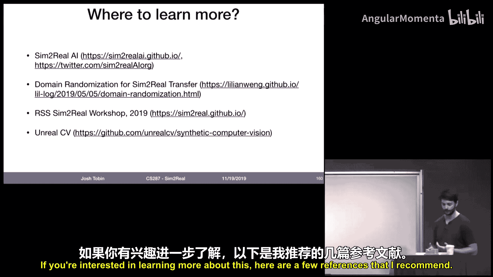
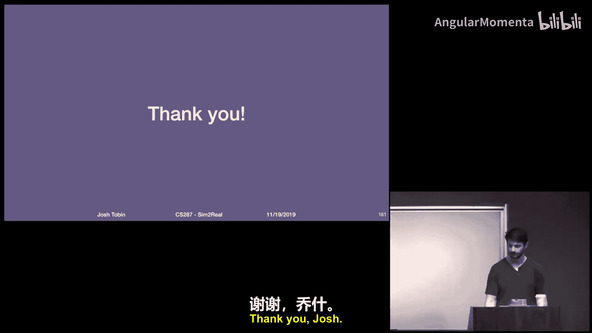
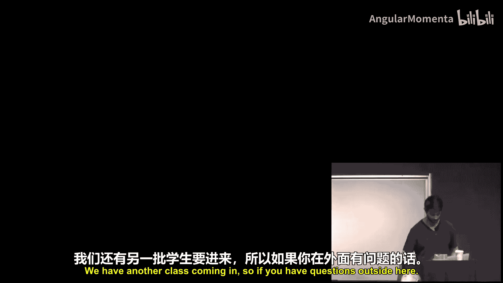

# 【加州大学伯克利分校】高级机器人学-｜-CS287-Advanced-Robotics-at-UC-Berkeley-Fall-2019-p21-22-仿真转现实与领域随机化--BV1KXqCB4Eua_p21-

。Hi everyone， welcome to lecturec today we have a guest lecture。Josh Dobin， Josh。

 got his PhD in AI from Berkeley。I's been a research scientist and Open eye for several years。

And it's one of the world leading experts， I would say the world leading pioneer in Sreel。

 how to make robots learning in simulation and have it still somehow work well in the real world。

 and that's exactly what we're going to learn about today。

Before Josh going to started a couple of quick logistical things。You have your last homework。

 your homework five is out and due in about two weeks， so keep track of that。

 and then your midterm has happened if you missed it。And then final project presentation。

 time slot Paul has gone out， we'll look at that soon and then we'll send out something for signups in the next couple of days so you can pick a specific slot for your team and if you have any conflict with all the slots we'll figure something out probably with youre doing a recording for us ahead of time。

All right， any logistical questions？Okay， then please join me in welcoming Josh。All right。

 thank you Peter， I'm really excited to be here Before I dive into the topic of today's talk which is S to real just a bit about me。

 my background was in pure math and then I decided that I wanted to like do stuff in the real world went into consulting for a little bit but missed being technical so I came back to Berkeley to do my PhD in applied math。

 but little did I know when I came back to Berkeley that I would do one thing that would change at all which is actually to take this class and so I took CS287。

 I think the last time was offered around four years ago and that sort of change my trajectory from math to robotics and artificial intelligence I spent time doing those things at OpenAI in Berkeley。

So the first thing I want to talk about is just know what was my like takeaway from CS287 Actually I'm curious you all are almost done with this semester。

 what's your main takeaway from this class so far？Any takers on this question？

Josh wants an opportunity to throw this box Yeah I really do。

Or maybe no ones learn anything from the class。Yeah。L QR， L QR， Yeah， that's great。

 That's that's not exactly my main takeaway， but I definitely did take that away。

 My main takeaway was get started early on homework 5。 now I'm just getting a。

 I think like the the thing that I took away from the class more than anything else is that know。

 robotics is really hard， right， And so why， why is that the case， right。

 So you all have talked about you know， the simplified model of how robots interact with the real world。

 which is an MP。 But I think one of the the core things that makes robotics so hard is that the real world really isn't an MP right。

 So in an MP， you have an agent。😊，That gets to observe the ground truth state of the world。

 But in the real world， you states are super complex and they're ambiguous and they're really hard to model。

 And so these are all kind of examples of scenes where you should think about how would we actually model the state of this。

So what the robot does get instead of this state is an observation。

 but the observations themselves are often really high dimensional and they're multimodal。

 so maybe they have many camera inputs， and then they're also super noisy。

Right so even though we do get an observation of the world， that observation might not be reliable。

The next assumption that we have in an MVP is that we get a reward。

 but my question is where does reward come from in the real world right so if you're trying to have a robot pour a cup of coffee for someone。

 how do you actually set up a system that will give you a reward back when they do that task successfully？

And a couple of other examples that you might want to think about is what does a reward function look like for folding a towel or for cooking someone dinner or ultimately like making their user happy。

 how would you define a reward function for those things？

And then even if you can define a reward function， a lot of times our reward measuring our reward relies on having sensors to tell us sort of where the robot is in space。

 so how do you measure reward outside the lab。And then lastly。

 actions that robots take right so designing controllers for robotics is a really hard engineering problem。

 you need to understand the system that the robot is interacting with very well and it doesn't always scale that well to high dimensions。

I like this quote from Rus Teddch at MIT and TRI， which is that manipulation。

 like maybe one of the main things that we care about in robotics。

 breaks all of the rigorous and reliable methods for control that we know about。

And then once you do get your controller， your robot is going to break and it's going to degrade and the sensors are going to fail。

 and so how do you make sure that things are reliable for that？

And so one thing that I was really excited about when I took this class is deep reinforcement learning and deep learning more generally applied to robotics and so I think the hope there is that rather than us needing to spend a ton of time understanding the environment that the robots can operate in。

 maybe we can just collect a lot of experience and let the algorithm handle the rest。

And so the next thing I want to talk about is like what's preventing us from doing that。

 why is this so hard？And so I think the main observation here is that deep learning is super data hungryung right so from training models and images to sentences to robotic control。

 you really need like often millions or tens of millions or even more sort of labeled examples in order to get things to work well。

But for those of us in robotics， that presents a big challenge because robotic data is super expensive。

Robots themselves are expensive and actually going out and collecting data on robots can be dangerous。

 and then often in the real world it's hard to actually get labels for the things that we care about our robots doing。

And so one of the main things that motivated me when I started working on my PhD is how can we get around the data availability problem in robotics so is there any way to make data more plentiful so that we can do deep learning and robotics？

There's a few ways that people have thought about approaching this。

 maybe if the problem is we don't have enough data like let's just scale up data collection。

 and so some researchers have thought about how to make fleets of robots that all collect data together and learn from their shared experiences。

Maybe if the problem is that our learning algorithms are too inefficient。

 maybe we should just make them more efficient and so more efficient than sort of model free reinforcement learning could be model based RL meta learning and learning from demonstrations and I know that you've talked about at least two of these model based and LFD in the class so far。

Or you know maybe another way to get around this is if if the problem is one of the problems is it's really hard to get labeled data in the real world。

 maybe we can do a lot of our learning in unsupervised way and so I think you all of these approaches that I've sort of touched on at a really high level so far are really interesting and I think are going to be a big part of the story about how robots make it to the real world。

 but the question I want to focus on is what can we do without doing that。

 so what can we do with simulated data。And you might ask why would we even bother with simulated data at all？

Well， if simulated data works， it has a lot of really big advantages， so unlike robotic data。

 simulated data is super cheap， basically zero marginal cost， it's very fast。

 you can run simulators faster than real time and it's scalable right so you can have a simulation running on every core in your data center。

 you don't need to go and buy new robots。Maybe more importantly， it's safe。

 so you can't actually damage something by running a simulation， at least not yet。

You get labels for free because you design the world so you know where all the objects are and you know kind of how the task is evolving。

And you're not beholden to real world probability distributions。

 and I'll expand on what I mean by this in a second。嗯。

But first labeling I think this is kind of like an underrated advantage of simulation there are a lot of tasks where it's very hard to get a human to label the data for you。

 so for example， if you have images from the real world and you want to have someone annotate the ground truth for depth in those images that's kind of like a hard task for a human to do or similarly annotating the 3D pose of objects when you only have a 2D image both of those things you know it's kind of hard to just go and ask people in Amazon Tu to do it for you。

What do I mean by not being beholden to real world probability distributions。

 a couple of kind of examples I want to mention here， first is the edge case problem。

So if you're training a self driving car， right， most of the time your car is just driving on the highway。

 but every once in a while you see something like this， right。

Uniccyclist in a pink bodysuit or a kangaroo hopping across the road。

 maybe that's common in Australia， I don't know， but definitely not here or this like crazy roundabout that's like five roundabouts in one or something like that。

And so know the challenge with edge cases in self- drivingriving cars is that by definition we have sort of very few if any training examples for our robot。

 and so how do we like if we're doing machine learning。

 how do we not overfit to the training examples that we have and if we can train on simulated data that might be a way around that。

Another reason I'm excited about simulation is for reducing bias so you take a toy example here like let's say that we're training a model to distinguish I don't know dogs from puppies and our training data looks like this so this training data is biased because it only has golden retrievers in the dogs category and so what would happen if we train a model on data that looks like this well the model might classify all Australian shepherds as puppies and that's really bad because there are adult Australian shepherds as well and so know the question I have is can we fix this by synthesizing adult Australian shepherds。

But I think kind of the core question to ask yourself about all this is like if simulation works。

 it could be really valuable， but what reason do we have to believe that it should actually work。

 and so this is a quote from Rodney Brooks that I like。

Because I think it captures what the way that most people in the robotics community and the machine learning community felt for a long time about the value of simulation right。

 there is actually a near certainty that programs that work well on our simulated robots will completely fail in the real world and the reason that they'll fail is because the real world is not like s。

 their are differences between between the dynamics in the real world and those in our simulator。

Okay， so what am I going to talk about for the rest of this talk？

The first thing I want to touch on is just I want to give you sort of an intuitive sense of why it's so hard to use simulated training data。

 so why is it the case that we have a gap between simulation in the real world？

And then I want to sort of briefly mention， you know simulation is a broad topic in robotics and even if you don't solve this symptom real problem。

 you can still use simulation to help you build robot systems that work。

 and so I'll talk about a couple of those。Then I'll mention kind of some ways that you can go about building a good simulation。

 so a simulation that's a good fit for the real world。

And then I'll talk about a couple of techniques to bridge the gap， so the verse is domain adaptation。

 and then the second is domain randomization， which I'll have the most to say about。And then finally。

 I want to mention a couple of thoughts about sort of what's next for this field of Sel。

But are there any questions before I dive into that？All right。

So why is it so hard to use simulated training data？

I think the core at its core there are two reasons the first is that it's really hard to accurately and also efficiently model sensors and physical systems。

 and then the second is that even if you have only like a small modeling error that can tend to lead to large errors in the behavior of the downstream control system so why is it hard to accurately and efficiently model sensors and physical systems well as you talked about a couple weeks ago。

 physics simulators make some big assumptions about the world in order to run faster so a lot of physics simulators assume that all the objects are coned or that we have sort of discrete time stepss with a relatively large。

DT， or that all bodies are rigid， or we have a simplified model of friction， let's say。

And so there's inherently going to be gaps between any model that makes assumptions this large and the physics of the real world。

But also， even if you can model everything accurately。

 then if you want to carefully match the real world。

 you still need to get the parameters of that simulation right。

And so how do you measure things that are not directly observable in your data like damping。

 inertia and friction？And you know the more accurate your model is。

 the more parameters it's going to have， and so the more of these things you need to measure。

 and so that means that you need more data in order to accurately estimate them。

I'll talk a little bit more on how to do this later。But it's not just physics。

 we can do a reasonably good job now of。phohoto realisticalistic rendering of sensors and so this is an example from a movie a few years ago ago which is the remake of the jungle book。

 and I think this is a really good example of super super high quality rendered images。

 but if you look at how much effort went into creating images like this。

 it's like tens of hours of artist effort per frame。

So getting sensor data that's this high quality is very expensive。

And it's really not a solve problem， right， and so I think LDAR is kind of one example of something that people see as being relatively easy to simulate。

 but in fact， there are a lot of gaps between how LDR simulators work and real worldor LiIDAar data。

Okay so so there's always going to be some sort of gap between your simulator and the data that you get from the real world。

 but what's worse is that if there is a gap then simulators will or then your model will tend to exploit it so one reason for that is that like one of my intuitions about neural networks is that they're very lazy and so if there's like some artifact in your data distribution that they can exploit。

 they will exploit it and so an example to illustrate this point is the virtual kitdie data and so they essentially took each scene in a self-driving car data set and exhaustively reproduce it in simulation。

 they train a model on both the real data distribution and the simulated data distribution and so even though this is kind of like the best that you could expect to do in terms of recreating your real data distribution。

 there's still a big gap in the performance between training on the simulated version and the real version。

But so you might say， well， maybe it's okay if we have some errors because our robot should be robust to errors that we make in modeling。

 right？One challenge is that arrows tend to compound for gaps between S andre。

so what we hope happens is if you have some blue curve that's like the path that you want the robot to follow and the green curve is the path that it actually follows where you kind of make small mistakes along the way。

 but those mistakes are uncorrelated， and so you're able to kind of keep the robot on track。

But what actually happens a lot in the real world is that you have。

 know the same path that you're trying to follow， but the robot gets off the path and it gets so far off the path that it's out of the data distribution that is trained on and it's not able to recover。

All right， any questions about？What I've covered so far？All right。

 the next thing I want to talk about is。So we've sort of established this S to real problem。

 like the problem of using simulated data for real world tasks is hard。

 so the next thing I want to address is like why should we do this at all。

 maybe we can take advantage of simulation without needing to train robots on it and there's a couple of ways that you can do that。

One is， simulation is great for prototyping your algorithms。

Simulation is also really good for debugging your specific implementation and making sure that you have sort of bug free code before running it on a robot。

Prototyping entire systems。And then testing。So for prototyping algorithms。

 I think this is like really common in reinforcement learning， for example， where people will。

 if they're trying to come up with a better reinforcement learning algorithm。

 they'll almost always run that in simulation before it ever makes it to a real robot and the reason for that is you're going to have to do a lot of cycles since you want to make sure you're using those cycles efficiently。

It's also useful for debugging your software， and so typically this is done in tools like gazebo and RosOSSs that are very similar to the software that's actually going to be running on the robot and so what you do here is you actually implement your entire stack that you want to run on your robot and then you make sure that with realistic latency and all of the sort of bugs in your RAOSs stackack that you're able to get things to work in simulation first before deploying them on the robot。

Another use case that you see a lot in industrial robotics is for prototyping entire systems， right？

You know，For example， like if you have some task that you want your industrial robot to solve。

 then you need to figure out what robot you're going to use and you need to once you figure that out。

 you want to kind of make sure that it's going to be able to solve the task before you go and buy it and like invest the effort into installing it。

And then you often need to design the entire cell itself。

 so like the entire workflow that the robot is going to be part of。

 and you can prototype things like that much faster in simulation。And then finally。

 you can kind of test how long things are going to take and make some sort of ROI calculation before you decide to invest in expensive robots。

One other kind of use case that I'm actually really excited about that I want to mention is for reliability testing or like continuous integration for robotic software development and so know I think the question is like。

Say you're developing a self driving car and you。Make some change to your vision model right and so how do you make sure that that change to your vision model is not actually going to degrade performance in the real world？

The most straightforward way to do that is you can run tests against your log data so you can look at all the sensor data that your robot has seen before and then you can look at your model against that and make sure that the errors it makes aren't too big。

 but the challenges are that log data has itself incomplete right it's a noisy observation of the world。

 you don't have full state information。嗯。And you it's partially observed and then importantly like log data is also static right so really what you want to do is you want to make sure that your entire control system still behaves well when you make a change to your vision system。

 but if you're looking at log data， then you can't explore what happens when your robot's behavior itself changes。

 you can only look at sort of what's happening in the current time step。

And so a lot of self- drivingr car companies have invested pretty heavily in this。

 there's an article that came out about Waymo's simulation testing setup that I recommend checking out。

 and they've run like several more orders of magnitude of tests in simulation than they have on real cars。

Another example of this that I really like is the approach that Russ Tedrick's group is taking at Toyota Research Institute。

 and so they call it Simulation first robotic development and basically what this means is that they have a bunch of tests that run in simulation every night。

And so they want to make sure that like any changes to the codebase that they pushed during the day。

 they want to know how those affect the behavior of the robot in the simulation。

And so the keys that they've mentioned that have been important for this technique being successful are making sure that the simulation is harder than the real environment that they're trying to solve。

Being rigorous about sources of randomness， so knowing that if you have a degradation in performance it's not just because you got unlucky with the random seed。

And then manually going through the errors that your model makes to find kind of sources of bugs。

 so like looking， you know if you had a degradation and performance overnight。

 then like actually going and looking at each of those cases and saying like， okay。

 why did we make this mistake？And then lastly， good contact simulation is important for them。Okay。

The next thing I want to talk about is if let's say that we decide to use simulation to train our robots or just to do testing。

 then how can we actually go about building a good simulation？

But I'll pause there just to see if there were any questions。On the pass section， yeah。

 maybe toss the。All right。So my question is。Do you know if most self driving car companies just use simulation for testing or do they also train on that data。

Yeah， I think self driving car companies are sort of interested and curious about training on self driving car data。

 but and I think it。So from the ones that I've talked to， they have tried doing this。

 but I don't think it's a widespread practice right now。

You quoted earlier about like make simulation hotter than reality。 Can if you like expand on that。

 How can you actually make simulation。Like a more rigorous than reality。

 That sounds a little bit like counterintuitive。 Sure， yeah， it's， it's a good question。 So the。

So like one way to think about it is let's say that you're training a robot that you want to be able to grasp objects and so you have some properties that you know about the objects that you want to be able to grasp like maybe they're they're all objects that you'd see in a kitchen and they're all between this size and this size and you know it's always going to be well like lighting conditions are always going to be good when you're trying to grasp the robots one thing that you might think about when designing the simulator is take your worst case estimate of all those things and just make sure that your simulator is like sort of biased towards that so make sure that you're giving the robot lots of the hardest objects for it to grasp in the sim rather than if you only see those hard objects 1% of the time in the real world。

 maybe you see it more of the time in the simulated world。All right。嗯。

So I think the process that people typically go through when they're designing a simulator is first you kind of build the model of the world。

And then you create scenarios， so the first part is about like designing the physics and making sure that you have accurate。

Kin of model of your robot and then the second part is about creating the scenarios that the robot is going to interact with。

 so like which roads is it going to need to drive on or which objects is it going to need to pick up。

And then finally， typically what you'll do is you'll collect a bunch of data from the real world。

 use that data to do system ID， which is a process of improving your simulation。

So just really briefly on designing the simulation model。

 I'll just refer you back to Peter's lecture earlier in this class。In practice。

 what most people do is they don't build their simulator from scratch。

 they just pick bullet or pie bullet or Mujoko， and then use the models that are provided for them by the developer of their robot。

A couple of other simulators that are worth looking at。Drake from Russ Tedrake's group again at MIT。

 which is， I think， pushing a little bit more towards trying to make more realistic simulation at the expense of it being maybe a little bit slower。

And then gazebo， which was the most， the most popular simulator for a while in robotics and has since fallen out of favor。

 but if you're doing a lot of stuff with Ross， it's still worth exploring。

The next thing you need to do is create your scenarios for the robot。

And so this is kind of the process of designing the world that the robot is going to interact with。

And so I think kind of one of the main questions here is like where do we actually get 3D models for things so if the robot needs to interact with objects。

 where do we find examples of objects that the robot can interact with in the simulator？

There's a spectrum of different options that sort of have tradeoffs in terms of the quality of the objects and the number of objects。

 ShapeNet is the one that's freely available that I think has the most objects。

 and so it's like in the high tens of thousands， but the quality of the objects themselves tends to vary。

YCB is sort of at the other end of the spectrum， very， very high quality object models。

 but not very many of them。Dexnet is a data set from Jeff Muer at Berkeley and it's actually a combination of other data sets and this is I think at a pretty good tradeoff point between quality of the models themselves and the number of models that you have access to。

A couple of other things to be aware of， there are like all these sort of 3D model repositories that you might see if you've ever done like game development。

 these are worth checking out generally you can't get things for free from them。And then lastly。

 procedural object generation， and I'll talk a little bit more about that in a second。

And so then the next question is like we have our database of objects that we want the robot to be able to interact with。

 like many hammers and cups and whatever it is that we need our robot to do。

 and so then the next question is like how do we place those into the world in a coherent way？

You could just try placing them randomly， but what tends to happen if you do that is that all the objects will sort of collide with each other and they'll be in very unrealistic configurations。

 you can place them randomly according to physics so maybe you just have like a box that the objects are sitting in and you might drop them from above the box before the scene starts so that they're at least placed in a way that's consistent with physics。

Or you might do it procedurally， so I mentioned procedural content generation in the context of object modeling and also world design。

 so this is kind of a pretty big and well exploreplord area in game design。

 I won't really go into it， but there's a book that I recommend if you want to learn more about that topic。

All right， and so lastly。You have know you've built your simulator。

 you have collected a bunch of scenarios that you can put in your simulator that you want your robot to perform well on。

 and so then the next thing to do is like you've made guesses at all of your physics parameters when you've been modeling the world and so the next thing you want to do is actually collect a bunch of data and use that data to try to make the simulator a better match for reality。

And so this is the process of system ID。So what is the problem that we're trying to solve with system ID。

 Well， we have some like parameters of our simulation， so these are things like friction， damping。

 you know massive different links of the robot。And then we have some sequence of actions that we want the robot to follow。

 and so the goal of system ID is to try to find the set of parameter values。

That give you the sort of lowest loss， the lowest difference between what the robot does when you execute those actions in the simulator and what it does when you execute those actions in reality。

so there are a few design choices here one is like how do you actually choose this sequence of actions so like what do you want to actually run on the robot in order to like in order to kind of minimize the difference between SIim and real and then another is like what distance function do you want to use so how do you tell how you measure if these two trajectories are close to one another。

And so I'm going to just give a quick sort of case study of how this worked for one problem。

 which was。Doing system ID for the shadow hand in some of the open AI robotics experiments。

AndSo in this case， they chose trajectories that consisted of kind of individually moving each joint to its limits。

 and then moving each finger individually along kind of spline curves to try to capture the interdependencies between the joints。

And then the distance function that they use is they took。

 know they applied the same sequence of actions both in SIim and real。

 and then they looked at where the robot was one second later。

 and then they took the difference between those states and tried to minimize that distance。

And then finally， the optimization algorithm that they used to do this minimization was sort of iterating between the coordinates and doing coordinate disscent until things converged。

Okay， so you've designed your simulator and you've tried to make it as good a fit to reality as you can。

 but as I alluded to earlier， there's still going to be gaps so your simulator is still not really going to be a perfect match for reality and so kind of the rest of the talk is about what to do about that。

But before I dive into that， yeah， there's a question here。

Have you ever seen a simulator that has good like other agents as well。

 like simulation of like other cars in the scene or maybe things that the robot is going to interact with Yeah it's a really good question。

I think。So。A couple of ways that I've seen people deal with this。

 one is if you can incorporate the learning of the other agent into the actual optimization process。

 so if you're in like a multiagent reinforcement learning setting。

 that's kind of one way that people deal with this。

 but in general this is a really hard problem and this is like when you talk to self-dring car companies about their problems with the simulation one of the biggest ones that they cite is not having good models of like how pedestrians are going to behave or how other drivers are going to behave And so I think you know。

If you can figure out an answer to that question， then it's going to be really。

 really valuable in that industry。Yeah。For the data collection in the previous slide， how about。

Running and optimization also over the data collection。So you're saying。

 also figuring out trying to optimize which data set to collect in order to minimize， yeah。

 that's really interesting。I'm sure that there are examples of people doing that。

 I've not seen people try it myself。Yeah。Yeah。Do you have a sense for which types of tasks is possible to make a good simulation form and which types of task is just like near impossible？

An。So I'll give a couple of categories of things that are maybe harder to make a simulation for。

Anything where。It's so anything where it like explicitly violates the assumptions that most simulators make。

 so if you have non-rigid bodies like if you need to do cloth simulation， for example。

 you can do that， but it tends to be harder。 So that's kind of one category of things like maybe if your robot needs to interact with fluids that might also be really difficult And then another category of things is just where you have。

Or the like set of。Things that you need your robot to be able to solve is just really wide。

If for example， you're trying to make a simulator for all of self-driving cars， then it's like。

 how can you possibly get enough variety in your simulator to capture all the different scenarios that you might see in a self-driving car？

Yeah。How do you think about like？Well， it's， it's for the recording， I think。 Yeah。

 How do you think about like the model class that you should have here， For example， like you could。

 you can imagine using a neural network， But like in between all the data points that you observe。

 it's arbitrarily bad。 So how do you。How do you what is your process for selecting the appropriate model for for dynamics for the dynamics itself。

 Yeah， think I think typically the thing that you want to do is like。

So neural networks can basically learn any function or they can learn any function if you have enough data。

The challenge with neural nets is that they don't really generalize that well to data that's out of the distribution they've seen before and so I think like one of the reasons why simulated training data works so well is because we as humans actually know things about the world it's not like the world is just a black box that spits data out at us like we understand at least at a simplified level how physics work and so I think one of the reasons why this approach has actually been really successful is because if you build a physics model of the world and then use that to generate data then even if it's not perfect。

 we're exploiting some of our knowledge about how the real world works so I guess。

My answer is I would suggest trying to use physically based models yeah。

 and I think Peter's lecture on that from a couple weeks ago is a good starting point for that。

All right。So addressing the gap between the simulator and the real world。

The first class of techniques that I want to talk about is domain adaptation。

 so this is sort of a broad topic in machine learning and I don't really have time to do justice but what I do want to do is just give a few examples of how domain adaptation techniques have been applied for symptom to real problems in robotics and so I would kind of categorize domain adaptation techniques into two buckets one is supervised domain adaptation where like let's say that you assume that you're able to get labels or reward signal in the real world。

And then the other is unsupervised or weekly supervised domain adaptation。

 where your assumption is that we have labels and rewards in the simulator。

 but in the real world we don't， we just have like only unlabeled sensor data。

So the first category is supervised domain adaptation and so for those of you that have that have trained like convolutional neural networks for example。

 the simplest form of supervised domain adaptation is just fine tuning so you train on some source data distribution and then you kind of take the weights that you get from training on that source data distribution and then you just retrain them a little bit on data from your target data distribution so from the real world in this example and so this can work quite well in robotics and it's present in a lot of papers but it's kind of rarely the focus of people's effort when they're doing research in this area。

One kind of extension of。Of fine tuning is this idea of progressive networks and so one of the challenges with fine tuning is that when you finet a model that's trained on one data set to another data。

 it tends to forget what it learned in the first data and so progressive networks are kind of a way to try to address that where instead of fine tuning the same network。

 they instead like add some additional layers to the network and then those are what they train on the second data。

Another approach that people have tried here is what I would call like learning inverse dynamics。

 and so inverse dynamics is basically you have kind of the current state of the world and then you have some goal state that you want to get to and the learning problem that you're trying to solve is learning what action will take you from this state to the next state。

And so there's a couple of different variations of this technique that people have tried。

Another idea in this category is using simulation to find a lowdial search space。

 so one thing that you can do is like know one of the reasons why it's slow to learn policies or models in the real world is because you're searching over this really high-dial space which is like all possible policies。

 but if you train in simulation and you use that to find like a submanifold of that huge space and then search over that in the real world then that could make learning more efficient。

And then the final category that I want to just quickly mention here is using simulation explicitly as a Bayesian prior for your learning in the real world。

 and there's quite a bit of research in this area， and I think this category is actually particularly exciting for kind of ongoing research。

Yes。Do you experiment the learning verse dynamics？Yeah， so the idea in this category of。

Of techniques is like， so you。Train a model in simulation and the goal of that model in simulation is to tell the robot what states it's trying to reach at any given time point。

 And so that model might say like， all right， heres a trajectory that I you know given the state of the world that I see now。

 here's the trajectory that I want to follow。 But you know the challenge is that if you。

If you just apply the actions that you took in the simulator。

 then that won't actually allow you to follow the same trajectory in the real world。

 and so what you're doing here is you're kind of like you're taking the output of that simulated model which says。

 like all right， since I'm in this state， I need to go to this state next and then what you're learning on real data is the function that allows you to get from this state to the next state。

Other questions on this？All right， so there's also kind of less supervised domain adaptation。

 One category is weekly supervised where you take， you know， you take the labels of。

Like your model outputs and you treat them as kind of or you take your model's predictions and you treat those as noisy labels for fine tuning。

There's self supervised demand adaptation。 So if you can create a system that allows the robot to do things that automatically allow it to label the data。

 So if you know that， for example， that if you kind of。

That if if you have a sensor that tells you that this object has moved， then that might tell you。

 well， okay， if the object has moved above a certain height。

 then that means that our attempt to grasp that object was successful。

 that's kind of this category of things。And then lastly is unsupervised domain adaptation。

 and so I think kind of the most exciting recent advance in this is taking image image translation models and applying those to domain adaptation。

 and so what I mean by that is you might have some data from your simulator that's unrealistic。

And then you might also have some data from the real world。

 but the data from the real world doesn't have labels。

 and so what you can do is you can learn a function that maps your simulated data into the real world and tries to match the data distribution from the real world and so the idea is like you're kind of translating the image from the simulated domain into the real domain and if you can do that successfully then what that allows you to do is take is to train on data instead of just your simulated data。

 it's the translated data so you can train on data that looks like this and then the hope is that when you go to the real world it's close enough that things will be successful。

All right， any questions about domain adaptation， that was kind of like a quick tour。

 it's a very deep topic， but I have to move on to other things。All right。嗯。

The next topic I want to talk about is domain randomization。And so the idea here is。

 you know in a lot of in sort of the techniques that we've talked about so far for SIM tore transfer。

 the assumption has been like let's try to model the real world as closely as we can in the simulator。

 and if we get it close enough， then maybe that data will be more useful in the real world。

 or maybe at least it will allow us to kind of adapt between that data and the real worldl data。嗯。

The idea of domain randomization is a little bit different。

 which is instead of trying to find a single best simulator。

 let's just make the simulator as varied as possible and maybe the hypothesis is that maybe if the model sees enough simulated variation。

 so it sees enough kind of different simulated worlds， then when it does get into the real world。

 it'll have learned sort of a general enough strategy because it seen so much variety that it'll be able to figure out what's happening in the real world。

So this is kind of the core idea。And。What I want to cover on domain randomization first I want to give kind of a little bit of a history of the idea because I think it's important to kind of know where this idea came from and it's not a new idea then I want to talk about some of the applications that people have used it for。

Then I want to try to give you a little bit of intuition as to why it works right because it's kind of a counterintuitive thing。

 right why should training on a lot of really unrealistic data allow us to generalize to realistic data。

Then I want to briefly mention a few tools if you want to use this in practice that you can go try。

And then finally， I want to talk about some extensions that people have made to this core idea and sort of how this research field is evolving。

All right， starting with the history， I think so again this is like this idea of using really noisy simulators is not new in robotics and the first instance that I know of is from this paper called the Ra envelope of noise hypothesis from 1997。

 and the idea here is if you're trying to solve a task like you have a robot driving down a hallway and it needs to turn decide whether to turn left or right。

 depending on whether it gets a flash of light from the left or the right。

How do you build a simulator to solve this task Well the insight of this paper was to say there's some things that we really need to model carefully in order to actually solve the problem at all and so that's that's what we call like the base set of things in the simulator right so is the light coming from the left or is it coming from the right？

How long is the hallway and things like that？And then there's a bunch of other things that we need to model in our simulator but that are sort of inconsequential for solving the task。

 so like you what is the friction model between the wheels and the hallway。

 and so the insight here is we want to take the base set and model those things as carefully as possible and then take everything else and maximally randomize it。

And they were able to solve this task using sort of a very simple simulator by using this technique。

In the deep learning world， the first example of this that I've seen is from this very underrated paper called live repetition counting。

 and the idea of this paper is you they wanted to train a model that could count when people are doing cyclical behavior so when they're doing pushups or jumping jacks or something like that。

But they didn't really want to go through all the effort of labeling data of people doing that。

So what they did instead is they created the synthetic training dataset that consisted of kind of random white noise in the background and then cyclical periodic noise in the foreground and the really surprising result from this paper was that when they trained model on data that looked like this random noise and then tested on real data。

 they were able to actually solve the task they were able to count how many times people were doing jumping jacks。

The first application of this sort of concept in robotics in sort of deep learning and robotics that I'm aware of is this paper called CAD2R from Sergey Levin's group here at Berkeley and the task that they were trying to solve here is driving a quadcopenter down a hallway and making sure that doesn't hit the walls and so they built this simulator that had that was。

Randomized with these different sort of semi realisticistic textures and floor plans that they designed。

 and what they found was that when they trained on the simulator。

 they were able to fly a quadcopier down a real hallway and not crash at least reasonably frequently。

And then I think the last two papers that I mentioned were kind of the inspiration for us to start working on this。

 and the core thing that we wanted to try to figure out is whether we could apply this idea to sort of more precise tasks in robotics。

 so to grasping something where you need to be able to position the gripper really carefully。

And we were also curious to see whether we could get away without needing to design floor plans and textures ourselves if instead we could just procedurally generate those in a really unrealistic way。

 and then finally， we were curious if we really needed to pre-train these models on INe in order for this to work or whether we could just train them only on synthetic data。

All right， so next thing I'm going to talk about is some of the ways that people have applied this idea。

And the first is kind of the problem that I just mentioned。

 which is using domain randomization for computer vision。

 and in particular for using it to estimate the pose of a particular object in a scene。

And so what we did here is we for each scene， so for each like image that the model saw。

We gave it a unique set of randomizations， so we randomized things like textures and materials。

 colors of the background， and things like that， we changed the positions of the cameras。

 we changed the lighting and we added a bunch of other objects to the scene that we're sort of trying to distract the model from the object that it ultimately cares about。

We trained a relatively simple neural network， so this is kind of just a VGG with the top two fully connected layers popped off and smaller ones put on top。

 and the model is taking an image of a scene and regressing it to just the X。

 Y and Z coordinates of a particular object that we care about in that scene。

So how well does it work？YouThis is sort of an unfair comparison because you all these papers use different objects and different distances from the camera and so on。

 but kind of at a high level were sort of within what you'd expect to be able to do with relatively state of the art post- estimation techniques from a single monocular camera training entirely on synthetic data。

And so here's what this work looks like when you deploy it on a robot to grasp an object。Maybe。

All right， well let's see if we can get the other ones to work then。I saw I do something。

Oh there we go Okay yeah， so this is kind of an extension of the original paper where we were you know it was April Fool's day and we wanted to like see if we could train a robot that could detect like spam in the real world。

 so we built a spam detecting robot and they would pick up the spam off the table and drop it in the trash can。

えて。The next thing that we applied this to at Open AI was block stacking。

And so the goal here was we had trained a policy that could do block stacking in simulation using one shot imitation learning right so see a single demonstration of a human doing the task in virtual reality and then apply it from different initial conditions but the challenge was in order to deploy this in the real world。

 we needed to know where the blocks were， and so we trained similar model。

 really similar data set and we were much more careful about。

sortrt of calibrating cameras and stuff like that， and we were able to get really precise localizations of the objects so that you could actually stack six blocks on top of each other using vision models that trained entirely on synthetic data。

So how does it work， a few observations， one is you know one of the really important things is just using a lot of data。

 so as you increase number the amount of training data on the X axis， then the error goes down。

 at least until you get to around 50 or 10000 images。

You might ask like what's the important part of having more data。

 is it just having more training examples？So we tested whether we could get the same results with the same number of images。

 but with fewer unique textures， and it turns out that the important thing here was you need to have as many unique textures as you can。

 so as you increase the number of unique textures， the error also goes down。And then lastly。

 and this is kind of surprising to us was that to find that pretraining our model on imagenet is actually not necessary。

So you can see like pretraining INe actually does help right， like if you are in the low data regime。

 then the model pretrain on ImageNe is still able to do something reasonable。

 but as you get enough data， then pretraining becomes unnecessary。All right。

 so here's just a few other kind of highlights of results that people have had using this technique or extensions of this technique to solve other kind of perception problems in robotics。

 so people have extended it to estimating not just where the object is on the table but the full sort of 60 pose。

 so the position and orientation of the object。People have extended it to。

Doing objects with really challenging textures， and so this is a paper where they use domain randomization to train a model perception model for a system that was grasping fish out of a bucket。

Not sure why they picked that task， but it's a really challenging one from a perception standpoint because fish are kind of shiny and reflective and difficult to model those textures。

And then people have also extended to， you know， instead of just localizing where a single object is with a single network。

 instead localizing kind of an entire corpus of objects。A few others I want to highlight。

People have used these techniques for object detection， for autonomous vehicles。for face tracking。

 so taking a simulated model of your face， randomizing it。

 training a model and that to sort of tell the pose of your face from a single camera image。

Loalizing a robot within a lung， so like if you're driving a robot around a lung and you want to decide whether to turn left or turn right。

 you need to know where in the lung you are， and so if you have a vision model that allows you to sort of take the image that the robot sees and then map it back to where on the map of the lung you are。

Sort of end to end control， so instead of just training a pose estimator。

 you can also train a policy that takes images directly and outputs commands to the robot。

 and so people have done that with domain randomized data。And then also cloth manipulation。

 so estimating kind of the state of a cloth so that a robot can fold the corners together。

 so also tasks where there's non- rigid objects。This technique also works for other types of sensors。

呃。Some of Jeff Muer's work here at Berkeley on Dexnet。

 which is a sort of work that does a really good job of grasping generic objects。

 their models are trained， the inputs to their models are images from。

 at least in this version of the work or images from a depth camera。

And you can apply a similar set of techniques by like adding a lot of random noise to the depth image。

 and then you can train on synthetic depth images and generalize to real depth images in the real world。

A couple of assumptions that the results I've shown you so far have in common。

 the first is that you actually have 3D models of kind of all the objects that you want to track。

And so one thing that you might ask is how can we move from this。

 so how can we move from needing 3D models of every object that we care about to being able to train a sort of generic vision policy that can work for any type of object？

AndSo we explore this in the context of grasping so you know and grasping like you care about really being able to grasp any object。

 but as we talked about earlier， it's really hard to get good databases of objects to train your model on And so we asked the question。

 well， maybe similarly to how you don't really need realistic textures in order to train a vision model。

 maybe you also don't need realistic objects to train a grasping model And so we procedurally generated these sort of highly unrealistic objects like on the left。

 and we trained a policy to pick up those objects in simulation based based on depth images of the objects and then we tested on real worldd objects and kind of the surprising thing。

That we found out was that we're able to actually generalize to grasping realistic objects in the real world from only training on highly unrealistic。

 procedurally generated objects entirely in simulation。And this is what it looks like。So again。

 it's not perfect right， this is not we're not getting 100% success here。

 but its it's generalized grasping is a very difficult problem and the interesting result here is that we're able to get something to work at all using entirely simulated data。

Another assumption baked into the results I've shown you so far is that sort of dynamics are relatively consistent between the simulator and the real world。

So what if that's not true， right？So what if there's some gap in physics between your simulator and the real world？

And so similar set of ideas also applies to randomizing dynamics。

And so the way this typically works is in standard reinforcement learning。

 you'll train like a feed forward neural network policy on a single best version of the environment。

 and then you'll execute that on your test environment。

But what these techniques do is instead they train a recurrent neural network。

 so a neural network that has some state and they'll train that on a variety of different physical of physics environments and the idea here is that。

The memory of the neural network。In principle， should allow the neural network to kind of figure out which version of the simulation it's in and adapt to that simulation。

So the first set of results here was from Jason Pang during his internship at OpenAI and they worked on kind of these tasks that involved sort of sliding objects on table。

 and so this is trained entirely in simulation with ourcurren neural network and then generalizes to the real world。

This has also been extended to more challenging tasks。So。

This is a result from Open AI about a little more than a year ago， where we trained a robotic hand。

 a high dimensional robotic hand to sort of reorient and manipulate objects in hand。

 so it's a very contact rich and challenging task， and this is trained more or less exactly the same way using randomized physics parameters。

In a little bit more detail， the way this worked is there were a bunch of different sort of variations of the environment and robots were trained in those environments using reinforcement learning。

And the recurrent policies were forced to adapt to a wide range of different physics environments。

 and then in the real world there was also sort of a state estimation module that was trained in a similar way。

 so trained on vision data from the simulator and then deployed deployed in order to like estimate the state so that the policy could know what to do next。

And so the things that are typically randomized here and that were randomized in this paper are things like physical parameters。

 but then also just sort of correlated and uncorrelated noise being added to the simulation sensor dropout。

 so occasionally just assuming that the sensor fails。

How the physics long DT is in the physics simulation。

 there's a model of backlash that's applied to it and there are random forces that are applied to the object as well。

 so there's like quite a bit of effort that went into figuring out what are really all the things that we need to randomize in order to make something like this transfer。

All right， any questions about kind of like the high level idea here。

 sort of where people have applied it to， where it works。

 where it doesn't before I move on to talking about，My intuition about why this actually works， yeah。

 keep us behind you。So when you see S to real not working。

 how can you tell what the failure mode was like was it the dynamics that was different was it？

The pose estimation now was different。Yeah， it's a great question， and I think this is sort of。

One of the core things that that makes using these techniques still difficult。

 there's a few things that you can do to make it easier。

 I think in a lot of the opening eye results the sort of approach that we took was to separate perception and control so we'll have one neural network that's looking at raw sensor data like images and then it's trying to output what it thinks the state of the world is given those images and then we'll have another module that says all right given that I know the state of the world let me try to predict what I should do next and so separating those two things allows you to audit it a little bit more easily because then you can look at the errors that the pose estimation module like the state estimator is doing specifically and isolate that as a source of error but in general if you're deploying a model of the real world and and it fails it's it's still a very hard problem to go back and see like okay did this fail because there's like way more friction in this scenario than we modeled or is it something else and so I think there's kind of a lot of intuition。

And engineering that goes into this still。Also have one more question。

So how much domain knowledge is required？When you're applying these techniques to one robot versus then trying it for maybe a slightly different application。

 is there a lot of fine tuning with each individual robot and each individual application or do you think you're getting closer to a general strategy。

Yeah it's a little bit hard to answer that definitively because this has really only been tried on to my knowledge like a pretty small number of robots so there's the fetch robot that I showed you for the grasping examples and the shadow hand and I think there's other examples too but those are the two that I'm most familiar with。

 I think the thing that gives me hope that maybe it' like maybe we're starting to figure out the limits of the parameters that we need to randomize and things like that is that like Open eye team was able to get the kind of the inhand block manipulation result to work with other objects like different shaped objects with sort of relatively little additional effort on top of that so that's kind of the one piece of evidence that I can point to that says maybe once we figure these things out once it's easier to expand them to other types of problems。

Question behind you。So if we're doing the physics parameter randomization。

 then can we skip the system ID stuff great question in principle you would hope right that like if we're randomizing physics then the whole point is that we're trying to make our simulator so much more diverse than the real world that you it doesn't matter that it's not exactly the same and I think for vision that's mostly true like you don't really have to be super careful about calibrating things for vision but for dynamics that's decidedly not true so it is still important like the better your system ID is the more likely this technique is to be successful for。

For dynamics randomization， even if you sort of have a big range of randomization parameters。

 and I'm not sure why that's the case。All right so the next topic I want to touch on is like why does this work It's kind of this mysterious thing you have sort of all this very training data and you train a model on it and then it kind of just magically works on your real data。

 even though the simd data is super low fidelity and unrealistic so's few so I think no one really has a great answer to this question there's a few intuitions that I have that I want to just sort of lay out for you and I'll talk a little bit about each of these so the first intuition that I have is that maybe the trading data itself comes from like some sort of covering distribution of the real- worldor data and so this intuition says that if you have an unranomized simulator。

 maybe like this is sort of the distribution of kind of like environments and physics that you would see but the real data is like this complicated messy distribution of of environments that's like much wider than your simulated distribution and so that's why you don't generalize well if you use an unrandomized simulation and so what this intuition says is like well maybe what we can do is。

can just make the range of randomizations so big in simulation that like everything that we might see in the real world kind of lies somewhere in between different things that we've seen when we're randomizing and so like maybe the domain randomized data looks like this it's like this massive distribution that covers the real distribution so I think this is kind of a flawed intuition there are a few things that I think are useful about it。

 one is the idea that wider distribution like implication of this is that as you make the distribution of simulated parameters wider。

 you should get better results and that tends to be true。

Another thing that I think is useful about this is that the concept that we've already touched on in the sort instance of testing that you want your simulated tasks to be harder than your real task。

And then I think the last intuition that this the last sort of。

usefulful thing about this intuition is that it's clear from this intuition that if you want your model to perform well。

 then you need kind of you need to be able to perform well in all parts of this like massive distribution that you're training on so it's not okay like if you if your model performs really badly over here because it might be the case that your real data sort of lies in that part of the region。

I think there are some problems with this intuition。

 so we're mostly operating in a highdial space and so you we really should need like a really massive amount of data to truly cover this real data distribution and then you there are a lot of real world effects that we might not model at all in our simulator like backlash gear backlash for example or the specific distorttion of the camera that you're using and so if we're not modeling and effect at all。

 is it like really reasonable to believe that the impact of that effect will somehow be accounted for by the things that we are randomizing。

Another intuition that I think can be helpful in thinking about this is that domain randomization is a way of telling the model what it can ignore and so the example I have here is like let's say that you have a data set that looks like this and you train a neural network on it to predict whether the image comes label from class1 or class2 and so if you train on this data distribution。

 then what your model is going to do is it's going to train a detector for blue owls on green backgrounds so neural networks are kind of lazy and they'll exploit any sort of commonality in the data that you give them。

And so if you want to instead train。An owl detector then you need to like then what might work better is to use data like this。

 right so if you don't want the model to pick up on the fact that all of the owls in your data set are blue。

 then maybe you should just change the color of the owl every single time so that you force that feature to be unreliable and the neural network can't exploit it in order to decide in order to make its decision。

And then the last intuition I want to touch on is this idea of demand randomization as metal learning。

So the high level idea of meta learning is that in a standard machine learning task。

 you're trying to find some parameters that minimize some loss function on your data。

But in meta learning you assume that you can that you can also choose or that the data itself is not static so you're minimizing some parameters for data that is sampled from some distribution over data sets and so kind of a concrete example here is like suppose that youre you want to train a model that can from a very small number of images distinguish between two different classes and so your training examples in this paradigm are themselves data sets so you might have one data set that has cats and birds and the model has to decide whether it's a cat or a bird and then you might have another data set that has flowers and bikes and the model has to decide for a new image whether it's a flower or a bike。

And then at test time， you'll be given some other data that might have some different classes。

 maybe that you haven't seen before， and then by ingesting this kind of small amount of labeled data。

 your model will need to take a new image like let's say have a dog and then correctly predict whether it's a dog or an otter。

嗯。So this idea has been also applied to reinforcement learning and so like in this formulation。

 you have the concept of a task， so predicting whether's something as a cat or a dog is basically like one or more rollouts in a given environment。

And then you can kind of reset the state of the policy that you're using to learn between each of those tasks。

And so I think like the one paper that I like on this is RL squared paper from Rocky Duon。

 who was one of Peter's former PhD students， and the idea here is that like the recurrent neural network is allowed to use its hidden state within a given task to sort of quickly figure out how to solve a new reinforcement learning。

 and then there's a slow learning process on top of that that allows it to figure out what it needs to do when it's faced with the new environment in order to learn quickly。

So I'll skip through the formalisms here。嗯。But I think I do want to touch on why domain randomization might be meta learning。

So the formulation of domain randomization as meta learning is that each set of physics parameters corresponds to some environment and so one like attempt at solving the task in that environment。

 one attempt at solving the problem in that environment is a task and so during the rollout itself like when you're trying to solve that problem in your new environment。

 the recurrent state of the policy allows you to adapt to whatever new physics you're seeing。

And so there's a little bit of evidence that this might actually be happening in when policies are trained in simulation and then deployed in the real world。

嗯。There are some sort of tools that you can use to do demand randomization。

 like if you're using different simulators， gazebo， unity， Unal。

 or sort of custom self-driv simulator， and I recommend checking these out if you want to apply this。

And then there are also some challenges to applying domain randomization and so in practice。

 how does this process actually work， right？the first thing that you do is you build a simulated world。

And then you take your simulated world and you calibrate that to the real environment。

And then you design some randomizations that like you think intuitively might sort of like cover the real world variability。

 then what you do is you train a model in that simulation and you evaluate it in the real world。

 and then finally you kind of have to go through this manual iterative process of examining the failure modes in the real world and trying to design new randomizations that allow you to get around those failure modes。

And so I think kind of the core challenges here are that this process is very manual。

 right so you need to do all the 3D modeling yourself。

You need to do this system ID problem which itself can be challenging。

You need to decide what to randomize， which can require a lot of judgment。

And you need to decide how much to randomize it？And then finally， you need to like。

 as was pointed out， once you evaluate in the real world。

 you need to somehow like go back and figure out what you should do when the model is failing。

 like what additional randomizations should you add？

And so there's been some recent work that's tried to extend domain randomization to kind of alleviate some of these challenges。

And I think what I'll do is I'll just kind of。Give a high levelvel sense of what are the ways that people are trying to address the challenges of domain randomization。

 and then I have also some references to some specific papers where people are trying to do this that you can dive into if you're curious about the specifics of the approaches that people have taken。

So kind of the first class of techniques that people have tried to make domain randomization better is to say like。

 well， maybe we can design specific types of neural network architectures that are better suited to transfer so that work better for this particular type of tasks that we're doing。

So an example of a paper here is this randomized to canonical adaptation networks from some folks at Google and the idea here is instead of taking your randomized simulation and training your model on that to directly output what it's supposed to do instead what if you add this intermediate step and this intermediate step is we first train a model that maps this randomized simulation into some sort of canonical simulation and then when we get in the real world we'll take our real worldorl data and we'll also map that into the canonical simulation and。

And so it turns out in their experiments， this performs better than just training on randomized data from scratch alone。

Another class of techniques that people have tried is trying to match the simulator to real data。

 and so this is kind of like combining domain randomization at system ID。嗯。

One approach in this category is Sopped where they kind of iteratively train on a randomized environment。

 use the policy from that randomized environment to collect data in the real world。

 and then use that real world data to try to update the parameters of the simulator to be a better match for what was seen in the real world。

 so thiss kind of an iterative approach to automatically incorporating real world data into simulator design。

And they had some pretty interesting results from that。

And you sort of another approach here is this idea of medicine where this is really addressing the problem of world design using simulation。

 and so the challenge is that if you're trying to design a self-driving car simulator and you're just placing objects randomly。

Then you're going to get a lot of scenes that look like on the left。

 right where objects are not placed in。In a way that's physically realistic or that you would see in your real data set。

 and so the goal of this approach is to try to take these scenes that you generate naively and use a little bit of real world data to make the scenes that your simulator generates more physically plausible。

Another thing that you could think about doing is like。

Is actually using the real data itself to try to directly improve the performance of the model that you trained on simulation on the task that you care about。

 And so I think the。One paper that I really like in this category is called Learning to Sim。

And so the idea here is you know in standard domain randomization what we do is we sort of we have this manual process of tuning the simulator parameters so we create some simulator parameters and then we train a model on those parameters。

 we see how well it works in the real world and then we try to use our intuition to go back and say。

 all right， can we design better simulator parameters。

 so what they do in this paper is instead of doing that tuning process manually。

 they instead use meta learning to find the parameter distribution so they're optimizing over the distribution of simulator parameters that performs the best on the task that they actually care about。

So' they're actually optimizing the distribution of simulator parameters itself based on this metric of how well does the model that I train on that simulator perform in the real world？

Another kind of class of techniques in this category is。

Providing some way of telling whether you're overfitting to the simulation before you actually go into the real world。

 and so what this could allow you to do is if you know that you've trained too much on this simulation。

 then you can stop training and deploy into the real world before you've kind of overfit to the simulator。

 and so this is a really interesting paper that follows that approach。

Another thing you might think about doing is so we have this intuition that it's really good if your simulator is harder than the real world but most of the examples in your simulator maybe are not really that hard and so the question here is like can is there some automated way of surfacing the hardest examples in the simulator so that you can focus your models's training on those hard examples？

嗯。And two papers that I like in this category， one is active domain randomization where they have like they're randomized simulators and then some reference simulator。

 and they train a model to try to tell whether the policy was being rolled out in the reference simulator where you know that you should do well or in one of the randomized simulators。

 and so if if this discriminator can tell the difference between the behavior of the robot in the randomized simulator。

 then that means that that simulator might be harder。

 and so you can focus more of your effort on training in that simulator。嗯。

I think I'm going to skip over this one。And then I think the last category of extensions to demand randomization that I'm excited about is so we have this idea that the wider the range of simulation and the better so if we can train on a wide range of simulators then it's more likely that our model will generalize to the real world。

 but the challenge is that in a lot of cases if you make the distribution of simulations too wide。

 it becomes too hard a task for your network to do well on so if you degrade the performance in simulation。

 then you can't expect it to do well in the real world either。

And so this category of things is about trying to allow the model to perform well in a wider range of simulations。

 so you can continue to expand the range of simulations that you train on without hurting your model's performance in simulation。

And so。Two ideas in this category that I want to touch on。Essentially。

 allowing the model when you're trading in simulation to see which simulator it's in。

So instead of needing to figure out which simulator it's in。

 you provide the information about which simulator it's in to the policy and so that allows the policy to kind of have less work to do because it doesn't need to figure out which version of the world it's in。

 it already knows that then on the real environment obviously you don't have that information and so what they do is they run an optimization algorithm in the real world that allows them to find the value of that simulator parameter vector that allows the model to perform best there。

They have results， some promising results in simulation that show that this can work well。

And then the last idea I want to touch on is automatic domain randomization。

 and this is kind of the extension to domain randomization that allowed Open AI to recently solve the Rubik's Cu with a robotic hand and the core concept here is that。

You know， since wide randomization ranges lead to poor performance of a model that's trained on the entire randomization range。

 maybe we can allow the models to perform well on a wider and wider range of simulations sort of by gradually growing the width of those simulations that it's trained on so we start with a really narrow range of simulations and then once we perform well on that narrow range。

 then we make the range a little bit wider， and so like the idea here is that maybe that's an easier learning problem and so we can we can continue to expand the number of simulators that the model is trained on。

嗯。I'll skip over the details here。But this is kind of the result that you can get by using something like this。

嗯。And so I think this is running in real time， so it takes a few seconds for it to actually start doing things。

 but this robot ultimately is able to solve the rubbi's cube in hand。Cole of caveats to this result。

 The first is that like this doesn't actually work all that reliably。

 It's kind of maybe 20% of the time。 that actually is able to solve it successfully。

 And then there were some kind of。诶。Explicit choices that need to be made around how the sensors were configured。

 So it's not like directly estimating the state of the world from vision。

But I think impressive result， nonetheless。Okay， the last thing I want to touch on。

Is just kind of whats you know like what's coming in this field right so what's next。

 I think I hope that we're going to see more and better tools。 I sort of showed you a slide。

 I flashed a slide that has some tools for domain randomization， but I think that we can do better。

 especially on physics randomization。I think hopefully we can。

 like simulators will continue to get more and more accurate and more and more scalable。

 and so we can do larger and larger training runs。And I think there's sort of a next generation of cental techniques that are coming。

 and so I'm really excited about sort of the research areas that I showed you earlier around automating different parts of like the very manual demand randomization process。

 and I think those are going to continue to get better。

I see like domain randomization and domain adaptation and as well as like model based reinforcement learning。

 people kind of think about these things separately right now。

 but I think that they're all going to converge right there's no reason that you can't do domain randomization then also do domain adaptation on top of that so I think ideas that sort of like approaches that combine ideas from these three fields are promising。

And then in terms of use cases， right I think this comes back to sort of what I touched on at the beginning as motivation for studying these techniques to begin with。

 I hope that people will start to prove out that you can use synthetic data for edge cases and for reducing bias and ultimately for getting robots to learn on really complicated like wide。

 messy real worldor data distributions， like I think an awesome project for someone to do would be to try to get a remote controlled car to drive around Berkeley campus only training on synthetic data。

And then lastly like the dream for all this right so right now it's the superman process。

 but I think the North star for this field is like what I would call like real to Sim to real and so the idea here is like where you want to be is you can sort of collect some data about the real world like maybe have some sensors that are observing your scene and then you can use that sensor data to automatically construct a simulation and automatically decide what ranges of parameters to randomize and then you train a model in those simulations and then use the policy that results from that to go and collect more real world data and then go back and sort of improve and widen your simulation and so my hope is that like in the long term this whole process is going to get automated and we're going to be able to just build really powerful robotic systems on top of these techniques。

Okay， if you're interested in learning more about this， here are a few references that I recommend。

 and yeah thanks， I think we're a little over time。

 but I'm happy to take questions kind of outside or offline by email after。

Thank you， Josh。

We have another class coming in， so we get questions outside here。

That's great。Thanks， yeah， I had way too much there， realize halfway way through。Tends to happen I。

We'll share the slides， right？