# 【加州大学伯克利分校】高级机器人学-｜-CS287-Advanced-Robotics-at-UC-Berkeley-Fall-2019-p22-23-客座讲座：无人机技术--BV1KXqCB4Eua_p22-

I'm excited to be here because I looked at the class syllabus and it looks really good。

 so it's super relevant so my name's Heke， I work at Skyio I lead the autonomy team there。

 Skyio is a startup in Redwood City that makes vision based， fully autonomous drones。This is the。

Drone， we just launched the Skyo 2， and it it does。

A lot of the stuff that you've been learning in this class。

 and so I mostly just want to show a bunch of visualizations。

 talk about the way we think about things and please ask lots of questions because that's the whole point。

嗯。So I'll just pass this around if you guys want to take a look， how we go。

I don't think I'm allowed to fly in here， but I would。And you'll have to excuse my mustache。

 but it is November。Okay， so just to get you guys interested， I'm going to show the first like。

 I don't know，40 seconds of our of our launch video for this guy， which we launched just。Boy。

 a month ago and we're shipping out right about now。So。

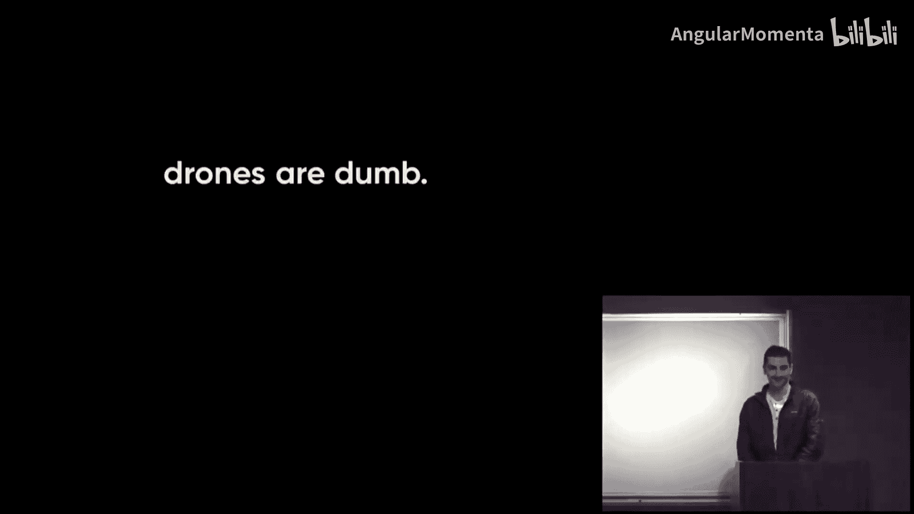

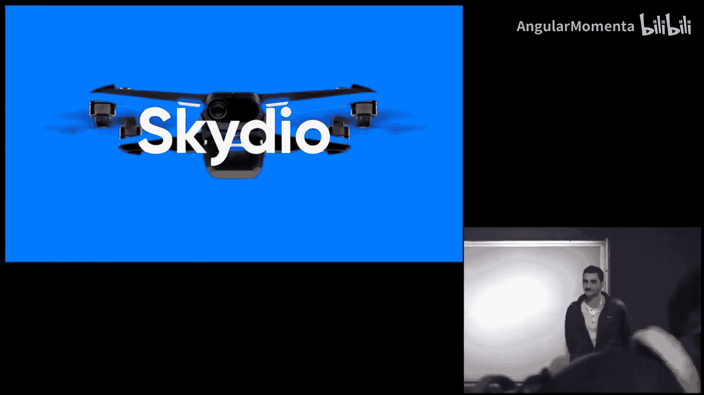

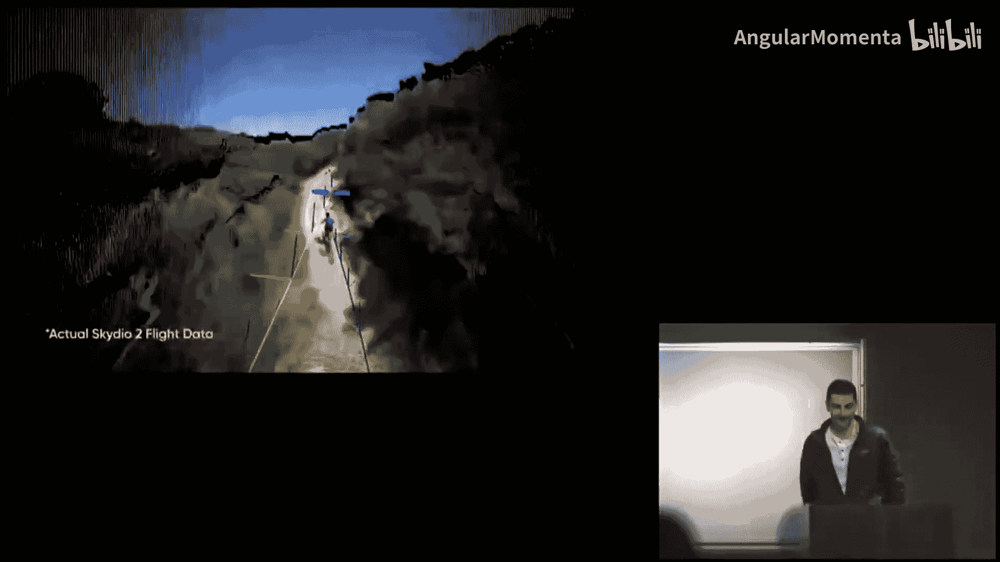

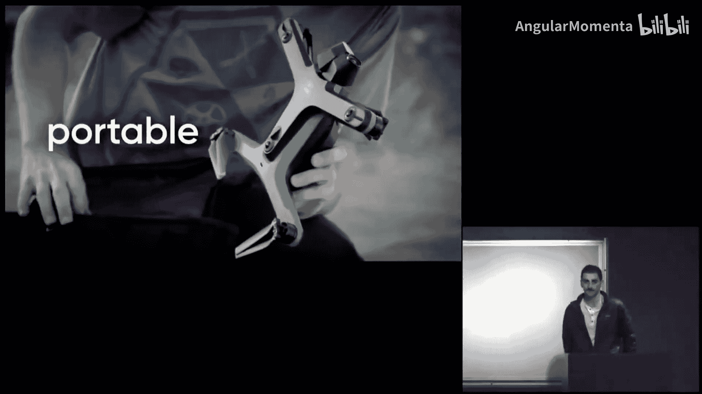

All right。So you can watch the rest it's pretty good。

 but I'm just going to talk very quickly about the point of our company and then just jump into technical stuff so basically drones are really useful because you can have an eye in the air moving around in 3D and that's useful for just a ton of different industries and this is nothing new。

 the problem is that I think the technology for them to be safe and trustworthy and intelligent in the wild and enough places hasn't been there and so that's the point of Skyo from day one。

 it's like let's make the technology for this type of robot work such that it can go out and do things in the world。

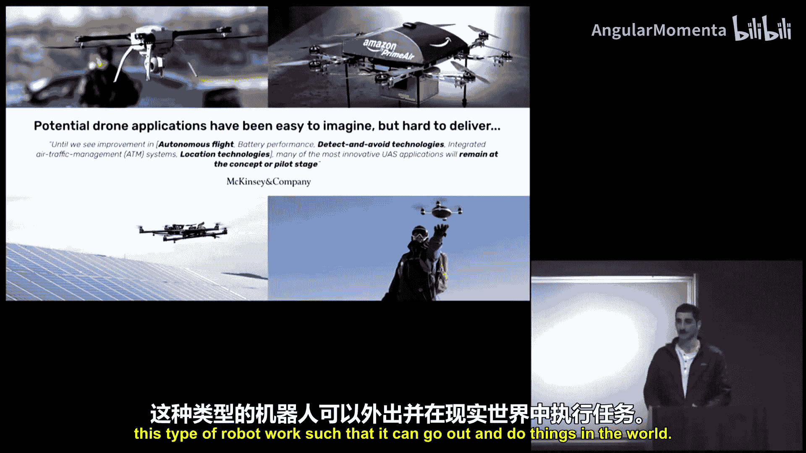

So basically we've been invested in this， like building the whole stack and the reason we build the hardware is because like the whole thing just matters like you care a ton about weight and size and power and cost。

 but also just about the quality of the cameras， the exact like vibration characteristics of the thing。

 the electronics in play， the power system， the embedded system。

 and the software on top that runs like controlling the whole thing makes it possible to make to like push the limits of robots and that's why we do it and so。

So not just this is the consumer launch that video regarding like this awesome video capture for anyone without needing to be an expert pilot but it also makes a ton of sense for any task where you're inspecting things like bridges and cell towers and pipelines and rooftops anywhere that's dangerous。

 anywhere that's costly and you need to build a map of things or for construction for mining it's a long list。

 so as long as you have something that is trustworthy intelligent can automate tasks and get even just video data。

 it's incredibly useful。

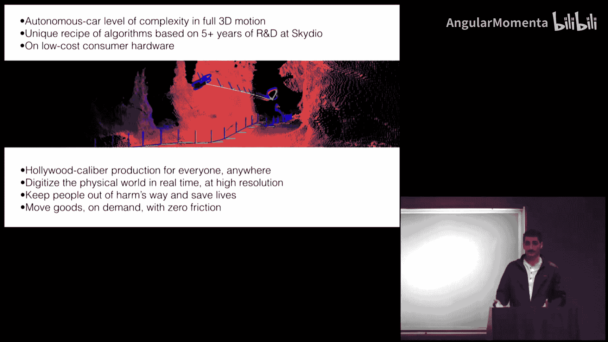

So that's our goal。

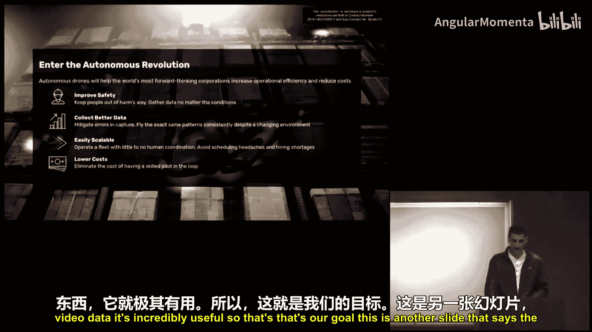

This is another slide that says the same thing。Okay。

 and then here's just a view of kind of the more commercial side of this。

 so the idea of being able to get up inside kind of these high voltage trusses and power lines and take close inspection photos。

 this is something that's very hard to do。

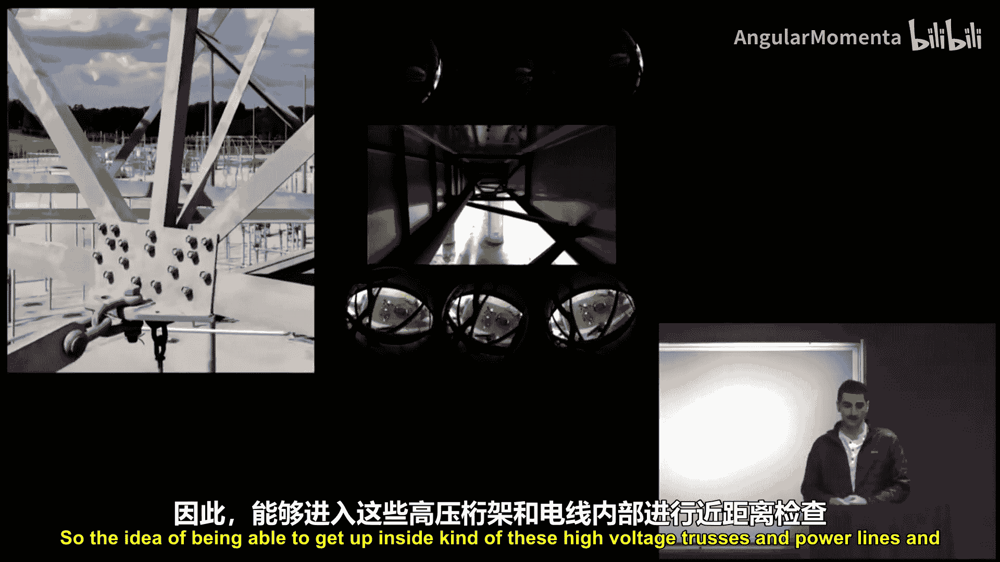

mannually and it's dangerous and these things need to get inspected all the time and it's incredibly expensive and then on the right is us being inside kind of just this narrow bridge truss with metal on all three sides so something you really can't do with GPS just it's not possible。

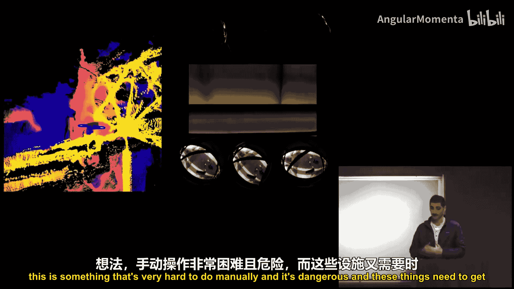

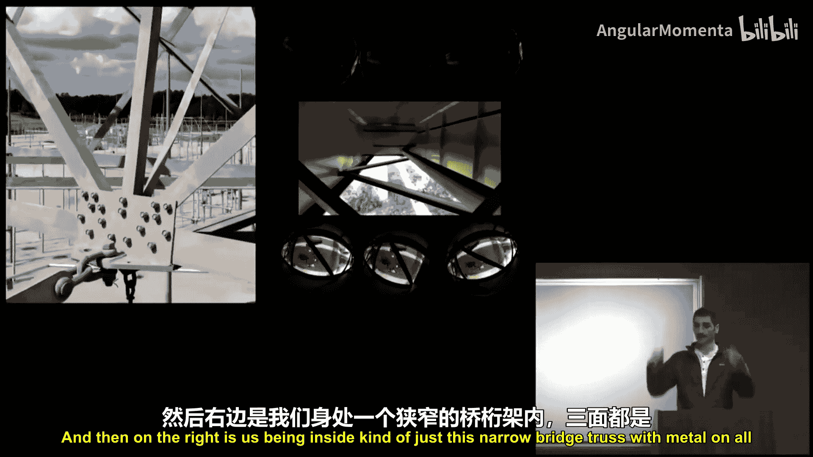

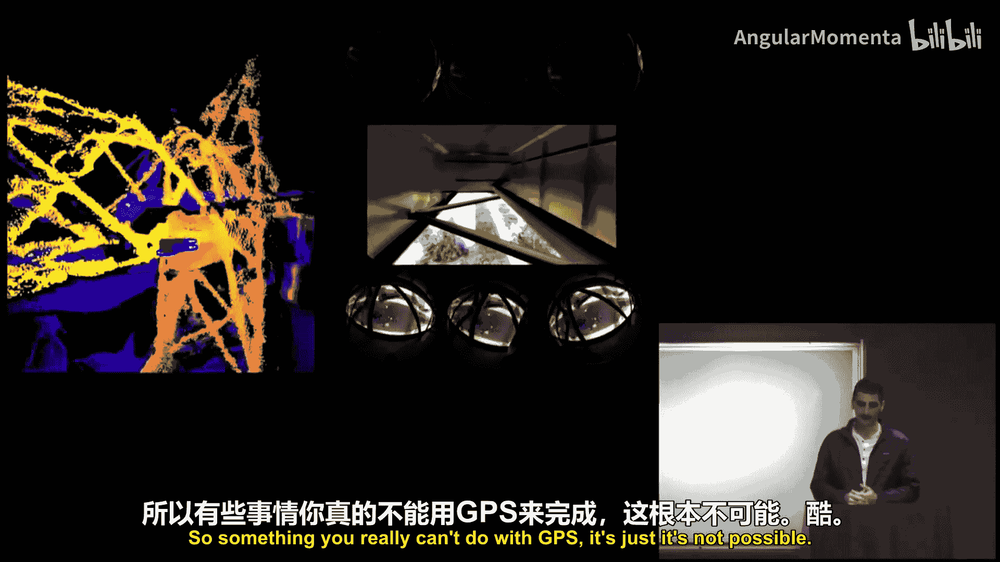

Cool， and then finally，'ll show this product that we just kind of announced that we're super。

 super excited about， which is the dock also commonly referred to as the box。

 which is essentially just a cozy home for the drone that is weatherproof and basically it pops out the drone flies。

 it does a task comes back and land and goes in and the thing cloud connected and the whole idea is like you have this robot out somewhere on your construction side along。

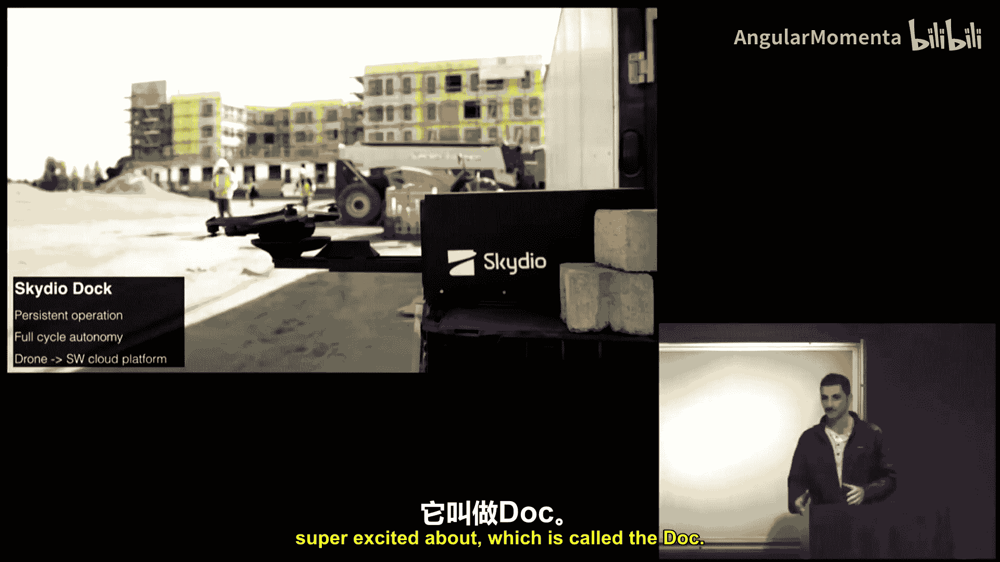

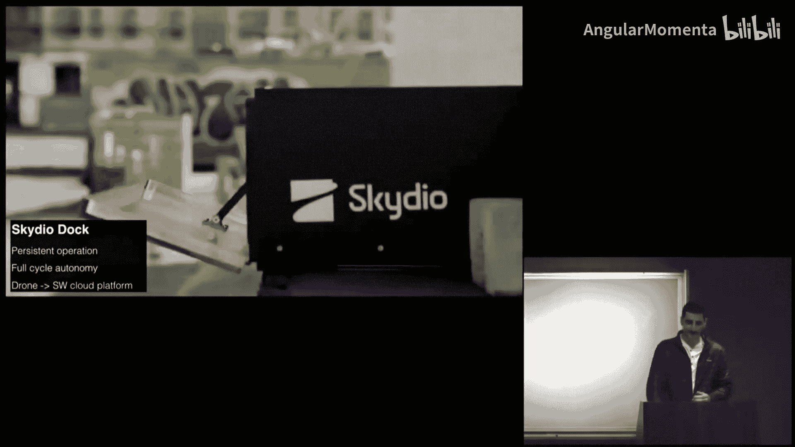

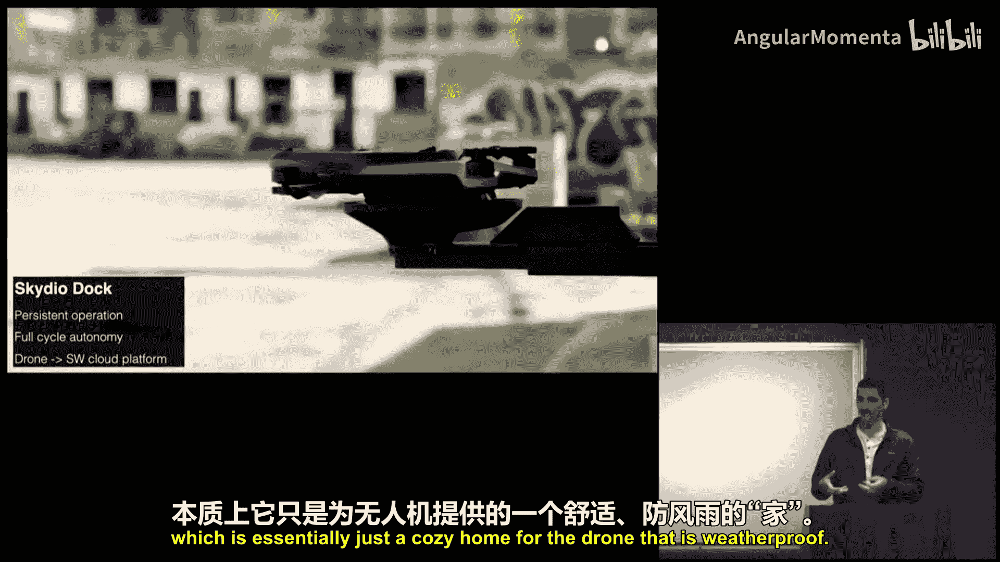

Along a pipeline and the drones go out and do tasks on a regular schedule， and they come back。

 and the whole thing is hands off。 and it's truly like just。

Just an autonomous thing that's doing work。 and so it becomes more of a cloud platform where people can use that rather than someone is piloting this robot and in control of it。

 and kind that's how we see the long long- term play of this going。

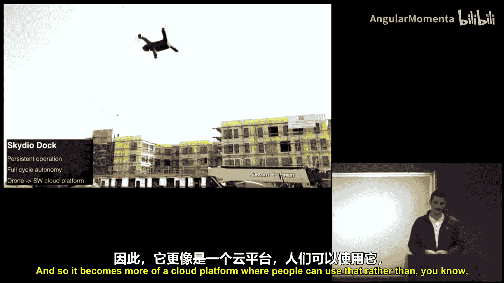

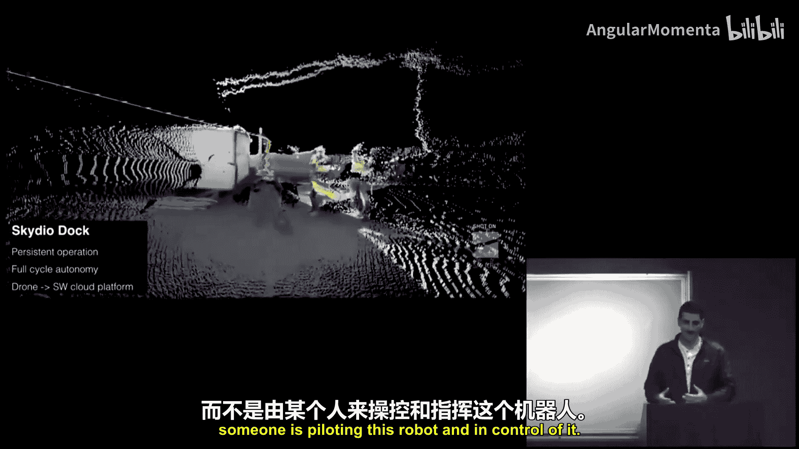

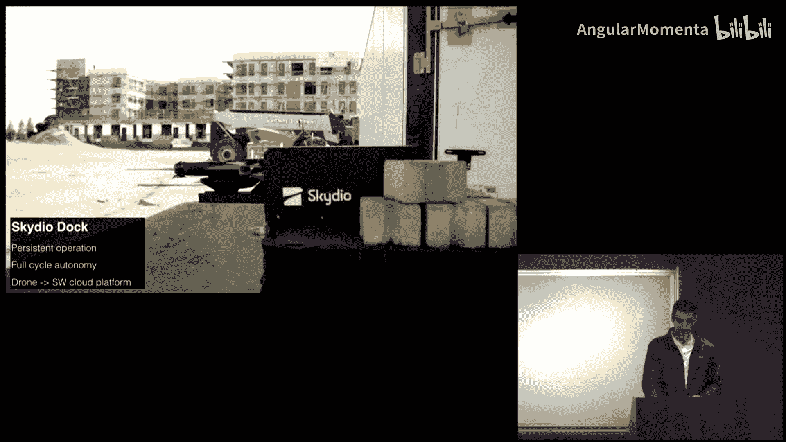

Cool， so here's a video that just shows。It's just a clip of a mountain biker that we think is a pretty good shot of just autonomous visual tracking following。

 so the drone is doing all this computation， of course， on board in real time。

 based on visual tracking and we're able to kind of get some nice cinematic video here with tree occlusions with fast motion and here we're getting a shot from the front which we call lead mode。

 which is pretty tough because it means you have to do a lot better job anticipating someone's motions。

So I want to just talk about aspects of how this works and just build it up。And again， please ask。

Lots of questions。Okay， so if you look at the drone。

 so it's got the main 4K camera on a 3 axis gimbal， and that's kind of what we were looking at here。

And then it has six navigation cameras so you can look at the geometry of the drone。

's there's three on top and three on the bottom and they're actually these crazy superf eye cameras。

 so they see 200 degrees so they see like beyond the hemisphere。

 which means the three on the top can basically see the upper hemisphere in triocular view and then the three on the bottom can see the bottom hemisphere and triocular view and the goal is to get like 360 coverage so we can do 360 you know obstacle avoidance and awareness of the scene。

So this is what one of the cameras looks like on the bottom and one on the top。

 the other four are pretty similar to these two， so you can see the view is pretty funky like this is one of the propellers that's the battery on the top that you're seeing from the bottom right side where is forward。

呃。And then this fin is actually， if you get the drone。

 you can see it's got this little by the camera。 it's got this fin。

 which protects the camera lens if you were to like drop it down and it looks a lot bigger here than on the drone itself。

 but that's because it's just really right next to the camera。And then， this is the other。Let's see。

 Yeah。 I think the other arm is over there that you're seeing from one of the top cameras。

 So obviously， it's this kind of tiny planet distorted view。 But this， this is what we work with。

 And the cameras are rolling shutter。 So doing computer vision on rolling shutter cameras is。

Is a really hard problem because basically what that means is every row is kind of taken at a different time。

 which means if you're undergoing fast rotation， especially but even fast motion。

 the contents of the image are as if。You know， time is changing in them。

 So to account for that correctly， you have to。呃。You have to be very careful。

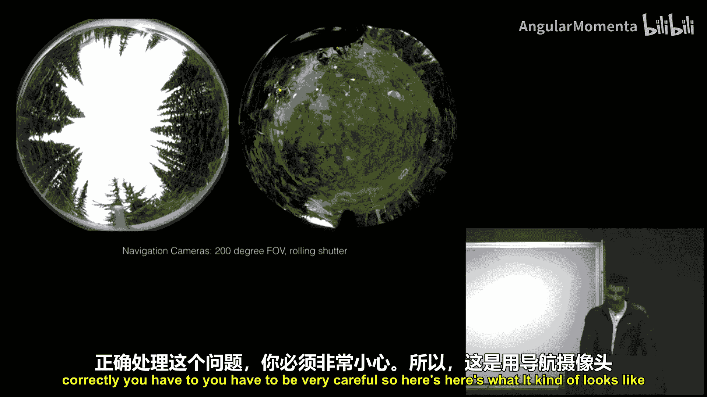

So here's what。It kind of looks like with the navigation cameras put together to create a 360 view。

So if you see the clip we were watching before is on the top left。

 but that is of the full sort of sphere of where you can see， it's just this yellow outline。

Does that make sense so having so the navigation cameras give a lot more context？And that that's。

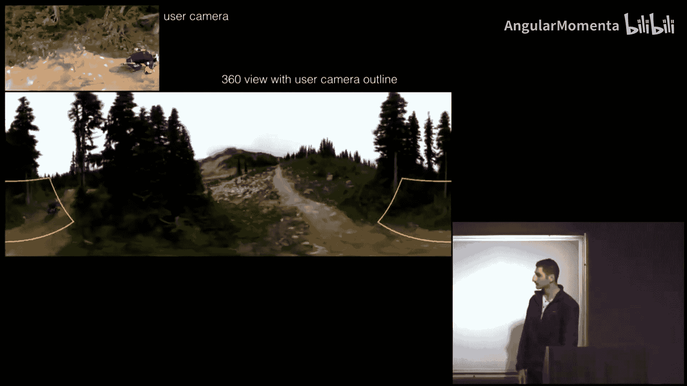

You know， that's that's what we use for all the algorithms。 So the core。

 the core things we basically need to do to make this drone fly are one state estimation。

 So we need to estimate our trajectory， how we how we're moving in the world and。

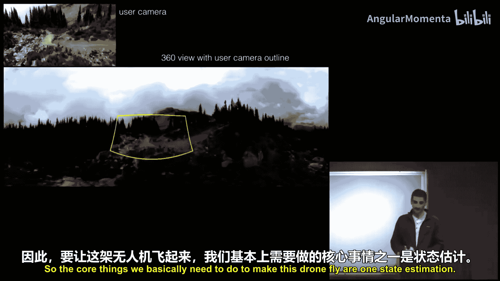

The second thing is obstacle avoidance， like building a dense map of the environment in a way that we can use to navigate the third thing is detection and tracking of objects。

 so in this case， the biker seeing them in the image estimating them 3D predicting their trajectory and the fourth thing is motion planning so with that sort of understanding of the scene want to。

Figure out what is the best flight path that sort of。

 in this case provides really cinematic video and is also not crashing。

 It is also smooth and respects the physical dynamics of the vehicle。

 like being able to push the limits of aggressiveness， but if you need it。

 but without sort of commanding something that is not possible by the the physical vehicle。

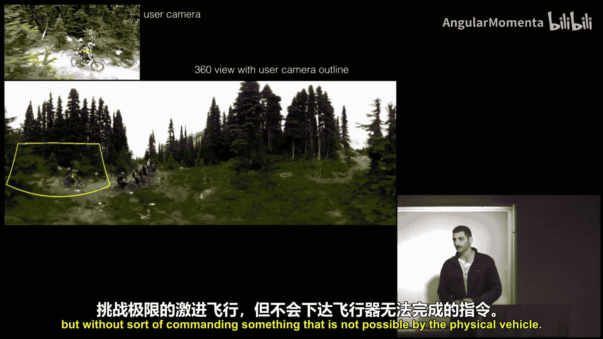

Okay， and then here is the same 360 view with with a depth estimate at the bottom。

 So this is one way of visualizing the like full output of our。Of our depth estimation system。

 where the。Close pixels are more。Hello。And so you can imagine how that is really useful for obstacle avoidance because you can directly。

开了。Feed into the。The planning system as a 3D map。I'm visualizing it here in this。

 we call it an ertangular view because it's a nice way to show the 360。

But this is not actually how we。Use the system online。

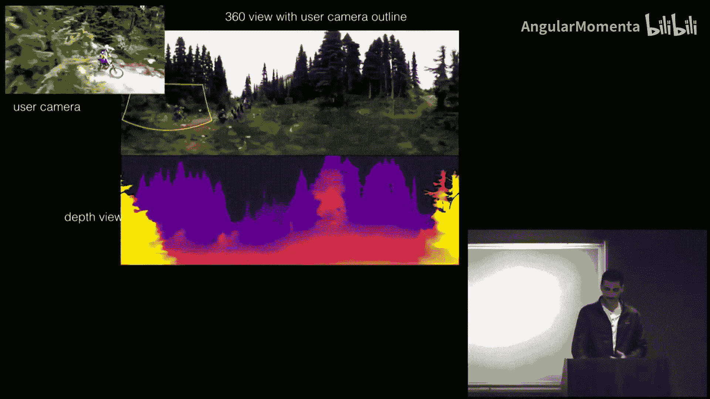

Okay， and then here's one more way of viewing like a single instance in time here it's a point cloud view that is kind of colored by the pixels themselves。

 This guy up here， that's the drone。 That's the trajectory。 The drone was flying。

 and then here is the person's trajectory。Does that make sense。And then。We have。Yeah。

 the scene around us。 And then it's going to switch to a depth view。

 So instead of being colored by the pixels themselves， they'll be colored by the。

Range from the vehicle， so the distance of each point from the vehicle。

 similar to what we were looking at before， but now in 3D。

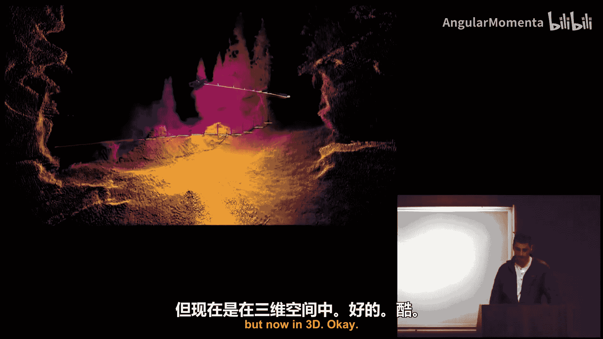

Okay。

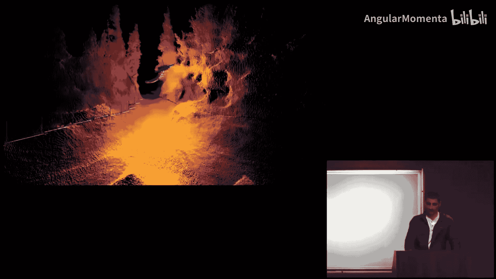

Cool， so I'm going to talk a little bit about what we need to do in terms of state estimation。

 And this was actually our first drone， the R1 that it's a picture of。 but anything that is。You know。

 could potentially be variable on the drone。 We want to model and estimate。 So the。

 the obvious one is the trajectory of the robot， which be like opposing space。 So a position。

 velocity， orientation， angular velocity over time of the robot。 And we do this。

With our visual initialt autoometry system， I'll show one slide after this。

 we also have several IMUs and so accelerometer gyroscope。

 which is super useful for propagating shortterm data。

 it really only works to integrate the IMU for a matter of or at least the accelerometer for maybe a second beyond that on a drone and with the sort of size and cost constraints。

 is too noisy。嗯。But IMs have biases and estimating them correctly is key to being able to effectively use them。

And then we have the poses of the cameras on the vehicle。

 so we obviously have CAD of the lenses and they get calibrated at factory time。

And we take that and we put that into our model of you know how we're going to go from things in the image in 2D to 3D。

 And the problem is those move around。 So every vehicle is a little bit different just because the physical characteristics so they get calibrated in the factory by a robot that waves them around a bunch of tags we know how to model that we have a model for the camera lenses and we calibrate that and also their poses。

 the problem with that is that they also move around when as the vehicle undergoes temperature changes especially So it's a magnesium frame with plastic pieces and those things expand and contract and any small amount of rotation。

 like even a small fraction of a degree significantly changes the actual results you get when something is。

20 m away。 So the problem is that the。The， the ability of estimating。

Depth or really doing odoometry from things that distance。 It depends on the inverse range of。

The object you're looking at。 And so as you get that far out。

 you're really looking for fractional differences between fractional differences of a pixel between multiple images。

 And that makes you。That makes it so that you have to be very careful about your calibration。Yeah。

 so we calibrate the poses of the cameras and particularly it's mostly about the rotation。

 like the actual translation of the cameras moving， it does not have a large effect on the results。

's mostly it's mostly rotations but we calibrate those things online sort of jointly with our oometry system so there are many variables in the optimization。

 some of which are the pose of the robot， but also the poses of the cameras and the biases of the IMU and additionally we calibrate the intrinsic parameters of our lenses。

 which is kind of nuts thing to do online， but those also change I'll show。

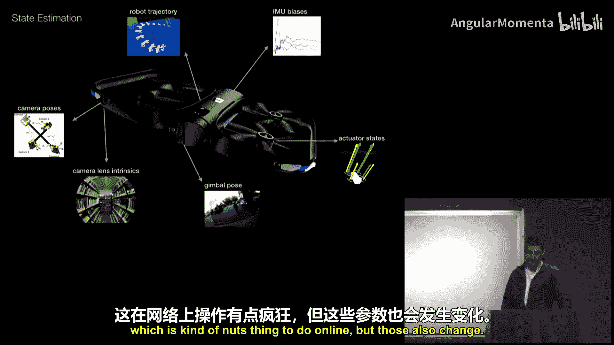

Video of that here。 So this is showing a temperature sweep of， of a fixed lens。

 And you can actually see sort of these circles are fixed。 But you can see how much it moves。

 There's actually several pixels of motion there over the change。 And those are the。

Like intrinsic lens parameters and the distortion model of the camera， and so to really handle this。

 we also estimate these online with everything else。

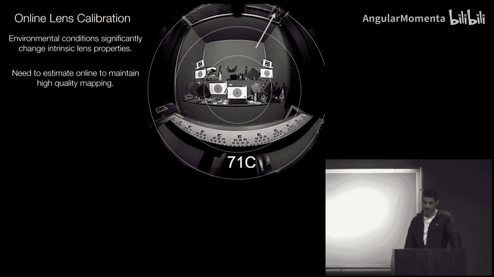

Which is。A cool and a hard problem。And then， of course we have the propeller spinnings。

 we got to estimate the rates of those propellers， and then we have the gimbal and we estimate。

A combination of ways exactly where the user camera is pointed because while we have sensors on the gimbal that tell us where we think it is and we've commanded it to be somewhere。

 it's also on an isolation system and there are other changes there。

 so we also additionally do visual estimation of between the user camera and the navigation cameras to line those things up。

Cool。So here's just the quick visualization of the visual inertial Dotry system。

So on the bottom left are some features that are being tracked in this case they're sparse features just tracked over time in one camera and the right is the estimated trajectory of the robot。

I think you guys have gone through kind of a traditional slam pipeline， is that right in this class？

Sort of， maybe。Okay， well anyway。Yeah， so so what you get is a bunch of 2D observations in your camera images by tracking in your images and you can track either between cameras at a single time instant or you can track over time and really you want to kind of do both and there's different characteristics of what works well。

 but then you take that and youre jointly optimizing for a 3D locations of those landmarks that agree with the observations you've made in the images while also solving for your own pose and the residual in this kind of objective will be the。

Reprojection of that 3D point into your camera model for your pose。

 and those are all variables in your optimization result in a pixel coordinate。

 and then you would compare that pixel coordinate to the pixel coordinate at which you actually observed that feature in that camera and with multiple observations of what you think is the same 3D point that starts to constrain things in this system。

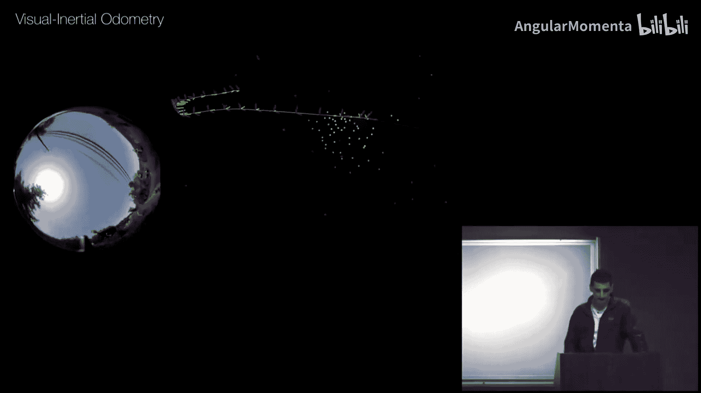

。Still no Okay， so here is here's a little bit of what rolling shutter can look like。 In this case。

 it's rolling shutter combined with vibration。 it's slowed down a lot。

 and it's a little subtle to see here。 But you can see these like wiggles。

 we call it wbble wobble the。Yeah， so the car， you know。

 you can see the windshield of the car sort of waving around and that。If you're not modeling that。

 if you're not accounting for it， that's just pure noise that's going to mess things up for you。

In a way that。Does not match geometric constraints。The the way you， if this is happening to you。

 you have two choices。 choiceice one is to like improve your hardware。

 improve your system such that you don't get this issue。

 Like there might be a certain say frequency of vibration that is related to the。

The time it takes to read out in your camera and you get some periodic signal option two is to have a way of estimating exactly how the camera moved during this time period and accounting for that。

 which requires。Very careful work。We do both of these things。

But it's once you're trying to fly like at high speeds in aggressive scenarios， like you really。

 really have to be。Pushing the edge of what we can model there and what we can estimate。

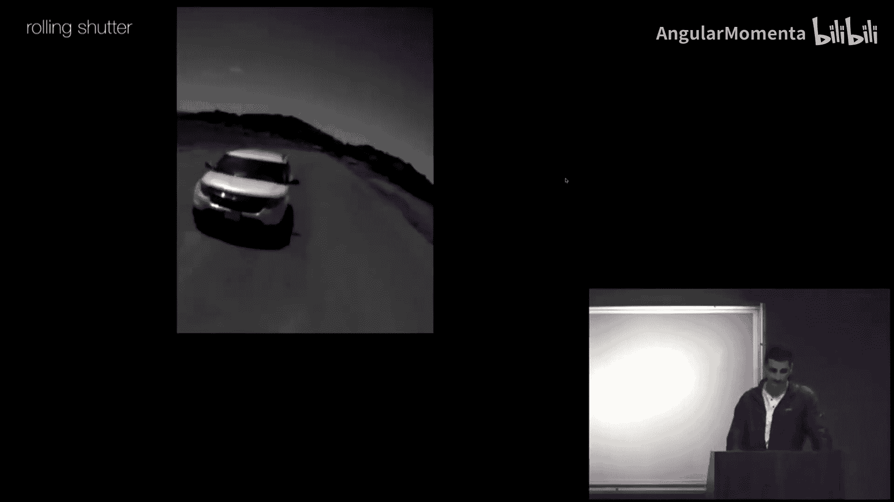

Okay cool， this is one of my favorite slides because I think it talks about what is really hard about computer vision。

 at least computer vision in a production robot。TheSo A here is just thin thin branches。

 so flying in a forest。Right now it's in winter we're going to have a bunch of customers。

 they're going to take their drones and they're going to try to follow themselves riding a bike in the forest and there's going to be all kinds of terrifying thin branches that you can barely see。

And we work really， really hard on being able to see that from the cameras。

 I'll make the bold claim that I think we're almost definitely the best in the world at seeing really fine thin cameras from or thin branches from camera images。

嗯。And when you're flying， you know， you kind have to think about like what's the resolution of my camera。

 how fast am I flying， What's my physical reaction time to either steer away or stop。

's obviously not guaranteed do you have a way to steer away so you could really be thinking about okay。

 if I'm flying at 35 miles per hour And there is like how far away do I have to see an object to be able to stop if that's like if it suddenly pops in And and that will that kind of plays into how how faint does it like what is the smallest perceptible signal you can have in your camera images before you have a chance of seeing that And I think' we're pretty close to the limit there of like if you can as a human like look at the camera image and and see something。

 like we probably see it as well， but it's still like we're up against that edge of just how much signal can we get out of that。

So B here is a really fun scenario where there's a bright sun so the tough lighting conditions make everything harder right so in this case there's a low sun and we're in a forest and。

Particular problem here， these are actually images from R1， the first drone。But it's very similar。

 so the slide on the left， the camera on the left is， I think has a smudge on it。

 like a fingerprint on the lens， which basically makes just like light。

Goes differently into the camera and the left and right cameras look very different there。

 What that means is that if you're looking to if you're looking between the images for a photometric signal。

 they're not agreeing at all。 So typically what you might do for stereo vision algorithm is look at two cameras and look for you know look along an a polarlar line and look for something where the you know say a small patch of pixels looks the same in the left and right camera。

 the problem is if you're。Up over here here， you've just got these crazy vertical sun rays that will match other sun rays in a totally inconsistent way。

 but not your actual contents。 So it's a huge source of noise。

And especially when it's different between the two cameras。And then。

C is just motion blur so drone can you know， like that's kind of our decision unless it hits something and flips over。

 but to allow very aggressive rotations up to several hundred degrees per second。

 which induces motion blur in the cameras。D is just reflections and mirrors I really don't have a good solution for that。

 like if you fly the drone in front of a panel of glass that's three meters by three meters wide。

It will it will see what's inside and think it can fly in the hope of doing this like semantically is。

It's it's tough， it's really tough and then mirrors， of course， like in this case。

 a reflective building。 so we typically hope is that these vertical struts， we're able。

 you know those make geometric sense and will prevent us from flying into it。

 But the part of the mirror that's just reflecting the building behind well that just looks like。

An opposite world that's geometrically consistent。 And so our depth map will reflect that it thinks that these are。

That these are basically poles。 and then there's something behind there。 If you look closely。

 you can kind of see there's some blinds in here。 So horizontally and so at some at some point of like。

 if you can see what's in the window and you can see what's behind。

 if the kind of there's like two potential realities for what that could be and。

It's an interesting problem to think about when that switch would happen and which taking a stronger signal。

嗯。Okay， so E is just。Big textist surfaces。 So let's say the drones like right up against the ceiling is typically the hardest of cases and really only sees what E looks like。

 So it's just white。 And that's also what the sky looks like in a lot of scenarios。 Now。

 sometimes the sky is bright blue， but not not always often it's just basically saturated whiteness from the cameras。

And deciding which of those two is the case is a really hard problem the best thing that can help you there is like the fact that we have full 360 context on the drone means that the rest of the scene can tell us。

 oh， is this more likely to be an indoor scene with a room or is this going to be you know。

 we're flying。Out。In an outdoor scene and the reason it matters so much is because well the sky is one of the best directions to fly in like it's usually very safe and so if we're trying to get away from something and try to figure out how to move。

 like going up is usually a very good decision but not if it's a ceiling。

Then you're going to have a bad time。Okay， and then F is water。

 So there's just water droplets on the lens。 I mentioned smudges from your fingerprint， also dirt。

 also dust， also cracked lenses， just all manner of things that inhibit the sensor。

 And this is something that we don't particularly control the user is responsible。

 They get for cleaning the lenses， but they take this drone somewhere that we've never been and we ask them to wipe the thing。

 And and we detect these things online。 like that's the best thing we can do。

 So actually as the drone is flying， we look for potential issues with what the cameras see and having dirty lenses and we have sort of。

We have a lot of these types of warnings， but thiss an interesting one in particular is like we have multiple levels of like。

 oh， it looks like your lenses are dirty， like you should probably land and clean them and try again。

You can dismiss that and most people just dismiss it and don't listen。

 and then there's another level that's like， okay， you really have dirty cameras like we're not going to let you say track anymore so the drone just kind of like goes into a hover and it's like。

 oh， it's not safe but we can't just make the drone land or something because the drone could be you know a couple kilometers out over the ocean or something and just hovering there landingny is not a acceptable solution and just coming back on its own is also dangerous so what we sort of chose to do there is for the drone to just hover and you can control it manually on your phone or with a controller but it won't like track you because。

Then it's sort of more autonomous and you're oblivious to the fact that it's。Yess。

Performance is degraded for sure。 So we care about lots of those types of robustness issues because it's just like getting getting to a demo that works of like。

 okay， you know， have， we have this drone。 It films somebody It avoids obstacles like。That is。

It's much， much easier obviously than getting to the point where you can actually have something where someone paid for a product and they take it somewhere new and they like initially don't trust it。

 but what we typically see is after like one or two flights of no problems it works and in the vast majority of scenes you're not going to have any issue but quickly just gain way too much confidence in the robot just to work anywhere anytime and that's something that we kind of struggle with is how to communicate limitations in an effective way。

Because it does work so well in so many cases。

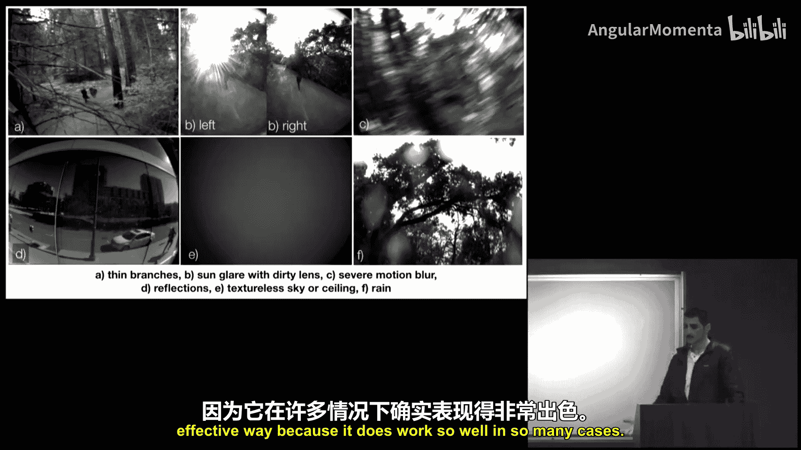

Okay， talk a little bit about mapping。So。And by talk， I'm in to show this video。So these are just。

You know， like a voxel representation over the user camera video， basically just to。

To look cool so in terms of dense mapping so that the goals from state estimation are different right because for estimating how we're moving。

 basically we have cameras in every direction and you don't need a lot of points like you need a little bit of information about how other things are moving that are static and you track them well。

Which means if something is very difficult， like crazy tangle of thin branches。

 you can just ignore that part and look at the ground or look at the tops of the trees。

 and that's enough to tell you how you're moving， but for actually mapping things like we need to pay attention to every single direction and make a decision about that saying oh。

 this directions like too hard to look at like you can decide to never fly in that direction。

 but that's very limiting。So we published one paper here a couple of years ago。

Research intern and Alex Kendall and the paper was basically trying to combine a classical stereo matching pipeline like geometric reasoning about stereo vision with deep learning to learn features and do the matching so at the time we did really well on these the kitty self-diving。

Data set should we submit it to？And basically the bottom one here is the ground truth of that data set。

 which is a LDAR scan， and then the middle is a prediction of our network。

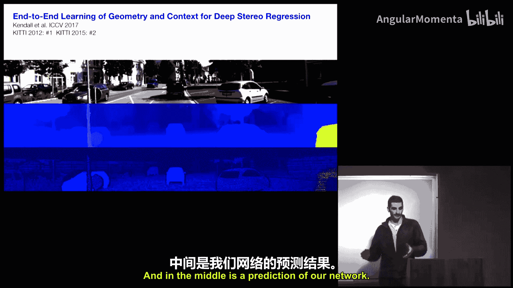

It worked really well in these scenes。 I'm not going to go into details here， but essentially。

 the the network was structured in a way to take advantage of。

sortrt of intuition about stereo matching and classical stere matching algorithms where we have we compute shared learned weights on each of the two images with two towers and then we have a cost volume approach where we kind of mix those features together at different possible disparities and then we regularize the cost volume with 3D convolutions and then we。

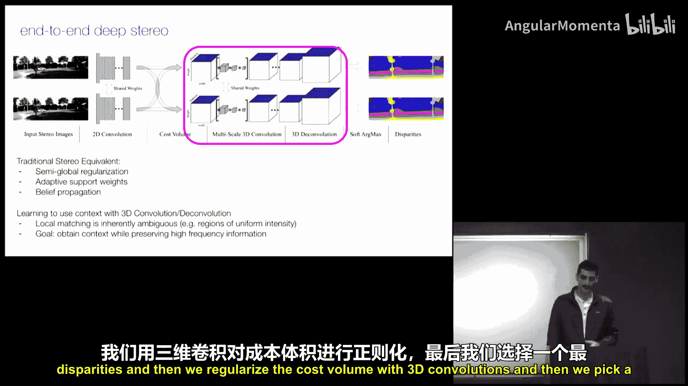

We pick a winner， so this worked really well， but I'll kind of give a couple of caveats the first caveat is it ran at one frame per second on a tight next GPU。

 which meant。Like obviously we can't use it。 It's ordered as a magnitude off and the second caveat is that frankly。

 the kitdie data set or really like my experience， any self-diving data set that I've seen are incredibly easy compared to the types of scenes that drones tend to see in the wild and the reason is because of regularities。

 So most of the images just look very similar like you have a road scene， you have cars。

 there's always a ground plane， there's things on the sides。

 there are street signs that are vertical and there's just a ton of semantic priors you can do。

 This is why monocular depth estimation works really well on driving scenes as well。 when things are。

You know， when things are normal now that's not always the case， but for a drone。

 you can be flying like really in any nook or cranny of any building or while and you really can't tell what's in a lot of the camera images and there's just there's no good monocular p a lot of the time because you could just be inside some random geometric shape in a sculpture in art gallery or something。

And so it's a much harder problem。For that。And specifically， the metrics on data set like Kitty。

 where you're typically measured on。How how accurate is like the average pixel error across the image right like I can't emphasize enough just how useless that is for robotic navigation purposes。

 like being being 1% closer like it's basically just dominated by you know how well do you estimate the ground plane and the exact pixel values of the depths and if you have something like a thin object that you miss or an entire vehicle。

 but it's further away or something like it has very little to no impact on the score and so focusing on metrics that really matter for autonomous navigation things like 3D occupancy and just thinking about only the parts of the scene that matter and in the end。

In the Berkeley way， kind of one of the most powerful ways to do that is to think about the sort of action space。

 like what are the parts of the scene that actually matter for making a decision rather than doing it。

 allocating your error metric by pixel values， which is totally。Simple to think about。

 but pretty meaningless。

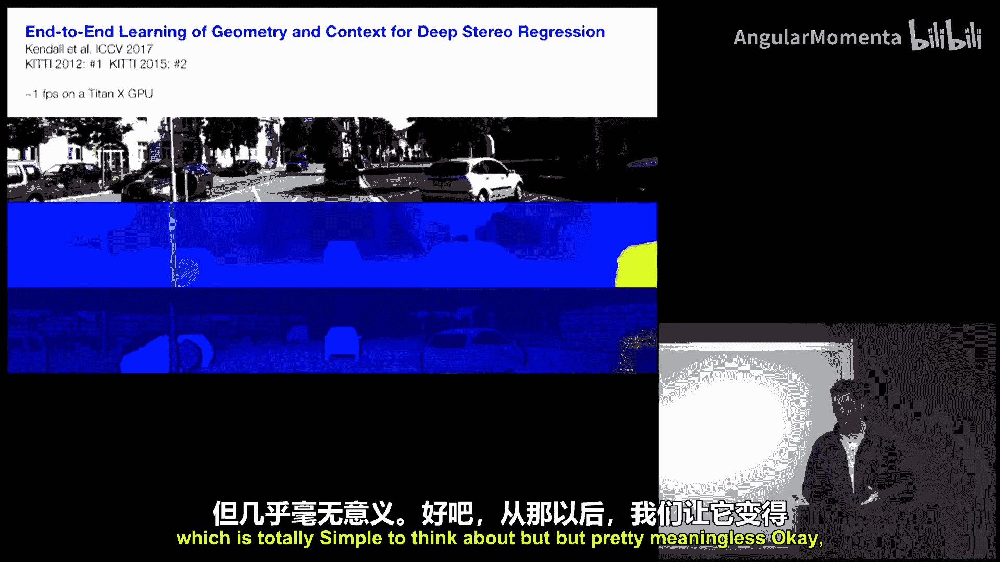

Okay， so。Since then， we've made it a lot faster and a lot better。 And it's also changed in many。

 many ways。 But basically， we are flying deep networks that。Produce。

depth and build an obstacle map for us。 and it runs at approximately a thousand times faster than the previous sort of first thing that I mentioned。

 And actually think we were the first ones to fly a robot based in a complex scene based on sort of a deep learned obstacle avoidance system about a year and a half ago。

Our little ATV flight， yeah。Stch each time or do any sort of reasoning about how like this should be someone？

Yeah， that's a good question basically。We do a bit of both like we aggregate the images， but the。

The dominant part of the。Deep learning estimation right now is。Is。Between the sort of。

LikeThe camera is at an instant in time， but definitely we definitely do things that are like temporarily as well。

There are different challenges。In to doing that， one of the challenges is moving objects。So。

Moving objects。You know， you have to estimate that motion to geometrically get the correct thing right。

 like if you're doing optical flow and then you assume things are static。

 you'll get incorrect depths in particular， like if you're flying the same speed as somebody。

And following a biker say they and you do that and you think they're static like it'll seem like they're far away because basically they don't move with respect to you。

 And so the pixels， you stay in the same pixel location。

 which means which implies that they're basically at infinity。

 So there's tricky things like that to take into account。Yeah。

 I'm going to show some a couple of just clips of the sort of hard things we focus on。

 so this is just。

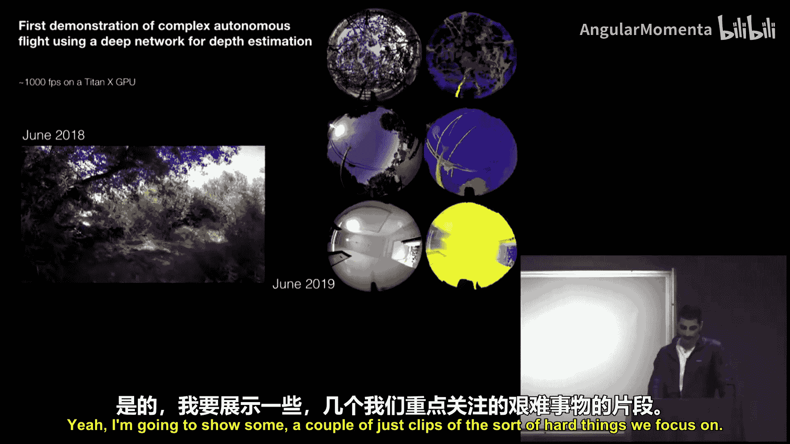

A forest with a bunch of branches and。Looking like really what you care about here is like did you see this object or not。

 and generally the like 3D extent of it but exact the exact details of the shape really don't matter very much。

 although it does tend to be correlated with you know the quality of your predictions。

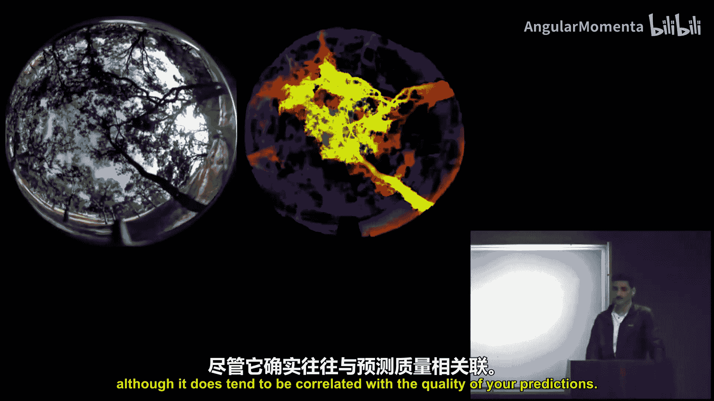

Here's a 3D view of that same thing where we have the camera image on the bottom left and then the depth on the bottom right。

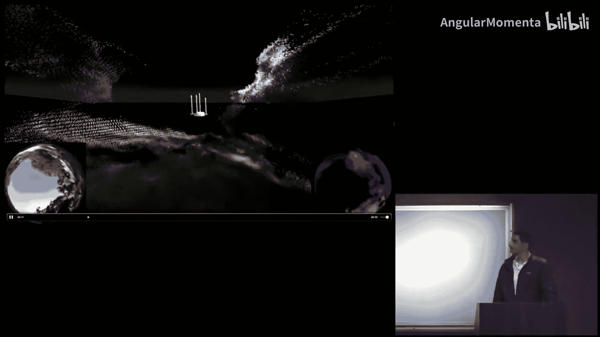

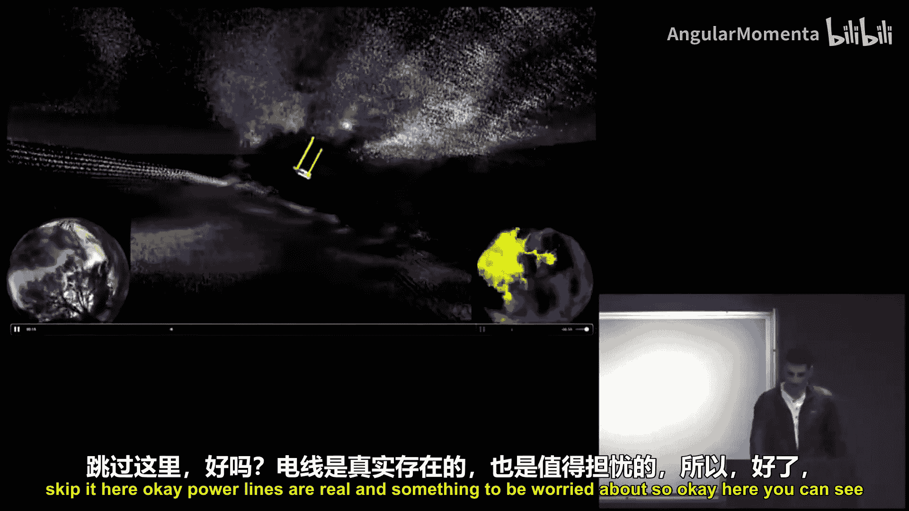

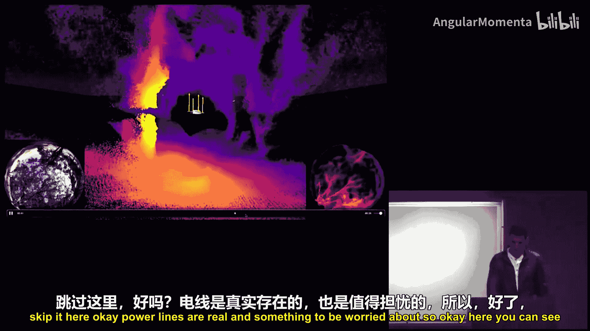

Okay， power lines are real and something to be worried about。So。here you can see。

It's a little hard to to tell here。These aren't matching， are they annoying？Okay， well。嗯。

So you can kind of if you trace this out， there are a bunch of power lines in this image。

 so these ones obviously are very clear， you can see these。This is a faint。

 but you can see it over here it kind of fades into the background。

 this is a power line that's quite faint to see and it disappears entirely behind the sun here。

 and then actually up here there's one that goes all the way across like that。And it's very。

 very hard to see。So， it's。Just giving some intuition for that and then there's a second one here and there's a third one here and so it really like it does depend a lot on the background and the lighting on everything just when it gets into your camera image and how much that works So again that's kind of the。

Walls we tend to be up against， trying to push the limits of where we can fly。

 what we can see and how fast we can go especially。

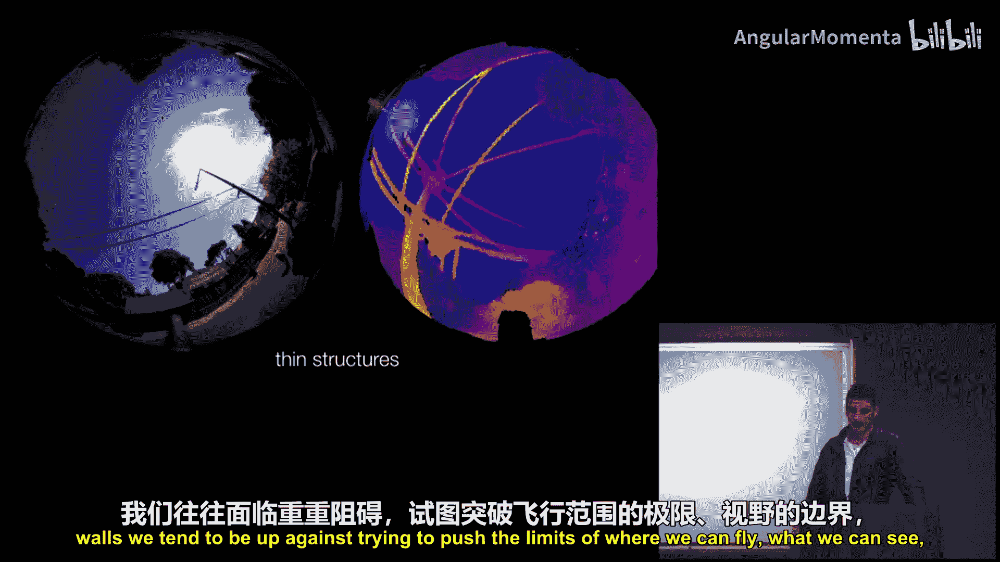

And then about textual as surfaces， so here's actually flying through our office and you can see on the left here。

 example it's。It's seen with specities on the walls。

 which will be lying to you photometrically and just a lot of white texture。

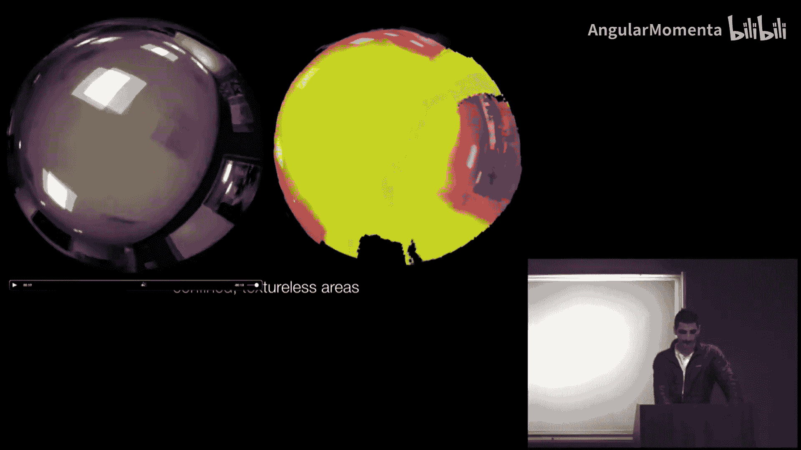

And then here is the same thing in 3D。

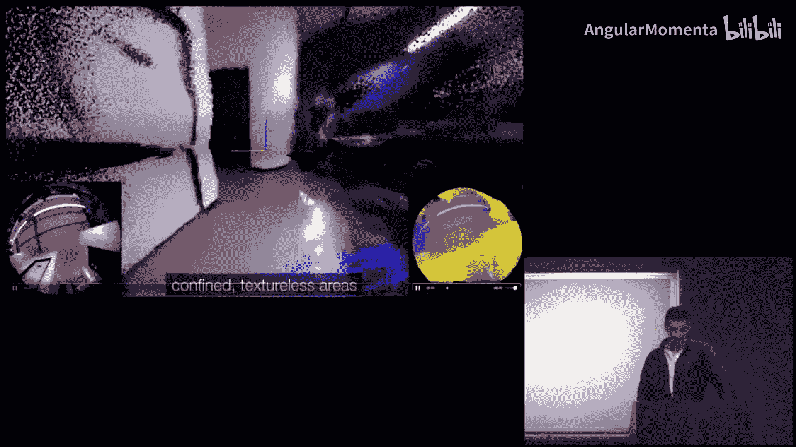

It's funny this blue glow on the bottom is actually because。啊。Theres。

There are some different lights on the drone， but the。

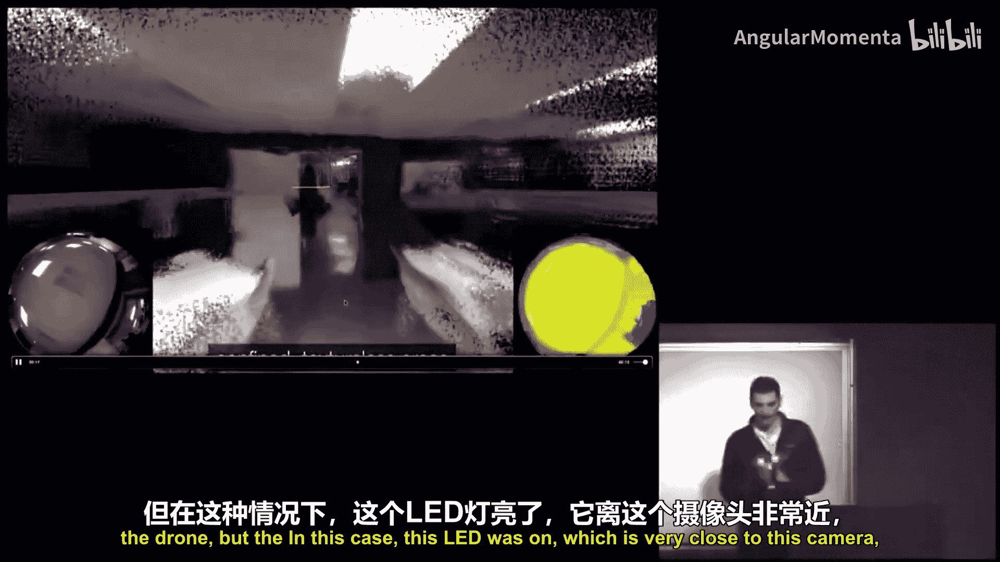

In this case， this， this LED was on， which is very close to this camera。

 And it basically just shines this blue halo under。Right there on the ground。

 but we don't keep this one on in flight， normally it's just these guys which have been designed to not be seen by the cameras。

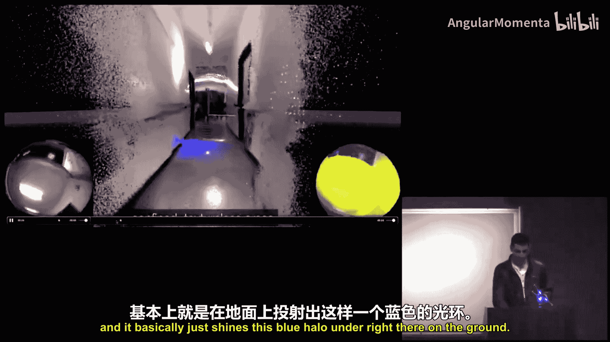

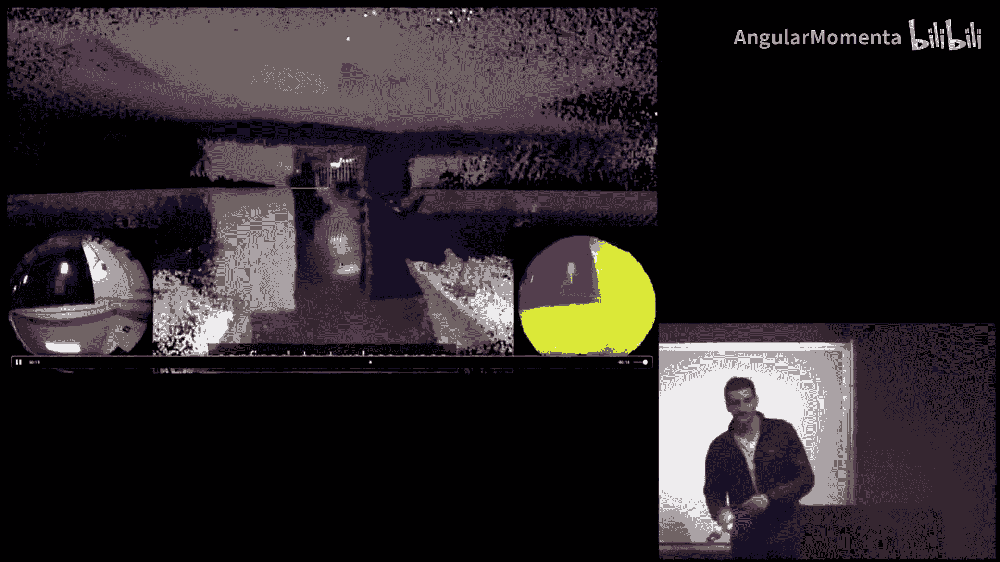

And the whole of she mentioned the whole geometry of the drone and the inversion and everything is kind of built around enabling as much visibility as possible of the world without obstructions。

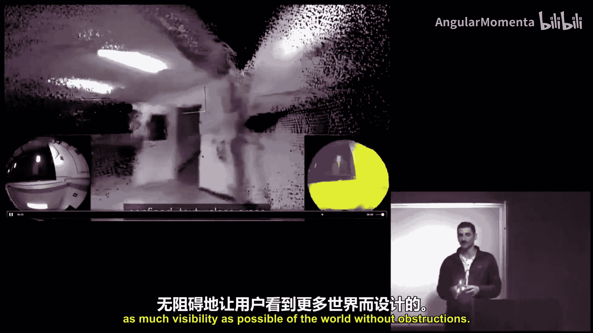

啊一。What's the onboard update steps。Estimation。The frequency。

 so I can't say exactly what frequency is。 Part of the reason is because it's sort of internal stuff。

 and part of the reason is because it can change based on some different things so we。

Are pretty clever about some of the things we do in terms of， so， you know。

 what what resolution do you process stuff at， How complicated of algorithms do you run or intensive and which。

 like which directions do you focus on， So all those things in terms of like downs and phoviation and choosing the。

The extent of the algorithm you run are。Pretty important to finding the best balance。For example。

 if you're flying really fast such that it's really dynamically infeasible for you to even move in these other directions for the purpose of navigation。

It doesn't really make sense to focus your efforts there。

 You really want to kind of like pick the cone， of just do tunnel vision there。 Now the the kind of。

In a different case， like， for example， let's say let's say you're barreling down this way at max speed。

 but you're also filming something that's over there。

 Now you may want to focus on those two directions instead of just the one because you need to estimate the scene over there to make some decisions about your high level objectives and then obstacle avoidance over here。

So things like that are important games to play。Okay， here's another fun one。That's just。Artistic。

This is just an example of someone basically pushing back on the joysticks， so we have。

We have a bunch of accessories but one is just it's a controller and you can fly and the idea is basically like you control a drone like normal。

 you know kind of if you've ever flown these mode to joysticks and the idea is that you don't have to be an extra pilot you can just push it forward and it won't crash right it'll go around things。

 it will do its things so it's a really fun way to fly because it means you can either just have fun or do your task。

 film something but you're not worried about the physics of the drone or crashing or things like that。

And that's what this shot was basically just pushing pushing back on the sticks。

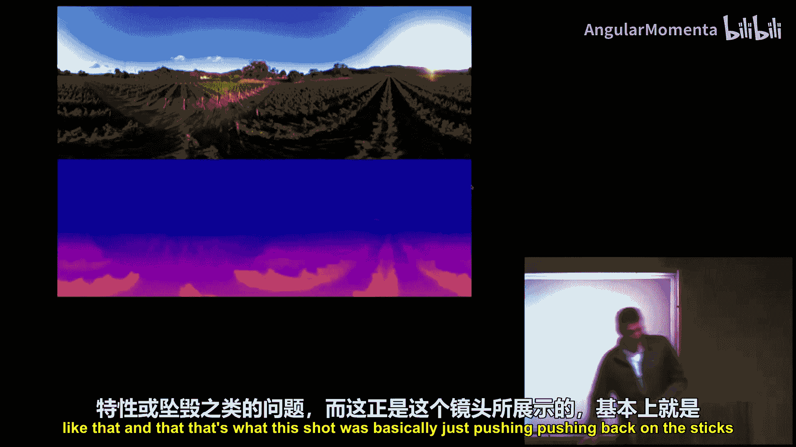

Okay。YeahSo this is。I can't tell if I cant see this at all。

 but this is kind of a typical example of what a thin branch looks like in an image。

 so these are actually two images， it's quite a close branch。a sense of like， here's。

Here's the branch， and then here's the branch。 So if you look closely。

 it's coming out of the ground over here。And then it comes all the way down very close to the camera。

 And so the actual correct sort of match of the stick is moving from here to here。

 And then there's another one over here that's moving like that。 So if you， if you look closer。

 you can， you can kind of get a sense of that。 And so this is just。嗯。It know。

 maybe conveying a sense of the the type of problem here。

 which is one of the hardest things we need to do， which is just carefully pick out objects。 and。

 and there's kind of the outline in。This image of what we're looking at。

And actually a real key here is like if you flip between two images， you can tell。

 but if you're just looking at a single image， you can't like no human can and really no algorithm can either like you can look at this kind of scene all day。

 a tangle of branches and not have any idea what the closest thing in there is。

 which really showed that that's kind of what I was getting out the difference between a road type scene。

 which is very regular and this type of scene。Here's。

 here's another fun one where we're actually above power lines。 So there's。

 there's one power line here。 You can see that's moving。 There's another， I think。

 really faint one here。 And then there's two right here that you can see very clearly on this part and then disappear。

Mostly up， up in that section。

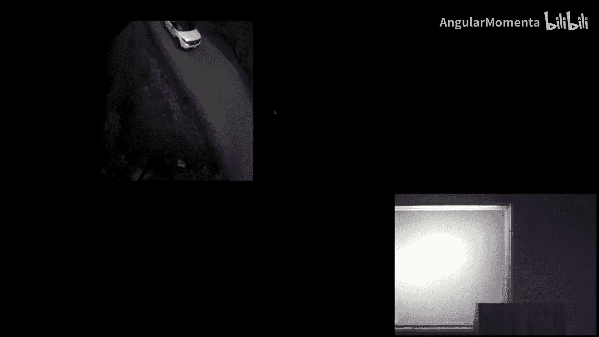

Okay。Is mention so we have， you know， we can play with simulated data， synthetic data。

 And the cool thing about that is， you know we can we know everything about it and we can try to make it realistic。

 We also have real data。 And the problem with real data is we don't have any ground truth for the depth。

 which is a very tough problem。 And there's a whole body of research that focuses on trying to learn from unsupervised data。

 which is really interesting。 The problem is that slide I showed about all the the things that make vision hard none of those things are photometrically consistent。

 So if that's your cue to learn depth。 it's。😊，That's not a solved problem right now。

 because that queue won't get you the really hard things。

So here it' kind of a fun example of something where we took suns like synthetic suns that we generated and we just put them in real images and the kind of fun thing you can do there is say。

 oh， well， whatever you predicted before the sun was there。

 you should predict the same thing with the sun， so that's kind of one way of getting at。

Just without knowing everything， at least gaining some robustness to a really big， bright sun。

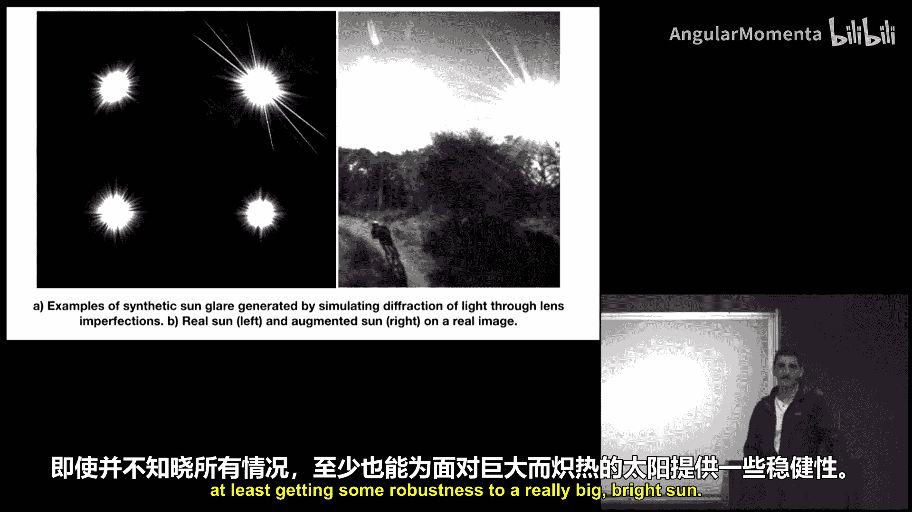

嗯。Okay， let me show a little bit about tracking and detection。

 so this is kind of a fun video of just tracking somebody through a forest with a bunch of lighting changes and occlusions and pose change so people change shape a lot。

And we're reprojecting the 3D trajectory into the image。

 which you need a pretty accurate estimate of the robots trajectory to do。跟。

And then on the top right is the actual output of a deep network that predicts the pixels of this person instance at that time step。

嗯。And on the bottom right is just。This is just the top down view of where the drone was and where the person was。

And then the red vector is just an estimate of the velocity。

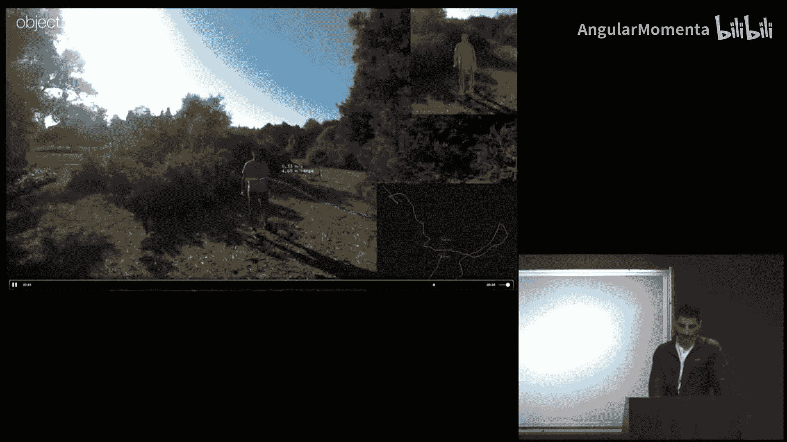

What's in a linear sense where is that person going to go in the next little bit？Cool。

 so the way we do this is。Kind of the way we do everything else。

 which is a combination of geometric reasoning and and and deep learning for semantics in the images to could be combined with like 3D motion and things we know tend to be true about the world。

So oh yeah， so multi objectject tracking is even if you're just tracking one person。

 which is more common， tracking multiple objects is really useful because you can then discriminate between people rather than just saying everyone else's background。

 you can say， oh， this person A disappeared， but person B matches person B from before rather than person B also just appeared and which one's the right person。

So these are our three cofounders just running among each other。

 and we're doing a pretty good job of keeping them in frame。Or keeping him as the correct estimate。

And then on the bottom， oh boy， oh boy。Okay， on the bottom right here is kind of a fun failure mode where it's hard to see。

 But so A will run behind Matt here。 and then or Adam and Matt pops out at the same instant。

 So like there is a person， one person goes behind and hides。

 And the other person that was hiding pops out。 and they're kind of at a similar velocity。

 And so the things you're combining are like where are they， their positions， their their velocities。

 someone's unlikely to just suddenly stop but it can happen。

 And then like estimate the visual estimate of their body's appearance。

 which we do with with deep networks。 And so in this case。

 the visual estimate is similar enough that like the chance of one person disappearing and another appearing and them being at the same velocity is like very low。

 and it clearly。Yeah。It we use for distinguish between。They're basically learned features。

 so essentially it's based on the appearance of an instance of an object and there's。

Pretty solid body literature about how to try to learn those things。

 but you tend to have learned through examples of people that look。

There's different constraints based on what type of like use you want to do。

 but typically it's like you have similar instances。 you have the same instance of a person。

 but from many different views and poses and lighting and all that。

 And then you have multiple people that look similar and you train positive and negative examples and you learn that kind of task。

 This is very common for like I guess like surveillance camera data sets。

 they tend to be easy to collect where they're just fixed。 Now again。

 the drone is a lot harder because it's moving and people tend to be moving very quickly and running away and doing flips and stuff。

 which make the problem a lot harder。嗯。But the concept is pretty similar， yeah。

hich objectives should start driving？Oh yeah， so in the just for the sort of consumer follow use case。

 you just take off and then whatever is in the view of the user camera。

 you'll see just icons on the phone so we we do people in cars and so you'll just see a little plus icon and then you just tap and then。

And then it works and it shows that halo that was in the launch video earlier on the phone。嗯。

We also have this thing called the becon another。accessory so this guy is just a little puck that lets you basically fly without your phone and it has a GPS that we trust a lot more and so what this does is if it lets the drone if it loses visual tracking。

 you you like you get stuck or something fails， it can basically try to just combine between that and the GPS estimate and then find you again and pick you up visually and so the idea is to just make it much more robust in terms of if you're skiing or something that you're just hands you don't have to worry about it and so。

The other way we do it， which is kind of fun is if you take off like this。

 it will take off and if there was someone standing right there， it will just track that person。Okay。

Cool。Say a little bit about planning。I think generally we have a bunch of knowledge of the environment。

 it's all uncertain， there's no guarantees about anything。

Because you know we're not sure if we saw the thin branch where we think we know where we are。

 there's uncertainty about all these things， we try to reason about that in the best way possible in the end like we have some measurements and we need a policy that decides what the propeller should do such that the drone accomplishes our goals。

 you know some of which are down here like obstacle voids dynamic limits， smoothness。

 effective tracking and cinematic quality of the video and these are all。

there are hard trade offs with each other， it's not easy to achieve these things in all but the simplest of cases。

So I think it breaks down a way that。I think you've all kind of seen before。

 so won't go into this one， but basically。We have。The the biggest。

 the most interesting part of the problem is figuring out what the cost function should be based on everything we know。

 And so based on the current state of things and the full environment， what。

What are the actions we should choose that meant that give us the best result and defining that function is a lot of work and trial and error and investigation and that's something we just work a ton on just iteratively like trying things out。

 flying and seeing what fails， trying to like figure out what are discrepancies between what we really want and what we saw。

Whi is a really fun problem。 And then you have to find you actually need to find an action that accomplishes that goal and that。

That's the cycle。 And then either you didn't have the right objective or you didn't。

Find the minimum for that objective well enough to do what you wanted。And in terms of solving it。

 I think you guys all know， but like you can learn， know。

 that's the promise of deep reinforcement learning is that you can well potentially learn both of these things from data。

And you can do sampling techniques。 You can do trajectory library。 You can do a tree based search。

 or you can do optimization， you can。You can do trajectory optimization and mild predictive control to solve these things。

And so we do a combination of all these things in a way。

 but what is cool is like we run something on board that runs at 500 rats per second that is reasoning about kind of the whole stack between all the way up to like obstacle ones and cinematic quality down to like what are the dynamic limits on the rotors and the more you can reason about the whole system together rather than in separate little layers that have their own boundaries。

 the more you can get out of the robot， I think that's kind of universally true。

 the trick is that you have to。

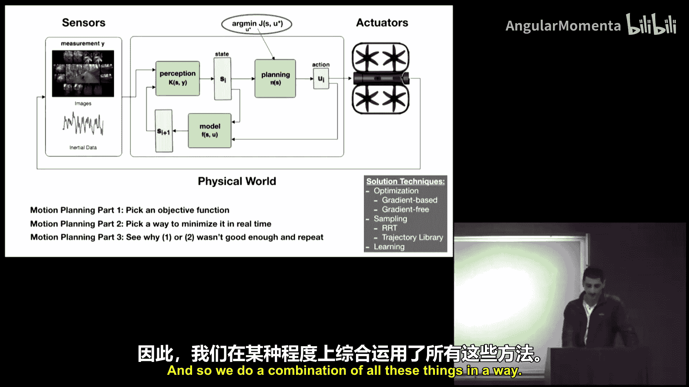

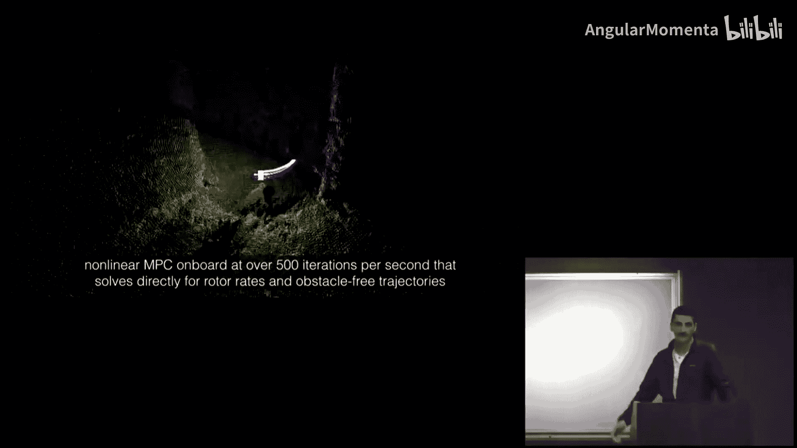

It's。You have to be a lot more careful， it's a more dangerous game to play and again we also use sampling techniques and they have a good role to play within the system。

Then I'll just add a note about simulation because it's awesome and super useful。

 especially for motion planning。For computer vision you want is like really photoreistic images that you've carefully curated for planning。

 You don't care。 You just need something that like。

Is good enough to see your behaviors and try things out on。 So this is like， you know。

 we literally drive this guy around with a joystick at our computers。

 And he just kind of slides around the world。 And we we。😊，Just use that to test basic things。

 And then even without images， we have these scenes where basically， we generate a random forest and。

We we want to say compare， we want to figure out， okay。

 how far away from obstacles should the drones stay to not crash into them versus like how often is it going to get stuck in a dense forest if we do that so we can like we tend to run logs against hundreds and thousands of regressions against a ton of just recorded log data right so we record all of our flights。

 all of the images and we can rerun all our vision algorithms and check like those types of things。

 but for planning， you can't change what the robot did it's all kind of off policy。

 and so simulation is really helpful there。 And so we can run an experiment like oh generate a bunch of different random forests and have the。

Subjectre the same path through them and then see how often the drone hits something or gets stuck and have a statistical sense of what to do there。

 The problem is always like something bad happens。 We look at that log and I'm like， okay。

 we can tweak this thing to fix it。 But then did we just make five other things worse and we can't like do we can't do 1000 real flights to test that in any sane way。

 So maintaining the sort of infrastructure to handle all those things is really critical。Yeah。la。系。

我哋。Yeah。Yeah， I mentioned I would fly in here， but don't think I'm allowed to。Yeah。

So that's a good question。Identify the dynamics model， which is somewhere between them。

 but we definitely model the dynamics of a drone。 It's not like a modelfr black box。

 And the reason because it's eminently mallerable。 So it is you know the propellers。

 there are aerodynamic effects that we understand quite well。

 theres the inertias of the drone and the properties of it。

 And so we model everything that we can and we try to fit parameters to it based on flight data。

 And then I think that's pretty different from other types of robots that are more like especially when you're dealing with contacts and more complicated things。

 but this is not that many degrees of freedom there。

 I think the complicated part comes from aerodynamic。

 So once once you're flying fast and you're in turbulent flow and you get these types of like pitching moments and the accelerations。

 your rotors play into things。 so there is a lot of complexity there。

 but it's also complexity that has been pretty well。Moodeed in aerospace。

 at least in terms of the structure of something that you can learn。So。有。Yeah。On the last slide。

 you said you have nonlinear NPC running How do you ensure that you reach？We don't。I mean。

 you can't insure anything。Well。Yeah， I guess it's a complicated question。That's not exactly。

 sometimes people ask like， how do you guarantee that it's going to be obstacle free， for example。

 And and the answer that is we can't because of perception。 And so nothing is ever guaranteed。

 but we， we do our best。 So in terms of like， if you have a non nonlinear MP PCC。

 how do you make sure that it converges well。It depends a lot on how you're solving it if you。

There are good ways to know if you've made it worse than your initial guess， for example。

 so if you do that， you can try to fall back to something else。嗯。

Or just like try to work towards robustness so have have ways of just managing what you're doing such that you at least have some path that moves you forward and is not catastrophic。

 but the best way to I think the best way to do that is just to try to carefully design your problem。

 your constraints and a setup of what you have to to have。You know， stability and convergence。

 And there's， there's a lot of， there's a ton of work that could be put into that that is。

 that is tricky。 But there's no fallback。 That's a good fallback because let's say a fallback is like。

嗯。You know go constant velocity well you might just run into something or。Yeah。

 but but you could for example， say， oh， I'm going to stop caring about any of my other high level stuff。

 and I just want to like come to a stop with obstacle avoidance if it's a really bad scenario。

Yeah。Okay。Just another video of simulation。 and the kind of cool thing about simulation。 So this is。

This is actually from an SDK that we have， it's kind of in a private beta SDK where people sort of we let people work on it that we think make a lot of sense to kind of develop on our drone but the cool thing is to share that simulation between like our purposes and actually being able to turn the drone into something that you can program so at a high level like make it move around。

 make it do things but not have to care about obstacle avoidance and again the low level stuff so。

it's a hard problem because controlling a drone like you have to understand a lot of the internals of the system to do it。

 so we're kind of always thinking about what is the way to try to design an API such that it's intuitive for people to understand。

 especially people that aren't experienced drones or even robotics to be able to control things and get what they want and sort of understand why it might not be able to do something and why it might be able to do something else。

Okay， cool， let me just show a couple of other cool things， so we estimate the wind online。

 which is really useful for。嗯。To have as a model to do more effective planning an aerodynamic control the drone。

 this is something neat。 It's a lot less relevant for this drone。

 but the first drone had perimeter guards。 And the reason I had peri guards is to have cameras that can see like on the outside。

 That's why we very carefully design the geometry of this drone to try to。

Get rid of the perimeter guards because they're so expensive and bulky and。

And bad for performance while still having visibility。

 but the cool thing was it could bump into things and not have the propellers touch it and in this case like we go。

 we fly into this glass intentionally and we actually detect that collision and we add that obstacle into our map there。

 so we won't do it again， which is a pretty neat thing to do。

And then。Yeah， we look a lot at sort of recovery from dynamicmaneuvers。

 so we call this inverted pizza toss where your initial condition is like upside down and then spinning quickly。

 and then the drug kind of has to come down and recover。

This is another fun one where there's prior work on this as like its own controller。

 but something neat that we found was that if you actually。

Basically just with parameter changes to our planning system， if we shut off one rotor。

 we find this kind of mode of flight where it's still semi- stable where you're not controlling yawn anymore but you're able to sort of hover and come down to a land this is all in simulation at least so far because the question of state estimation in this scenario is a lot harder。

 but it's pretty cool that like by just spinning really fast。

 you're able to stay hovering with three rotors and in fact。

 what we did was show that we can again in simulation actually follow somebody and avoid obstacles while just having three propellers and spinning like a madman。

So I don't think anyone's shown that before。Okay。These are slides from CVPR。

 it's a vision conference。I'm going to skip those other than to say that， in fact。

 I already talked about， yeah， don't work on deep learning benchmarks and try to improve them by 1%。

 that's a sucky thing to do。Work on hard things and real robots。

AndThat's I think what this class is all about， so that's awesome。Okay。

 and then I'm just going to show one last video， which is one of my favorites。

 just four drones following。Jack here， as he goes down a water slide just in every direction。

And it's。Just a fun thing to watch。All right， cool。Yeah， so we get a lot of sweet videos and again。

 so our goal is to like bring these drones to doing useful things， not just for video capture。

 for you know content for consumers in action sports。

 but also for inspection and mapping and construction and all these places where you need a trustworthy reliable robot that can move around anywhere and get。

And sense things， basically。All right， that's it。Yeah， thank you。Cool， and then yeah。

 if any of you guys are like looking at internships or I know a lot of your graduate students。

 so I'd be happy to hear from basically anybody in this class。

 know we have a jobs page on our website or my emails just hike HAYK at Skyio。

 I'd love to hear from any of you。Yeah， thanks for coming。

