# 【加州大学伯克利分校】高级机器人学-｜-CS287-Advanced-Robotics-at-UC-Berkeley-Fall-2019-p23-24-论文背后的诞生故事--BV1KXqCB4Eua_p23-

Alright， so unfortunately Chris Armsson can't make it today so I thought we do something a little different and so instead of talking about technical topics kind of talk about the backstories。

 how some papers came about which if you're PhD doing undergroundgrad research it could be quite relevant because often distinction between successful research and unsuccessful research is not so much what you understand the math though it definitely matters but most people do understand the math。

 do not have to implement but how do you actually work in the right problems and get things to come together on a topic that people might actually care about and so what I thought we do is step through some of the papers and of course citation counts are not necessarily the like perfect metric for which papers are more important or less important。

 but it's at least a metric that's somewhat approximate in terms of how much maybe other people at least cared about the research after you completed it and so we could step through。

We could step through some of the papers here that I'm familiar with the backstory about because the ones I know are the ones I was involved in。

 and I can tell you how they came together and maybe that can help you think through how your own work might come together in the future。

So。I thought I'd start with the。Trusage policy optimization one， which is second on the list。

 So how did that come together actually。This is the papers published in 2015。

 but it really started in 2012，13。And John Schulman， the lead PhD student on that project。

 was actually working on this problem here， so he was working on how to make robots learn from demonstrations and he actually came up with a method that allows the robot to。

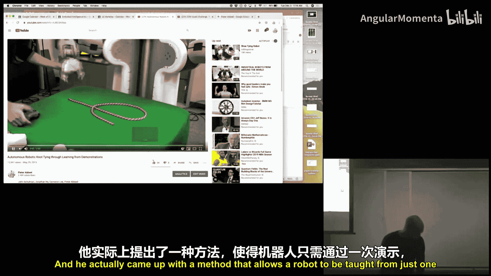

Be taught。From just one demonstration， how to tie a new knot from a。

Somewhat arbitrary starting configuration。 So this is a demonstration。And the specific type of knot。

And then now the rope is laid out differently。 And it actually， the train the system finds a。

nonn-rigid transformation between the situation and the demonstration and the currently encounter situation and then not only transforms the rope between situations。

 but also transforms the motions that were executed accordingly by extrapolating into 3D space。

 and then we get an execution based on that and it actually can tie a wide range of knots just from a single demonstration。

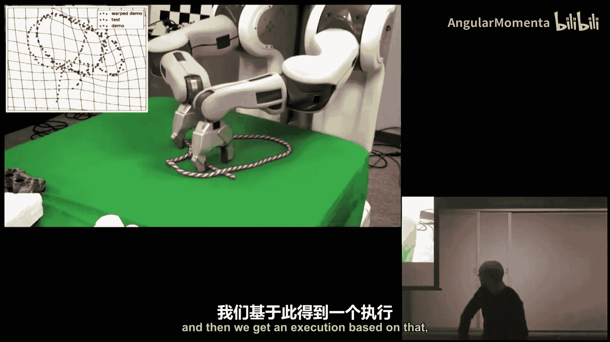

Now Cha was working on that then in parallel。Or kind of around the same time。This is 2012。

 A Crt 2012， Viro one the main robotics conferences。 that's something called Sushi Cha。

 And in this sushi challenge， the idea was that your robot is supposed to manage it sushi restaurant and kind of set the table and things like that and just Google for this video。

 this was not our entry。 I think the brown。

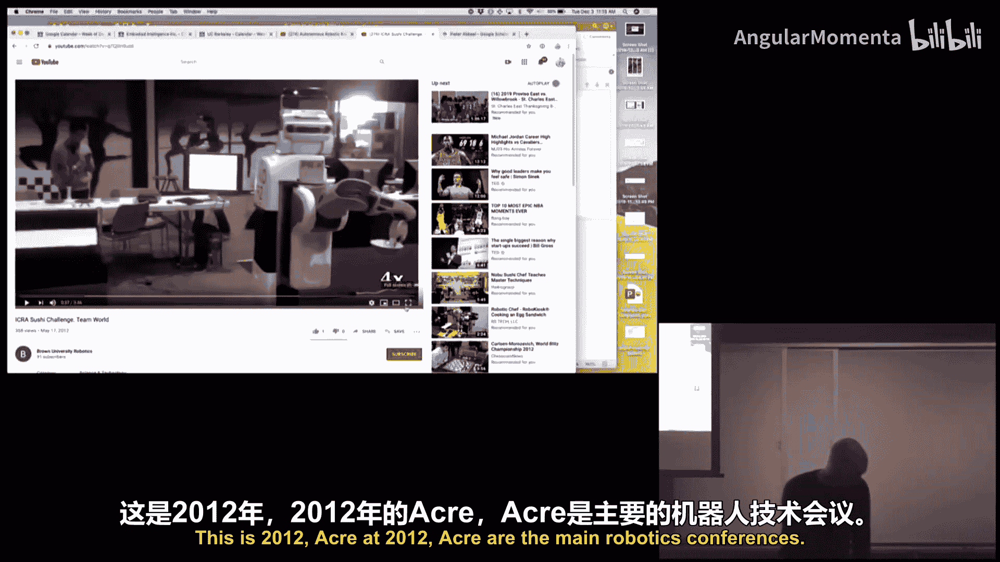

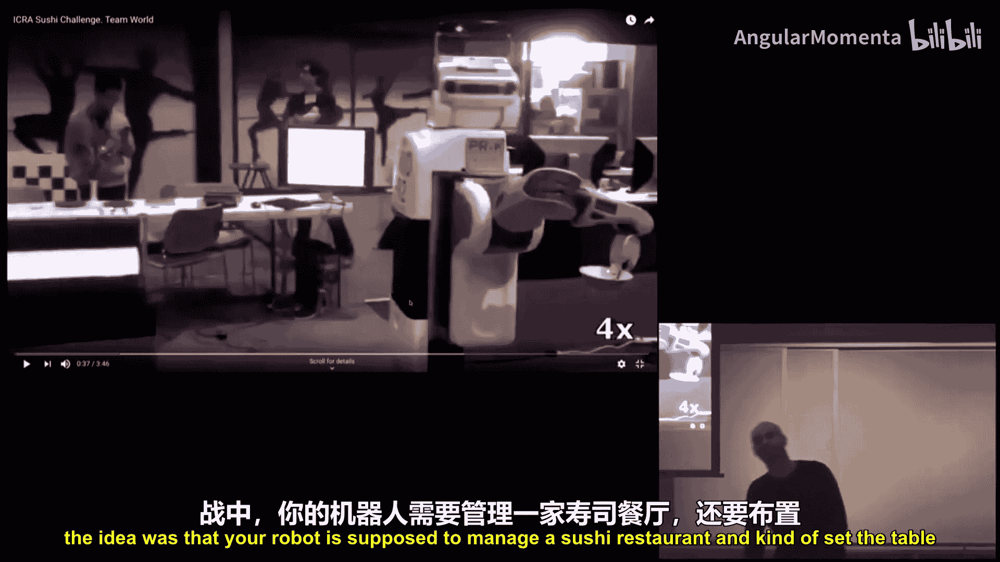

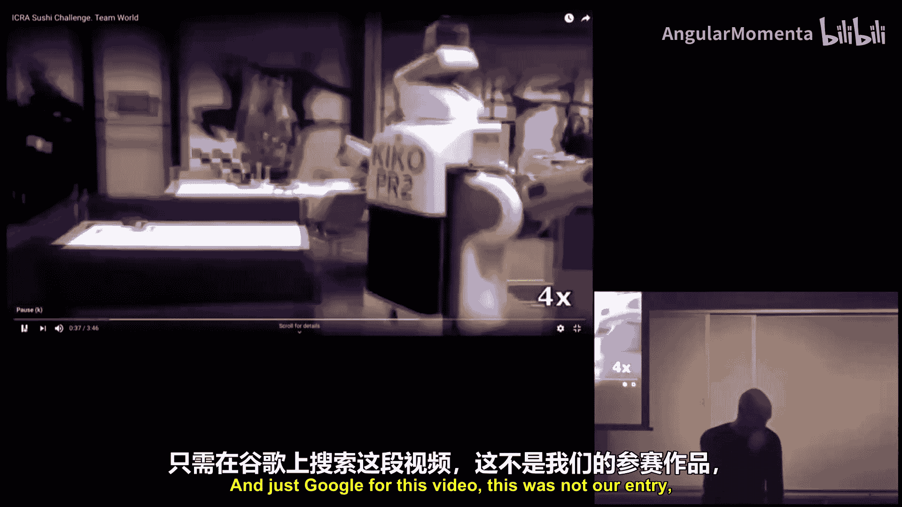

Or team world entry， I think it's Brown and Ku Lovin who did this。

 and this room was supposed to kind of pick things up， put them on the shelves。

 take things from the shelf onto the table and so forth。

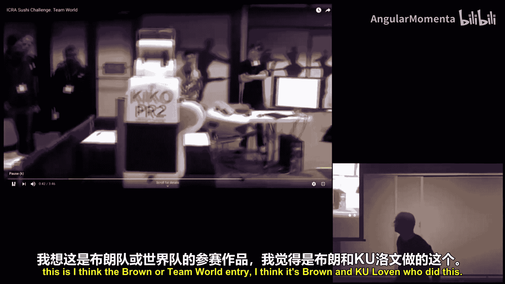

And as John was working on the sushi challenge， we actually did， he did quite well。

 but it wasn't perfect。 The notty worked really well， very reliable， but still far from perfect。

 It felt like。The amount of time spent。

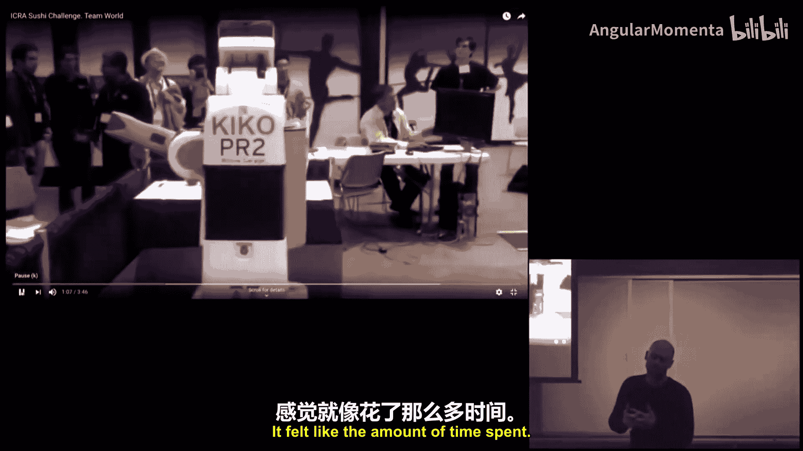

INot sure how to show that up。Okay。嗯。So。This。

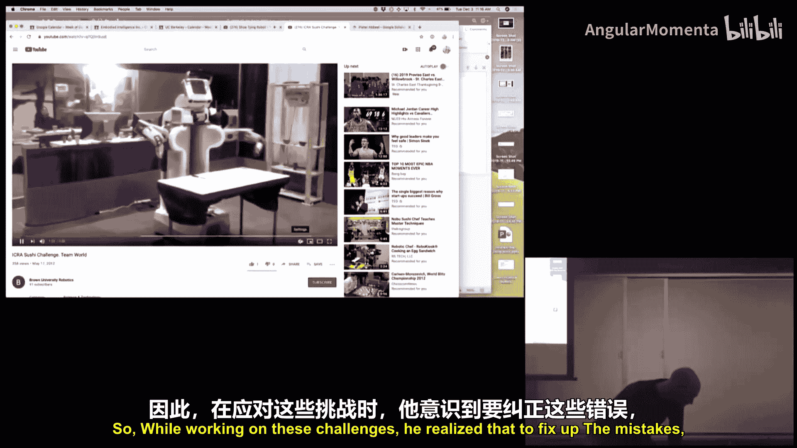

While working on these challenges， he realized that to fix up。The mistakes。

 it was always a lot of work。 And then after fixed up some mistakes by thinking through what could be done differently。

 it would make another mistake later and again， work to fix it up。

 And it just felt like a never ending game of。

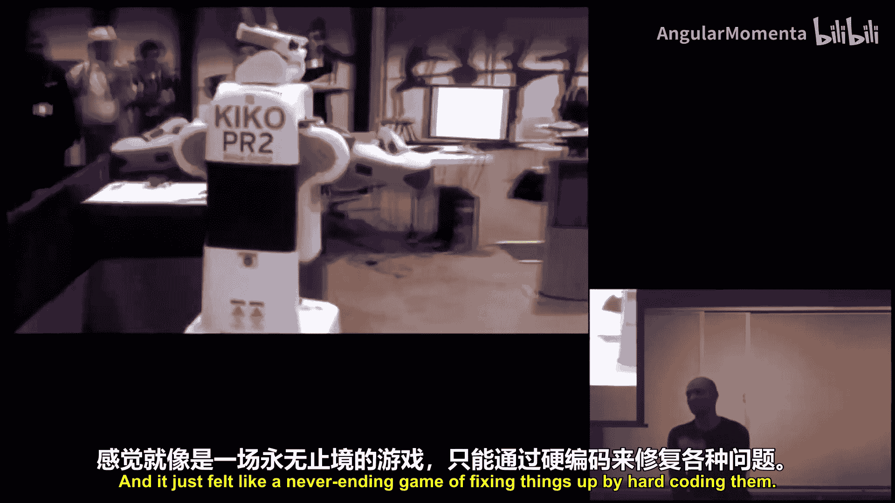

Fixing things up by hard coding them。That maybe there should be a better way to do it and so even though in my lab we had worked a lot in reinforcement learning。

 actually around 2010 1112， we were working less on reinforcement learning。

 much more on learning from demonstrations。And John essentially said。

 let's revisit reinforcement learning， I know it didn't really fully work the way we wanted to。

 but ultimately it seems like we need something like that to get reliable systems without it。

 it's not going to be fully reliable。And so you need a self improving system that can just keep getting better over time。

 that was kind of the starting point。Then what happened around the same time going back to the paper。

 What happened around the same time。 This is a paper we're discussing is that。嗯。Alexevwsky。

 Eli Sgiver and Jeff Hinton also in 2012， showed that you can actually train a neural network to somewhat reliably recognize what's in an image with the Inet challenge where they had a big breakthrough。

And so our thinking was， well， maybe。Image recognition used to not work very well。

 but with a deep neural network， it starts working， reinforce learning used to work not very well。

 but。Maybe the reason it didn't work well was not the algorithms， maybe it was the representation。

 maybe by us relying on a weighted sum of hand design features we can just not succeed。

 we need something else and await weighted sum of hand design features and maybe deep neural us can give that to us。

And we thought about it a little more and we said， well， I mean， look at what's happening in most of。

Kind of classical control theory and a good example was Claire Tomlin's lab at the time。

 hybrid control is very popular， it's definitely very popular at the time。 most hybrid control。

 you say linear control as we know how to do。But linear everywhere it doesn't work。

 what if we partition this space and different parts of space have a different linear controller then it can work and hybrid control will hand design。

The partitioning of the space。 And we said， well， in some sense。

That's what a neural net can do if you read neural net with rectified linear units you're effectively in the first sequence of layers finding partitioning of the space and at the very end you apply a linear controller in that region of the space that's effectively what's happening so maybe if we run reinforcement learning to train deep neural nets with rectified linear units then we'll actually get the notion of hybrid control but fully learned so we get the expressiveness that we want and it's even more expressive because hybrid control tends to actually partition。

But a neural net doesn't partition the space。 It has much more gradual transitions from one region to the next is' just along one dimension that's not even axis aligned。

 one dimension that the controller will change。 So it's like a rank one update to your feedback matrix rather than a full new feedback matrix that's happening as you cross a boundary So you start working on this。

But keep in mind， at the time， Rl just didn't really work。

 So John decided to try to really understand it。 And he worked on。Pendulum。

One degree of freedom pendulum for almost a year。Just R for pendulum。Okay， right now。

 this might seem crazy。 but at the time， R L was just not reliable。 People actually。

 you went to machine learning commerce。 R L was in like some separate room poster session with only a small number of posters and most people wouldn't visit that room。

s that was a state of。Affairs in machine learning， whereasas now you go to machine learning commercemerce R is everywhere it's maybe have the stuff R。

 but back then it was like a small fraction and it was usually tucked away in a place that people don't have to see it。

 that's changed obviously but at the time it didn't work， Ch was like。

 okay let's get it to work on pendulum and really understand how to get that to work。

 Sp almost a year on that pendulum and cartpole。Finally got it working there。

 how did he get it working， essentially it's like， okay。

 while he was doing that in parallel Deep Min was working on the Atari Game。

 John was working on pendulum。And。In December 2013 and Deep Mind released the result on DQN can learn to play atari games。

 and John are still pushing pendulum， a lot of people tried to reproduce guitar game results and it took forever before anybody。

Was able to reproduce the DQN results it was like。A major tour of force。

 if you somehow manage to reproduce those results， It's very hard to do。 It was clear that， you。

 Vla me， a deep mind who did was the lead on that project。

Clearly had a lot of trickery up in his head that could make it work。

 but that the rest of the world had not figured out at all yet。 In parallel。

 John was essentially figuring out the same things at Berkeley independently。

And then what happened is as we try to also reproduce DQN， essentially what we concluded is well。

 the problem with DQN is that you're not really optimizing an objective you're just optimizing distinct。

 this Belmon error but then you have the next Belmont error comes from the previous estimate of the Q function and it's just like it's a weird cyclic thing and that's why it's probably very unstable so we decided to fully focus on policy grade methods because the policy grade method you know at all times how well you're doing。

Then we notice that even policy gradient methods are not that stable。

 even on simple problems like it'll not always work if you just run a naive policy gradient。

 and so that's really where trust vision policy optimization came from。

 John decided that to actually make progress on this we need an extremely stable optimization method for policy gradients。

 so change policy gradients to be much more stable than the standard vanilla policy gradient。

Now of course， John had already worked on job trajectory optimization with trust regions and so forth。

 and he knew from there that one way to stabilize optimization is to have trust regions because you have your current policy。

 and if you stay close enough to your current policy，Then if you step in the right direction。

 then it should be an improvement， if you make a big step。

 it might not be an improvement anymore because the local approximation not valid。

 but if you know which reason you can trust your grade and you should be good to go and so that's really where you started focusing on and TrRPO trust policy music became the first stable R algorithm at the time it came out still DQN was very hard to get to work and that's really where also its popularity came from was that you could actually。

Just run it and it would be stable and gradually improve performance。There are downsides to it。

 like DQN is off policy。 TrRPO is on policy。 you care about sample complexity， DQN will。

By design pretty much outperformed TrRPO， but the real high level bit at the time was get something stable。

 get something that you can just rely on， you can run it。

 and it'll gradually improve reward you collect。So that's how this paper came about。 And I mean。

 of course， a big part of why it's highly cited is because it was the first one to do this。

 so it matters a lot when you do things if people are going to pay attention to it or not。

 at the same time， John wasn't fully happy with it。

 So as he had finished TRPO and of course it starts working and I think there is something you realize comes。

Recurse a lot。You'll see a paper and you like it and a lot of people like it and you might project your liking of the paper onto the person who wrote the paper believing that that's the way to go。

 just like you might think that you Yami K Yosha Bencho。

 Jeff Finton this specific deep net they just did is the only way to go， no。

 usually people who originated it， already know a lot more about the limitations than you think and while everybody else is so excited to follow into those steps。

 they're already thinking about okay， these are the limitations。

 what am I going to do next and moving on to the next thing。And so。From TrRPO。

 which is still one of the most stable algorithms out there。

 John's main reservation essentially was that。It's not first order。

 when you're running and you do a second order calculation， which tends to be difficult to implement。

And it also is not very scalable。Not very compatible with things like dropout。

 not very compatible with auxiliary losses and so how can we get rid of that second order optimization of course we saw in class PPO and PPO is a result of John working for another year past this Think about how do I make this first order so I can run it a lot more easily using off theshe optimization algorithms like Adamom RMS Pro instead of a specifically designed optimization method and so that's how this one came about。

And。Another angle，That John wasn't very happy because he felt like the signal。

 the noise ratio still wasn't good in Tario like it was improving gradually。

 but actually and it was able to learn to play the Atari games， it was able to， I think it was the。

It was the Min paper and a games。 There was a Michigan paper that was doing it with a little more to a kind of。

Cning type approach， and then Monte Carly research and Clning。

 and then TRPO was the third paper overall that was consistently learning on the Atari games。

I was also learning 2D locomotion。But it wasn't learning 3D locomotion， higher dimensional problem。

More noise， less signal， and so it wasn't learning very effectively。

And so that's where John actually started to think about generalized advantage estimation。

 which we covered。In class where I said， okay， you have the policy gradient part。

 but then there's the advantage function and how do you estimate that more reliably than we've been estimating it so far。

 Monte Carlo is great because it's in the limit always precise。

 but it's very time consuming high dimensional problems， not enough time to get enough data。

 and then he switched over to doing advantage estimation with reward plus discounted value minus value and that made all the difference to be able to go into 3D locomotion。

So maybe let me pause here for questions on this one， and I'll switch to another one。

Yes does this paper relate to the approximately optimal paper byca and？Good question。

 So is this paper related to the approximately optimal？ So there's a paper， I think it's called。Well。

 I forgot what the title is， but essentially it says that you can provably make improvements。

With essentially a conservative version of policy tu。

 policy tu completely updates the policy to the greedy one in respect the current one step look ahead。

But。That's not great because that might be too big a step。

 And so what they looked at essentially is they said， okay， it's too big a step。

 What am I going to do， I'm going to mix。Old policy with a new policy。 So I'm interplating by mixing。

 stochically mixing。 Of course， John read that paper。

 John read very much all the papers that existed in R at the time when he had a whole year to really figure out what ideas actually help on a pendulum and a carpo right so you really carefully tease it all apart。

And。Essentially， his conclusion was that that idea is key。

But the keeping all past policies around and mixing them is just not practical。

 so you need to do the interpolation in neural net space like update your neural net gradually rather than having multiple policies you keep around。

But very close connection， absolutely。Yes， actuallysha let me see if the box is here is the button。

 I don't see it。Yeah， I'll repeat the question。When it comes to these limitations。

 you realize after you publish a paper， how much of it？Just leave for other people。

IHow much of it would you？Do it yourself。Yeah that's a good question after you write a paper how much do you want to still do the next。

 next， next next paper or do you want to just move on to something else， I think it depends a lot。嗯。

It varies a lot， sometimes you just write one paper and you move on to something else because you feel like。

 okay， you've made your contribution and it's exciting to do something new。InThis particular case。

 I mean。The excitement was that， okay， this is the first table algorithm。

 but it still wasn't getting at the harder problems we really wanted to solve and we thought maybe at the time。

Those are maybe just a handful of people who really understood how to get deeperL to work and it was not something where if we just left it there that a half year later it would work。

 it would have been either pretty much it have been one of just a handful of people who actually specifically pushes this direction and we thought it was very worthwhile to kind of。

Do the next thing General Adv submission， the next thing PPO to get this all the way。Yeah。

 could you say a little about the decision to switch from rope tying like trying to tie the knots to the decision to go into the pendulum？

On carppo， like what because it seems like you were saying。

you have something that can work on a robot but we have to hard code in a bunch of extra rules it felt like a game that we've never win competing back into。

And then we do have these general methods that can。

Work potentially in simulation and on a pendulum I'm curious it seems like there might be some trade off and like at least when you're doing the ropes you know that like hey we have this awesome demonstration where we're showing a real robot tying a rope because when you make that tack change to the simulation you don't honestly know like again maybe it's a whole year of like hey what are you what we were able to do oh I was able to have a carpool and simulate like but yeah what we I guess the。

I just I feel like a few things were at play。 just to repeat the question on Mike。

 essentially what was that transition like， Like， what was the debate like。

 the transition from we got something that can fairly reliably learn to tie knot on a real robot to we're spending a year on pendulum in simulation。

 It seems like a real step back。 I think there were a few things at play。 One is that。

The fundamental belief that we're not going to get there otherwise that no matter what we do。

 ultimately we've got to figure out reinforcement learning properly to get reliable robot systems。

 That was the。Kind of starting observation that we just。

Very strongly believed in and still believe in that without reliable R， it's just not。

Going to be able to self improve and hence not going to be able to get to the levels that we wanted to get to。

 So that was one big thing。Not a big thing was a big risk， essentially， I mean。

 it could be that we spend the whole year on this keep in mind at the time there was no the DQN result didn't exist yet。

 I mean it was literally RL was still relegated to the side rooms in machine learning conferences that nobody visited right so it was a big bet I felt like part of why we could make the be this because at the time。

John had already him done。Multiple major contributions worth of more than one PhD thesis。

 so he had done TraO， which was the best motion plan at a time。

 maybe still now optimization based motion planning。

 he had done the learning from demonstrations for manipulation of deamable objects。

 which was a breakthrough in terms of dealing with deformable objects。And。Fel like I'm blanking on。

 on the third thing somehow。 But he had， I believe he had done three major。 Oh。

 he had done something。Extremely innovative in tracking de formalable objects since she had come up with a way to。

When you get a point cloud input。To leverage that， to track the 3D shape of deformable object by directly feeding where you've seen the point cloud into an existing simulator of deformable objects。

 you can use off thes shelf simulators， not when you build a common filter。

 you have to build the simulator yourself because the common filter embodies the simulator and the observation model yet come up with a methodology to essentially。

Allow the simulator to remain a black box， yet effectively run a particle filter common wall particle。

 you always， but we run a common filter around that could reliably track。The shape。

 the current shape of a deformable object， had three major breakthroughs already。

 so I felt like even if nothing came out of it， you already hadn't done more than one PhD。And。

 you know， it's just like， okay， this is clearly what's needed。 Maybe now is a time， Maybe not。

But let's just try and see what happens if it doesn't happen。It's not a problem。

 like his career is on track no matter what happens， so we can easily tag the bet。

Other questions on this one。So let me switch to another one then。Sometimes the stories are simpler。

 So this one here。I was just a first year PhD student starting at Stanford and this new professor showed up Andrew Eng。

 who I think many of you know， but back then not everybody knew， I mean。

 he just started his first year， he just finished his PhD at Berkeley， moved to Stanford。

And he showed up and he said， you know what？I think reinforcement learning is all good。

When you want to put it in practice， actually， the ballneck is often designing the reward function。

 Why don't we work on that。And I was like， that sounds kind of。

Crazy because nobody else is really working on that， who's going to pay attention to our work。

 Nobody seems to pay attention to that。 but Andrew is like you know， think about it。

 this is only what people going need to do。 like whenever RL works。

 the next step is to be good at reward engineering， and that's really hard。

 why we already start thinking about it now because it is a big challenge and see what we can figure out。

And this was a space where there was already a paper Andrew had written together with Stuart Russell from Berkeley Hillo during his PhD and that kind of laid out the problem setting。

 but hadn't come up with a full algorithm yet， it had some suggestions for August was not a full algorithm that you could use to then learn from demonstrations。

And so Andrew is like， that's the missing piece， he already wrote the paper with Stetuwart that kind of lays out the problem。

 but we need something that can actually learn from demonstrations， close the loop fully。

And so this I would say was some of those things where it almost never happened when'm working on a paper like I work on it and the idea is so clear and then we run experiments and it just works because it's just like。

 okay what are we supposed to do， we're supposed to recover reward function from demonstrations we know that demonstration is supposed to be near optimal it's a clear optimality criterion and any guess the naive thing is you guess a reward function。

 or you might guess you guess a reward function， you look how well the expert does against that reward function。

 you compare with some other random policy the expert better than might have been a good guess if the expert is worse。

 probably a bad guess it's obviously not the algorithm we propose you propose an optimization。

 perceive that more efficient just logically speaking。It kind of felt like this couldn't go wrong。

 like there is a guarantee that you can formulate this problem and that you can。

Optimized to back out。 It's a min max optimization effectively。

 but you can solve that to find the reward function， and that just didn't exist yet。

 And so it's like a very linear path to to getting the paper done。That said， I mean。

 we submitted a paper。And it got rejected。 I remember I was like my first paper and it was like。

 oh my God， this is so sad， like worked on this all year。

 and Andrew had been telling me you know this is the important thing and the reviewers don't agree great。

 This is the important thing。 they say， you know， they didn't care seemingly， and I's like okay。

 I went bowling and next day I come back and talk with Andrew and'm like okay。

 what are you going do It says you know， don't worry about it you know。

It's not what the reviewers think。 You know， we have a clear view on this and you。

 we'll just resubmit and， we'll pause the writing。 know。

 there's definitely places where we could have been clear。

 such that the reviewers would have gotten our idea more easily。 And we'll do that。

 And when we get our idea across more clearly， hopefully we'll have better luck。

'll get in that's exactly what happened。 But essentially its kind of very interesting thing because it was like so clear what to do。

 and then at the review time was just like， okay， reviewers are like， oh no， not interesting。

 partially due to the writing， partially due to the fact it was just。Not what people were working on。

 like people were trying to improve reinforcement algorithms。

 they were not trying to take the next step of finding a reward function that you could use with your RL algorithm and so a lot more explanation was needed to get。

 in some sense， the argument across why this matters and just proposing an algorithm wasn't cutting it because people weren't really。

Caring about that algorithm because they hadn't been made to understand why there' was even a problem here that I needed solving。

 only once they understood that， could they appreciate there was an algorithm that solved the problem。

This is an example where we essentially would just we didn't write any follow up papers on this。

 but there was a lot of follow up papers like soon thereafter there was a maximum entropy version of this。

 there was a max margin version of this because essentially whenever you do something like this there's always variations you can do。

 and improvements， but we actually just，Did this， and then we started looking at dynamics model learning as the other bottleneck in RL rather than continuing to push this at the time。

Let me pause here for this one， see if there are questions。Yeah。

 it seems like there aren't that many papers on inverse reinforcement learning。

 even though it tries to it aims to solve a pretty fundamental problem。

 do you think also quite like generalizable in some sense， could you touch on why that is maybe？Well。

 back then there was essentially no papers now there's a lot more。

 and I think the pickup is happening because partially because R is turned to work better and the better it works。

 the more people try to，Make it solve problems and realize that reward engineering is a real thing。

In addition to that， there is a big look。Push by， especially Stuart Russell and Anka Dragon。

 both here at Berkeley to think about human compatible AI。

 How do you make your AI understand what a human wants。 And ultimately。

 if you think about reinforceforment as the formalism that AI is solving for optimizing some objective。

 you care about well， it better optimize the right objective。

 And so I would say in the last two years it's been a big uptick and work in that space。

 not always called inversarellas than I mean， another thing sometimes you know。

 you need to give something a slightly different name to reflect both that it's slightly different direction and to make it more new to people who read it。

 but it's essentially a lot of these ideas coming back and building on top of it。 like， for example。

 a paper that's quite popular。Dylan Hatfield Manel did， who's jointly advised by Stuart Onka and me。

 is cooperative inverse reinforcement learning， where you have a human in the loop。

With the robot orD agent and together， they're trying to optimize reward。 and so the goal。

For the robot or the agent there is to optimize the reward that the human has。

 the human might give demonstrations might give other information in principle。

 but the robot never has access to reward。 It's essentially the same thing this is very much just demonstrations。

 bunch of demonstrations and done。 that's interactive。 How do you get the most。

And how do you account for uncertainty that you might have about the actual reward function underneath？

Yeah， you may have already answered this， but when the follow up work， many。

 many follow up work on this came up， do you feel like I should have done that or？

That's a good question。 they sometimes feel like， okay， this follow paper， I wish I had done it。Yeah。

 sometimes felt that way， sometimes I like， yeah maybe maybe should have done this and some I mean there's one paper where we actually had the exact same idea。

 I was like， oh， it feels you know too similar to what we already did。

 it's not worth another paper but then you know somebody else did it and executed really nicely on it it had a lot of p I'm like oh we could have done a lot of interest in this work。

But yeah， I mean， ultimately， it would have been an opportunity cost also where we did other work in the meantime that we couldn't have done。

Yeah， I think。Maybe coming back to your original question。

 I think you kind of want to do something you're pretty uniquely qualified to do most of the time at least。

 and then sometimes maybe want to build up your qualification to become uniquely qualified at something a little new。

And so。I would say when we're doing the first papers on deep reinforce learning。

 it felt like if we didn't keep pushing it， it's not clear how fast it would move with this。

 It felt more like。Other people could build on it too， it wouldn't be easy。

 but it felt like there would be more critical mass of people who could build on it。可是。

The inversaral formulations feel more clear cut。 back then， I mean， keep in mind，2012，1314。

 there was not even。 there was no tensorflow。 There's no pi torch like no chainer。 I mean。

 you had to pretty much do your your automatic differentiation wasn't that easily available。 I mean。

 there was a lot of things people did not know about batch。 I mean。

 people did not know about how to initialize neural nets。

 Like there was so many things people didn't know that to get something working was actually so hard that。

It felt like that we were extremely uniquely qualified to keep pushing that and I feel it's still reflected what we're doing today。

 it also reflected in what happened after because after those results。

 more and more people joined the lab， we said， hey。

 we actually also want to working deep around and build more and more critical mass around that。

 make even more uniquely qualified to solve some of those problems at this point we' hit a point where the expertise is more spread out for sure but at that time it really felt like。

If we don't push it。Well， not sure how fast it's going to go and it's nice to push something where you feel like you're going to be likely ahead。

Yes。Could you talk a little more about， I guess your intuition of， let's say you're heading down？

That you're not so sure it's going to work for like how long？T explain that problem versus that。

Dropping it and switching direction。Yeah， it it's hard to decide when it's time to give up。

I'll tell you a story about that on Thursday from my PhD where after one year I finally gave up with something and then in three weeks I solved the problem differently。

 so yeah。I spent one year on the path that could have shortcut in the three week other effort。

 but so definitely， I mean， I'm not perfect at deciding when to switch。😊，I think。

A big part of it is to。Try to think about whether you're making measurable progress。

It's one thing to have a goal and not achieve it。 like， okay， maybe we wanted， you know。

Policy gradients to solve atari games。 And for the longest time。

 that was just like the runtime would be too slow， we couldn't have fast turnaround experiments that would never work anyway。

 And so we were not even close。But we were able to isolate a problem that is just pendulum and then later also card pole that are low dimensional。

Easier to analyze。 we know what optimal solutions look like。 We know when we're getting closer。

 We can run so many experiments， so many random seeds， and we can see， okay。

 now our methods succeeds， maybe in 5% of the random seeds before it was 1% of the random seeds。

 And we could actually see how to build that up to make things more robust。

 And so it felt like that entire year， there was continuous progress being made。

 It didn't feel like it was just like。😊，We throw ideas into a blog box and it just comes back and like it wasn't 01 reward。

 Let's put it that way。 and it was always zero for a year and then one。

 it was very gradual progress over time， progress in terms of better results。

 sometimes progress in terms of things that we thought would work。Don't work。

But we learned something， and so it's progress in our heads， in our understanding of the problem。

 what might or might not work and how to deal with it。Yeah， I mean。

 for the trustsion policy optimization paper， initially we thought one of the big important things would be this idea called Vine。

 where when you collect your rollouts， you want to reset in states you visited before and take the other actions to see a branching happening to get signal to noise to understand which of those 10 actions available is the better one。

Turned out it didn't matter at all that took us a long time to like we hammered and hammered and tried。

 try， try because thought that should be it right， you get more signal from being in the same state twice or more than twice and seeing the different effects。

 but actually that wasn't the case。More rollouts helps。

 but putting them from the same state doesn't necessarily help。Yeah。

 so I think it's all about breaking it down into gradual progress where you say okay。

 can I get this to work or work better than I had it before and essentially whenever you're doing research you're like okay。

 what am I trying to do I'm trying to get to a stable policy grade method， let's say right。

What is the smallest experiment that can run to get some learnings from that experiment？

 And I think that's really， I mean， ultimately， you could argue research is ball andne by how fast you can code。

 But I would say if you're coding the wrong thing。Then it doesn't really help you。

 And I would say say a much more bottleneck by， are you able to choose the right experiment。

 that's the smallest experiment that allows you to learn something new。

And then you can from there choose the next experiment， next experiment， next experiment。

 if you're really good at that， your research will go really fast because also those experience will be faster to implement。

 you'll have very gradual progress， signal along the way and be more easily on the right track。Yeah。

 what happens when you've been working on something for a long time and then it just like doesn't work。

You just have to give up at that point。Let's see if you worked on some for a long time。

 it just doesn't work， you just give up。I would tell you it's rarely happened that it felt like we just had to give up because we are always trying to go that gradual progression and learn lessons。

As you learn those lessons， often what happens is you essentially change direction you pivot。

 you say， okay， this is direction that I thought we're going to go。

 but actually this finding suggests maybe we should go this other way so。Yes， you are in some sense。

 giving up， but I wouldn't call it giving up because it's not like you try something for a long time。

 as always。 It's more like you're making products in a direction， you learn some lessons。

 you steer and you go in a slightly different direction now and that might happen many times。

 And at some point you end up in a place where you're happy。

 you get some ideally somewhat unexpected results for the outside world。

 But for you now make a lot of sense。 I feel like those are the things you're striving for right you want to essentially。

Find something that now to you makes a lot of sense you had a hji would probably work and makes a lot of sense。

 but to the outside world would still be a bit of a surprise that that is actually true。

So let me take another paper。Oh here。 Look at this one。 Inuction to physical relational learning。

 This is a great way to get a lot of citations。 you write a chapter in a book。

 So the way that that often happens is somebody else is writing a book or they've seen a new trend。

 So here， essentially what was happening at the time。😊，The paper that's effectively in here is。

This one over here， discrim probabilistic models for relational data paper I wrote as a master's student。

 Ben Tascar was the PhD student who was my mentor at the time， Daphne Ker， professor of the lab。

And essentially。This was a direction that at the time saw a bunch new work。

 there was a workshop organized around it， and then the organizer decided to bring a collection together of papers。

 rewrite your paper as a chapter of a book instead of the original paper format probably do a few additional experiments。

 a bit more context to it in the context of the book and then all of a sudden you get a lot of people to read it let's say but still going back to the original paper itself So what happened here is essentially at the time and I think I mean。

 of course it's always going to be different， but it's always about finding things that other people are not doing yet that you think are somewhat inevitable like when you say like this is for sure going to happen like same with RL for sure the future of robotics we'll have successful RL in it that was clear back then even if we didn't know how to make it succeed yet。

Same thing here， machine learning at the time was all about you have some inputs。

 let's say could be an image， an output， some classification or input could be some text and output sentiment or。

Topic of the document， things like that。But the internet was just coming about。Which was a new thing。

 and when machine learning could start pulling data from the internet， relational data。

 And so the idea was essentially Daphne's thinking at the time was look。

It's inevitable that we can do better by considering all the linked information。 Like obviously。

 it's also what Google used in support， but essentially the notion that。

If you look at words on a page that are links to this page。

 let's say you want know the topic of a given page， if you also look at pages that are linked to it。

 and especially the words on the link to that page might be extremely informative about that page。🤢。

Same for the out linkss， it might be that it's very often that。

 and those are some of the examples in the paper that often。For university pages。

 because the internet had a lot of university pages at the time。

 Often students will link to professors。 professorfes link back to their students。

 And so it's very likely。That。If one page is a professor page that the page they're link to。

 even though it's just a name and the name doesn't give away where it's a student in it's very likely it's going to be a student page and so there's a relationship between this page is that you just know from the linking if once you clearly know this professor because it might take professor somewhere and it goes to this other page well。

 now it's likely if it's a name that is is a student page。And so。

That was kind of the inevitable thing Daphne saw in late 90s， early 200s like， okay。

 we need to lift the way we look at machine learning from just this kind of more insular one document at a time to seeing everything as linked and doing a joint inference over a whole set of pages which is now called structure output prediction。

 So structured prediction problems is what essentially grew out of this original push it's done differently Now。

 of course， we're 20 years later， but。That's essentially where this came from if you can just。

Leverage everything around you。 You're going inevitably do better。

 The other thing what this pay was specifically about。

 there was already some work in that direction was discriminative models。 So at the time。

 there was a big kind of。Differentiation between generative models and discrimininate models。

 generative meant something like naive B。 You train a generative model for your data。

 and then you use Bay rule to figure out。The class from the features。

You can also do logistic regression， straight up discriminative。

 and so we looked at a way to doing discriminative learning over a joint set of outputs。

 this really the structure output prediction problem that。Look at here。Now。

 the most highly cited paper in this direction was actually Ben's next paper。

 which unfortunately I was not involved in， as you say。

 sometimes you're excited to be involved in the next paper and sometimes you'll miss out on the next paper。

 but the next paper I can probably pull it up。Max margin， Markov networks。Yes。So。This paper。

It was a nerve paper and so this paper essentially did something very similar。

 but it used to support vector machine formulation into it rather than a probabilistic inference formulation。

At the time， people did not fully appreciate yet the close connections between things like support。

 vector machines， logistic regression and so forth。

 but Ben and Carlos had seen those connections already before most people could see them。

 could see how they were there even for the structured output prediction case and were able to essentially write a paper that shows that。

You can do this kind of joint inference over many， many variables。

 structure output prediction using max margin formulation， which was the most。

 I mean today people mostly don't use max margin back then it was almost a religious like the way。

 neuralNe makes you get a paper today， sport vector machine would make you get a paper back then and so when you switch from the kind of more logistic regression mark random field framework at the time to sport vector machine formulation。

Which by the way， was not the inside was non trivialal at the time。 I mean。

 it wasn't like everybody could just see it all。 you just reform it。

 It was a nontrivalal insight to get this right and make it tractable and so forth。

 But it was also a sign of the times that the fact that that specific thing was figured out it's what made it so popular。

 And so it was very clear at the time you made a support vector machine version of something。

That would be。Like essentially， it was a oral at Nips， maybe even best paper word I forgot。

 And there's only like 20 orals out of， you know。Well only once a year，20 ors。

 so that's very selective。 And that was the follow up paper there or one of the followup papers but the one that got maximum traction。

 I would say。嗯。Let's see。What else do we have， actually。

 let's take a two minute break and after the break we'll go through maybe two more。All right。

 let's restart。How about we pick the infofo game paper first， So infofo again， the idea there is to。

Essentially。What was the state of affairs at the time。

 Gene about visceal networks were starting to look very promising to generate images like real images。

But the original motivation for doing unsupervised learning and generative modeling was to find latent representations that are。

Meaningful for which you can learn easily。And ideally。

 often that means you're looking for disentangled。Information where maybe color and shape are disentangle over amnes digs。

 maybe thickness of the pen stroke， tilt of the digit。

 and the digit number are decoupled or living in separate variables。Now， why would that happen？ Well。

 there's no reason to believe that that would actually happen automatically because all you're training for is a way to represent。

These images。So Peter Chan at the time went to actually information theory talk at Berkeley。And。

The talk was discussing various aspects of entropy， independence of variables。

 mutual information and so forth， and just sitting in that talk he was just like， okay。

 it's obvious now， like if I can have high mutual information between the latent variables。

The code and my image that's generated。Then that code is informative about the image， which is key。

They have an addition。I make those latent variables maximally independent while retaining that information。

Then as I'm trying to make them independent， the natural independent structure should emerge。

 So I said I just need a train again where I make all the code variables independent but make sure they retain the information。

You set that up more formally with， know， mission information， objective and so forth。

 It kind of just worked。 And this was， I would say this one of those papers where。

Sometimes somebody just has their right idea， execute on it。

 it just works because the idea is just really right It's the right time and its a bit surprising how well decoupled。

It was clear it should be doing some decoupling， was surprising that decoupling was so well aligned with what we think about as decoupling that latent variables corresponding to the digits。

 the numbers， then latent variables corresponding to the slant， the thickness and so forth。

So how well it worked was still a surprise when the experiments came out。

 but it was just like a very clear idea that was just turned around in probably order of a month or two months from just inception of idea to what became a invited a paper at Ns。

 but also invited at the time。At that time。Which obviously not the case right now， but at that time。

 Europe's。There was still something called deep learninging Sposium。

So after the main conference ended on Thursday， there were a few symposia and it was a dedicated symposium to deep learning because not everything was deep learning yet。

 and now slowly not everything is deep learning anymore either。

 but for a while everything was deep learning。Back then， not everything was deep learning。

 it was a dedicated symposium to bring that work together。And essentially which is by invitation。

 what people thought were the。10 to 20 most interesting papers to get presented。

 and it got selected for oral presentation in that。

 So just like less than two months of work and there it was。 So sometimes teens can go very quickly。

 and there's no long story of working for a year with you know a pendulum to finally get something working。

 It just you have the right idea。 And that was Peter in this case。 and he just made it happen。

Then this one here entering training of deep vision motor policies。 So what happened here is。Now。

 professorfessor here at Sergey 11 at the time， he just finished up his PhD at Stanford。

And he came to Berkeley for postdoc。At Stanford， he had shown that he had developed this thing called guided policy search。

 was guided policy We in class with a quick recap， essentially， the ideas that。

We do trajectory optimization to find good trajectories and feedback controls along those trajectories。

 and then you essentially copy。The controllers along those trajectories are into a neural net that consolidates it all in one place。

 so the neural net imitates these optimal controllers that you found。That's guided policyors。 Now。

 Sergey was the one who pioneered all of this。And he wanted to bring this on real robots。

First thing he did， he actually then learned the dynamics models from data collect on the river。

 essentially doing a model based URLL version of guided policy search that worked really。

 really well。Next thing he said， well， this is not very satisfactory because also the robot needs to see。

 it needs to have a visual system。That point also Chelsea showed up， she started her PhD。

 so she was her first year PhD student at the time。The two of them started working together on this。

 And the main idea there was essentially the following。 And it was kind of a new inside。

 which of course， now everybody understands very well。 But the notion that。You could。In principle。

 and this was done， run trajectory optimization in state space。

 So you run trajectory all in state space。But then the neuralNe that's going to learn to copy what those trajectory based controllers are doing in different situations。

 that neural net does not get access to state， it only gets access to the image input。

And so now you're forced。To learn a vision based controller。

 even though your examples are self generated by effectively running trajectory optimization in state space。

 so you still need access to state space at training time。But at test time。

 you can now do a vision based control。 And this was the first successful deep neuralnad。😊，嗯。

Learning for real robots， vision based control。At least in the modern area with I mean with RL。

 so that's really kind of the big thing and why the paper is cited so often it's not to say about the very specifics of the approach because approach has always evolved。

 but was essentially the first one to get working on real robots with visual input。

 doing a wide range of tasks， not just this one thing but a wide range of tasks。

 but this came really from a progression of Sergey working throughout this PhD。

Going from direct optimization to guided policy search， all in simulation， then on real robots。

 then bringing in vision in a way that could actually be made to work at a time and so that's the story here。

Let's see when we discussed the relational data1。Benchmarking RL， D RL for continuous control。

 So this is。Rocky Duan started his PhD in when is this published 2016， so he started his PhD in 2015。

And at the time TrRPO had just come in place， DQN was there。

 but honestly it was not much else was DDPG was there， there was some double DQN variants of DQN。

 and it was older approaches like just straight up natural policy gradient。

 evolutionary methods and so forth。And there was not a good understanding there was just a lot of like。

 okay， this paper claims it's doing well， But then this paper， you know， claims it're doing better。

 And but it's all both Cartp or it's both2D Walker。 How come like there's just a lot of。

Disrepancies in experimental results。 And part of it because a lot of things had to be tuned up。

 The neural net architecture had to be tuned up。 The learning rates。

 implementationmation could be a little bit off and so forth。 So Rocky decided to get some clarity。

 So decided as you start PhD， he wants to get clarity in the space and he essentially decided。

 I'm going to benchmark。😊，All the at of time。Most kind of dominant R algorithms and see how well they can do on a fixed set of tasks。

These were me joke tasks that he standardized and that actually later when Open Open eyes started in January 2016。

 so Rocky finished this in fall 2015， submitted in January 2016。

 Open eye started in full in early 2016。 one of the first things Open items and said is we should actually continue up on this benchmarking and then build Open eye gym on top of what Rockhead O built。

 of course， taking it to completely next level， but the foundation here was at Rocky realized that there was a complete。

Lack of clarity on how different approaches stack up against each other and doing a very thorough comparison and having reference implementations。

 R lab， which came out of this， was the first set of reference implementations for deepL algorithms。

 Also at the time， Deep Mind and still mostly now would never release their code。

And so anything came out of deep mind somebody had to reimplement。To be able to benchmark against it。

 so our lab had a lot of that implemented， as well as the algorithms coming out of Berkeley a few other places。

 very thorough comparison， and that's what people kind of picked up on and then build off。Yeah。

 let me pause here again， see after there are questions about infog and。Benchmarking model based。

 benchmarking R， DRL I our lab。Rocky was still working on it。

 is he still working on that or is that is our lab not？So Rock。

 the question is Rock is still working in RL La， I would say RL labb lives on in the next generations of code basis for RL。

 but Rocky is not actively maintaining RL lab itself anymore。我's say。

The places I would go look right now。Is probably。Two places， one is called spinning up。By open AI。

 and that's a tutorial。Codeb， where you have code and the tutorial that goes with the code。

 it's not the most optimized code for runtime and efficiency and so forth。

 but it's most optimized for your learning。Looking at one algorithm at a time。

 clearly spelling out why every piece is there and what's happening with the code right there that you can also run。

 So that might be a natural starting point right now for codeb。

If you want something highly optimized， Adam St， PUU at Berkeley。

 he spent a lot of time building a highly optimized pytorrch implementation of most state of the art。

 if not all state of the art deep parallel algorithms。 that's called RL Pi， So RL PYT。

 and that's probably where I would go now if I wanted something that is optimized and the you know access to a range of algorithms。

 be able to run them easily。Yes， you mentioned about open air starting around that time。Plish and。

Historically there is think very good synergy between。The students in your lab。

 so that how did you build that？So the question is there's been a lot of synergy between Open AI and Berkeley。

 especially students in my lab at Berkeley and how did DA grow， what's the dynamic behind that？

Let me take a step back。 how did the opening eye come about， essentially， opening eyes started。

I believe early 2015， not as a has organization， but the kind of seeds of the organization started early 2015。

 What happened at the time is there was a dinner。With a bunch of renowned kind of Silicon Valley people。

 including。Elon Musk， Sam Aldman and Greg Brockman， Greg Brockman at the time was CTO ofs Trie。

This tribe is doing really well at the time and he's doing， maybe even， I mean。

 it's continuing that great path， it's doing really well now too。And。

And Greg there was a lot of discussion about AI in that dinner， was about all about AI。And Greg。

Concluded he was ready for a new challenge。 Like some sense Ellam Ma same album were kind of you know the domain like we should really do something。

 And Greg was like， I'm ready for something new。 I want to dig into this。

 He wasn't an AI expert at the time。 but you could see how important it was。

 He had build other systems So he knew， you know he could probably build something new and had led a big organization already。

 So he's like okay， I want to dig into this and learn more。 He started learning a lot about AI。

 He concluded that he wants to take this to the next level and really make this happen。

 This notion of a nonprofit that tries to ensure AI is built for good。

 not just for whoever who built it。 So Greg wanted to make that happen at that point。

 Greg then started asking around。And of course， part of it is that it's very hard to make people move who are already at other companies and are happy。

So。A lot of focus ended up being on people who are about to graduate。

 So Greg tried to figure out who are the people who are about to graduate who are by large considered leaders in the field。

And the names that kept coming back were essentially then the names that became the founders of Open AI was the founding researchers were John Schulman came from Berkeley。

 Andriker Poy from Stanford， Woig Zamba from NYU， Derek Kingman from Amsterdam。And a。

 blanking on somebody here。Yeah， one more， there's five founding researchers。And then of course。

 founding research director Eliot Suzkiver， who they did manage。

To recruit away from Google at the time。And so part of why is a very strong connection between Berkeley and Open eye。

 especially at the time， is because John。Came out of Berkeley。Open eyes very close to Berkeley。

 I mean， it's in San Francisco。It was clear a lot of interesting things were going to happen there。

 and so John started telling us about a lot of the exciting things that were going to happen。

And how maybe there could be really good synergies that students spending some time there could be great for the students to get。

Broader perspective beyond just the Berkeley perspective and could be great for Open AI because well。

 Open AI is growing and wants to track the next generation， next generation of contributors。

 And so that's a lot where this came from in some senses。

The fact that John Schulman cofounded Open AI was the seed for the connection between Berkeley and Open AI。

 and that proximity， I think， made it。Much tighter than any university has been。

So I realized I skipped one paper here going down the list， the mammal paper。

 monognostic meylating for fast adaptation of deep networks。So before I get into that one。

 I want to get into another one that's related。Which is。The Rl squared paper。How is that one？

Let's see， maybe it's just below the fold here。Are all squared。 So the story here is。At the time。

 so this paper came out。Fll 2016。So essentially。What happened is。

Charles Sheulman had just graduated and。Kfoed open AI。

Rocky Duan had just finished the benchmarking paper and started thinking about， okay。

 we now know which harness work well。 We also know certain problems are completely unsolvable by R。

 And let's think about those。 And kind of the main thing there was that it seemed。

The most important and biggest challenge， essentially was to deal with long horizon problems。

So we needed some hierarchical approach to reinforcement learning。

That seemed like the clear cut hardest problem at the time。 I would argue still today。 So is you say。

 when do you switch， really switch directions， Rocky was going to take on Haracle Aral。

 John was working in Harac Arl， They worked on it together。 I mean， I was involved。

 Peter Chen was involved and so forth。嗯。Why hierarchy？ Well， think about why it's unavoidable。

 Why do you need hierarchy。 Well， think about a cleaning robot at the lowest level。

 it controls itself at maybe 100 Hz just to make the motor spin at the right rate。

 But then above that， it's like deciding which direction to go。 That might be at， I don't know。

1 Hz Above that。 It's trying to see where it even should be going。 That might be at I don't know。

Maybe。Every hundred0 seconds， it has to make a new decision about work really to go next which room and so forth。

 And then at that level above it， my decide needs to go to a different building or go empty itself and so forth。

 And so if you think about it， if you're going to learn。

To maintain a whole the cleanliness of an entire building by doing reinforcement at the 100 Htz level。

 you're never going to succeed。 The credit assignment problem is too difficult。

 You need some abstractions on top of that。To make it work。 So hierarchy。 So Rocky spend。

And Rocky is super fastuzz away with like when Rocky spends a month on something。

 it's like a normal researcher spend something like 10 months in something。

 So Rocky spend something like six months on this， which is like six years for a normal person and。

Still， it wasn't working。 like it felt like it just thinks they tried so many things and so many things that we thought should work。

And then they sometimes they give rise to hierarchy。 But then it was hierarchy for hierarchy's sake。

 It didn't learn more quickly to solve a problem。 like， yeah， weve got a hierarchy。

 but it's not quicker。 And so after six months of doing that， essentially。Rocky said， you know what。

 why do we even care about hierarchy， It's clear what we care about。

 even when we have hierarchy that it learns more quickly， that's the final metric that we want。

What can we just directly train for learning more quickly？ So what can we end and train。

An agent that is trained to learn quickly and whether it in on the inside figures out hierarchy or not。

 that's up to the agent， give it a massive recurrent neural network， which in principle。

 can have some things。Change at low rate， some thingss at a faster rate。

 so it can have hierarchy if it wants to， it's completely free to do that。

 wood doesn't have to if it's not needed for the problem。

' can just set up a gigantic R&N and just train it to learn quickly to let's say solve new problems。

And that was essentially the motivation behind Ral squared。 It was。

 in some sense the change of direction。 It was a hierarchy seemed the path to better solutions we couldn't figure out in a half year's stretch。

To get true tangible progress on the problem。But we realized that ultimatelyly always were asking the same bottom line question and the reason we concluded we made no progress was not because we didn't have any hierarchy that was hierarchy。

 it just wasn't helping the bottom line which is faster learning and we said" well if the bottom line is faster learning。

We should just directly train end to end。Recurren neuralial nets that are the brains of agents that will。

 when dropped in new environments， will start collecting reward after a very small number of episodes。

 and so that became RL squared。As that came out。At the same time， Chelsea here at Berkeley。

 I also started to think about how to learn more quickly。

 how do you use past experience to learn more quickly in the future。

She came from a very different angle。 So Rocky came from the kind of end to end。

 I want just this black box to learn faster in the future。 I'm going to end to end train for that。

 Chelsea came from a bit more of the kind of。AnOation of what's happening in the current state of the art at the time。

 and this is the mammal paper。So， she observed。Thatad。

What is so successful in computer vision is actually。Just pretrain on INe。

 fine tune it on your own data。But that doesn't really work for behaviors。

 there's no image it for behaviors， and it's not even clear that it is guaranteed to work。

 you just do something and you hope it works。At the same time， the evermo kind of。

Prevailing paradigm was end to end training。 What you should do is always train end to end。

 Don't make it， you know。Don't have something and then puzzle it together。

 whatever you puzzle together。Make a transantttoine。

So if we want something that is good at specializing to new things。

 we should be able to train end to end for specializing to new things。

 so we train neural network ahead of time to be ready to be fine- tuned with a few grand updates。Now。

 of course， you still need to figure out how to make it actually work， how to implement that。

Because now you're saying there's an inner loop of grain descent。

 there's aner outer optimization objective around that that's saying if the inner loop I do grain descent。

 then the outer objective should succeed at optimizing my classifier very quickly for a new data set or my RL agent for a new environment。

So this came out， well she figured this out fall 2016， the paper came out in 2017。Now。

 one of the beauties here of this paper is that it's in the name also model agnostic。

 It's essentially agnostic to。The type of neural network is not committed to， let's say。

 a RNN or a feed4I network or maybe an attention network versus a combant， it's agnostic to that。

And the formulation is agnostic to the task， the same idea can be applied to reinforcement learning。

 which was their original motivation， but just as well be applied to supervised learning。

 to do fu shot learning in supervised setting。And so that's one thing I would say that's always interesting to pay attention to。

Even if RL is your ultimate goal and you want a better RL agent。

 if the idea you come up with is more general。And often it can be。

 It's good to keep that in mind and make your work much more general。

 Like one way to write this paper could have been to just write about RL。

 because that was the original motivation， but that's actually how the paper was set up。

 the paper setup look， this is completely general。 and so people who now work on fu shot learning for classification or fu shot learning for enterpriseed learning。

 future shot learning for RL。 Any one of those can effectively look at this paper for inspiration and build on it。

 which makes it much have much more impact then if you keep it one application domain made that might have motivated you initially。

Let me pause here again。Looks like we have time for one more。 let me see which one to pick。

Everything helicopters will do on Thursday。This is not a good example of how you might decide on writing a paper。

 so this is year 2014，15。This was a time when。Compute had largely started to move into the cloud。But。

Most robotics work that was done， people would still put a dedicated computer with each robot or even build a computer into the robot。

Like look at the PR2 robot， which came out in 2010， in the base of the PR2。

 there was a massive state of your compute of that time。

But it was clear that a lot of things were at the time moving into the cloud。

 especially for training your robot。You still need some compute close to now have too much latency。

 Otherwise， you know， it's going to take too long。 You have too much latency。 robust。

 I'm going to succeed。Essential this。Here at the time。

 and especially Ken was very much looking into that。 Ken Goldberg， this notion that。You know。

 isn't it also inevitable that a lot of compute for robotics is going to shift to the cloud？

And one thing is interesting about shifting the compute。

 but it also means like shifting all the data that's collected into a central repository。

 shifting all the learning into a single place that can be shared across all robots。

 maybe some robots need specializations， some don't。

 but this notion that it's not just about moving the computer is everything that comes with it。

 and really kind of writing out in a clear way。What that trend is going to mean in surveying a lot of work that already existed。

 but wasn't really necessarily using that terminology and bring it together and say， look。

This is starting to happen here there and there， this is the trend。

 and this is how this can project into the future。And that's often very powerful because often things start happen in very many different places。

 but。It's not always obvious to most people that there's a common pattern across all of them。

 and if you can bring that together and clearly articulate the pattern。

 it can be very powerful to kind of push the next generation of work forward。Cool。

 maybe I'll stop here， any more questions for today。Two quick logistical things， one is。

I'm going to send out a survey。Later today。There are a lot of things that we change in the class this semester from the previous offering and so the server is going to be large focused and I' like to open it the questions for anything you want to get feedback on。

 its going to really we're curious about feedback on specific all the things that changed。

 things like，A lot of the homework was redone。So also means that we can only roughly estimate how much time is going to take so we want to better understand how much time each homework has taken you what the ratio of learning over time spent has been as you work through homework is only that's what matters I mean if you spend a lot of time that's justifiable if you learn a lot it's not very justifiable feel like you're just doing it because you need it to complete the homework and so we want to get a lot more insight into that especially this year because everything is very new this year so I hope all of you can look at that and fill that out so we can build on that for the next offering。

Of the class。And then we have our last lecture on Thursday， on Thursday。

 what I plan to do is go through something a little similar today。

 but in a lot more depth on one specific project， so what I plan to do is to go through my PhD work on the Stanford Autonomous helicopter project and take you not just through the final things that worked。

 but also the things that failed along the way and how we got where we got in the end。

 but then also understand how it actually works and how it all came together。

I think that's it for today， thank you， see you on Thursday。

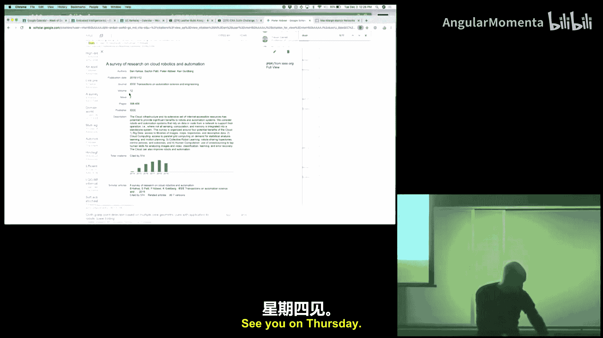

して。有し。どな。It。Okay。我系正如。

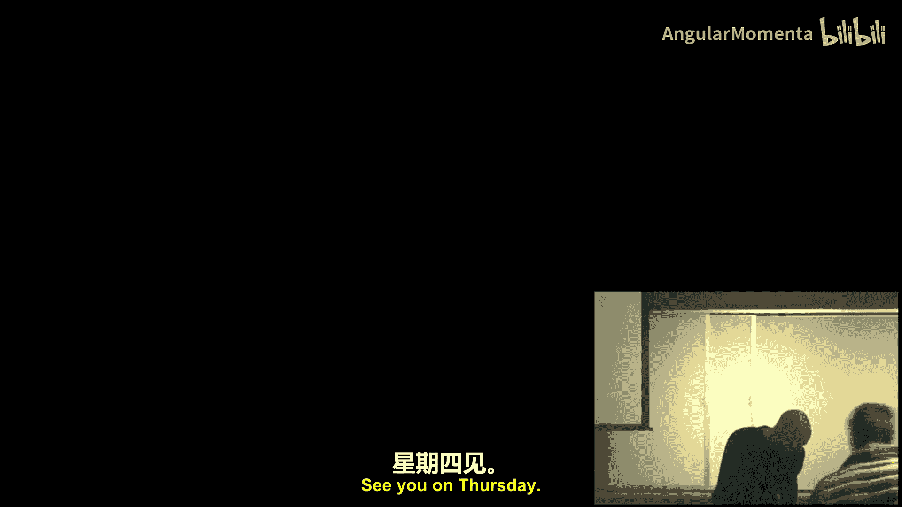

缺意。