# 【加州大学伯克利分校】高级机器人学-｜-CS287-Advanced-Robotics-at-UC-Berkeley-Fall-2019-p24-25-自主直升机--BV1KXqCB4Eua_p24-

To lecture 24， which will cover autonomous helicopter flight。 Also last lecture of the semester。

 we do have a couple other things left to past this lecture。 your homework 5 was due yesterday。

 but if you're using late days， you actually and if you still have your entire budget of late days left。

 then you actually still have till。This coming Wednesday。

 so you' have another six days if you want to， if you have enough late this left。U。

The other thing that's still in our schedule after today's lecture is final projects。

 So you should all have a slot for presentation， either a live slot or a。Video slot。

 the slots are on Tuesday next week and Wednesday。嗯。Beyond that， there's a final project report。

 which will be due on the 15th， which is a few days after your project presentations。

 And I think after that， its， it's all done。 at that point。

 we'll try to get all your grades back to you。 give you enough time。

 a couple days to do regrade requests If you know， anything seems off in our grading。

 And then after that we'll submit graces。 but we'll give you a timeline on that Piazza。

 Any questions about logistics。Yes。The presentations should be， I believe， but we should。

 I should double check that thatll fit by。 I believe it is all five minute presentations with five minute presentations with one minute change over time。

 So you should actually have five minutes assuming you can。

Get the other person out of the way and get set up yourself in less than one minute。

One quick thing actually about the slots because we wanted to maximize the amount of presentation time。

 we'll do the final project presentations on regular time， not Berkeley time。

 so the first presentation if the slot says I don't know three to five or something the first presentation will actually be at three if youre the first presenter be there before three so you can actually hook up and get started at three。

I don't know if it's three for your slot， but whatever the timing is of the slot。Yes。

 do you have any guidance on how much time we should spend on related work？B suffer first。Yeah。

 that's a good question because five minutes is very short。

 So what I would suggest is spend about maybe。One minute on problem framing。嗯。

Including put some citations on slides， so it's clear that。You know there is prior work。

 but you don't have to go into all the details of that work there's no time for it。

 but put the citations on there so it's clear you're aware and then that gives you a couple minutes to explain your approach and then from there you have another couple minutes to present experimental findings and conclusions from that。

Any other logistical questions？Okay then let's get started for today。

 so autonomous helicopter flight， especially what I worked on for my PhD thesis several years ago now。

 and this was our team at the time so on the left， Peter Digovich， our first helicopter pilot。

 then Tim Hunter who was a masters student at Stanmford at the time。

 since did his PhD at Berkeley now works at Data Bricks actually。

 then Adam Coates who was initially an undergrad on the project。

 then a master's student on the project， then a PhD student on the project。

 has since gone on to be essentially AI director of Baidu Silicon Valley Lab and from there gone on to he's leading a lot of things at Apple now。

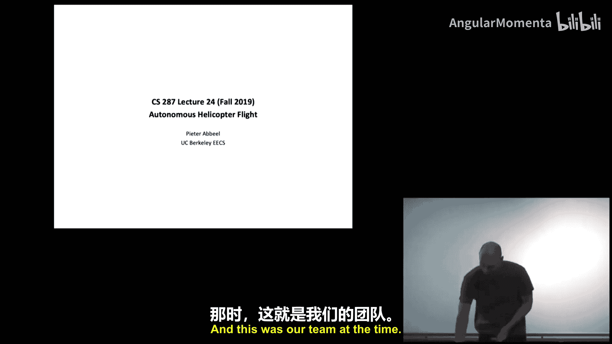

Then entering our advisor， then that's me 10， 12 years ago， Garret。

 our helicopter pilot we worked with for the last few years of the project。

 and then Ben Sey who was one of our early helicopter pilots also who actually was a graduate from Berkeley。

 worked in Ron Fings lab at Berkeley， but then at the time lived near Stanford and he was a helicopter hobbyist and so he was one of our pilots at that time。

Most days， though， I mean this was the day that all the news agencies came by to see what was happening in the project and as we' were wrapping it up。

 most days not everybody was there was just three of us just Adam me and then Garrett in the back slightly included here。

 but very important to save our helicopter whenever our computer control goes wrong。

 he could take back control and make sure failure in our control did not result necessarily in a crash。

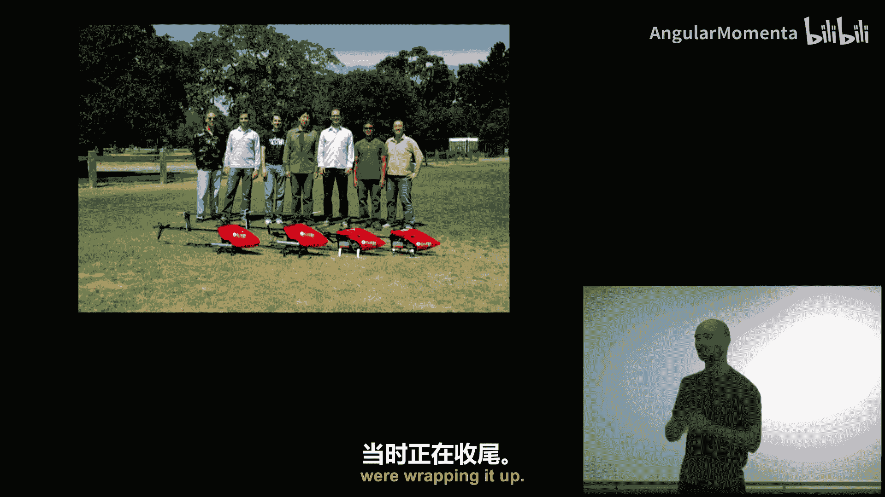

So what I thought we'd do today is I'm going to give you some sense two stories。

 first story is going to be the standard。Kind of。Paper story。

 I'll present to you all the cool things we did and how it all came。 how it all works。

 And then the second version of the story， which we'll do after that will essentially be all the things we did behind the scenes that don't often make it into a paper。

 but that actually also made it work。 and we'll step through that in our second path。😊。

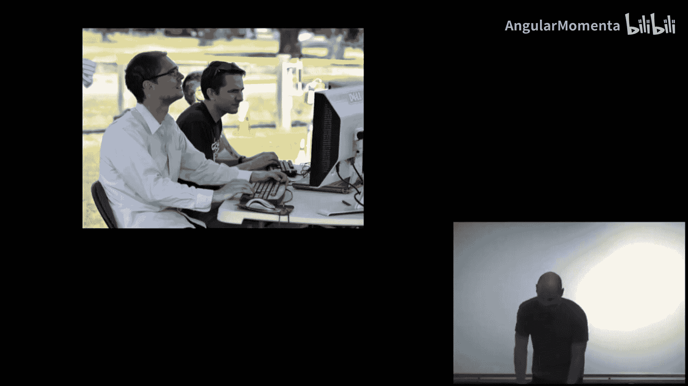

All right， So why is helicopterlic control a heart problem。 So at the time， essentially。

I would say to kind of position it a little bit。Reinforcement wedding was not that considered that successful。

 didn't really work that well。And。In general， learning hadn't been that successfully in showing much real world。

Success beyond what people could do otherwise so Andrew had been going around。

 actually entering had been going around while he was still at Berkeley as a PhD student and asking people okay。

If I want to show you that I've done something convincing with a real robot where machine learning really made a difference。

What would you want to see what's a hard problem and from that talking to a lot of the controls faculty at Berkeley。

 the conclusion was helicopters are the thing that's hard， if you can do something with a helicopter。

 then the controls people will。Be convinced that you actuallyher did something hard as opposed to。

 I don't know， maybe a card pole or something。So Andrew decided we're going to do helicopters。

And why was it considered hard？ I mean， now， as you might know， we kind of solved it by now。

 But back then， why was it considered hard， helicopter dynamics are unstable。

 unstable means that if you apply open loop controls， it's guaranteed to to kind of just。

Run away from you and not stay in the air。It's not just that it's unstable because， in fact。

 if you have an unstable linear system， things don't have to be hard at all。 You just have a。

 simple linear feedback controller for linear system， and it'll stabilize it。

 And you might be good to go。 but the dynamics of helicopter are nonlinear。

 making it much harder to deal with。 In fact， they're not just nonlinear because nonlinear is not necessarily an issue in itself。

 but the very complicated nonlinear。 In the following sense。

 when you think about helicopter dynamics， you might look at this helicopter body and be like， okay。

 that's what I need to model。 But really the complications is that the helicopter interacts with the world by pushing air around。

And the effects of pushing air around are very， very complicated。

 And so that's really what makes the whole dynamics so difficult。Now。

 in addition to the airflow being complicated， there is coupling， what do I mean with coupling？

It means that when you have。When you build a system and you have control channels。

 usually you assign your control channels a certain meaning。

 and you'd hope that when you apply controls along a certain channel。

 the intended effect will happen and nothing else will happen。

 coupling means that other things start happening too。So how do you control a helicopter， Well。

 a helicopter has four control inputs。 So well， how does it work， I mean， you have blades。

 The blades spin around and push air down， and the counterforest keeps the helicopter up。Now。

You might say， well， how much air do I want to push down。 Can I regulate that， Yes， you can。

 And naively you might think I'm going regulate it by the engine speed like the faster it spins。

 the more air I push down， the slower it spins， the less air push down。 that's kind of true。

 but kind of the way engines tend to work is that they tend to be pretty good at certain speeds。

 And tend to be designed to be good at a certain speed， and maybe not so effective at other speeds。

 So the engine and it's not easy to spin them up and down。

 So you're not very reactive if you rely on engine speed going up and down to control the thing。

 So instead the way it's control is by changing the angle of attack of the blades。

 as you make the angle of attack steeper， more air gets pushed down and you get more thrust。

 And in fact， you can make the angle negative and push air up and descend really， really quickly。

So that's one control。 That's a collective control。

 It's how much air you push up or well mostly down， but sometimes up。

 then what else do you want to do， you kind of want to not just stay up， you want to move somewhere。

 There's no way for a helicopter just move forward or sideways。

 You have no thrusters to do that What you can do is you can actually reorient your helicopter the helicopter is facing that way。

 nose is down now that vertical thrust is actually pushing backwards in the earth frame and you can fly forward。

 So to fly forward you've first got to put your nose down。 how do you put your nose down。

 there's something called cyclic controls。 and there's something called a swash plate on top of the helicopter here。

 and that swash plate essentially allows you to say I want different angle of attack left right。

 different angle of attack front back as the blade sweeps through the air。

 So the little mechanism there that regulates that as you go through cycling you have changing angle of attack throughout the cycle。

Then we'll make that you essentially end up exerting a torque on the helicopter that you can make a helicopter tilt forward or backwards or make it roll。

 left or right， depending on the setting of your roll and pitch cyclic controls。

Now that gives you the ability to stay up to nose down or up， left row and left right。

 The last thing you need is the ability to face in the direction you want to face into。

 that's what a tail rotor gives you tail rotor， also you control it by just changing an angle of attack which will affect the amount of area push and that way you'll be able to spin left or right。

It's actually more to the tail rotor than that。 It turns out because you have the main rotor。

 the engine has a torque。 There is a counter torque on the body of the helicopter from that main rotor。

And so if you don't have a tail rotor， your helicopter body will actually counterspin to the main rotor。

And that makes it very hard to control the helicopter constantly facing in different directions。

 and this would actually pi it very， very fast。 so the tail rotor's main function is something to just stabilize and make sure that you have a counter force for that tor that would otherwise spin you around。

 but in addition， slight adjustments in the tail rotor angle of attack will allow you to face different directions。

So you have four control inputs。 a simplified way to think of it is you have vertical thrust in the frame of the helicopter。

 and you have。Tque along each of the three main axes。But then what happens in terms of coupling。

 Well， imagine your helicopter is going you want to fly forward。 So what you're going to do。

 you're going to put your nose down and then now you're going to fly forward。

 you think what happens next is well， as you fly forward。Blade's going around。

The blade is going around on this side， moving forward with your helicopter。

It's actually getting more airflow than the blade that's going back。So you actually。

 even though you did not intend to generate any kind of torque around the body of the helicopter。

 you actually are because of the differential airflow between the。Bde is going forward。

 The blade is going backwards。 There are other things in that mechanically。

 as the blades go around and you have different angle of attack， it actually doesn't work just like。

 oh， steep angle of attack， more air pushed down。 So actually now I'm going go this way。 No。

 actually the way it works is steep angle of attack。 blade goes up a little bit。

 the swash plate is spring loaded。 And now actually the nose of the helicopter goes up。

 And so it's actually 90 degrees out of phase you'll have。😊。

Sepper angle of attack here to then be up here and the spring loaded will follow and those will go up。

 Now does it follow exactly 90 degrees and how do you make sure that' so tune。

 those things you need to configure as you set up your helicopter， Of course。

 they're not going to be perfectly set up。 as that bladelaze going up and down there'll be oscillations and so forth。

 And there's a lot of coupling between the different things you're trying to do。

Then in addition to the dynamics being complicated。

 the state estimates are not going to be very precise for a helicopter。

 you don't have exact position， you don't have exact orientation， you don't have exact velocity。

 the exact anglengular rate instead you get noisy measurements of some subset of these that you can hopefully fuse in maybe a common filter。

 a particle filter， comma filter， its more appropriate probably because it's a unimmodal problem and comma filter is a very good for unmodal estimation。

 you fuse that information to hopefully get out a reasonably accurate estimate。Now。

 when we started working on this， there had already been a bit of success on hovering and forward flight。

 and here are a few of the works that were happening at the time， a lot of NA controls groups。

 some out of Berkeleys， some out of MIT， CMU， some universities in Australia。

And when you looked at the trend， actually there was no real trend except that they were all doing hover and forward flight。

 but the methods were wildly different。 Some people say you need an inner outer loop PD controller with some hand and automatic cuning。

 some people say you need to do you know LQR control， H infinity control， H1。

There was all kinds of control methods people applied。

 and ultimately they all did the same thing the helicopter was hovering or flying forward。

Which in itself is actually a hard problem because when you think about it。

The way helicopter dynamics works。If you think about maybe an analogy that you would be familiar with。

 imagine you have just a plate。And you put a perfect sphere， a marble on this plate。

 and now maybe there's wind guss and things that kind of jerk this plate around a little bit and while you have those wind guss and things that are jerking around。

 including the bladeze not being perfectly balanced and jerking your helicopter around。

 you're trying to stabilize that marble on top of that plate and that's what makes hover so hard。

 you're constantly have perturbations， we need to then compensate for them in the right way to make sure that marble doesn't roll off。

 that's extremely similar to controlling a helicopter and hover and that's why people are saying this is very。

 very hard。It turned out the most precise hover controller achieved at the time was this one here by entering as a PC student at Berkeley。

 he had a reinforce learning approach that was able to stabilize it extremely well。

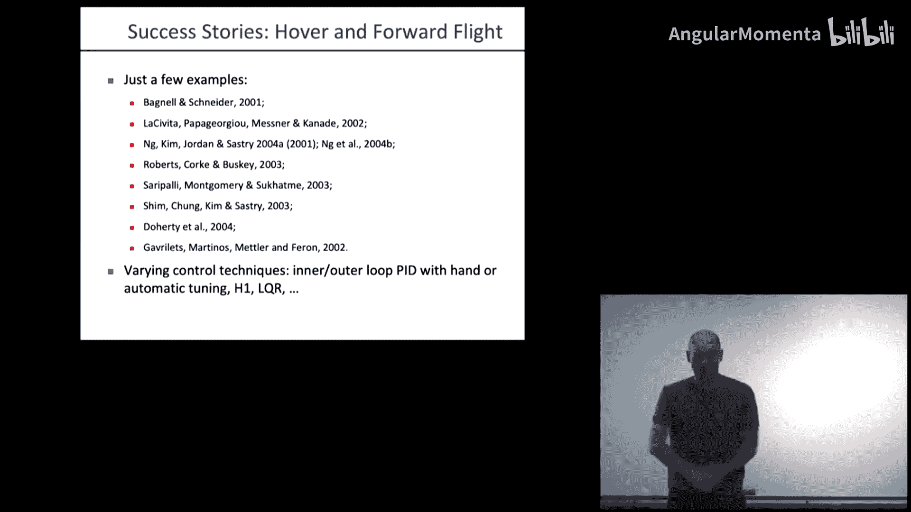

Then he came to Stanford as a professor， he said， let's see what we can do。

 and here was the first result， this will turn normal colors。

 this is the first result achieved there after two years at Stanford shows a helicopter hovering but hovering upside down。

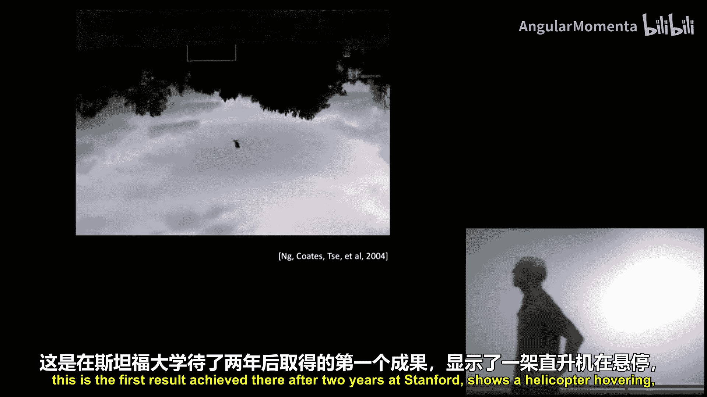

So this is now stabilizing in a more difficult regime than regular hover。

 Now a couple of things here。 how much harder is this I would say it's a bit of the difference between having a marble on top of your plate that you're trying to balance while you're being jerked around by wind and imbalance in your helicopter and so forth to now going to a heavy body on top。

 so it's almost like you put a broom on top of your plate and now you're being jerked around and you're still making sure you're balanced that broom at all times。

 so it's a lot harder do not though that。It's the camera that did the flipping and what we watched here。

 right， it was not we did not see the helicopter flip。 Now the helicopter was flipped， of course。

 otherwise it wouldn't be in this configuration， but it was flipped by a pilot。

 a human pilot flipped the helicopter put it in a steady state inverted hover and then the autonomous controller to Co。

And so when I joined the project was right around this time after this had happened and the question we asked ourselves was can we do more。

 can we autonomously flip it instead of having it prefpped and more generally。

 can we go to the full flight envelope， the way humans can fly these helicopters and so one of the videos that was very motivating for me at the time is this one here。

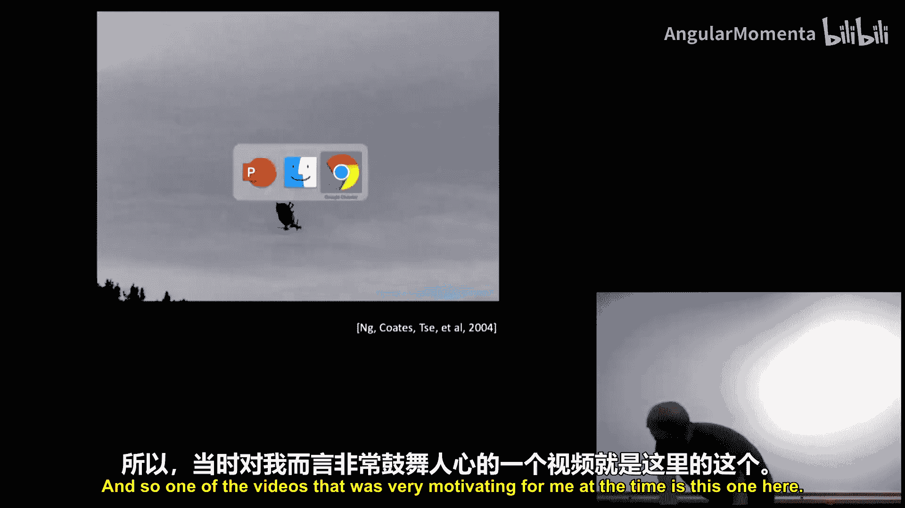

R C helicopters are this kind of hobby thing that。

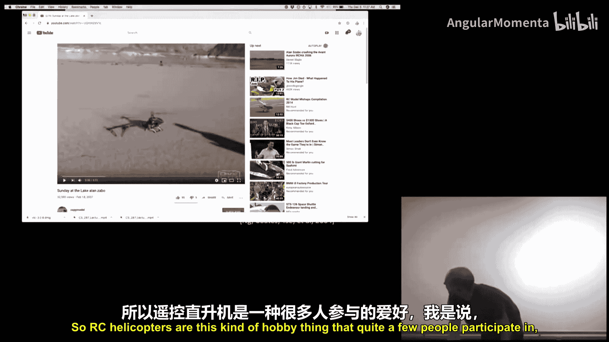

Quite a few people participate in and there's， I mean。

 some people are known as like the best pilots in the world and Alan Zbo at the time。

 Pra still now is known as one of the best pilots in the world for RC helicopters。

 So let's get a sense of what it means to be one of the best pilots what happens when such a pilot flies a helicopter。

嗯。Nothing autonomous here， just to be clear， is a human pilot。One of the best in the world。

You can see it's a lot more dynamic than what we saw in the hover video。

 there's a lot of upside down happening too。Traveling TikTok。嗯。

Essentialially every other second a new maneuver is happening， there's very little steady state here。

 contrast that with the state of the art at the time an autonomous helicopter flight where essentially the only things that had been achieved was steady state flight regimes hover inverted hover and forward flight and this is just essentially anything this helicopter that can physically possibly do many things you couldn't imagine that this thing could do。

 it's actually doing no problem。Let me go a little further towards the end here。

If you want to look up this video called Sunday at the Lake， it's flying upside down。

 it can do upside down also he does it close it to the ground。

 which makes it more dangerous if you do anything wrong， you lose it。嗯。

So this is essentially what we were looking at and we said， okay。

 this is definitely at a whole different level than anything that's been achieved so far in。

Any of the。Autonomous control results。 So let's see if we can get anywhere near that。

That was the goal for our research project。

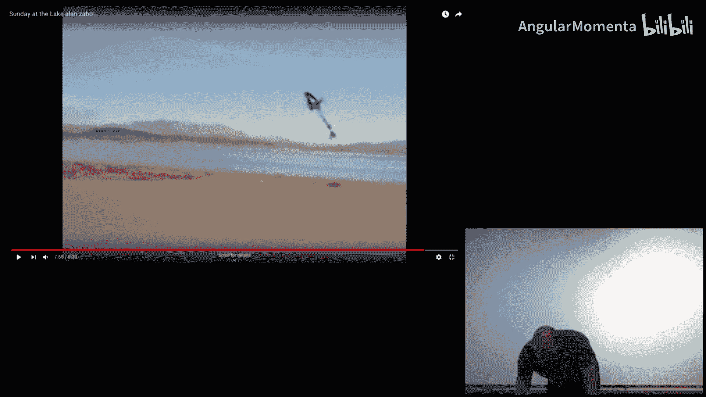

So。嗯。

Next thing we did said， okay， well， let's try， what do we need to do？Well， clearly。

 we need to find a different trajectory than hover or inverent hover。

 So we're gonna to just pick a trajectory。 maybe look at this video and say， okay。

 maybe all have just fly this trajectory。 and then we got to run something to find a controller。

 So it's okay， well， what can we do to write a controller well。Maybe what we can do is we run LQR。

 we have a trajectory， we do LQR regulation around the trajectory。

 and hopefully we stay on track and we execute this trajectory and we're done， I mean。

 we have our solution and we have a cool video and our paper and we're get to go。

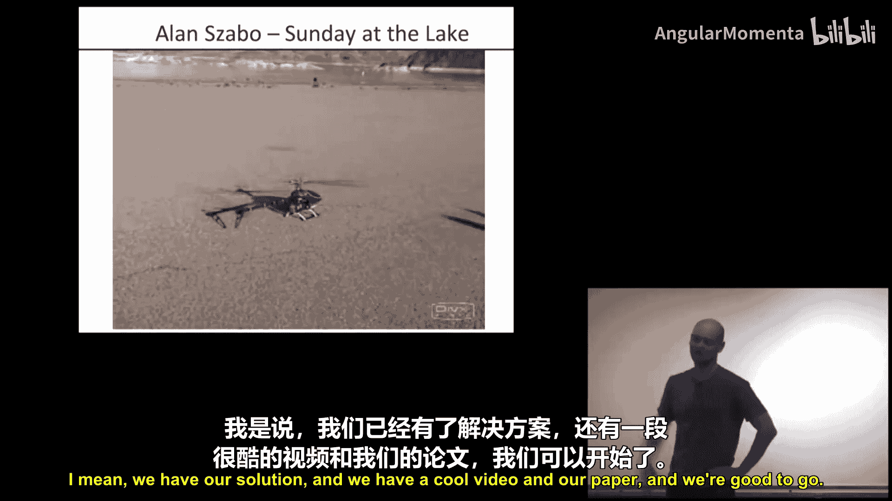

So that's what we tried。Let's watch this in action。

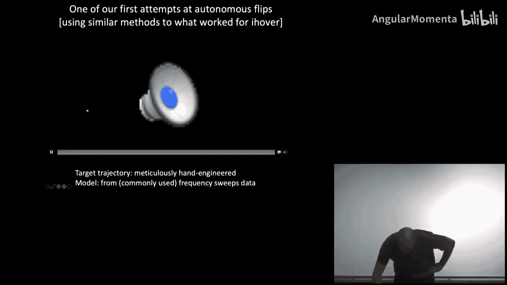

This is autonomous。Hovering， flipping。Pretty dynamically flipping。

 but it's not really staying in place， which it was kind of supposed to do。Then the engine died。どうす。

Helicopter disappeared。so a lot of things went wrong here。

 but let me first clarify what actually happens。We're flying this helicopter autonomously。

We're trying to follow this flipping trajectory。We deviate。What happens next。

 our linear sequence of feedback control， Our sequence of linear feedback control is this like not so great anymore for where we are now because we're off the trajectory what it's designed for。

 So it kind of starts doing even worse。 and it starts us oscillating very big flips around the target trajectory。

 At some point， it pushes the controls so hard。😊，Then。

As the engine's trying to push the blades through， it actually can't。 It can't provide the torque。

 the engine stalls out。And that's it。 En stalls out， no controlling more over the bladelaze。

 can't push them around anymore at that point。Well， we lose control。 Heopter drops out of the sky。

 Now， it actually then actually even dropped， chemistry had dropped。

Looks like it dropped into the trees， but actually the crazy thing that happen is our helicopter pilot。

 Garradoku at the time。He see by the way， we told him look don't they control back too quickly。

 want to really see how all this works， so he's like， okay I'll have patience。

 he saw this was going wrong， he's like they asked me to wait and see what happens when the engine died。

 he's like okay， clearly they lost it， he said okay， look。He took back control actually。

 after the engine died。 so he after the engine dies。

 you can still control the angle of attack of the blades。 that's electric。

 So he controlled the angle of attack of the blades。

There was still a little bit of inertia in the blade， just a little bit of inertia。

 It's still spinning just a little bit。 It controls angle of attack in a way that they can start spinning up again。

Rorients the helicopter。Helicop helicopter goes behind the trees。 It's still on its side。

 He can't see it anymore。 but he knows enough。 He just knows so much about how his helicopters work。

 muscle memory， everything。 He actually gets it fully oriented and it lands on its feet behind the trees。

 Now it landed with much too high velocity to fully survive the landing。

 but kind if there had been a person inside。 in some sense。

 maybe it would have survived because it landed on its speed and at much lower speed than dropping like a rock out of sky。

 essentially auto rotated that helicopter into a landing。

 auto rotation is where you essentially engine off and still managed to land your helicopter The reason it couldn't fully safely land is because the blades were going so slowly and the helicopter was not high enough up to regain enough blade speed to regain full control。

 But in principle， you can fully control a helicopter without engine if you're high enough up。

 you can get the airflow through the blades to spin up the blades。

 which again then in turn gives you control over the torque you apply to your。Helicopter。

 so very interesting。 Our pad was able to land that and then fix up the helicopter later， actually。

 which was。😊，Completely crazy that that was even possible after we lost control。

That's what like the state of。they just。So there's different setups to pilot his helicopters。

 Garrett here was just looking at it， and he's just standing on the ground。

 roughly the same viewpoint as a camera， not exactly the same viewpoint。 He's just looking at it。

 He has a remote control。 and the remote control allows him to choose who's in control the computer So our controller or he and at some point when the engine died。

 he flipped it to him being in control。 But yeah， he just watches it all the way as it's moving。

 and then at some point he decides， take back control。 obviously he couldn't save it。

 but it's because we told him let's see if it can actually succeed。

 don't take back control this time too soon。There are these days other setups where you put a camera on the helicopter and you then wear goggles and you look through that camera。

 I don't know if that's any easier， I think probably it's more convenient if you can't see the helicopter anymore of course。

 and it might be more fun， but I think if the helicopter is in your line of sight it's probably easier to do it this way。

So。We essentially followed all the descriptions what you're supposed to do to control a helicopter。

 but it didn't really work。So that's a good starting point to do research。

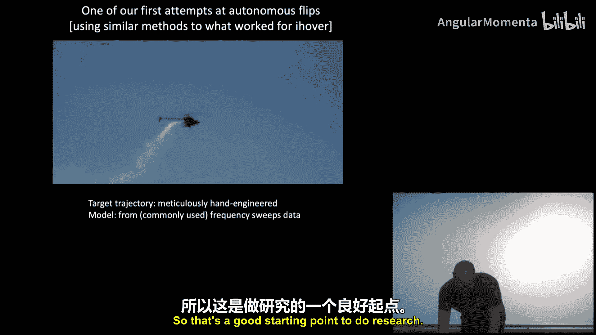

Think about what's different about what we did versus what was done before。

 I wanted to do what was done before。In the past， people looked at hover and stationary flight regimes。

 restrict attention to a specific flight regime， what you can do is you can collect data in that flight regime。

And then you can build a model， even a linear model， potentially then。

Build a controller around that linear model。 and you're good to go and get successful hover。

 inverted hover and forward flight。But for aggressive flight maneuvers。

 there are additional challenges， namely， it's not even clear what the trajectory should be。

 the trajectory we chose for the helicopter to follow was actually not flyable。

 and so of course it was going to deviate and it's not going to succeed then because it's not flyable。

Dynamics model， how do you get a good dynamics model when you're in a nonstary flight regime。

 because at that point， it's much more complex to all dynamics of the helicopter than when you're in a single flight regime where a linear approximation is often going to be good enough。

So we looked around and was there any place where somebody had done anything？

With a helicopter in a non stationary flight regime。

 and we found this paper by Eric Fn's group at MIT， showing three non stationary。Muvers。

 a split S is where you， you're flying forward， you。

You do a half roll followed by a half loop as a way to change direction without burning your energy to friction。

 Snap actual roll is just you spin around your forward axis。

 and a stall turn is you're going forward and then you climb。And then spin your tail around。

 come back out， another way to not burn your energy to friction while being able to change direction。

And so the key there seemed to be that they had a lot of expert engineering of controllers after human pilot demonstrations。

 they would record human pilot demonstrations and they would record the angular rate of the helicopter at all times。

 the velocity of the helicopter at all times， and then would say。

 okay since the human pilot had this angular rate， this sequence of angular rates and this sequence of velocities。

 we're going to ask our controller to just regulate around the same sequence of angular rates and velocities because they should be flyable and see what happens。

At the same time， there's also a lot of people saying， well。

Maybe that's not too different from just recording the human pilot's controls and just replaying them。

Maybe you can just replay somebody's controls， but nobody really tried that。

SoBut after a year or two of work on the helicopter and the best result we had was this flipping that kind of partiallyel succeeded but then would crash we said let's try what we would call Sunday not at the lake but Sunday and open loops。

 it went out on a Sunday to one of the soccer fields there and we said。

 let's see what happens if the only thing we bring out no instrumentation it was a helicopter we had never flown before autonomously we just said we're going to just record the sequence of control the pile of the p and essentially have a tape recorder and play it back and see what happens and that's what we did so we said okay let's just play it back see what happens。

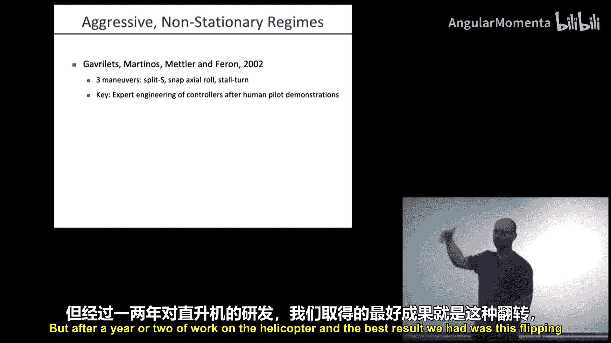

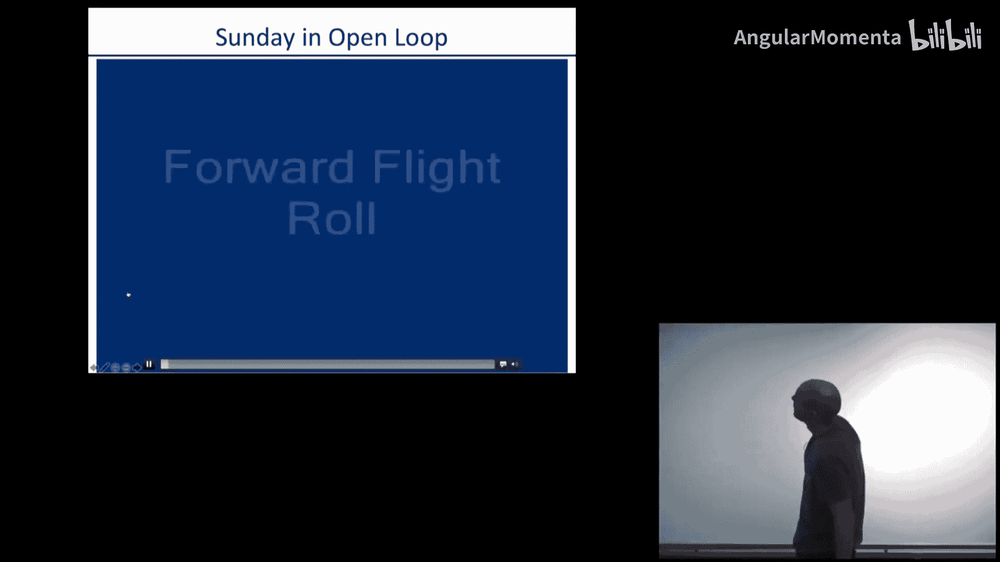

Pled to the fourth flight roll， we recorded that， we played back。

And then we actually get a Ford fly roll。 You can see a bit of a dip there。

 It wasn't like a very precision， high precision thing to do， but it did get the maneuver， right。

And there you go crazy split us。 So a half roll followed by。Half loop。

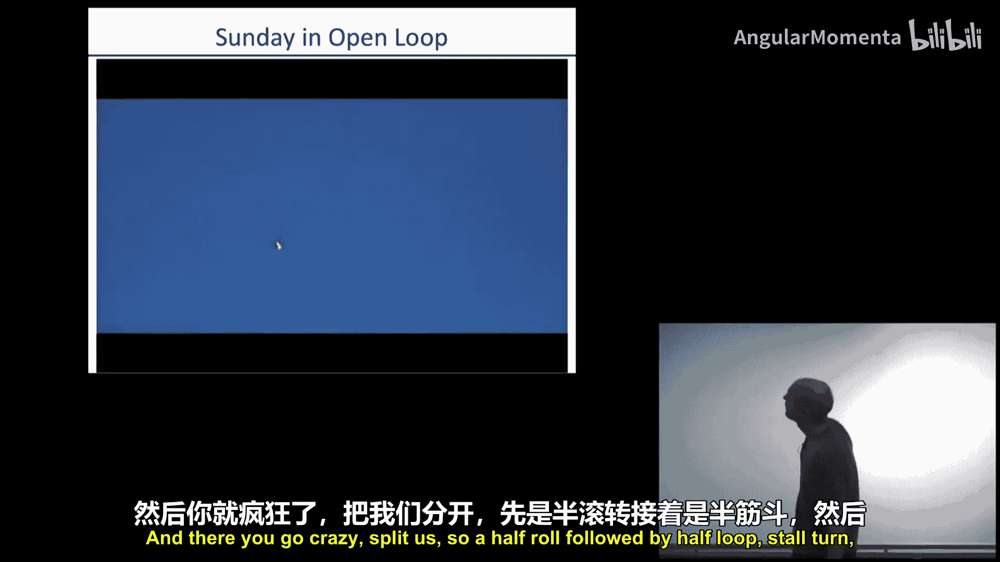

Stall turn。

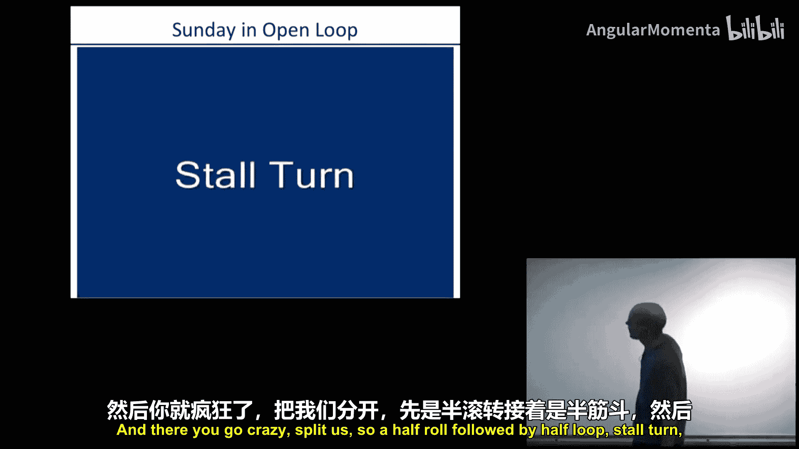

And so at this point， we're probably a half hour into that day and about two years into the research project。

 but a half hour into this day， we actually have completed three aobatic maneuvers beyond what we're able to do before。

We did all the ones that were done before by Ferone's group， said， okay， what else can we do。

 We recorded a loop。And we played back the pilotd controls， and it did a loop。Then we said， okay。

 well， let's keep going。嗯。Second loop。You can actually do two loops in a row and still up in the air。

We thought about takeoff。Okay you just replay pilot controls to do takeoff。Bldes spinning up。

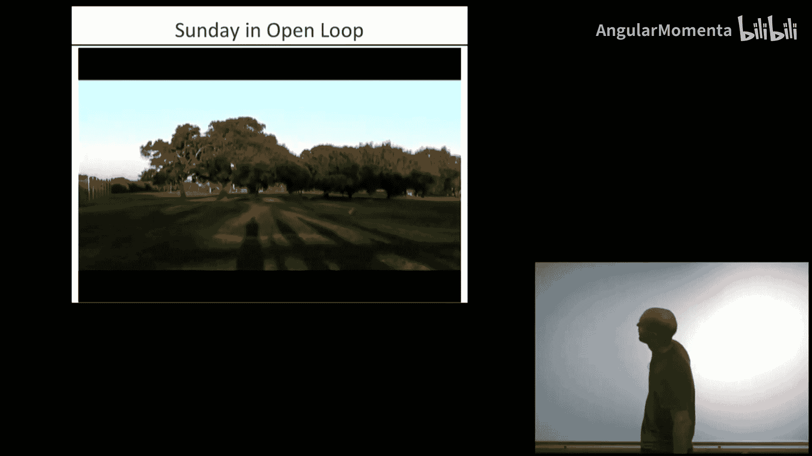

And there it is。Taking off。How about inverted takeoff？

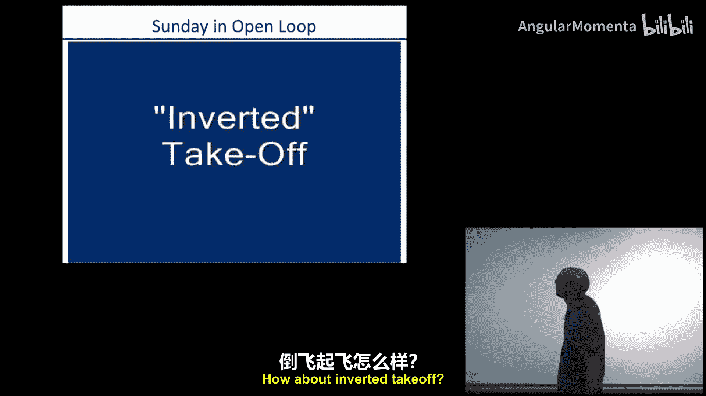

We spin up the blades and we're going to flip it 180 right after takeoff。There we go。

 and there we were flying upside down。

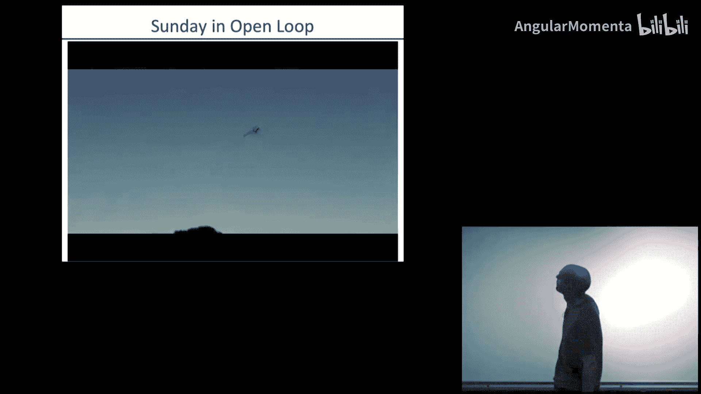

Just， you， about an hour of effort。 there were a few things that didn't work though。

 there were definitely limitations。Hover。

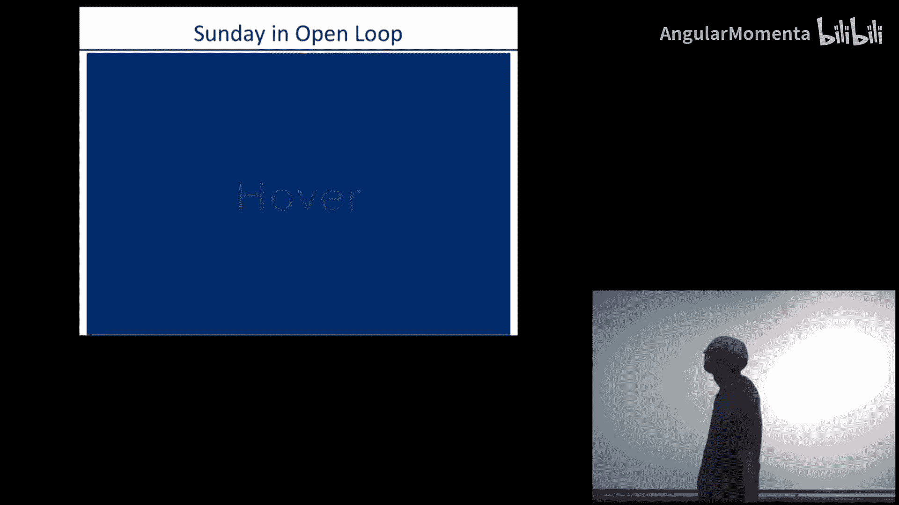

If you actually want to do a stain hover， it's not going to happen in open loop。

It's it's just drifting away and it's going to end up completely somewhere else then where you started。

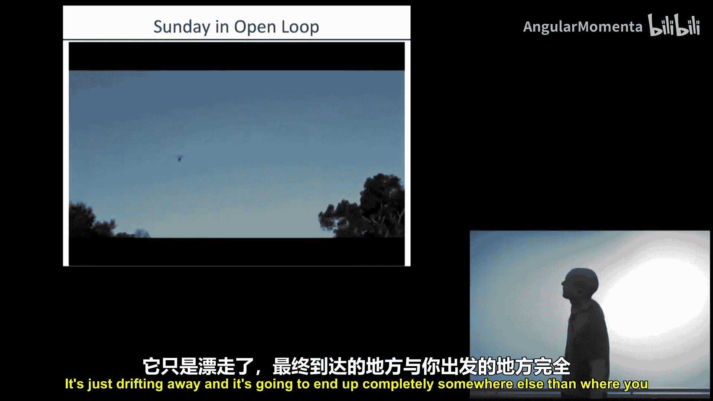

TikTok， while they can say one of the hardest maneuvers。

 where you kind of go back and forth like an old school clock。

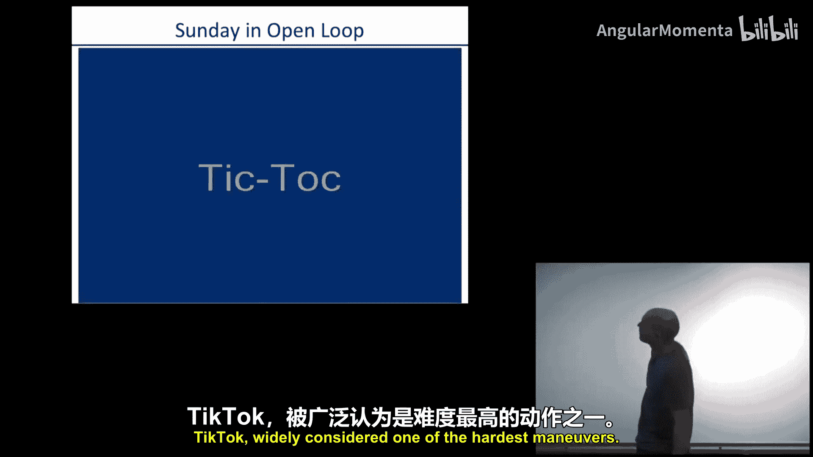

We're doing the TikTok， but it's descending very rapidly while it's doing that。

 it's not able to maintain its altitude。Chaos， which is often can see the hardest maneuver。

 You spin your tail around as quickly as possible while flipping and rolling that we got the gist of a chaos。

 but we didn't get any kind of control over where the helicopter was。

 And it was just moving all over the place。 and was， I mean。

 we had to put it very high up to even be able to try this。 So in some sense。

 the lesson learned here was。 Oh yeah，If you want to just get the gist of a maneuver and you're high enough up。

You can replay controls and it'll actually get the gist。

 But if you want any kind of precision while executing those maneuvers。

 Open loopop replay is not even going to get close。

 And we had tried to something continues like keep flipping Sure you get flipping。 And in fact。

 I would say the flipping by open loop replay is slightly better than the flipping we had in that previous video。

 And much simpler。 just replay the pilot controls。 but it was still descending over time。

 And at this point， the pilot took control。

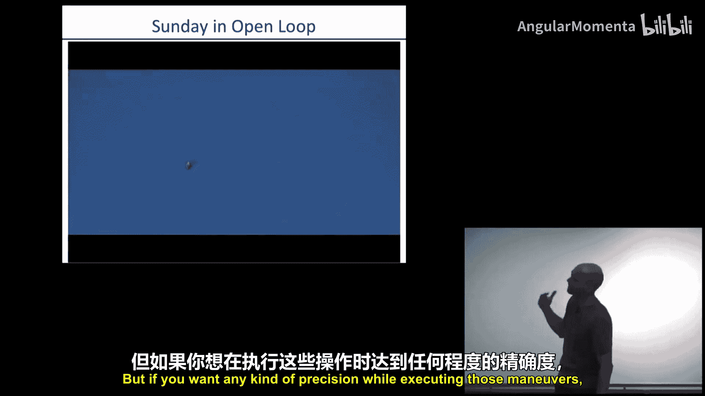

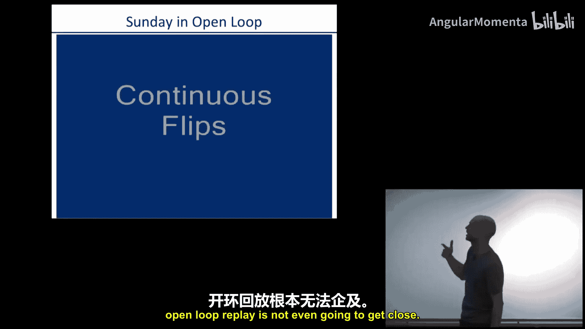

So lesson learned was that。

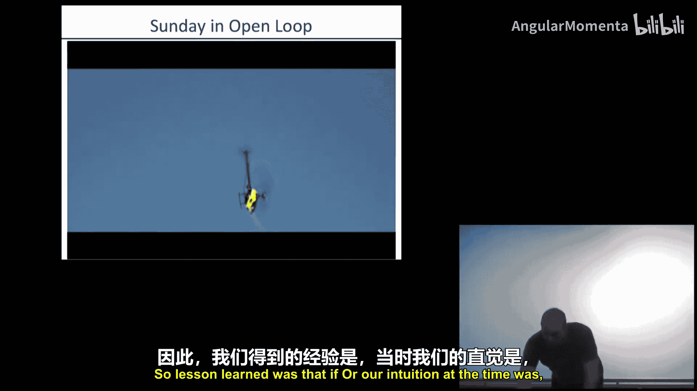

If。Or our inition at time was。If we can model our controls after the pilot demonstrations。

 maybe through machine learning to also get feedback into it and so forth。

 we should be able to do quite well compared to these hand design trajectories and controllers。

 and we should may be able to do aggressive manures not only one。But many in rapid succession。

 may be something even close to the Sunday at the lake video。 So the first step was。

 we needed a target trajectory。Tyts are difficult to specify by hand why。

 because helicopter dynamics are complex， and so hard and it's not just like a rigid body model that's complex it' airflow that's very hard to get the right intuition for。

Our solution was collect demonstrations of this knew was because we knew that that would be things that can be flown。

 but the challenge is that if you get pilot demonstrations that often not any single demonstrations is exactly what you want。

 so what should you do well collect many demonstrations and then run some kind of probabilistic inference to infer a cleaned up version of those demonstrations。

There's two reasons the pilot demonstrations are imperfect。

 one is that they just don't execute exactly the way they might want to。

 two our sensing is imperfect， and so even if they did a perfect demonstration。

 the recording we have of that trajectory after running our common filter and so forth is not going to be super precise and so we want to also smooth that out across multiple demonstrations。

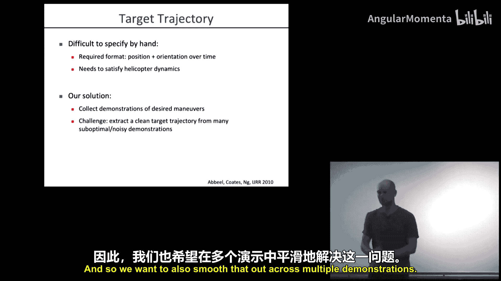

So here are our expert demonstrations。And this is for a specific sequence of maneuvers。

 all these helicopters Now this is the result of expert demonstrated in real world。

 where're in our common filter and smoother and now we're watching the result of the common filter smoother for each of those demonstrations replayed in this graphical interface。

 and we see they're all doing the same thing。 They're doing loops now。

 but they're not doing it in the same timing， and they're not doing exactly in the same place。

 There's definitely variation。

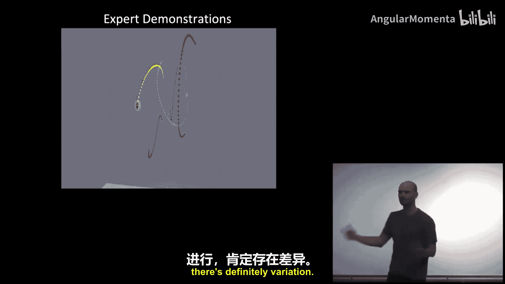

So you want to turn this into a single target。😡，How are we going to learn this？ Well。

 what's the natural thing to do here？ How do we set up probabilistic inference for this。

Temporal sequence， so might want to look at the HM like model。When we assume。

There is some hidden sequence we don't know， which is a sequence of states the helicopter actually should be going through。

And that should satisfy helicopter dynamics， which you don't know perfectly。

 but maybe of an approximation for。And then there are demonstrations。

 which are approximate measurements of what we want the helicopter to do。

And then we should be able to just have the measurements hook it up。

 run let's say an extended comma filter and smoother and get out the hidden state。

 But the timing isn't aligned for those demos。 So we've got to do something extra。

 How do we align those demos。Well， if you only have two， you can align those two demos。

 but in practice we had more like 10 demos and aligning 10 demos is very hard to do 10 trajectories alignment is a very computationally expensive problem。

 Well you can do is try to align each one of the demos to a single master trajectory and get alignment that way。

 And so in some sense we had chicken and egg problem here， we don't know the master trajectory。

 Yeah but if we knew it we could align them all to it And once they're aligned。

 we can run a common filter smoother to get the estimates for the hidden trajectories。

 That's what we did we said okay let's just somehow fill in something。 maybe pick one of the demos。

 put that in the hidden。Then we run something called dynamicy time Warping or Needle Men Woch。

 which is a dynamic programming algorithm to do sequence alignment， it's used in biology。

 it's used in speech and we use it for helicopter trajectory alignment。

 it's been around for a long time， it gives you the optimal alignment against some cost function that you specify。

And then after you've done that， you hide that trajectory because it was just one of the demos。

 And now you infer。Through a common folder smoother， what it should be。

 But now the alignment was kind of ad hoc initially。 So May wasn't the best。

 So let's get rid of the alignment。And realign against our new estimate and repeat till this process reaches a fixed point。

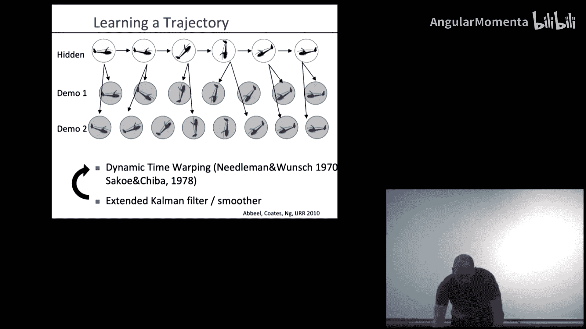

Once we do this long enough， and usually five to10 iterations， here's what we get。

 We get all the demonstrations aligned。In time， and we get the white helicopter here is the estimate of what the pilot's intent was。

 what we might want to fly ourselves， which is a cleaned up version of any single one of them。

So that's what we're going to want to fly， let's take a look。诶。

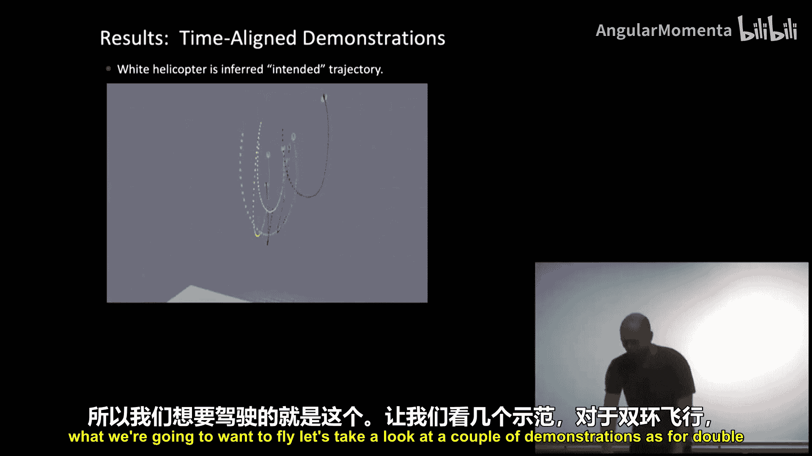

A couple of demonstrations， as for double loop here， we did it for the full air show。

 but let's look at the double loop specifically here。

These are demonstrations after you run the approach I described the dynamic time warping with commmo filtering smoothing。

 here's what comes out。You can see it's a much clean di version。

 there's no prior in there about needing to be circular or anything It's just the demonstrations in themselves explain that likely a double circle is what you would have wanted。

 Look at the purple one that kink at the top is not likely to have happened in the real world。嗯。

That's probably just the state estimation error because we maybe had some imprecise measurements at the time。

 but that all gets cleaned up in this process。So now we have a target， once we have a target。

 we need to find a controller to control around that target trajectory。

While let's take a look at our dynamics models， we would work with the standard dynamics models for helicopters and tune some parameters based on data。

 and then we'd look at okay， here's a trajectory， our helicopter flew for every time step。

 let's look at the predicted acceleration by our model and the actually experienced acceleration by the helicopter。

See what the difference is。This is the difference， so vertical axis is acceleration error。Zero is。

 of course， where you want to be。10 is 1 G，30 is 3 Gs。 So you see that throughout this trajectory。

 at some point， this standard dynamics model is off by 3 Gs。

Three times force of gravity is how much you're off。 might wonder what does that mean。

 It all depends on how much control your helicopter has。 if your helicopter has100 Gs in control。

 3Gs off is easy to compensate for because the Z axis it has control on the Z axis。

 But the helicopter has less than 3Gs of control。 So a 3G error in anticipating what's going to happen to you is actually a real problem。

 And that's really why we had that。Crsh， big reason we had that crash that I showed you is because。

 yes， we did all the right things in terms of， you。

 iterative LQR against our model and find a sequence of controls and so forth。

 But it was against a model that was so wrong that had errors in it like this。

 And if you are going to run your LQR optimization against malls that are so wrong。

 you're just not going to get a good execution。Now the interesting thing。

Is that we did that experiment where we replayed the open loop controls from our pilot。

It flew roughly the same thing every time， not at a precision level。

 but at a kind of high level gist， it was the same。

So we concluded that maybe if we compare many trajectories。

 the error will be consistent and indeed that's what we saw。

 So as we had the pilot fly the same trajectory multiple times，😊。

And we looked at the error the model had along that trajectory， there was a pattern there。

Once you run the alignment procedure。This is what you get。

 and you can see actually a very consistent pattern in the errors。

 So what this is showing is that the standard helicopter dynamics models we were using that come from textbooks。

 which are， of course were designed for stationary flight regimes。

That's what they had in mind and the helicopter is doing acrobatic maneuvers。

 so obviously they're not going to be perfect， but they're highly imperfect， it turns out。

 but highly imperfect in a way that is very consistent as you execute the same maneuver over and over and over。

 you get the same errors happening along different rollouts。

So what this means is that there's actually a decent amount of determinism to this process and that maybe the only thing you need to do is say well。

 maybe I cannot build a perfect helicopter model， but maybe what I can do is for this specific sequence of maneuvers at each time slice I know how much I'm going to be off I know that's pretty consistently the case I can just insert that offset and so essentially do a very simple model correction that is my acceleration of time T is off by this much。

 I'm going to add it in that now when I in my LQR against a new model it anticipates those errors and knows they're going to be coming。

So。The reason you could expect is the that our model does not very actually capture the airflow。

 but the airflow is still a physical thing that might be consistent as we do the same thing over and over。

 same for actuator delays。 We don't model them， but they might be consistently behaving the same way。

 And so in some， there are hidden variables。They are not part of our state。

 but apparently those hidden variables， you can summarize the effect on the state we actually track in a very consistent way。

So we set up a locally weighted regression， so instead of fitting the parameters on all the data。

 one set of parameters， we said okay at every time slice， we're going to use the data that's nearby。

 so we have a bunch of aligned trajectories some all the aligned trajectories and you look at that time slice。

 look at nearby data and fit your parameters specific to that time slice。Once we do that。

 here's what we can do。 so here's the full setup， we have a helicopter。

The helicopter has sensing on board a microtrain 3DM Gx1， which senses had。If you're in a 33 Htz the。

It has three axis's accelerometer，3 axis's gyro and3 x's magnetometer。 What did they do。

3 xs accelerometer measures acceleration， actually is a little more cell that。

 Accelerometer measures。😊，Acceleration relative to as if you were free falling。

 if you're free falling accelerometer measures。Zero on all axes。

 but once you resist free falling in any way， accelerometer measures that。so in some sense。

 let's say you're sitting on the ground where you're resisting free falling by sitting on the ground then。

You will know which direction gravity points， and so it's in some sense a way to know more about where gravity is pointing。

Then， the magnetometer。We all know about compass compass will tell you which direction is north。

 technically not exactly the north that we see on the map。 the magnetic north is about， I believe。

 15。5 degrees off from the north on the map， but we know for every location on Earth。

 which direction the magnetic field is pointing。 It's actually it's not just along the surface is actually goes into the surface of Earth mostly。

 So most actually is' a z component， but you can actually then measure。For accelerometer。

 how it's aligned relative to the magnetic field。What you don't have。

 it'll say the magnetic field is pointing down，ll say out then you don't know your rotation around the magnetic field axis。

 but you do essentially know two out of three degrees of freedom of orientation from the magnetometer。

Then the jarros gives you angular rates around each of the three main axes。

 so a lot of orientation related measurements on board。

 we had a RPM sensor which measures the speed of the blades。

And then a sonar which can measure distance from the ground。

 we also had cameras looking at the helicopter to know where it is。

 So once you have two cameras you can triangulate， if you're detect it in both camera views and know where the helicopter is in 3D space and all that information gets fused into an extended common filter。

 which is then outputing state information。Then since we have a target trajectory。

 we can run receding horizon control against that target trajectory。

We ran receding horizonoriz control at。20 Hz。 So every  one，20 of a second。

 we re optimizeimized our sequence of controls more specifically around iterative L QR。

 So we would essentially。And at any given moment， we were run itqR with a two second look ahead。

 So 40 time takes into the future look ahead。 ItQR a bunch of iterations that we find our new sequence of feedback controllers。

 execute the first one and repeat Why two seconds look ahead is the first we could look ahead in the budget we had。

 if we try to look ahead further， let's say5 seconds or 10 seconds， ItlQR would take too long。

 and then you have a lot of delay before you know what controls you want to send。

 And if you have a lot of delay control becomes a lot harder。

 You want high frequency control to have better performance。 So we could only look two seconds ahead。

 We did a bit of a calculation in simulation where we can slow down the dynamics of the helicopter。

 And so we found that looking5 seconds ahead would have been ideal。

Because after five seconds against the mall that we have。

 it would always have steered back onto track。After two seconds is not fully back onto the target。

 Once you fully it back onto the target， looking further ahead doesn't do anything for you because I mean。

 you assume you're on target and you are on target in the future。 So that's it。So ideal。

 we'd have looked five seconds ahead， we couldn't do it with compute budget at the time。

 What we could do though is we could do a pre calculationc， we would do itLQR ahead of time。😊。

Find a sequence of cost to go functions。 And so our two second look ahead was capped off by a quadratic cost to go function。

 and because we were close enough after two seconds to the target。

 that quadratic approximation of cost to go was good enough to essentially be as good as using the five second look ahead if you had more compute。

Then the controls would go from a compute box into the back of the remote control for the helicopter。

 and if the pilot let them through by he has a specific switch to let things through。

 then it would be sent to the helicopter and then process repeats。

So the full procedure would be something like this， we collect some sweeps。

 which is kind of you move the controls at different frequencies to get some understanding of the range of dynamics that's present in your helicopter。

Then we learn a dynamics model from that， then our pilot demonstrates the air show several times。

We learn a target trajectory。We learn a dynamics model。

Then we find optimal control policy for Learn target and Learn dynamics model。Automy F Air show。

And then we do yet another step they haven't talked about yet。

 but essentially at this point it would actually work， but it would not be super precise。

Because the dynamics model was still from the initial data collection。So it'd actually get。

This data sometimes do model based RL， but in a very specific way， get the data from this execution。

 improve the dynamics model， and repeat。And about an hour time。

 we could learn to fly any new maneuver this way。

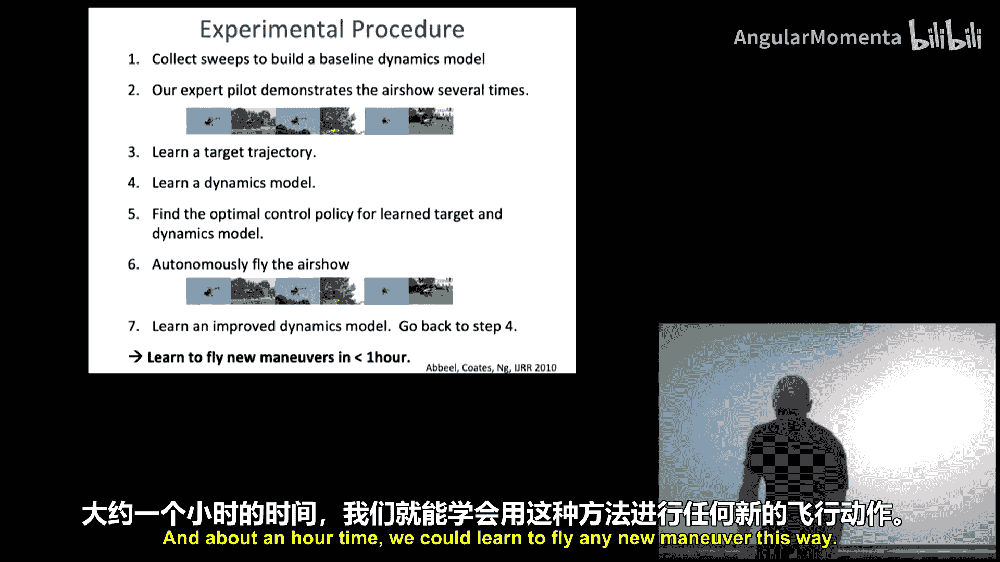

So here is this in action now， so fully autonomous。Take off。Inversion。Hover and so in this air show。

 we specifically chose to do all the things anybody had done before in the first few seconds。

 so we did hover， including inverted， did。

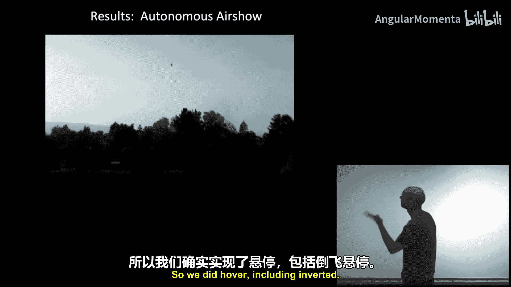

Here For flight， split us。Snap roll。Install turn。And then we do new maneuvers that were never done before autonomously。

 So within did loops。 if you are in good control of your helicopter。

 you can actually peer with the tail around at the top when you're executing your loop。

Sall turn coming out tail first。Hurricane， which is fast backward flying circle。

 We went up to about 55 miles an hour with this helicopter about this big。

 So it's a pretty high speed for this thing。Then。Inverted。Nive E fall。And then。

Stationary rolls and stationary flips。 Now， the stationary maneuvers actually are some of the hardest ones because you're maneuvering in the airflow that you just created。

 the faster you fly， the cleaner the air you get into。

 and sometimes the more predictable the behavior is that you're going encounter from the air pushing on you。

 TikTok and then at the end the inverted hover。So。M ask did we actually fly what we wanted to fly。

 White helicopter is the target black helicopter is what we flew。

 I mean what we think we flew running the extent of the comma filter and smoother to estimate the state of the helicopter and we see that indeed we're tracking the target very closely throughout all these dynamic noise in fact we're as closely to the target as the best results at the time for keeping a helicopter just in a single location hovering。

 so very， very high precision flight throughout any flight regime that we're considering here。

Then I' talk to you about auto rotation， helicopter can still be controlled when。The engine is dead。

We decided to collect some data specifically for that to get， of course。

 the normal dynamics model wouldn't be that great in auto rotation because the normal dynamics model assumes you have an engine。

 and this thing does not have an engine that's functional。 So we did a new data collection。

 started from new model， new demonstrations。 But then indeed。

 we're able to also get the helicopter to auto rotate。

 It's got kind of slightly bigger landing gear here because it's got a little bit of sideway speed at the end and to make sure it doesn't tip if it's if it kind of hits a bump on the grass。

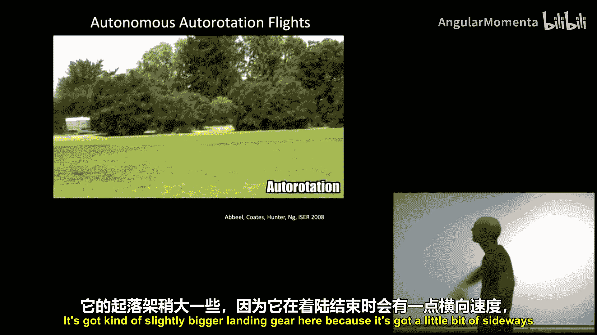

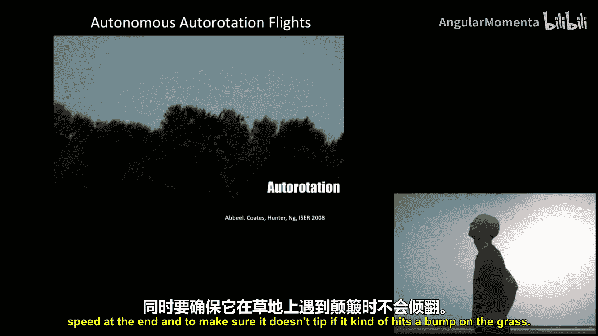

But so we did this。Probably close to 100 times landing helicopter timesly with engine off。

 No problem。 So pretty interesting how well that works。

 It actually another thing interesting about auto rotation。

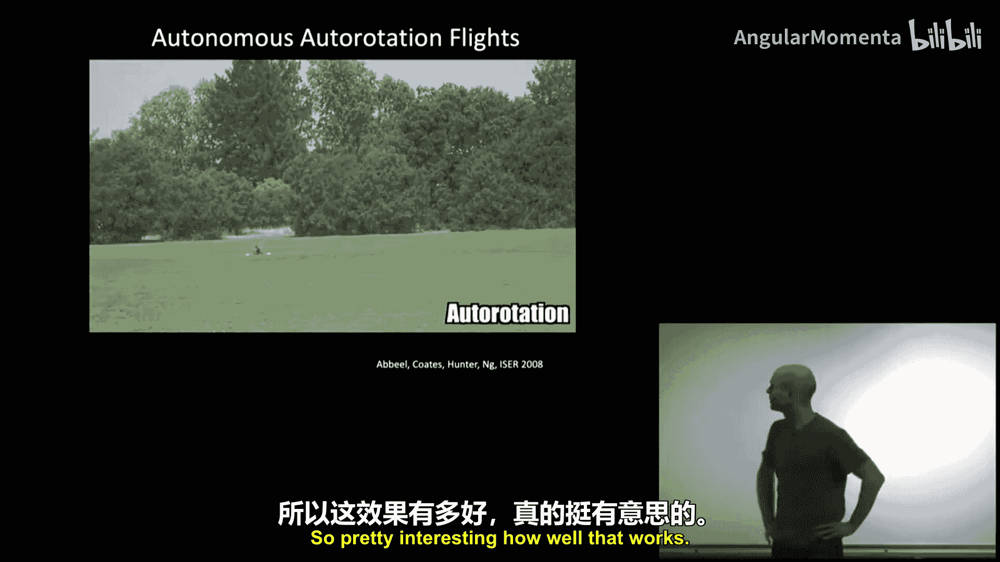

There's another， maybe curious a everybody way knows。

 I told you you can use auto rotation to safely land when your engine dies。

 is another reason you might want to use auto rotation aside from for showing off。

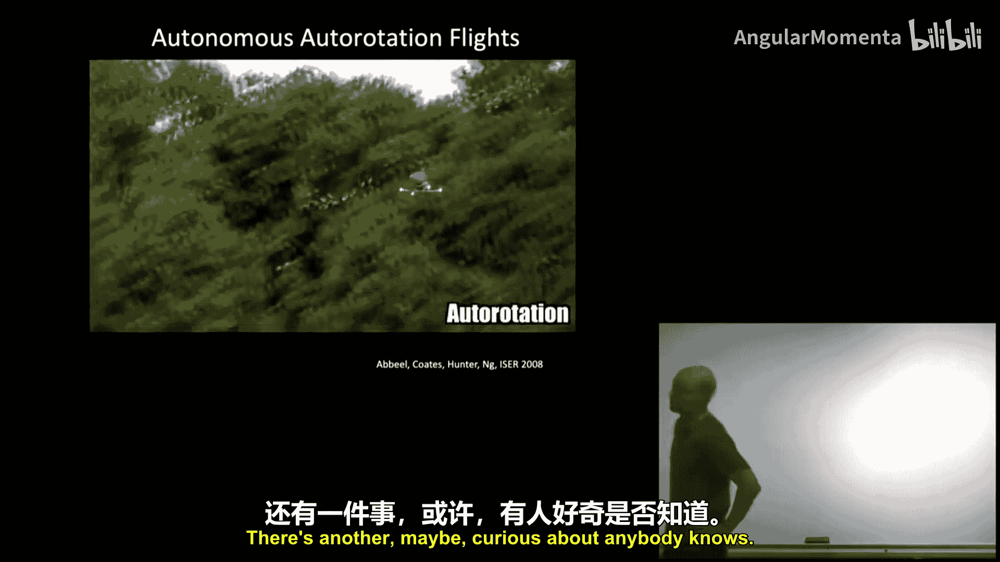

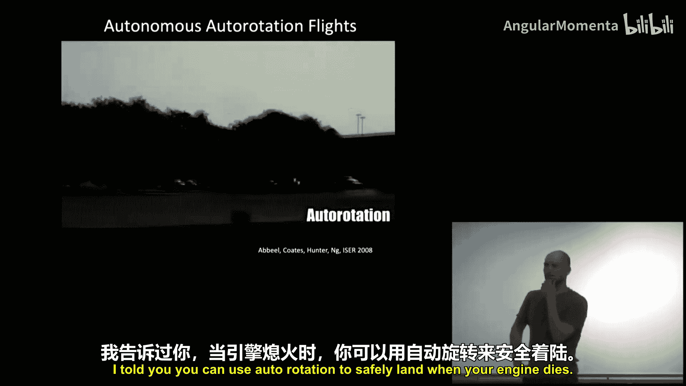

The one reason I just thought it， which might be complete。long is if I'm trying to land a rope。い。

get shot by the atmosphere。I like this idea。 Imagine you're landing on Venus。

 which is like very difficult probably。 And you arrive there with a helicopter that comes out of a rocket but the engine gets shot so you still have the same issue and sometimes engine shot。

そにわだみろ。Yeah so maybe you want to shut off your engine because you just want to quietly land。

 you don't want to disturb your neighbors or something you say， I come in an out rotation。

 maybe that's quieter， especially very related， Sashi， imagine you' a tail rotor。Gets lost。

When you lose your tail rotor， the countertorrque will make you spin and pretty much impossible to control a helicopter at that point if you let it spin around。

 but if you shut off your engine， that countertrque is not there anymore。

And so now your helicopter is actually stable， will not be counterting。

 And so if you lose your tail rotadtor you'd actually deliberately shut off your engine go to auto rotation to land。

 So it's a very interesting thing where you'd actually deliberately shut down。

 not just to be quieter， but as the only way to safely descend。

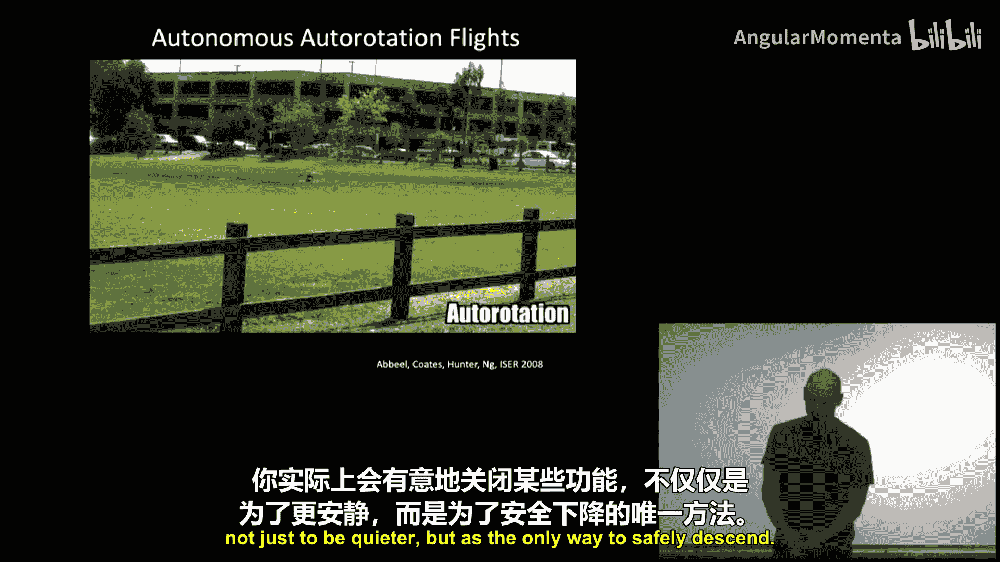

Then a lot of people said hardest maneuver is chaos， so chaos was not in the original air show。

 but here it is。Helicopter doing chaos， so you're supposed to spin your tail around as fast as possible while flipping and rolling。

And that's what it's doing here and also while staying in place， you're not supposed to lose。

Your position。And the beauty is that this is sustained when we did it in an open loop。

 I maybe it could do it for a couple seconds you get to gist。

 but here it's actually staying in the same spot， permission an entire fuel tank。

 it can just keep going。W去。We were at that point you essentially called it done because that was going say it the hardest maneuver。

 but actually at the time I went to Ns and this was 2007 or 2008 and it was talking with Jan Lacoun who is not only a deep learning person but also has a lot of expertise in robotics。

And showed them。 I said I said， yeah， we can do every maneuver now。 andll show them the chaos。

 And he said， well， chaos， Sure， but equally hard Tiktk。 Can you do Tiktk。

 So then we collected another one where we actually did。And essentially again。

 indefinite like full tank of fuel of just TikToing showing that we can also sustain that chaos is probably harder than TikTok。

 but I mean both are considered very， very hard and so here is the TikTok in action keeping helicopter nicely in place。

There is a very inefficient way to fly， by the way。

 because you are mostly verticals see of pushing the air in the wrong direction most of the time。

 Most efficient way to fly is upside down。 reason the most efficient way to fly is upside down is because。

As you push air down。You accelerate that air and it kind of basic first principles calculations is the air goes at twice the speed after it's gone through the blades。

 that twice the speed air in normal flight would drag over the body of the helicopter pushing the body down。

 but an inverted flight， you get just the regular speed air to go over the body and then the 2x speed air doesn't go over the body。

So what I've thought is in the last few minutes we have here。

 I think we have another five or 10 minutes， we will have some course evaluations at the end。

 not forgetting about that。

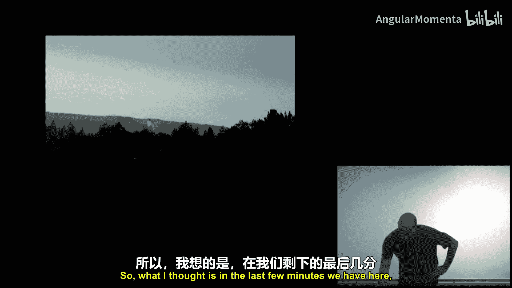

Go to kind of what happened behind the scenes， all of this。 So this is a story of how it all works。

 Now let's see what Ashley we were doing。So。First of all helicopter pilots our helicopter pilot。

 Ben say he had many jobs， so he had two startups and a regular job。

 so we did not have much access to flight experimentation so he recommended his friend Antonio his friend Antonio shows up and okay he seems like a pilot that's great。

呵。😊，First day Anctonio's there， the most incredible thing happened I've ever seen。

 but it was not a good thing。Essentially。Things were not carefully attached to our helicopter。

 and our helicopter went upside down。Something fell。Hit the blade。

When you hit a blade of a helicopter， these are very lightweight strong。

 but light way we hit that with something metal， you make a dent， you get an asymmetry。

These blades are spinning around at super high speed of asymmetry in there。

 the helicopter just ripped itself apart， there was at least 100 pieces on the grass field spread out from just that one thing hitting the blade asymmetry and just starts ripping itself apartLuckily none of us got anything on our heads but that was pretty worrisome I'm like okay Ben's not available Antonio got our helicopter ripped apart。

Then the next thing that happens， we have a spare helicopter and also and we say okay。

 maybe we'll do some more experiments， we'll see Antonio calls up his friend is's like hey。

 I'm having fun at Stanford flying some helicopters after some research project you want to come out and fly some helicopters with us and so somebody shows up and this person shows up pulls up their pickup their big truck and they essentially pull out a few helicopters they put one in front of us like very close to us and they just I mean once a year somebody dies from one of these helicopters and。

Just takes off right in front of us with almost no distance and it starts doing essentially all the crazy maneuvers that we saw Sunday at the lake。

 but with no distance from us。And we're like， okay。

 this guy knows how to fly helicopterliccut beyond anything we've seen in except for that one video that inspired us。

But not sure how responsible he is because this is very dangerous。 So go back and we tell Andrew。

 we say， look， we lost the helicopter there。 we're very sad about it。 said， don't worry， don't worry。

 if you don't lose a helicopter every so often it means you know。

 you weren't pushing the boundaries enough。 We say， well。

 we kind of lost it because just we didn't det something properly。 It's like， okay， yeah， well。

And then this other pilot shows up and starts doing totally crazy things， not sure what to do。

 Andrews like， but it sounds like he's a good pilot。He's like。

My intuition is that if you stand right behind the pilot， you're in a very safe spot。え。

So maybe we can pay attention to standing being right behind the pilot when he comes and so but from there we start working with the new pilot Garrett。

 and he's just fantastic， most responsible person we ever met。

 we just had no idea how much control he had over the helicopter the first time he showed them and worked with him for many。

 many years from there。Then actually when we started the project。

 we were trying to get this thing to work better and you saw the crash with many things that didn't succeed that didn't crash。

 but it was just like okay it just doesn't work politics control。

 we play with so many things we play like maybe the coordinate frame from model should be attached to the helicopter。

 maybe you should be attached to Earth like little change you think like this little change is gonna make the difference and it maybe makes a difference maybe not trying is the part and not clear。

 then everybody telling us you know oh Lqr， it's only the basic thing you know you should do upcounted instead of discounted L Qr because upcounted cares more about the future so it will be more stable we try that they say oh the new thing in control is H infinity control。

 you should try h infinity control then say oh the new thing you you need to do something with robust control and like all this new something kind mu synthesis was like the next big thing in control we try all those things and they say。

 oh no you should frequency shape your cost function you should maybe put integrals on your errors。

We have some kind of PID style thing and so we tried all those things that everybody was speaking very highly off as like these are the things that matter I like nothing works better and then we were like。

 isn't the case that every one of those control methods ultimately returns a linear controller so isn't it the case that as a consequence？

If we just tweak the cost function in LQR， we can by tweaking the cost function。

 also get essentially any linear controller back out。

It's really just a way to maybe more easily tweak the cost function。

 but it's much less intuitive to us those other methods。 So I guess we're really back to square1。

 which is just tweaking the cost function in LQR to see if we might find a better one that is more stable。

Then we start realizing some of the things that。Happ when you go from simulation to real world。

Real world always， pretty much always doesn't work as well as simulation。

 But can you do things to check if you have a high chance of success。 So we realizes that。

If you have a controller in simulation。And then in the simulator， introduce random delays。

 so just random delays， you have like ah。10th of a second delay。That makes it so much harder。

 and any control your design that can handle that actually tends to work much more likely work in the real world。

 even just for hover things at the time， like that was like our sanity check。

Let we start sort of thinking， control should be trivial if you have a high frequency control。

 so it should really be all about doing very fast sensing， like if you have perfect sensing。

You should be able to do a lot better than if you have lagged sensing or noisy sensing。

 we test that in simulation and we essentially compared。

Doing rollouts when we put noise on the state， So it would be like things like wind gust effectively simulated。

 first， we put noise on the estimate of the state fed into our controller and putting noise on the estimate of the state would be so much more harmful essentially you're controlling against the wrong thing。

 You think this is a state。 you do the thing for the thing you think but actually the reality is different is much more harmful than actually being pushed around。

In your actual state。Then we kind of started reading a lot of stuff on。

How can we get a better state estimate， and we ultimately found like there's a thing called a。

Low pass filter， the Cheby5 lowpa filter， the magical Cheby5 lowpa filter。

 which has less delay than any other low pass filter。

 so all our because the helicopter is shaking so much。

 when you get your measurements from your initial unit there's so much noise and you need to low pass it and Cheby5 is just this magical thing that gives you very low latency while smoothing things out。

Then what we learned， which you can find in some places， but you're probably。

 most people learn the hard way is that。When you have a filter like that。

Normally you look at it as like， okay， something like x T plus one is some linear combination of the previous axis。

 then you're like， okay， that seems reasonable。 and you set that up。

 It turns out you set it up that way and you don't export。

More than if you only export like five digits of precision。

 you're actually your filter is not the same filter essentially by you and the idea of thinking。

 well， the process here is that it turns out that the zeros of a polynomial are extremely sensitive to the coefficients of a polynomial。

 if you portray the coefficients of a polynomial just a little bit。The zeros can shift a lot。

 And so that's what's happening here if you have a standard filter implementation。

The way it behaves is determined by the zeros of the polynomial that that filtering codes。

 and if you have low precision on the coefficients， all of a sudden your zeros are elsewhere。

 you might have something completely unstable。And then we realized that probably of the problems that that our helicopter model is not precise enough。

 so we read books and books and books on helicopter modeling， people told us the helicopter Bible。

 this is what describes a helicopter work like 500 pages on how helicopters work we look at everything in there and then only we conclude you know the only things like if you look at all the models。

 there's input variables and output variables we already have those input and output variables and since we learn the mapping between them like there's nothing else we can do apparently and we start realizing all those books are only for stationary flight regimes。

 none of them cover。More aggressive flight regimes， and so that was like a lot of reading。

 a lot of interesting reading， but not very useful。Then。

We realized that to try the helicopter more reliably， we used to have a GPS。

But when you flip it over， the GPS loses lock and you need to wait lock several seconds before you get the log back。

 if you accelerate very fast， you might also lose lock again。 So we start building our own GPS。

And so we went to the Air Astra department and we said we're going to build our own GPS and they had a GPS lab。

 so the professor at the whole group， all they're doing is studying GPS systems。I'm like， okay。

 we want to build our own GPS They say wow， that's that's pretty wild。 And and we say， yeah。

 we're going to start with building a software receiver。

 We're going to log raw signals and build a software receiver and then build up from there and they say。

 wow， that's a whole PhD thesis worth of work it' an intermediate step for your research project。

 like it seems like it should be feasible So shut enough a couple months later。

 we had what I guess what's called a whole PhD thesis work of work。 worth of work。 We had it working。

 I like okay， that's good。 We're on track。😊，It was the first software based GPS receiver。

 and it really worked。 And we're like， okay to make this run fast。 We need to deal with FPGs。

 We started working with FPGs。 That was like a nightmare。s so hard to program and debug。

 ultimately we got that working。 They're like now when you do omnidirectional GPS So multiple antennas all running same time。

 and hand lock from one antenna to another antenna。 And that's where we just completely got stuck。

 And maybe we could have seen this coming。 But understanding。😊，Like， what？

The phases when you go from one antenna to another antenna depends really on the geometry of the antenna。

 depends on so many factors of where the signals are coming from。

 You can't easily just have a phase difference between two antennas just based on measuring what the phase difference is。

 It depends on because you measure from many different satellites and have different phase difference with different satellites depending where they're positioned。

 And so at that point we we just couldn't figure it out anymore。 And after one year， we're just like。

 okay。This， G， we have， we have papers in GPS conferences on that。 what we did。

 but we actually don't have a working system， which is very frustrating。Very。

 very frustrating one year of a lot of work and it didn't come out the way we wanted to， in fact。

 the time。Like this company came by some finance company Goldman Sachs came by。

 They came to Stan and like， they said， oh， we want to recruit。 And I'm like， wow。

 that sounds better thanm trying to get this GPS to work。

Maybe I should go talk to these guys and see what they're up to and my friend who Morgan was also working on the GPS Pri where he's like yeah。

 you know， my dad has a friend over in Connecticut and he works at Goman Sachs and they live a good life maybe should talk to them Yeah we talk to them and's like not that interesting okay okay now back to trying to get this GPS to work then。

😊，We're like， okay， why don't we just put cameras on the ground and look at the helicopter and's like。

 okay， but Andrew and Adams said like， yeah， we did that two years ago， it didn't work。 I' like。

 okay， we tried this for a year。 It also didn't work。 We're gonna at least give this a shot。

 We're gonna at least try this again。 I don't know what you tried them。 but we'll try now and see。

 And three weeks later， we had a working system。It's like， okay， one year of effort。

Versus three weeks and we're good to go and worked perfectly。

 Only catch was calibration took a long time。 so we took helicopter， we put the cameras。

 then we would put the helicopter in the air and we would collect an hour of data。

 an hour of calibration calculations， then we get out to calibration。😊，Like， okay。

 how can we do this。 Well， if we can keep the cameras on site， then we don't need to recalibrate。

 But that's kind of hark is just like a soccer field。 And I mean。

 the soccer balls flying around other days。 and how we're going to do that。 So actually。

 our pilot was also general contractor。 So I think we have to build things。

 So our pilot build a contraption that you can snap on to fence posts。 So whenever we show back up。

 we just snap it on。 and our cameras were screwing so tightly to that contraption that nothing could ever move。

 And we just like in one minute set it up and ready to go。

 So those are all things that are not really in the paper。 but made us a lot more efficient。😊。

Then we switched helicopters。 It turns out the helicopter pad initially can generate about 1。

5 to 2 Gs， but the synergy on 9 could generate 3 Gs。

 The more Gs you can generate the more control you have over your system。

 But initially it was weighed down by the instrumentation board。 Our instrumentation board was。😊。

Viibrating too much。 So I put weights on it to make it vibrate less and make it heavier。

 It doesn't shake as much， but then it's heavy。 how comes heavy。

 you lose like 1 G and the weight that you put on it。So we then actually。The big breakthrough。

One of the big breakthroughs was we found this material called Mayopprene。

 you put that material on your helicopter and mount your instrumentation on that material。

 it just damps out pretty much all the vibration has near zero weight。

 all of a sudden we get back from 2G to 3G。U。Other things oh yeah。

 Adam was just a genius in getting Linux to work， so Linux the problem is I mean you have a lot of control but most Linux is you just kind of install it and it is what it is and it'll run some processes in the background and now you're stuck with those processes。

He decided we're going to run Gen2 Linux。 completely bare bones like have nothing in there essentially。

 So nothing can run in the background。 You need to compile it。 I mean。

 you need to compile it from scratch。 You need to like go through all the details。

 But ultimately once he did that， we could run。Things add。

We can essentially run a realtime operating system without having an official real-time operating system because we're running nothing else on that system。

 and we didn't have to deal with any of the real- time programming that's really difficult to do as the interface was more complex because we're just cleanly running just our code。

 Nothing could interrupt it。 It was just our stuff running。 That was it。嗯。

Then the last thing that happened in the background is。Oh， yeah。

When we're trying to get the outer rotation results。We had three days left for the paper deadline。

And。We go out， and。We tried to land and。It crashes。

And so now we have a whole day we have like no experiments that day。

 the next day our pilot is repairing the helicopter of one day left。

And so the little trick we play to make it all work。

 And the reason it crashed was because we lost track of the helicopter。 like， essentially。

 because now when you're landing， your cover a much wider range and one of the cameras had lost track of the helicopter within the right state estimate。

 And so essentially the one day off was for us was all about installing warning signals So our pilot safety pilot could know whether or not。

We were still tracking reliably and whether or not it should take back control Once we did that。

 essentially we could land reliably every single time we didn't lose track of the helicopter and when we did lose track on that day3。

 then the pilot knew we lost track and could safely put it down and we could go again。

 and so a lot of things happening behind the scenes to make it all work。Yeah。

 and a lot of years of work。I think that's。Yeah， I think that's， yeah。 if you're wondering the one。

 the one thing we never managed to control is in principle， that helicopter has spin。

Two times per second。So 720 degrees per second spinning。

That's the place we never managed to control it at that pair wedding speed。

 just our state estimation would just。Bil out， not really understand what's happening because it's spinning so fast and you kind of need to measure things in the helicopter frame。

 which is spinning so fast that we kind of that was the one limitation we were left with and elbow said。

 okay there is this one regime we can too， we'll just leave it at that。

 maybe in the future it'll be better sensing than we have today。Cool， that's all I had。

 I think Mortza you're taking over for course evaluations， thank you。得。

听你个嘛。You could use the box。啲た。Yes。