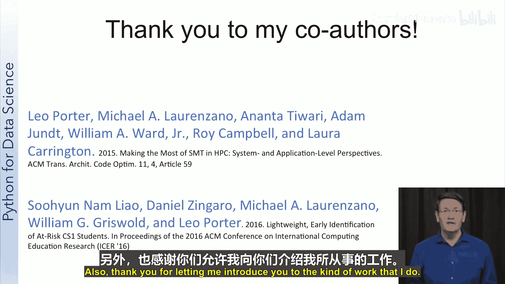
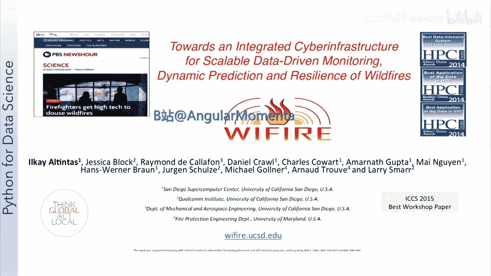

# 【加州大学圣地亚哥分校】Python数据科学-｜-Python-for-Data-Science-p02-01-02-02-视频-利奥·波特--BV1jwFUzjEXu_p2-

Hi， I'm Leo Porter， and I just wanted to take this opportunity to introduce myself a bit more。

 A told you that I am an assistant teaching professor in the computer science and engineering department at U San Diego。

 I haven told you of the kind of work that I do。😊，My background is in computer architecture。

 which is an area of computer science， focused on the high level design and processors。 there。

 my research is aimed at making processors faster or more power efficient or both。

These days I spend most of my time doing research on how students learn computer science and how to improve their learning。

Most of my work has focused on improving student outcomes through the adoption of an evidence based teaching practice known as peer instruction。

But I' have also worked to identify common student misconceptions and to produce meaningful assessments of student learning。

In both of these fields， I've used skills from the areas of data science and machine learning to inform and conduct research Let me give you two examples。

One example from computer architecture。As we wanted to be able to predict how a program might run on a high performance computing cluster。

Given certain architectural features of the cluster。Specifically。

 we want to know if it would be better to run the software using or not using a very specific hardware optimization。

To figure this out， we took statistics from a whole bunch of programs and used machine learning to build a model of performance。

We could then feed statistics about a single program。Into the model。

 and the model would then produce。A prediction of how that program might perform on that system。

It turned out that predictions were quite accurate for the problem we were trying to solve。Similarly。

 in computer science education， we wanted to see if we could use data to predict when students were in jeopardy of failing a course。

In many of our classes at UC San Diego， we use clickers like the one you see here Students answer questions during the term using clickers。

 and we wondered， could those responses tell us who might be at risk of failing？

So what we' have is a whole term worth of clicker responses per student and how well they did on the final exam。

Similar to the architecture example， we just feed that data into a machine learning model designed to predict student outcomes。

Then we use clicker date responses from the first few weeks of a new class。

 feed them into the prediction model。In bingo， we'd see which students were in trouble。Again。

 the prediction model was quite accurate， enabling instructors to potentially intervene to help students at risk。

For this work and for the prior， I want to reinforce the fact that computer science research is often a highly collaborative effort。

 and I want to thank my collaborators on these projects。Also。

 thank you for letting me introduce you to the kind of work that I do。

Hi again。I'm I Ka Alzenfish。Just like Leo， I'd like to tell you a little bit about my work here at the San Diego Supercomputer Center and UC San Diego。

😊，You might even think， what does a supercomputer center have to do with data science。

 let me tell you。As you might have heard， there are many different exciting applications that are being enabled by data science in the big data era。

I'm the Chief data science Officer at SDSC， leading our collaborative data science hub activities。😊。

At the same time， I lead our research， development and education division where I oversee many exciting research programs。

😊，And a role that I'm passionate about is my research Center for data Science Workflows。

 which I built over time as an area since the year 2001， which is when I joined SDSC at UC San Diego。

😊，In terms of some of my education activities， I'm the faculty Co director for the Master of Advanced Studies Program on Data Science and Engineering here at UC San Diego。

 in which I teach a capstone project course。😊，I also work as a lecturer for the computer Science and engineeringering department。

😊，And have done big data courses as part of other online and offline course programs。

What is common to all these roles is that I work。On Interdisciplinary research。

As a part of my core research， development and teaching activities。

 I work on building methodologies and tools to make big data， data science。

 and computational science useful to dynamic data driven scientific applications。😊。

I work with many UC San Diego centers in these areas。

My colleagues and I work on many grand challengell data science applications in all areas of science and engineering。

 including genomics， Geinformatics， Metro data science or Smart cities， energy management。

 biomedicine， personalized health and many others as a part of our data science hub。

What is common to all these applications is their unique way of bringing together new modes of data and computing research。

😊，So it's all about collaboration。😊，And what the supercomputer Center brings to it as the computing and data management expertise。

So what do I do on a regular day is to think about how I can get a group of very smart people collaborate to solve data science challenges。

😊，I worry about questions like， how do we close the loop on data science methods， tools。

 computing and data systems， and domain experts？😊，These questions also get translated to research challenges and toolboxes for data science by my research group。

😊，Our main goal。Is methodology and tool development to build automated and operational workflow driven solution architectures on big data and high performance computing platforms。

😊，This applies to many scientific disciplines。😊，Let me tell you a project we work on as a part of many of these applications。

It is for wildfire analytics， which breaks up in two2 components prediction。And emergency response。

WifF is a collaborative project funded by the National Science Foundation to build a cyber infrastructure for wildfire monitoring。

 prediction and resilience， it's a research project which led to very useful insights。

In WiFIR， we built a scalable cyber infrastructure that can utilize any high end computing。

 cloud and big data platform for dynamic big data driven fire modeling and prediction。

The approach here is to use real time data to learn about the dynamics of fire behavior and environment and using data science techniques assimilate what we learn into a fire model to adapt to changes in the situation over time。

😊，Here， data science methods and workflows were used for system integration and dynamic application scalability。

😊，All the data， models and computing systems。Being used were there before WiFIR。

 but a programmable system integration that can match the application needs were lacking。

Data science enabled such computing capabilities to become available to fire response。

 research and planning communities。😊，In fact， the system is being used as a traditionalal awareness tool by some fire departments already。

 and we are really happy about that。😊，But WiFIR represents a wide range of applications where real time big data can be assimilated with modeling and simulation tools for better situation awareness and dynamic decision support。

😊，Just take a moment to imagine how data science will help with firefighting in the future。😊。

Many streams of data will come together in 3D displays that can show all the related information along wet weather and fire predictions。

 that would be a great application of data science with societal impact。😊，Needless to say。

 none of these would be possible without the collaboration of many individuals。

 showing how important interdisciplinary collaboration is to data science。😊。

Hope you enjoyed hearing about what I do。😊，And I'm looking forward to sharing some of exciting data science use cases with you over the next 10 weeks。

😊。