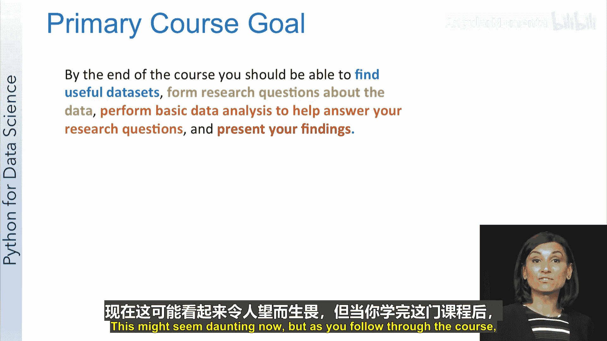
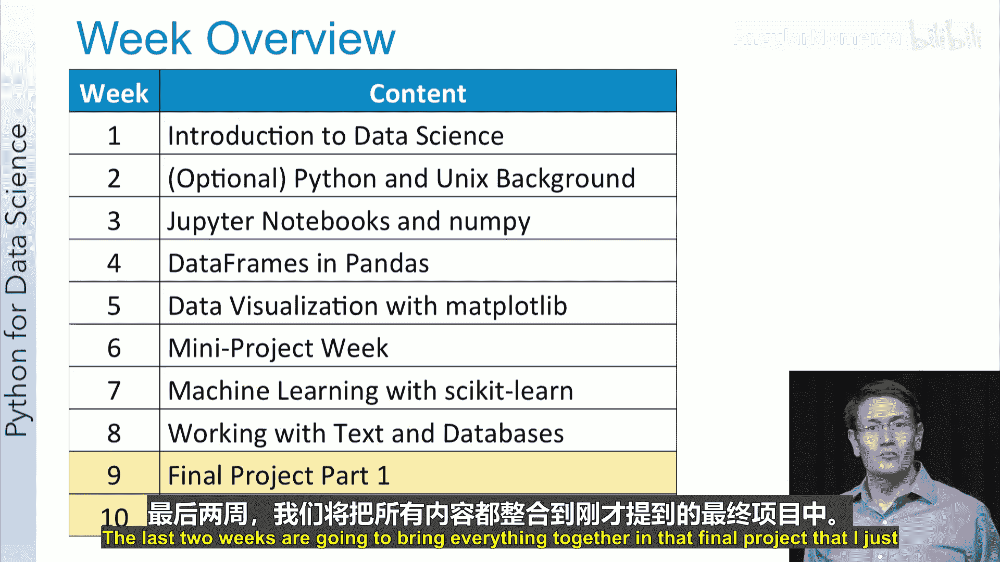
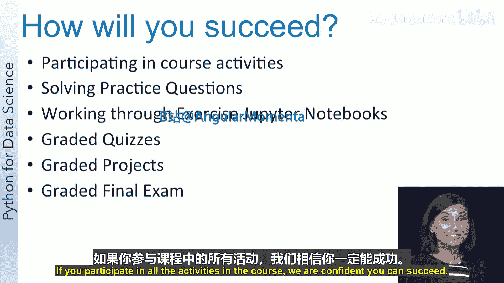
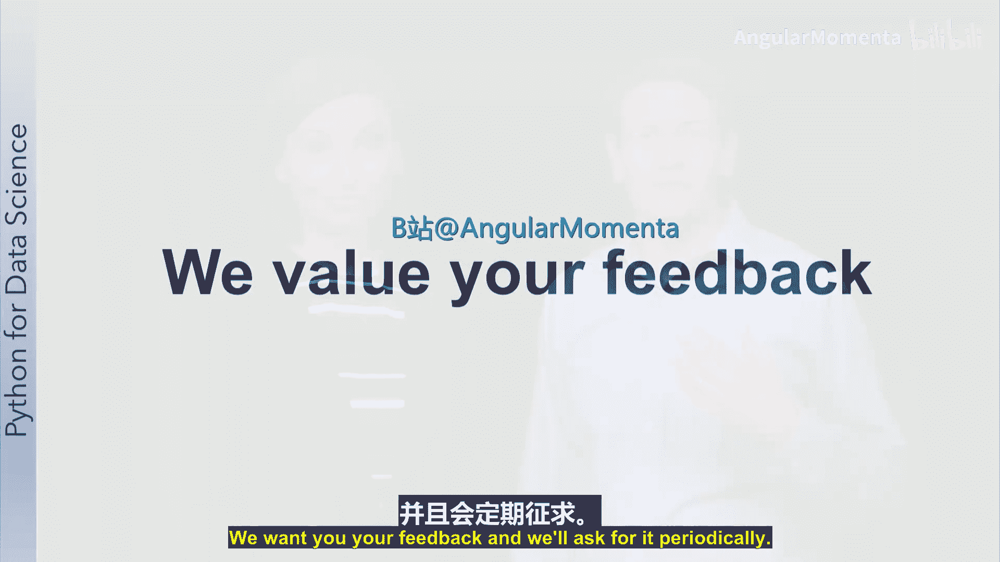
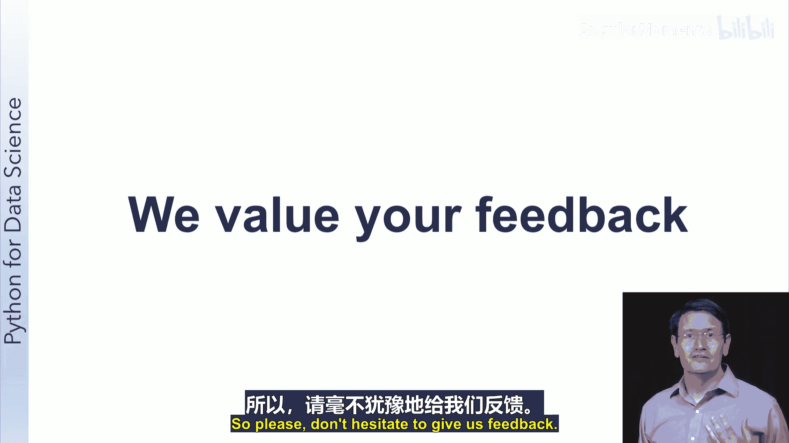

# 【加州大学圣地亚哥分校】Python数据科学-｜-Python-for-Data-Science-p03-01-03-02-视频课程_概览--BV1jwFUzjEXu_p3-

What we'd like to do next is just give you an overview of the course and its features。😊。

More details about things like grading and the honor code will appear in the syllabus readings next。

😊，We have one primary goal for you for this course， but it's a big goal。

We want you to be able to by the end of the course to find an open dataset set and explore it using the tools we'll learn in this class。

Either before the exploration or during， develop a meaningful research question which could be answered by the dataset。

😊，Then further explore the data or analyze it to find an answer to your research question。😊。

Based on what you find， you should be able to accurately present your results。😊。

This might seem daunting now， but if you follow through the course。

 you should be well prepared to conduct this kind of data analysis。 In fact。

 your final project asks you to do exactly this。😊。

To see how we'll prepare you， let's take a look at what you'll be doing in the course。

Here's our weekly overview。 We'll get started in week one with an introduction to the field of data science and big data。

Then we'll have an optional week if your background is in a language other than Python or you don't have much experience with the UniX。

 this week will give you the background you need to succeed in the course。

The next two weeks are all about manipulating and working with data in Jupyter notebooks between Numby and pandas。

 you'll be able to read in data， clean and organize the data， and explore the data。

Week five is all about data visualization， we'll introduce you to some of the core concepts in the field of data visualization and show you how to produce visualizations in your notebooks using MaPtlibb。

By week six you'll already know a lot about how to analyze data and how to present the results。

 so the next step is to spend some time doing data analysis yourself in a small Jupyter notebook project with the data set we've already shown you。

The next two weeks will introduce you to more advanced topics in data science The first focuses on machine learning and the librarysyit Learn in the next week you'll be diving into working with text from the web。

 databases， and some basic natural language processing using the natural language processing toolkit。

The last two weeks are going to bring everything together in that final project that I just mentioned。

So how will you succeed， First， we really want to see you finish the course。

 We love data science and hope you'll learn to appreciate the field as much as we do。😊。

We also know that many of you have competing demands for your time。To help you keep on track。

And on pace to succeed， there are a variety of activities throughout the course， including videos。

 discussions and practice questions。😊，They'll give you credit toward completing the course for this effort to help motivate you to make progress。

😊，We also want to give you practice working in Jupyter notebooks。

 so you'll find exercise notebooks which have built in tests to help you get feedback on your code。😊。

At the end of most weeks， you'll find a graded quiz。

 which will be based on the practice questions and exercise notebook。😊。

If you've been making progress in the course， you should succeed in these quizzes。

But because everyone has a bad day sometimes， you get to drop your lowest quiz。😊。

Leo has already talked about the projects and those are critical for you to test your new skills。😊。

Lastly。Once you have finished everything else in the class。

You'll have a final exam to gain feedback on your final understanding of the course。

If you participate in all the activities in the course， we are confident you can succeed。😊。

One last key point。 We want you your feedback and we'll ask more periodically。

 We both have experienced building online courses， and we know there's always wrinkles in a course after first launches。

 We're committed to remedymining any issues you discover and getting you the help you need if you get stuck。

 So please don't hesitate to give us feedback。

We want to thank you for joining the course and please look through the next readings for more syllabus details。

