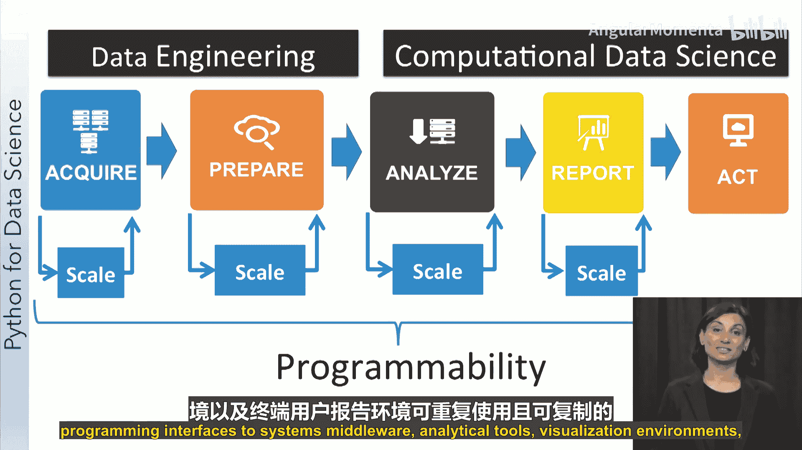
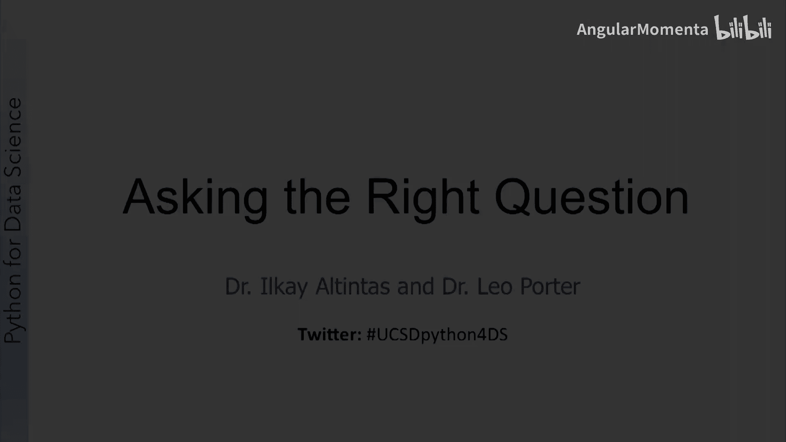
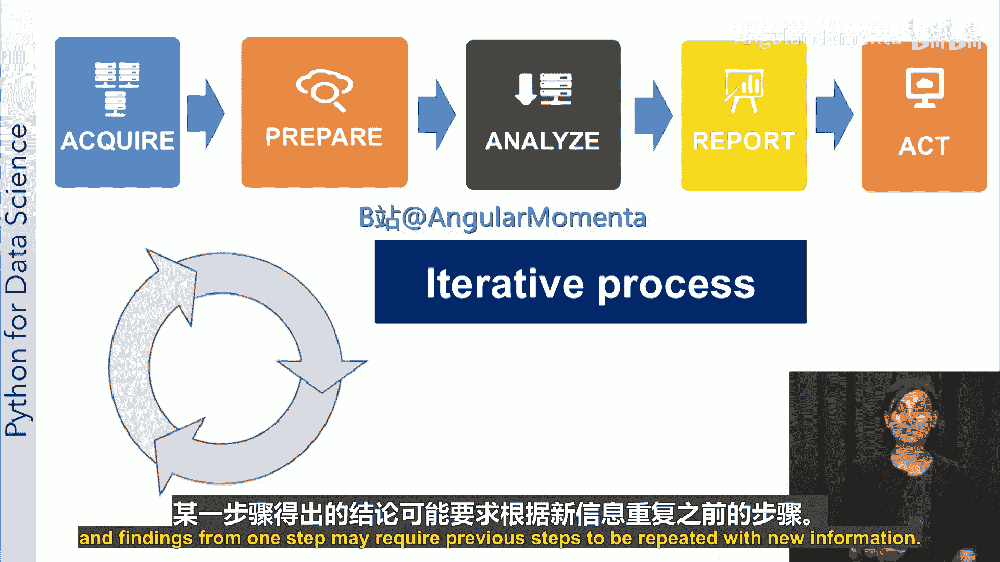

# 【加州大学圣地亚哥分校】Python数据科学-｜-Python-for-Data-Science-p06-02-02-03-视频-数据科学如何运作--BV1jwFUzjEXu_p6-

Now that we identified what data science is， let's come back to using data science to extract value out of data or to solve a question。

How does the data science process function from the point of asking a question to answering that question in other words。

 can we generalize the process steps that we started seeing in the So data analysis example and see how data science leads to insights？

😊，After this video， youll be able to list some of the dimensions of modern data science。😊。

And identify why analyzing these dimensions are important for us as data scientists。😊。

Our experience with building and observing successful data science projects can be summarized as a craft with a few distinct components。

Those components can be defined as the key features or dimensions of data science。

So summarize what we talked about before。We define data science as a multidisciplinary craft that combines an interdisciplinary team with an application purpose。

😊，So generally speaking。😊，Data science starts with a team of people。

With an overarching broad question and of course， some data to explore。😊。

We can say that we start with data and question。And we build a process around how we come up with a data driven insight。

A process is a conceptual entity in the beginning and defines the core set of steps to solve the question。

😊，And then from then on。😊，Trilling down to many areas of expertise often met blurred lines between the steps。

There are many ways to look at the process。One way of looking at it。Is as two distinct activities。

 mainly data engineering and data analysis or computational big data science。

 as I'd like to call it as more than simple analytics is being performed at the stage in general。😊。

A more detailed way of looking at the process reveals five distinct steps or activities of the data science process。

 namely， acquire， prepare， analyze， report， and act。

We can simply say data science happens at the boundary of all these steps。Ideally。

 this process should support experimental work and dynamic scalability on big data and cloud platforms。

😊，This five step process can be used in alternative ways in real life big data applications if we add the dependencies of different tools to each other。

😊，The influence of big data pushes for alternative scalability approaches at each step of the process。

😊，Another way to look at this process is。Seeing all these steps with reporting needs in different forms。

Or。Droving all these activities as an iterating process， including build， explore。

 and scale for big data S steps。Scalable data analysis needs alternative data management techniques。

 systems， analytical tools， and methods。As well as nodes of scalability based on dynamic data and computing load。

😊，Change in physical infrastructure。😊，And streaming data specific urgencies arising from special events。

😊，For simplicity。😊，We will refer to the process as a set of five sequential activities that iterate in this course intro。

😊，However， at the end of the day， the scalable process should be programmable through utilization of reusable and reproducible programming interfaces to systems。

 middleware， analytical tools， visualization environments， and end user reporting environments。😊。

This final dimension， the programming of data science steps in Python。

 is what we will be focusing on in this course。With some examples in Python modules for analytics。

 data processing and visualization。😊。

Now we'll focus on formulating a well stated data science problem。After this video。😊。

You will be able to describe the ingredients to form a data science problem。

List some questions others ask to get value out of their data。

And formulate the right questions to guide your data science process。😊。

The first step in any process is to define what it is you're trying to tackle。

What is the problem that needs to be addressed or the opportunity that needs to be ascertained？

Without this， you won't have a clear goal in mind or know when you solved your problem。

An example question is， how can sales figures and call center logs be combined to evaluate any new product？

Or in a manufacturing process， how can data from multiple sensors on an equipment be used to detect equipment failure。

How can we understand our customers and market better to achieve effective targeted marketing。Next。

 you need to assess the situation with respect to the problem or opportunity you have defined。

This is a step where you need to exercise cautionient， analyzing risks， costs， benefits。

 contingencies， regulations， resources and requirements of the situation。😊。

What are the requirements of the problem？What are the assumptions and constraints？

What resources are available to you？This in terms of both personnel and capital such as computer systems。

 equipment， et cetera。What are the main costs associated with this project。

 What are the potential benefits。What risks are there in pursuing a project？

What are the contingencies to potential risks？Answers to these questions will help you get a better overview of the situation and better understanding of what the project involves and how you will guide your programming to solve the project with all these in mind。

😊，Then you need to define your goals and objectives。Defining success criteria is also very important。

What do you hope to achieve by the end of this project？

Having clear goals and success criteria will help you to assess the project throughout its life cycle。

😊，Once you know the problem you want to address and understand the constraints and goals。

 then you can formulate the plan to come up with the answer that is the solution to your business problem or the analytics you are trying to achieve。

As a summary， defining the questions you are looking to find answers for is a huge factor contributing to the success of any data science project。

😊，By following the explained set of steps， you can formulate better questions to solve using analytical skills and link them to scientific and business value。

😊，Let's now look into the basic steps in the data science process。

We will keep applying some or all of these steps in all of the case studies we discuss in this course。

😊，After this video， you will be able to identify the steps in the data science process。😊。

And understand what each step involves。We have already seen a simple linear form of data science process。

 including five distinct activities that depend on each other。😊。

Let's summarize each activity further before we go into the details of each。😊。

Acquire includes anything that makes us retrieve data， including finding， accessing， acquiring。

 and moving data。😊，It includes identification of and authenticated access to all related data。

 transportation of the data from different sources。

And ways to subset and match the data to regions or times of interest。

 sometimes we refer to this as geospatial query。We divide。

 prepare data into two steps based on the nature of the activity。😊。

First step in data preparation involves literally looking at the data to understand its nature。

 what it means its quality and format。😊，It often takes a preliminary analysis of data or samples of data to understand this。

😊，This is why。This step is called preparepa。Once we know more about the data through exploratory analysis。

 the next step is preprocessing of data for analysis。😊，It includes cleaning data。

 substing or filtering data， and creating data that programs can read and understand via modeling raw data into a more defined data model or packaging it using a specific data format。

😊，If there are multiple data sets involved。😊，This step also includes integration of data from different data sources or streams。

😊，The prepared data then would be passed on to the analysis step。

 which involves selection of analytical techniques to use。😊。

Building a model of the data and analyzing results。

This step can take couple of iterations on its own or might require a data scientist to go back to steps 1 and two to get more data or package data in a different way。

😊，Step four is four communicating results。😊，It includes evaluation of analytical results。

Presenting them in a visual way。😊，And creating reports that include an assessment of results with respect to success criteria。

😊，Activities in each step can often be referred to with terms like interpret， summarize， visualize。

 and post process。😊，The last step is to bring us back to the very first reason we do data science for。

😊，Its purpose， reporting insights from analysis and determining actions from insights based on the purpose you initially defined is why we refer to as the Act step。

😊，We have now seen all of the steps in a typical data science process。😊。

Please note that this is an iterative process and findings from one step may require previous steps to be repeated with new information。

 and that's the science in data science。😊。

